# Culture-TRIP: Culturally-Aware Text-to-Image Generation with Iterative Prompt Refinement

Suchae Jeong ^(†)^(†)thanks: indicates equal contribution.
Affiliation: Department of Computer Science and Engineering, Dongguk
University Email: <mailto:email@domainyys3606@dgu.ac.kr>    Inseong
Choi¹¹footnotemark: 1 Affiliation: Department of Computer Science and
Engineering, Dongguk University
Email: <mailto:email@domainjihie.kim@dgu.edu>    Youngsik Yun
Affiliation: Department of Computer Science and Artificial Intelligence,
Dongguk University    Jihie Kim ^(†)^(†)thanks: indicates corresponding
authors. Affiliation: Department of Computer Science and Artificial
Intelligence, Dongguk University

###### Abstract

Text-to-Image models, including Stable Diffusion, have significantly
improved in generating images that are highly semantically aligned with
the given prompts. However, existing models may fail to produce
appropriate images for the cultural concepts or objects that are not
well known or underrepresented in western cultures, such as ‘hangari’
(Korean utensil). In this paper, we propose a novel approach,
Culturally-Aware Text-to-Image Generation with Iterative Prompt
Refinement (Culture-TRIP), which refines the prompt in order to improve
the alignment of the image with such culture nouns in text-to-image
models. Our approach (1) retrieves cultural contexts and visual details
related to the culture nouns in the prompt and (2) iteratively refines
and evaluates the prompt based on a set of cultural criteria and large
language models. The refinement process utilizes the information
retrieved from Wikipedia and the Web. Our user survey, conducted with 66
participants from eight different countries demonstrates that our
proposed approach enhances the alignment between the images and the
prompts. In particular, C-TRIP demonstrates improved alignment between
the generated images and underrepresented culture nouns. Resource can be
found at https://shane3606.github.io/Culture-TRIP.

## 1 Introduction

To date, many Text-to-Image Models  (Ramesh et al., 2022; Rombach
et al., 2022a; Ruiz et al., 2023) have demonstrated remarkable
improvements. Despite the outstanding performance in the text-to-image
models, the models fail to align the images with the culture nouns in
the prompts, such as ‘ao dai’(a Vietnamese clothing) or ‘hangari’ (a
Korean utensil). Most of these issues stem from the large training
datasets gathered by crawling the Internet without paying attention to
the details of the cultural elements  (Yun and Kim, 2024). Furthermore,
Internet access varies significantly across countries  (Birhane et al.,
2023; Luccioni et al., 2024), leading to challenges in appropriately
aligning culture nouns due to insufficient data, as shown in Figure 1
(b).

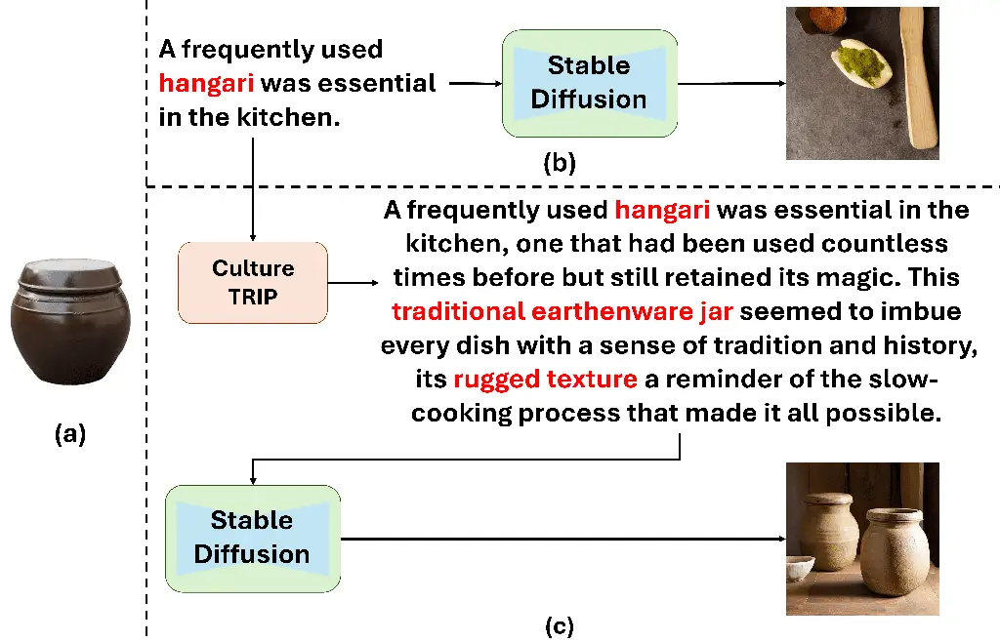

Figure 1: Comparison between Stable Diffusion with and without our
proposed approach, C-TRIP. (a) shows an image of a hangari from
Wikipedia. (b) is an image generated by Stable Diffusion 2, while (c)
shows an image generated with our approach. The additional knowledge
about hangari (highlighted in red) in (c) helps the model generate an
image that more closely resembles the actual hangari.

Representation is important in AI applications. Appropriate
representation can positively affect viewers, while inappropriate ones
can negatively affect them and can even be harmful  (Castañeda, 2018).
Culture nouns are essential elements that often represent the identity
and the uniqueness of the given culture. The misrepresentation of
culture nouns by existing text-to-image models may cause dissatisfaction
in the corresponding countries. Moreover, the models may reinforce
harmful stereotypes about particular cultures.

In this paper, we introduce a new approach that generates more
culturally aligned images for the given culture nouns, called
Culturally-Aware Text-to-Image Generation with Iterative Prompt
Refinement (C-TRIP). C-TRIP focuses on refining the prompt to ensure
that the culture nouns are appropriately represented in the generated
images, as shown in Figure 1 (c). Our goal is to generate
culturally-aware images by appropriately aligning culture nouns with
images from underrepresented countries.

Our research question is, How can we refine the prompt so that
text-to-image models generate images that appropriately align with
culture nouns? The Culture Capsules  (Taylor and Sorensen, 1961) is an
educational approach designed to help learners who have not directly
experienced a culture gain the proper understanding. This approach
explains cultural contexts and visual details, enabling learners to gain
comprehensive understand unfamiliar cultures. Through this process,
learners can develop a deeper profound awareness of different cultures.

Inspired by the Culture Capsules, C-TRIP first retrieves cultural
contexts and visual details related to the culture nouns in the prompt
and then iteratively refines and evaluates the prompt against the
criteria used in culture education. Large Language Models (LLMs) are
used for this iterative refinement and evaluation process, guiding the
text-to-image model in generating images for culture nouns.

We conducted experiments across eight countries, refining a total of
10,000 prompts by using 50 prompt templates for each of the 25 culture
nouns per country. To evaluate our results, we recruited participants
who were a native of the corresponding country and had a high
familiarity with the culture to rank images generated by Stable
Diffusion 2  (Rombach et al., 2022a), with or without the proposed
iterative prompt refinement. The 66 participants across eight countries
evaluated the 990 generated images, and C-TRIP received ratings for
cultural alignment that were 18.84% on average higher than the
baseline’s. In particular, our approach demonstrated more improvement
for relatively the Unrecognized/Underrepresented Culture nouns (UC nouns
for short) than for the Recognized/Common Culture nouns (RC nouns for
short).

Our contributions are as follows:

1.  1.  We introduce culturally-aware image generation with a prompt that
        improves the representation of ‘culture nouns’—cultural concepts or
        objects often overlooked by existing text-to-image models.
2.  2.  We propose a novel approach, C-TRIP (Culturally-Aware Text-to-Image
        GeneRation with Iterative Prompt Refinement), which iteratively
        refines the prompt in order to improve the alignment of culture
        nouns in the images generated by text-to-image models.
3.  3.  Human evaluations by representatives across eight countries
        demonstrate that our refined prompts enhance the alignment between
        generated images and culture nouns. In particular, C-TRIP
        demonstrated more improvement for UC nouns than RC nouns.

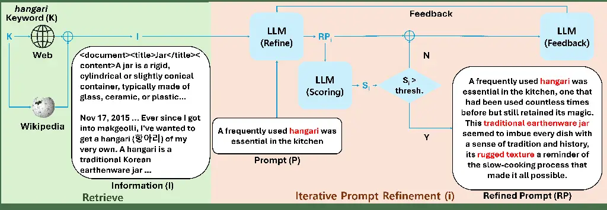

Figure 2: C-TRIP Overview. First, retrieve cultural contexts (cultural
background, purpose) and visual details related to the culture nouns as
described in Section 3.1. Then, refining the prompt based on the
obtained information. We iteratively evaluate and refine the prompt as
described in Section 3.2.

## 2 Related Work

### 2.1 Cultural Text-to-Image Generation

Previously, various methods have been proposed to address the cultural
bias in text-to-image models  (Cho et al., 2023; Friedrich et al., 2023;
Luccioni et al., 2024). Liu et al. (2024) collected a cultural dataset
called CCUB across nine cultural categories for five countries and
proposed a training technique named SCoFT to address cultural bias.
Similarly, Kannen et al. (2024) collected the CUBE across three cultural
categories for eight countries. However, these approaches are highly
resource-intensive, demanding significant time and cost for data
collection.

Other works  (Basu et al., 2023; Bansal et al., 2022) attempted to
mitigate cultural bias by modifying prompt. However, merely adding
contextual information such as country names to prompt is proven
insufficient in mitigating cultural bias, particularly for the concepts
from underrepresented countries.

Unlike the previous approaches, our approach refines prompt based on
cultural information and visual details to improve the alignment of
text-to-image models with culture nouns, which are significant for
representing unique concepts and objects across cultures.

### 2.2 Prompt Engineering in Text-to-Image Generation

The prompt as input to the text-to-image generation guides the images
created by the models. Many studies  (Oppenlaender, 2023; Liu and
Chilton, 2022; Brade et al., 2023) on prompt engineering aimed at
optimizing user-desired images by text-to-image models.

Wen et al. (2024) propose a method for learning hard prompts that is
optimized for text-to-image generation. This approach demonstrates how
to generate prompt with minimal tokens that effectively guide the model
to produce images in a specific style. Yao et al. (2024) propose a
refinement method that aligns input prompt with training prompts,
ensuring that text-to-image models produces high-quality images.

Unlike the existing approaches, we refine the prompt based on cultural
information related to culture nouns, guiding text-to-image models to
generate images that align appropriately with cultural representation.

### 2.3 Refinement

Refinement is a method designed to improve output quality through
feedback and the application of a refiner. Learned Refiners  (Schick
et al., 2022; Saunders et al., 2022) involve providing feedback through
a trained refiner, which requires human-annotated data for the training
process. In contrast, Prompted Refiners  (Peng et al., 2023; Yang
et al., 2022) offer feedback through prompting without the trained
refiner. Recently, a method called self-refine  (Madaan et al., 2024)
has been proposed, which performs iterative feedback and refinement
using a single Large Language Model (LLM) without external supervision.

Unlike the self-refine methods designed for LLM tasks, we iteratively
refine the prompt based on cultural contexts and visual details to
enhance the understanding of culture nouns in text-to-image models.

## 3 Method

Inspired by the Culture Capsules  (Taylor and Sorensen, 1961), an
educational method that introduces unfamiliar cultures through cultural
contexts and visual details, our method refines the prompt for
text-to-image models by incorporating cultural contexts and visual
details relevant to the culture noun. In order to include only
information essential for cultural expressions in the image, external
information is retrieved, and an iterative refinement and evaluation
process is conducted based on the criteria derived from both cultural
contexts and visual details.

Our overall architecture is depicted in Figure 2. We first retrieve
cultural information from Wikipedia and Web content (Section 3.1), then
second iteratively refine and evaluate the prompt based on scores
(Section 3.2) until the stop condition is satisfied.

### 3.1 Cultural Information Retrieval

In obtaining raw information related to culture nouns, we use two
sources. Given a culture noun, we first retrieve the Wikipedia content
in order to leverage cultural contexts and visual details. Second, for
certain culture nouns that lack sufficient information on Wikipedia, we
perform additional retrieval from the Web. By making use of both
Wikipedia and the Web, we can collect sufficient raw data, even for
relatively uncommon UC nouns.

[TABLE]

Table 1: Criteria for scoring refined information. C-TRIP performs
scoring of the refined prompt based on five criteria across the aspects
of cultural contexts and visual details. Cultural contexts are a
criterion for evaluating cultural information, and visual details are
criteria for assessing visual information relevant to image generation.
Each criterion is assigned a score ranging from 0 to 10.

### 3.2 Iterative Prompt Refinement

The iterative refining process consists of 3 key steps: Refine, Scoring,
and Feedback. The Refine step refines the raw information using the
prompt and feedback from the previous Feedback step. The Scoring step
evaluates the refined prompt based on five cultural criteria. Finally,
the Feedback step proposes revisions in the prompt based on the refined
prompt and the evaluation score. All three steps were implemented using
LLaMA-3-70B (Dubey et al., 2024), as iterative refinement processes
benefit from larger LLM (Madaan et al., 2024) with the latest
open-source model.

#### Refine

The retrieved raw information I for the culture noun K is used to refine
the prompts in the Refine step. In this step, the refined prompt RP is
typically generated based on feedback F. For the first step, only the
raw information I and the prompt P are used. In the equations,
$`\parallel`$ denotes concatenation throughout the paper.

```math
\hskip-10.00002ptRP_{i}=\begin{cases}Refine(K||I||P)&\text{if $i=0$},\\
Refine(K||I||RP_{i-1}||F_{i-1})&\text{if $i>0$}.\end{cases} \tag{1}
```

Through the Refine step, only the information essential for cultural
education is extracted from the raw data. The final refined prompt
guides the text-to-image model in generating images for culture nouns.

#### Scoring

In the Scoring step, the refined prompts are evaluated based on five
cultural criteria: Clarity, Background, Purpose, Visual Elements, and
Comparable Objects. If the total score does exceed the threshold
(thresh.) or a specified maximum iteration i, the process stops;
otherwise, it proceeds to the Feedback step for further refinement.

```math
score_{i}=Scoring(K||RP_{i}) \tag{2}
```

The five scoring criteria are structured based on the Culture Capsules
 (Taylor and Sorensen, 1961), which organize the criteria into two
primary aspects: cultural contexts and visual details. Specifically,
Clarity, Background, and Purpose are categorized as cultural contexts,
while Visual Elements and Comparable Objects fall under visual details.
Detailed descriptions of each evaluation criterion are provided in Table

1.

#### Feedback

In the Feedback step, each score is reviewed based on the criteria, and
feedback is provided along with suggestions to improve the scores.

```math
F_{i}=Feedback(K||RP_{i}||score_{i}) \tag{3}
```

Details illustrating the evolution of prompts during the refinement
process, along with templates for each step, can be found in Appendix C

## 4 Experiments

### 4.1 Data Preparation

#### Culture Nouns

The culture nouns are phonetically transcribed into English based on the
original pronunciation in their respective languages (e.g., hangari,
pronounced /\textipahA:NgA:ri/). However, when an English equivalent
exists, they are represented in the format of ‘Adjective form for the
country + English expression’ (e.g., Korean pagoda) to signify culture
nouns.

#### Setup

Based on  Basu et al. (2023), which addresses cultural bias in
text-to-image generation by modifying prompts, we selected eight
countries representing diverse cultural backgrounds: India, Pakistan,
China, Japan, South Korea, Vietnam, the United States, and Germany.
Drawing on research by  Liu et al. (2024) on culturally-aware
text-to-image models, we focused on eight specific categories that
typically represent culture in visual expressions: architecture, city
landmarks, clothing, dance & music, visual arts, food & drink, religion
& festivals, and utensils and tools. We generated 10,000 prompts using
50 prompt templates for each of the 25 culture nouns per country. These
templates, generated by GPT-4o, incorporate culture nouns into typical
scenarios, enabling consistent prompt generation for experimentation
without relying on real-world prompts.

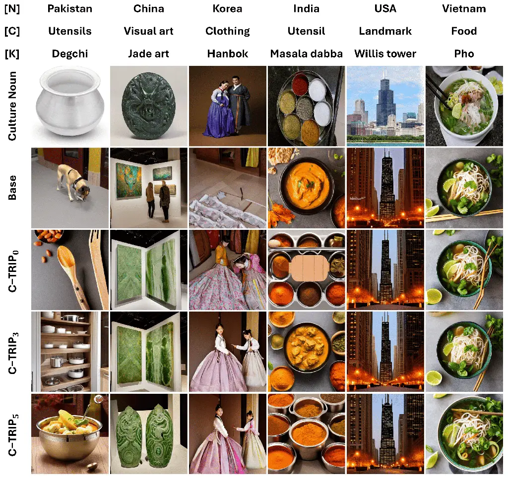

Figure 3: Qualitative comparison of C-TRIP ablated configurations
compared to Base Prompt. The six columns can be divided into two groups:
Relatively UC nouns (left four columns) and RC nouns (right two
columns). The left group needed C-TRIP to introduce culture nouns that
were underrepresented in Text-to-Image models, while the right group had
to recall what they already knew through the additional information
provided.

### 4.2 Baselines for Ablation Study

To effectively analyze the specific contributions of cultural contexts
and visual details based on the Culture Capsules approach, the baseline
and ablation configurations were established in order to systematically
examine the roles of cultural contexts (Clarity, Background, Purpose)
and visual details (Visual Elements, Comparable Objects).

In this study, we evaluated three configurations of the C-TRIP, each
with different criteria for prompt refinement: C-TRIP₀, C-TRIP₃, and
C-TRIP₅. For C-TRIP₃ and C-TRIP₅, the refinement process was performed
up to a maximum of 5 iterations, ensuring that the prompts reached the
desired level of cultural and visual alignment.

These configurations were applied to 10,000 Base Prompts, resulting in
40,000 refined prompts. Subsequently, 80,000 images were generated, with
two images created for each prompt using Stable Diffusion 2  (Rombach
et al., 2022b).

#### C-TRIP₀

C-TRIP₀ utilizes prompts augmented with raw cultural information without
applying the Iterative Prompt Refinement. This configuration is used to
evaluate the baseline effect of unrefined cultural information, enabling
an assessment of how much alignment can be achieved without iterative
refinement.

#### C-TRIP₃

C-TRIP₃ refines the prompts based solely on the cultural context
criteria (Clarity, Background, and Purpose). This setup evaluates the
contribution of cultural context alone without incorporating visual
details. This enables assessing how effectively the refined cultural
information enhances alignment with the intended culture nouns in the
generated images.

#### C-TRIP₅.

C-TRIP₅ incorporates both cultural context and visual details, refining
prompts according to all five criteria: Clarity, Background, Purpose,
Visual Elements, and Comparable Objects. This configuration assesses
whether adding visual details improves the alignment. By comparing
C-TRIP₃ and C-TRIP₅, we can evaluate how much visual details enhance
cultural alignment in the generated images.

|                     |                                 |             |         |         |         |
| ------------------- | ------------------------------- | ----------- | ------- | ------- | ------- |
| Evaluation Criteria |                                 | Base Prompt | C-TRIP₀ | C-TRIP₃ | C-TRIP₅ |
| User Survey (↓)     | Cultural Representation         | 2.73        | 2.53    | 2.56    | 2.18    |
|                     | The Naturalness of the Keyword  | 2.76        | 2.69    | 2.38    | 2.18    |
|                     | Offensiveness                   | 2.81        | 2.60    | 2.46    | 2.13    |
|                     | Description and Image Alignment | 2.53        | 2.66    | 2.51    | 2.30    |
| VIEScore (↑)        | Semantic Consistency (SC)       | 0.37        | 0.36    | 0.37    | 0.38    |
|                     | Perceptual Quality (PQ)         | 7.50        | 7.81    | 7.80    | 7.76    |
|                     | Overall Score                   | 0.71        | 0.71    | 0.73    | 0.74    |

Table 2: Result of User Survey and VIEScore. The results highlighted in
bold indicate the best outcomes. For the User Survey, a lower average
rank is better, while for the VIEScore, a higher score is preferred.
Except for the Perceptual Quality in the VIEScore, C-TRIP₅ received the
best evaluation in all other evaluations.

### 4.3 Evaluation

#### User Survey.

The alignment of images with culture nouns is inherently subjective and
can only be appropriately evaluated by participants of the respective
cultural groups based on country. Accordingly, surveys were distributed
to individuals who were either native to the respective countries or had
at least three years of cultural experience to evaluate our approach.
Participants were provided with survey questions based on their chosen
country. Each survey page presented 4 images of a randomly selected
culture noun. Each survey page contains 4 evaluation questions to rank
images: (a) Cultural Representation, (b) The Naturalness of the Keyword,
(c) Offensiveness, and (d) Description and Image Alignment. Participants
were asked to evaluate a randomly ordered set of images for each
question. The image ranked first was considered the most appropriately
represented and least offensive, while the image ranked fourth was
deemed the most inappropriate and offensive. Detailed information
regarding the user survey is provided in the appendix E.

We employed the Matrix Mean-Subsequence Reduced (MMSR) model  (Ma and
Olshevsky, 2020), an established algorithm  (Majdi and Rodriguez, 2023)
for noise label aggregation provided by crowd-kit  (Ustalov et al.,
2021), to quantitatively estimate subjective performance perception.
Using MMSR, the labels from all respondents were aggregated through
weighted majority voting based on the assessment of their reliability.
Subsequently, the MMSR+Vote method was applied, in which labels were
further aggregated and ranked using simple majority voting.

#### Automatic Evaluation.

In addition to the cultural survey, we measured the VIEScore  (Ku
et al., 2023) using GPT-4o, demonstrating a strong correlation with
human evaluations of text-guide image generation. The VIEScore assesses
the Semantic Consistency (SC) and the Perceptual Quality (PQ) and
Overall score based on these metrics. To evaluate C-TRIP, 150 Base
Prompts were randomly sampled from each country. These prompts were then
processed through C-TRIP configurations, resulting in a total of 600
samples per country for which scores were measured.

## 5 Results

#### Qualitative Comparison

Figure 3 compares the images generated from each C-TRIP configuration
and the Base Prompt described in Section 4.2. The refined prompt
generated by C-TRIP provides cultural knowledge to Stable Diffusion 2,
contributing to the generation of culturally-aware images. C-TRIP₅,
which includes the visual details criteria, demonstrated higher quality
representation. That is, Stable Diffusion 2 can produce better images
when the prompts include appropriate cultural contexts and visual
details. With these enhancements, C-TRIP effectively improves the
model’s ability to generate culturally relevant images.

#### User Survey Results.

A total of 66 participants from eight countries participated in the
survey, ranking the four configurations of the generated images based on
the four evaluation questions specified in the survey. The average
ranking for each selected configuration is presented in the Table 2.

When applying the MMSR algorithm to all the survey responses, C-TRIP₅
achieved the highest ranking overall. C-TRIP₃ ranked second-highest,
using cultural contexts criteria alone is still effective in the
refinement. However, C-TRIP₀ scored lower than the Base Prompt,
particularly in the Description and Image Alignment questions. This
suggests that unrefined prompts may introduce irrelevant details, which
can degrade description quality.

Further analyzing alignment, we converted the rankings into binary
comparisons between C-TRIP₅ and the Base Prompt, isolating and comparing
their respective rankings. This approach revealed that C-TRIP₅
demonstrated higher average alignment in 61% of the time.

In conclusion, incorporating both cultural contexts and, importantly,
visual details in the scoring process significantly enhances the
alignment of culture nouns with the generated images.

#### Automatic Evaluation Results.

C-TRIP₅ scored the best in the evaluation of the SC score, evaluating
the semantic similarity between the prompt and the generated image.
However, C-TRIP₀ scored the best in the PQ score, which assesses the
naturalness of the generated image. This result suggests that additional
iterative refinement can potentially reduce the perceived naturalness of
the image. It appears that the additional refinement process may have
overemphasized specific details, thereby deviating from the naturalness
in quality as perceived by GPT-4o. Nevertheless, C-TRIP₅ still
outperformed the Base Prompt by 3.4%. Overall, C-TRIP₅ maintained the
highest score. In conclusion, as in the user survey results,
incorporating both cultural and visual refinements consistently enhances
the overall performance.

## 6 Ablation Study for UC Nouns

The Culture Capsule approach is a method that teaches learners who have
not experienced a particular culture. With this idea in mind, we aimed
to apply a similar approach to words that Stable Diffusion 2 is not
familiar with. In this section, we analyzed and compared the
Unrecognized/Underrepresented Culture nouns (UC nouns) and the
Common/Recognized Culture nouns (RC nouns).

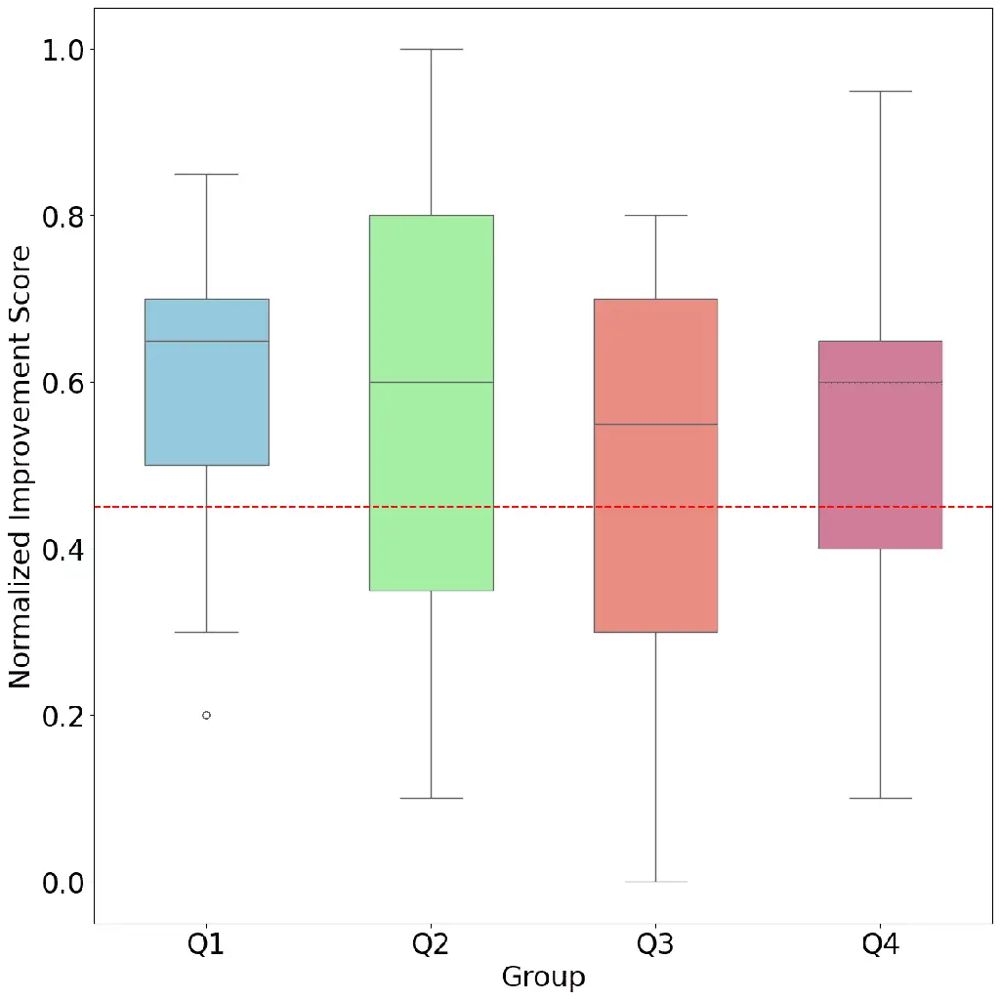

Figure 4: A box plot illustrating the normalized improvement scores for
each group (Q1, Q2, Q3, and Q4). A score exceeding 0.45 signifies that
the C-TRIP’s guidelines enhance the image alignment of the Stable
Diffusion 2 model. Notably, the Q1 group exhibits the highest
performance improvement compared to the other groups.

#### UC and RC noun groups

We categorized culture nouns into UC and RC noun groups according to
their frequency within the training dataset used for Stable Diffusion 2.
To achieve this, we analyzed Re-LAION-2B-en-research, a filtered true
subset of the LAION-2B-en (Schuhmann et al., 2022), using a
$`p_{unsafe}>0.95`$ threshold and keyword-based filters to remove
potentially suspicious content.¹¹ 1
[https://laion.ai/blog/relaion-5b/](https://laion.ai/blog/relaion-5b/)

Our analysis focused on culture nouns within the dataset captions,
classifying them based on their frequency of appearance. These nouns
were then grouped using a quartile-based approach (Q1 to Q4), with Q1
and Q2 representing UC nouns and Q3 and Q4 representing RC nouns. This
grouping provided a structured means to evaluate the C-TRIP’s capacity
to generate culturally aligned images across varying levels of
representation.

#### User Survey.

We used the normalized improvement score to evaluate UC nouns. This
score is calculated by normalizing the difference between the average
rankings of C-TRIP₅ and the Base Prompt in the user survey, measuring
the improvement of C-TRIP₅ over the Base Prompt. A normalized
improvement score higher than 0.45 indicates that C-TRIP’s guidelines
improved image alignment in Stable Diffusion 2.

Our approach performed the best with the Q1 group, with the highest
median score and a narrow IQR, presenting consistent improvement across
this group, as shown in Figure 4. This suggests that C-TRIP effectively
reinforces the generation of images for the Q1 group, enhancing
alignment for UC nouns. The Q2 group demonstrated the highest upper
range within the IQR and the second-highest median, suggesting effective
but slightly variable improvements. However, the Q3 group showed the
lowest performance with a wide variance, which may potentially indicate
that additional information could decrease alignment for culture nouns.

Our approach demonstrated an 11.05% higher mean normalized improvement
score for UC nouns compared to RC nouns. The t-test yielded a
t-statistic of 2.951 and a p-value of 0.0033, providing statistical
evidence of a significant performance improvement for the UC noun group.
These results indicate that C-TRIP’s guidance was more effective in
improving alignment with UC nouns than with RC nouns.

|                           |        |         |         |        |
| ------------------------- | ------ | ------- | ------- | ------ |
|                           | Q1     | Q2      | Q3      | Q4     |
| Semantic Consistency (SC) | 0.1304 | -0.0003 | -0.0077 | 0.047  |
| Perceptual Quality (PQ)   | 0.4517 | 0.2879  | 0.3059  | 0.1093 |
| Overall                   | 0.2158 | 0.0165  | 0.0489  | 0.0541 |

Table 3: Score Differences between C-TRIP₅ and Base Prompt across Groups
(Q1, Q2, Q3, and Q4), Assessed by GPT-4o. The VIEScore incorporates
three key aspects: Semantic Consistency, reflecting the alignment
between the image and the prompt; Perceptual Quality, measuring the
naturalness of the generated image; and the Overall Score, which
combines these metrics.

#### Automatic Evaluation.

As shown in Table 3, C-TRIP₅ demonstrated improvements in all scores:
SC, PQ, and Overall score. The table highlights significant gains in Q1,
with notable increases across all scores. However, C-TRIP₅ scored lower
in the SC score with Q2 and Q3. This discrepancy with the user survey
highlights the potential limitations of using VIEScore, which relies on
LLMs trained on culturally biased web-based data. It emphasizes the need
for surveys conducted by members of the respective cultural groups when
evaluating culture nouns. The consistently low SC scores suggest that
LLMs may struggle to accurately assist in recognizing and aligning
culture nouns, further limiting VIEScore’s effectiveness in assessing
culturally specific content.

## 7 Conclusion

In this paper, we introduced C-TRIP (Culturally-Aware Text-to-Image
Generation with Iterative Prompt Refinement), a novel approach that
iteratively refines prompts to improve the alignment of culture nouns
with images generated by existing text-to-image models without any
fine-tuning. Experiments across eight countries demonstrated that C-TRIP
significantly improves the alignment of culture nouns in generated
images, particularly for underrepresented UC nouns. User surveys and
automatic evaluations consistently present C-TRIP’s superior performance
in cultural representation and the semantic consistency.

## 8 Limitations

Sources like Wikipedia and general Web content contain cultural biases
(Miquel-Ribé and Laniado, 2018; Baeza-Yates, 2018), which can affect the
refinement process and C-TRIP’s capacity to provide balanced cultural
representation. Future work should focus on enhancing the information
retrieval process through developing culturally diverse datasets,
thereby ensuring high-quality, relevant data for effective prompt
refinement.

The limited scope of prompts utilized in our experiments and human
evaluations presents a current limitation and suggests an important
avenue for future research. Additionally, our work is constrained by the
perceptual biases of human annotators from eight countries. To improve
the reliability of evaluation outcomes, future work will emphasize the
inclusion of annotators from a broader range of cultural backgrounds.

#### Acknowledgements

This research was supported by the MSIT(Ministry of Science and ICT),
Korea, under the ITRC(Information Technology Research Center) support
program(IITP-2025-2020-0-01789), the Artificial Intelligence Convergence
Innovation Human Resources Development (IITP-2025-RS-2023-00254592)
supervised by the IITP(Institute for Information & Communications
Technology Planning & Evaluation), and the Hyundai Motor Chung Mong-Koo
Foundation.

## References

- Baeza-Yates (2018) Ricardo Baeza-Yates. 2018. Bias on the web.
  _Communications of the ACM_, 61(6):54–61.
- Bansal et al. (2022) Hritik Bansal, Da Yin, Masoud Monajatipoor, and
  Kai-Wei Chang. 2022. How well can text-to-image generative models
  understand ethical natural language interventions? _arXiv preprint
  arXiv:2210.15230_.
- Basu et al. (2023) Abhipsa Basu, R Venkatesh Babu, and Danish
  Pruthi. 2023. Inspecting the geographical representativeness of images
  from text-to-image models. In _Proceedings of the IEEE/CVF
  International Conference on Computer Vision_, pages 5136–5147.
- Birhane et al. (2023) Abeba Birhane, Vinay Prabhu, Sang Han, and
  Vishnu Naresh Boddeti. 2023. On hate scaling laws for data-swamps.
  _arXiv preprint arXiv:2306.13141_.
- Brade et al. (2023) Stephen Brade, Bryan Wang, Mauricio Sousa, Sageev
  Oore, and Tovi Grossman. 2023. Promptify: Text-to-image generation
  through interactive prompt exploration with large language models. In
  _Proceedings of the 36th Annual ACM Symposium on User Interface
  Software and Technology_, pages 1–14.
- Castañeda (2018) Mari Castañeda. 2018. The power of (mis)
  representation: Why racial and ethnic stereotypes in the media matter.
  _Challenging inequalities: Readings in race, ethnicity, and
  immigration_.
- Cho et al. (2023) Jaemin Cho, Abhay Zala, and Mohit Bansal. 2023.
  Dall-eval: Probing the reasoning skills and social biases of
  text-to-image generation models. In _Proceedings of the IEEE/CVF
  International Conference on Computer Vision_, pages 3043–3054.
- Dubey et al. (2024) Abhimanyu Dubey, Abhinav Jauhri, Abhinav Pandey,
  Abhishek Kadian, Ahmad Al-Dahle, Aiesha Letman, Akhil Mathur, Alan
  Schelten, Amy Yang, Angela Fan, et al. 2024. The llama 3 herd of
  models. _arXiv preprint arXiv:2407.21783_.
- Friedrich et al. (2023) Felix Friedrich, Manuel Brack, Lukas Struppek,
  Dominik Hintersdorf, Patrick Schramowski, Sasha Luccioni, and Kristian
  Kersting. 2023. Fair diffusion: Instructing text-to-image generation
  models on fairness. _arXiv preprint arXiv:2302.10893_.
- Kannen et al. (2024) Nithish Kannen, Arif Ahmad, Marco Andreetto,
  Vinodkumar Prabhakaran, Utsav Prabhu, Adji Bousso Dieng, Pushpak
  Bhattacharyya, and Shachi Dave. 2024. Beyond aesthetics: Cultural
  competence in text-to-image models. _arXiv preprint arXiv:2407.06863_.
- Ku et al. (2023) Max Ku, Dongfu Jiang, Cong Wei, Xiang Yue, and Wenhu
  Chen. 2023. Viescore: Towards explainable metrics for conditional
  image synthesis evaluation. _arXiv preprint arXiv:2312.14867_.
- Liu and Chilton (2022) Vivian Liu and Lydia B Chilton. 2022. Design
  guidelines for prompt engineering text-to-image generative models. In
  _Proceedings of the 2022 CHI conference on human factors in computing
  systems_, pages 1–23.
- Liu et al. (2024) Zhixuan Liu, Peter Schaldenbrand, Beverley-Claire
  Okogwu, Wenxuan Peng, Youngsik Yun, Andrew Hundt, Jihie Kim, and Jean
  Oh. 2024. Scoft: Self-contrastive fine-tuning for equitable image
  generation. In _Proceedings of the IEEE/CVF Conference on Computer
  Vision and Pattern Recognition_, pages 10822–10832.
- Luccioni et al. (2024) Sasha Luccioni, Christopher Akiki, Margaret
  Mitchell, and Yacine Jernite. 2024. Stable bias: Evaluating societal
  representations in diffusion models. _Advances in Neural Information
  Processing Systems_, 36.
- Ma and Olshevsky (2020) Qianqian Ma and Alex Olshevsky. 2020.
  Adversarial crowdsourcing through robust rank-one matrix completion.
  _Advances in Neural Information Processing Systems_, 33:21841–21852.
- Madaan et al. (2024) Aman Madaan, Niket Tandon, Prakhar Gupta, Skyler
  Hallinan, Luyu Gao, Sarah Wiegreffe, Uri Alon, Nouha Dziri, Shrimai
  Prabhumoye, Yiming Yang, et al. 2024. Self-refine: Iterative
  refinement with self-feedback. _Advances in Neural Information
  Processing Systems_, 36.
- Majdi and Rodriguez (2023) Mohammad S Majdi and Jeffrey J
  Rodriguez. 2023. Crowd-certain: Label aggregation in crowdsourced and
  ensemble learning classification. _arXiv preprint arXiv:2310.16293_.
- Miquel-Ribé and Laniado (2018) Marc Miquel-Ribé and David
  Laniado. 2018. Wikipedia culture gap: quantifying content imbalances
  across 40 language editions. _Frontiers in physics_, 6:54.
- Oppenlaender (2023) Jonas Oppenlaender. 2023. A taxonomy of prompt
  modifiers for text-to-image generation. _Behaviour & Information
  Technology_, pages 1–14.
- Peng et al. (2023) Baolin Peng, Michel Galley, Pengcheng He, Hao
  Cheng, Yujia Xie, Yu Hu, Qiuyuan Huang, Lars Liden, Zhou Yu, Weizhu
  Chen, et al. 2023. Check your facts and try again: Improving large
  language models with external knowledge and automated feedback. _arXiv
  preprint arXiv:2302.12813_.
- Ramesh et al. (2022) Aditya Ramesh, Prafulla Dhariwal, Alex Nichol,
  Casey Chu, and Mark Chen. 2022. Hierarchical text-conditional image
  generation with clip latents. _arXiv preprint arXiv:2204.06125_.
- Rombach et al. (2022a) Robin Rombach, Andreas Blattmann, Dominik
  Lorenz, Patrick Esser, and Björn Ommer. 2022a. High-resolution image
  synthesis with latent diffusion models. In _Proceedings of the
  IEEE/CVF conference on computer vision and pattern recognition_, pages
  10684–10695.
- Rombach et al. (2022b) Robin Rombach, Andreas Blattmann, Dominik
  Lorenz, Patrick Esser, and Björn Ommer. 2022b. High-resolution image
  synthesis with latent diffusion models. In _Proceedings of the
  IEEE/CVF Conference on Computer Vision and Pattern Recognition
  (CVPR)_, pages 10684–10695.
- Ruiz et al. (2023) Nataniel Ruiz, Yuanzhen Li, Varun Jampani, Yael
  Pritch, Michael Rubinstein, and Kfir Aberman. 2023. Dreambooth: Fine
  tuning text-to-image diffusion models for subject-driven generation.
  In _Proceedings of the IEEE/CVF conference on computer vision and
  pattern recognition_, pages 22500–22510.
- Saunders et al. (2022) William Saunders, Catherine Yeh, Jeff Wu,
  Steven Bills, Long Ouyang, Jonathan Ward, and Jan Leike. 2022.
  Self-critiquing models for assisting human evaluators. _arXiv preprint
  arXiv:2206.05802_.
- Schick et al. (2022) Timo Schick, Jane Dwivedi-Yu, Zhengbao Jiang,
  Fabio Petroni, Patrick Lewis, Gautier Izacard, Qingfei You,
  Christoforos Nalmpantis, Edouard Grave, and Sebastian Riedel. 2022.
  Peer: A collaborative language model. _arXiv preprint
  arXiv:2208.11663_.
- Schuhmann et al. (2022) Christoph Schuhmann, Romain Beaumont, Richard
  Vencu, Cade Gordon, Ross Wightman, Mehdi Cherti, Theo Coombes, Aarush
  Katta, Clayton Mullis, Mitchell Wortsman, et al. 2022. Laion-5b: An
  open large-scale dataset for training next generation image-text
  models. _Advances in Neural Information Processing Systems_,
  35:25278–25294.
- Taylor and Sorensen (1961) H Darrel Taylor and John L Sorensen. 1961.
  Culture capsules. _The Modern Language Journal_, 45(8):350–354.
- Ustalov et al. (2021) Dmitry Ustalov, Nikita Pavlichenko, and Boris
  Tseitlin. 2021. Learning from crowds with crowd-kit. _arXiv preprint
  arXiv:2109.08584_.
- Wen et al. (2024) Yuxin Wen, Neel Jain, John Kirchenbauer, Micah
  Goldblum, Jonas Geiping, and Tom Goldstein. 2024. Hard prompts made
  easy: Gradient-based discrete optimization for prompt tuning and
  discovery. _Advances in Neural Information Processing Systems_, 36.
- Yang et al. (2022) Kevin Yang, Yuandong Tian, Nanyun Peng, and Dan
  Klein. 2022. Re3: Generating longer stories with recursive reprompting
  and revision. _arXiv preprint arXiv:2210.06774_.
- Yao et al. (2024) Junyi Yao, Yijiang Liu, Zhen Dong, Mingfei Guo,
  Helan Hu, Kurt Keutzer, Li Du, Daquan Zhou, and Shanghang Zhang. 2024.
  Promptcot: Align prompt distribution via adapted chain-of-thought. In
  _Proceedings of the IEEE/CVF Conference on Computer Vision and Pattern
  Recognition_, pages 7027–7037.
- Yun and Kim (2024) Youngsik Yun and Jihie Kim. 2024. [Cic: A framework
  for culturally-aware image
  captioning](https://doi.org/10.24963/ijcai.2024/180). In _Proceedings
  of the Thirty-Third International Joint Conference on Artificial
  Intelligence, IJCAI-24_, pages 1625–1633. International Joint
  Conferences on Artificial Intelligence Organization. Main Track.

## Appendix A List of Culture Nouns

This part lists culture nouns for the eight countries used in the
experiment. The culture nouns are divided into 8 categories:
architecture (3), city & landmark (5), clothing (4), dance & music (2),
visual arts (1), food & drink (5), religion & festival (3), and utensils
& tools (2). The numbers in parentheses indicate the quantity of nouns
used in each category. A total of 25 nouns were extracted and used for
each country as shown in Table 6 to 13.

## Appendix B Retrieve Cultural Information

This part covers the process of retrieving cultural information. As
mentioned in the text, the retrieval is carried out in two steps. First,
information about the culture noun is retrieved from Wikipedia. However,
for culture nouns categorized under UC nouns, when information is
unavailable or insufficient on Wikipedia, further information is
retrieved from the web. Both retrieval processes utilized LangChain
modules, with WikipediaQueryRun²² 2
[https://python.langchain.com/api_reference/community/tools/langchain_community.tools.wikipedia.tool.WikipediaQueryRun.html](https://python.langchain.com/api_reference/community/tools/langchain_community.tools.wikipedia.tool.WikipediaQueryRun.html)
used for Wikipedia searches and GoogleSearchAPIWrapper³³ 3
[https://python.langchain.com/docs/integrations/tools/google_search/](https://python.langchain.com/docs/integrations/tools/google_search/)
used for web searches. The two examples below show cases where the
retrieval was successful through Wikipedia as shown in Figure 12 and
where the information was not insufficient through Wikipedia, so
additional retrieval was also conducted from the web as shown in 13.

## Appendix C Iterative Prompt Refinement

Figure 14 visually depicts how the prompt evolves through the Iterative
Prompt Refinement process. First, the prompt is refined, and the score
is measured based on the five evaluation criteria defined in Table 1.
Next, the feedback process generates an explanation for the given score,
based on the refined prompt and the measured score. Finally, the prompt
is iteratively refined and scored based on the feedback. The Iterative
Prompt Refinement process terminates when the total score of the refined
prompt exceeds 40 points or after 5 iterations. The Refine, Score, and
Feedback processes all utilize LLaMA-3-70B, and the respective templates
can be found in Figure 9, Figure 10, and Figure 11.

## Appendix D Qualitative Comparison Prompts

This part includes the prompts used to generate the images in Figure 3
of the main text. Cultural contexts are written in orange, and visual
details are written in cyan. For culture nouns categorized under the UC
nouns (dengchi, jade art, and masala dabba), we observe that Stable
Diffusion 2 effectively aligns with the culture nouns using prompt
refined through our approach.

In contrast, for culture nouns categorized under the RC nouns (Willis
Tower and pho), there is no significant difference in the images
generated between the refined prompt and the base prompt. For pho
(Vietnamese cuisine), Stable Diffusion 2 generates images similar to the
original reference image, even without visual details in the refined
prompt.

## Appendix E User Survey

To evaluate the performance of our approach, we recruited 66
participants with at least 3 years or older of cultural experience in
each of the 8 countries. Even so, to address the mitigate bias further,
we recruited at least 5 participants from each country. Table 4 provides
detailed information about the participants. Each participant responded
to 15 survey pages. A single page of the survey form includes culture
nouns, a base prompt, and one image generated from each of the three
approaches described in Section 4.2, for a total of four images. Each
survey page has a total of four survey items (see Table 15) to rank
relative to (a) Cultural Representation, (b) The naturalness of the
keyword, (c) Offensiveness, and (d) Description and Image Alignment. A
sample of a survey page can be viewed in Figure 15. Survey participants
were compensated for their time and contributions in accordance with
ethical guidelines.

## Appendix F Additional Qualitative Samples

In Figure 16 to 23, we present additional qualitative examples
illustrating how the C_TRIP approach improves the alignment of culture
nouns in UC and RC nouns with the generated images by Stable Diffusion 2. Results are showcased across China, Germany, India, Japan, Pakistan,
South Korea, USA, and Vietnam. Additionally, our approach effectively
enhanced the alignment between prompt containing culture nouns from the
UC nouns and the generated images.

## Appendix G Culture noun Distribution by Quartile Group for Each Country in the Re-LAION Dataset

Table 16 presents the culture noun counts for each country, divided into
quartiles. Each quartile represents 25% of the data, helping to better
understand and compare the frequency of culture nouns across countries.
This allows for an analysis of the characteristics of cultural
expression distribution by country, making it easier to identify the
proportion of UC and RC nouns.

Furthermore, Figures 5 to 8 analyze the distribution of culture nouns
across each quartile group. Looking at the top three countries in each
group, for Q1, the leading countries were Germany, China, and Vietnam.
For Q2, Japan, Vietnam, and India ranked highest. In Q3, China, India,
and the USA were the top countries, while in Q4, the USA accounted for
more than half, showing a dominant proportion.

|             |       |       |       |        |        |       |
| ----------- | ----- | ----- | ----- | ------ | ------ | ----- |
|             | Age   |       |       | Gender |        | Total |
|             | 21-30 | 31-40 | 41-50 | Male   | Female |       |
| China       | 6     | 1     | 0     | 6      | 1      | 7     |
| Germany     | 12    | 0     | 0     | 4      | 8      | 12    |
| India       | 5     | 2     | 0     | 3      | 4      | 7     |
| Japan       | 6     | 0     | 0     | 2      | 4      | 6     |
| Pakistan    | 9     | 3     | 0     | 9      | 3      | 12    |
| South Korea | 9     | 1     | 2     | 9      | 3      | 12    |
| USA         | 6     | 0     | 0     | 3      | 3      | 6     |
| Vietnam     | 4     | 1     | 0     | 1      | 4      | 5     |

Table 4: This table presents participant information, including age and
gender distribution for each culture group.

|             |          |       |          |       |
| ----------- | -------- | ----- | -------- | ----- |
| Country     | UC nouns |       | RC nouns |       |
|             | Q1(%)    | Q2(%) | Q3(%)    | Q4(%) |
| China       | 12       | 24    | 40       | 24    |
| Germany     | 40       | 12    | 28       | 20    |
| India       | 16       | 24    | 28       | 32    |
| Japan       | 12       | 40    | 28       | 20    |
| Pakistan    | 40       | 20    | 16       | 24    |
| South Korea | 36       | 36    | 20       | 8     |
| USA         | 0        | 8     | 28       | 64    |
| Vietnam     | 44       | 36    | 12       | 8     |

Table 5: Distribution of culture nouns by quartile group for each
country. Bold text represents the highest proportion for each respective
country.

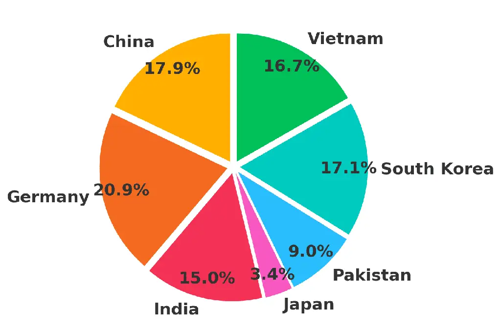

Figure 5: Country Distribution in Q1 group.

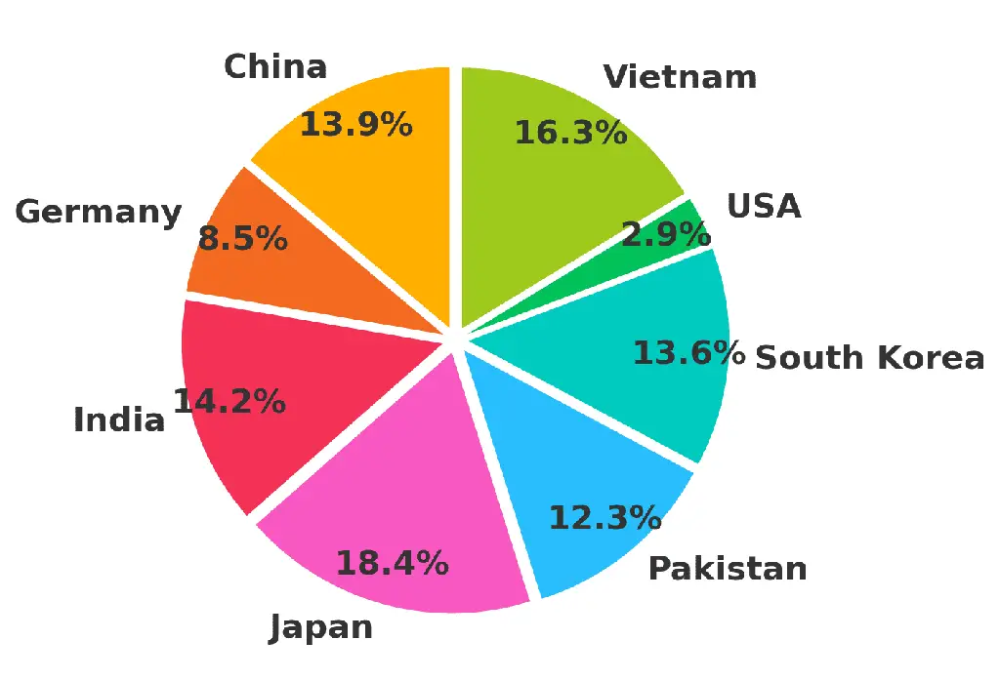

Figure 6: Country Distribution in Q2 group.

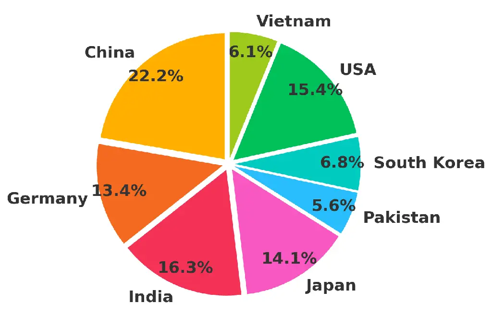

Figure 7: Country Distribution in Q3 group.

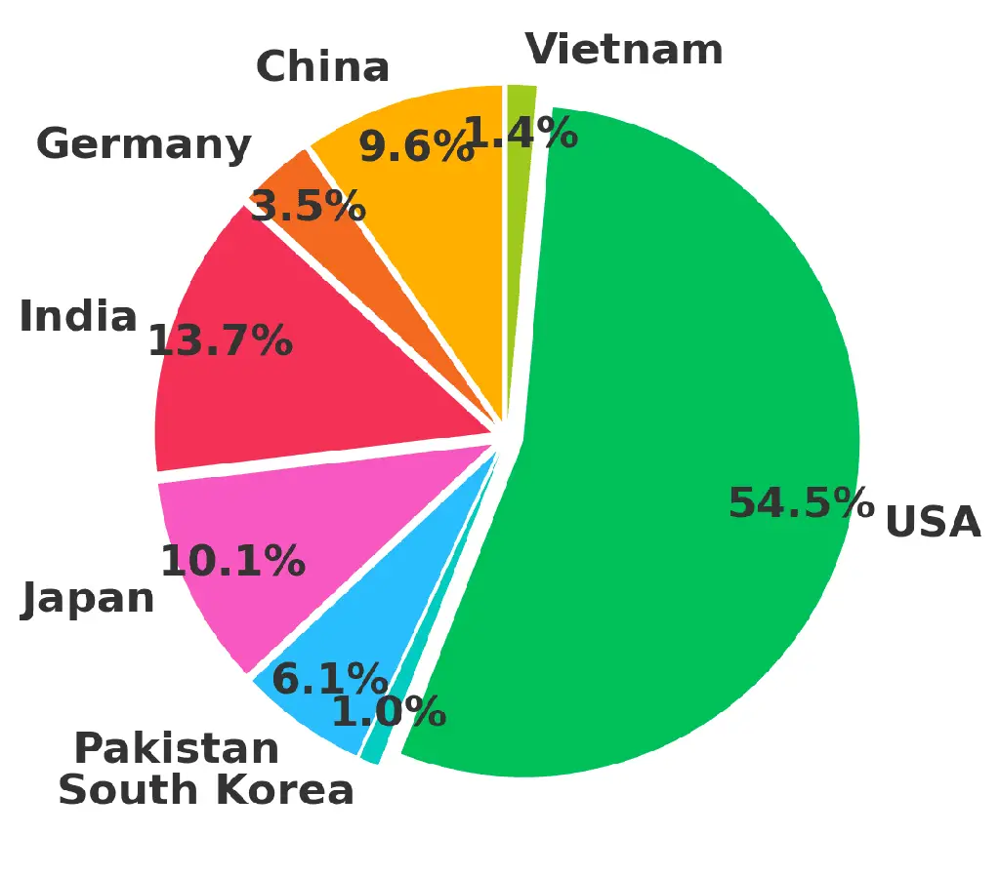

Figure 8: Country Distribution in Q4 group.

|                     |                                                                                                                                        |
| ------------------- | -------------------------------------------------------------------------------------------------------------------------------------- |
| Category            | Culture Nouns                                                                                                                          |
| architecture        | Tulou, Siheyuan, Chinese pagoda                                                                                                        |
| city & landmark     | Dunhuang (Mogao Caves), Xi’an (Terracotta Army), Beijing (Forbidden City), Beijing (Temple of Heaven), Shanghai (Oriental Pearl Tower) |
| clothing            | Tangzhuang, Zhongshan suit, Qipao, Hanfu                                                                                               |
| dance & music       | Lion dance, Yangge                                                                                                                     |
| visual arts         | Jade art                                                                                                                               |
| food & drink        | Mooncake, Peking duck, Wonton, Xiaolongbao, Chinese hot pot                                                                            |
| religion & festival | Chinese New Year, Chinese Mid-Autumn Festival, Qingming                                                                                |
| utensils & tools    | Chinese wok, Chinese bamboo steamer                                                                                                    |

Table 6: Categorization of culture nouns associated with Chinese
culture.

|                     |                                                                                                                                                         |
| ------------------- | ------------------------------------------------------------------------------------------------------------------------------------------------------- |
| Category            | Culture Nouns                                                                                                                                           |
| architecture        | German Romanesque, German Gothic, German Baroque                                                                                                        |
| city & landmark     | Berlin (Brandenburger Tor), Munich (Munich’s Marienplatz), Cologne (Cologne Cathedral), Bavaria (Neuschwanstein Castle), Heidelberg (Heidelberg Castle) |
| clothing            | Lederhosen, Tracht, Dirndl, Schürze                                                                                                                     |
| dance & music       | Zwiefacher, Schuhplattler                                                                                                                               |
| visual arts         | Deutsch Renaissance                                                                                                                                     |
| food & drink        | Mulled wine, Currywurst, Knödel, Bratwurst, Sauerkraut                                                                                                  |
| religion & festival | Nikolaustag, Weihnachtsmärkte, Oktoberfest                                                                                                              |
| utensils & tools    | Bratpfanne, Rouladenklammer                                                                                                                             |

Table 7: Categorization of culture nouns associated with German culture.

|                     |                                                                                                          |
| ------------------- | -------------------------------------------------------------------------------------------------------- |
| Category            | Culture Nouns                                                                                            |
| architecture        | Indian stupa, Mughal architecture, Gupta architecture                                                    |
| city & landmark     | Agra (Taj Mahal), Delhi (Red Fort), Jaipur (Amber Fort), Allahabad (Allahabad Fort), Delhi (Qutub Minar) |
| clothing            | Lehenga, Sari, Shalwar kameez, Dhoti                                                                     |
| dance & music       | Manipuri dance, Bharatnatyam                                                                             |
| visual arts         | Mughal painting                                                                                          |
| food & drink        | Paratha, Biryani, Vada Pav, Aloo Gobi, Saag                                                              |
| religion & festival | Diwali, Holi, Durga Puja                                                                                 |
| utensils & tools    | Tawa, Masala dabba                                                                                       |

Table 8: Categorization of culture nouns associated with Indian culture.

|                     |                                                                                                                    |
| ------------------- | ------------------------------------------------------------------------------------------------------------------ |
| Category            | Culture Nouns                                                                                                      |
| architecture        | Shinto architecture, Torii, Edo architecture                                                                       |
| city & landmark     | Tokyo (Tokyo Tower), Shizuoka (Mount Fuji), Kyoto (Kinkaku-ji), Osaka (Osaka Castle), Matsumoto (Matsumoto Castle) |
| clothing            | Hanten, Haori, Hakama, Yukata                                                                                      |
| dance & music       | Kabuki, Noh mai                                                                                                    |
| visual arts         | Origami                                                                                                            |
| food & drink        | Okonomiyaki, Tempura, Wagashi, Gyudon, Gyoza                                                                       |
| religion & festival | Sapporo Snow Festival, Gion Matsuri, Sanda Matsuri                                                                 |
| utensils & tools    | Sashimi bōchō, Takoyaki Pan                                                                                        |

Table 9: Categorization of culture nouns associated with Japanese
culture.

|                     |                                                                                                                                             |
| ------------------- | ------------------------------------------------------------------------------------------------------------------------------------------- |
| Category            | Culture Nouns                                                                                                                               |
| architecture        | Pakistani Buddhist architecture, Pakistani Indo-Islamic architecture, Pakistani Mughal architecture                                         |
| city & landmark     | Lahore (Badshahi Mosque), Karachi (Mazar-e-Quaid), Islamabad (Faisal Mosque), Multan (Shrine of Bahauddin Zakariya), Hyderabad (Pakka Qila) |
| clothing            | Sherwani, Gharara, Shalwar Kameez, Lehenga                                                                                                  |
| dance & music       | Khattak dance, Jhumair                                                                                                                      |
| visual arts         | Truck art                                                                                                                                   |
| food & drink        | Biryani, Nihari, Gulab Jamun, Kheer, Gol Gappa                                                                                              |
| religion & festival | Vaisakhi, Eid al-Fitr, Eid al-Adha                                                                                                          |
| utensils & tools    | Karahi, Degchi                                                                                                                              |

Table 10: Categorization of culture nouns associated with Pakistani
culture.

|                     |                                                                                                                       |
| ------------------- | --------------------------------------------------------------------------------------------------------------------- |
| Category            | Culture Nouns                                                                                                         |
| architecture        | Hanok, Korean pagoda, Korean temple                                                                                   |
| city & landmark     | Jeonju (Hanok Village), Seoul (Gyeongbokgung), Gyeongju (Bulguksa), Suwon (Hwaseong Fortress), Seoul (Jongmyo Shrine) |
| clothing            | Hanbok, Jeogori, Durumagi, Dangui                                                                                     |
| dance & music       | Cheoyongmu, Buchaechum                                                                                                |
| visual arts         | Minhwa                                                                                                                |
| food & drink        | Bingsu, Kimchi, Sundubujjigae, Bibimbap, Tteokbokki                                                                   |
| religion & festival | Chuseok, Seollal, Korean New Year                                                                                     |
| utensils & tools    | Gamasot, Hangari                                                                                                      |

Table 11: Categorization of culture nouns associated with Korean
culture.

|                     |                                                                                                                                                           |
| ------------------- | --------------------------------------------------------------------------------------------------------------------------------------------------------- |
| Category            | Culture Nouns                                                                                                                                             |
| architecture        | Colonial Revival, Mission Revival, American Craftsman                                                                                                     |
| city & landmark     | New York City (Statue of Liberty), San Francisco (Golden Gate Bridge), Washington (The White House), Chicago (Willis Tower), Los Angeles (Hollywood Sign) |
| clothing            | Cowboy hat, Denim overalls, Buffalo check shirt, Quilted vest                                                                                             |
| dance & music       | Bluegrass, Cotton-Eyed joe                                                                                                                                |
| visual arts         | American folk art                                                                                                                                         |
| food & drink        | Apple pie, Buffalo wings, Clam chowder, Barbecue ribs, Cornbread                                                                                          |
| religion & festival | Thanksgiving, Independence Day, Memorial Day                                                                                                              |
| utensils & tools    | Cast iron skillet, Butter dish                                                                                                                            |

Table 12: Categorization of culture nouns associated with American
culture.

|                     |                                                                                                                                        |
| ------------------- | -------------------------------------------------------------------------------------------------------------------------------------- |
| Category            | Culture Nouns                                                                                                                          |
| architecture        | Vietnamese dynasty architecture, Vietnamese stilt house, Vietnamese pagoda                                                             |
| city & landmark     | Hanoi (One Pillar Pagoda), Hanoi (Temple of Literature), Hanoi (Old Quarter), Hue (Imperial City of Hue), Quang Nam (My Son Sanctuary) |
| clothing            | Ao dai, Ao ba ba, Ao tu than, Non la                                                                                                   |
| dance & music       | Mua lan, Quan ho                                                                                                                       |
| visual arts         | Vietnamese silk painting                                                                                                               |
| food & drink        | Banh mi, Goi cuon, Pho, Bun cha, Banh xeo                                                                                              |
| religion & festival | Vietnamese Lunar New Year, Vietnamese Mid-Autumn Festival, Hung Kings Temple Festival                                                  |
| utensils & tools    | Vietnamese wok, Vietnamese clay pot                                                                                                    |

Table 13: Categorization of culture nouns associated with Vietnamese
culture.

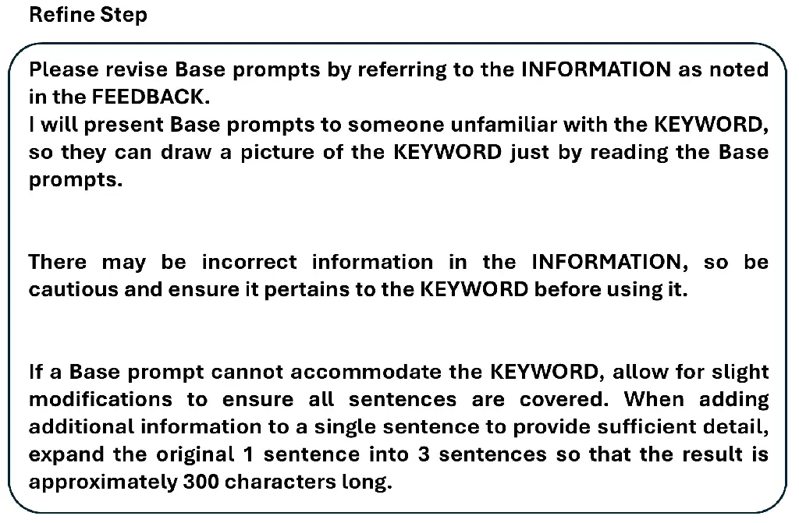

Figure 9: Prompt provided to LLaMA-3-70B in the Refine step. There are
two key points in the Refine step. The first is to effectively refine
the INFORMATION and incorporate it into the Base prompt. To address the
first key point, we structured the first and second paragraphs. The
second is to inject the information while maintaining the structure of
the Base prompt. At this stage, we also imposed a length limit to
prevent exceeding Stable Diffusion’s input limit and to ensure that the
Base prompt remains the focal point, avoiding distraction from too much
information. For the second key point, we structured the third
paragraph.

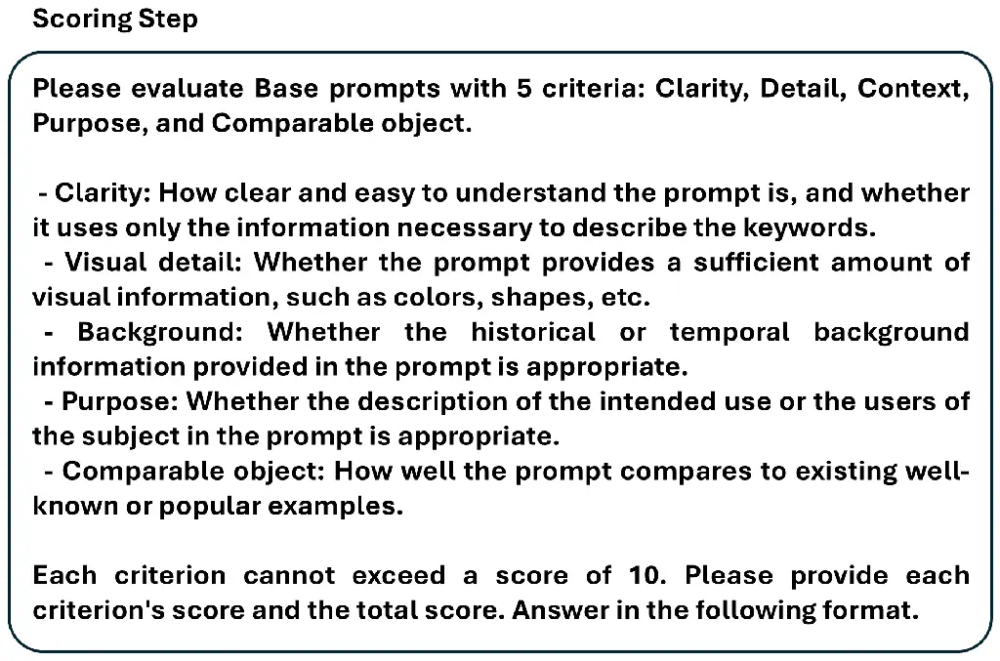

Figure 10: Prompt provided to LLaMA-3-70B in the Scoring step. We
provided LLaMA-3-70B with the criteria and definitions set in Table 1 to
score each criterion up to 10 points, for a total maximum score of 50
points.

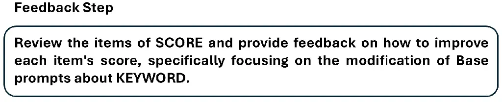

Figure 11: Prompt provided to LLaMA-3-70B in the Feedback step. We
focused on reviewing the scores from the Scoring step and generating
feedback to improve areas with lower scores.

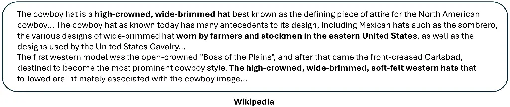

Figure 12: Example of sufficient information retrieved from Wikipedia:
Cowboy hat (USA clothes). This culture noun, classified within the Q4
group and categorized under RC nouns, provided detailed information on
its appearance and cultural significance, accessible solely through
Wikipedia.

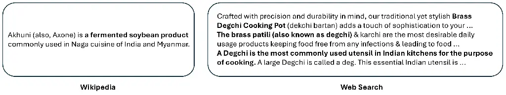

Figure 13: Example of insufficient information retrieved from Wikipedia:
Degchi (Pakistan utensil). This culture noun, classified within the Q1
group and categorized under UC nouns, could not be found on Wikipedia.
Additional cultural information was subsequently obtained through a web
search.

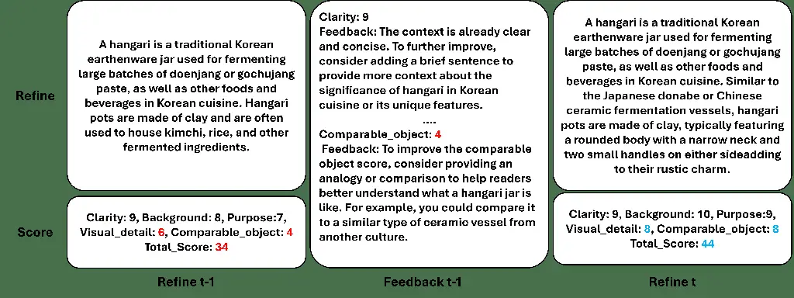

Figure 14: The step-by-step results of C-TRIP. The example uses
"hangari", a Korean conventional utensil. In the (t-1)th iteration, a
score is assigned based on the criteria, and feedback is generated based
on this score. Then, in the t-th iteration, the prompt is revised using
the feedback.

|          |              |               |                                                                                                                                                                                                                                                                                                                                                                                                                                                                                                                                                   |
| -------- | ------------ | ------------- | ------------------------------------------------------------------------------------------------------------------------------------------------------------------------------------------------------------------------------------------------------------------------------------------------------------------------------------------------------------------------------------------------------------------------------------------------------------------------------------------------------------------------------------------------- |
| Country  | Culture noun | Configuration | Prompt                                                                                                                                                                                                                                                                                                                                                                                                                                                                                                                                            |
| Pakistan | Degchi       | Base prompt   | The task was made easier with a degchi.                                                                                                                                                                                                                                                                                                                                                                                                                                                                                                           |
|          |              | C-TRIP₀       | The task was made easier with a degchi, a must-have utensil for any hardcore foodie, providing a seductive and smoked flavor to dishes.                                                                                                                                                                                                                                                                                                                                                                                                           |
|          |              | C-TRIP₃       | The task was made easier with a degchi, which allowed for efficient cooking and storage of ingredients.                                                                                                                                                                                                                                                                                                                                                                                                                                           |
|          |              | C-TRIP₅       | The task was made easier with a degchi, a type of traditional Indian cooking pot known for its rich flavors and aromas. This utensil was made from heavy-gauge brass and resembled a deep cooking vessel with enough space to cook and store milk, tea, vegetable curries, curd, and other ingredients. Its versatility in cooking both vegetarian and non-vegetarian dishes made it an essential tool.                                                                                                                                           |
| China    | Jade art     | Base prompt   | The gallery opening was a major event for jade art enthusiasts.                                                                                                                                                                                                                                                                                                                                                                                                                                                                                   |
|          |              | C-TRIP₀       | The gallery opening was a major event for jade art enthusiasts who appreciated the stone’s subtle, translucent colors and its association with Chinese conceptions of the soul and immortality. The exhibit featured a range of jade pieces, from ancient artifacts to modern creations, showcasing the evolution of jade art over thousands of years. Attendees were treated to an immersive experience, surrounded by the beauty and symbolism of this revered stone.                                                                           |
|          |              | C-TRIP₃       | The gallery opening was a major event for jade art enthusiasts, who admired the subtle, translucent colors and artistic treatment of jade. The exhibit featured intricately crafted jade artifacts, created by skilled artisans over seven millennia ago. With gold, it represented the sky, earth, and four directions.                                                                                                                                                                                                                          |
|          |              | C-TRIP₅       | The gallery opening was a major event for jade art enthusiasts, who gathered to marvel at the exquisite carvings, jewelry, and ornaments on display, crafted from nephrite and jadeite minerals prized for their vibrant colors and high translucency. The exhibit featured pieces with delicate filigree patterns, ornate designs, and symbols of good fortune, showcasing the great skill and attention to detail involved in shaping these minerals into beautiful works of art. The event was a testament to the enduring appeal of jade art. |
| Korea    | Hanbok       | Base prompt   | hanbok are scattered on the floor after a long day.                                                                                                                                                                                                                                                                                                                                                                                                                                                                                               |
|          |              | C-TRIP₀       | hanbok are scattered on the floor after a long day, their delicate fabrics crumpled and disheveled. Despite the chaos, the vibrant colors and intricate patterns of the garments remain striking, a testament to the beauty and elegance of traditional Korean clothing.                                                                                                                                                                                                                                                                          |
|          |              | C-TRIP₃       | hanbok are scattered on the floor after a long day of festivities and celebrations. The hanbok is a traditional Korean dress that is worn for formal or semi-formal occasions. In modern times, Koreans often wear hanbok to cultural events and festivals.                                                                                                                                                                                                                                                                                       |
|          |              | C-TRIP₅       | Hanbok are scattered on the floor after a long day, their vibrant colors and intricate designs reflecting Korea’s rich cultural heritage. The traditional clothing features a unique blend of straight and curved lines that are representative of a distinctly Korean aesthetic. With its roots tracing back to the Three Kingdoms of Korea period, these elegant dresses are typically worn on special occasions such as weddings and festivals.                                                                                                |
| India    | Masala dabba | Base prompt   | A simple masala dabba helped achieve the desired texture.                                                                                                                                                                                                                                                                                                                                                                                                                                                                                         |
|          |              | C-TRIP₀       | A simple masala dabba helped achieve the desired texture by providing quick access to the necessary spices without having to search through cabinets or drawers. The box’s compact design made it easy to store on the countertop, keeping the workspace clutter-free and organized. With its small spoon, the cook could measure out the perfect amount of each spice.                                                                                                                                                                           |
|          |              | C-TRIP₃       | A simple masala dabba helped achieve the desired texture, by providing quick access to spices like cumin, coriander, and turmeric, which are essential for many Indian dishes.                                                                                                                                                                                                                                                                                                                                                                    |
|          |              | C-TRIP₅       | A simple masala dabba helped achieve the desired texture, its carefully arranged cups holding the secrets to the recipe’s success. The cook knew that with this container, they could confidently combine the various spices and seasonings, resulting in a culinary masterpiece. It was an indispensable item in their kitchen, one that had been passed down through generations.                                                                                                                                                               |
| USA      | Willis tower | Base prompt   | chicago (willis tower) was beautifully lit up at night.                                                                                                                                                                                                                                                                                                                                                                                                                                                                                           |
|          |              | C-TRIP₀       | chicago (willis tower) was beautifully lit up at night, making it a stunning sight in the city’s skyline. Its unique design and impressive height make it a popular spot for photographers and tourists alike. The building’s facade is made of anodized aluminum and black glass, which adds to its visual appeal.                                                                                                                                                                                                                               |
|          |              | C-TRIP₃       | chicago (Willis Tower) was beautifully lit up at night, making it one of Chicago’s most popular tourist destinations, with its facade made of anodized aluminum and black glass shining brightly.                                                                                                                                                                                                                                                                                                                                                 |
|          |              | C-TRIP₅       | The Willis Tower was beautifully lit up at night, its anodized aluminum and black glass façade shimmering against the city lights. The building’s unique design took on a new level of sophistication in the evening hours, becoming a beacon of light in the Chicago skyline. Its nighttime beauty was a sight to behold.                                                                                                                                                                                                                        |
| Vietnam  | Pho          | Base prompt   | pho is a delicious way to start any meal.                                                                                                                                                                                                                                                                                                                                                                                                                                                                                                         |
|          |              | C-TRIP₀       | Pho is a delicious way to start any meal, with its warm, comforting broth and tender noodles providing a satisfying and filling experience.                                                                                                                                                                                                                                                                                                                                                                                                       |
|          |              | C-TRIP₃       | Pho is a delicious way to start any meal, with its warm, comforting broth and soft rice noodles providing a soothing contrast to the crunch of fresh herbs and the savory flavor of meat.                                                                                                                                                                                                                                                                                                                                                         |
|          |              | C-TRIP₅       | pho is a delicious way to start any meal, providing comfort and sustenance, whether as a light breakfast, a satisfying lunch, or a nourishing dinner.                                                                                                                                                                                                                                                                                                                                                                                             |

|                                 |                                                                                                                                                                                                                                                                                             |
| ------------------------------- | ------------------------------------------------------------------------------------------------------------------------------------------------------------------------------------------------------------------------------------------------------------------------------------------- |
| Item Title                      | Item Text                                                                                                                                                                                                                                                                                   |
| Cultural Representation         | Rank the images from 1 for the best representation of \[country\] culture to 4 for the worst cultural representation. Please ignore image artifacts (such as distorted faces, hands, or glitches) when considering Cultural Representation. (1=most representative, 4=least representative) |
| The naturalness of the keyword  | Keyword: \[keyword\], Rank the images from 1 for the most natural-looking to 4 for the least natural-looking. Please ignore image artifacts (such as distorted faces, hands, or glitches) when considering The naturalness of the keyword. (1=most natural, 4=least natural)                |
| Offensiveness                   | Rank the images by their offensiveness to you personally, numbering from 1 as the least offensive to 4 for the most offensive. Please ignore image artifacts (such as distorted faces, hands, or glitches) when considering Offensiveness. (1=least offensive, 4=most offensive)            |
| Description and Image Alignment | Image Description: \[prompt\], Rank the accuracy of the match between the image and its description. Number each image from 1 for the image best described by the description to 4 for the worst match between image and description. (1=best described, 4=worst described)                 |

Table 15: The four survey items for our human evaluation survey.

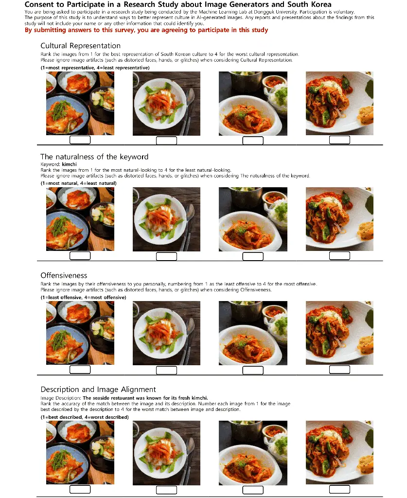

Figure 15: A sample page from the survey presents participants with four
images, and below, they are asked to enter a rank between 1 and 4 into
designated text fields. Participants provide evaluations based on four
criteria: Cultural Representation, Keyword Naturalness, Offensiveness,
and Alignment between Description and Image. For each survey item, four
images are displayed in a randomized but consistent order throughout the
page.

|             |          |                                                                                                                                                                                                                                                                                                                                                                                                                                                    |
| ----------- | -------- | -------------------------------------------------------------------------------------------------------------------------------------------------------------------------------------------------------------------------------------------------------------------------------------------------------------------------------------------------------------------------------------------------------------------------------------------------- |
| Country     | Quartile | Culture nouns (Count)                                                                                                                                                                                                                                                                                                                                                                                                                              |
| China       | Q1       | Zhongshan suit (290), Siheyuan (408), Tangzhuang (462)                                                                                                                                                                                                                                                                                                                                                                                             |
|             | Q2       | Xiaolongbao (555), Dunhuang (Mogao Caves) (1042), Chinese bamboo steamer (1541), Chinese hot pot (2700), Tulou (2830), Qingming (2901)                                                                                                                                                                                                                                                                                                             |
|             | Q3       | Yangge (4115), Peking duck (5077), Shanghai (Oriental Pearl Tower) (5522), Chinese wok (5630), Chinese pagoda (10490), Chinese Mid-Autumn Festival (10645), Jade art (10856), Xi’an (Terracotta Army) (12477), Mooncake (15494), Wonton (16147)                                                                                                                                                                                                    |
|             | Q4       | Beijing (Temple of Heaven) (20108), Lion dance (27302), Qipao (42352), Beijing (Forbidden City) (55328), Hanfu (107289), Chinese New Year (391554)                                                                                                                                                                                                                                                                                                 |
| Germany     | Q1       | Rouladenklammer (0), Zwiefacher (6), Deutsch Renaissance (12), Weihnachtsmärkte (17), Nikolaustag (66), Bratpfanne (113), Schuhplattler (129), German Romanesque (138), Knödel (409), Schürze (459)                                                                                                                                                                                                                                                |
|             | Q2       | German Gothic (2105), German Baroque (2139), Currywurst (2831)                                                                                                                                                                                                                                                                                                                                                                                     |
|             | Q3       | Tracht (3855), Heidelberg (Heidelberg Castle) (4885), Munich (Munich’s Marienplatz) (5646), Bratwurst (7746), Lederhosen (8854), Berlin (Brandenburger Tor) (9286), Sauerkraut (17848)                                                                                                                                                                                                                                                             |
|             | Q4       | Dirndl (19876), Bavaria (Neuschwanstein Castle) (21512), Cologne (Cologne Cathedral) (29416), Mulled wine (52917), Oktoberfest (111654)                                                                                                                                                                                                                                                                                                            |
| India       | Q1       | Gupta architecture (148), Allahabad (Allahabad Fort) (203), Indian stupa (298), Manipuri dance (321)                                                                                                                                                                                                                                                                                                                                               |
|             | Q2       | Masala dabba (825), Bharatnatyam (1280), Vada pav (1355), Aloo gobi (1797), Mughal architecture (2736), Delhi (Qutub Minar) (3833)                                                                                                                                                                                                                                                                                                                 |
|             | Q3       | Mughal Painting (4618), Saag (5053), Shalwar kameez (8824), Tawa (8949), Jaipur (Amber Fort) (13909), Paratha (14272), Durga Puja (14904)                                                                                                                                                                                                                                                                                                          |
|             | Q4       | Dhoti (26053), Biryani (30699), Delhi (Red Fort) (43940), Agra (Taj Mahal) (92631), Holi (124249), Sari (129095), Diwali (207137), Lehenga (261160)                                                                                                                                                                                                                                                                                                |
| Japan       | Q1       | Sashimi bōchō (0), Noh mai (15), Edo architecture (207)                                                                                                                                                                                                                                                                                                                                                                                            |
|             | Q2       | Shinto architecture (505), Takoyaki pan (629), Gion Matsuri (711), Hanten (756), Gyudon (889), Sanja Matsuri (944), Sapporo Snow Festival (1603), Okonomiyaki (2976), Wagashi (3083), Matsumoto (Matsumoto Castle) (3242)                                                                                                                                                                                                                          |
|             | Q3       | Hakama (4957), Gyoza (6092), Haori (6293), Kyoto (Kinkaku-ji) (6591), Osaka (Osaka Castle) (7576), Yukata (14470), Tempura (15307)                                                                                                                                                                                                                                                                                                                 |
|             | Q4       | Tokyo (Tokyo Tower) (21830), Torii (23570), Kabuki (27924), Shizuoka (Mount Fuji) (36331), Origami (566794)                                                                                                                                                                                                                                                                                                                                        |
| Pakistan    | Q1       | Pakistani Indo-Islamic architecture (0), Pakistani Buddhist architecture (0), Jhumair (1), Hyderabad (Pakka Qila) (10), Multan (Shrine of Bahauddin Zakariya) (19), Pakistani Mughal architecture (29), Khattak dance (32), Degchi (50), Gol gappa (175), Karachi (Mazar-e-Quaid) (264)                                                                                                                                                            |
|             | Q2       | Nihari (733), Islamabad (Faisal mosque) (1591), Karahi (2327), Lahore (Badshahi Mosque) (2607), Vaisakhi (3046)                                                                                                                                                                                                                                                                                                                                    |
|             | Q3       | Gulab jamun (4181), Kheer (4285), Gharara (6853), Shalwar kameez (8824)                                                                                                                                                                                                                                                                                                                                                                            |
|             | Q4       | Eid al-Fitr (17903), Eid al-Adha (18648), Biryani (30699), Sherwani (34183), Truck art (46479), Lehenga (261160)                                                                                                                                                                                                                                                                                                                                   |
| South Korea | Q1       | Cheoyongmu (1), Gamasot (23), Durumagi (28), Aundubujjigae (29), Hangari (49), Buchaechum (49), Jeogori (200), Minhwa (310), Seollal (416)                                                                                                                                                                                                                                                                                                         |
|             | Q2       | Seoul (Jongmyo Shrine) (523), Dangui (594), Korean pagoda (895), Bingsu (945), Gyeongju (Bulguksa) (1002), Tteokbokki (1026), Suwon (Hwaseong Fortress) (1491), Korean temple (1846), Jeonju (Hanok Village) (3018)                                                                                                                                                                                                                                |
|             | Q3       | Chuseok (3853), Korean New Year (4840), Hanok (5797), Seoul (Gyeongbokgung) (7423), Bibimbap (7718)                                                                                                                                                                                                                                                                                                                                                |
|             | Q4       | Hanbok (30133), Kimchi (33340)                                                                                                                                                                                                                                                                                                                                                                                                                     |
| USA         | Q1       |                                                                                                                                                                                                                                                                                                                                                                                                                                                    |
|             | Q2       | Cotton-Eyed Joe (542), Mission Revival (1909)                                                                                                                                                                                                                                                                                                                                                                                                      |
|             | Q3       | Buffalo check shirt (4342), American Craftsman (5101), Clam chowder (9757), Colonial Revival (11429), American folk art (11432), Barbecue ribs (11789), Chicago (Willis Tower) (12907)                                                                                                                                                                                                                                                             |
|             | Q4       | Los Angeles (Hollywood Sign) (33952), Buffalo wings (34780), Cast iron skillet (41098), Denim overalls (43346), Butter dish (52346), Cornbread (55906), Quilted vest (61705), Bluegrass (96302), Cowboy hat (112205), San Francisco (Golden Gate Bridge) (120285), Apple pie (137320), New York City (Statue of Liberty) (180139), Memorial Day (270410), Independence Day (424057), Washington (The White House) (603026), Thanksgiving (1375806) |
| Vietnam     | Q1       | Vietnamese dynasty architecture (4), Vietnamese stilt house (15), Ao tu than (17), Vietnamese silk painting (21), Mua lan (36), Vietnamese wok (38), Ao ba ba (43), Vietnamese clay pot (68), Hung Kings Temple Festival (151), Vietnamese Mid-Autumn Festival (305), Goi cuon (385)                                                                                                                                                               |
|             | Q2       | Vietnamese pagoda (484), Hnoi (One Pillar Pagoda) (554), Banh Xeo (658), Quang Nam (My Son Sanctuary) (998), Quan ho (1132), Bun Cha (1301), Hue (Imperial City of Hue) (1814), Vietnamese Lunar New Year (3055), Hanoi (Temple of literature) (3628)                                                                                                                                                                                              |
|             | Q3       | Non la (5798), Banh mi (8550), Ao dai (12302)                                                                                                                                                                                                                                                                                                                                                                                                      |
|             | Q4       | Hanoi (Old Quarter) (26451), Pho (66696)                                                                                                                                                                                                                                                                                                                                                                                                           |

Table 16: Culture noun counts by Quartile of each country

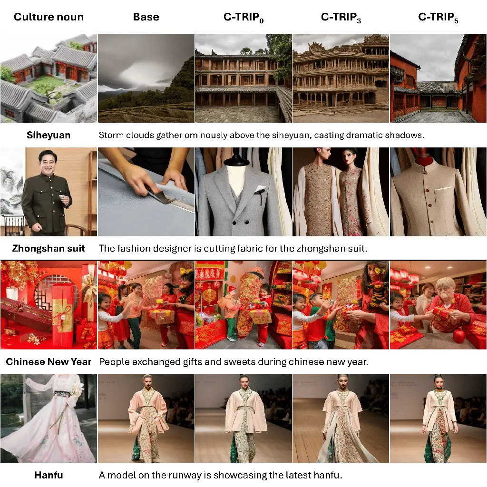

Figure 16: Additional Qualitative Sample for Chinese culture. The top
two images show the results of C-TRIP for culture nouns categorized
under UC nouns, while the bottom two images present the result for
culture nouns categorized under RC nouns.

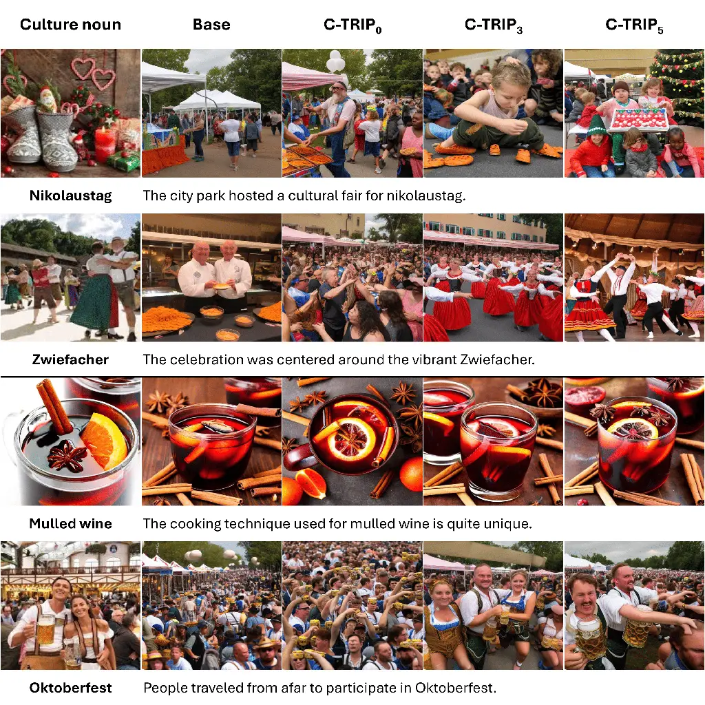

Figure 17: Additional Qualitative Sample for German culture. The top two
images show the results of C-TRIP for culture nouns categorized under UC
nouns, while the bottom two images present the result for culture nouns
categorized under RC nouns.

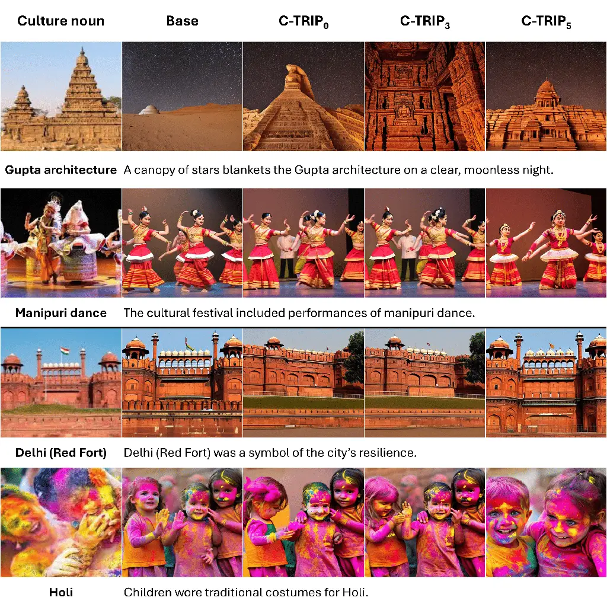

Figure 18: Additional Qualitative Sample for Indian culture. The top two
images show the results of C-TRIP for culture nouns categorized under UC
nouns, while the bottom two images present the result for culture nouns
categorized under RC nouns.

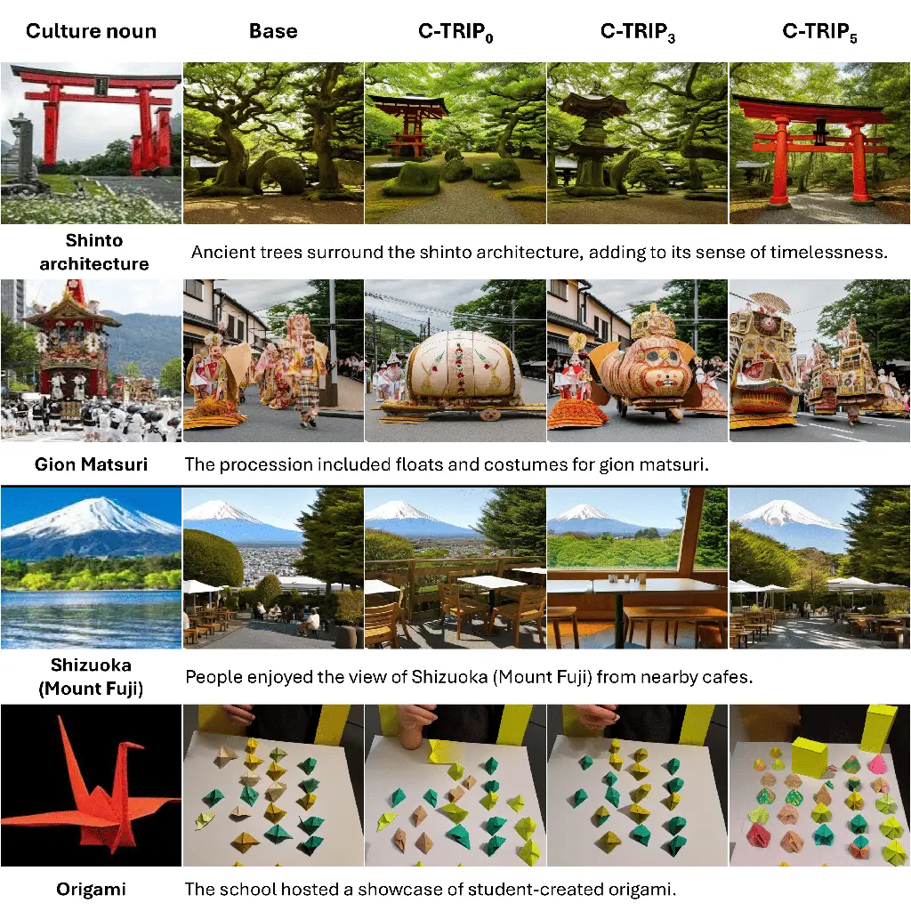

Figure 19: Additional Qualitative Sample for Japanese culture. The top
two images show the results of C-TRIP for culture nouns categorized
under UC nouns, while the bottom two images present the result for
culture nouns categorized under RC nouns.

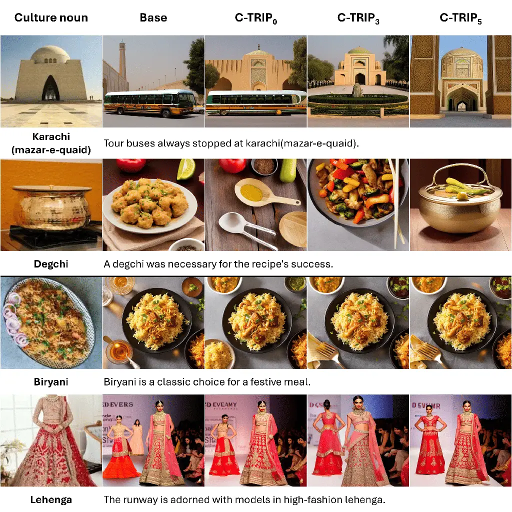

Figure 20: Additional Qualitative Sample for Pakistani culture. The top
two images show the results of C_TRIP for culture nouns categorized
under UC nouns, while the bottom two images present the result for
culture nouns categorized under RC nouns.

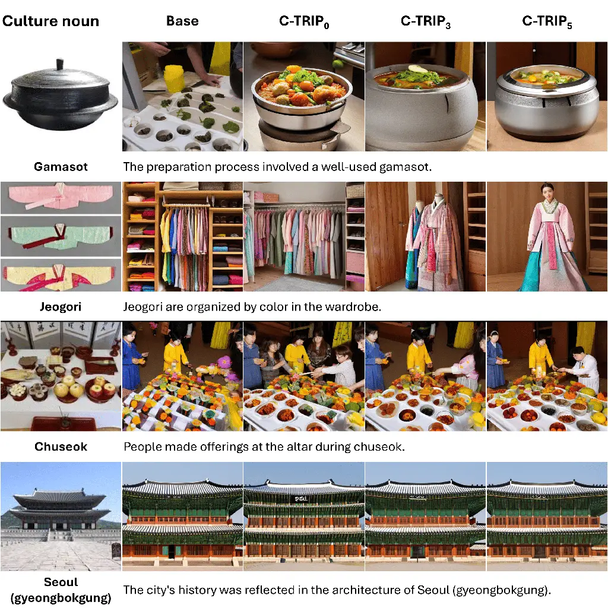

Figure 21: Additional Qualitative Sample for Korean culture. The top two
images show the results of C-TRIP for culture nouns categorized under UC
nouns, while the bottom two images present the result for culture nouns
categorized under RC nouns.

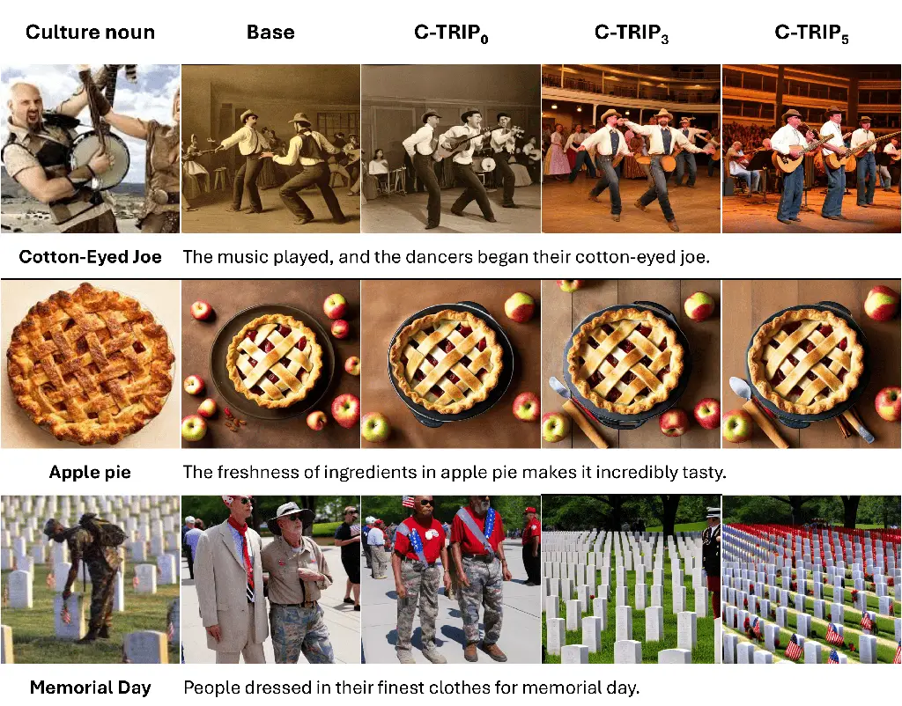

Figure 22: Additional Qualitative Sample for American culture. The top
one image show the results of C-TRIP for culture nouns categorized under
UC nouns (The United States has no culture nouns categorized under Q1.),
while the bottom two images present the result for culture nouns
categorized under RC nouns.

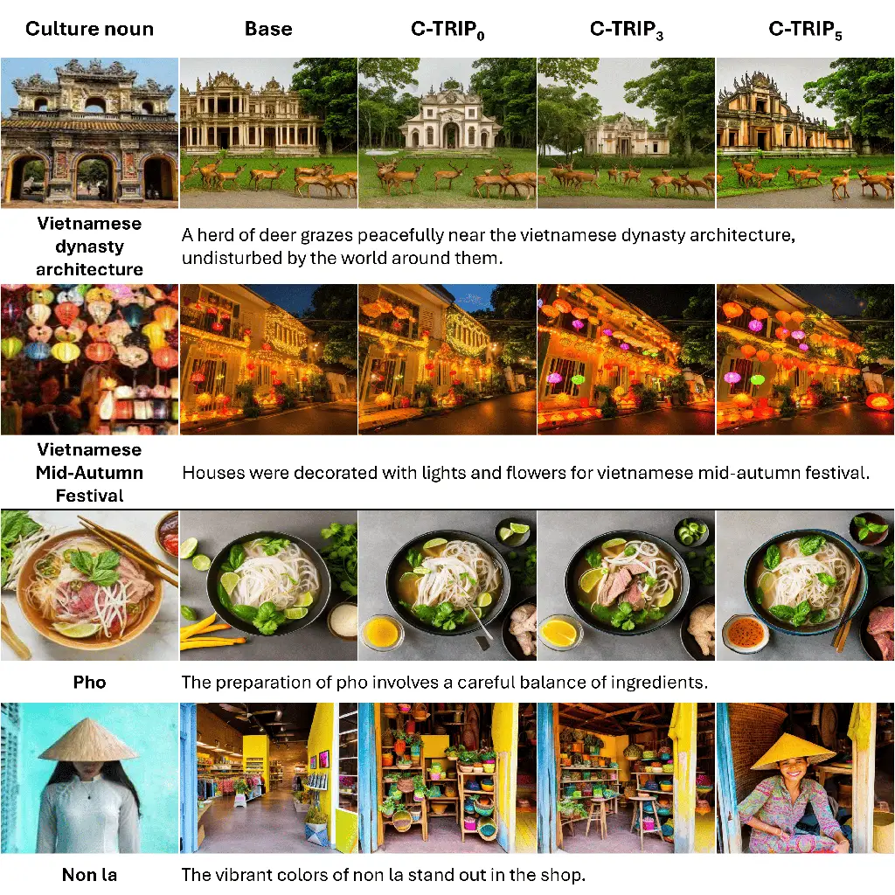

Figure 23: Additional Qualitative Sample for Vietnamese culture. The top
two images show the results of C-TRIP for culture nouns categorized
under UC nouns, while the bottom two images present the result for
culture nouns categorized under RC nouns.
