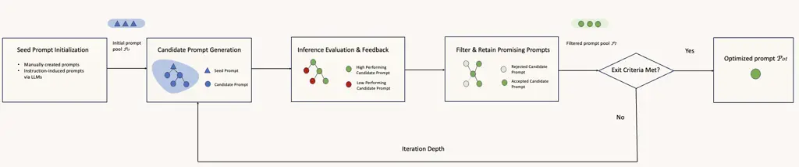

# A Systematic Survey of Automatic Prompt Optimization Techniques

Kiran Ramnath    Kang Zhou    Sheng Guan    Soumya Smruti Mishra    Xuan
Qi    Zhengyuan Shen Affiliation: Shuai Wang, Sangmin Woo, Sullam
Jeoung, Yawei Wang, Haozhu Wang, Han Ding, Affiliation: Yuzhe Lu,
Zhichao Xu, Yun Zhou, Balasubramaniam Srinivasan, Qiaojing Yan, Yueyan
Chen, Affiliation: Haibo Ding, Panpan Xu,    Lin Lee Cheong
Affiliation: Amazon Web Services Affiliation: 
{raxkiran,zhoukang,shguan,soumish,xuaqi,donshen,
wshui,sangminw,sullamij,  
yawenwan, haozhuw, handing, yuzhelu, xzhichao, yunzzhou, srbalasu,
qiaojiny, yyanc, hbding, xupanpan, lcheong}@amazon.com

###### Abstract

Since the advent of large language models (LLMs), prompt engineering has
been a crucial step for eliciting desired responses for various Natural
Language Processing (NLP) tasks. However, prompt engineering remains an
impediment for end users due to rapid advances in models, tasks, and
associated best practices. To mitigate this, Automatic Prompt
Optimization (APO) techniques have recently emerged that use various
automated techniques to help improve the performance of LLMs on various
tasks. In this paper, we present a comprehensive survey summarizing the
current progress and remaining challenges in this field. We provide a
formal definition of APO, a 5-part unifying framework, and then proceed
to rigorously categorize all relevant works based on their salient
features therein. We hope to spur further research guided by our
framework.

## 1 Introduction

Since McCann et al. (2018) cast multi-task NLP as Question Answering,
using prompts as inputs has become the standard way to elicit desired
responses from Large Language Models (LLMs). Furthermore, LLMs’ few-shot
learning Brown et al. (2020), instruction-following Ouyang et al.
(2022), and zero-shot reasoning capabilities Kojima et al. (2023) have
led to a widespread proliferation of prompting tricks for various tasks
and model variants. However, LLMs still exhibit unpredictable
sensitivity to various factors (explanation of the task Li et al.
(2023b),ordering Liu et al. (2024a), stylistic formatting Sclar et al.
(), etc.) causing a performance gap between two prompts that are
semantically similar, thereby adding impediments for adoption by end
users. Against this backdrop, Black-Box Automatic Prompt Optimization
(APO) techniques have emerged that improve task performance via
automated prompt improvements. The possess various attractive features -
(1) they do not require parameter access on LLMs performing the task,
(2) they systematically search through the prompt solution space, and
(3) they retain human interpretability of prompt improvements. In this
survey paper, we aim to highlight the advances in the field. Our core
contribution is a 5-part APO taxonomy combined with a comprehensive
fine-grained categorization of various design choices therein (see Fig.
1, Tables 2, 3, 4 in Appendix). We hope our framework will be
informational for new and seasoned researchers alike, enabling further
research on open questions.

{forest}

Figure 1: Taxonomy of Automatic Prompt Optimization

## 2 Automatic Prompt Optimization Formulation

We formalize the process of automatic prompt optimization (APO) as
follows. Given a task model $`M_{task}`$, initial prompt $`\rho`$
$`\in V`$, the goal of an APO-system $`M_{APO}`$ is to obtain the best
performing prompt-template $`\rho^{opt}`$ under a metric $`f\in F`$ and
eval-set $`D_{val}`$

```math
\displaystyle{\rho^{opt}:=\arg\max_{\begin{subarray}{c}\rho\in V\end{subarray}}E_{x\sim D_{val}}[f(M_{task}(\rho\oplus x))]} \tag{1}
```

This objective function is not tractable for discrete prompt
optimization as token-sequence search spaces are combinatorial. Instead,
APO techniques follow the general anatomy as described in Algorithm 1 to
obtain approximate solutions.

1: $`P_{0}:=\{\rho_{1},\rho_{2},\ldots,\rho_{k}\}`$ $`\triangleright`$
§3. Seed prompts

2: $`D_{val}:=\{(x_{1},y_{1})\}_{i=1}^{n}`$ $`\triangleright`$
Validation set

3: $`f_{1},\ldots,f_{m}\in F`$ $`\triangleright`$ §4. Inference
evaluation

4: for $`t=1,2,\ldots,N`$ do $`\triangleright`$ §7. Iteration depth

5: $`\triangleright`$ §5. Generate prompt candidates

6:   $`G_{t}:=M_{{}_{APO}}(P,D_{val},F)`$

7: $`\triangleright`$ §6. Filter and retain candidates

8:   $`P_{t}:=Select(G_{t},D_{val},F)`$

9: $`\triangleright`$ §7. Optionally check for early convergence

10:   if $`f_{convergence}\leq\epsilon`$ then

11:    exit   

12: return
$`\arg\max_{\begin{subarray}{c}\rho\in P_{N}\end{subarray}}E_{\begin{subarray}{c}x\sim D_{val}\end{subarray}}\left[f(M_{task}(\rho\oplus x))\right]`$

Algorithm 1 Prompt optimization framework



Figure 2: Representative APO system

## 3 Initialize Seed Prompts

### 3.1 Manual Instructions

Several approaches use a seed of manually created instructions that
offer interpretable and strong baselines as the basis for further
improvement,inter alia., ProteGi Pryzant et al. (2023), GPS Xu et al.
(2022), SPRIG Zhang et al. (2024b). While obtaining quality examples can
be costly, APE Zhou et al. (2022) ¹¹ 1 Note: APE stands for Automatic
Prompt Engineer method introduced by Zhou et al. (2022), not to be
confused with APO which broadly refers to the entire area of Automatic
Prompt Optimization showed that a few hundred samples are sufficient for
further optimization.

### 3.2 Instruction Induction via LLMs

Honovich et al. (2023) were the first to propose inducing LLMs to infer
human-readable prompts based on a few demonstrations $`E`$ (see Appendix
14.1 for prompt). APE Zhou et al. (2022) and DAPO Yang et al. (2024c)
use the induced seed instructions for further optimization, while MOP
Wang et al. (2025) and GPO Li et al. (2023c) use APE to induce
cluster-specific prompts. Apart from demonstrations, SCULPT Kumar et al.
(2024) induced instructions from task-READMEs, while UniPrompt Juneja
et al. (2024) used LLMs to fill-in structured templates.

[TABLE]

Table 1: Comparison of some APO techniques under our framework (Tables
2,3,4 show full comparison)

## 4 Inference Evaluation and Feedback

The evaluation step helps identify promising prompt candidates in each
iteration. Some methods also use LLM feedback on prompt-response pairs
to help generate more prompt candidates.

### 4.1 Numeric Score Feedback

#### 4.1.1 Accuracy

Using task-specific accuracy metrics is the most straightforward and
widespread way of eliciting feedback, i.a., Zhou et al. (2022); Zhou
et al. (2023); Zhang et al. (2024b); Khattab et al. (2022).
Classification and MCQ-based QA tasks use exact accuracy, while
code-related tasks measure execution accuracy. Text generation tasks
(summarization, translation, creative writing) employ flexible metrics
like BLEU-N, Rouge-N, Rouge-N-F1, or embedding-based measures such as
BERTScore Zhang\* et al. (2020) Honovich et al. (2023); Dong et al.
(2024b).

#### 4.1.2 Reward-model Scores

Given the limitations of rigid accuracy metrics, some approaches
proposed using learned reward models to provide more nuanced evaluations
of prompts-response pairs Deng et al. (2022); Sun et al. (2024a); Kong
et al. (2024). OIRL Sun et al. (2024a) trained an XGBoost-based reward
model that takes query-prompt embedding pairs as input and predicts
whether the prompt will elicit correct answers from the language model
and use it to select appropriate prompts for specific queries using a
best-of-N strategy. DRPO Amini et al. (2024) follows an LLM-based reward
modeling approach using both predefined and dynamic reward criteria. It
first optimizes in-context learning examples $`E`$, and using that it
optimizes the specific task prompt.

#### 4.1.3 Entropy-based Scores

Entropy-based scores evaluate the entire output distribution induced by
candidates, as opposed to a single inference instance. They are
gradient-free but require access to the entire output probability
distribution, something not usually possible with black-box LLMs. CLAPS
Zhou et al. (2023) leverages the negative incremental cross-entropy of
$`\pi_{(x_{i}\oplus v\in V)}`$ v/s $`\pi_{(x_{i})}`$ to identify
promising words $`v\in V`$ to add to the prompt. The topK words are then
used as candidate tokens from which to construct candidate prompts.
GRIPS Prasad et al. (2023) simply added an entropy term to the
task-weighted accuracy
$`-\sum\pi_{\rho}(y)\,ln(\pi_{\rho}(y))+\frac{1}{|T|}\sum\mathbf{1}(y=\hat{y})`$
to prioritize output diversity in potential prompt candidates.

#### 4.1.4 Negative Log-likelihood of Output

Some approaches like APE, GPS Xu et al. (2022), PACE Dong et al. (2024b)
consider the negative log-likelihood (NLL) of token sequences under the
target LLM, i.e., $`-\log(\pi_{\rho}(y))`$. This however requires the
log-probabilities to be accessible during the decoding of each token,
limiting its applicability. The NLL for ground truth one-hot
token-sequence is equivalent to the cross-entropy.

### 4.2 LLM Feedback

A popular paradigm to augment or fully replace numeric scores is to use
textual feedback generated by $`LLM_{Evaluator}`$ Wang et al. (2024a);
Long et al. (2024); Sinha et al. (2024). It is versatile because it can
evaluate both the response as well as the prompt input. It can directly
aid the prompt rewriting process while being flexible to individual
tasks as it only needs natural language instructions for general-purpose
LLMs as opposed to task-specific handcrafting of metrics. A potential
downside is the inference cost incurred due to an additional LLM call.
All the LLM feedback approaches provide multiple feedback data and
broadly fall into two categories - improving a single prompt candidate
versus improving multiple prompt candidates (discussed below, examples
in Appendix 14.3).

#### 4.2.1 Improving Single Candidate

SCULPT Kumar et al. (2024) introduces a systematic method for tuning
long, unstructured prompts by employing a hierarchical tree structure
and two-step feedback loops - preliminary assessment and error
assessment - to evaluate and correct prompts before and after execution.
The feedback updates the hierarchical prompt tree which is then
back-synthesized into a new prompt candidate. PACE Dong et al. (2024b)
applies an actor-critic editing framework to the prompt refinement
process itself, allowing for more dynamic and adaptive adjustments.
Overcoming the limitations of optimizing a single metric, CRISPO He
et al. (2025) adopts a multi-aspect critique-suggestion meta-prompt to
highlight flaws in the generated response across multiple dimensions
such as style, precision, and content alignment. Thereafter it leverages
detailed, aspect-specific feedback and iteratively updates the prompts.
Autohint Sun et al. (2023) summarizes feedback for multiple incorrect
inferences via hints to instill improvements into a single prompt
candidate.

#### 4.2.2 Improving Multiple Candidates

ProTeGi Pryzant et al. (2023) and TextGrad Yuksekgonul et al. (2024)
leverage textual “gradients” to guide the discrete prompt optimization
procedure, very similar to the gradient-descent style of continuous
prompt optimization approaches. Different from continuous
gradient-descent, ProTeGi sampled multiple “gradients” i.e. directions
of improvement, and each such “gradient” is used to generate several
prompt candidates for evaluation in the next iteration. PromptAgent Wang
et al. (2024a) similarly used an error collection approach to emulate
expert-written prompts that consisted of clear sections like “Task
description”, “Domain Knowledge”, “Solution Guidance”, “Exception
Handling”, “Output Formatting”. PREFER Zhang et al. (2024a) utilizes a
feedback-reflect-refine cycle to aggregate feedback into multiple
prompts in an ensemble to improve the model’s ability to generalize
across various tasks. Survival of the Safest (SOS) Sinha et al. (2024)
added safety-score into a multi-objective prompt optimization framework
that used an interleaved strategy to balance performance and security in
LLMs simultaneously. To avoid accidentally damaging well-functioning
prompts, StraGo Wu et al. (2024) summarized strategic guidance based on
both correct and incorrect predictions as feedback.

### 4.3 Human-feedback

A few works also incorporate human feedback, either during compile-time
or inference-time in the prompt construction / optimization process.
Joko et al. (2024) proposed “Generative Active Task Elicitation” to
better capture human preferences. It prompts a language model to
interactively ask questions and infer human preferences conditioned on
the history of free-form interaction. Cheng et al. (2024) trained a
smaller LLM to optimize input prompts based on user preference feedback,
achieving up to 22% increase in win rates for ChatGPT and 10% for GPT-4.
PROMST Chen et al. (2024) tackles the challenges of multi-step tasks by
incorporating human-designed feedback rules and a learned heuristic
model. APOHF Lin et al. (2024) focuses on optimizing prompts using only
human preference feedback rather than numeric scores, employing a
dueling bandits-inspired strategy to efficiently select prompt pairs for
preference feedback, proving effective for tasks like text-to-image
generation and response optimization.

## 5 Candidate Prompt Generation

In this step, one or more candidate prompts are generated that are most
likely to result in an improvement in a metric of interest $`f\in F`$.
The approaches reviewed below range from simple rule-based edits (sec.
5.1) to sophisticated agentic systems that combine with LLM-based
evaluations (sec. 4.2) and various filtering strategies (sec. 6).

### 5.1 Heuristic-based Edits

Several works proposed heuristic-based mechanisms to make edits to
intermediate prompt candidates to generate newer candidates. They range
from edits at the word / phrase / sentence-level (either simple
rule-based or LLM-generated), or metric-driven incremental search. While
these strategies may not result in the most optimal solution, they help
in making the discrete prompt optimization problem computationally
tractable.

#### 5.1.1 Monte Carlo Sampling

ProTeGi Pryzant et al. (2023) uses Monte carlo sampling to explore
combinatorial discrete solution spaces in an incremental fashion - it
samples multiple textual gradients to use to generate prospective
candidates, and spawns paraphrases as monte-carlo successors for
evaluation. PromptAgent Wang et al. (2024a) uses a tree-variant called
Monte Carlo Tree Search (MCTS) which consists of 4 steps — Selection,
Expansion, Simulation, and Backpropagation (also explained in Sec. 6).

#### 5.1.2 Genetic Algorithm

A significant line of work applies the well-studied genetic algorithms
to make discrete edits to texts. The common recipe for several genetic
algorithms is 1/ Mutate and 2/ Cross-over components from promising
candidates. Token mutations: SPRIG Zhang et al. (2024b) and CLAPS
perform token-level mutations. SPRIG uses a starting corpus of 300
components grouped into categories like COT, roles, styles, emotions,
scenarios, and good properties. It performs add/rephrase/swap/delete,
highlighting complementary strengths of optimizing system prompts
alongside task-prompts (via methods like ProTeGi) to enhance accuracy
across multiple diverse domains, languages, and tasks without needing
repeated task-specific optimizations.

LLM-based mutation: LMEA Liu et al. (2023), SOS Sinha et al. (2024), and
StraGo Wu et al. (2024) uses mutation prompts with LLMs to overcome the
traditional complexity of designing tailored operators for cross-over /
mutation. PromptBreeder Fernando et al. (2023) advocates
self-referential improvement of all prompts in the prompt optimization
system - Direct Mutation of task prompts, Hypermutation of mutation
prompts themselves, Lamarckian Mutation where prompts are
reverse-engineered from successful examples (similar to Instruction
Induction Honovich et al. (2023), and finally Crossover and Shuffling to
improve diversity of the prompt pool. EvoPrompt Guo et al. (2024) use
Differential Evolution - where differences between existing prompts is
incorporated to form new prompt candidates to overcome the problem of
local optima. AELP Hsieh et al. (2024) also uses mutation operators to
perform sentence-level edits in an iterative fashion. They include
sentence-level histories of reward $`\{(s_{t-1},s_{t},r_{t})\}`$ in the
mutation prompt in order to avoid local optima and accidentally
returning to sub-optimal versions. GPS Xu et al. (2022) used
Back-translation, Sentence Continuation, and Cloze transformations to
perform prompt mutation. PromptWizard Agarwal et al. (2024) proposed a
pipeline combining several steps including iterative improvement, few
shot example synthesis and selection, utilizing LLM’s reasoning
capability to improve and validate the prompt, and finally an expert
persona to ensure consistency of the style of generated prompts.

#### 5.1.3 Word / Phrase Level Edits

Several word-edit approaches first identify "influential" tokens in the
prompts. COPLE Zhan et al. (2024) argued that LLMs exhibit lexical
sensitivity, showing that merely replacing a few words with their
synonyms can yield significant improvements. First, “influential” tokens
are identified where expected loss on dev-set
$`E_{D_{val}}[L(y,\hat{y})]`$ drops the most after removing that token
versus the original prompt, and then influential tokens are replaced
using predictions from a Masked-Language Models. This token-replacement
approach is also attractive as a standalone post-processing step for
long prompts that are already optimized using other LLM-based
approaches. GRIPS Prasad et al. (2023) argues that phrase level edition
is an effective and interpretable method to optimize prompts, leveraging
4 basic edit operations -add, delete, paraphrase, and swap

#### 5.1.4 Vocabulary Pruning

Some works prune the vocabulary space $`V`$ to $`V_{pruned}`$ for
decoding the next token for the optimized prompt $`\rho^{*}`$. CLAPS
Zhou et al. (2023) argued that general search spaces are highly
redundant and use K-means clustering to find word-clusters and retain
top-2000 words closest to cluster centroids. BDPL Diao et al. (2022)
used pairwise mutual information (PMI) to retain top co-occuring ngrams
for decoding. PIN Choi et al. (2024) instead added regularization in the
form of Tsallis-entropy (ideal for heavy-tailed distributions like
natural language) for the RL training of a prompt generation network, to
reduce the probability mass for unlikely tokens and improve
interpetability.

### 5.2 Editing via Auxiliary Trained NN

Some approaches leverage a trained auxiliary neural network to edit the
initial prompt for obtaining desired improvements. We include approaches
where the finetuned network is different and smaller than the task
network.

#### 5.2.1 Reinforcement-learning

Multi-objective Optimization techniques Jafari et al. (2024) demonstrate
superiority over simple reward averaging, particularly through
volume-based methods that effectively balance competing objectives.
Dynamic prompt modification strategies, introduced through prompt
rewriting Kong et al. (2024), directional stimulus prompting Li et al.
(2023d) and test-time editing Zhang et al. (2022) solve the important
goal of moving beyond static prompt generation. Prompt-OIRL Sun et al.
(2024a) also tackled test-time optimization objective by learning an
offline reward model and subsequently using a best-of-N strategy to
recommend the optimal prompt in a query-dependent fashion. BDPL Diao
et al. (2022) optimized discrete prompts using variance-reduced policy
gradient algorithm to estimate gradients, allowing user devices to
fine-tune tasks with limited API calls.

#### 5.2.2 Finetuning LLMs

BPO Cheng et al. (2024) trains a smaller 7B model to align itself to
task-performance on individual LLMs using reward-free alignment. FIPO Lu
et al. (2025) trains a local model (7B - 13B) to perform prompt
optimizations to preserve privacy and adapt to target models better
leveraging both data diversification and strategic fine-tuning such as
SFT, preference optimization, and iterative preference learning.

#### 5.2.3 Generative Adversarial Networks

Long et al. (2024) framed the prompt optimization process in the GAN
setting. The LLM generator takes question and the generation prompt to
produce output. The (input, output) pairs are evaluated by an LLM
powered discriminator, whose goal is to identify generated pairs from
ground truth pairs. Both generator and the discriminator are jointly
optimized using adversarial loss, by utilizing a prompt modifier LLM to
rewrite their prompts.

### 5.3 Metaprompt Design

PE2 Ye et al. (2024) argued that previous works under-explored
meta-prompt search space. OPRO (Yang et al., 2024a) proposes a
meta-prompt design (see Appendix 14.2) which includes the optimization
problem description in natural language and previously generated
solutions (multiple solutions per stage for diversity) and scores
alongisde the meta-instruction for prompt refinement. DAPO Yang et al.
(2024c) utilizes a well-designed meta-instruction to guide the LLM in
generating high-quality and structured initial prompts (contain
task-specific info, e.g. task type and description, output format and
constraints, reasoning process, professional tips) by observing given
input-output exemplars. Then, DAPO iteratively optimizes the prompts at
the sentence level, leveraging previous tuning experience to expand
prompt candidates.

### 5.4 Coverage-based

Some approaches seek to "cover" the entire problem space - either within
a single prompt, or using multiple prompts working individually or in an
ensemble during inference.

#### 5.4.1 Single Prompt-expansion

AMPO Yang et al. (2024d) uses LLM feedback to enumerate all the failure
cases based on the evaluation-set $`D_{val}`$ and then enlists each of
them in the meta-instruction in an if-then-else format using 3 modules -
1/ Pattern Recognition, 2/ Branch Adjustment, and 3/ Branch Pruning to
decide whether to enhance existing branches, or to grow new branches.
Similarly, UNIPROMPT focused on explicitly ensuring that various
semantic facets of a task get represented in the final prompt. It
designs a human-like (manual) prompt engineering approach (UniPrompt)
with two stages: a) task facets initialization using background
knowledge, and b) refinement using examples.

#### 5.4.2 Mixture of Experts

Wang et al. (2025) introduced the Mixture-of-Expert-Prompts where each
expert is a task-prompt to be used for specialized inference. MOP first
clusters all demonstrations using K-means clustering. Then, the
Region-based Joint Search (RBJS) (sec.6.3) algorithm generates the
appropriate instruction for each exemplar-cluster via instruction
induction (sec.3.2) based on a mix of in-cluster and out-of-cluster
demonstrations to cover “blind-spots”. During inference, a single expert
prompt is invoked whose cluster centroid $`\mu_{c}`$ is closest to the
instance-embedding $`\arg\min_{{}_{C}}||\phi(x_{i})-\mu_{c}||_{2}`$.

#### 5.4.3 Ensemble Methods

PromptBoosting Hou et al. (2023), BoostedPrompting Pitis et al. (2023),
PREFER Zhang et al. (2024a), etc. are ensemble methods that invoke
multiple prompts during inference and combine them to generate the final
output $`\hat{y}=y_{0}+\Sigma_{m}\beta_{i}y_{i}`$. GPO Li et al. (2023c)
also uses labeled source data to generate an ensemble of prompts, which
are applied to unlabeled target data to generate output through majority
voting.

### 5.5 Program Synthesis

Program-synthesis based approaches transform LLM pipelines into
structured, modular components that can be systematically optimized and
composed. These optimization techniques iteratively refine instructions
and demonstrations for each module to improve the entire pipeline’s
performance, DSP Khattab et al. (2022) introduces a three-stage
framework for retrieval-augmented inference: Demonstrate (generates
task-specific demonstrations), Search (retrieves relevant information),
and Predict (combines retrieved info with demonstrations). DSPY Khattab
et al. (2024) transforms LLM pipelines into text transformation graphs -
introducing parameterized models, learning through demonstrations, and a
compiler that optimizes pipelines. DLN Sordoni et al. (2023) similarly
considers chained LLM calls as stacked deep language networks performing
variational inference, where the learnable parameters for each layer are
task-decomposed prompt templates. MIPRO Opsahl-Ong et al. (2024)
automates the optimization of multi-stage language model programs by
improving instructions and demonstrations for each module. SAMMO
Schnabel and Neville (2024) proposed symbolic prompt programming,
representing prompts as directed-acyclic-graphs (DAG). A set of
user-defined node mutation rules guide the mutation-search to find the
optimal DAG, which is then converted back to a prompt.

## 6 Filter and Retain Promising Prompts

In this step, promising prompt candidates are filtered for further
optimization.

### 6.1 TopK Greedy Search

The simplest mechanism to iteratively search through prompt candidate
sets is a greedy topK search where in each iteration of the
optimization, the top-K best-performing candidates on mini-batch of data
instances $`D_{val}`$ are retained for further iterations (e.g. -
ProTeGi, AELP. This differs from beam-search which judges partial
solutions’ based on the reward for the entire trajectory of prompt edits
$`r(\{\rho_{1}^{1},\rho_{2}^{1},\ldots,\rho_{t}^{1}\})`$.

### 6.2 Upper Confidence Bound and Variants

Relying on a single static evaluation dataset can lead to biases in the
selection procedure and finally suboptimal solutions. ProTeGi, SPRIG,
inter alia, cast the candidate prompt selection problem as that of
bandit search - identifying the most suitable arm (prompt candidate)
operating on a fixed computation budget. They use the Upper Confidence
Bounds (UCB, Algorithm 2) which balances exploration with exploitation.
In each iteration of prompt optimization, they sample a different
evaluation dataset $`D_{sample}\in D_{val}`$, and maintain a moving
estimate of the optimality of each arm (i.e. prompt). In each iteration,
the playout filters top-B prompt candidates with the greatest score for
further exploration. PromptAgent uses a variation of UCB called UCB for
Trees (UCT) which are used in the setting of contextual bandits (i.e.
the action-space and the reward function is state-dependent). AELP Hsieh
et al. (2024) used a modification called Linear UCB Li et al. (2010)
which uses a closed form linear estimate based on the reward
trajectories of previously sampled edits as well as prompt embedding
$`\phi(s)`$ to select the next best-arm.

### 6.3 Region-based Joint Search

MOP Wang et al. (2025) proposes a Mixture-of-Expert-Prompts performing
prompt optimization for each expert individual. Once C exemplar-clusters
are identified, the RBJS search first samples examples
$`D_{exemplars}\in D_{C}\cup D\setminus D_{C}`$, and then uses APE to
induct and optimize each expert instruction.

### 6.4 Metaheuristic Ensemble

PLUM Pan et al. (2024) library offered a meta-heuristic ensemble of
different search algorithms like Hill climbing, Simulated Annealing,
Genetic Algorithms, Tabu Search, and Harmony Search.

## 7 Iteration Depth

### 7.1 Fixed Steps

Most approaches choose to carry out the prompt optimization for a fixed
number of steps N.

### 7.2 Variable number of steps

GRIPS Prasad et al. (2023) concludes search when successive iterations
with negative gains breach a patience parameter, whereas PromptAgent
concluded APO when
$`r_{t}\leq\epsilon_{min}\vee r_{t}\geq\epsilon_{max}`$.

## 8 Theoretical Perspectives

### 8.1 Upper Bound of Improvement from APO

AlignPro Trivedi et al. (2025) establishes an upper bound on the gains
realizable from discrete prompt optimization under a given prompt
optimizer and also a suboptimality-gap w.r.t. RLHF-optimal policy
$`\pi^{*}`$, while a lower bound is left unexplored.

### 8.2 Other Related Perspectives

Bhargava et al. (2024) proposed a control theoretic framework to
establish bounds on the set of reachable LLM-outputs for self-attention
in terms of the singular values of its weight matrices. Liu et al.
(2024c) showed the existence of a strong transformer that can
approximate any sequence-to-sequence Lipschitz function. They also
showed the existence of “difficult” datasets that depth-limited
transformers could not commit to memory.

## 9 Challenges and Future Directions

### 9.1 Task-agnostic APO

All the surveyed APO methods assume that the task type $`T`$ is known
beforehand; additionally offline APO methods also require an evaluation
set $`D_{val}`$, something not explicitly available in production
settings. Barring a few tasks covered by Joko et al. (2024); Sun et al.
(2024a); Zhang et al. (2022); Choi et al. (2024), inference-time
optimization of multiple unknown tasks is underexplored. More robust
evaluations are needed for task-agnostic APO systems combining seen and
unseen tasks.

### 9.2 Unclear Mechanisms

Melamed et al. (2024) showed that prompts have so-called ’evil twins’
that are uninterpretable yet recover some of the performance of
gold-standard prompts. Lu et al. (2024) showed that rare gibberish
strings can serve as competitive delimiters $`\tau`$ in prompts. Yang
et al. (2024b) showed that self-reflection by LLMs can suffer from
incorrect error identification, prior biases, semantic invalidity,
leading to failure in yielding improved prompts. More studies are needed
to better uncover the mechanisms of prompt optimization.

### 9.3 APO for System Prompts / Agents

Although SPRIG explored optimizing system prompts in chat-style
settings, scalability remains a challenge - optimizing system prompts
required a predefined corpus and close to 60 hours whereas Protegi only
needed 1̃0 minutes per task. Similarly, optimizing prompts for several
components in an agentic system in a concurrent fashion poses an
exciting direction for future research.

### 9.4 Multimodal APO

Recently, textual prompt optimization has expanded to multimodal
domains: text-to-image Liu et al. (2024b); Mañas et al. (2024); Liu
et al. (2024d), text-to-video Ji et al. (2024), text-to-audio Huang
et al. (2023), and text-image alignment models like CLIP Du et al.
(2024); Mirza et al. (2024). Beyond textual prompts,  Huang et al.
(2023) explore optimizing multimodal inputs, such as images, to elicit
better responses from large multimodal models. However, the interplay
between modalities in prompt optimization remains underexplored. Future
research could develop APO frameworks to jointly optimize multimodal
prompts (eg - remove background noise from audio, add visual markers to
videos, etc.) to fully leverage their synergies.

## 10 Conclusion

In this paper, we provide a comprehensive fine-grained review of
existing APO techniques and identified key areas for future growth. It
is our aim to spur future research spawning from our survey.

## 11 Limitations

While we attempted to cover all qualifying papers, it is possible that
we may have unintentionally missed out on some relevant papers. We also
mention some of the papers that were excluded in this survey with
specific reasons in section 12.2. Also, we realize that fitting varied
research works into a single unifying framework might risk broad
categorizations for some papers, or skipping some characteristics for
others (e.g. Tempera Zhang et al. (2022) consists of both RL-based and
word/phrase-level editing techniques, applied to both instructions and
exemplars). In such cases, we categorize a paper based on its most
salient features. Another challenge is that when presenting a survey
paper under 8 pages, we had to make tradeoffs and only retain content in
the main body that was deemed most necessary. This resulted in having to
relegate a core contribution (Tables 2,3,4) which contained a rigorous
comparison of all the surveyed papers into the appendix. We have
attempted our best to strike the right balance between specificity and
brevity to present a novel framework. We also provide copious references
to interested researchers for further reading.

## References

- Agarwal et al. (2024) Eshaan Agarwal, Joykirat Singh, Vivek Dani,
  Raghav Magazine, Tanuja Ganu, and Akshay Nambi. 2024. [Promptwizard:
  Task-aware prompt optimization
  framework](http://arxiv.org/abs/2405.18369).
- Alva-Manchego et al. (2020) Fernando Alva-Manchego, Louis Martin,
  Antoine Bordes, Carolina Scarton, Benoît Sagot, and Lucia
  Specia. 2020. Asset: A dataset for tuning and evaluation of sentence
  simplification models with multiple rewriting transformations. In
  _Proceedings of the 58th Annual Meeting of the Association for
  Computational Linguistics_, pages 4668–4679.
- Amini et al. (2024) Afra Amini, Tim Vieira, and Ryan Cotterell. 2024.
  [Direct preference optimization with an
  offset](https://doi.org/10.18653/v1/2024.findings-acl.592). In
  _Findings of the Association for Computational Linguistics: ACL 2024_,
  pages 9954–9972, Bangkok, Thailand. Association for Computational
  Linguistics.
- Anantha et al. (2020) R. Anantha, Svitlana Vakulenko, Zhucheng Tu,
  S. Longpre, Stephen G. Pulman, and Srinivas Chappidi. 2020.
  [Open-domain question answering goes conversational via question
  rewriting](https://api.semanticscholar.org/CorpusID:222290679). In
  _North American Chapter of the Association for Computational
  Linguistics_.
- Andreas et al. (2020) Jacob Andreas, Johannes Bufe, David Burkett,
  Charles C. Chen, Joshua Clausman, Jean Crawford, Kate Crim, Jordan
  DeLoach, Leah Dorner, Jason Eisner, Hao Fang, Alan Guo, David
  Leo Wright Hall, Kristin Delia Hayes, Kellie Hill, Diana Ho, Wendy
  Iwaszuk, Smriti Jha, Dan Klein, Jayant Krishnamurthy, Theo Lanman,
  Percy Liang, C. H. Lin, Ilya Lintsbakh, Andy McGovern, Aleksandr
  Nisnevich, Adam Pauls, Dmitrij Petters, Brent Read, Dan Roth, Subhro
  Roy, Jesse Rusak, Beth Ann Short, Div Slomin, B Snyder, Stephon
  Striplin, Yu Su, Zachary Tellman, Sam Thomson, A. A. Vorobev, Izabela
  Witoszko, Jason Wolfe, A. G. Wray, Yuchen Zhang, and Alexander
  Zotov. 2020. [Task-oriented dialogue as dataflow
  synthesis](https://api.semanticscholar.org/CorpusID:221822514).
  _Transactions of the Association for Computational Linguistics_,
  8:556–571.
- Bansal et al. (2019) Trapit Bansal, Rishikesh Jha, and Andrew
  McCallum. 2019. [Learning to few-shot learn across diverse natural
  language classification
  tasks](https://api.semanticscholar.org/CorpusID:207852358). In
  _International Conference on Computational Linguistics_.
- Bhargava et al. (2024) Aman Bhargava, Cameron Witkowski, Shi-Zhuo
  Looi, and Matt Thomson. 2024. [What’s the magic word? a control theory
  of llm prompting](http://arxiv.org/abs/2310.04444).
- Bisk et al. (2019) Yonatan Bisk, Rowan Zellers, Ronan Le Bras,
  Jianfeng Gao, and Yejin Choi. 2019. [Piqa: Reasoning about physical
  commonsense in natural
  language](https://api.semanticscholar.org/CorpusID:208290939). In
  _AAAI Conference on Artificial Intelligence_.
- Bowman et al. (2015) Samuel R Bowman, Gabor Angeli, Christopher Potts,
  and Christopher D Manning. 2015. A large annotated corpus for learning
  natural language inference. _arXiv preprint arXiv:1508.05326_.
- Brown et al. (2020) Tom B. Brown, Benjamin Mann, Nick Ryder, Melanie
  Subbiah, Jared Kaplan, Prafulla Dhariwal, Arvind Neelakantan, Pranav
  Shyam, Girish Sastry, Amanda Askell, Sandhini Agarwal, Ariel
  Herbert-Voss, Gretchen Krueger, Tom Henighan, Rewon Child, Aditya
  Ramesh, Daniel M. Ziegler, Jeffrey Wu, Clemens Winter, Christopher
  Hesse, Mark Chen, Eric Sigler, Mateusz Litwin, Scott Gray, Benjamin
  Chess, Jack Clark, Christopher Berner, Sam McCandlish, Alec Radford,
  Ilya Sutskever, and Dario Amodei. 2020. [Language models are few-shot
  learners](http://arxiv.org/abs/2005.14165).
- Budzianowski et al. (2018) Paweł Budzianowski, Tsung-Hsien Wen,
  Bo-Hsiang Tseng, Iñigo Casanueva, Stefan Ultes, Osman Ramadan, and
  Milica Gasic. 2018. Multiwoz-a large-scale multi-domain wizard-of-oz
  dataset for task-oriented dialogue modelling. In _Proceedings of the
  2018 Conference on Empirical Methods in Natural Language Processing_,
  pages 5016–5026.
- Cer et al. (2017) Daniel Matthew Cer, Mona T. Diab, Eneko Agirre,
  Iñigo Lopez-Gazpio, and Lucia Specia. 2017. [Semeval-2017 task 1:
  Semantic textual similarity multilingual and crosslingual focused
  evaluation](https://api.semanticscholar.org/CorpusID:4421747). In
  _International Workshop on Semantic Evaluation_.
- Cettolo et al. (2017) Mauro Cettolo, Marcello Federico, Luisa
  Bentivogli, Niehues Jan, Stüker Sebastian, Sudoh Katsuitho, Yoshino
  Koichiro, and Federmann Christian. 2017. [Overview of the iwslt 2017
  evaluation
  campaign](https://api.semanticscholar.org/CorpusID:21675165). In
  _International Workshop on Spoken Language Translation_.
- Chen et al. (2024) Yongchao Chen, Jacob Arkin, Yilun Hao, Yang Zhang,
  Nicholas Roy, and Chuchu Fan. 2024. [PRompt optimization in multi-step
  tasks (PROMST): Integrating human feedback and heuristic-based
  sampling](https://doi.org/10.18653/v1/2024.emnlp-main.226). In
  _Proceedings of the 2024 Conference on Empirical Methods in Natural
  Language Processing_, pages 3859–3920, Miami, Florida, USA.
  Association for Computational Linguistics.
- Cheng et al. (2024) Jiale Cheng, Xiao Liu, Kehan Zheng, Pei Ke,
  Hongning Wang, Yuxiao Dong, Jie Tang, and Minlie Huang. 2024.
  [Black-box prompt optimization: Aligning large language models without
  model training](https://doi.org/10.18653/v1/2024.acl-long.176). In
  _Proceedings of the 62nd Annual Meeting of the Association for
  Computational Linguistics (Volume 1: Long Papers)_, pages 3201–3219,
  Bangkok, Thailand. Association for Computational Linguistics.
- Chiang et al. (2023) Wei-Lin Chiang, Zhuohan Li, Zi Lin, Ying Sheng,
  Zhanghao Wu, Hao Zhang, Lianmin Zheng, Siyuan Zhuang, Yonghao Zhuang,
  Joseph E Gonzalez, et al. 2023. Vicuna: An open-source chatbot
  impressing gpt-4 with 90%\* chatgpt quality. _See https://vicuna.
  lmsys. org (accessed 14 April 2023)_, 2(3):6.
- Choi et al. (2023) Minje Choi, Jiaxin Pei, Sagar Kumar, Chang Shu, and
  David Jurgens. 2023. Do llms understand social knowledge? evaluating
  the sociability of large language models with socket benchmark. In
  _Proceedings of the 2023 Conference on Empirical Methods in Natural
  Language Processing_, pages 11370–11403.
- Choi et al. (2024) Yunseon Choi, Sangmin Bae, Seonghyun Ban, Minchan
  Jeong, Chuheng Zhang, Lei Song, Li Zhao, Jiang Bian, and Kee-Eung
  Kim. 2024. [Hard prompts made interpretable: Sparse entropy
  regularization for prompt tuning with
  rl](http://arxiv.org/abs/2407.14733).
- Cieri et al. (2022) Christopher Cieri, Mark Liberman, Sunghye Cho,
  Stephanie Strassel, James Fiumara, and Jonathan Wright. 2022.
  [Reflections on 30 years of language resource development and
  sharing](https://aclanthology.org/2022.lrec-1.57). In _Proceedings of
  the Thirteenth Language Resources and Evaluation Conference_, pages
  543–550, Marseille, France. European Language Resources Association.
- Clark et al. (2018) Peter Clark, Isaac Cowhey, Oren Etzioni, Tushar
  Khot, Ashish Sabharwal, Carissa Schoenick, and Oyvind Tafjord. 2018.
  [Think you have solved question answering? try arc, the ai2 reasoning
  challenge](https://api.semanticscholar.org/CorpusID:3922816). _ArXiv_,
  abs/1803.05457.
- Cobbe et al. (2021) Karl Cobbe, Vineet Kosaraju, Mohammad Bavarian,
  Mark Chen, Heewoo Jun, Lukasz Kaiser, Matthias Plappert, Jerry Tworek,
  Jacob Hilton, Reiichiro Nakano, et al. 2021. Training verifiers to
  solve math word problems. _arXiv preprint arXiv:2110.14168_.
- Conover et al. (2023) Mike Conover, Matt Hayes, Ankit Mathur, Jianwei
  Xie, Jun Wan, Sam Shah, Ali Ghodsi, Patrick Wendell, Matei Zaharia,
  and Reynold Xin. 2023. Free dolly: Introducing the world’s first truly
  open instruction-tuned llm. _Company Blog of Databricks_.
- Cui et al. (2020) Leyang Cui, Yu Wu, Shujie Liu, Yue Zhang, and Ming
  Zhou. 2020. [Mutual: A dataset for multi-turn dialogue
  reasoning](https://api.semanticscholar.org/CorpusID:215548215).
  _ArXiv_, abs/2004.04494.
- Dagan et al. (2005) Ido Dagan, Oren Glickman, and Bernardo
  Magnini. 2005. [The pascal recognising textual entailment
  challenge](https://api.semanticscholar.org/CorpusID:8587959). In
  _Machine Learning Challenges Workshop_.
- de Marneffe et al. (2019) Marie-Catherine de Marneffe, Mandy Simons,
  and Judith Tonhauser. 2019. [The commitmentbank: Investigating
  projection in naturally occurring
  discourse](https://api.semanticscholar.org/CorpusID:203595067).
- Deng et al. (2022) Mingkai Deng, Jianyu Wang, Cheng-Ping Hsieh, Yihan
  Wang, Han Guo, Tianmin Shu, Meng Song, Eric P. Xing, and Zhiting
  Hu. 2022. [Rlprompt: Optimizing discrete text prompts with
  reinforcement learning](http://arxiv.org/abs/2205.12548).
- Dernoncourt and Lee (2017) Franck Dernoncourt and Ji Young Lee. 2017.
  [Pubmed 200k rct: a dataset for sequential sentence classification in
  medical abstracts](https://api.semanticscholar.org/CorpusID:151184).
  In _International Joint Conference on Natural Language Processing_.
- Detrano et al. (1989) Robert C. Detrano, András Jánosi, Walter
  Steinbrunn, Matthias Emil Pfisterer, Johann-Jakob Schmid, Sarbjit
  Sandhu, Kern Guppy, Stella Lee, and Victor Froelicher. 1989.
  [International application of a new probability algorithm for the
  diagnosis of coronary artery
  disease.](https://api.semanticscholar.org/CorpusID:23545303) _The
  American journal of cardiology_, 64 5:304–10.
- Diao et al. (2022) Shizhe Diao, Zhichao Huang, Ruijia Xu, Xuechun Li,
  Yong Lin, Xiao Zhou, and Tong Zhang. 2022. Black-box prompt learning
  for pre-trained language models. _arXiv preprint arXiv:2201.08531_.
- Doğan et al. (2014) Rezarta Islamaj Doğan, Robert Leaman, and Zhiyong
  Lu. 2014. Ncbi disease corpus: a resource for disease name recognition
  and concept normalization. _Journal of biomedical informatics_,
  47:1–10.
- Dolan and Brockett (2005) William B. Dolan and Chris Brockett. 2005.
  [Automatically constructing a corpus of sentential
  paraphrases](https://api.semanticscholar.org/CorpusID:16639476). In
  _International Joint Conference on Natural Language Processing_.
- Dong et al. (2024a) Qingxiu Dong, Lei Li, Damai Dai, Ce Zheng,
  Jingyuan Ma, Rui Li, Heming Xia, Jingjing Xu, Zhiyong Wu, Baobao
  Chang, Xu Sun, Lei Li, and Zhifang Sui. 2024a. [A survey on in-context
  learning](https://doi.org/10.18653/v1/2024.emnlp-main.64). In
  _Proceedings of the 2024 Conference on Empirical Methods in Natural
  Language Processing_, pages 1107–1128, Miami, Florida, USA.
  Association for Computational Linguistics.
- Dong et al. (2024b) Yihong Dong, Kangcheng Luo, Xue Jiang, Zhi Jin,
  and Ge Li. 2024b. [PACE: Improving prompt with actor-critic editing
  for large language
  model](https://doi.org/10.18653/v1/2024.findings-acl.436). In
  _Findings of the Association for Computational Linguistics: ACL 2024_,
  pages 7304–7323, Bangkok, Thailand. Association for Computational
  Linguistics.
- Du et al. (2024) Yingjun Du, Wenfang Sun, and Cees GM Snoek. 2024.
  Ipo: Interpretable prompt optimization for vision-language models.
  _arXiv preprint arXiv:2410.15397_.
- Dua et al. (2019) Dheeru Dua, Yizhong Wang, Pradeep Dasigi, Gabriel
  Stanovsky, Sameer Singh, and Matt Gardner. 2019. [Drop: A reading
  comprehension benchmark requiring discrete reasoning over
  paragraphs](https://api.semanticscholar.org/CorpusID:67855846). In
  _North American Chapter of the Association for Computational
  Linguistics_.
- Dumitrescu et al. (2021) Stefan Daniel Dumitrescu, Petru Rebeja, Beáta
  Lőrincz, Mihaela Găman, Mihai Daniel Ilie, Andrei Pruteanu, Adriana
  Stan, Luciana Morogan, Traian Rebedea, and Sebastian Ruder. 2021.
  [Liro: Benchmark and leaderboard for romanian language
  tasks](https://api.semanticscholar.org/CorpusID:237259105). In
  _NeurIPS Datasets and Benchmarks_.
- Farha and Magdy (2020a) Ibrahim Abu Farha and Walid Magdy. 2020a.
  [From arabic sentiment analysis to sarcasm detection: The arsarcasm
  dataset](https://api.semanticscholar.org/CorpusID:219301519). In
  _OSACT_.
- Farha and Magdy (2020b) Ibrahim Abu Farha and Walid Magdy. 2020b.
  [From arabic sentiment analysis to sarcasm detection: The arsarcasm
  dataset](https://api.semanticscholar.org/CorpusID:219301519). In
  _OSACT_.
- Fernando et al. (2023) Chrisantha Fernando, Dylan Banarse, Henryk
  Michalewski, Simon Osindero, and Tim Rocktäschel. 2023.
  [Promptbreeder: Self-referential self-improvement via prompt
  evolution](https://api.semanticscholar.org/CorpusID:263310323).
  _ArXiv_, abs/2309.16797.
- Fisher (1936) Rory A. Fisher. 1936. [The use of multiple measurements
  in taxonomic
  problems](https://api.semanticscholar.org/CorpusID:29084021). _Annals
  of Human Genetics_, 7:179–188.
- Garcia et al. (2020) Noa Garcia, Chentao Ye, Zihua Liu, Qingtao Hu,
  Mayu Otani, Chenhui Chu, Yuta Nakashima, and Teruko Mitamura. 2020. A
  dataset and baselines for visual question answering on art. In
  _European Conference on Computer Vision_, pages 92–108.
- Garc’ia-Orteg’on et al. (2021) Miguel Garc’ia-Orteg’on, Gregor N. C.
  Simm, Austin Tripp, José Miguel Hernández-Lobato, Andreas Bender, and
  Sergio Bacallado. 2021. [Dockstring: Easy molecular docking yields
  better benchmarks for ligand
  design](https://api.semanticscholar.org/CorpusID:240288398). _Journal
  of Chemical Information and Modeling_, 62:3486 – 3502.
- Gardent et al. (2017) Claire Gardent, Anastasia Shimorina, Shashi
  Narayan, and Laura Perez-Beltrachini. 2017. [Creating training corpora
  for nlg
  micro-planners](https://api.semanticscholar.org/CorpusID:6702871). In
  _Annual Meeting of the Association for Computational Linguistics_.
- Geva et al. (2021) Mor Geva, Daniel Khashabi, Elad Segal, Tushar Khot,
  Dan Roth, and Jonathan Berant. 2021. [Did aristotle use a laptop? a
  question answering benchmark with implicit reasoning
  strategies](https://api.semanticscholar.org/CorpusID:230799347).
  _Transactions of the Association for Computational Linguistics_,
  9:346–361.
- Gliwa et al. (2019) Bogdan Gliwa, Iwona Mochol, Maciej Biesek, and
  Aleksander Wawer. 2019. Samsum corpus: A human-annotated dialogue
  dataset for abstractive summarization. In _Proceedings of the 2nd
  Workshop on New Frontiers in Summarization_, pages 70–79.
- Gunasekara et al. (2019) Chulaka Gunasekara, Jonathan K. Kummerfeld,
  Lazaros Polymenakos, and Walter S. Lasecki. 2019. [Dstc7 task 1:
  Noetic end-to-end response
  selection](https://api.semanticscholar.org/CorpusID:85537312).
  _Proceedings of the First Workshop on NLP for Conversational AI_.
- Guo et al. (2024) Qingyan Guo, Rui Wang, Junliang Guo, Bei Li, Kaitao
  Song, Xu Tan, Guoqing Liu, Jiang Bian, and Yujiu Yang. 2024.
  [Connecting large language models with evolutionary algorithms yields
  powerful prompt
  optimizers](https://openreview.net/forum?id=ZG3RaNIsO8). In _The
  Twelfth International Conference on Learning Representations_.
- He et al. (2025) Han He, Qianchu Liu, Lei Xu, Chaitanya Shivade,
  Yi Zhang, Sundararajan Srinivasan, and Katrin Kirchhoff. 2025.
  [Crispo: Multi-aspect critique-suggestion-guided automatic prompt
  optimization for text generation](http://arxiv.org/abs/2410.02748).
- Hendrycks et al. (2020) Dan Hendrycks, Collin Burns, Steven Basart,
  Andy Zou, Mantas Mazeika, Dawn Xiaodong Song, and Jacob
  Steinhardt. 2020. [Measuring massive multitask language
  understanding](https://api.semanticscholar.org/CorpusID:221516475).
  _ArXiv_, abs/2009.03300.
- (50) Dan Hendrycks, Collin Burns, Saurav Kadavath, Akul Arora, Steven
  Basart, Eric Tang, Dawn Song, and Jacob Steinhardt. Measuring
  mathematical problem solving with the math dataset. In _Thirty-fifth
  Conference on Neural Information Processing Systems Datasets and
  Benchmarks Track (Round 2)_.
- Honovich et al. (2022) Or Honovich, Uri Shaham, Samuel R. Bowman, and
  Omer Levy. 2022. [Instruction induction: From few examples to natural
  language task
  descriptions](https://api.semanticscholar.org/CorpusID:248986755).
  _ArXiv_, abs/2205.10782.
- Honovich et al. (2023) Or Honovich, Uri Shaham, Samuel R. Bowman, and
  Omer Levy. 2023. [Instruction induction: From few examples to natural
  language task
  descriptions](https://doi.org/10.18653/v1/2023.acl-long.108). In
  _Proceedings of the 61st Annual Meeting of the Association for
  Computational Linguistics (Volume 1: Long Papers)_, pages 1935–1952,
  Toronto, Canada. Association for Computational Linguistics.
- Hosseini et al. (2014) Mohammad Javad Hosseini, Hannaneh Hajishirzi,
  Oren Etzioni, and Nate Kushman. 2014. [Learning to solve arithmetic
  word problems with verb
  categorization](https://api.semanticscholar.org/CorpusID:428579). In
  _Conference on Empirical Methods in Natural Language Processing_.
- Hou et al. (2023) Bairu Hou, Joe O’Connor, Jacob Andreas, Shiyu Chang,
  and Yang Zhang. 2023. Promptboosting: black-box text classification
  with ten forward passes. In _Proceedings of the 40th International
  Conference on Machine Learning_, ICML’23. JMLR.org.
- Hsieh et al. (2024) Cho-Jui Hsieh, Si Si, Felix Yu, and Inderjit
  Dhillon. 2024. [Automatic engineering of long
  prompts](https://doi.org/10.18653/v1/2024.findings-acl.634). In
  _Findings of the Association for Computational Linguistics: ACL 2024_,
  page 10672—10685, Bangkok, Thailand. Association for Computational
  Linguistics.
- Hu and Liu (2004) Minqing Hu and Bing Liu. 2004. [Mining and
  summarizing customer
  reviews](https://api.semanticscholar.org/CorpusID:207155218).
  _Proceedings of the tenth ACM SIGKDD international conference on
  Knowledge discovery and data mining_.
- Huang et al. (2019) Lifu Huang, Ronan Le Bras, Chandra Bhagavatula,
  and Yejin Choi. 2019. Cosmos qa: Machine reading comprehension with
  contextual commonsense reasoning. In _Proceedings of the 2019
  Conference on Empirical Methods in Natural Language Processing and the
  9th International Joint Conference on Natural Language Processing
  (EMNLP-IJCNLP)_, pages 2391–2401.
- Huang et al. (2023) Rongjie Huang, Jiawei Huang, Dongchao Yang,
  Yi Ren, Luping Liu, Mingze Li, Zhenhui Ye, Jinglin Liu, Xiang Yin, and
  Zhou Zhao. 2023. Make-an-audio: Text-to-audio generation with
  prompt-enhanced diffusion models. In _International Conference on
  Machine Learning_, pages 13916–13932. PMLR.
- Jafari et al. (2024) Yasaman Jafari, Dheeraj Mekala, Rose Yu, and
  Taylor Berg-Kirkpatrick. 2024. [Morl-prompt: An empirical analysis of
  multi-objective reinforcement learning for discrete prompt
  optimization](http://arxiv.org/abs/2402.11711).
- Ji et al. (2024) Yatai Ji, Jiacheng Zhang, Jie Wu, Shilong Zhang,
  Shoufa Chen, Chongjian GE, Peize Sun, Weifeng Chen, Wenqi Shao,
  Xuefeng Xiao, et al. 2024. Prompt-a-video: Prompt your video diffusion
  model via preference-aligned llm. _arXiv preprint arXiv:2412.15156_.
- Jiang et al. (2020) Yichen Jiang, Shikha Bordia, Zheng Zhong, Charles
  Dognin, Maneesh Kumar Singh, and Mohit Bansal. 2020. [Hover: A dataset
  for many-hop fact extraction and claim
  verification](https://api.semanticscholar.org/CorpusID:226278099). In
  _Findings_.
- Jin et al. (2024) Can Jin, Hongwu Peng, Shiyu Zhao, Zhenting Wang,
  Wujiang Xu, Ligong Han, Jiahui Zhao, Kai Zhong, Sanguthevar
  Rajasekaran, and Dimitris N. Metaxas. 2024. [Apeer: Automatic prompt
  engineering enhances large language model
  reranking](http://arxiv.org/abs/2406.14449).
- Jin et al. (2020) Di Jin, Eileen Pan, Nassim Oufattole, Wei-Hung Weng,
  Hanyi Fang, and Peter Szolovits. 2020. [What disease does this patient
  have? a large-scale open domain question answering dataset from
  medical exams](https://api.semanticscholar.org/CorpusID:221970190).
  _ArXiv_, abs/2009.13081.
- Jin et al. (2019) Qiao Jin, Bhuwan Dhingra, Zhengping Liu, William
  Cohen, and Xinghua Lu. 2019. Pubmedqa: A dataset for biomedical
  research question answering. In _Proceedings of the 2019 Conference on
  Empirical Methods in Natural Language Processing and the 9th
  International Joint Conference on Natural Language Processing
  (EMNLP-IJCNLP)_, pages 2567–2577.
- Joko et al. (2024) Hideaki Joko, Shubham Chatterjee, Andrew Ramsay,
  Arjen P De Vries, Jeff Dalton, and Faegheh Hasibi. 2024. Doing
  personal laps: Llm-augmented dialogue construction for personalized
  multi-session conversational search. In _Proceedings of the 47th
  International ACM SIGIR Conference on Research and Development in
  Information Retrieval_, pages 796–806.
- Juneja et al. (2024) Gurusha Juneja, Nagarajan Natarajan, Hua Li, Jian
  Jiao, and Amit Sharma. 2024. Task facet learning: A structured
  approach to prompt optimization. _arXiv preprint arXiv:2406.10504_.
- Jurgens et al. (2018) David Jurgens, Srijan Kumar, Raine Hoover,
  Daniel A. McFarland, and Dan Jurafsky. 2018. [Measuring the evolution
  of a scientific field through citation
  frames](https://api.semanticscholar.org/CorpusID:51917388).
  _Transactions of the Association for Computational Linguistics_,
  6:391–406.
- Khattab et al. (2022) Omar Khattab, Keshav Santhanam, Xiang Lisa Li,
  David Hall, Percy Liang, Christopher Potts, and Matei Zaharia. 2022.
  Demonstrate-search-predict: Composing retrieval and language models
  for knowledge-intensive nlp. _arXiv preprint arXiv:2212.14024_.
- Khattab et al. (2024) Omar Khattab, Arnav Singhvi, Paridhi Maheshwari,
  Zhiyuan Zhang, Keshav Santhanam, Sri Vardhamanan, Saiful Haq, Ashutosh
  Sharma, Thomas T. Joshi, Hanna Moazam, Heather Miller, Matei Zaharia,
  and Christopher Potts. 2024. Dspy: Compiling declarative language
  model calls into self-improving pipelines.
- Kiesel et al. (2019) Johannes Kiesel, Maria Mestre, Rishabh Shukla,
  Emmanuel Vincent, Payam Adineh, D. Corney, Benno Stein, and Martin
  Potthast. 2019. [Semeval-2019 task 4: Hyperpartisan news
  detection](https://api.semanticscholar.org/CorpusID:120224153). In
  _International Workshop on Semantic Evaluation_.
- Kojima et al. (2023) Takeshi Kojima, Shixiang Shane Gu, Machel Reid,
  Yutaka Matsuo, and Yusuke Iwasawa. 2023. [Large language models are
  zero-shot reasoners](http://arxiv.org/abs/2205.11916).
- Koncel-Kedziorski et al. (2015) Rik Koncel-Kedziorski, Hannaneh
  Hajishirzi, Ashish Sabharwal, Oren Etzioni, and Siena Dumas Ang. 2015.
  [Parsing algebraic word problems into
  equations](https://api.semanticscholar.org/CorpusID:4894130).
  _Transactions of the Association for Computational Linguistics_,
  3:585–597.
- Kong et al. (2024) Weize Kong, Spurthi Amba Hombaiah, Mingyang Zhang,
  Qiaozhu Mei, and Michael Bendersky. 2024. [Prewrite: Prompt rewriting
  with reinforcement learning](http://arxiv.org/abs/2401.08189).
- Kumar et al. (2024) Shanu Kumar, Akhila Yesantarao Venkata, Shubhanshu
  Khandelwal, Bishal Santra, Parag Agrawal, and Manish Gupta. 2024.
  [Sculpt: Systematic tuning of long
  prompts](http://arxiv.org/abs/2410.20788).
- Kwiatkowski et al. (2019) Tom Kwiatkowski, Jennimaria Palomaki, Olivia
  Redfield, Michael Collins, Ankur Parikh, Chris Alberti, Danielle
  Epstein, Illia Polosukhin, Jacob Devlin, Kenton Lee, et al. 2019.
  Natural questions: a benchmark for question answering research.
  _Transactions of the Association for Computational Linguistics_,
  7:453–466.
- Lai et al. (2017) Guokun Lai, Qizhe Xie, Hanxiao Liu, Yiming Yang, and
  Eduard Hovy. 2017. Race: Large-scale reading comprehension dataset
  from examinations. _arXiv preprint arXiv:1704.04683_.
- Lee et al. (2019) Kenton Lee, Ming-Wei Chang, and Kristina
  Toutanova. 2019. [Latent retrieval for weakly supervised open domain
  question
  answering](https://api.semanticscholar.org/CorpusID:173990818).
  _ArXiv_, abs/1906.00300.
- Lester et al. (2021) Brian Lester, Rami Al-Rfou, and Noah
  Constant. 2021. [The power of scale for parameter-efficient prompt
  tuning](https://doi.org/10.18653/v1/2021.emnlp-main.243). In
  _Proceedings of the 2021 Conference on Empirical Methods in Natural
  Language Processing_, pages 3045–3059, Online and Punta Cana,
  Dominican Republic. Association for Computational Linguistics.
- Levesque et al. (2011) Hector J. Levesque, Ernest Davis, and
  L. Morgenstern. 2011. [The winograd schema
  challenge](https://api.semanticscholar.org/CorpusID:15710851). In
  _AAAI Spring Symposium: Logical Formalizations of Commonsense
  Reasoning_.
- Li et al. (2023a) Bei Li, Rui Wang, Junliang Guo, Kaitao Song, Xu Tan,
  Hany Hassan, Arul Menezes, Tong Xiao, Jiang Bian, and JingBo Zhu.
  2023a. [Deliberate then generate: Enhanced prompting framework for
  text generation](http://arxiv.org/abs/2305.19835).
- Li et al. (2023b) Cheng Li, Jindong Wang, Yixuan Zhang, Kaijie Zhu,
  Wenxin Hou, Jianxun Lian, Fang Luo, Qiang Yang, and Xing Xie. 2023b.
  Large language models understand and can be enhanced by emotional
  stimuli. _arXiv preprint arXiv:2307.11760_.
- Li et al. (2010) Lihong Li, Wei Chu, John Langford, and Robert E.
  Schapire. 2010. [A contextual-bandit approach to personalized news
  article recommendation](https://doi.org/10.1145/1772690.1772758). In
  _Proceedings of the 19th International Conference on World Wide Web_,
  WWW ’10, page 661–670, New York, NY, USA. Association for Computing
  Machinery.
- Li et al. (2023c) Moxin Li, Wenjie Wang, Fuli Feng, Yixin Cao, Jizhi
  Zhang, and Tat-Seng Chua. 2023c. [Robust prompt optimization for large
  language models against distribution
  shifts](https://doi.org/10.18653/v1/2023.emnlp-main.95). In
  _Proceedings of the 2023 Conference on Empirical Methods in Natural
  Language Processing_, pages 1539–1554, Singapore. Association for
  Computational Linguistics.
- Li et al. (2023d) Zekun Li, Baolin Peng, Pengcheng He, Michel Galley,
  Jianfeng Gao, and Xifeng Yan. 2023d. Guiding large language models via
  directional stimulus prompting. _arXiv preprint arXiv:2302.11520_.
- Lin et al. (2022) Stephanie Lin, Jacob Hilton, and Owain Evans. 2022.
  Truthfulqa: Measuring how models mimic human falsehoods. In
  _Proceedings of the 60th Annual Meeting of the Association for
  Computational Linguistics (Volume 1: Long Papers)_, pages 3214–3252.
- Lin et al. (2014) Tsung-Yi Lin, Michael Maire, Serge Belongie, James
  Hays, Pietro Perona, Deva Ramanan, Piotr Dollár, and C Lawrence
  Zitnick. 2014. Microsoft coco: Common objects in context. In _Computer
  Vision–ECCV 2014: 13th European Conference, Zurich, Switzerland,
  September 6-12, 2014, Proceedings, Part V 13_, pages 740–755.
  Springer.
- Lin et al. (2024) Xiaoqiang Lin, Zhongxiang Dai, Arun Verma, See-Kiong
  Ng, Patrick Jaillet, and Bryan Kian Hsiang Low. 2024. [Prompt
  optimization with human feedback](http://arxiv.org/abs/2405.17346).
- Ling et al. (2017) Wang Ling, Dani Yogatama, Chris Dyer, and Phil
  Blunsom. 2017. [Program induction by rationale generation: Learning to
  solve and explain algebraic word
  problems](https://api.semanticscholar.org/CorpusID:12777818). In
  _Annual Meeting of the Association for Computational Linguistics_.
- Liu et al. (2024a) Nelson F Liu, Kevin Lin, John Hewitt, Ashwin
  Paranjape, Michele Bevilacqua, Fabio Petroni, and Percy Liang. 2024a.
  Lost in the middle: How language models use long contexts.
  _Transactions of the Association for Computational Linguistics_,
  12:157–173.
- Liu et al. (2023) Shengcai Liu, Caishun Chen, Xinghua Qu, Ke Tang, and
  Yew Soon Ong. 2023. [Large language models as evolutionary
  optimizers](https://api.semanticscholar.org/CorpusID:264829031). _2024
  IEEE Congress on Evolutionary Computation (CEC)_, pages 1–8.
- Liu et al. (2024b) Shihong Liu, Samuel Yu, Zhiqiu Lin, Deepak Pathak,
  and Deva Ramanan. 2024b. Language models as black-box optimizers for
  vision-language models. In _Proceedings of the IEEE/CVF Conference on
  Computer Vision and Pattern Recognition_, pages 12687–12697.
- Liu et al. (2024c) Xiaogeng Liu, Zhiyuan Yu, Yizhe Zhang, Ning Zhang,
  and Chaowei Xiao. 2024c. [Automatic and universal prompt injection
  attacks against large language
  models](http://arxiv.org/abs/2403.04957).
- Liu et al. (2024d) Yilun Liu, Minggui He, Feiyu Yao, Yuhe Ji, Shimin
  Tao, Jingzhou Du, Duan Li, Jian Gao, Li Zhang, Hao Yang, et al. 2024d.
  What do you want? user-centric prompt generation for text-to-image
  synthesis via multi-turn guidance. _arXiv preprint arXiv:2408.12910_.
- Long et al. (2024) Xuan Do Long, Yiran Zhao, Hannah Brown, Yuxi Xie,
  James Xu Zhao, Nancy F. Chen, Kenji Kawaguchi, Michael Shieh, and
  Junxian He. 2024. [Prompt optimization via adversarial in-context
  learning](https://doi.org/10.18653/v1/2024.acl-long.395). In
  _Proceedings of the 62nd Annual Meeting of the Association for
  Computational Linguistics (Volume 1: Long Papers)_, pages 7308–7327,
  Bangkok, Thailand. Association for Computational Linguistics.
- Lowe et al. (2015) Ryan Lowe, Nissan Pow, Iulian Serban, and Joelle
  Pineau. 2015. [The ubuntu dialogue corpus: A large dataset for
  research in unstructured multi-turn dialogue
  systems](https://api.semanticscholar.org/CorpusID:8379583). In
  _SIGDIAL Conference_.
- Lu et al. (2025) Junru Lu, Siyu An, Min Zhang, Yulan He, Di Yin, and
  Xing Sun. 2025. [FIPO: Free-form instruction-oriented prompt
  optimization with preference dataset and modular fine-tuning
  schema](https://aclanthology.org/2025.coling-main.731/). In
  _Proceedings of the 31st International Conference on Computational
  Linguistics_, page 11029—11047, Abu Dhabi, UAE. Association for
  Computational Linguistics.
- Lu et al. (2021) Yao Lu, Max Bartolo, Alastair Moore, Sebastian
  Riedel, and Pontus Stenetorp. 2021. [Fantastically ordered prompts and
  where to find them: Overcoming few-shot prompt order
  sensitivity](https://api.semanticscholar.org/CorpusID:233296494). In
  _Annual Meeting of the Association for Computational Linguistics_.
- Lu et al. (2024) Yao Lu, Jiayi Wang, Raphael Tang, Sebastian Riedel,
  and Pontus Stenetorp. 2024. [Strings from the library of babel: Random
  sampling as a strong baseline for prompt
  optimisation](https://doi.org/10.18653/v1/2024.naacl-long.122). In
  _Proceedings of the 2024 Conference of the North American Chapter of
  the Association for Computational Linguistics: Human Language
  Technologies (Volume 1: Long Papers)_, page 2221—2231, Mexico City,
  Mexico. Association for Computational Linguistics.
- Luan et al. (2018) Yi Luan, Luheng He, Mari Ostendorf, and Hannaneh
  Hajishirzi. 2018. [Multi-task identification of entities, relations,
  and coreference for scientific knowledge graph
  construction](https://api.semanticscholar.org/CorpusID:52118895).
  _ArXiv_, abs/1808.09602.
- Maas et al. (2011) Andrew Maas, Raymond E Daly, Peter T Pham, Dan
  Huang, Andrew Y Ng, and Christopher Potts. 2011. Learning word vectors
  for sentiment analysis. In _Proceedings of the 49th annual meeting of
  the association for computational linguistics: Human language
  technologies_, pages 142–150.
- Mañas et al. (2024) Oscar Mañas, Pietro Astolfi, Melissa Hall, Candace
  Ross, Jack Urbanek, Adina Williams, Aishwarya Agrawal, Adriana
  Romero-Soriano, and Michal Drozdzal. 2024. Improving text-to-image
  consistency via automatic prompt optimization. _arXiv preprint
  arXiv:2403.17804_.
- McCann et al. (2018) Bryan McCann, Nitish Shirish Keskar, Caiming
  Xiong, and Richard Socher. 2018. The natural language decathlon:
  Multitask learning as question answering. _arXiv preprint
  arXiv:1806.08730_.
- Melamed et al. (2024) Rimon Melamed, Lucas H. McCabe, Tanay Wakhare,
  Yejin Kim, H. Howie Huang, and Enric Boix-Adsera. 2024. [Prompts have
  evil twins](http://arxiv.org/abs/2311.07064).
- Mirza et al. (2024) M Jehanzeb Mirza, Mengjie Zhao, Zhuoyuan Mao,
  Sivan Doveh, Wei Lin, Paul Gavrikov, Michael Dorkenwald, Shiqi Yang,
  Saurav Jha, Hiromi Wakaki, et al. 2024. Glov: Guided large language
  models as implicit optimizers for vision language models. _arXiv
  preprint arXiv:2410.06154_.
- Mishra et al. (2021) Swaroop Mishra, Daniel Khashabi, Chitta Baral,
  and Hannaneh Hajishirzi. 2021. [Cross-task generalization via natural
  language crowdsourcing
  instructions](https://api.semanticscholar.org/CorpusID:237421373). In
  _Annual Meeting of the Association for Computational Linguistics_.
- Mollas et al. (2020) Ioannis Mollas, Zoe Chrysopoulou, Stamatis
  Karlos, and Grigorios Tsoumakas. 2020. Ethos: an online hate speech
  detection dataset. _arXiv preprint arXiv:2006.08328_.
- Nallapati et al. (2016) Ramesh Nallapati, Bowen Zhou, Cícero Nogueira
  dos Santos, Çaglar Gülçehre, and Bing Xiang. 2016. [Abstractive text
  summarization using sequence-to-sequence rnns and
  beyond](https://api.semanticscholar.org/CorpusID:8928715). In
  _Conference on Computational Natural Language Learning_.
- Narayan et al. (2018) Shashi Narayan, Shay B. Cohen, and Mirella
  Lapata. 2018. [Don’t give me the details, just the summary!
  topic-aware convolutional neural networks for extreme
  summarization](https://api.semanticscholar.org/CorpusID:215768182).
  _ArXiv_, abs/1808.08745.
- Nezhadarya et al. (2019) Ehsan Nezhadarya, Yang Liu, and Bingbing
  Liu. 2019. Boxnet: A deep learning method for 2d bounding box
  estimation from bird’s-eye view point cloud. In _2019 IEEE Intelligent
  Vehicles Symposium (IV)_, pages 1557–1564. IEEE.
- Nie et al. (2019) Yixin Nie, Adina Williams, Emily Dinan, Mohit
  Bansal, Jason Weston, and Douwe Kiela. 2019. [Adversarial nli: A new
  benchmark for natural language
  understanding](https://api.semanticscholar.org/CorpusID:207756753).
  _ArXiv_, abs/1910.14599.
- Novikova et al. (2017) Jekaterina Novikova, Ondrej Dusek, and Verena
  Rieser. 2017. [The e2e dataset: New challenges for end-to-end
  generation](https://api.semanticscholar.org/CorpusID:19662556).
  _ArXiv_, abs/1706.09254.
- Opsahl-Ong et al. (2024) Krista Opsahl-Ong, Michael J Ryan, Josh
  Purtell, David Broman, Christopher Potts, Matei Zaharia, and Omar
  Khattab. 2024. [Optimizing instructions and demonstrations for
  multi-stage language model
  programs](https://doi.org/10.18653/v1/2024.emnlp-main.525). In
  _Proceedings of the 2024 Conference on Empirical Methods in Natural
  Language Processing_, page 9340—9366, Miami, Florida, USA. Association
  for Computational Linguistics.
- Ouyang et al. (2022) Long Ouyang, Jeff Wu, Xu Jiang, Diogo Almeida,
  Carroll L. Wainwright, Pamela Mishkin, Chong Zhang, Sandhini Agarwal,
  Katarina Slama, Alex Ray, John Schulman, Jacob Hilton, Fraser Kelton,
  Luke Miller, Maddie Simens, Amanda Askell, Peter Welinder, Paul
  Christiano, Jan Leike, and Ryan Lowe. 2022. [Training language models
  to follow instructions with human
  feedback](http://arxiv.org/abs/2203.02155).
- Pal et al. (2022) Ankit Pal, Logesh Kumar Umapathi, and Malaikannan
  Sankarasubbu. 2022. Medmcqa: A large-scale multi-subject multi-choice
  dataset for medical domain question answering. In _Conference on
  health, inference, and learning_, pages 248–260. PMLR.
- Pan et al. (2024) Rui Pan, Shuo Xing, Shizhe Diao, Wenhe Sun, Xiang
  Liu, KaShun Shum, Jipeng Zhang, Renjie Pi, and Tong Zhang. 2024.
  [Plum: Prompt learning using
  metaheuristics](https://doi.org/10.18653/v1/2024.findings-acl.129). In
  _Findings of the Association for Computational Linguistics: ACL 2024_,
  page 2177—2197, Bangkok, Thailand. Association for Computational
  Linguistics.
- Pang and Lee (2004) Bo Pang and Lillian Lee. 2004. [A sentimental
  education: Sentiment analysis using subjectivity summarization based
  on minimum cuts](https://api.semanticscholar.org/CorpusID:388).
  _ArXiv_, cs.CL/0409058.
- Pang and Lee (2005) Bo Pang and Lillian Lee. 2005. [Seeing stars:
  Exploiting class relationships for sentiment categorization with
  respect to rating
  scales](https://api.semanticscholar.org/CorpusID:3264224). In _Annual
  Meeting of the Association for Computational Linguistics_.
- Patel et al. (2021) Arkil Patel, S. Bhattamishra, and Navin
  Goyal. 2021. [Are nlp models really able to solve simple math word
  problems?](https://api.semanticscholar.org/CorpusID:232223322) In
  _North American Chapter of the Association for Computational
  Linguistics_.
- Pilehvar and Camacho-Collados (2019) Mohammad Taher Pilehvar and Jose
  Camacho-Collados. 2019. Wic: the word-in-context dataset for
  evaluating context-sensitive meaning representations. In _Proceedings
  of the 2019 Conference of the North American Chapter of the
  Association for Computational Linguistics: Human Language
  Technologies, Volume 1 (Long and Short Papers)_, pages 1267–1273.
- Pitis et al. (2023) Silviu Pitis, Michael R Zhang, Andrew Wang, and
  Jimmy Ba. 2023. Boosted prompt ensembles for large language models.
  _arXiv preprint arXiv:2304.05970_.
- Ponti et al. (2020) Edoardo Maria Ponti, Goran Glavaš, Olga Majewska,
  Qianchu Liu, Ivan Vulić, and Anna Korhonen. 2020. Xcopa: A
  multilingual dataset for causal commonsense reasoning. _arXiv preprint
  arXiv:2005.00333_.
- Prasad et al. (2023) Archiki Prasad, Peter Hase, Xiang Zhou, and Mohit
  Bansal. 2023. [Grips: Gradient-free, edit-based instruction search for
  prompting large language models](http://arxiv.org/abs/2203.07281).
- Pryzant et al. (2023) Reid Pryzant, Dan Iter, Jerry Li, Yin Lee,
  Chenguang Zhu, and Michael Zeng. 2023. [Automatic prompt optimization
  with “gradient descent” and beam
  search](https://doi.org/10.18653/v1/2023.emnlp-main.494). In
  _Proceedings of the 2023 Conference on Empirical Methods in Natural
  Language Processing_, page 7957—7968, Singapore. Association for
  Computational Linguistics.
- Qi et al. (2018) Ye Qi, Devendra Singh Sachan, Matthieu Felix, Sarguna
  Padmanabhan, and Graham Neubig. 2018. [When and why are pre-trained
  word embeddings useful for neural machine
  translation?](https://api.semanticscholar.org/CorpusID:4929974)
  _ArXiv_, abs/1804.06323.
- Rajpurkar et al. (2016) Pranav Rajpurkar, Jian Zhang, Konstantin
  Lopyrev, and Percy Liang. 2016. [Squad: 100,000+ questions for machine
  comprehension of
  text](https://api.semanticscholar.org/CorpusID:11816014). In
  _Conference on Empirical Methods in Natural Language Processing_.
- Rein et al. (2023) David Rein, Betty Li Hou, Asa Cooper Stickland,
  Jackson Petty, Richard Yuanzhe Pang, Julien Dirani, Julian Michael,
  and Samuel R. Bowman. 2023. [Gpqa: A graduate-level google-proof q&a
  benchmark](https://api.semanticscholar.org/CorpusID:265295009).
  _ArXiv_, abs/2311.12022.
- Roemmele et al. (2011) Melissa Roemmele, Cosmin Adrian Bejan, and
  Andrew S Gordon. 2011. Choice of plausible alternatives: An evaluation
  of commonsense causal reasoning. In _2011 AAAI spring symposium
  series_.
- Roy and Roth (2016) Subhro Roy and Dan Roth. 2016. [Solving general
  arithmetic word
  problems](https://api.semanticscholar.org/CorpusID:560565). _ArXiv_,
  abs/1608.01413.
- Sap et al. (2019) Maarten Sap, Hannah Rashkin, Derek Chen, Ronan
  Le Bras, and Yejin Choi. 2019. Social iqa: Commonsense reasoning about
  social interactions. In _Proceedings of the 2019 Conference on
  Empirical Methods in Natural Language Processing and the 9th
  International Joint Conference on Natural Language Processing
  (EMNLP-IJCNLP)_, pages 4463–4473.
- Schnabel and Neville (2024) Tobias Schnabel and Jennifer
  Neville. 2024. [Symbolic prompt program search: A structure-aware
  approach to efficient compile-time prompt
  optimization](http://arxiv.org/abs/2404.02319).
- Schuhmann et al. (2022) Christoph Schuhmann, Romain Beaumont, Richard
  Vencu, Cade Gordon, Ross Wightman, Mehdi Cherti, Theo Coombes, Aarush
  Katta, Clayton Mullis, Mitchell Wortsman, et al. 2022. Laion-5b: An
  open large-scale dataset for training next generation image-text
  models. _Advances in Neural Information Processing Systems_,
  35:25278–25294.
- (132) Melanie Sclar, Yejin Choi, Yulia Tsvetkov, and Alane Suhr.
  Quantifying language models’ sensitivity to spurious features in
  prompt design or: How i learned to start worrying about prompt
  formatting. In _The Twelfth International Conference on Learning
  Representations_.
- She et al. (2023) Jingyuan Selena She, Christopher Potts, Sam Bowman,
  and Atticus Geiger. 2023. [Scone: Benchmarking negation reasoning in
  language models with fine-tuning and in-context
  learning](https://api.semanticscholar.org/CorpusID:258987746). In
  _Annual Meeting of the Association for Computational Linguistics_.
- Shi et al. (2024) Zeru Shi, Zhenting Wang, Yongye Su, Weidi Luo, Fan
  Yang, and Yongfeng Zhang. 2024. [Robustness-aware automatic prompt
  optimization](http://arxiv.org/abs/2412.18196).
- Shin et al. (2020) Taylor Shin, Yasaman Razeghi, Robert L. Logan IV,
  Eric Wallace, and Sameer Singh. 2020. [AutoPrompt: Eliciting Knowledge
  from Language Models with Automatically Generated
  Prompts](https://doi.org/10.18653/v1/2020.emnlp-main.346). In
  _Proceedings of the 2020 Conference on Empirical Methods in Natural
  Language Processing (EMNLP)_, pages 4222–4235, Online. Association for
  Computational Linguistics.
- Shinn et al. (2023) Noah Shinn, Federico Cassano, Edward Berman,
  Ashwin Gopinath, Karthik Narasimhan, and Shunyu Yao. 2023. [Reflexion:
  Language agents with verbal reinforcement
  learning](http://arxiv.org/abs/2303.11366).
- Shinn et al. (2024) Noah Shinn, Federico Cassano, Ashwin Gopinath,
  Karthik Narasimhan, and Shunyu Yao. 2024. Reflexion: Language agents
  with verbal reinforcement learning. _Advances in Neural Information
  Processing Systems_, 36.
- Shridhar et al. (2020) Mohit Shridhar, Xingdi Yuan, Marc-Alexandre
  Côté, Yonatan Bisk, Adam Trischler, and Matthew Hausknecht. 2020.
  Alfworld: Aligning text and embodied environments for interactive
  learning. _arXiv preprint arXiv:2010.03768_.
- Sinha et al. (2024) Ankita Sinha, Wendi Cui, Kamalika Das, and Jiaxin
  Zhang. 2024. [Survival of the safest: Towards secure prompt
  optimization through interleaved multi-objective
  evolution](https://doi.org/10.18653/v1/2024.emnlp-industry.76). In
  _Proceedings of the 2024 Conference on Empirical Methods in Natural
  Language Processing: Industry Track_, pages 1016–1027, Miami, Florida,
  US. Association for Computational Linguistics.
- Socher et al. (2013) Richard Socher, Alex Perelygin, Jean Wu, Jason
  Chuang, Christopher D Manning, Andrew Y Ng, and Christopher
  Potts. 2013. Recursive deep models for semantic compositionality over
  a sentiment treebank. In _Proceedings of the 2013 conference on
  empirical methods in natural language processing_, pages 1631–1642.
- Sogancioglu et al. (2017) Gizem Sogancioglu, Hakime Öztürk, and
  Arzucan Özgür. 2017. [Biosses: a semantic sentence similarity
  estimation system for the biomedical
  domain](https://api.semanticscholar.org/CorpusID:3778978).
  _Bioinformatics_, 33:i49 – i58.
- Sordoni et al. (2023) Alessandro Sordoni, Eric Yuan, Marc-Alexandre
  Côté, Matheus Pereira, Adam Trischler, Ziang Xiao, Arian Hosseini,
  Friederike Niedtner, and Nicolas Le Roux. 2023. [Joint prompt
  optimization of stacked llms using variational
  inference](https://proceedings.neurips.cc/paper_files/paper/2023/file/b5afe13494c825089b1e3944fdaba212-Paper-Conference.pdf).
  In _Advances in Neural Information Processing Systems_, volume 36,
  pages 58128–58151. Curran Associates, Inc.
- Srivastava et al. (2022) Aarohi Srivastava, Abhinav Rastogi, Abhishek
  Rao, Abu Awal Md Shoeb, Abubakar Abid, Adam Fisch, Adam R Brown, Adam
  Santoro, Aditya Gupta, Adrià Garriga-Alonso, et al. 2022. Beyond the
  imitation game: Quantifying and extrapolating the capabilities of
  language models. _arXiv preprint arXiv:2206.04615_.
- Sun et al. (2024a) Hao Sun, Alihan Hüyük, and Mihaela van der Schaar.
  2024a. [Query-dependent prompt evaluation and optimization with
  offline inverse RL](https://openreview.net/forum?id=N6o0ZtPzTg). In
  _The Twelfth International Conference on Learning Representations_.
- Sun et al. (2023) Hong Sun, Xue Li, Yinchuan Xu, Youkow Homma, Qi Cao,
  Min Wu, Jian Jiao, and Denis Charles. 2023. Autohint: Automatic prompt
  optimization with hint generation. _arXiv preprint arXiv:2307.07415_.
- Sun et al. (2024b) Jingwei Sun, Ziyue Xu, Hongxu Yin, Dong Yang,
  Daguang Xu, Yudong Liu, Zhixu Du, Yiran Chen, and Holger R. Roth.
  2024b. Fedbpt: efficient federated black-box prompt tuning for large
  language models. In _Proceedings of the 41st International Conference
  on Machine Learning_, ICML’24. JMLR.org.
- Suzgun et al. (2023) Mirac Suzgun, Nathan Scales, Nathanael Schärli,
  Sebastian Gehrmann, Yi Tay, Hyung Won Chung, Aakanksha Chowdhery, Quoc
  Le, Ed Chi, Denny Zhou, et al. 2023. Challenging big-bench tasks and
  whether chain-of-thought can solve them. In _Findings of the
  Association for Computational Linguistics: ACL 2023_, pages
  13003–13051.
- Talmor et al. (2019) Alon Talmor, Jonathan Herzig, Nicholas Lourie,
  and Jonathan Berant. 2019. [Commonsenseqa: A question answering
  challenge targeting commonsense
  knowledge](https://api.semanticscholar.org/CorpusID:53296520).
  _ArXiv_, abs/1811.00937.
- Trivedi et al. (2025) Prashant Trivedi, Souradip Chakraborty, Avinash
  Reddy, Vaneet Aggarwal, Amrit Singh Bedi, and George K. Atia. 2025.
  [Align-pro: A principled approach to prompt optimization for llm
  alignment](http://arxiv.org/abs/2501.03486).
- Vaghani and Thummar (2023) Nirali Vaghani and Mansi Thummar. 2023.
  Flipkart product reviews with sentiment dataset.
- Voorhees and Tice (2000) Ellen M Voorhees and Dawn M Tice. 2000.
  Building a question answering test collection. In _Proceedings of the
  23rd annual international ACM SIGIR conference on Research and
  development in information retrieval_, pages 200–207.
- Wan et al. (2024) Xingchen Wan, Ruoxi Sun, Hootan Nakhost, and
  Sercan O. Arik. 2024. [Teach better or show smarter? on instructions
  and exemplars in automatic prompt
  optimization](http://arxiv.org/abs/2406.15708).
- Wang et al. (2025) Ruochen Wang, Sohyun An, Minhao Cheng, Tianyi Zhou,
  Sung Ju Hwang, and Cho-Jui Hsieh. 2025. One prompt is not enough:
  automated construction of a mixture-of-expert prompts. In _Proceedings
  of the 41st International Conference on Machine Learning_, ICML’24.
  JMLR.org.
- Wang et al. (2022a) Ruoyao Wang, Peter Jansen, Marc-Alexandre Côté,
  and Prithviraj Ammanabrolu. 2022a. Scienceworld: Is your agent smarter
  than a 5th grader? In _Proceedings of the 2022 Conference on Empirical
  Methods in Natural Language Processing_, pages 11279–11298.
- Wang (2017) William Yang Wang. 2017. [“liar, liar pants on fire”: A
  new benchmark dataset for fake news
  detection](https://api.semanticscholar.org/CorpusID:10326133). In
  _Annual Meeting of the Association for Computational Linguistics_.
- Wang et al. (2024a) Xinyuan Wang, Chenxi Li, Zhen Wang, Fan Bai,
  Haotian Luo, Jiayou Zhang, Nebojsa Jojic, Eric P. Xing, and Zhiting
  Hu. 2024a. [Promptagent: Strategic planning with language models
  enables expert-level prompt
  optimization](https://openreview.net/forum?id=22pyNMuIoa). In _The
  Twelfth International Conference on Learning Representations, ICLR
  2024, Vienna, Austria, May 7-11, 2024_. OpenReview.net.
- Wang et al. (2022b) Yizhong Wang, Yeganeh Kordi, Swaroop Mishra, Alisa
  Liu, Noah A. Smith, Daniel Khashabi, and Hannaneh Hajishirzi. 2022b.
  [Self-instruct: Aligning language models with self-generated
  instructions](https://api.semanticscholar.org/CorpusID:254877310). In
  _Annual Meeting of the Association for Computational Linguistics_.
- Wang et al. (2023) Yizhong Wang, Yeganeh Kordi, Swaroop Mishra, Alisa
  Liu, Noah A. Smith, Daniel Khashabi, and Hannaneh Hajishirzi. 2023.
  [Self-instruct: Aligning language models with self-generated
  instructions](https://doi.org/10.18653/v1/2023.acl-long.754). In
  _Proceedings of the 61st Annual Meeting of the Association for
  Computational Linguistics (Volume 1: Long Papers)_, pages 13484–13508,
  Toronto, Canada. Association for Computational Linguistics.
- Wang et al. (2015) Yushi Wang, Jonathan Berant, and Percy Liang. 2015.
  [Building a semantic parser
  overnight](https://api.semanticscholar.org/CorpusID:14472576). In
  _Annual Meeting of the Association for Computational Linguistics_.
- Wang et al. (2024b) Zhichao Wang, Bin Bi, Shiva Kumar Pentyala, Kiran
  Ramnath, Sougata Chaudhuri, Shubham Mehrotra, Zixu, Zhu, Xiang-Bo Mao,
  Sitaram Asur, Na, and Cheng. 2024b. [A comprehensive survey of llm
  alignment techniques: Rlhf, rlaif, ppo, dpo and
  more](http://arxiv.org/abs/2407.16216).
- Warstadt et al. (2018) Alex Warstadt, Amanpreet Singh, and Samuel R.
  Bowman. 2018. [Neural network acceptability
  judgments](https://api.semanticscholar.org/CorpusID:44072099).
  _Transactions of the Association for Computational Linguistics_,
  7:625–641.
- Wiebe et al. (2005) Janyce Wiebe, Theresa Wilson, and Claire
  Cardie. 2005. [Annotating expressions of opinions and emotions in
  language](https://api.semanticscholar.org/CorpusID:382842). _Language
  Resources and Evaluation_, 39:165–210.
- Williams et al. (2017) Adina Williams, Nikita Nangia, and Samuel R.
  Bowman. 2017. [A broad-coverage challenge corpus for sentence
  understanding through
  inference](https://api.semanticscholar.org/CorpusID:3432876). In
  _North American Chapter of the Association for Computational
  Linguistics_.
- Wu et al. (2024) Yurong Wu, Yan Gao, Bin Benjamin Zhu, Zineng Zhou,
  Xiaodi Sun, Sheng Yang, Jian-Guang Lou, Zhiming Ding, and Linjun
  Yang. 2024. [StraGo: Harnessing strategic guidance for prompt
  optimization](https://doi.org/10.18653/v1/2024.findings-emnlp.588). In
  _Findings of the Association for Computational Linguistics: EMNLP
  2024_, pages 10043–10061, Miami, Florida, USA. Association for
  Computational Linguistics.
- Xian et al. (2024) Jasper Xian, Saron Samuel, Faraz Khoubsirat, Ronak
  Pradeep, Md Arafat Sultan, Radu Florian, Salim Roukos, Avirup Sil,
  Christopher Potts, and Omar Khattab. 2024. Prompts as auto-optimized
  training hyperparameters: Training best-in-class ir models from
  scratch with 10 gold labels. _arXiv preprint arXiv:2406.11706_.
- Xu et al. (2022) Hanwei Xu, Yujun Chen, Yulun Du, Nan Shao, Wang
  Yanggang, Haiyu Li, and Zhilin Yang. 2022. Gps: Genetic prompt search
  for efficient few-shot learning. In _Proceedings of the 2022
  Conference on Empirical Methods in Natural Language Processing_, pages
  8162–8171.
- Xu et al. (2012) Wei Xu, Alan Ritter, William B. Dolan, Ralph
  Grishman, and Colin Cherry. 2012. [Paraphrasing for
  style](https://api.semanticscholar.org/CorpusID:13050210). In
  _International Conference on Computational Linguistics_.
- Xu et al. (2024) Weijia Xu, Andrzej Banburski-Fahey, and Nebojsa
  Jojic. 2024. Reprompting: automated chain-of-thought prompt inference
  through gibbs sampling. In _Proceedings of the 41st International
  Conference on Machine Learning_, ICML’24. JMLR.org.
- Yang et al. (2024a) Chengrun Yang, Xuezhi Wang, Yifeng Lu, Hanxiao
  Liu, Quoc V. Le, Denny Zhou, and Xinyun Chen. 2024a. [Large language
  models as optimizers](http://arxiv.org/abs/2309.03409).
- Yang et al. (2024b) Chengrun Yang, Xuezhi Wang, Yifeng Lu, Hanxiao
  Liu, Quoc V Le, Denny Zhou, and Xinyun Chen. 2024b. [Large language
  models as optimizers](https://openreview.net/forum?id=Bb4VGOWELI). In
  _The Twelfth International Conference on Learning Representations_.
- Yang et al. (2024c) Muchen Yang, Moxin Li, Yongle Li, Zijun Chen,
  Chongming Gao, Junqi Zhang, Yangyang Li, and Fuli Feng. 2024c.
  [Dual-phase accelerated prompt
  optimization](https://doi.org/10.18653/v1/2024.findings-emnlp.709). In
  _Findings of the Association for Computational Linguistics: EMNLP
  2024_, pages 12163–12173, Miami, Florida, USA. Association for
  Computational Linguistics.
- Yang et al. (2024d) Sheng Yang, Yurong Wu, Yan Gao, Zineng Zhou,
  Bin Benjamin Zhu, Xiaodi Sun, Jian-Guang Lou, Zhiming Ding, Anbang Hu,
  Yuan Fang, et al. 2024d. Ampo: Automatic multi-branched prompt
  optimization. _arXiv preprint arXiv:2410.08696_.
- Yang et al. (2018) Zhilin Yang, Peng Qi, Saizheng Zhang, Yoshua
  Bengio, William W. Cohen, Ruslan Salakhutdinov, and Christopher D.
  Manning. 2018. [Hotpotqa: A dataset for diverse, explainable multi-hop
  question
  answering](https://api.semanticscholar.org/CorpusID:52822214). In
  _Conference on Empirical Methods in Natural Language Processing_.
- Ye et al. (2024) Qinyuan Ye, Maxamed Axmed, Reid Pryzant, and Fereshte
  Khani. 2024. [Prompt engineering a prompt
  engineer](http://arxiv.org/abs/2311.05661).
- Yuksekgonul et al. (2024) Mert Yuksekgonul, Federico Bianchi, Joseph
  Boen, Sheng Liu, Zhi Huang, Carlos Guestrin, and James Zou. 2024.
  [Textgrad: Automatic "differentiation" via
  text](http://arxiv.org/abs/2406.07496).
- Zelle and Mooney (1996) John M. Zelle and Raymond J. Mooney. 1996.
  [Learning to parse database queries using inductive logic
  programming](https://api.semanticscholar.org/CorpusID:263135). In
  _AAAI/IAAI, Vol. 2_.
- Zellers et al. (2019) Rowan Zellers, Ari Holtzman, Yonatan Bisk, Ali
  Farhadi, and Yejin Choi. 2019. Hellaswag: Can a machine really finish
  your sentence? In _Proceedings of the 57th Annual Meeting of the
  Association for Computational Linguistics_, pages 4791–4800.
- Zhan et al. (2024) Pengwei Zhan, Zhen Xu, Qian Tan, Jie Song, and
  Ru Xie. 2024. [Unveiling the lexical sensitivity of llms:
  Combinatorial optimization for prompt
  enhancement](https://api.semanticscholar.org/CorpusID:270199843). In
  _Conference on Empirical Methods in Natural Language Processing_.
- Zhang et al. (2024a) Chenrui Zhang, Lin Liu, Chuyuan Wang, Xiao Sun,
  Hongyu Wang, Jinpeng Wang, and Mingchen Cai. 2024a. [Prefer: prompt
  ensemble learning via
  feedback-reflect-refine](https://doi.org/10.1609/aaai.v38i17.29924).
  In _Proceedings of the Thirty-Eighth AAAI Conference on Artificial
  Intelligence and Thirty-Sixth Conference on Innovative Applications of
  Artificial Intelligence and Fourteenth Symposium on Educational
  Advances in Artificial Intelligence_, AAAI’24/IAAI’24/EAAI’24. AAAI
  Press.
- Zhang et al. (2024b) Lechen Zhang, Tolga Ergen, Lajanugen Logeswaran,
  Moontae Lee, and David Jurgens. 2024b. [Sprig: Improving large
  language model performance by system prompt
  optimization](https://api.semanticscholar.org/CorpusID:273502098).
  _ArXiv_, abs/2410.14826.
- Zhang et al. (2022) Tianjun Zhang, Xuezhi Wang, Denny Zhou, Dale
  Schuurmans, and Joseph E. Gonzalez. 2022. [Tempera: Test-time
  prompting via reinforcement
  learning](http://arxiv.org/abs/2211.11890).
- Zhang\* et al. (2020) Tianyi Zhang\*, Varsha Kishore\*, Felix Wu\*,
  Kilian Q. Weinberger, and Yoav Artzi. 2020. [Bertscore: Evaluating
  text generation with
  bert](https://openreview.net/forum?id=SkeHuCVFDr). In _International
  Conference on Learning Representations_.
- Zhang et al. (2015) Xiang Zhang, Junbo Jake Zhao, and Yann
  LeCun. 2015. [Character-level convolutional networks for text
  classification](https://api.semanticscholar.org/CorpusID:368182). In
  _Neural Information Processing Systems_.
- Zheng et al. (2023) Lianmin Zheng, Wei-Lin Chiang, Ying Sheng, Siyuan
  Zhuang, Zhanghao Wu, Yonghao Zhuang, Zi Lin, Zhuohan Li, Dacheng Li,
  Eric P. Xing, Hao Zhang, Joseph E. Gonzalez, and Ion Stoica. 2023.
  Judging llm-as-a-judge with mt-bench and chatbot arena. In
  _Proceedings of the 37th International Conference on Neural
  Information Processing Systems_, NIPS ’23, Red Hook, NY, USA. Curran
  Associates Inc.
- Zhou et al. (2023) Han Zhou, Xingchen Wan, Ivan Vulić, and Anna
  Korhonen. 2023. [Survival of the most influential prompts: Efficient
  black-box prompt search via clustering and
  pruning](https://doi.org/10.18653/v1/2023.findings-emnlp.870). In
  _Findings of the Association for Computational Linguistics: EMNLP
  2023_, pages 13064–13077, Singapore. Association for Computational
  Linguistics.
- Zhou et al. (2022) Yongchao Zhou, Andrei Ioan Muresanu, Ziwen Han,
  Keiran Paster, Silviu Pitis, Harris Chan, and Jimmy Ba. 2022. [Large
  language models are human-level prompt
  engineers](http://arxiv.org/abs/2211.01910).

## 12 Appendix

### 12.1 Notation

We now define the notation of key terms and expressions used throughout
the paper.

1.  1.  $`T`$ = Task type, $`I`$= Task instruction,
        $`E={(xi,yi)}_{i=1}^{e}`$ Few shot demonstrations in the prompt,
        $`\tau`$= Template delimiters, z = CoT recipe for a task-instance,
        $`z_{i}\in I_{i}`$
2.  2.  $`M_{task}`$ target model, $`M_{APO}`$ APO system
3.  3.  $`\rho=concat([s_{1},s_{2},\ldots,s_{m}])=concat(I,\tau,E)`$ Prompt
        composed of m sentences, which comprise of Instruction, template
        delimiters and few-shot demonstrations.
4.  4.  $`D=\{(x_{i},y_{i})\}_{i=1}^{m}`$ collection of m input-output
        pairs. $`D_{val}`$ is the validation set used to validate prompt
        performance, $`D_{train}`$ is the training set used to finetune the
        language model(Reprompting).
5.  5.  $`\{f_{1},f_{2},\ldots\}\in F`$ metric function upon which to
        evaluate task-prompt performance
6.  6.  $`r:S\times A\rightarrow R`$= reward model score, where S is the
        state-space and A is the action-space
7.  7.  $`|V|`$ = length of vocabulary
8.  8.  $`\phi:S\in V_{*}\rightarrow R_{d}`$ embedding function which takes
        in a sentence generated as a finite sequence of tokens belonging to
        a vocabulary V, and generating a floating point array representation
        of dimension d
9.  9.  $`\rho_{*}=argmax_{\rho\in V_{*}}E_{D_{val}}[f_{i}(\rho)]`$ The best
        performing prompt based on the metric score on validation set
10. 10. $`k`$ = number of candidates for top-K search, $`B`$ = Beam width
        for beam search, $`N`$ = number of iterations for search
11. 11. $`C`$ = number of experts in a Mixture of Experts approach (MOP),
        $`\mu_{C}`$= cluster centroid of cluster C (MOP).
12. 12. $`LLM_{target}`$= target model which will be used for inference,
        $`LLM_{rewriter}`$= rewriter model which will be used for rewriter,
        $`LLM_{evaluator}`$= evaluator model which provides the LLM feedback
        to prompts / responses or both
13. 13. $`\lambda`$ with subscripts to denote different latency types:
        $`\lambda_{t}`$ = Total training cost/latency, including all offline
        costs for data collection, preprocessing, and model fine-tuning,
        $`\lambda_{i}`$ = per-example inference latency, $`\lambda_{m}`$ =
        MLM inference latency per-example

### 12.2 Excluded works

FedBPT Sun et al. (2024b) used federated learning to update soft prompts
and not discrete tokens. Deliberate-then-generate Li et al. (2023a)
randomly sampled arbitrary noisy inference and prompted the task LLM to
deliberate on the wrong inference, while Reflexion Shinn et al. (2023)
agents maintain an episodic buffer of past deliberations. Neither method
optimizes the input prompt. AutoPrompt Shin et al. (2020) required
gradient access to the task LLM and therefore doesn’t remain blackbox.

### 12.3 UCB based selection algorithm

1: $`n`$ prompts $`\rho_{1},...,\rho_{n}`$, dataset
$`\mathcal{D}_{val}`$, $`T`$ time steps, metric function $`m`$

2: Initialize: $`N_{t}(\rho_{i})\leftarrow 0`$ for all $`i=1,\dots,n`$

3: Initialize: $`Q_{t}(\rho_{i})\leftarrow 0`$ for all $`i=1,\dots,n`$

4: for $`t=1,\dots,T`$ do

5:   Sample uniformly $`\mathcal{D}_{sample}\subset\mathcal{D}_{val}`$

6:
  $`\rho_{i}\leftarrow\arg\max_{\rho}\left\{\frac{Q_{t}(\rho)}{N_{t}(\rho_{i})}+c\sqrt{\frac{\log t}{N_{t}(\rho)}}\right\}`$

7:   Observe reward $`r_{i,t}=m(\rho_{i},\mathcal{D}_{sample})`$

8:
  $`N_{t}(\rho_{i})\leftarrow N_{t}(\rho_{i})+|\mathcal{D}_{sample}|`$

9:   $`Q_{t}(\rho_{i})\leftarrow Q_{t}(\rho_{i})+r_{i,t}`$

10: return $`SelectTop_{b}(Q_{T}/N_{T})`$

Algorithm 2 $`Select(\cdot)`$ with UCB Bandits

## 13 Comparison of different approaches + Tasks

### 13.1 Comparison

Below we offer a comprehensive comparison of all the surveyed methods
against our framework, covering the following aspects

1.  1.  Seed instructions
2.  2.  Inference evaluation
3.  3.  Candidate generation
4.  4.  Search+filter strategy
5.  5.  Iteration depth
6.  6.  Optimization time complexity
7.  7.  Prompt generation model
8.  8.  Target models

[TABLE]

Table 2: Comparison of all APO techniques based on our framework

[TABLE]

Table 3: Comparison of all APO techniques based on our framework

[TABLE]

Table 4: Comparison of all APO techniques based on our framework

### 13.2 Evaluation tasks and datasets

Below we describe the different datasets and tasks that each method was
evaluated on.

[TABLE]

Table 5: Tasks covered in the different papers

[TABLE]

Table 6: Tasks covered in the different papers

[TABLE]

Table 7: Tasks covered in the different papers

## 14 Prompt examples

### 14.1 Instruction Induction

Below is the original instruction induction prompt used by Honovich
et al. (2023)

{{# system $`\sim`$ }}  
You are a helpful assistant  
{{$`\sim/`$ system }}  
{{# user $`\sim`$}}  
I gave a friend an instruction and \[\[n_demo\]\] inputs. The friend
read the instruction and wrote an output for every one of the inputs.
Here are the input - output pairs:  
{{ demos }}  
What was the instruction ? It has to be less than {{ max_tokens }}
tokens .  
{{$`\sim/`$ user }}  
{{# assistant $`\sim`$}}  
The instruction was {{gen ’instruction ’ \[\[ GENERATION_CONFIG \]\]}}  
{{$`\sim/`$ assistant }}

### 14.2 Metaprompt design example

Below is the metaprompt used in OPRO Yang et al. (2024a)

I have some texts along with their corresponding scores. The texts are
arranged in ascending order based on their scores, where higher scores
indicate better quality. text:  
Let’s figure it out!  
score: 61  
text: Let’s solve the problem.  
score: 63  
(. . . more instructions and scores . . . )  
The following exemplars show how to apply your text:  
you replace in each input with your text, then read the input and give
an output. We say your output is wrong if your output is different from
the given output, and we say your output is correct if they are the
same.  
input: Q: Alannah, Beatrix, and Queen are preparing for the new school
year and have been given books by their parents. Alannah has 20 more
books than Beatrix. Queen has 1/5 times more books than Alannah. If
Beatrix has 30 books, how many books do the three have together?  
A: output: 140  
(. . . more exemplars . . . )  
Write your new text that is different from the old ones and has a score
as high as possible. Write the text in square brackets

### 14.3 LLM Feedback prompts

[TABLE]

Table 8: Automatic prompt optimization for LLM-as-a-Judge methods, text
gradients Pryzant et al. (2023); Wang et al. (2024a) and PE2 Ye et al.
(2024).

[TABLE]

Table 9: Automatic prompt optimization for LLM-as-a-Judge methods,
Hints Sun et al. (2023).

[TABLE]

Table 10: Automatic prompt optimization for LLM-as-a-Judge methods,
Critique He et al. (2025).

[TABLE]

Table 11: Automatic prompt optimization for LLM-as-a-Judge methods,
Reflection Cieri et al. (2022).

[TABLE]

Table 12: Automatic prompt optimization for LLM-as-a-Judge methods,
Safety Score Sinha et al. (2024).
