# ProAPO: Progressively Automatic Prompt Optimization for Visual Classification

Xiangyan Qu    Gaopeng Gou ^(†)^(†)thanks: Corresponding author   
Jiamin Zhuang    Jing Yu Affiliation: School of Information Engineering,
Minzu University of China    Kun Song Affiliation: University of Science
and Technology Beijing{quxiangyan, gougaopeng, zhuangjiamin}@iie.ac.cn,
jing.yu@muc.edu.cnsongkun@xs.ustb.edu.cn, wangqihao22@mails.ucas.ac.cn,
{liyili, xionggang}@iie.ac.cn    Qihao Wang    Yili Li    Gang Xiong
Affiliation: Institute of Information Engineering, Chinese Academy of
Sciences Affiliation: School of Cyber Security, University of Chinese
Academy of Sciences

###### Abstract

Vision-language models (VLMs) have made significant progress in image
classification by training with large-scale paired image-text data.
Their performances largely depend on the prompt quality. While recent
methods show that visual descriptions generated by large language models
(LLMs) enhance the generalization of VLMs, class-specific prompts may be
inaccurate or lack discrimination due to the hallucination in LLMs. In
this paper, we aim to find visually discriminative prompts for
fine-grained categories with minimal supervision and no
human-in-the-loop. An evolution-based algorithm is proposed to
progressively optimize language prompts from task-specific templates to
class-specific descriptions. Unlike optimizing templates, the search
space shows an explosion in class-specific candidate prompts. This
increases prompt generation costs, iterative times, and the overfitting
problem. To this end, we first introduce several simple yet effective
edit-based and evolution-based operations to generate diverse candidate
prompts by one-time query of LLMs. Then, two sampling strategies are
proposed to find a better initial search point and reduce traversed
categories, saving iteration costs. Moreover, we apply a novel fitness
score with entropy constraints to mitigate overfitting. In a challenging
one-shot image classification setting, our method outperforms existing
textual prompt-based methods and improves LLM-generated description
methods across 13 datasets. Meanwhile, we demonstrate that our optimal
prompts improve adapter-based methods and transfer effectively across
different backbones. Our code is available at
[here](https://github.com/MorningStarOvO/ProAPO).

## 1 Introduction

In recent years, vision-language models (VLMs) \[58, 30, 36, 1, 78, 46,
68, 79\] pre-trained on large-scale paired image-text data, such as
CLIP \[58\], have shown strong generalization on various image
classification tasks. These models classify images by computing the
similarity between the image and the prompt (a human-readable natural
language) associated with a category. The prediction is the category
with the highest similarity to the query image. Their performance highly
relies on prompt quality, especially in fine-grained categories. Finding
the optimal prompts for the downstream task becomes an urgent
challenge \[83, 55, 39\].

Recent works have made efforts to improve prompt quality \[58, 4, 19\].
Manual prompt engineering \[58, 76, 9\] is a standard approach, writing
several templates to include task-specific information, e.g., “a photo
of a {class}, a type of bird.” for bird recognition. However, designing
templates requires domain expertise, making it costly and challenging to
scale \[43, 55, 39, 83, 42\]. Moreover, the template may lack details to
recognize fine-grained categories as only the class name provides the
distinct information in prompts \[83, 42, 55\]. Prompt tuning
methods \[83, 82, 6, 85\] introduce a set of learnable tokens in the
prompt to represent task-specific context, optimizing through gradient
updates. While improving the performance of VLMs, they require
additional training and lack interpretability \[43, 39, 61\]. In
contrast, LLM-generated description methods \[43, 55, 73, 42, 60, 87\]
leverage the implicit knowledge of large language models (LLMs) \[4,
51\] to generate descriptions with class-specific details, enhancing
generalization ability of VLMs. However, due to the hallucination in
LLMs \[28, 59\], generated descriptions are suboptimal due to
inaccurate, e.g., “feet” for the food Peking Duck, or lack
discrimination for fine-grained recognition, e.g., the same descriptions
“hooked bill” and “webbed feet” appear in Laysan Albatross and Sooty
Albatross (see Fig. 1(a)), or exhibit non-visual descriptions, e.g.,
“strong smell” for Jackfruit. To this end, we propose the following key
questions:

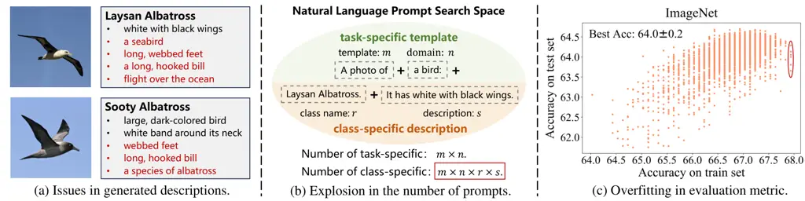

Figure 1: Issues of optimizing class-specific prompts. (a) Due to the
hallucination in LLMs, generated descriptions may be inaccurate and lack
discrimination between fine-grained categories (see red words). (b)
Compared to task-specific templates, we see an explosion in the number
of class-specific prompts (see red rectangle). This leads to higher
generation costs, iteration times, and the overfitting problem. (c)
Overfitting problem: Multiple candidate prompts have the same best
training accuracy but variable and low test results (see red circle).

How can we find the optimal class-specific prompts that are visually
discriminative for fine-grained categories with minimal supervision and
no human intervention?

Inspired by recent automatic prompt optimization (APO) methods \[64, 84,
21, 56\] in language tasks, we aim to optimize class-specific prompts by
an evolution-based process, removing confused prompts while retaining
discriminative ones. We consider an approximate zero-shot setting, i.e.,
one-shot classification, where minimal supervision is introduced to
evaluate the prompt quality. However, previous APO methods focus solely
on task-specific template optimization. In contrast, except for
templates, a class-specific prompt also contains a description
associated with visual details in a category, as shown in Fig. 1(b).
Compared with templates, class-specific optimization introduces new
challenges due to the expanded search space (see Fig. 1(b)), which leads
to: (1) High generation costs. As the search space grows, it is costly
and time-consuming to generate class-specific prompts exclusively with
LLMs at each iteration. (2) Long iteration times. Evaluating each
candidate prompt in the search space may exponentially increase the
iteration time, which is impractical in this scenario. (3) Overfitting
problem. As shown in Fig. 1(c), multiple candidate prompts achieve
variable and low test results (from 63.6% to 64.3%) at the best training
accuracy.

To address these issues, we propose a Progressively Automatic Prompt
Optimization (ProAPO) algorithm to iteratively optimize prompts from
task-specific to class-specific levels. In each iteration, we use
several edited-based (i.e., add, remove, and replace) and
evolution-based operators (i.e., crossover, and mutation) to generate
diverse candidate prompts from a prompt library. We query LLMs to
generate this library in the initialization stage. Compared to querying
LLMs at each iteration, these simple operations can effectively save
generation costs. Then, we introduce a novel fitness score to evaluate
generated candidate prompts and retain several top-scoring ones for the
next iteration generation. An entropy constraint is added to the score
to increase the soft prediction score and reduce overfitting. After
several iterations, we return the best prompt for classification. To
reduce iteration times in class-specific descriptions, we propose a
prompt sampling strategy to find a better initial point in the search
space and a group sampling strategy to explore a few salient classes
instead of all for optimization. Our key contributions are:

- •
  We propose an evolution-based algorithm to progressively optimize
  prompts from task-specific to class-specific levels with one-shot
  supervision and no human intervention. It solves issues of inaccuracy
  and lack of discrimination in LLM-generated descriptions.
- •
  We address challenges in class-specific prompt optimization by an
  offline generation algorithm to reduce LLM querying costs, an
  entropy-constrained fitness score to prevent overfitting, and two
  sampling strategies to find an optimal initial point and reduce
  iteration times.
- •
  Extensive experiments on thirteen datasets show that our proposed
  ProAPO consistently outperforms SOTA textual prompt-based methods and
  improves description-based methods in a challenging one-shot
  supervision. Moreover, our optimal prompts improve adapter-based
  methods and transfer effectively across different backbones.

## 2 Related Work

Adaptation of VLMs for image classification tasks. Inspired by successes
in VLMs, recent works aim to adapt them for image classification tasks.
Some works utilize lightweight linear layers \[58, 69, 29, 52, 66, 89,
38\], adapters \[18, 42\], visual prompting \[2, 50, 31\], or cache
models \[80, 86, 70\] to enhance visual features. Other works aim to
improve the quality of prompts. Manual prompt engineering \[58, 37, 9\]
applies task-specific information in prompt templates to enhance
performance. However, templates need to be hand-written and lack
fine-grained details \[43, 55, 39, 83, 42\]. Prompt tuning methods \[83,
82, 6, 85, 25, 40, 12, 65, 32, 33, 35\] learn task-specific context by a
set of learnable tokens. However, they need additional training and lack
interpretability \[43, 39, 61\]. In contrast, LLM-generated description
methods \[43, 55, 73, 42, 60, 87, 44, 62, 57, 47\] exploit implicit
knowledge in LLMs to generate visual descriptions for each category.
They enrich semantics in prompts and offer interpretable predictions. In
this work, we aim to further improve description quality through an
evolution process.

LLM-generated description methods apply class-specific descriptions to
language prompts to adapt VLMs for classification. DCLIP \[43\] and
CuPL \[55\] design prompts such as “What does a {class} look like?” to
instruct LLMs to generate category descriptions. GPT4Vis \[73\] and
VDT \[42\] use GPT-4 \[51\] for rich and diverse descriptions. Some work
utilizes LLM-generated hierarchy labels \[49\] or descriptions \[60\] to
recognize images from coarse to fine-grained levels. However, due to the
hallucination in LLMs, generated descriptions might be inaccurate,
non-visual, and lack discrimination \[43, 61, 60\]. To this end, we
propose ProAPO to iteratively remove ambiguous and retain discriminative
prompts. Moreover, category names, ignored in previous methods, are
equally crucial for improving accuracy and are introduced in our
optimization.

Automatic prompt optimization aims to automatically find optimal prompts
for language tasks, overcoming the time-consuming issue in manual prompt
methods \[5\]. Early methods \[64, 11, 54\] generate discrete prompts by
filling templates with trigger tokens, iteratively refining prompts by
mining, generation, or paraphrasing. Recently, chat-based LLMs have been
applied as prompt engineers \[56, 21, 84, 17, 75, 20\], using a
meta-prompt with task information to find optimal prompt design.
PN \[39\] is the first to instruct LLMs to optimize templates on
multimodal tasks, which feeds visual feedback of the best and worst
templates to guide. However, these methods only optimize task-specific
templates. iCM \[22\] is somewhat similar to ours, optimizing
class-specific prompts with chat-based LLMs. However, it uses the whole
validation set as supervision. In contrast, we optimize prompts with
one-shot supervision and propose solutions to solve high generation
costs, long iteration times, and overfitting in class-specific
optimization.

## 3 Method

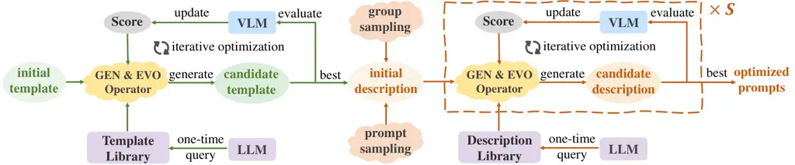

Figure 2: Overview of our ProAPO algorithm. We progressively refine
prompts from task-specific (green lines) to class-specific (brown lines)
levels. Specifically, we first explore the best template by an iterative
optimization process (Sec. 3.1). For each iteration, ProAPO generates a
set of candidate templates by several operators (Sec. 3.2) and
filters/refines templates by a fitness score (Sec. 3.3). After several
iterations, we choose the top-scoring template for description
initialization. Subsequently, we introduce two sampling strategies to
find a better initial point and reduce traversed categories (Sec. 3.4).
Similar iterative optimization is then applied to class-specific
descriptions.

Our ProAPO algorithm is shown in Fig. 2 and summarized in Alg. 1. We
first describe iterative optimization in templates (Sec. 3.1). For each
iteration, candidates are generated by several operators (Sec. 3.2) and
then evaluated by a fitness score (Sec. 3.3). Afterward, similar
iterative optimization is applied in descriptions, where we introduce
two sampling strategies to save iteration costs (Sec. 3.4).

0:  $`\mathcal{D}\leftarrow\{{(x,y)}\}_{n}`$: training samples,
$`F:\mathcal{D}\times P\to\mathbb{R}`$: score function

1:  Initialize Template: $`\mathcal{U}_{t}\leftarrow\{P_{0}\}`$

2:  Build Template Library:
$`B_{t}\leftarrow\{{d}_{1},\cdots,{d}_{n}\}`$

3:  Iterative Optimization:
$`\mathcal{U}_{t}\leftarrow\texttt{APO}(\mathcal{D},F,\mathcal{U}_{t},B_{t})`$

4:
 $`P_{t}^{*}\leftarrow\arg\max_{P\in\mathcal{U}_{t}}F(\mathcal{D},P)`$

5:  Initialize Description:
$`\mathcal{U}_{c}\leftarrow\{\hat{P}_{0}\}`$, initializing with
$`P_{t}^{*}`$ and prompt sampling strategy

6:  Group Sampling: Sample $`S`$ groups by class salience

7:  for $`s=1`$ to $`S`$ do

8:   Build Description Library:
$`B_{s}\leftarrow\{\hat{d}_{1},\cdots,\hat{d}_{q}\}`$

9:   Iterative Optimization:
$`\mathcal{U}_{c}\leftarrow\texttt{APO}(D,F,\mathcal{U}_{c},B_{s})`$

10:  end for

11:
 $`{P}^{*}\leftarrow\arg\max_{{P}\in\mathcal{U}_{c}}F(\mathcal{D},{P})`$

12:  return candidate prompt with the highest score $`{P}^{*}`$

Algorithm 1 Our Progressively Automatic Prompt Optimization (ProAPO) for
visual classification, which iteratively refines prompts from
task-specific to class-specific.

Preliminaries. Given an image, CLIP \[58\] predicts by selecting the
highest similarity between the image and category prompt. The category
prompt is a human-readable natural language associated with a category,
which contains a template, e.g., “a photo of a bird: {class}.
{description}.”, and class-specific descriptions, e.g., class name
“Laysan Albatross” and its descriptions “It has white with black
wings.”. Some categories may use multiple prompts with varied templates
or descriptions, i.e., prompt ensembling. We denote the prompt set that
includes all categories in the task as a candidate prompt $`P`$. A score
function $`F:\mathcal{D}\times P\rightarrow\mathbb{R}`$ is introduced
in Sec. 3.3 to evaluate the candidate prompt $`P`$ on a limited training
set $`\mathcal{D}=\{{(x,y)}\}_{n}`$ with one-shot supervision, where
$`x`$ is an image and $`y`$ is its label. Finally, we use a test set to
evaluate optimized prompts. Our goal is to refine prompts in the natural
language space to achieve superior performance in per training sample
$`(x,y)`$:

```math
\argmax_{P}F(\mathcal{D},P)=\argmax_{P}\mathbb{E}_{(x,y)}[F(\{(x,y)\},P)]. \tag{1}
```

0:  $`\mathcal{D}\leftarrow\{{(x,y)}\}_{n}`$: training samples,
$`F:\mathcal{D}\times P\to\mathbb{R}`$: score function, $`\mathcal{U}`$
: candidate prompt set, $`B`$: template or description library

1:  Initialize Evaluation Score:
$`\mathcal{S}\leftarrow\{F(\mathcal{D},P)\}_{P\in\mathcal{U}}`$

2:  for $`t=1`$ to $`T`$ do

3:   $`\mathcal{U}_{g}\leftarrow\emptyset`$

4:   for all $`P\in\mathcal{U}`$ do

5:    Edit-based Generate:
$`\mathcal{U}_{g}\leftarrow\mathcal{U}_{g}\cup\texttt{GEN}(P,B)`$

6:   end for

7:   Evaluate:
$`\mathcal{S}_{g}\leftarrow\{F(\mathcal{D},P^{\prime})\}_{P^{\prime}\in\mathcal{U}_{g}}`$

8:   Update: $`\mathcal{U}\leftarrow\{\mathcal{U},\mathcal{U}_{g}\}`$
and $`\mathcal{S}\leftarrow\{\mathcal{S},\mathcal{S}_{g}\}`$, retaining
the top-$`k`$ of candidate prompts with high scores

9:   Evolution-based Generate:
$`\mathcal{U}_{e}\leftarrow\texttt{EVO}(\mathcal{U},B)`$

10:   Evaluate:
$`\mathcal{S}_{e}\leftarrow\{F(\mathcal{D},P^{\prime})\}_{P^{\prime}\in\mathcal{U}_{e}}`$

11:   Update: $`\mathcal{U}\leftarrow\{\mathcal{U},\mathcal{U}_{e}\}`$
and $`\mathcal{S}\leftarrow\{\mathcal{S},\mathcal{S}_{e}\}`$, retaining
the top-$`k`$ of candidate prompts with high scores

12:  end for

13:  return the latest candidate prompt set $`\mathcal{U}`$

Algorithm 2 Automatic Prompt Optimization (APO) algorithm for VLMs -
Lines 3 and 9 of Alg. 1, $`\texttt{APO}(\mathcal{D},F,\mathcal{U},B)`$.

### 3.1 Automatic Template Optimization

To mitigate issues of semantic ambiguity caused by class names, we first
iteratively optimize the template to provide better task-specific
contextual information.

Template initialization offers a candidate prompt $`P_{0}`$ as a
starting point in the language search space (Line 1 of Alg. 1). Similar
to PN \[39\], we use “a photo of a {class}.” filling with class names in
the dataset as $`P_{0}`$.

Building template library aims to provide a set of templates (Line 2 of
Alg. 1) for subsequent prompt generation. We denote template library as
$`B_{t}=\{d_{1},\cdots,d_{n}\}`$, where $`d`$ is a single template.
Similar to PN \[39\], we can instruct LLMs with a one-time query to
generate a set of templates as the library. Pre-defined templates, e.g.,
Template-80 provided in CLIP \[58\], can also be used. Inspired by
description-based methods \[61, 42\], we also supplement templates with
dataset domain information generated by LLMs, such as “flower” for FLO
and “bird” for CUB.

Iterative optimization. Automatic prompt optimization (APO) algorithm is
introduced to refine template set $`\mathcal{U}_{t}`$ by an
evolution-based process (Line 3 of Alg. 1). As summarized in Alg. 2,
each iteration of APO contains the process of: (1) Generate new
candidate prompts $`\mathcal{U}_{g}`$ and $`\mathcal{U}_{e}`$ by several
edit-based (Lines 4-6) and evolution-based (Line 9) operations based on
the set $`\mathcal{U}`$ and library $`B`$. (2) Evaluate each new
candidate prompt (Lines 7 and 10) by a score function. We regard this
score as an implied “gradient”. (3) Update the prompt set
$`\mathcal{U}`$ based on score (Lines 8 and 11). This process retains
the top-$`k`$ of prompts with high scores to explore the search space
around the current best candidates. Finally, we return the latest
candidate set $`\mathcal{U}`$.

0:  $`P\leftarrow\{\hat{d}_{1},\cdots,\hat{d}_{i}\}`$: a candidate
prompt, $`B\leftarrow\{d_{1},\cdots,d_{j}\}`$: template or description
library

1:  $`\mathcal{U}_{g}\leftarrow\emptyset`$

2:  for $`m=1`$ to $`M`$ do

3:   $`d_{add}\leftarrow\texttt{Select}(B)`$

4:   $`P_{add}\leftarrow P\cup\{d_{add}\}`$ $`\triangleright`$ Add

5:   $`d_{del}\leftarrow\texttt{Select}(P)`$

6:   $`P_{del}\leftarrow P\setminus\{d_{del}\}`$ $`\triangleright`$
Delete

7:   $`d_{in}\leftarrow\texttt{Select}(B)`$

8:   $`d_{out}\leftarrow\texttt{Select}(P)`$

9:   $`P_{rep}\leftarrow(P\cup\{d_{in}\})\setminus\{d_{out}\}`$
$`\triangleright`$ Replace

10:
  $`\mathcal{U}_{g}\leftarrow\mathcal{U}_{g}\cup\{P_{add},P_{del},P_{rep}\}`$

11:  end for

12:  return the generated candidate prompt set $`\mathcal{U}_{g}`$

Algorithm 3 Edit-based prompt generation algorithm - Line 5 of Alg. 2,
$`\texttt{GEN}(P,B)`$.

### 3.2 Prompt Generation by Several Operators

Due to the explosion of class-specific prompts, it is costly and
time-intensive to generate new prompts exclusively with LLMs like
previous methods \[39, 22\]. To this end, we introduce edit-based and
evolution-based operators to generate diverse candidate prompts from the
library.

Edit-based generation is introduced to create a set of new candidate
prompts by several simple arithmetic operators. As shown in Alg. 3, we
iteratively operate a candidate prompt $`P`$ with the library $`B`$,
where $`\hat{d}`$ in $`P`$ and $`d`$ in $`B`$ denotes a single template
or description. The $`\texttt{Select}(\cdot)`$ operator samples an
element from a given prompt set. Three operations are then applied to
$`P`$ in each iteration: (1) Add a new element $`d_{add}`$ to $`P`$. (2)
Remove an existing element $`d_{del}`$ from $`P`$. (3) Replace an
element $`d_{out}`$ in $`P`$ with a new element $`d_{in}`$ in $`B`$.
These new candidates are ensembled around the current high-score
candidate $`P`$, which makes them more likely to succeed. Moreover,
selecting elements from the library ensures differences between
generated candidates. After $`M`$-times steps, we return the latest set
$`\mathcal{U}_{g}`$.

Evolution-based generation is introduced to improve search efficiency
over random steps, as shown in Alg. 4. Inspired by widely used Generic
Algorithm \[23, 27, 45\], we introduce crossover and mutation operators
to enhance candidate generation. Crossover operator aims to find the
optimal direction quickly by combining high-scoring candidate prompts.
We randomly take the concatenation of two candidates $`P_{c1}`$ and
$`P_{c2}`$ sampled from the current optimal set $`\mathcal{U}`$,
yielding a new candidate $`P_{c}`$. Mutation operator aims to prevent
convergence to local optima by introducing variations. We randomly add
new elements selected from library $`B`$ into the candidate $`P_{c}`$,
yielding mutation candidate $`P_{m}`$. After $`N`$-times steps, we
return the generated set $`\mathcal{U}_{e}`$.

0:  $`\mathcal{U}\leftarrow\{P_{1},\cdots,P_{n}\}`$: candidate prompt
set, $`B\leftarrow\{d_{1},\cdots,d_{j}\}`$: template or description
library

1:  $`\mathcal{U}_{e}\leftarrow\emptyset`$

2:  for $`n=1`$ to $`N`$ do

3:   $`P_{c1}\leftarrow\texttt{Select}(\mathcal{U})`$

4:   $`P_{c2}\leftarrow\texttt{Select}(\mathcal{U})`$

5:   $`P_{c}\leftarrow P_{c1}\cup P_{c2}`$ $`\triangleright`$ Crossover

6:   $`P_{all}\leftarrow B\cup P_{c}`$

7:
  $`P_{m}\leftarrow\textsc{RandomSelect}(P_{all},\text{len}(P_{c}))`$$`\triangleright`$
Mutation

8:   $`\mathcal{U}_{e}\leftarrow\mathcal{U}_{e}\cup\{P_{c},P_{m}\}`$

9:  end for

10:  return the generated candidate prompt set $`\mathcal{U}_{e}`$

Algorithm 4 Evolution-based generation algorithm - Line 9 of Alg. 2,
$`\texttt{EVO}(\mathcal{U},B)`$.

### 3.3 Score Functions

To measure candidate prompts, we introduce a fitness score to
approximately obtain the “gradient” used for optimization. It contains
the accuracy and an entropy constraint.

Accuracy. Given an image $`x`$, we obtain a prediction
$`\text{pred}(x)`$ that yields the highest cosine similarity:

```math
\displaystyle s(x,c) \displaystyle=\frac{1}{|D(c)|}\sum_{d\in D(c)}\text{cos}(I(x),T(d)). \tag{2}
```

```math
\displaystyle\text{pred}(x) \displaystyle=\argmax_{c\in C}s(x,c), \tag{3}
```

where $`D(c)\in P`$ is a set with all prompts describing the category
$`c`$ in candidate prompt $`P`$, and $`C`$ is the entire category in the
dataset. $`I`$ and $`T`$ are image encoder and text encoder,
respectively. The accuracy is formulated as follows:

```math
\text{Acc}=\mathbb{E}_{(x,y)\in\mathcal{D}}[\mathbb{I}(\text{pred}(x)=y)], \tag{4}
```

where $`\mathcal{D}`$ is the training set and $`\mathbb{I}(\cdot)`$ is
an indicator function.

Entropy constrain. Previous methods \[39, 22\] only use accuracy as the
evaluation metric. However, the overfitting problem appears as shown
in Fig. 1(c). To this end, we include a simple entropy constrain, which
penalizes the model to predict a higher probabilistic score in the true
label $`y`$:

```math
H=\mathbb{E}_{(x,y)\in\mathcal{D}}[\log(s(x,y))]. \tag{5}
```

The final score is formulated as follows:

```math
F(\mathcal{D},P)=\text{Acc}+\alpha H. \tag{6}
```

where $`\alpha`$ is a scalar to balance them. In Sec. 4.4, we
empirically show that this score effectively reduces overfitting.

### 3.4 Sampling Strategy for Initialization

After exploring the best template, we continue to optimize the
class-specific descriptions. To save iteration costs, we introduce a
prompt sampling strategy to find a better start point and a grouping
sampling strategy to select some salient categories instead of all for
iterative optimization.

Prompt sampling strategy aims to initialize the class-specific candidate
prompt $`\hat{P}_{0}`$ with the optimized template $`P_{t}^{*}`$ and
high-score descriptions (Line 5 of Alg. 1). Similar to description-based
methods \[43, 55\], we instruct LLM to generate a set of visual
descriptions for each class. Besides, we replace the class name with its
synonyms generated by LLMs to increase the number of descriptions. To
obtain a better initial point, we randomly sample descriptions of each
category to obtain multiple candidate prompts and select the one with
the highest score as $`\hat{P}_{0}`$. It ensures that subsequent
optimization is around candidates with relatively high scores. More
details are shown in Appendix B.

Group sampling strategy aims to explore several salient categories into
groups for optimization (Line 6 of Alg. 1). We consider two ways to
sample categories. First, we select the groups with the lowest
top-$`n_{wst}`$ accuracy and its misclassified categories. Moreover, we
also choose salient groups by the category with the top-$`n_{sln}`$
result gains after adding descriptions and its misclassified categories.
In the end, We use $`S=n_{wst}+n_{sln}`$ groups for optimization. More
details are shown in Appendix C. In Sec. 4.4, experiments show that
optimizing these selected categories can effectively improve performance
and save costs.

Building Library and Iterative Optimization for Descriptions. In Lines
7-10 of Alg. 1, we iteratively optimize the class-specific description
in selected groups. Similar to template optimization, we first build the
description library, which contains visual descriptions for categories
in the specific group. Then, we apply APO algorithm to refine
descriptions automatically. After several iterations, we use the
candidate $`P^{*}`$ with the highest score as the final prompt.

## 4 Experiments

Datasets. Following prompt tuning \[83, 82\] and LLM-generated
description works \[43\], we evaluate our ProAPO on thirteen downstream
tasks, including ImageNet-1K (IN-1K) \[10\], Caltech101 \[15\] (object
recognition), StandfordCars \[34\], CUB200-2011 \[71\] (bird
classification), DTD \[8\] (Textures), EuroSAT (ESAT) \[26\] (satellite
images), FGVCAircraft \[41\], Flowers102 \[48\], Food101 \[3\],
OxfordPets \[53\], Places365 \[81\], SUN397 \[74\] (scene recognition),
UCF101 \[67\] (human action).

[TABLE]

Table 1: Comparison of our ProAPO with SOTA textual prompt-based
methods. We report the top-1 accuracy (%) on the test set. The best and
second best results of the same backbone for each dataset are bolded and
underlined, respectively. Avg (11) and Avg (13) denote average results
across 11 datasets (excluding CUB \[71\] and Places \[81\]) and all 13
datasets. TF denotes training-free approaches.

Implementation details. In the default setting, we use template-80
pre-defined in CLIP \[58\] as the template library and CuPL \[55\] as
the description library for searching the hyperparameters in a fixed
language space. Dataset domain and synonym labels are generated by LLMs.
This setting ensures a one-time query of LLMs, and no human intervention
is required. If not explicitly stated, we set iteration times $`T=4`$ in
both template and description optimization, generated number $`M=N=8`$,
$`\alpha=1e3`$, $`n_{wst}=n_{sln}=\text{log}(|C|)`$ for all datasets,
where $`|C|`$ is the number of classes. All results are average with
four seeds. Besides, our ProAPO is implemented in PyTorch and runs with
an RTX 3090 GPU. More details are shown in Supp.4.

### 4.1 Comparison with SOTA Methods

Compared methods. We compare our results with state-of-the-art (SOTA)
textual prompt-based methods, including vanilla CLIP with “a photo of a
{}” template, prompt tuning methods \[83, 6, 85\], hand-engineered
methods (i.e., best templates released by \[58, 76, 9\]), LLM-generated
description methods \[55, 43, 61, 73, 62\], and automatic prompt
optimization methods \[39\]. We test our ProAPO on two popular backbones
(ResNet50 \[24\] and ViT-B/32 \[13\]). Prompt tuning and automatic
prompt optimization methods are evaluated under one-shot supervision.

Results. In Tab. 1, we see that our ProAPO consistently outperforms
previous prompt-based methods across diverse datasets on ResNet50 and
ViT-B/32 backbones. Our optimized prompts improve vanilla CLIP by an
average of 8.4% (from 53.4% to 61.8%) on ResNet50 and 5.7% (from 59.3%
to 65.0%) on ViT-B/32. Moreover, our training-free ProAPO surpasses
gradient-based prompt-tuning methods (CoOp, PLOT, ProGrad) by at least
1.9% average accuracy in eleven datasets. It shows optimizing prompts in
a natural language space is more effective in low-shot tasks. Compared
to template-optimized methods (i.e., PN and hand-engineered methods),
our ProAPO achieves remarkable performance on fine-grained datasets,
e.g., CUB, FLO, ESAT, and UCF. This is because class-specific
descriptions provide fine-grained discriminative details. Our ProAPO
also outperforms description-based methods, even with DCLIP as
initialization. We improve performances of DCLIP and CuPL by 3.3% and
2.7% on average across thirteen datasets. Notably, it improves DCLIP and
CuPL by 5.4% and 4.8% on FLO and by 21% and 12.5% on ESAT, confirming
that iterative optimization of class-specific prompts enhances
fine-grained recognition.

Critical analysis. On datasets like ImageNet \[10\], Caltech \[15\],
Places \[81\], and SUN \[74\], performance gains are relatively small.
We attribute this to two reasons: First, datasets like ImageNet and
Caltech contain coarse-grained categories. The differences between
categories have become clearer with LLM-generated descriptions,
eliminating the need for our method. Second, fine-grained datasets, such
as Places and SUN for scene recognition, are easily confusing between
different images, limiting performance from only textual side
optimization. In Sec. 4.2, we show that adapter-based methods with our
optimized prompt improve performance again after addressing issues of
image confusion. Moreover, we observe that the language search space
impacts performance. Since CuPL has better descriptions than DCLIP, our
ProAPO with CuPL performs well.

(a)

(b)

Figure 3: Results of adapter-based methods with different initial
prompts. Solid and dotted lines denote prompt initialization with ProAPO
and CuPL, respectively.

### 4.2 More Benefits by Optimal Prompts

Transfer to adapter-based methods. In Fig. 3, we show the results of
popular adapter-based methods \[80, 70, 86, 18\] with different prompt
initialization, i.e., SOTA method CuPL \[55\] and our ProAPO.
Adapter-based methods with ProAPO (solid lines) consistently surpass
those with CuPL (dotted lines). It reveals that high-quality prompts
make adapters perform better. Even in low shots, training with ProAPO
achieves notable performance gains, which verifies its effectiveness. As
the number of shots increases, adapters further improve results by
enhancing image features.

|             |       |        |        |          |          |
| ----------- | ----- | ------ | ------ | -------- | -------- |
|             |       | Source | Target |          |          |
| Module      | Shots | RN50   | RN101  | ViT-B/32 | ViT-B/16 |
| CLIP \[58\] | 0     | 57.9   | 60.6   | 61.9     | 66.6     |
| CoOp \[83\] | 16    | 63.0   | 20.6   | 31.7     | 39.5     |
| PN \[39\]   | 1     | 59.9   | 60.7   | 62.2     | 67.0     |
| ProAPO      | 1     | 61.5   | 62.1   | 64.6     | 69.9     |

Table 2: Results of prompt transfer from ResNet-50 to other
architectures. We report the top-1 accuracy in ImageNet-1K.

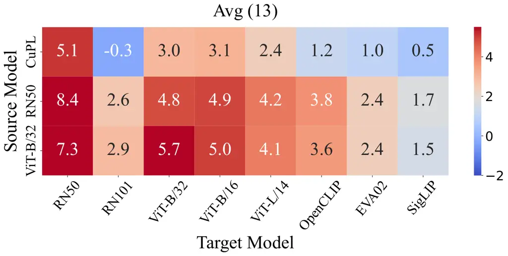

Figure 4: Results of prompt transfer to different backbones. The value
denotes performance gains compared to vanilla VLMs. Our optimized
prompts of ResNet50 and ViT-B/32 are reported.

Transfer to different backbones. In Tab. 2, we report accuracy in
ImageNet across different backbones, with prompts optimized on a source
backbone (ResNet50) adapted to target backbones (ResNet101, ViT-B/32,
ViT-B/16). We observe that CoOp \[83\] obtains a significant drop in
accuracy on target backbones while our ProAPO maintains performance. It
verifies that discrete prompts searched in natural language spaces
transfer better than continuous prompts. ProAPO also outperforms PN,
which reveals the effectiveness of class-specific optimization.
Moreover, we achieve stable performance gains compared to CuPL \[55\]
from source to target models in Fig. 4. It further verifies that ProAPO
transfers easily across different backbones.

(a)

(b)

Figure 5: Performance improvement analysis. (a) Analysis of the effect
of single vs. ensemble prompts. \* denotes results evaluated in the test
set. ATO is our automatic template optimization algorithm. (b) Results
of previous description-based methods with prompt optimization by our
ATO and ProAPO algorithms.

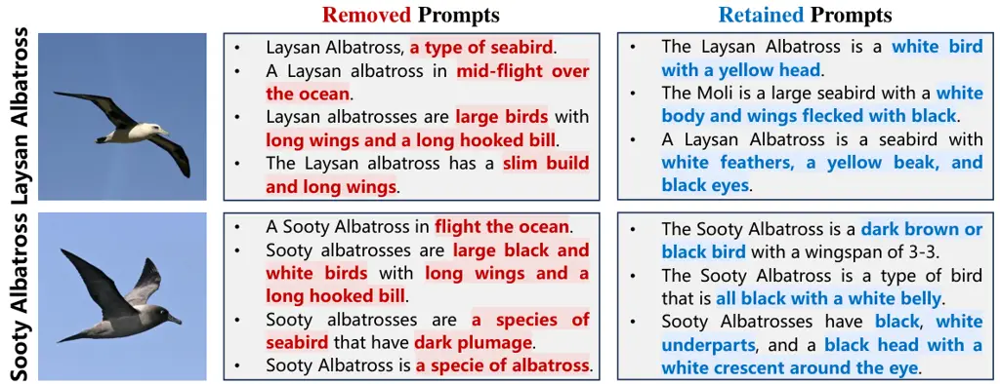

Figure 6: Qualitative analysis of class-specific prompt optimization by
ProAPO. Shaded red and blue words denote common and discriminative
descriptions in two confused categories.

### 4.3 Performance Improvement Analysis

In this section, we analyze the key reasons for the performance
improvement of our ProAPO.

Prompt ensembling is better than a single prompt. Compared to PN \[39\],
we utilize prompt ensembling instead of a single prompt to optimize the
template and description. To evaluate the effectiveness of prompt
ensembling, we use Template-80 \[58\] as the template library and denote
the prompts searched by the test set as the upper bound. As shown
in Fig. 5(a), we observe that ensemble templates have a higher upper
bound than the single template, consistent with prior work \[76, 9,
43\]. Similarly, we observe that our optimized templates achieve higher
performance than PN \[39\], even better than the best single template,
further verifying the effectiveness of our method.

Iterative optimization improves prompt quality. In Fig. 6, we show the
changes in descriptions with our ProAPO. After iterative optimization,
common descriptions such as “flight over ocean” and “long wings and
hooked bill” are removed. Discriminative descriptions are also retained
in candidate prompts, e.g., “white body” for Laysan Albatross, and
“black underpants” for Sooty Albatross. As such, we see a notable
improvement in description-based methods \[43, 62, 55, 73\] with our ATO
and ProAPO in Fig. 5(b) by at least 2.7% average in thirteen datasets.
It further verifies the effectiveness of our progressive optimization.

|                            |     |     |     |       |     |       |          |          |
| -------------------------- | --- | --- | --- | ----- | --- | ----- | -------- | -------- |
| Component                  |     |     |     |       |     |       |          |          |
|                            | Add | Del | Rep | Cross | Mut | IN-1K | Avg (11) | Avg (13) |
| CLIP (Baseline)            |     |     |     |       |     | 62.1  | 61.8     | 59.3     |
| edit-based generation      |     |     |     |       |     |       |          |          |
| a)                         | ✓   |     |     |       |     | 63.8  | 66.0     | 63.3     |
| b)                         | ✓   | ✓   |     |       |     | 64.6  | 66.4     | 63.8     |
| c)                         | ✓   |     | ✓   |       |     | 64.4  | 66.5     | 63.8     |
| d)                         | ✓   | ✓   | ✓   |       |     | 64.6  | 66.7     | 64.0     |
| evolution-based generation |     |     |     |       |     |       |          |          |
| e)                         | ✓   | ✓   | ✓   | ✓     |     | 64.6  | 67.3     | 64.5     |
| f)                         | ✓   | ✓   | ✓   |       | ✓   | 64.7  | 67.1     | 64.3     |
| g)                         | ✓   | ✓   | ✓   | ✓     | ✓   | 64.7  | 67.9     | 65.0     |

Table 3: Ablation of edit- and evolution-based operators.

### 4.4 Ablation Study

Are both GEN and EVO algorithms necessary? In Tab. 3, we ablate edit-
and evolution-based operators. For edit-based operators, we observe that
the model with add, delete, and replace operations achieves a higher
result in row d). After introducing evolution-based operators, i.e.,
crossover operator to combine advantages of high-scoring candidates, and
mutation operator to avoid locally optimal solutions, we see an increase
in performance in rows e)-g). It confirms that evolution-based operators
make the model search the optimal prompt faster with limited iterations.

|                            |       |          |          |         |
| -------------------------- | ----- | -------- | -------- | ------- |
| Module (ViT-B/32)          | IN-1K | Avg (11) | Avg (13) | Times   |
| a) w/o prompt sampling     | 64.4  | 67.3     | 64.5     | 12 min  |
| b) w/o group sampling      | 64.8  | 68.1     | 65.2     | 306 min |
| c) w/o sampling strategies | 64.5  | 67.2     | 64.4     | 302 min |
| ProAPO (full model)        | 64.7  | 67.9     | 65.0     | 15 min  |

Table 4: Ablation of two sampling strategies.

Does sample strategies degrade performance? In Tab. 4, we ablate two
sampling strategies for description optimization. Without the prompt
sampling, we see a slight decrease in times while results drop in row
a). It verifies the effectiveness of the prompt sampling in finding a
better initial point. Without the group sampling to select salient
categories for optimization, we observe a notable increase in time costs
(from 15 min to 300+ min, 20 times) yet similar results in row b) and
the full model. It reveals that group sampling simultaneously improves
performance and efficiency.

Which score function is better? In Fig. 7, we compare the different
score functions, i.e., accuracy (used in PN \[39\]) and our fitness
score, to evaluate the quality of the candidate prompt. PCCs (Pearson
Correlation Coefficients) are introduced to evaluate the linear
relationship between training metrics and test performance. The high PCC
values mean a strong correlation. We see that the model with our fitness
score achieves stable and high test results compared to previous score
functions when achieving the best score. Besides, a higher PPC value
further verifies that our fitness score effectively alleviates the
overfitting problem.

(a)

(b)

Figure 7: Effect of different score functions. Higher PCC values mean
stronger correlations between training metrics and test results. Best
Acc is the test result when achieving the best score.

(a)

(b)

(c)

Figure 8: The effect of hyperparameter analysis. The hyperparameter
value set to 0 denotes the result of CuPL \[55\].

### 4.5 Hyperparameter Sensitivity

How many iterations of Alg. 2 to use? In Fig. 8(a), we show the effect
of iteration times $`T`$ in APO algorithm. As the number of iterations
increases, we see a consistent performance improvement compared to the
baseline CuPL. It demonstrates that iterative optimization improves
prompt quality. Stable results are achieved when $`T\geq 4`$.

How many generated prompts to use? In Fig. 8(b), we show the effect of
generated numbers in GEN and EVO algorithm, where we set $`M=N`$.
Similarly, progressive improvements are seen as generated numbers
increase. We see a reliable result when $`M=N\geq 8`$. It reveals the
effectiveness of generating diverse candidates by our algorithm.

Are more sampling groups better? In Fig. 8(c), we show the effect of the
number of salient groups $`S`$ in the group sampling strategy. We see a
notable improvement when $`S=2`$. As the number of groups $`S`$
increases, it achieves stable results when $`S\geq 8`$. It verifies that
optimizing several salient categories can achieve comparable
performances with all categories and save iteration costs.

## 5 Conclusion

We propose an evolution-based algorithm for VLMs to progressively refine
prompts from task-specific to class-specific levels. To save generation
costs, ProAPO uses several edit- and evolution-based operators to create
candidate prompts with a prompt library. Results show that our fitness
score mitigates overfitting in class-specific prompts. We empirically
verify that two sampling strategies improve performance and save
iteration times. Extensive experiments on thirteen datasets reveal that
ProAPO consistently outperforms SOTA textual prompt-based methods on
low-shot tasks. Moreover, our method effectively improves adapter-based
and description-based methods and easily transfers across different
backbones. We hope ProAPO could provide new insight into adapting VLMs
from the textual side.

## Acknowledgements

This work was supported by the Central Guidance for Local Special
Project (Grant No. Z231100005923044).

## References

- \[1\] J. Alayrac, J. Donahue, and P. L. et al. (2022) Flamingo: a
  visual language model for few-shot learning. In NeurIPS, Cited by:
  §D.2, §1.
- \[2\] H. Bahng, A. Jahanian, S. Sankaranarayanan, and P. Isola (2022)
  Visual prompting: modifying pixel space to adapt pre-trained models.
  CoRR abs/2203.17274. Cited by: §2.
- \[3\] L. Bossard, M. Guillaumin, and L. V. Gool (2014) Food-101 -
  mining discriminative components with random forests. In ECCV, Vol.
  8694, pp. 446–461. Cited by: Table 5, Table 7, Table 12, §4.
- \[4\] T. B. Brown, B. Mann, and N. R. et al. (2020) Language models
  are few-shot learners. In NeurIPS, Cited by: §D.1, §1.
- \[5\] K. Chang, S. Xu, C. Wang, Y. Luo, T. Xiao, and J. Zhu (2024)
  Efficient prompting methods for large language models: A survey. CoRR
  abs/2404.01077. Cited by: §2.
- \[6\] G. Chen, W. Yao, X. Song, X. Li, Y. Rao, and K. Zhang (2023)
  PLOT: prompt learning with optimal transport for vision-language
  models. In ICLR, Cited by: §1, §2, §4.1, Table 1.
- \[7\] M. Cherti, R. Beaumont, R. Wightman, M. Wortsman, G. Ilharco, C.
  Gordon, C. Schuhmann, L. Schmidt, and J. Jitsev (2023) Reproducible
  scaling laws for contrastive language-image learning. In CVPR,
  pp. 2818–2829. Cited by: Table 8, Appendix E, Appendix E.
- \[8\] M. Cimpoi, S. Maji, I. Kokkinos, S. Mohamed, and A.
  Vedaldi (2014) Describing textures in the wild. In CVPR,
  pp. 3606–3613. Cited by: Table 5, Table 7, Appendix E, §G.1, Table 12,
  §4.
- \[9\] Y. Cui, L. Zhao, F. Liang, Y. Li, and J. Shao (2022)
  Democratizing contrastive language-image pre-training: A CLIP
  benchmark of data, model, and supervision. CoRR abs/2203.05796. Cited
  by: §A.1, §D.2, §1, §2, §4.1, §4.3, Table 1.
- \[10\] J. Deng, W. Dong, R. Socher, L. Li, K. Li, and L.
  Fei-Fei (2009) ImageNet: A large-scale hierarchical image database. In
  CVPR, pp. 248–255. Cited by: Table 5, Table 7, Table 12, §4.1, §4.
- \[11\] M. Deng, J. Wang, C. Hsieh, Y. Wang, H. Guo, T. Shu, M.
  Song, E. P. Xing, and Z. Hu (2022) RLPrompt: optimizing discrete text
  prompts with reinforcement learning. In EMNLP, pp. 3369–3391. Cited
  by: §2.
- \[12\] M. M. Derakhshani, E. Sanchez, A. Bulat, V. G. T. da
  Costa, C. G. M. Snoek, G. Tzimiropoulos, and B. Martínez (2022)
  Variational prompt tuning improves generalization of vision-language
  models. CoRR abs/2210.02390. Cited by: §2.
- \[13\] A. Dosovitskiy, L. Beyer, and A. K. et al. (2021) An image is
  worth 16x16 words: transformers for image recognition at scale. In
  ICLR, Cited by: §4.1.
- \[14\] Y. Fang, Q. Sun, X. Wang, T. Huang, X. Wang, and Y. Cao (2024)
  EVA-02: A visual representation for neon genesis. Image Vis. Comput.
  149, pp. 105171. Cited by: §D.2, Table 8, Appendix E, Appendix E.
- \[15\] L. Fei-Fei, R. Fergus, and P. Perona (2004) Learning generative
  visual models from few training examples: an incremental bayesian
  approach tested on 101 object categories. In CVPRW, pp. 178. Cited by:
  Table 5, Table 7, Table 12, §4.1, §4.
- \[16\] C. Feng, K. Yu, Y. Liu, S. Khan, and W. Zuo (2023) Diverse data
  augmentation with diffusions for effective test-time prompt tuning. In
  ICCV, pp. 2704–2714. Cited by: Table 9.
- \[17\] C. Fernando, D. Banarse, H. Michalewski, S. Osindero, and T.
  Rocktäschel (2024) Promptbreeder: self-referential self-improvement
  via prompt evolution. In ICML, Cited by: §2.
- \[18\] P. Gao, S. Geng, R. Zhang, T. Ma, R. Fang, Y. Zhang, H. Li,
  and Y. Qiao (2024) CLIP-adapter: better vision-language models with
  feature adapters. IJCV 132 (2), pp. 581–595. Cited by: §J.1, §2, §4.2.
- \[19\] T. Gao, A. Fisch, and D. Chen (2021) Making pre-trained
  language models better few-shot learners. In ACL, pp. 3816–3830. Cited
  by: §1.
- \[20\] Q. Guo, R. Wang, J. Guo, B. Li, K. Song, X. Tan, G. Liu, J.
  Bian, and Y. Yang (2024) Connecting large language models with
  evolutionary algorithms yields powerful prompt optimizers. In ICLR,
  Cited by: §2.
- \[21\] Q. Guo, R. Wang, J. Guo, B. Li, K. Song, X. Tan, G. Liu, J.
  Bian, and Y. Yang (2024) Connecting large language models with
  evolutionary algorithms yields powerful prompt optimizers. In ICLR,
  Cited by: §1, §2.
- \[22\] S. Han, L. Zhuo, Y. Liao, and S. Liu (2023) LLMs as visual
  explainers: advancing image classification with evolving visual
  descriptions. CoRR abs/2311.11904. Cited by: Table 10, Table 10, Table
  10, Appendix F, §2, §3.2, §3.3.
- \[23\] F. Hayes-Roth (1975) Review of ”adaptation in natural and
  artificial systems by john h. holland”, the u. of michigan press, 1975. SIGART Newsl. 53, pp. 15. Cited by: §3.2.
- \[24\] K. He, X. Zhang, S. Ren, and J. Sun (2016) Deep residual
  learning for image recognition. In CVPR, pp. 770–778. Cited by: §4.1.
- \[25\] X. He, D. Yang, W. Feng, T. Fu, A. R. Akula, V. Jampani, P.
  Narayana, S. Basu, W. Y. Wang, and X. Wang (2022) CPL: counterfactual
  prompt learning for vision and language models. In EMNLP,
  pp. 3407–3418. Cited by: §2.
- \[26\] P. Helber, B. Bischke, A. Dengel, and D. Borth (2019) EuroSAT:
  A novel dataset and deep learning benchmark for land use and land
  cover classification. IEEE J. Sel. Top. Appl. Earth Obs. Remote. Sens.
  12 (7), pp. 2217–2226. Cited by: Table 5, Table 7, Appendix E, §G.1,
  Table 12, §4.
- \[27\] J. H. Holland (1992) Adaptation in natural and artificial
  systems: an introductory analysis with applications to biology,
  control, and artificial intelligence. MIT Press. Cited by: §3.2.
- \[28\] L. Huang, W. Yu, and W. M. et al. (2023) A survey on
  hallucination in large language models: principles, taxonomy,
  challenges, and open questions. CoRR abs/2311.05232. Cited by: §1.
- \[29\] Y. Huang, F. Shakeri, J. Dolz, M. Boudiaf, H. Bahig, and I. B.
  Ayed (2024) LP++: A surprisingly strong linear probe for few-shot
  CLIP. In CVPR, pp. 23773–23782. Cited by: §2.
- \[30\] C. Jia, Y. Yang, and Y. X. et al. (2021) Scaling up visual and
  vision-language representation learning with noisy text supervision.
  In ICML, Vol. 139, pp. 4904–4916. Cited by: §D.2, §1.
- \[31\] M. Jia, L. Tang, B. Chen, C. Cardie, S. J. Belongie, B.
  Hariharan, and S. Lim (2022) Visual prompt tuning. In ECCV, Vol.
  13693, pp. 709–727. Cited by: §2.
- \[32\] M. U. Khattak, H. A. Rasheed, M. Maaz, S. H. Khan, and F. S.
  Khan (2023) MaPLe: multi-modal prompt learning. In CVPR,
  pp. 19113–19122. Cited by: Table 9, §2.
- \[33\] M. U. Khattak, S. T. Wasim, M. Naseer, S. Khan, M. Yang,
  and F. S. Khan (2023) Self-regulating prompts: foundational model
  adaptation without forgetting. In ICCV, pp. 15144–15154. Cited by:
  Table 9, §2.
- \[34\] J. Krause, M. Stark, J. Deng, and L. Fei-Fei (2013) 3D object
  representations for fine-grained categorization. In ICCV, pp. 554–561.
  Cited by: Table 5, Table 7, Table 12, §4.
- \[35\] F. Li, Q. Jiang, H. Zhang, T. Ren, S. Liu, X. Zou, H. Xu, H.
  Li, J. Yang, C. Li, L. Zhang, and J. Gao (2024) Visual in-context
  prompting. In CVPR, Cited by: §2.
- \[36\] J. Li, D. Li, C. Xiong, and S. C. H. Hoi (2022) BLIP:
  bootstrapping language-image pre-training for unified vision-language
  understanding and generation. In ICML, Vol. 162, pp. 12888–12900.
  Cited by: §D.2, §1.
- \[37\] Y. Li, F. Liang, L. Zhao, Y. Cui, W. Ouyang, J. Shao, F. Yu,
  and J. Yan (2022) Supervision exists everywhere: A data efficient
  contrastive language-image pre-training paradigm. In ICLR, Cited by:
  §D.2, §2.
- \[38\] Y. Li, J. Yu, K. Gai, B. Liu, G. Xiong, and Q. Wu (2024)
  T2VIndexer: A generative video indexer for efficient text-video
  retrieval. In ACM MM, pp. 3955–3963. Cited by: §2.
- \[39\] S. Liu, S. Yu, Z. Lin, D. Pathak, and D. Ramanan (2024)
  Language models as black-box optimizers for vision-language models. In
  CVPR, pp. 12687–12697. Cited by: §A.1, §K.1, Table 17, Table 17, Table
  17, Table 11, §1, §1, §2, §2, §3.1, §3.1, §3.2, §3.3, §4.1, §4.3,
  §4.4, Table 1, Table 2.
- \[40\] Y. Lu, J. Liu, Y. Zhang, Y. Liu, and X. Tian (2022) Prompt
  distribution learning. In CVPR, pp. 5196–5205. Cited by: §2.
- \[41\] S. Maji, E. Rahtu, J. Kannala, M. B. Blaschko, and A.
  Vedaldi (2013) Fine-grained visual classification of aircraft. CoRR
  abs/1306.5151. Cited by: Table 5, Table 7, Table 12, §4.
- \[42\] M. Maniparambil, C. Vorster, D. Molloy, N. Murphy, K.
  McGuinness, and N. E. O’Connor (2023) Enhancing CLIP with GPT-4:
  harnessing visual descriptions as prompts. In ICCV, pp. 262–271. Cited
  by: §A.1, §1, §2, §2, §3.1.
- \[43\] S. Menon and C. Vondrick (2023) Visual classification via
  description from large language models. In ICLR, Cited by: §A.2, Table
  6, §K.2, Table 18, §D.1, §G.1, §1, §2, §2, §3.4, §4.1, §4.3, §4.3,
  Table 1, §4.
- \[44\] M. J. Mirza, L. Karlinsky, W. Lin, S. Doveh, J. Micorek, M.
  Kozinski, H. Kuehne, and H. Possegger (2024) Meta-prompting for
  automating zero-shot visual recognition with llms. In ECCV, Vol.
  15060, pp. 370–387. Cited by: §2.
- \[45\] M. Mitchell (1998) An introduction to genetic algorithms. MIT
  Press. Cited by: §3.2.
- \[46\] N. Mu, A. Kirillov, D. A. Wagner, and S. Xie (2022) SLIP:
  self-supervision meets language-image pre-training. In ECCV, Vol.
  13686, pp. 529–544. Cited by: §D.2, §1.
- \[47\] M. Naeem, M. A. Khan, Y. Xian, M. Afzal, D. Stricker, L. V.
  Gool, and F. Tombari (2023) I2MVFormer: large language model generated
  multi-view document supervision for zero-shot image classification. In
  CVPR, pp. 15169–15179. Cited by: §2.
- \[48\] M. Nilsback and A. Zisserman (2008) Automated flower
  classification over a large number of classes. In ICVGIP, pp. 722–729.
  Cited by: Table 5, Table 7, Appendix E, §G.1, Table 12, §4.
- \[49\] Z. Novack, J. J. McAuley, Z. C. Lipton, and S. Garg (2023)
  CHiLS: zero-shot image classification with hierarchical label sets. In
  ICML, Vol. 202, pp. 26342–26362. Cited by: §2.
- \[50\] C. Oh, H. Hwang, H. Y. Lee, Y. Lim, G. Jung, J. Jung, H. Choi,
  and K. Song (2023) BlackVIP: black-box visual prompting for robust
  transfer learning. In CVPR, pp. 24224–24235. Cited by: §2.
- \[51\] OpenAI (2023) GPT-4 technical report. CoRR abs/2303.08774.
  Cited by: §D.1, §1, §2.
- \[52\] Y. Ouali, A. Bulat, B. Martínez, and G. Tzimiropoulos (2023)
  Black box few-shot adaptation for vision-language models. In ICCV,
  pp. 15488–15500. Cited by: §2.
- \[53\] O. M. Parkhi, A. Vedaldi, A. Zisserman, and C. V.
  Jawahar (2012) Cats and dogs. In CVPR, pp. 3498–3505. Cited by: Table
  5, Table 7, Table 12, §4.
- \[54\] A. Prasad, P. Hase, X. Zhou, and M. Bansal (2023) GrIPS:
  gradient-free, edit-based instruction search for prompting large
  language models. In EACL, pp. 3827–3846. Cited by: §2.
- \[55\] S. M. Pratt, I. Covert, R. Liu, and A. Farhadi (2023) What does
  a platypus look like? generating customized prompts for zero-shot
  image classification. In ICCV, pp. 15645–15655. Cited by: §A.2, Table
  6, Table 6, Figure 15, Figure 15, §J.1, §J.2, §K.2, Table 18, Table
  18, §D.1, Table 8, Table 8, Table 8, Table 8, Table 8, Table 8, Table
  8, Table 8, Appendix E, Table 9, §G.1, §1, §1, §2, §2, §3.4, Figure 8,
  Figure 8, §4.1, §4.2, §4.2, §4.3, Table 1, §4.
- \[56\] R. Pryzant, D. Iter, J. Li, Y. T. Lee, C. Zhu, and M.
  Zeng (2023) Automatic prompt optimization with ”gradient descent” and
  beam search. In EMNLP, pp. 7957–7968. Cited by: §1, §2.
- \[57\] X. Qu, J. Yu, K. Gai, J. Zhuang, Y. Tang, G. Xiong, G. Gou,
  and Q. Wu (2024) Visual-semantic decomposition and partial alignment
  for document-based zero-shot learning. In ACM MM, pp. 4581–4590. Cited
  by: §2.
- \[58\] A. Radford, J. W. Kim, and C. H. et al. (2021) Learning
  transferable visual models from natural language supervision. In ICML,
  Vol. 139, pp. 8748–8763. Cited by: §A.1, §D.2, Table 8, Table 8, Table
  8, Table 8, Table 8, Appendix E, Appendix E, Table 9, §1, §1, §2,
  §3.1, §3, §4.1, §4.3, Table 1, Table 2, §4.
- \[59\] V. Rawte, S. Chakraborty, and A. P. et al. (2023) The troubling
  emergence of hallucination in large language models - an extensive
  definition, quantification, and prescriptive remediations. In EMNLP,
  Cited by: §1.
- \[60\] Z. Ren, Y. Su, and X. Liu (2023) ChatGPT-powered hierarchical
  comparisons for image classification. In NeurIPS, Cited by: §1, §2,
  §2.
- \[61\] K. Roth, J. Kim, A. S. Koepke, O. Vinyals, C. Schmid, and Z.
  Akata (2023) Waffling around for performance: visual classification
  with random words and broad concepts. In ICCV, pp. 15700–15711. Cited
  by: §A.1, §1, §2, §2, §3.1, §4.1, Table 1.
- \[62\] O. Saha, G. V. Horn, and S. Maji (2024) Improved zero-shot
  classification by adapting vlms with text descriptions. In CVPR,
  pp. 17542–17552. Cited by: §A.2, Table 6, §K.2, Table 18, §D.1, §G.1,
  §2, §4.1, §4.3, Table 1.
- \[63\] J. A. Samadh, H. Gani, N. Hussein, M. U. Khattak, M.
  Naseer, F. S. Khan, and S. H. Khan (2023) Align your prompts:
  test-time prompting with distribution alignment for zero-shot
  generalization. In NeurIPS, Cited by: Table 9.
- \[64\] T. Shin, Y. Razeghi, R. L. L. IV, E. Wallace, and S.
  Singh (2020) AutoPrompt: eliciting knowledge from language models with
  automatically generated prompts. In EMNLP, Cited by: §1, §2.
- \[65\] M. Shu, W. Nie, D. Huang, Z. Yu, T. Goldstein, A. Anandkumar,
  and C. Xiao (2022) Test-time prompt tuning for zero-shot
  generalization in vision-language models. In NeurIPS, Cited by: Table
  9, §2.
- \[66\] K. Song, H. Ma, B. Zou, H. Zhang, and W. Huang (2023) FD-align:
  feature discrimination alignment for fine-tuning pre-trained models in
  few-shot learning. In NeurIPS, Cited by: §2.
- \[67\] K. Soomro, A. R. Zamir, and M. Shah (2012) UCF101: A dataset of
  101 human actions classes from videos in the wild. CoRR abs/1212.0402.
  Cited by: Table 5, Table 7, Appendix E, §G.1, Table 12, §4.
- \[68\] Q. Sun, Y. Fang, L. Wu, X. Wang, and Y. Cao (2023) EVA-CLIP:
  improved training techniques for CLIP at scale. CoRR abs/2303.15389.
  Cited by: §D.2, §1.
- \[69\] Y. Tang, Z. Lin, Q. Wang, P. Zhu, and Q. Hu (2024) AMU-tuning:
  effective logit bias for clip-based few-shot learning. In CVPR,
  pp. 23323–23333. Cited by: §2.
- \[70\] V. Udandarao, A. Gupta, and S. Albanie (2023) SuS-x:
  training-free name-only transfer of vision-language models. In ICCV,
  pp. 2725–2736. Cited by: §J.1, §2, §4.2.
- \[71\] C. Wah, S. Branson, P. Welinder, P. Perona, and S.
  Belongie (2011) The caltech-ucsd birds-200-2011 dataset. california
  institute of technology. Cited by: Table 5, Table 18, Table 18, Table
  7, Table 8, Table 8, Table 11, Table 11, §G.1, Table 12, Table 1,
  Table 1, §4.
- \[72\] D. Wang, M. Li, X. Liu, M. Xu, B. Chen, and H. Zhang (2023)
  Tuning multi-mode token-level prompt alignment across modalities. In
  NeurIPS, Cited by: Table 9.
- \[73\] W. Wu, H. Yao, M. Zhang, Y. Song, W. Ouyang, and J. Wang (2023)
  GPT4Vis: what can GPT-4 do for zero-shot visual recognition?. CoRR
  abs/2311.15732. Cited by: §A.2, Table 6, §K.2, Table 18, §D.1, §G.1,
  §1, §2, §2, §4.1, §4.3, Table 1.
- \[74\] J. Xiao, J. Hays, K. A. Ehinger, A. Oliva, and A.
  Torralba (2010) SUN database: large-scale scene recognition from abbey
  to zoo. In CVPR, pp. 3485–3492. Cited by: Table 5, Table 7, Table 12,
  §4.1, §4.
- \[75\] C. Yang, X. Wang, Y. Lu, H. Liu, Q. V. Le, D. Zhou, and X.
  Chen (2024) Large language models as optimizers. In ICLR, Cited by:
  §2.
- \[76\] L. Yao, R. Huang, and L. H. et al. (2022) FILIP: fine-grained
  interactive language-image pre-training. In ICLR, Cited by: §A.1,
  §D.2, §1, §4.1, §4.3, Table 1.
- \[77\] Y. Zang, W. Li, K. Zhou, C. Huang, and C. C. Loy (2022) Unified
  vision and language prompt learning. CoRR abs/2210.07225. Cited by:
  Table 9.
- \[78\] X. Zhai, B. Mustafa, A. Kolesnikov, and L. Beyer (2023) Sigmoid
  loss for language image pre-training. In ICCV, pp. 11941–11952. Cited
  by: Table 8, Appendix E, Appendix E, §1.
- \[79\] H. Zhang, H. Li, F. Li, T. Ren, X. Zou, S. Liu, S. Huang, J.
  Gao, Leizhang, C. Li, and J. Yang (2024) LLaVA-grounding: grounded
  visual chat with large multimodal models. In ECCV, Vol. 15101,
  pp. 19–35. Cited by: §1.
- \[80\] R. Zhang, W. Zhang, R. Fang, P. Gao, K. Li, J. Dai, Y. Qiao,
  and H. Li (2022) Tip-adapter: training-free adaption of CLIP for
  few-shot classification. In ECCV, Vol. 13695, pp. 493–510. Cited by:
  §J.1, §2, §4.2.
- \[81\] B. Zhou, À. Lapedriza, A. Khosla, A. Oliva, and A.
  Torralba (2018) Places: A 10 million image database for scene
  recognition. IEEE TPAMI 40 (6), pp. 1452–1464. Cited by: Table 5,
  Table 18, Table 18, Table 7, Table 8, Table 8, Table 11, Table 11,
  Table 12, §4.1, Table 1, Table 1, §4.
- \[82\] K. Zhou, J. Yang, C. C. Loy, and Z. Liu (2022) Conditional
  prompt learning for vision-language models. In CVPR, pp. 16795–16804.
  Cited by: Table 9, §1, §2, §4.
- \[83\] K. Zhou, J. Yang, C. C. Loy, and Z. Liu (2022) Learning to
  prompt for vision-language models. IJCV 130 (9), pp. 2337–2348. Cited
  by: §D.1, Appendix F, §H.1, Table 15, Table 15, Table 15, Table 15,
  Table 15, Table 15, Table 15, Table 15, Table 15, Table 15, Table 15,
  Table 15, §1, §1, §2, §4.1, §4.2, Table 1, Table 2, §4.
- \[84\] Y. Zhou, A. I. Muresanu, Z. Han, K. Paster, S. Pitis, H. Chan,
  and J. Ba (2023) Large language models are human-level prompt
  engineers. In ICLR, Cited by: §1, §2.
- \[85\] B. Zhu, Y. Niu, Y. Han, Y. Wu, and H. Zhang (2023)
  Prompt-aligned gradient for prompt tuning. In ICCV, pp. 15613–15623.
  Cited by: §1, §2, §4.1, Table 1.
- \[86\] X. Zhu, R. Zhang, B. He, A. Zhou, D. Wang, B. Zhao, and P.
  Gao (2023) Not all features matter: enhancing few-shot CLIP with
  adaptive prior refinement. In ICCV, pp. 2605–2615. Cited by: §J.1,
  Table 9, Appendix F, §2, §4.2.
- \[87\] Y. Zhu, Y. Ji, Z. Zhao, G. Wu, and L. Wang (2024) AWT:
  transferring vision-language models via augmentation, weighting, and
  transportation. In NeurIPS, Cited by: Table 9, Table 9, Appendix F,
  §1, §2.
- \[88\] Y. Zhu, G. Zhang, C. Xu, H. Shen, X. Chen, G. Wu, and L.
  Wang (2024) Efficient test-time prompt tuning for vision-language
  models. CoRR abs/2408.05775. Cited by: Table 9.
- \[89\] J. Zhuang, J. Yu, Y. Ding, X. Qu, and Y. Hu (2024) Towards fast
  and accurate image-text retrieval with self-supervised fine-grained
  alignment. IEEE TMM 26, pp. 1361–1372. Cited by: §2.

We first describe detailed processes of building the prompt library and
sampling strategies in our method:

- •
  Appendix A: Details of building prompt library.
- •
  Appendix B: Details of prompt sampling strategy.
- •
  Appendix C: Details of group sampling strategy.

Then, we show more experiments to show the effectiveness of our ProAPO:

- •
  Appendix D: More implementation details.
- •
  Appendix E: Results on different backbones.
- •
  Appendix F: More comparisons with SOTA methods.
- •
  Sec. G.1: Ablation of progressive optimization.
- •
  Sec. G.2: More ablation of operators.
- •
  Sec. G.3: More ablation of group sampling.
- •
  Sec. G.4: Ablation of cost computation.
- •
  Sec. H.1: Effect of shot numbers.
- •
  Sec. H.2: Effect of scalar $`\alpha`$ in score function.
- •
  Sec. H.3: Effect of sampled numbers in prompt sampling.
- •
  Sec. H.4: Effect of quality of prompt library.
- •
  Appendix I: More qualitative results.

We also provide detailed results for experiments appearing in the main
paper:

- •
  Sec. J.1: Results of transfering to adapter-based methods.
- •
  Sec. J.2: Results of transferring to different backbones.
- •
  Sec. K.1: Analysis of single vs ensemble prompts.
- •
  Sec. K.2: Improvement by iterative optimization.
- •
  Sec. L.1: Ablation of edit and evolution operators.
- •
  Sec. L.2: Ablation of two sampling strategies.
- •
  Sec. L.3: Ablation of different score functions.

## Appendix A Details of Building Prompt Library

### A.1 Details of Building Template Library

The template library aims to collect a set of templates that provide
task-specific contextual information, which can address issues of
semantic ambiguity caused by class names. It contains processes for
collecting templates, generating dataset domains, and adding dataset
domains to templates.

Collecting templates. We utilize two ways to collect templates. First,
pre-defined templates, such as Template-80 \[58\], FILIP-8 \[76\], and
DEFILIP-6 \[9\] can be used. Second, similar to PN \[39\], we query LLMs
to create diverse templates by the following prompt:

> “Hi, ChatGPT! I would like your help to prompt for image
> classification using CLIP. As a human-level prompt engineer, your task
> is to create a set of Templates like the following for visual
> classification. For example:
>
> a photo of a {}.”

Generating dataset domain by LLMs. Inspired by previous
description-based methods \[61, 42\], we query LLMs to generate dataset
domain information to provide task-specific context. For this purpose,
we use the prompt:

> “Hi, ChatGPT! I would like your help in generating dataset domain
> information for image classification based on the dataset paper. A few
> words are good. Please return directly without explanation.
>
> {uploaded PDF}.”

Here, {uploaded PDF} represents the uploading of the paper of the
dataset to LLMs. Generated dataset domain information is summarized
in Tab. 5.

|                |                                                                                                                      |
| -------------- | -------------------------------------------------------------------------------------------------------------------- |
| Dataset        | Domain Information                                                                                                   |
| IN-1K \[10\]   | real scenario; natural scene                                                                                         |
| Caltech \[15\] | object; everyday objects; common items                                                                               |
| Cars \[34\]    | car; vehicles; auto-mobile                                                                                           |
| CUB \[71\]     | bird; wildlife; ornithology                                                                                          |
| DTD \[8\]      | textures; patterns; surface; material                                                                                |
| ESAT \[26\]    | land cover; remote sensing; satellite photo; satellite imagery; aerial or satellite images; centered satellite photo |
| FGVC \[41\]    | aircraft; airplane; plane; airliner                                                                                  |
| FLO \[48\]     | flower; floral; botanical; bloom                                                                                     |
| Food \[3\]     | food; dishes; cuisine; nourishment                                                                                   |
| Pets \[53\]    | pet; domestic animals; breed; dog or cat                                                                             |
| Places \[81\]  | place; scene                                                                                                         |
| SUN \[74\]     | place; scene                                                                                                         |
| UCF \[67\]     | action; human action; human activities; person doing                                                                 |

Table 5: Generated dataset domain information.

Adding dataset domain to templates. We supplement templates with dataset
domain information in the following four ways: (1) Add “a type of
{domain}”. (2) Replace “{class}” with “{domain}:{class}”. (3) Replace
“photo” with “{domain}”. (4) Replace “photo” with “{domain} photo”.
Taking “a photo of a {class}” as an example, we modify the templates
with the above four ways to add dataset domain information as follows:

> 1. a photo of a {class}, a type of {domain}. 2. a photo of a
>    {domain}: {class}. 3. a {domain} of a {class}. 4. a {domain} photo of
>    a {class}.

Here, {class} and {domain} denote category name and dataset domain
information, respectively.

### A.2 Details of Building Description Library

Description Library aims to provide a set of visual descriptions for
each category, enhancing visual semantics for fine-grained recognition
in prompts. It contains processes for generating visual descriptions and
category synonyms and integrating descriptions with the best templates.

|                  |                                                                                                                                                                                                                                                                                                                                                                                                                                                                                                                               |
| ---------------- | ----------------------------------------------------------------------------------------------------------------------------------------------------------------------------------------------------------------------------------------------------------------------------------------------------------------------------------------------------------------------------------------------------------------------------------------------------------------------------------------------------------------------------- |
| Method           | Prompts                                                                                                                                                                                                                                                                                                                                                                                                                                                                                                                       |
| DCLIP \[43\]     | Q: What are useful visual features for distinguishing a {class} in a photo?                                                                                                                                                                                                                                                                                                                                                                                                                                                   |
|                  | A: There are several useful visual features to tell there is a {class} in a photo:                                                                                                                                                                                                                                                                                                                                                                                                                                            |
| CuPL-Base \[55\] | Describe what a {class} looks like.                                                                                                                                                                                                                                                                                                                                                                                                                                                                                           |
|                  | Describe a {class}.                                                                                                                                                                                                                                                                                                                                                                                                                                                                                                           |
|                  | What are the identifying characteristics of a {class}?                                                                                                                                                                                                                                                                                                                                                                                                                                                                        |
| CuPL-Full \[55\] | Describe what a {class} looks like.                                                                                                                                                                                                                                                                                                                                                                                                                                                                                           |
|                  | How can you identify a {class}?                                                                                                                                                                                                                                                                                                                                                                                                                                                                                               |
|                  | What does a {class} look like?                                                                                                                                                                                                                                                                                                                                                                                                                                                                                                |
|                  | Describe an image from the internet of a {class}                                                                                                                                                                                                                                                                                                                                                                                                                                                                              |
|                  | A caption of an image of a {class}:                                                                                                                                                                                                                                                                                                                                                                                                                                                                                           |
| GPT4Vis \[73\]   | I want you to act as an image description expert. I will give you a word and your task is to give me 20 sentences to describe the word. Your description must accurately revolve around this word and be as objective, detailed and diverse as possible. In addition, the subject of your description is a some kind of object photograph. Output the sentences in a json format which key is the the word and the value is a list composed of these sentences. Do not provide any explanations. The first word is “{class}”. |
| AdaptCLIP \[62\] | What characteristics can be used to differentiate {class} from other {domain} based on just a photo? Provide an exhaustive list of all attributes that can be used to identify the {domain} uniquely. Texts should be of the form “{domain} with {characteristic}”.                                                                                                                                                                                                                                                           |

Table 6: Prompts for generating visual descriptions.

Generating category synonym. Except for descriptions, we also replace
class names from the dataset with their synonyms to create diverse
class-specific prompts. For this purpose, we use the following prompt to
ask LLMs to generate category synonyms:

> “Hi, ChatGPT! I would like your help in generating category synonyms.
> As a {domain} expert, I will provide you with a category name. Your
> task is to provide synonyms for the current category. If it has
> subclasses, return them as well. Please return directly without
> explanation.
>
> User: I want to give the synonyms of {class}.  
> Assistant: ”

Generating visual descriptions for each category. Similar to previous
description methods \[55, 43, 73, 62\], we instruct LLM to generate
visual descriptions for each category by several prompts, which are
summarized in Tab. 6.

Integrating descriptions with the best templates. We use the following
prompt to integrate descriptions with templates: “{template}.
{description.}”.

After the above processes, we collect diverse visual descriptions for
each category $`c`$, denoted as $`\text{VD}(c)`$. For each group
iteration, we select the descriptions for categories in the specific
group as the description library. Moreover, the prompt sampling strategy
also utilizes these descriptions for class-specific initialization.

## Appendix B Details of Prompt Sampling Strategy

The detailed prompt sampling strategy is summarized in Alg. 5. Visual
descriptions of each class $`\text{VD}(c)`$ are collected by the above
process (see Sec. A.2). We utilize the candidate prompt $`P_{t}^{*}`$
with the best templates as an initial point. The
$`\textsc{RandomSample}(\cdot)`$ operator denotes randomly selecting a
set of elements from a given set. We randomly sample descriptions for
each category to create multiple candidate prompts (Lines 2-8). After
$`T_{sample}`$-times steps, we select the candidate prompt
$`\hat{P}_{0}`$ with the highest score for description initialization
(Line 9). It ensures that subsequent optimization is around the optimal
initial point. We set $`T_{sample}=32`$ for all datasets in the default
setting.

0:  $`\mathcal{D}\leftarrow\{{(x,y)}\}_{n}`$: training samples,
$`F:\mathcal{D}\times P\to\mathbb{R}`$: score function, $`\mathcal{C}`$:
class labels, $`\text{VD}(c)`$: visual descriptions of class $`c`$,
$`P_{t}^{*}`$: the prompt candidate with the best template

1:  $`\mathcal{U}\leftarrow\{P_{t}^{*}\}`$

2:  for $`i=1`$ to $`T_{sample}`$ do

3:   $`P_{i}\leftarrow P_{t}^{*}`$

4:   for all class $`c\in\mathcal{C}`$ do

5:    $`P_{i}\leftarrow P_{i}\cup\textsc{RandomSample}(\text{VD}(c))`$

6:   end for

7:   $`\mathcal{U}\leftarrow\mathcal{U}\cup\{P_{i}\}`$

8:  end for

9:
 $`\hat{P}_{0}\leftarrow\arg\max_{{P}\in\mathcal{U}}F(\mathcal{D},{P})`$

10:  return the candidate prompt with the highest score $`\hat{P}_{0}`$

Algorithm 5 Prompt Sampling Strategy.

0:  $`\mathcal{D}\leftarrow\{{(x,y)}\}_{n}`$: training samples,
$`F:\mathcal{D}\times P\to\mathbb{R}`$: score function, $`\mathcal{C}`$:
class labels, $`\text{VD}(c)`$: visual descriptions of class $`c`$,
$`P_{t}^{*}`$: prompt candidate with the best template,
$`\text{pred}(x)`$: prediction for image $`x`$

1:  for all class $`c\in\mathcal{C}`$ do

2:   $`\textsc{MisClass}(c)\leftarrow\emptyset`$

3:  end for

4:  for all training sample $`(x,y)\in\mathcal{D}`$ do

5:   if $`\text{pred}(x)\neq y`$ then

6:
   $`\textsc{MisClass}(y)\leftarrow\textsc{MisClass}(y)\cup\{\text{pred}(x)\}`$

7:   end if

8:  end for

9:  for all class $`c\in\mathcal{C}`$ do

10:   Select Class Images:
$`\textsc{Data}(c)\leftarrow\{(x,y)\;|\;y=c\}_{(x,y)\in\mathcal{D}}`$

11:   Compute Accuracy:
$`\textsc{Acc}(c)\leftarrow F(\textsc{Data}(c),P^{*}_{t})`$

12:   Add Descriptions: $`P_{c}\leftarrow P^{*}_{t}\cup\text{VD}(c)`$

13:   Compute Accuracy Gain:
$`\textsc{AccGain}(c)\leftarrow F(\textsc{Data}(c),P_{c})-\textsc{Acc}(c)`$

14:  end for

15:  Sort Class by Accuracy: $`\mathcal{C}_{wst}`$, retaining the
classes with the lowest top-$`n_{wst}`$ accuracy

16:  Sort Class by Accuracy Gain: $`\mathcal{C}_{sln}`$, retaining the
classes with the top-$`n_{sln}`$ accuracy gain

17:  Initialize Group Set: $`\mathcal{G}\leftarrow\emptyset`$

18:  for all class $`c\in\mathcal{C}_{wst}`$ do

19:   $`\mathcal{G}\leftarrow\mathcal{G}\cup\{\textsc{MisClass}(y)\}`$

20:  end for

21:  for all class $`c\in\mathcal{C}_{sln}`$ do

22:   $`\mathcal{G}\leftarrow\mathcal{G}\cup\{\textsc{MisClass}(y)\}`$

23:  end for

24:  return sampled groups $`\mathcal{G}`$

Algorithm 6 Group Sampling Strategy.

## Appendix C Details of Group Sampling Strategy

The detailed group sampling strategy is summarized in Alg. 6. It
contains processes of obtaining misclassified categories and selecting
the worst and salient groups.

Obtaining misclassified categories. In Lines 1-8 of Alg. 6, we collect
misclassified set for each category by $`\textsc{MisClass}(\cdot)`$
operator. Given an image $`x`$, if the prediction $`\text{pred}(x)`$ is
not its corresponding label $`y`$, we will add $`\text{pred}(x)`$ to the
misclassified set for category $`y`$. In fact, we also ablate the
K-means clustering algorithm to group categories (in Sec. G.3). Results
show that the misclassified set achieves better performance than the
K-means algorithm.

Selecting the worst groups aims to select categories with the lowest
top-$`n_{wst}`$ accuracy and corresponding misclassified categories. We
first compute the accuracy for each category in Line 11. Then, we sort
the categories by accuracy and retain the top-$`n_{wst}`$ worst
categories in Line 15. Finally, $`n_{wst}`$ groups are added to the set
$`\mathcal{G}`$ in Lines 18-20.

Selecting the salient groups aims to select categories with the
top-$`n_{sln}`$ performance gains and its misclassified categories after
adding descriptions. In Line 13, we compute the accuracy gains after
adding the descriptions. Then, we sort the categories by accuracy gain
and retain the top-$`n_{sln}`$ accuracy gain categories in Line 16. At
last, $`n_{sln}`$ groups are added to the set $`\mathcal{G}`$ in Lines
21-23.

Finally, we collect $`S=n_{wst}+n_{sln}`$ groups for subsequent
description optimization.

## Appendix D More Implementation Details

### D.1 Hyperparameter Settings

In Tab. 7, we show the searched hyperparameter settings for thirteen
datasets. All results are average with four seeds. Except for $`1,2,3`$
as seeds like CoOp \[83\], we add $`42`$ as our fourth seed to further
evaluate the stability of our method. In the default setting, we use the
same LLMs as the description methods, i.e., GPT-3 \[4\] for CuPL \[55\]
and DCLIP \[43\], GPT-4 \[51\] for GPT4Vis \[73\] and AdaptCLIP \[62\].

|                |       |       |       |            |             |             |                |
| -------------- | ----- | ----- | ----- | ---------- | ----------- | ----------- | -------------- |
| Dataset        | $`T`$ | $`M`$ | $`N`$ | $`\alpha`$ | $`n_{wst}`$ | $`n_{sln}`$ | $`T_{sample}`$ |
| IN-1K \[10\]   | 4     | 8     | 8     | 1e3        | 4           | 4           | 32             |
| Caltech \[15\] | 2     | 8     | 8     | 1e2        | 2           | 2           | 32             |
| Cars \[34\]    | 4     | 8     | 8     | 1e4        | 4           | 4           | 32             |
| CUB \[71\]     | 4     | 8     | 8     | 1e2        | 4           | 4           | 32             |
| DTD \[8\]      | 4     | 8     | 8     | 1e3        | 4           | 4           | 32             |
| ESAT \[26\]    | 4     | 8     | 8     | 1e3        | 3           | 3           | 32             |
| FGVC \[41\]    | 4     | 8     | 8     | 1e3        | 4           | 4           | 32             |
| FLO \[48\]     | 4     | 8     | 8     | 1e3        | 4           | 4           | 32             |
| Food \[3\]     | 4     | 8     | 8     | 1e3        | 2           | 2           | 32             |
| Pets \[53\]    | 2     | 8     | 8     | 1e4        | 2           | 2           | 32             |
| Places \[81\]  | 4     | 8     | 8     | 1e2        | 3           | 3           | 32             |
| SUN \[74\]     | 2     | 8     | 8     | 1e4        | 4           | 4           | 32             |
| UCF \[67\]     | 4     | 8     | 8     | 1e3        | 3           | 3           | 32             |

Table 7: Hyperparameters settings for thirteen datasets.

### D.2 More Related Work

Large-scale vision-language models like CLIP \[58\] have shown promising
performance on various tasks. They align visual and textual spaces to a
joint space via training on millions of image-text pairs from the web.
Other work \[30, 9, 37, 76, 36, 1, 46, 68, 14\] has furthered this
paradigm to learn more accurate semantic alignment in joint space. In
this work, we advance VLMs for downstream tasks by progressively
learning optimal class-specific prompts with minimal supervision and no
human intervention.

[TABLE]

Table 8: Results of our ProAPO on different backbones. Avg (11) and Avg
(13) denote average results across 11 datasets (excluding CUB \[71\] and
Places \[81\]) and all 13 datasets, respectively. $`\Delta`$ denotes
performance gains compared to vanilla VLMs.

## Appendix E Results on Different Backbones

Settings. In Tab. 8, we show results of our ProAPO in different
backbones, including ResNet50, ResNet101, ViT-B/32, ViT-B/16, ViT-L/14
for CLIP \[58\], ViT-B/32 for OpenCLIP \[7\], ViT-B/16 for EVA02 \[14\],
and ViT-B/16 for SigLIP \[78\]. We compare our ProAPO with vanilla VLMs
and the SOTA description method CuPL \[55\].

Results. We see that our ProAPO consistently improves vanilla CLIP and
CuPL in thirteen datasets across all backbones. Compared to vanilla
VLMs, our ProAPO enhances them by at least 3.4% average accuracy in
thirteen datasets. Moreover, we see notable performance improvement on
several fine-grained datasets, such as DTD \[8\], ESAT \[26\],
FLO \[48\], and UCF \[67\]. It further verifies that class-specific
descriptions provide helpful knowledge for fine-grained recognition.
Besides, iterative optimization by our ProAPO also enhances the
description method CuPL.

More interesting findings. We find that as the backbones of VLMs become
larger, the performance improvement by ProAPO gradually decreases. For
example, from ViT-B/32 to ViT-B/16 to ViT-L/14, the gain for CLIP is
from 5.7% to 5.6% to 5.0%. Moreover, similar results appear in different
models with the same backbone, i.e., the vanilla model with better
results achieves a lower performance increase. For example, from
CLIP \[58\] to OpenCLIP \[7\] on ViT-B/32 backbone, the gain is from
5.7% to 4.7%, and from CLIP \[58\] to EVA02 \[14\] to SigLIP \[78\], the
gain is from 5.6% to 4.0% to 3.4%. We argue that the model with the
higher result has more knowledge, which may be affected less by prompt
quality. Overall, our ProAPO continues to improve the performance of
VLMs.

## Appendix F More Comparisons with SOTA Methods

In this section, we compare our ProAPO with more SOTA prompt tuning
methods. These methods adapt VLMs from both visual and textual views.

[TABLE]

Table 9: Comparison of our ProAPO with more SOTA methods under one-shot
supervision. Avg (11) denote average results across 11 datasets.

Comparison of test-time prompt tuning methods. In Tab. 9, our ProAPO
outperforms SOTA test-time prompt tuning methods on 11 datasets.
Notably, we adapt VLMs solely from the textual view, while TPT methods
introduce textual and visual views (i.e., augmented images), which
further verifies the effectiveness of our method.

Comparison of vector-based prompt-tuning methods Since recent
prompt-tuning methods adapt VLMs using both visual and textual views, we
combine ProAPO with an adapter (i.e., APE \[86\]) for a fair comparison.
(1) Higher performance in low-shot. In Tab. 9, ProAPO consistently
outperforms these methods, which verifies that optimizing prompts in
natural language is more effective in low-shot tasks. (2) Better
transferability and interpretability. Unlike vector-based prompt-tuning
methods that search in a continuous space, ProAPO benefits from the
discrete nature of natural language, leading to better interpretability
and easily transfers across different backbones (shown in Tab. 2). (3)
Lower performance in high-shot. However, in Tab. 15, ProAPO shows a
sub-optimal result compared to CoOp \[83\] in high-shot settings. This
is due to the limited language search space and iteration steps.

Comparison of AWT \[87\]. First, since AWT uses augmented visual and
textual views to adapt VLMs, we compare ProAPO with AWT under the
augmented textual view for a fair comparison. In Tab. 9, the result
shows our ProAPO improves AWT-text by 6.1% on average, verifying that
our progressive optimization improves prompt quality. In addition, we
introduce a common adapter-based method to our ProAPO and compare it
with AWT-Adapter in the one-shot setting. We see that our ProAPO
achieves comparable results. These results suggest that ProAPO and AWT
are complementary.

Comparison of iCM \[22\]. iCM is somewhat similar to ours, optimizing
class-specific prompts with chat-based LLMs. However, it uses the whole
validation set as supervision. In Tab. 10, we see that our ProAPO
outperforms iCM significantly even under the one-shot supervision. This
is because our ProAPO address challenges in class-specific prompt
optimization by an offline generation algorithm to reduce LLM querying
costs, an entropy-constrained fitness score to prevent overfitting, and
two sampling strategies to find an optimal initial point and reduce
iteration times.

|                                       |       |         |      |      |      |      |      |      |         |
| ------------------------------------- | ----- | ------- | ---- | ---- | ---- | ---- | ---- | ---- | ------- |
| Module (ViT-B/32)                     | IN-1K | Caltech | CUB  | DTD  | ESAT | FLO  | SUN  | UCF  | Avg (8) |
| Vanilla CLIP                          | 62.1  | 91.2    | 51.7 | 42.9 | 43.9 | 66.0 | 62.1 | 60.9 | 60.1    |
| Automatic Prompt Optimization Methods |       |         |      |      |      |      |      |      |         |
| iCM \[22\] (w/ validation set)        | 64.5  | 92.7    | 56.1 | 51.4 | 56.3 | 72.2 | 66.2 | 67.0 | 65.8    |
| ProAPO (w/ 1-shot)                    | 64.7  | 94.4    | 55.4 | 53.5 | 63.0 | 74.3 | 66.6 | 69.0 | 67.6    |

Table 10: Comparison of our ProAPO with iCM \[22\]. Avg (8) denotes
average results across 8 datasets.

[TABLE]

Table 11: Ablation of template and description optimization. Avg (11)
and Avg (13) denote average results across 11 datasets (excluding
CUB \[71\] and Places \[81\]) and all 13 datasets, respectively. ATO
denotes our automatic template optimization algorithm.

## Appendix G More Ablation Results

### G.1 Ablation of Template and Description Optimization

In Tab. 11, we ablate key components in template and description
optimization on the ResNet50 backbone.

(1) Ablation of Template Optimization. In the main paper (Sec. 4.3), we
show that prompt ensembling is better than a single prompt. Moreover,
dataset domain information also plays a significant role in template
optimization. Without domain information, we see a performance drop in
our ATO by an average of 1.0% (from 58.3% to 59.3 %) on thirteen
datasets. This is because domain information provides contextual
information, which can mitigate issues of semantic ambiguity caused by
class names.

(2) Ablation of Description Optimization. Without label synonyms to
increase description diversity, a performance degradation appears by an
average of 1.4% (from 60.4% to 61.8%) on thirteen datasets. It verifies
the effectiveness of optimization class names, which are usually ignored
in previous description methods \[55, 43, 62, 73\].

(3) Template VS Description Optimization. Compared with template
optimization, we see a notable performance improvement with description
optimization, especially in CUB \[71\], DTD \[8\], ESAT \[26\],
FLO \[48\], and UCF \[67\] datasets. It demonstrates that optimizing
class-specific prompts can find discriminative information for
fine-grained classification.

### G.2 More Ablation of Operators

To further explore whether each operator has a role in searching the
optimal result, we show the number of each operator causing the new
optimal score during the iterations in Tab. 12. We see that each
operator in iterative optimization may generate a better prompt. It
further demonstrates that each operator is helpful in ProAPO. Notably,
the crossover operator has the highest times to update the optimal
score, which demonstrates that it makes the model search for the optimal
prompt faster with limited iterations.

|                |     |     |     |       |     |       |
| -------------- | --- | --- | --- | ----- | --- | ----- |
| Dataset        | Add | Del | Rep | Cross | Mut | Total |
| IN-1K \[10\]   | 3   | 4   | 5   | 5     | 2   | 19    |
| Caltech \[15\] | 5   | 5   | 6   | 12    | 3   | 31    |
| Cars \[34\]    | 7   | 8   | 5   | 8     | 3   | 31    |
| CUB \[71\]     | 9   | 4   | 10  | 6     | 2   | 31    |
| DTD \[8\]      | 5   | 3   | 8   | 8     | 2   | 26    |
| ESAT \[26\]    | 2   | 4   | 6   | 8     | 1   | 21    |
| FGVC \[41\]    | 6   | 2   | 6   | 5     | 3   | 22    |
| FLO \[48\]     | 5   | 3   | 11  | 5     | 4   | 28    |
| Food \[3\]     | 5   | 3   | 4   | 5     | 2   | 19    |
| Pets \[53\]    | 4   | 2   | 5   | 6     | 2   | 19    |
| Places \[81\]  | 3   | 2   | 8   | 12    | 4   | 29    |
| SUN \[74\]     | 4   | 2   | 3   | 5     | 2   | 16    |
| UCF \[67\]     | 5   | 6   | 8   | 6     | 2   | 27    |
| Sum            | 63  | 48  | 85  | 91    | 32  | 319   |

Table 12: Number of times for each operator that update the optimal
score. Total denotes the total number of iterations when achieving the
highest score.

[TABLE]

Table 13: More ablation of group sampling strategy. We ablate the ways
for selecting salient groups. Times denotes the time that ProAPO runs on
ImageNet with the default setting.

### G.3 More Ablation of Group Sampling

In Tab. 13, we ablate how to select categories in the group sampling
strategy. We consider the settings for optimizing all categories in one
group, selecting random categories and the best categories with their
misclassified categories in groups. In rows a)-c) of Tab. 13, we see
notable performance degradation compared to full ProAPO. It further
demonstrates that optimizing salient and worst groups can achieve
comparable results with all categories and save iteration costs.
Moreover, we also consider replacing misclassified categories with a
K-Means clustering algorithm. A performance drop appears in row d),
which verifies the effectiveness of selecting misclassified categories
in groups.

### G.4 Ablation of Cost Computation

In Tab. 14, we detail the time each process consumes on ImageNet.
Compared to previous LLM-generated description methods, we similarly
query LLMs one-time to generate descriptions (i.e., process of building
prompt library). In addition, we introduce iterative processes to refine
prompts and two sampling strategies to save costs. With a few additional
costs (15 min v.s. 60 min), our ProAPO improves previous methods by at
least 2.7% on average. This further verifies the efficiency of our
method.

|         |               |                 |                 |                    |
| ------- | ------------- | --------------- | --------------- | ------------------ |
| Process | Build Library | Sample Strategy | Template Optim. | Description Optim. |
| Times   | 60 min        | 3 min           | 1.6 min         | 10.4 min           |

Table 14: Computation cost analysis in the ImageNet dataset.

## Appendix H More Hyperparameter Analysis

|          |             |     |                            |      |      |      |      |      |
| -------- | ----------- | --- | -------------------------- | ---- | ---- | ---- | ---- | ---- |
| Dataset  | Module      | TF  | Number of training samples |      |      |      |      | UB   |
|          | (RN50)      |     | 1                          | 2    | 4    | 8    | 16   |      |
| Avg (11) | CoOp \[83\] | ✗   | 59.6                       | 62.3 | 66.8 | 69.9 | 73.4 | \-   |
|          | ProAPO      | ✓   | 64.6                       | 65.0 | 65.4 | 65.8 | 66.1 | 67.2 |
| IN-1K    | CoOp \[83\] | ✗   | 57.2                       | 57.8 | 60.0 | 61.6 | 63.0 | \-   |
|          | ProAPO      | ✓   | 61.5                       | 61.6 | 61.5 | 61.6 | 61.6 | 61.7 |
| Caltech  | CoOp \[83\] | ✗   | 87.5                       | 87.9 | 89.6 | 90.2 | 91.8 | \-   |
|          | ProAPO      | ✓   | 90.3                       | 90.4 | 90.6 | 90.7 | 91.0 | 91.1 |
| Cars     | CoOp \[83\] | ✗   | 55.6                       | 58.3 | 62.6 | 68.4 | 73.4 | \-   |
|          | ProAPO      | ✓   | 58.0                       | 58.5 | 58.8 | 58.9 | 59.1 | 60.8 |
| DTD      | CoOp \[83\] | ✗   | 44.4                       | 45.2 | 53.5 | 60.0 | 63.6 | \-   |
|          | ProAPO      | ✓   | 52.3                       | 52.7 | 53.0 | 53.4 | 53.6 |      |
| ESAT     | CoOp \[83\] | ✗   | 50.6                       | 61.5 | 70.2 | 76.7 | 83.5 | \-   |
|          | ProAPO      | ✓   | 51.7                       | 53.5 | 55.6 | 57.4 | 58.3 | 62.2 |
| FGVC     | CoOp \[83\] | ✗   | 9.6                        | 18.7 | 21.9 | 26.1 | 31.3 | \-   |
|          | ProAPO      | ✓   | 21.1                       | 21.0 | 21.2 | 21.2 | 21.3 | 21.5 |
| FLO      | CoOp \[83\] | ✗   | 68.1                       | 77.5 | 86.2 | 91.2 | 94.5 | \-   |
|          | ProAPO      | ✓   | 75.1                       | 75.6 | 76.4 | 76.7 | 77.8 | 79.1 |
| Food     | CoOp \[83\] | ✗   | 74.3                       | 72.5 | 73.3 | 71.8 | 74.7 | \-   |
|          | ProAPO      | ✓   | 81.8                       | 82.0 | 82.1 | 82.2 | 82.3 | 82.9 |
| Pets     | CoOp \[83\] | ✗   | 85.9                       | 82.6 | 86.7 | 85.3 | 87.0 | \-   |
|          | ProAPO      | ✓   | 88.7                       | 89.4 | 89.5 | 89.8 | 89.9 | 91.0 |
| SUN      | CoOp \[83\] | ✗   | 60.3                       | 59.5 | 63.5 | 65.5 | 69.3 | \-   |
|          | ProAPO      | ✓   | 63.7                       | 63.8 | 63.8 | 63.8 | 63.9 | 64.5 |
| UCF      | CoOp \[83\] | ✗   | 61.9                       | 64.1 | 67.0 | 71.9 | 75.7 | \-   |
|          | ProAPO      | ✓   | 66.0                       | 66.8 | 67.1 | 68.1 | 68.9 | 71.4 |

Table 15: Scaling up to more shots. Avg (11) denotes average results
across 11 datasets. TF denotes training-free approaches. UB denotes
upper bound evaluated on the test set.

### H.1 Effect of Shot Numbers

In Tab. 15, we show the effect of the number of training samples per
category. Specifically, we conduct experiments with 1, 2, 4, 8, and 16
shots. Moreover, we introduce the performance of the optimal prompt
searched in the test set as the upper bound of ProAPO. Compared with
CoOp \[83\], ProAPO achieves remarkable performance when shots
$`\leq 2`$, which demonstrates the effectiveness of our method under
low-shot settings. Since we only adapt VLMs in a training-free way, the
performance increases finitely as the training samples increase. We
attribute two key directions for further performance improvement in
high-shot settings. First, our result is still far from the upper bound
(66.1 % in 16 shots VS 67.2 % for the upper bound). We need to improve
the prompt generation algorithm and the score function to find better
candidate prompts within the limited iterations. Second, the upper bound
of our ProAPO is much smaller than the prompt tuning method. We need to
use a larger natural language search space (e.g., more diverse
descriptions, or more query times of LLMs) to further increase the upper
bound of the optimal result.

### H.2 Effect of Scalar in Score Function

In Tab. 16, we show the effect of $`\alpha`$ in Eq. 6. We see that
performance improves as the $`\alpha`$ increases. This is because the
entropy constraint provides more information to select better candidate
prompts. We see a stable result when $`\alpha\in[5e2,5e3]`$, which means
a better trade-off between accuracy and entropy constraint. However, a
high $`\alpha`$ may be biased to the train set, thus harming the
performance.

|            |       |         |         |         |         |         |         |         |
| ---------- | ----- | ------- | ------- | ------- | ------- | ------- | ------- | ------- |
| $`\alpha`$ | $`0`$ | $`1e1`$ | $`1e2`$ | $`5e2`$ | $`1e3`$ | $`5e3`$ | $`1e4`$ | $`1e5`$ |
| Avg (13)   | 62.3  | 63.4    | 64.4    | 64.9    | 65.0    | 64.8    | 63.7    | 63.1    |

Table 16: Effect of $`\alpha`$ value in Eq.6 across 13 datasets.

### H.3 Effect of Sampled Numbers in Prompt Sampling Strategy

In Fig. 9, we show the effect of sampled numbers $`T_{sample}`$ of
Alg. 5. The $`T_{sample}=0`$ means that the prompt sampling strategy is
not used. As the number of $`T_{sample}`$ increases, we see a slight
performance gain when $`T_{sample}<4`$. After $`T_{sample}\geq 4`$, a
consistent improvement appears because the initial search point achieves
a higher score than the baseline. We achieve stable results when
$`T_{sample}\geq 32`$.

Figure 9: Effect of sampled numbers $`T_{sample}`$.

### H.4 Effect of Quality of Prompt Library

In Fig. 10 and Fig. 11, we analyze two key factors affecting the prompt
library: LLM-query prompts and generated descriptions. Our ProAPO
improves prompt quality even under a small number of query prompts and
descriptions, demonstrating its effectiveness in a limited prompt
library.

Figure 10: Effect of Number of LLM-query Prompts.

Figure 11: Effect of Number of Generated Descriptions.

## Appendix I More Qualitative Results

In Fig. 12, we show more examples of the changes in descriptions with
our ProAPO, including images of animals, flowers, and textures.
Similarly, we see that common descriptions are removed and
discriminative ones are retained for fine-grained categories, which
further verifies the effectiveness of our progressive optimization.

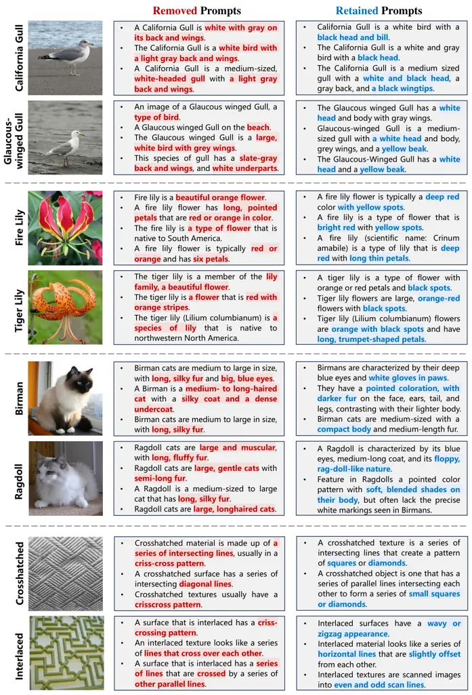

Figure 12: Qualitative analysis of class-specific prompt optimization by
ProAPO. Shaded red and blue words denote common and discriminative
descriptions in two confused categories.

## Appendix J Detailed Results of More Benefits by Optimal Prompts

### J.1 Transfer to Adapter-based Methods

In Fig. 13 and  Fig. 14, we show the detailed results of popular
training-free and training adapter-based methods \[80, 70, 86, 18\] with
different prompt initialization, i.e., SOTA method CuPL \[55\] and our
ProAPO. Adapter-based methods with ProAPO (solid lines) consistently
surpass those with CuPL (dotted lines). It reveals that high-quality
prompts make adapters perform better. Even in low shots, training with
ProAPO achieves notable performance gains, which further verifies its
effectiveness.

(a) ImageNet. (b) Caltech. (c) Cars. (d) DTD. (e) FGVC. (f) ESAT. (g)
FLO. (h) Food. (i) Pets. (j) SUN. (k) UCF.

Figure 13: Results of training-free adapter-based methods with different
initial prompts. Solid and dotted lines denote prompt initialization
with ProAPO and CuPL, respectively. We see that our ProAPO consistently
improves adapter-based methods.

(a) ImageNet. (b) Caltech. (c) Cars. (d) DTD. (e) FGVC. (f) ESAT. (g)
FLO. (h) Food. (i) Pets. (j) SUN. (k) UCF.

Figure 14: Results of training adapter-based methods with different
initial prompts. Solid and dotted lines denote prompt initialization
with ProAPO and CuPL, respectively. We see that our ProAPO consistently
improves adapter-based methods.

### J.2 Transfer to Different Backbones

In Fig. 15, we show detailed results of transferring prompts from source
to target models in thirteen datasets. Our optimized prompts of ResNet50
and ViT-B/32 are reported. We see that ProAPO achieves stable
performance gains compared to CuPL \[55\], which verifies that ProAPO
transfers easily across different backbones.

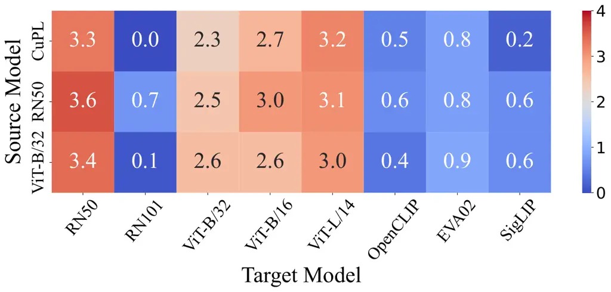

(a)

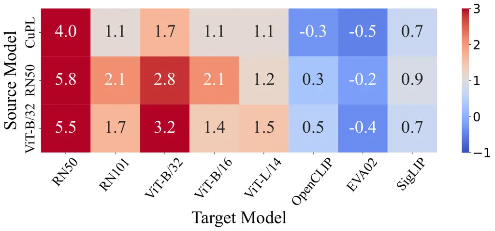

(b)

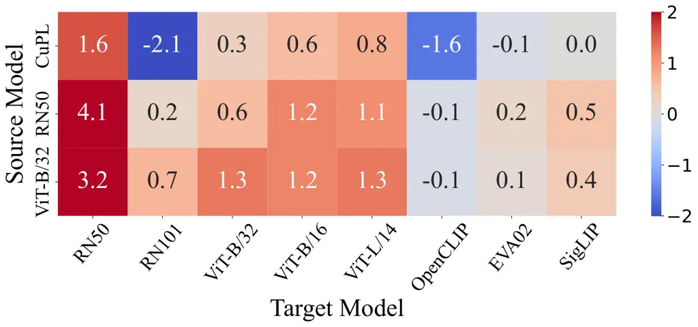

(c)

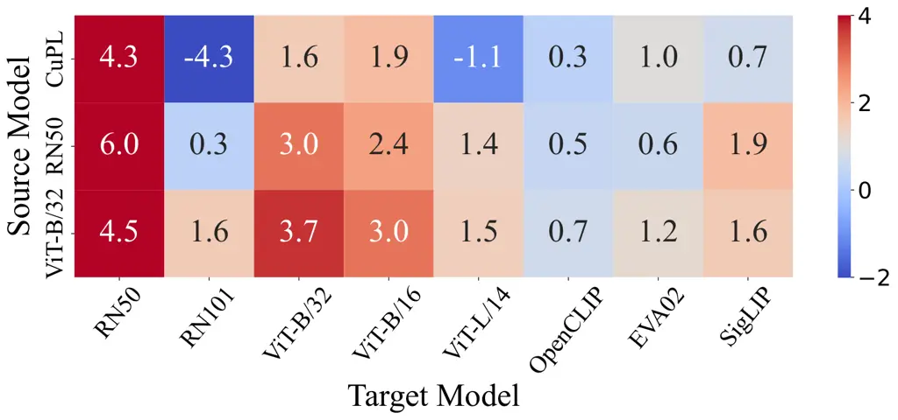

(d)

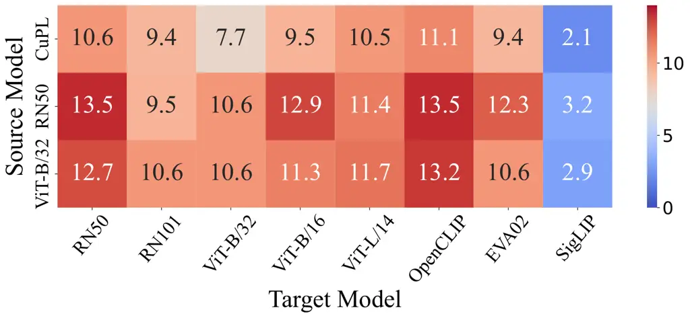

(e)

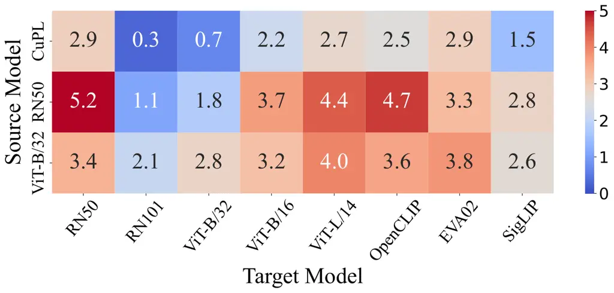

(f)

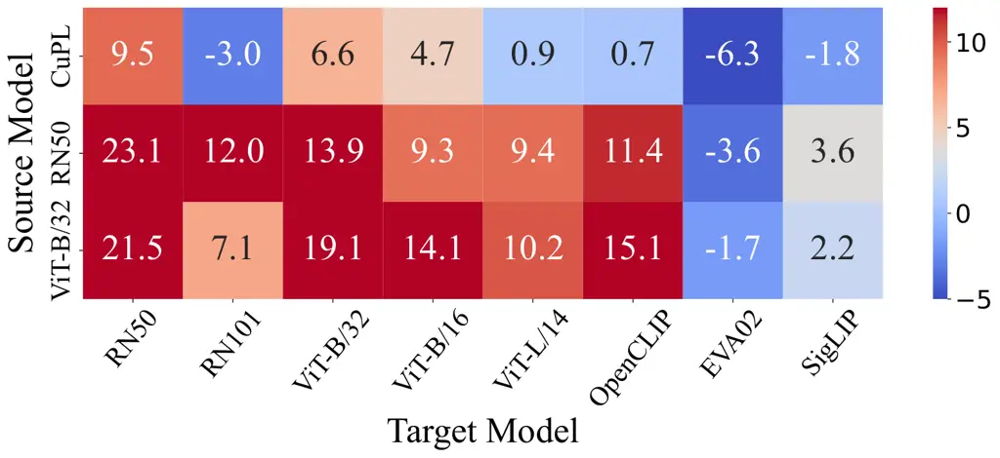

(g)

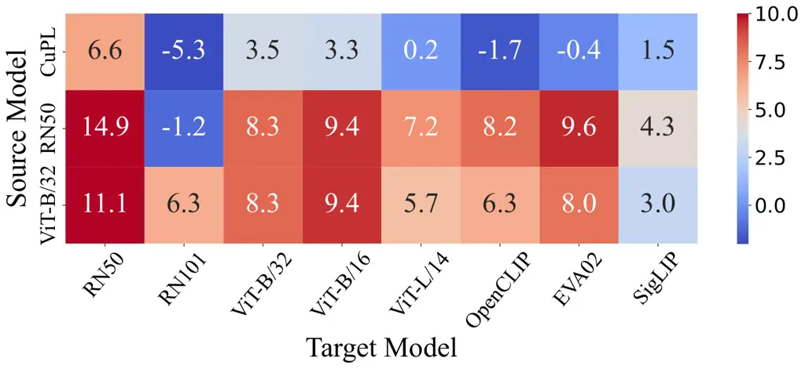

(h)

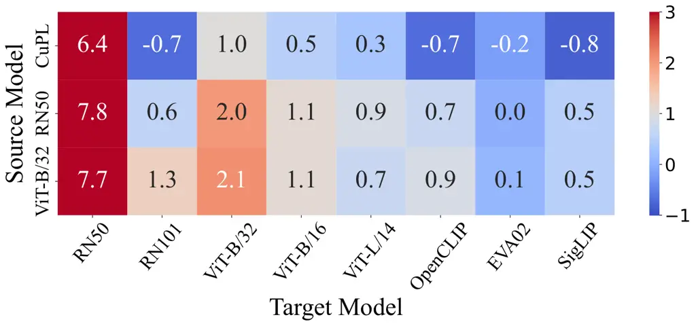

(i)

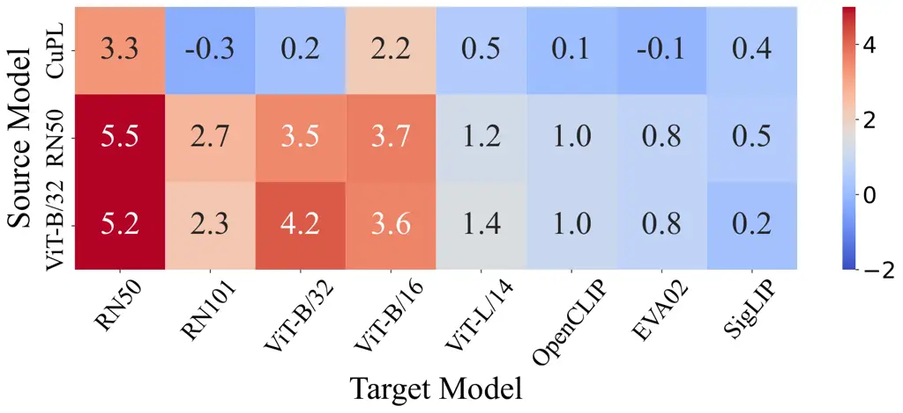

(j)

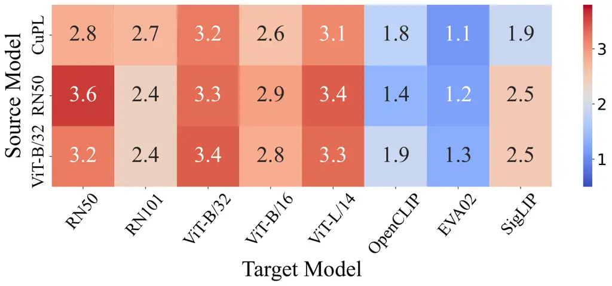

(k)

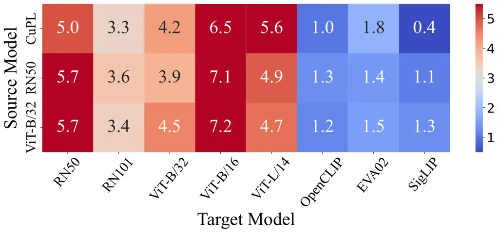

(l)

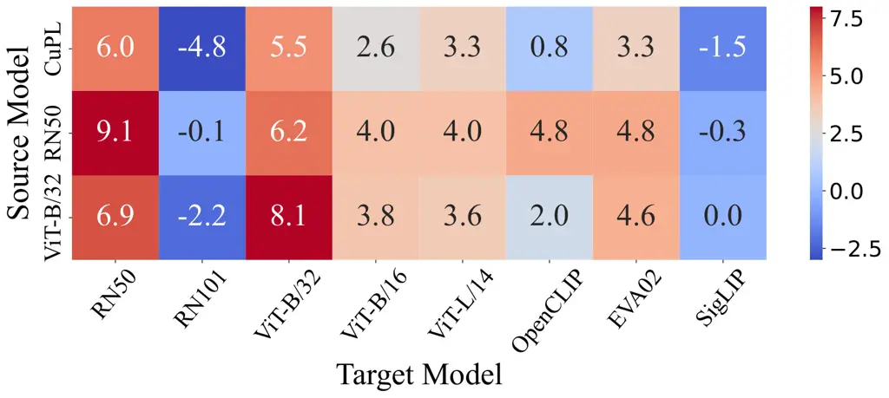

(m)

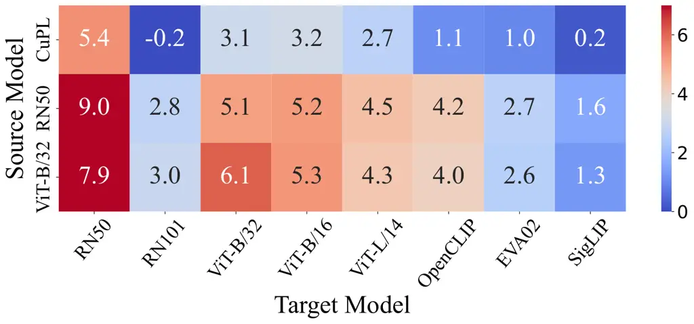

(n)

Figure 15: Results of prompt transfer to different backbones. The value
denotes performance gains compared to vanilla VLMs. Our optimized
prompts of ResNet50 and ViT-B/32 are reported. We see that we achieve
stable performance gains compared to CuPL \[55\].

## Appendix K Detailed Results of Performance Improvement Analysis

[TABLE]

Table 17: Analysis of the effect of single vs ensemble prompts. \*
denotes results evaluated in the test set. ATO is our automatic template
optimization algorithm. We see that our optimized templates achieve
higher results than PN \[39\], even better than the best single
template.

### K.1 Analysis of the Effect of Single VS Ensemble Prompts

In Tab. 17, we show detailed results of the effect of single vs ensemble
prompts. Compared to PN \[39\], we utilize prompt ensembling instead of
a single prompt to optimize the template and description. We observe
that ensemble templates have a higher upper bound than the single
template. Similarly, our optimized templates achieve higher performance
than PN \[39\], even better than the best single template, further
verifying the effectiveness of our method.

### K.2 Performance Improvement of Description Methods by ProAPO

In Tab. 18, we show detailed results of description methods \[43, 55,
73, 62\] with our ATO and ProAPO. We see a notable improvement in
description methods by at least 2.7% average in thirteen datasets. It
further verifies the effectiveness of our progressive optimization.

[TABLE]

Table 18: Performance improvement of description methods by our ProAPO.
Avg (11) and Avg (13) denote average results across 11 datasets
(excluding CUB \[71\] and Places \[81\]) and all 13 datasets,
respectively. $`\Delta`$ denotes performance gains compared to baseline.

[TABLE]

Table 19: Ablation of edit- and evolution-based operators.

[TABLE]

Table 20: Ablation of two sampling strategies.

[TABLE]

Table 21: Ablation of different score functions.

## Appendix L Detailed Results of Ablation Study

### L.1 Ablation of Edit- and Evolution-based Operators

In Tab. 19, we show detailed ablation results of edit- and
evolution-based operators. For edit-based operators, we observe that the
model with add, delete, and replace operations achieves a higher result
in row d). After introducing evolution-based operators, i.e., crossover
operator to combine advantages of high-scoring candidates, and mutation
operator to avoid locally optimal solutions, we see an increase in
performance in rows e)-g). It confirms that evolution-based operators
make the model search the optimal prompt faster with limited iterations.

### L.2 Ablation of Two Sampling Strategies

In Tab. 20, we show detailed ablation results of two sampling
strategies. Without the prompt sampling, we see a slight decrease in
times while results drop in row a). It verifies the effectiveness of the
prompt sampling. Without the group sampling to select salient categories
for optimization, we observe a notable increase in time costs (from 15
min to 300+ min, 20 times) yet similar results in row b) and the full
model. It reveals that group sampling simultaneously improves
performance and efficiency.

### L.3 Ablation of Different Score Functions

In Tab. 21, we show detailed ablation results of score functions.
Accuracy obtains the worst result as the score function due to the
overfitting problem. Our full model with accuracy and entropy
constraints as the score function achieves the SOTA result. The score
function with only accuracy or entropy constraint achieves suboptimal
results, suggesting a trade-off process between them.
