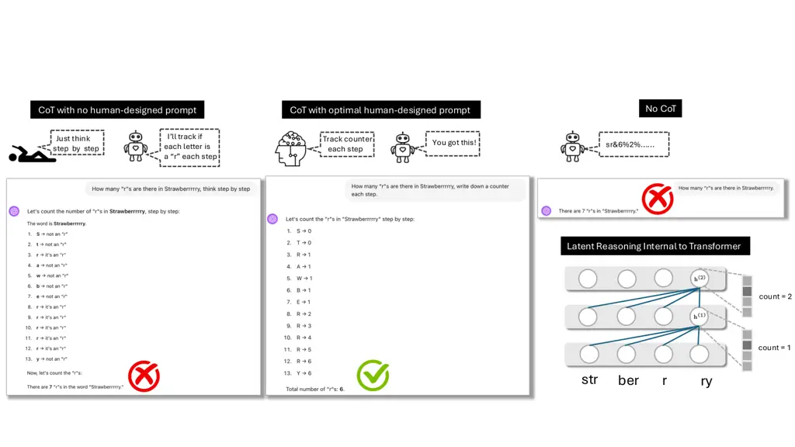
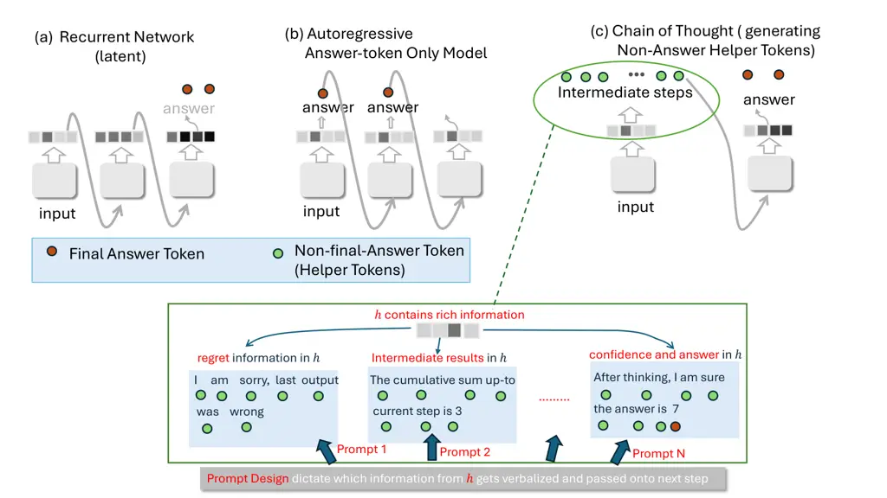
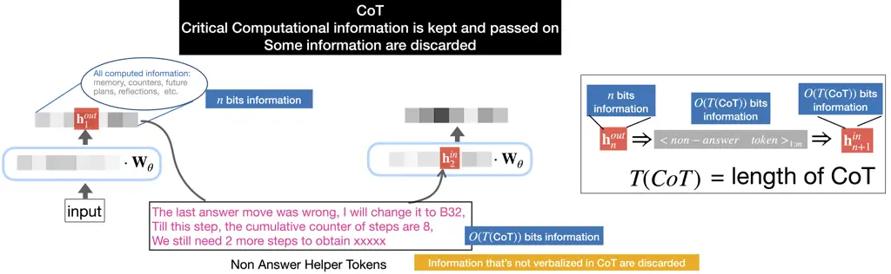
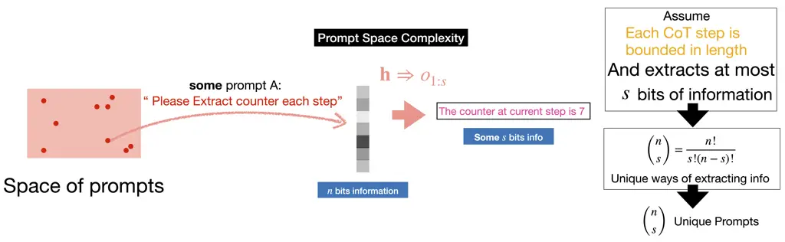
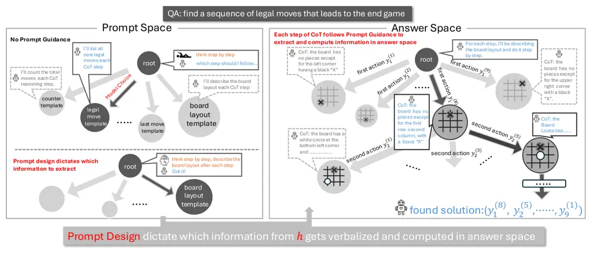

# Why Prompt Design Matters and Works: A Complexity Analysis of Prompt Search Space in LLMs

Xiang Zhang ^(†)^(†)thanks: Equal contribution. Affiliation: University
of British Columbia Email: <jiaqi.wei@zju.edu.cn>    Juntai
Cao¹¹footnotemark: 1 Affiliation: University of British Columbia
Email: <cyou@cs.stonybrook.edu>    Jiaqi Wei Affiliation: Zhejiang
Universityxzhang23@ualberta.ca, {jtcao7, dujian}@cs.ubc.ca,    Chenyu
You ^(†)^(†)thanks: Corresponding authors. Affiliation: Stony Brook
University    Dujian Ding²²footnotemark: 2 Affiliation: University of
British Columbia

###### Abstract

Despite the remarkable successes of Large Language Models (LLMs), the
underlying Transformer architecture has inherent limitations in handling
complex reasoning tasks. Chain-of-Thought (CoT) prompting has emerged as
a practical workaround, but most CoT-based methods rely on a single
generic prompt like “think step by step,” with no task-specific
adaptation. These approaches expect the model to discover an effective
reasoning path on its own, forcing it to search through a vast prompt
space. In contrast, many work has explored task-specific prompt designs
to boost performance. However, these designs are typically developed
through trial and error, lacking a theoretical ground. As a result,
prompt engineering remains largely ad hoc and unguided. In this paper,
we provide a theoretical framework that explains why some prompts
succeed while others fail. We show that prompts function as selectors,
extracting specific task-relevant information from the model’s full
hidden state during CoT reasoning. Each prompt defines a unique
trajectory through the answer space, and the choice of this trajectory
is crucial for task performance and future navigation in the answer
space. We analyze the complexity of finding optimal prompts and the size
of the prompt space for a given task. Our theory reveals principles
behind effective prompt design and shows that naive CoT—using
model-self-guided prompt like “think step by step” —can severely hinder
performance. Showing that optimal prompt search can lead to over a 50%
improvement on reasoning tasks through experiments, our work provide a
theoretical foundation for prompt engineering.

## 1 Introduction

Figure 1: Prompt templates influence the configuration and navigation of
the answer space. Prompt space search techniques include methods like
Auto-Prompt Shin et al. (2020), RL-Prompt Deng et al. (2022) While
answer space searching includes ToT Yao et al. (2024), ReST-MCTS^(∗)
Zhang et al. (2024a)



Figure 2: (a) Naive CoT, the model generates its own step template for
recurrent computation. This prompt template can be incorrect or
suboptimal, leading to task failure. (b) With prompt engineering and
design, the task performance under CoT can be properly guided. (c) When
CoT is not employed, the model relies solely on its internal reasoning
via the Transformer architecture. (d) Transformer can only perform
constant-depth sequential computations.

The advent of LLMs (Achiam et al., 2023) has transformed natural
language processing and artificial intelligence (Kojima et al., 2022;
Liu et al., 2022; Zhao et al., 2023; Kahatapitiya et al., 2023),
demonstrating near-human performance in knowledge tasks (Chang et al.,
2024; Zhang et al., 2023a; Zhang et al., 2022; Liu et al., 2021; Wen
et al., 2025) while showing limitations in reasoning
abilities (Valmeekam et al., 2022; Zhang et al., 2024b; Wei et al.,
2025). These reasoning challenges span from basic operations like
counting and sorting (Dziri et al., 2024; Cao et al., 2025) to complex
tasks such as mathematical problem-solving and coding (Xu et al., 2022;
Thirunavukarasu et al., 2023). While various factors affect reasoning
capabilities (Zhang et al., 2023b), including training
optimizations (Thorburn and Kruger, 2022), tokenization (Singh and
Strouse, 2024; Zhang et al., 2025), and datasets (Ye et al., 2024; Yin
et al., 2023), the model’s architecture plays a pivotal role in
determining its reasoning capabilities (Raghu et al., 2017; You et al.,
2020a; You et al., 2020b; You et al., 2021; You et al., 2024; Wu et al.,
2021; Zhang and Ding, 2024; Zhang et al., 2024b; Zhang et al., 2024c;
Delétang et al., 2022). The Transformer architecture (Vaswani, 2017)
underlying most LLMs has inherent computational depth limitations (Li
et al., 2024), as its attention mechanism can only perform a fixed
number of sequential computational steps (Li et al., 2024; Zhang et al.,
2024b; Sanford et al., 2024; Dehghani et al., 2018). This constant-depth
modeling (Li et al., 2024) restricts the model’s computability to
TC⁰ (Li et al., 2024; Feng et al., 2024), limiting its ability to solve
complex and lengthy tasks (Figure 2 Rightmost).

Chain of Thought (CoT) (Wei et al., 2022) overcomes the constant depth
limitation of model architectures by extending reasoning into the text
space through prompting(Li et al., 2024; Zhang et al., 2024b; Feng
et al., 2024). Theoretical and empirical studies show that CoT enables
Transformer-based models to achieve Turing Completeness under ideal
conditions (Li et al., 2024; Zhang et al., 2024b). While theoretical
upper bounds may not reflect real-world performance, understanding how
CoT transcends architectural constraints is crucial for optimal prompt
design and forms the foundation for our analysis of supervised CoT and
prompt search space theories. We therefore first reexamine CoT’s
computational mechanisms, synthesizing prior work (Li et al., 2024;
Zhang et al., 2024b; Feng et al., 2024) with our novel perspective.

The vanilla design of CoT is “unsupervised” Barlow (1989), meaning that
the model generates its prompt template without task-specific prompt
guidance from human. When prompted to “Think step by step”, LLMs
autonomously generate steps it needs to follow—for instance, generating
current chess board description—and then proceeding to search for final
answers based on this self-generated template (Figure 2 Leftmost). This
naive CoT approach can lead to poor performance, as the model may
generate sub-optimal trajectory, which hinder the search process. For
example, a problem requiring DFS might be unnecessarily attempted with a
BFS template generated by the vanilla CoT, incurring high inference
costs and likely delivering incorrect answers (Figure 2 Leftmost). Such
generic prompts are widely adopted in many CoT extensions, including
Graph-of-Thought (GoT) (Besta et al., 2024) and Tree-of-Thought
(ToT) (Yao et al., 2024), which simply generalize “think step by step”
into broader but still task-agnostic instructions.

In contrast, prompt engineering offers more deliberate, task-specific
guidance to steer LLMs effectively in downstream tasks. While a large
body of prompt design work exists, most approaches rely on empirical
trial and error to discover effective prompts. Furthermore, the reasons
behind the success of certain designs remain poorly understood.


Our work addresses this question by analyzing the information
trajectories induced by prompts in the answer space. We provide a
theoretical foundation for prompt engineering, offering principled
insights into the effectiveness of prompt designs.

Additionally, we investigate the fundamental distinction between prompt
space and answer space in LLM-based problem solving. Building on
insights from prior theoretical analyses of CoT, we propose and estimate
the complexity of each space. This allows us to formally characterize
the structure of prompt search and answer question:


We conduct extensive experiments on structured reasoning tasks,
demonstrating that well searched prompt design from prompt space is
essential for achieving optimal solutions.¹¹ 1 Our code and experiment
results are available at
[https://github.com/juntaic7/CoT-with-Supervision](https://github.com/juntaic7/CoT-with-Supervision).
Our results also reveal a substantial performance gap between scenarios
with and without prompt guidance in CoT. This work is the first to
explicitly explore the complexity of prompt space, providing a
theoretical foundation for both understanding and designing effective
prompting strategies for LLMs.

## 2 Demystifying CoT: Simple Explained

In this section, we synthesize key theoretical findings on CoT
prompting (Li et al., 2024; Zhang et al., 2024b; Feng et al., 2024) to
establish the foundation for our supervised CoT analysis.



Figure 3: How CoT approximates recurrent computation.

### 2.1 Limitations of Transformer Architecture and Answer-token-Only Models.

Transformers, unlike recurrent networks, cannot internally reason over
arbitrary sequential steps (depth). Specifically, Transformer don’t
reuse the previous hidden state $`\mathbf{h}_{\texttt{t-1}}`$ at time
step t-1 when calculating $`\mathbf{h}_{\texttt{t}}`$ (Figure 3.b), as
it would be in recurrent networks like RNN (Figure 3.a). The hidden
state $`\mathbf{h}`$ is passed only through the layers of the
Transformer (Dehghani et al., 2018) (Figure 2.c) rather than through
time, which means that the number of sequential steps is fixed and
limited for any given Transformer architecture (Li et al., 2024; Zhang
et al., 2024b; Elbayad et al., 2019). In contrast, RNNs (Grossberg, 2013) allow the hidden state $`\mathbf{h}`$ to be passed through time
steps via recurrent connections (Figure 3.a), enabling sequential
computation over $`\mathbf{h}`$ through an arbitrary number of input
tokens. This enables RNNs to perform deeper reasoning over
$`\mathbf{h}`$, which is essential for solving complex tasks (Zhang
et al., 2024b).

The hidden state $`\mathbf{h}`$ plays a crucial role in reasoning, as it
stores both reasoning memory and intermediate reasoning results (Zhang
et al., 2024b). The ability to sequentially compute and update
$`\mathbf{h}`$ over time allows a model to build reasoning depth, which
is necessary for addressing complex problems. This depth advantage
provided by recurrent connections cannot be replicated by autoregressive
models. Autoregressive models, instead of passing the hidden state
$`\mathbf{h}_{\texttt{t}}`$ forward, pass the generated token
$`\text{y}_{\texttt{t}}`$. However, y cannot replace the role of
$`\mathbf{h}`$ for the following reasons: y is a discrete value
extracted from $`\mathbf{h}`$ and only contains partial information
(Figure 3.b), making it insufficient for continued reasoning in many
tasks. y exists outside the latent space where $`\mathbf{h}`$ operates
(Figure 3.b), meaning it cannot be used for computation in the same way
that $`\mathbf{h}`$ can (Zhang et al., 2024b). As a result, the flow of
computational information stored in $`\mathbf{h}`$ is severely hindered
in Transformer-based autoregressive models.

### 2.2 Nature of Inductive Reasoning

Reasoning inherently requires sequential depth. For tasks with input of
length n, reasoning is typically performed step by step to arrive at the
final result. Examples include counting (incrementing a counter
iteratively), playing chess (updating the board state iteratively), and
searching (marking visited nodes iteratively). To solve a given task,
there is a theoretical lower bound on the required depth of
computation (Sanford et al., 2024). Transformer’s fixed sequential
reasoning depth over the hidden state $`\mathbf{h}`$ prevents them from
solving tasks that require deeper reasoning as input length grows
(Detailed in Appendix).

Consider chess game as an example. For a sequence of chess moves,
$`\mathbf{x}_{\texttt{n}}=(\text{x}_{\texttt{1}},\text{x}_{\texttt{2}},\dots,\text{x}_{\texttt{n}})`$,
to validate the n-th move, the n-th board state
$`\mathbf{h}_{\texttt{n}}`$ must be calculated. This requires n
sequential computations, as the n-th board state depends not only on the
sequence of moves $`\mathbf{x}`$ but also on the previous board state
$`\mathbf{h}_{\texttt{n-1}}`$. While a neural network could memorize the
mapping from $`\mathbf{x}_{\texttt{1:n}}`$ to the correct
$`\mathbf{h}`$ (Arpit et al., 2017) to bypass the need for sequential
computation, the memorization will be an exponentially growing challenge
and much more space-intensive than reasoning. Thus, the model’s internal
representation $`\mathbf{h}`$, which encodes the board state, must be
sequentially computed n times to simulate the game. Answer-token-only
(only $`\mathbf{x}`$ outputted) Transformers (Fig. 3b and Fig. 1
Rightmost), which compute their hidden states $`\mathbf{h}`$ a fixed
number of times regardless of input length, cannot perform such
inherently sequential tasks (More on Appendix).

Figure 4: Computational Information flow in Recurrent and Autoregressive
models



Figure 5: CoT only extract partial information from $`\mathbf{h}`$.
Which information to extract is dictated by prompt template.

### 2.3 CoT + Autoregressive = Recurrent

Previous research Li et al. (2024); Zhang et al. (2024b); Feng et al.
(2024) demonstrates that CoT effectively bridges the gap between
autoregressive Liang et al. (2022); Liu et al. (2022) models and
recurrent structures Zhang et al. (2024b) in LLMs. CoT extends beyond
simple answer token generation by producing intermediate steps as
non-answer natural language tokens
$`(\text{o}_{\texttt{1}},\text{o}_{\texttt{2}},\dots,\text{o}_{\texttt{k}})`$
that act as a discretizations of latent information
$`\mathbf{h}_{\texttt{n}}`$ (Figure 3 (c)). Natural language’s
expressive power enables $`\mathbf{h}`$ to be encoded into token
sequence $`\mathbf{o}_{1:k}`$, which the embedding layer then reconverts
to vector $`\mathbf{h}`$ (This process preserves computational
information through a process of discretizations followed by
vectorization (Figure 3 (c) and Figure 5 ):

```math
\mathbf{h}_{t}\xRightarrow{\text{discritization}}(\text{o}_{\texttt{1}},\text{o}_{\texttt{2}},\cdots,\text{o}_{\texttt{k}})\xRightarrow{\text{vectorization}}\mathbf{h}_{\texttt{t+1}}
```

The approach effectively mirrors the
$`\mathbf{h}_{t}\Rightarrow\mathbf{h}_{\texttt{t+1}}`$ (Figure 4)
operation in RNN-like networks, enabling recurrent updates to
$`\mathbf{h}`$ (Figure 5).

Using the previous chess example, the CoT process would generate natural
language tokens (non-answer helper tokens) describing board state
$`\mathbf{h}_{\texttt{k}}`$ after k moves (answer tokens), specifying
piece positions. The model’s embedding layer then processes this board
description to convert into $`\mathbf{h}_{k+1}`$, eliminating the need
for recalculation of board state from just moves $`\mathbf{x}`$—a
capability not inherent to Transformer’s non-recurrent architecture.

In conclusion, LLMs with CoT extend reasoning from latent space
$`\mathbb{H}`$ to natural language token space $`\mathbb{O}`$. Natural
language’s powerful encoding capability enables storage and reuse of
intermediate reasoning steps, increasing reasoning depth to
$`T(\texttt{n})`$, where $`T(\texttt{n})`$ is the number of CoT steps
performed. Ideally with infinite CoT steps and perfect
latent-space-to-text-space conversion, LLMs could theoretically achieve
recurrent and Turing completeness. However, as each CoT step is limited
in size and tokens, the amount of information that can be extracted
during CoT is limited. Which information to extract is selected by
prompt template.

## 3 CoT Search Space = Prompt Space + Answer Space

Despite theoretical potential for universal problem-solving Li et al.
(2024); Zhang et al. (2024b), practical CoT implementations face
limitations from finite steps and imperfect $`\mathbf{h}`$ to
$`\mathbf{o}`$ conversion. As each step captures only partial
information from $`\mathbf{h}`$ (Figure 5), identifying relevant data
for computation becomes critical (Figure 7). We decompose the CoT
reasoning into two components: template search within the prompt space
(Figure 7) and answer search within the answer space (Figure 7). We show
how effective navigation of the prompt space can simplify answer space
complexity and complexity of each space. Through out analysis, we reveal
the mechanism behind why certain prompt design can be effective.

### 3.1 Prompt Space Complexity

The latent vector $`\mathbf{h}`$ contains rich intermediate information
when processing a task (Fig. 5, including counters, sums, flags for
binary indicators, and more. When LLMs are prompted to perform tasks,
they follow a step template (either came up by LLM itself or provided by
human, Figure 1), specifying which information from $`\mathbf{h}`$ to
extract and discretize into non-answer helper tokens
$`(\text{o}_{\texttt{1}},\text{o}_{\texttt{2}},\dots,\text{o}_{\texttt{$T$(CoT)}})`$
in CoT. Ideally, as
$`T_{\texttt{(CoT)}}\mathbf{\to}\mathbf{\infty}`$—meaning the length of
the each CoT step is arbitrarily long—all vectorized information in
$`\mathbf{h}`$ can be fully textualized, achieving true
recurrence (Figure 4) through autoregression. However, with limited k,
only partial information is discretized (Fig. 5).



Figure 6: Each prompt dictate one way of information verbalization
during CoT. Prompt Space Complexity is calculated based on latent
information verbalization from $`\mathbf{h}`$ to non-answer tokens
$`\mathbf{o}`$.

If we define the amount of information stored in $`\mathbf{h}`$ as n
bits, and each CoT step extracts up to s bits of information into
$`\mathbf{o}`$ (Fig. 5 and 6), each unique step template specifies a way
to extract s bits from the full n-bit space (Fig. 6). Thus, the total
number of potential step templates is
$`C(\texttt{n},\texttt{s})=\frac{\texttt{n}!}{\texttt{s}!(\texttt{n}-\texttt{s})!}`$,
which estimates the number of ways information can be extracted via CoT
at each step (Fig. 6).


For example, in the chess simulation case (Fig. 7), $`\mathbf{h}`$
encodes details such as the \<current board layout\>, \<the next
player\>, \<board status\>, \<number of pieces taken by each player\>
and so on. When given the instruction to “think step by step”, the model
decides which information to extract based on the step template it
generates (Fig. 7 No prompt guidance). Extracting the wrong information
might hinder reasoning in subsequent steps as recurrence can not be
effectively performed on the needed information.

The prompt search complexity $`C(\texttt{n},\texttt{s})`$ depends on
both n, the total information in $`\mathbf{h}`$, and s, the amount of
information each CoT step can extract. If a model is sufficiently
trained, the total amount of encoded information in $`\mathbf{h}`$ is
proportional to both dimension size of $`\mathbf{h}`$ (Allen-Zhu and Li,
2023), d, and nature of the task, denoted by
$`\texttt{n}\propto\texttt{d}\ \ \&\ \ \text{TASK}`$. In this context, n
represents the size of the search space, while s correlates with the
length of CoT tokens $`\mathbf{o}`$, as longer CoT steps tend to extract
more information from $`\mathbf{h}`$. In practice, step template search
by model itself is not entirely random. Models often find relevant
templates using heuristics, which significantly reduces the search
complexity of $`C(\texttt{m},\texttt{s})`$. However, identifying the
optimal template remains challenging, and using an suboptimal template
can severely degrade performance, as demonstrated in our experiments.

In conclusion, the step (prompt) template defines how information is
extracted and used recurrently in the CoT process. Finding the correct
template is equivalent to discovering the algorithm for solving a given
task, determining what information is needed at each step and how it
should be used to compute the next state (Figure 7 left).

### 3.2 Answer Space Complexity

Once the model “decides” on the steps to follow during CoT, it performs
reasoning accordingly. With a specific step (prompt) template
$`\mathrm{p}i`$ chosen from the prompt space $`\mathcal{P}`$, CoT
iteratively executes
$`\mathbf{h}_{t}\xRightarrow{\mathrm{p}_{i}}(\text{o}^{{(i)}}_{\texttt{1}},\text{o}^{{(i)}}_{\texttt{2}},\dots,\text{o}^{{(i)}}_{\texttt{k}})\xRightarrow{}\mathbf{h}_{\texttt{t+1}}`$
to update $`\mathbf{h}`$ and calculate the next state, continuing this
process until reaching the final state (solution). The complexity of
finding solutions in the answer space depends on both the choice of
$`\mathrm{p}_{i}`$ and the nature of the task itself.

Each task embeds a different level of complexity in its answer space.
For instance, in the chess simulation task of \<finding a set of actions
leading to game end\>, the answer space
$`\mathcal{S}=(\mathbf{s}_{1},\mathbf{s}_{2},\dots,\mathbf{s}_{\infty})`$
contains all possible combinations of action sequences $`\mathbf{s}`$.
The solution set $`\mathcal{CR}\subset\mathcal{S}`$ includes all valid
action sequences that lead to the end of the game, being a subset of the
entire answer space $`\mathcal{S}`$. Solving the problem requires
identifying one single correct action sequence
$`\mathbf{s}_{\texttt{correct}}=(\text{y}_{\texttt{1}},\text{y}_{\texttt{2}},\dots,\text{y}_{\texttt{T}})\in\mathcal{CR}`$.

If a fixed step (prompt) template for this task, such as
$`\mathrm{p}_{0}=`$ \<extract current board configuration at each
step\>, is used, the CoT process iteratively extracts the current board
description and use it for calculating next board state in
$`\mathbf{h}`$ to identify the valid next move
$`\text{y}_{\texttt{i}}`$, eventually forming the correct answer
$`\mathbf{s}_{\texttt{correct}}=(\text{y}_{\texttt{1}},\text{y}_{\texttt{2}},\dots,\text{y}_{\texttt{T}})`$.
The complexity of navigating the answer space can be roughly measured
by:

```math
\frac{\texttt{len}(\mathcal{CR})}{\texttt{len}(\mathcal{S})}\ \ \ \ \ \ |\ \ \ \ \mathrm{p} \tag{1}
```

This ratio measures the proportion of the solution space
$`\mathcal{CR}`$ relative to the entire answer space $`\mathcal{S}`$,
given a specific template $`\mathrm{p}`$. If the chosen template
$`\mathrm{p}`$ extracts irrelevant information—such as determining which
player is next at each step—the ratio simplifies to
$`\frac{\texttt{len}(\mathcal{CR})}{\texttt{len}(\mathcal{S})}`$. In
this case, each $`\text{y}_{\texttt{i}}`$ would be generated randomly,
as $`\mathbf{h}`$ can not be computed iteratively over useful
information needed for extracting correct $`\text{y}_{\texttt{i}}`$,
making the correct answer only discoverable by chance.

Correctly identifying the step template $`\mathrm{p}`$ is crucial for
reducing the complexity of
$`\frac{\texttt{len}(\mathcal{CR})}{\texttt{len}(\mathcal{S})}\ |\ \mathrm{p}`$,
as $`\mathrm{p}`$ dictates what information is recurrently overlayed in
the process
$`\mathbf{h}_{\texttt{t}}\Rightarrow\mathbf{h}_{\texttt{t+1}}`$ and in
turn what can be calculated, essentially acting as the “algorithm” for
solving tasks in the CoT process. In the chess example, the optimal
template would be \<extract current board configuration at each step\>,
allowing the model to reason over the board state iteratively, i.e.,
$`\mathbf{h}_{\texttt{t}}\xRightarrow{\texttt{board state}}\mathbf{h}_{\texttt{t+1}}`$.
With the correct board state computed recurrently, the valid next move
$`\text{y}_{\texttt{t}}`$ can be effortlessly derived from
$`\mathbf{h}_{\texttt{t}}`$ (Figure 7 right). However, using a less
relevant template, such as \<extract the number of pieces on the board
at each step\>, would expand the search space nearly to
$`\frac{\texttt{len}(\mathcal{CR})}{\texttt{len}(\mathcal{S})}`$, as the
number of pieces doesn’t provide useful information for determining the
next valid move. Consequently, the model would have to recalculate the
board state at each step from previously generated moves
$`\text{y}_{\texttt{1
}}`$, which requires $`O(n)`$ depth–Transformers, limited by constant
depth, cannot handle. As a result, the next action
$`\text{y}_{\texttt{t+1}}`$ would not benefit from the CoT process.



Figure 7: Visualization of CoT Space, which decomposed into prompt space
and answer space for a given problem. Prompt selection from prompt space
(left) will affect answer navigation in answer space (right).

### 3.3 CoT as an Unsupervised Task Solver

CoT operates in an unsupervised manner for any given task, relying on a
single universal prompt, Think Step by Step, and leaving it to the model
to generate its own step template $`\mathrm{p}\in\mathcal{P}`$ for
extracting information at each step. Since humans do not design prompt
for information extraction, the generation of steps—i.e., determining
which information to extract from $`\mathbf{h}`$ and compute
recurrently—comes primarily from the model’s heuristics. For example, in
counting tasks, LLMs use learned heuristics to extract a Counter value
from $`\mathbf{h}`$ and perform recurrent updates. However, these
unsupervised, heuristic-driven templates are often unreliable, as the
model lacks the knowledge to identify key components for some
computation or tasks with complicated descriptions, as demonstrated in
previous work Valmeekam et al. (2022) and our experiments.

### 3.4 CoT Variants as Unsupervised Helpers for Navigating Answer Space

In practice, the answer space $`\mathcal{S}`$ can be large and complex,
and even with the optimal step (prompt) template $`\mathrm{p}`$, CoT can
make errors. Various CoT variants, such as Tree-of-Thought (ToT) and
Graph-of-Thought (GoT), have been proposed to mitigate these mistakes in
solution searching. While these “X-of-thought” approaches don’t dictate
which specific information to extract at each step like $`\mathrm{p}`$
does, they improve solution finding by exploring multiple paths and
self-verifying. For instance, ToT explores multiple instances in the
answer space simultaneously under some given template $`\mathrm{p}`$,
unlike the single-path exploration of CoT. Specifically, information
extracted from the current hidden state $`\mathbf{h}\texttt{t}`$ using
$`\mathrm{p}`$ is used to generate q possible answers for the next step,
denoted as
$`(\text{y}^{\texttt{(1)}}_{\texttt{t+1}},\text{y}^{\texttt{(2)}}_{\texttt{t+1}},\dots,\text{y}^{\texttt{(q)}}_{\texttt{t+1}})`$.
Each answer leads to a different next state
$`\mathbf{h}_{\texttt{t+1}}`$. In the example of \<finding a set of
actions leading to game end\>, the board state at step t is extracted
into descriptions using the correct template $`\mathrm{p}`$ and to form
$`\mathbf{h}_{\texttt{t+1}}`$, and instead of producing a single next
move $`\text{y}_{\texttt{t+1}}`$ from $`\mathbf{h}`$, multiple actions
are derived. Each derived action along with previous actions forms a
unique path that leads to a potential solution in $`\mathcal{S}`$. Since
some paths may fail (e.g., leading to a non-ending game), exploring
multiple paths simultaneously increases the efficiency of searching the
answer space. The visualization is shown in Figure 8.

{forest}

Figure 8: ToT mechanism. $`\mathbf{h}_{\texttt{t}}`$ is transitioned
into different $`\mathbf{h}_{\texttt{t+1}}`$, to explore more in answer
space. How state is transitioned is dictated by the step template of
CoT, which goes beyond what ToT offers.

Similarly, GoT improves search accuracy by iteratively revisiting
previously generated partial answers. However, none of these approaches
are supervised, as the model is not informed of the correct step
template $`\mathrm{p}`$ and generates it on its own, extracting
information at each step accordingly. X-of-Thought still relies on a
“one-prompt-for-all” approach and only aids in finding answers after
$`\mathrm{p}\in\mathcal{P}`$ is fixed. As we have shown, this can lead
to poor outcomes, since $`\mathrm{p}`$ directly influences the
complexity of the answer space, and X-of-Thought may be too late to
correct errors in some cases.

## 4 Experiments

In this section, we conduct experiments to demonstrate the importance of
supervision in the CoT process. Specifically, we design scenarios where
the correct and optimal step template is provided through supervision
(assume we know optimal template from prompt space), and compare them to
cases where incorrect or suboptimal prompt templates are simulated. Our
results show significant performance degradation when the step templates
are incorrectly derived, highlighting the need for human supervision to
ensure reliable task performance with LLMs.

### 4.1 Experiments Designs

We follow previous work Zhang et al. (2024b); Delétang et al. (2022) by
focusing on more fundamental reasoning tasks for LLMs. Specifically, we
evaluate tasks at three levels of computability: Regular (R),
Context-Free (CF), and Context-Sensitive (CS), each corresponding to
tasks solvable by different levels of computational power, from
deterministic automata all the way to linear bounded automata (i.e.
restricted Turing machines). These tasks involve operations such as
counting, sorting, and number addition—basic operations that are
required by more complex algorithmic problems (like NP problems). Each
task has a strong dependency on identifying the correct step template,
thus allowing us to clearly observe the impact of selection on step
template on CoT performance.

All of these tasks require a level of computability beyond the
capabilities of the Transformer’s internal architecture Delétang et al.
(2022). Specifically, solving them demands a minimum computational depth
that scales linearly with input length, surpassing the constant depth
inherent to Transformer models. Thus, solving these tasks necessitates
the use of CoT, and correctly identifying the information to extract
during CoT is crucial for resuming computation and building the
necessary depth, as we analyzed before.

We use gpt-4o-classic web-server and gpt-4o mini API, versions that
eliminates the use of external tools and functions solely based on the
LLM itself. To ensure that factors such as long-context information
retrieval and tokenization do not affect the results and conduct
controlled experiments, we carefully design the data instance in each
task. Details of our experimental design, including length sampling,
task specifications, format adjustments, and prompt usage, are provided
in detail in the Appendix Section A and Section B. The final results are
shown in Table 1 and Table 3.

Level Task RNN Tape Transformer LLM CoT CoT CoT RNN w/o CoT Unsupervised
Supervised Supervised-SUB R Modular Arithmetic 1.00 1.00 0.96 0.22 0.96
1.00 0.44 Parity Check 1.00 1.00 0.52 0.58 0.94 1.00 0.42 Cycle
Navigation 1.00 1.00 0.62 0.50 0.78 1.00 0.26 CF Stack Manipulation 0.56
1.00 0.58 0.00 0.92 0.96 0.00 Reverse List 0.62 1.00 0.62 0.48 0.80 0.96
0.38 Modular Arithmetic 0.41 0.95 0.32 0.00 0.82 0.94 0.50

Table 1: Results produced using gpt-4o-classic Web version on 50
instances each cell. For LLMs w/o CoT, intermediate steps are explicitly
prohibited using prompting. “ Supervised” refers to when we provide the
optimal prompt template. “Supervised-SUB” refers to correct but
suboptimal step templates are provided, simulating scenarios where LLM
makes inferior choices in navigating the prompt space and derives worse
step templates. Results for RNN, Tape-RNN and Transformer are from
previous work (Delétang et al., 2022) for reference. The difference in
experiment settings are detailed in the Appendix Section B.

### 4.2 Main Result

Recurrence is Key for Reasoning. Recurrence is crucial for task-solving,
as shown in both expert models (RNN, Tape-RNN, and Transformers) and
LLMs (Table 1). Expert models like RNN and Tape-RNN achieve over 90%
accuracy across tasks, depending on memory architecture. In contrast,
Transformers, limited by shallow reasoning depth, fail to solve these
tasks. Similarly, LLMs without CoT, relying solely on Transformer
reasoning, perform poorly. With CoT, which introduces recurrent
computational power, LLM accuracy improves significantly. These findings
underscore the essential role of recurrence in a model’s computability,
as previously analyzed.

Step Template Choices and Prompt Designs Dictates Reasoning Performance.
To study the role of prompt template design, we introduce two levels:
Optimal Supervision, guiding the model with ideal steps for maximum
performance, and Suboptimal Supervision, simulating less optimal steps
to observe performance degradation. While suboptimal templates are
technically correct and human-usable, they often degrade LLM performance
by altering answer space configurations (Detailed analysis on Appendix
Section C.1 and C.2). Since the tasks are relatively simple, models
rarely fail to identify optimal step templates under supervision, but
the performance gap between optimal and suboptimal steps highlights the
need for supervision. Details of supervision and prompt design are
provided in Appendix Section B.

From Table 1 and 3, we observe that providing supervision yields
noticeable improvements over the unsupervised “step-by-step” approach.
Specifically, errors caused by the model’s own derived step templates
are eliminated with correct supervision, resulting in better performance
scores. In contrast, when the step template is intentionally set up
sub-optimally, we observe a significant performance degradation, with
some tasks performing as poorly as they would without using CoT. This
verifies that answer space’s landscape and complexity are largely
affected by choice of step template from prompt space, and human
supervision can guide the model to the optimal configuration.

| Model                    | R    |      |      | CF   |      |      |
| ------------------------ | ---- | ---- | ---- | ---- | ---- | ---- |
|                          | MA   | PC   | CN   | SM   | RL   | MA   |
| Unsupervised CoT         | 0.96 | 0.94 | 0.78 | 0.92 | 0.80 | 0.82 |
| Unsupervised ToT         | 0.92 | 0.90 | 0.92 | 0.36 | 0.88 | 0.78 |
| Unsupervised GoT         | 1.00 | 0.98 | 0.90 | 0.72 | 0.92 | 0.88 |
| Correctly supervised CoT | 1.00 | 1.00 | 1.00 | 0.96 | 0.96 | 0.94 |

Table 2: Variant of CoT in performing each task. Each task is named
using the first two letters in Table 1.

CoT Variants Help Navigate Answer Space. We compare the results of
different CoT variants for the same tasks. As shown in Table 2, both ToT
and GoT improve performance over naive CoT. However, this improvement is
due to correcting “incorrect calculations” during computation, not from
improvements in step-template selection. ToT provides little benefit, as
the tasks typically have only one path to the solution, large scale
Tree-search does not offer much help. In contrast, GoT shows greater
accuracy gains, thanks to its self-revisiting mechanism.

Lastly, we showcase how suboptimal navigation in the prompt space leads
to uncorrectable results, which we classify these failures into 4 modes,
detailed in Appendix Section C.2. As shown in Appendix section C.1 and
C.2, the suboptimal step template results in incorrect information
extraction and redundant generation, leading to a wrongly computed next
state and ultimately increasing the difficulty of searching the answer
space.

## 5 Choosing an Optimal Prompt for a Task

An effective prompt serves as a selector that governs how information is
extracted from the hidden representation $`\mathbf{h}`$ to generate the
output $`\mathbf{o}`$, which in turn guides future computation. Since
$`\mathbf{h}`$ encodes a mixture of task-relevant and irrelevant
signals, the goal of prompt design is to identify and extract the top
$`s`$ most critical bits of information from $`\mathbf{h}`$—those most
relevant to the reasoning task—while discarding the rest.

This implies that an optimal prompt template must explicitly specify
what each step in the Chain-of-Thought (CoT) reasoning process should
output. In other words, each CoT step should be guided to compute and
emit a well-scoped summary of the current state, focused only on
task-relevant variables. The prompt must align the CoT step’s output
with the $`s`$ most informative components of $`\mathbf{h}`$ for that
specific task.

## 6 Conclusion

This work uncovers how prompts shape the reasoning process in
Chain-of-Thought (CoT) prompting. By analyzing the interaction between
prompt space and answer space, we show that prompts act as selectors of
task-relevant information from the model’s internal state. Our findings
reveal that prompt design is not just auxiliary but central to CoT
effectiveness—small changes in prompt structure can lead to large
performance differences. This provides a theoretical foundation for
understanding and improving prompt-based reasoning in LLMs.

## Limitations

Our research focused primarily on simple reasoning tasks, where we found
consistent evidence that CoT with optimal template (correct human
guidance) significantly improves performance. While we believe these
findings likely generalize to more complex reasoning tasks, as they
build upon similar fundamental principles, we were unable to verify this
directly due to resource constraints and the need for specialized domain
expertise. Similarly, although we tested on a limited set of models, the
universal nature of mainstream LLM training and design principles
suggests our findings would extend to other language models. Future work
could validate these assumptions by expanding the scope to both more
complex reasoning tasks and a broader range of models.

## References

- Achiam et al. (2023) Josh Achiam, Steven Adler, Sandhini Agarwal, Lama
  Ahmad, Ilge Akkaya, Florencia Leoni Aleman, Diogo Almeida, Janko
  Altenschmidt, Sam Altman, Shyamal Anadkat, et al. 2023. Gpt-4
  technical report. _arXiv preprint arXiv:2303.08774_.
- Allen-Zhu and Li (2023) Zeyuan Allen-Zhu and Yuanzhi Li. 2023. Physics
  of language models: Part 3.1, knowledge storage and extraction. _arXiv
  preprint arXiv:2309.14316_.
- Arpit et al. (2017) Devansh Arpit, Stanisław Jastrzebski, Nicolas
  Ballas, David Krueger, Emmanuel Bengio, Maxinder S Kanwal, Tegan
  Maharaj, Asja Fischer, Aaron Courville, Yoshua Bengio, et al. 2017. A
  closer look at memorization in deep networks. In _International
  conference on machine learning_, pages 233–242. PMLR.
- Barlow (1989) Horace B Barlow. 1989. Unsupervised learning. _Neural
  computation_, 1(3):295–311.
- Besta et al. (2024) Maciej Besta, Nils Blach, Ales Kubicek, Robert
  Gerstenberger, Lukas Gianinazzi, Joanna Gajda, Tomasz Lehmann, Michał
  Podstawski, Hubert Niewiadomski, Piotr Nyczyk, and Torsten
  Hoefler. 2024. [Graph of Thoughts: Solving Elaborate Problems with
  Large Language Models](https://doi.org/10.1609/aaai.v38i16.29720).
  _Proceedings of the AAAI Conference on Artificial Intelligence_,
  38(16):17682–17690.
- Cao et al. (2025) Juntai Cao, Xiang Zhang, Raymond Li, Chuyuan Li,
  Shafiq Joty, and Giuseppe Carenini. 2025. Multi ²: Multi-agent
  test-time scalable framework for multi-document processing. _arXiv
  preprint arXiv:2502.20592_.
- Chang and Bisk (2024) Yingshan Chang and Yonatan Bisk. 2024. [Language
  models need inductive biases to count
  inductively](https://arxiv.org/abs/2405.20131). _Preprint_,
  arXiv:2405.20131.
- Chang et al. (2024) Yupeng Chang, Xu Wang, Jindong Wang, Yuan Wu,
  Linyi Yang, Kaijie Zhu, Hao Chen, Xiaoyuan Yi, Cunxiang Wang, Yidong
  Wang, et al. 2024. A survey on evaluation of large language models.
  _ACM Transactions on Intelligent Systems and Technology_, 15(3):1–45.
- Dehghani et al. (2018) Mostafa Dehghani, Stephan Gouws, Oriol Vinyals,
  Jakob Uszkoreit, and Łukasz Kaiser. 2018. Universal transformers.
  _arXiv preprint arXiv:1807.03819_.
- Delétang et al. (2022) Grégoire Delétang, Anian Ruoss, Jordi
  Grau-Moya, Tim Genewein, Li Kevin Wenliang, Elliot Catt, Chris Cundy,
  Marcus Hutter, Shane Legg, Joel Veness, et al. 2022. Neural networks
  and the chomsky hierarchy. _arXiv preprint arXiv:2207.02098_.
- Deng et al. (2022) Mingkai Deng, Jianyu Wang, Cheng-Ping Hsieh, Yihan
  Wang, Han Guo, Tianmin Shu, Meng Song, Eric P. Xing, and Zhiting
  Hu. 2022. [Rlprompt: Optimizing discrete text prompts with
  reinforcement learning](https://arxiv.org/abs/2205.12548). _Preprint_,
  arXiv:2205.12548.
- Dziri et al. (2024) Nouha Dziri, Ximing Lu, Melanie Sclar,
  Xiang Lorraine Li, Liwei Jiang, Bill Yuchen Lin, Sean Welleck, Peter
  West, Chandra Bhagavatula, Ronan Le Bras, et al. 2024. Faith and fate:
  Limits of transformers on compositionality. _Advances in Neural
  Information Processing Systems_, 36.
- Elbayad et al. (2019) Maha Elbayad, Jiatao Gu, Edouard Grave, and
  Michael Auli. 2019. Depth-adaptive transformer. _arXiv preprint
  arXiv:1910.10073_.
- Feng et al. (2024) Guhao Feng, Bohang Zhang, Yuntian Gu, Haotian Ye,
  Di He, and Liwei Wang. 2024. Towards revealing the mystery behind
  chain of thought: a theoretical perspective. _Advances in Neural
  Information Processing Systems_, 36.
- Grossberg (2013) Stephen Grossberg. 2013. Recurrent neural networks.
  _Scholarpedia_, 8(2):1888.
- Kahatapitiya et al. (2023) Kumara Kahatapitiya, Zhou Ren, Haoxiang Li,
  Zhenyu Wu, Michael S. Ryoo, and Gang Hua. 2023. [Weakly-guided
  self-supervised pretraining for temporal activity
  detection](https://doi.org/10.1609/aaai.v37i1.25189). In _Proceedings
  of the Thirty-Seventh AAAI Conference on Artificial Intelligence and
  Thirty-Fifth Conference on Innovative Applications of Artificial
  Intelligence and Thirteenth Symposium on Educational Advances in
  Artificial Intelligence_, AAAI’23/IAAI’23/EAAI’23. AAAI Press.
- Kojima et al. (2022) Takeshi Kojima, Shixiang Shane Gu, Machel Reid,
  Yutaka Matsuo, and Yusuke Iwasawa. 2022. Large language models are
  zero-shot reasoners. _Advances in neural information processing
  systems_, 35:22199–22213.
- Li et al. (2024) Zhiyuan Li, Hong Liu, Denny Zhou, and Tengyu
  Ma. 2024. Chain of thought empowers transformers to solve inherently
  serial problems. _arXiv preprint arXiv:2402.12875_.
- Liang et al. (2022) Jian Liang, Chenfei Wu, Xiaowei Hu, Zhe Gan,
  Jianfeng Wang, Lijuan Wang, Zicheng Liu, Yuejian Fang, and Nan
  Duan. 2022. Nuwa-infinity: Autoregressive over autoregressive
  generation for infinite visual synthesis. _Advances in Neural
  Information Processing Systems_, 35:15420–15432.
- Liu et al. (2021) Fenglin Liu, Xian Wu, Chenyu You, Shen Ge, Yuexian
  Zou, and Xu Sun. 2021. Aligning source visual and target language
  domains for unpaired video captioning. _IEEE Transactions on Pattern
  Analysis and Machine Intelligence_.
- Liu et al. (2022) Puyuan Liu, Xiang Zhang, and Lili Mou. 2022. A
  character-level length-control algorithm for non-autoregressive
  sentence summarization. _Advances in Neural Information Processing
  Systems_, 35:29101–29112.
- Raghu et al. (2017) Maithra Raghu, Ben Poole, Jon Kleinberg, Surya
  Ganguli, and Jascha Sohl-Dickstein. 2017. On the expressive power of
  deep neural networks. In _international conference on machine
  learning_, pages 2847–2854. PMLR.
- Sanford et al. (2024) Clayton Sanford, Daniel Hsu, and Matus
  Telgarsky. 2024. Transformers, parallel computation, and logarithmic
  depth. _arXiv preprint arXiv:2402.09268_.
- Shin et al. (2020) Taylor Shin, Yasaman Razeghi, Robert L. Logan IV,
  Eric Wallace, and Sameer Singh. 2020. [Autoprompt: Eliciting knowledge
  from language models with automatically generated
  prompts](https://arxiv.org/abs/2010.15980). _Preprint_,
  arXiv:2010.15980.
- Singh and Strouse (2024) Aaditya K Singh and DJ Strouse. 2024.
  Tokenization counts: the impact of tokenization on arithmetic in
  frontier llms. _arXiv preprint arXiv:2402.14903_.
- Thirunavukarasu et al. (2023) Arun James Thirunavukarasu, Darren
  Shu Jeng Ting, Kabilan Elangovan, Laura Gutierrez, Ting Fang Tan, and
  Daniel Shu Wei Ting. 2023. Large language models in medicine. _Nature
  medicine_, 29(8):1930–1940.
- Thorburn and Kruger (2022) Luke Thorburn and Ariel Kruger. 2022.
  Optimizing language models for argumentative reasoning. In _ArgML@
  COMMA_, pages 27–44.
- Valmeekam et al. (2022) Karthik Valmeekam, Alberto Olmo, Sarath
  Sreedharan, and Subbarao Kambhampati. 2022. Large language models
  still can’t plan (a benchmark for llms on planning and reasoning about
  change). In _NeurIPS 2022 Foundation Models for Decision Making
  Workshop_.
- Vaswani (2017) A Vaswani. 2017. Attention is all you need. _Advances
  in Neural Information Processing Systems_.
- Wei et al. (2022) Jason Wei, Yi Tay, Rishi Bommasani, Colin Raffel,
  Barret Zoph, Sebastian Borgeaud, Dani Yogatama, Maarten Bosma, Denny
  Zhou, Donald Metzler, et al. 2022. Emergent abilities of large
  language models. _arXiv preprint arXiv:2206.07682_.
- Wei et al. (2025) Jiaqi Wei, Hao Zhou, Xiang Zhang, Di Zhang, Zijie
  Qiu, Wei Wei, Jinzhe Li, Wanli Ouyang, and Siqi Sun. 2025. Alignrag:
  An adaptable framework for resolving misalignments in retrieval-aware
  reasoning of rag. _arXiv preprint arXiv:2504.14858_.
- Wen et al. (2025) Tiansheng Wen, Yifei Wang, Zequn Zeng, Zhong Peng,
  Yudi Su, Xinyang Liu, Bo Chen, Hongwei Liu, Stefanie Jegelka, and
  Chenyu You. 2025. Beyond matryoshka: revisiting sparse coding for
  adaptive representation. _arXiv preprint arXiv:2503.01776_.
- Wu et al. (2021) Zhenyu Wu, Zhaowen Wang, Ye Yuan, Jianming Zhang,
  Zhangyang Wang, and Hailin Jin. 2021. Black-box diagnosis and
  calibration on gan intra-mode collapse: A pilot study. _ACM
  Transactions on Multimedia Computing, Communications, and
  Applications_.
- Xu et al. (2022) Frank F Xu, Uri Alon, Graham Neubig, and
  Vincent Josua Hellendoorn. 2022. A systematic evaluation of large
  language models of code. In _Proceedings of the 6th ACM SIGPLAN
  International Symposium on Machine Programming_, pages 1–10.
- Yao et al. (2024) Shunyu Yao, Dian Yu, Jeffrey Zhao, Izhak Shafran,
  Tom Griffiths, Yuan Cao, and Karthik Narasimhan. 2024. Tree of
  thoughts: Deliberate problem solving with large language models.
  _Advances in Neural Information Processing Systems_, 36.
- Ye et al. (2024) Tian Ye, Zicheng Xu, Yuanzhi Li, and Zeyuan
  Allen-Zhu. 2024. Physics of language models: Part 2.1, grade-school
  math and the hidden reasoning process. _arXiv preprint
  arXiv:2407.20311_.
- Yin et al. (2023) Yuwei Yin, Jean Kaddour, Xiang Zhang, Yixin Nie,
  Zhenguang Liu, Lingpeng Kong, and Qi Liu. 2023. Ttida: Controllable
  generative data augmentation via text-to-text and text-to-image
  models. _arXiv preprint arXiv:2304.08821_.
- You et al. (2020a) Chenyu You, Nuo Chen, Fenglin Liu, Dongchao Yang,
  and Yuexian Zou. 2020a. Towards data distillation for end-to-end
  spoken conversational question answering. _arXiv preprint
  arXiv:2010.08923_.
- You et al. (2020b) Chenyu You, Nuo Chen, and Yuexian Zou. 2020b.
  Contextualized attention-based knowledge transfer for spoken
  conversational question answering. _arXiv preprint arXiv:2010.11066_.
- You et al. (2021) Chenyu You, Nuo Chen, and Yuexian Zou. 2021.
  Knowledge distillation for improved accuracy in spoken question
  answering. In _ICASSP_.
- You et al. (2024) Chenyu You, Yifei Mint, Weicheng Dai, Jasjeet S
  Sekhon, Lawrence Staib, and James S Duncan. 2024. Calibrating
  multi-modal representations: A pursuit of group robustness without
  annotations. In _IEEE/CVF Conference on Computer Vision and Pattern
  Recognition_.
- Zhang et al. (2024a) Dan Zhang, Sining Zhoubian, Ziniu Hu, Yisong Yue,
  Yuxiao Dong, and Jie Tang. 2024a. Rest-mcts\*: Llm self-training via
  process reward guided tree search. _arXiv preprint arXiv:2406.03816_.
- Zhang et al. (2024b) Xiang Zhang, Muhammad Abdul-Mageed, and Laks
  V. S. Lakshmanan. 2024b. [Autoregressive + chain of thought =
  recurrent: Recurrence’s role in language models’ computability and a
  revisit of recurrent transformer](https://arxiv.org/abs/2409.09239).
  _Preprint_, arXiv:2409.09239.
- Zhang et al. (2025) Xiang Zhang, Juntai Cao, Jiaqi Wei, Yiwei Xu, and
  Chenyu You. 2025. [Tokenization constraints in llms: A study of
  symbolic and arithmetic reasoning
  limits](https://arxiv.org/abs/2505.14178). _Preprint_,
  arXiv:2505.14178.
- Zhang and Ding (2024) Xiang Zhang and Dujian Ding. 2024. Supervised
  chain of thought. _arXiv preprint arXiv:2410.14198_.
- Zhang et al. (2022) Xiang Zhang, Bradley Hauer, and Grzegorz
  Kondrak. 2022. [Improving HowNet-based Chinese word sense
  disambiguation with
  translations](https://doi.org/10.18653/v1/2022.findings-emnlp.331). In
  _Findings of the Association for Computational Linguistics: EMNLP
  2022_, pages 4530–4536, Abu Dhabi, United Arab Emirates. Association
  for Computational Linguistics.
- Zhang et al. (2023a) Xiang Zhang, Senyu Li, Bradley Hauer, Ning Shi,
  and Grzegorz Kondrak. 2023a. [Don‘t trust ChatGPT when your question
  is not in English: A study of multilingual abilities and types of
  LLMs](https://doi.org/10.18653/v1/2023.emnlp-main.491). In
  _Proceedings of the 2023 Conference on Empirical Methods in Natural
  Language Processing_, pages 7915–7927, Singapore. Association for
  Computational Linguistics.
- Zhang et al. (2024c) Xiang Zhang, Senyu Li, Ning Shi, Bradley Hauer,
  Zijun Wu, Grzegorz Kondrak, Muhammad Abdul-Mageed, and Laks VS
  Lakshmanan. 2024c. Cross-modal consistency in multimodal large
  language models. _arXiv preprint arXiv:2411.09273_.
- Zhang et al. (2023b) Xiang Zhang, Ning Shi, Bradley Hauer, and
  Grzegorz Kondrak. 2023b. Bridging the gap between babelnet and hownet:
  Unsupervised sense alignment and sememe prediction. In _Proceedings of
  the 17th Conference of the European Chapter of the Association for
  Computational Linguistics_, pages 2789–2798.
- Zhao et al. (2023) Wayne Xin Zhao, Kun Zhou, Junyi Li, Tianyi Tang,
  Xiaolei Wang, Yupeng Hou, Yingqian Min, Beichen Zhang, Junjie Zhang,
  Zican Dong, et al. 2023. A survey of large language models. _arXiv
  preprint arXiv:2303.18223_.

## Appendix A Experiment Design in Detail

### A.1 Impact of Tokenization on Experimental Results

Tokenization is a fundamental step in processing textual inputs for
LLMs, converting raw strings into token sequences. This step, though
often overlooked in reasoning experiments, significantly influences
model performance, particularly in CoT prompting. CoT externalizes
reasoning by breaking tasks into intermediate steps represented as text,
requiring a consistent mapping between input and output tokens. However,
variations in tokenization schemes can disrupt this mapping, introducing
inconsistencies in how intermediate reasoning steps are processed and
stored.

As demonstrated in Table 4, tokenization choices profoundly affect
counting accuracy. For instance, models using standard Byte Pair
Encoding (BPE) often merge multiple characters into a single token. This
creates a mismatch between the granularity of reasoning steps (e.g.,
counting individual letters) and the tokenization granularity, leading
to errors in CoT reasoning.

### A.2 Designing Tasks to Minimize Tokenization Effects

To mitigate the impact of tokenization on CoT reasoning, we designed
tasks using a structured "list" format. This approach ensures that each
reasoning unit (e.g., a character or a number) is tokenized as a
separate entity, eliminating ambiguity caused by merged tokens. For
example, instead of using a compact string like abbaabaababa, we format
inputs as ‘\[‘‘a’’, ‘‘b’’, ‘‘b’’, ‘‘a’’\]’, where delimiters like quotes
and commas enforce precise token boundaries.

This format ensures:

1.  1.  Each reasoning step operates on a distinct token, avoiding the need
        for token-awareness within merged tokens.
2.  2.  The attention mechanism can directly align reasoning steps with
        token embeddings, reducing errors caused by hidden token properties.
3.  3.  Consistent tokenization across models, allowing fair comparisons in
        experimental setups.

### A.3 Empirical Evidence of Tokenization Impact

Our experiments (Table 4) reveal significant differences in performance
across tokenization strategies:

- •
  Standard BPE : Counting tasks often yield random-like accuracy,
  particularly with longer strings, due to the lack of alignment between
  tokenization and reasoning granularity.
- •
  List-based tokenization: Accuracy improves significantly, with models
  achieving near-perfect results in many cases. The structured format
  eliminates ambiguity, ensuring each reasoning step aligns directly
  with a single token.

These findings emphasize the need to carefully design task inputs to
align with tokenization schemes. By structuring tasks in a “list”
format, we ensure CoT reasoning steps remain consistent and
interpretable, minimizing errors caused by tokenization-induced
discrepancies. Future research should explore tokenization schemes that
inherently support CoT reasoning, such as hybrid approaches combining
BPE efficiency with character-level granularity.

### A.4 Sensitivity of Tasks to Input Length

In our experiments, we use task-specific instance lengths for different
tasks, as summarized in the main results Table 3. This design choice is
based on the observation that task performance is highly sensitive to
input length due to variations in task difficulty and model biases.

Different tasks exhibit varying levels of complexity as input length
increases:

- •
  For more complicated tasks, such as sorting sequences, performance
  quickly drops to zero when input length exceeds a certain threshold
  (e.g., 20 letters).
- •
  Conversely, for less challenging tasks or tasks with inherent model
  biases, such as duplicating sequences, models can maintain relatively
  high performance even with much longer lengths.

If a task instance length is chosen to be excessively long, models may
fail entirely, achieving near-zero accuracy regardless of the prompting
strategy. Similarly, selecting an input length that is too short would
result in artificially high performance, masking the impact of different
prompting techniques.

To ensure a fair and meaningful evaluation, we select task-specific
lengths that avoid both extremes:

- •
  Not too short: The selected lengths prevent tasks from becoming
  trivial, where performance would be consistently high regardless of
  the prompt design.
- •
  Not too long: Excessively long tasks, which result in universally low
  accuracy, would obscure the impact of supervision and prompt
  variations.

By choosing appropriate lengths for each task, we strike a balance where
performance is neither too high nor too low. This ensures that the
results reflect the true reasoning capabilities of the model and the
influence of supervised CoT prompting.

## Appendix B Tasks, Prompts & Results

We provide a comprehensive description of our supplemental experiments
and evaluation prompts used to assess optimally-designed step templates
across the 9 tasks listed in Table 5. We name CoT prompts using the
optimal step template as ‘Supervised CoT’ (S-CoT), and CoT prompts using
the suboptimal step template as ‘Suboptimally-Supervised CoT’
(S-CoT-SUB), to distinguish them from vanilla CoT (‘Unsupervised CoT’)
that only instructs the model to ‘think step by step.’ We refer to this
procedure of providing step templates as ‘Supervision’. For each task,
we tested four different input lengths, four different prompt templates
and performed 1,000 experiments for each configuration using gpt-4o
mini, resulting in 144,000 total API calls.

Our experimental design extends beyond Delétang et al. (2022) which uses
specifically-trained expert models for particular tasks, to using
general-purpose LLMs. We also incorporate more challenging task
variations to rigorously test model capabilities. Unlike prior research,
which reports the best performance out of $`N`$ trials Delétang et al.
(2022); Zhang et al. (2024b) for each task instance, we report the
average one-trail performance across all tested instances. Our focus is
on practical usability beyond the theoretical upper-bound computability
analysis in previous work. To mitigate the impact of tokenization that
may hinder LLM’s reasoning ability, we convert string-based tasks to
list-based tasks. The full results of large-scale experiments are shown
in Table 3.

## Appendix C Case Study and Analysis of Supervision Impact on Answer Space

In this section, we provide case studies in two tasks (EP and RL) across
two levels (R and DCF).

### C.1 Supervision is Essential

CoT prompting exhibits two common failure modes, as demonstrated in
Tables 6 and 9: the selection of suboptimal reasoning paths and the
generation of superficial (‘fake’) reasoning. The impact of these
failures, however, can be mitigated through expert supervision. For
instance, comparing Tables 8 and 6 shows that injecting human domain
knowledge enables more efficient solution strategies that transcend
basic task definitions. This finding highlights how expert guidance can
unlock the full reasoning potential of LLMs.

The ‘fake’ CoT reasoning is particularly evident in Table 9, where the
model’s generated thinking steps devolve into mechanical
instruction-following. Rather than demonstrating genuine
problem-solving, the model disguises simple operations like format
conversions as cognitive steps in an attempt to ‘fake’ the thinking
process. Table 11 illustrates how explicit supervision resolves this
issue by steering the model toward authentic analytical reasoning.

### C.2 Suboptimal Supervision is Harmful

Tables 7 and 10 demonstrate two common pitfalls in supervised CoT
prompting: redundant generation and recursive reasoning. In the case of
redundant generation, human-provided instructions may prompt models to
output verbose intermediate steps containing unnecessary information.
This excessive verbosity can lead to context overflow issues similar to
the ‘forgetting’ phenomenon observed in RNNs.

The recursive reasoning problem arises when CoT instructions incorporate
subtasks that LLMs struggle to solve without CoT prompting, such as
counting operations Chang and Bisk (2024). This creates a paradoxical
situation: while CoT prompting aims to help models tackle otherwise
unsolvable tasks, the intermediate reasoning steps themselves may
require capabilities that exceed the model’s baseline abilities.
Therefore, we can fully harness CoT’s potential by using an optimal
supervision only through careful exploration of the prompt space.

Class Task Len Base CoT S-CoT S-CoT-SUB R PC 20 57.9 88.1 95.3 49.9 25
56.8 82.5 93.0 50.3 30 55.3 72.5 86.3 50.8 35 53.3 64.7 78.1 51.2 EP 10
59.9 70.7 98.6 78.9 15 38.1 56.1 88.2 50.3 20 22.8 41.7 71.5 29.1 25
17.6 26.6 53.8 18.3 CN 30 70.1 75.3 84.7 26.6 40 43.3 46.4 62.7 24.4 50
31.8 31.4 48.9 21.1 60 23.3 23.3 38.2 20.5 DCF RL 10 40.5 49.0 55.1 30.9
15 25.6 29.6 49.8 16.2 20 12.3 14.1 39.6 7.2 25 7.0 7.4 26.1 2.4 EN 20
87.3 96.2 99.0 90.1 30 79.6 91.8 93.5 86.3 40 77.1 87.4 87.7 79.8 50
69.2 80.6 86.0 77.9 PV 25 91.9 91.3 97.8 71.3 35 89.1 87.3 94.7 65.4 45
86.6 87.3 96.8 65.3 55 81.7 83.2 93.9 65.3 CS OF 8 22.9 24.6 65.4 2.0 10
22.0 14.4 56.5 1.8 12 8.0 7.0 38.2 1.1 15 2.7 2.1 15.7 1.2 SL 8 33.4
28.1 39.8 29.4 10 24.2 15.7 27.7 20.4 12 18.9 9.0 24.2 13.7 15 8.1 3.6
12.9 4.7 DL 40 62.7 73.2 73.8 66.3 50 61.0 68.6 71.4 64.5 60 64.7 71.1
72.6 65.7 70 62.4 63.7 66.2 59.6

Table 3: Large Scale results on 3 levels of tasks. Each task are tested
with 4 different lengths and 4 different prompt templates, each cell
with 1000 instances tested with gpt-4o mini API.

## Appendix D Supervised CoT: Users’ Perspective

### D.1 How to Supervise?

As we’ve demonstrated, providing correct supervision is crucial for
helping the model achieve accurate results. A natural question arises:
how can effective supervision be derived? The key to good supervision
lies in understanding CoT’s underlying mechanism, which essentially
involves relaying information through the text space. For tasks
requiring multiple steps, users need to identify ‘what each step is’ and
‘what key information should be extracted at each step’.

While this might seem straightforward in the basic reasoning tasks used
in our experiments, it can become more complex for challenging tasks,
where correctly identifying the information requires careful task
analysis. Therefore, human knowledge is critical for enhancing the
model’s computational abilities and can directly influence task results.
However, this supervision adds a substantial workload, as each task
demands a unique understanding of its computational structure.

Again, Supervised CoT requires clearly stating what should be outputted
as text at each step, as this information will be used to construct the
next $`\mathbf{h}`$, which we have shown before. Users need to provide
as specific instructions as possible to detail what intermediate steps
need to be outputted at each ‘think-step-by-step’ step.

### D.2 When to Supervise?

As we’ve observed, using an suboptimal step template—whether
model-derived or human-injected—can result in significant performance
degradation. Based on this, it’s important to avoid providing
supervision unless you are reasonably confident that the steps will not
hinder the reasoning process. In cases of uncertainty, it may be better
to rely on the model’s own heuristics.

## Appendix E The Limited Computational Depth of Answer-Only Models

We identify and formalize a fundamental computational limitation of
‘answer-only’ LLMs: their inability to perform deep, iterative reasoning
due to bounded architectural depth. Specifically, we characterize the
_computational depth_—defined as the number of sequential,
non-parallelizable steps—of various neural architectures and highlight
that Transformer-based models without intermediate reasoning steps
(e.g., CoT) are inherently constrained in the depth of computation they
can perform. This provides a theoretical grounding for the observed
reasoning failures of answer-only models on tasks requiring multi-step
logical inference or symbolic manipulation.

### E.1 Multi-Layer Perceptrons (MLPs)

Multi-layer perceptrons compute over a fixed number of layers, where
each layer applies a matrix multiplication and non-linear activation in
parallel across input dimensions. For an MLP with $`m`$ layers, the
depth complexity is $`O(m)`$, which simplifies to $`O(1)`$ for fixed
architectures. Crucially, this means the effective reasoning depth of
the model does not grow with input size. As a result, MLPs struggle with
tasks that require sequential decision-making or iterative reasoning
that scales with the input, such as sorting or arithmetic over long
sequences.

### E.2 Recurrent Neural Networks (RNNs)

In contrast, RNNs process inputs sequentially. Given an input sequence
$`x_{1:n}`$, the hidden state at time $`t`$ is updated via
$`h_{t}=g_{\theta}(h_{t-1},x_{t})`$. Each time step represents a
distinct computation, and thus for a sequence of length $`n`$, the model
executes $`O(n)`$ sequential operations. This dynamic depth enables RNNs
to learn and represent functions with unbounded computational depth,
conditioned on sequence length—a key advantage for tasks with temporal
or step-wise structure.

### E.3 Transformers and Answer-Only LLMs

Transformer models consist of a fixed number $`m`$ of layers, each
applying self-attention and feedforward operations. While each layer
attends over the full input context, the total computational depth is
$`O(m)`$ and thus constant with respect to the input length. This makes
Transformers highly parallelizable but limits their expressivity in
terms of sequential reasoning depth.

Autoregressive Transformers, such as GPT-style LLMs, generate outputs
token by token, where each token is conditioned on the preceding ones.
However, for a given token, the computation still flows through the same
fixed $`m`$ layers. Therefore, the depth of computation per token
remains $`O(1)`$. This design is efficient for language modeling but
poses challenges for tasks requiring deep computation per output token.

In an answer-only setting, where a model produces a final output token
or short span without generating intermediate reasoning steps, this
depth limitation becomes critical. The model compresses its entire
reasoning process into a shallow computation over the input and a small
number of past outputs. Without mechanisms like CoT prompting or
architectural recurrence, such models cannot emulate computations
requiring more depth than the number of Transformer layers.

This bounded depth explains the well-documented reasoning failures of
LLMs on tasks such as multi-digit arithmetic, logical deduction, or
planning. These tasks often require chaining intermediate states that
exceed the model’s depth. Techniques such as CoT prompting can be viewed
as a way to _simulate recurrence_ by externalizing intermediate
reasoning steps into tokens and re-feeding them as input. This
effectively increases the depth of computation across multiple decoding
iterations, allowing models to approximate iterative algorithms.

| Task                          | Tokenization Type | Unsupervised CoT | Supervised CoT |
| ----------------------------- | ----------------- | ---------------- | -------------- |
| Sorting (len $`\in[5,10]`$)   | BPE               | 24.40            | 28.00          |
|                               | List-fy           | 54.20            | 64.70          |
| Reversing (len $`\in[5,10]`$) | BPE               | 46.00            | 50.20          |
|                               | List-fy           | 39.10            | 51.10          |

Table 4: Comparison of Unsupervised and Supervised CoT under different
tokenization types for Sorting and Reversing tasks (sampled length
$`\in[5,10]`$), each cell is tested with 1000 generated instances.

| Task                         | Description                                                                                                                                                                                                                                                                                     | Prompts       |
| ---------------------------- | ----------------------------------------------------------------------------------------------------------------------------------------------------------------------------------------------------------------------------------------------------------------------------------------------- | ------------- |
| R                            |                                                                                                                                                                                                                                                                                                 |               |
| Parity Check (PC)            | Given a binary list composed of $`a`$s and $`b`$s, output a string indicating if the number of $`a`$s in the list is even or odd.                                                                                                                                                               | See Figure 9  |
| Even Pairs (EP)              | Given a binary list composed of $`a`$s and $`b`$s, determine if the total number of $`ab`$s and $`ba`$s is even. In our settings, we modify this task to output the total count of such pairs.                                                                                                  | See Figure 10 |
| Cycle Navigation (CN)        | Starting at position $`0`$ on a cycle of length $`5`$, follow a list of movements ($`0`$=STAY, $`1`$=INCREASE, $`2`$=DECREASE) and output the final position.                                                                                                                                   | See Figure 11 |
| DCF                          |                                                                                                                                                                                                                                                                                                 |               |
| Reverse List (RL)            | Given an input list of elements, output a string containing all elements in reverse order.                                                                                                                                                                                                      | See Figure 12 |
| Equal Number (EN)            | Given a balanced binary list composed of $`0`$s and $`1`$s, determine if the count of $`0`$ in the list is greater than or equal to the count of $`1`$ in the list at each prefix.                                                                                                              | See Figure 13 |
| Palindrome Verification (PV) | Given a list containing a middle marker $`\#`$, check whether the elements before the marker appear in reverse order after the marker.                                                                                                                                                          | See Figure 14 |
| CS                           |                                                                                                                                                                                                                                                                                                 |               |
| Odds First (OF)              | Given a list of letters, output a string containing all letters in odd positions followed by all letters in even positions from the original list, maintaining relative order within each group. In our settings, we modify this task to work with random letters instead of a binary alphabet. | See Figure 15 |
| Sorting List (SL)            | Given a list of characters, output a string containing the characters sorted in ascending ASCII order using insertion sort.                                                                                                                                                                     | See Figure 16 |
| Duplicate List (DL)          | Given a binary list, output a string that contains the input sequence repeated twice.                                                                                                                                                                                                           | See Figure 17 |

Table 5: Overview of Tasks & Prompt.

Task: Parity Check


Figure 9: Different prompting strategies for Parity Check task.

Task: Even Pairs


Figure 10: Different prompting strategies for Even Pairs task.

Task: Cycle Navigation


Figure 11: Different prompting strategies for Cycle Navigation task.

Task: Reverse List


Figure 12: Different prompting strategies for Reverse List task.

Task: Equal Number


Figure 13: Different prompting strategies for Equal Number task.

Task: Palindrome Verification


Figure 14: Different prompting strategies for Palindrome Verification
task.

Task: Odds First


Figure 15: Different prompting strategies for Odds First task.

Task: Sorting List


Figure 16: Different prompting strategies for Sorting List task.

Task: Duplicate List


Figure 17: Different prompting strategies for Duplicate List task.


Table 6: Case Study 1.1 - Unsupervised CoT Fails in EP Task (Level R)


Table 7: Case Study 1.2 - Sub-optimally Supervised CoT Fails in EP Task
(Level R)


Table 8: Case Study 1.3 - Supervised CoT Succeeds in EP Task (Level R)


Table 9: Case Study 2.1 - Unsupervised CoT Fails in RL Task (Level DCF)


Table 10: Case Study 2.2 - Suboptimally Supervised CoT Fails in RL Task
(Level DCF)


Table 11: Case Study 2.3 - Supervised CoT Suceeds in RL Task (Level DCF)
