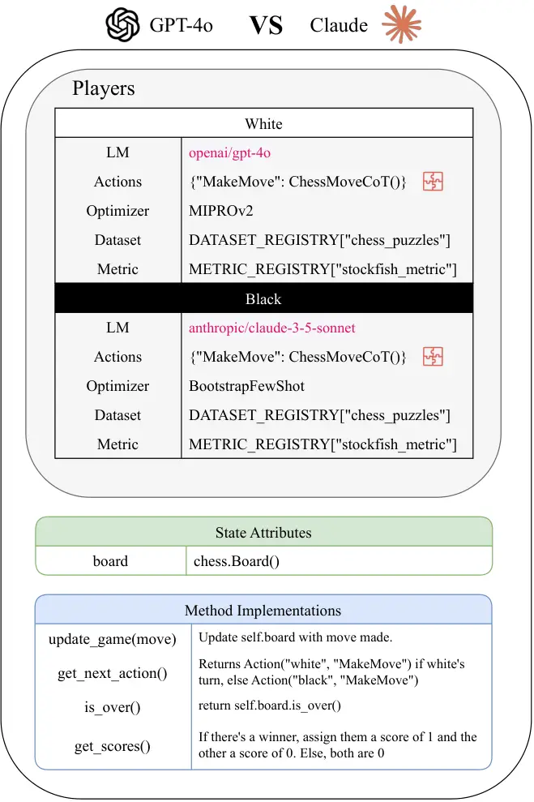
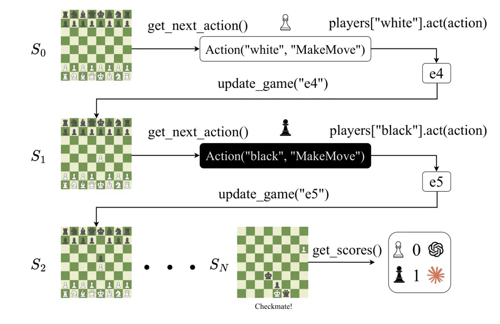
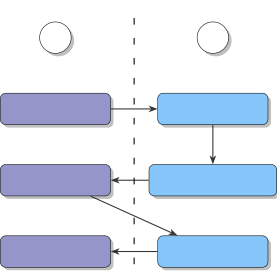

# ![[Uncaptioned image]](arxiv-2503-10673v2--fda8a4c4ecdc.figures/figure-1.webp) ZeroSumEval: An Extensible Framework For Scaling LLM Evaluation with Inter-Model Competition

Hisham A. Alyahya Affiliation: Saudi Data & AI Authority (SDAIA)   
Haidar Khan Affiliation: Meta    Yazeed Alnumay Affiliation: Cohere    M
Saiful Bari Affiliation: Saudi Data & AI Authority (SDAIA)    Bülent
Yener Affiliation: Rensselaer Polytechnic Institute\*Core contributors [

  
https://github.com/facebookresearch/ZeroSumEval](https://github.com/facebookresearch/ZeroSumEval)
Correspondence to: [haidark@meta.com](mailto:haidark@meta.com)

###### Abstract

We introduce ZeroSumEval, a dynamic, competition-based, and evolving
evaluation framework for Large Language Models (LLMs) that leverages
competitive games. ZeroSumEval encompasses a diverse suite of games,
including security challenges (Capture the Flag), classic board games
(chess), and knowledge tests (MathQuiz). These games are designed to
evaluate a range of capabilities such as strategic reasoning, planning,
knowledge application, safety, and adaptability. Building upon recent
studies that highlight the effectiveness of game-based evaluations for
LLMs, ZeroSumEval enhances these approaches by providing a standardized
and extensible framework for easily implementing games and leverages
DSPy to provide a better abstraction for LLM player strategies.

## 1 Introduction

Evaluation and benchmarking of Large Language Models (LLMs) is largely
done in a static manner, by building a test set for a particular task
and running models against it and checking whether the model output
matches what is expected. This direction suffers from multiple
weaknesses: (i) Data contamination (Yang et al., 2023), where models
inadvertently train on portions of the test data (Dubey et al., 2024;
Groeneveld et al., 2024), leading to inflated performance metrics. (ii)
Sensitivity to prompt variations (Alzahrani et al., 2024) and a lack of
diversity in evaluation tasks (Laskar et al., 2024) further undermine
the reliability and robustness of these benchmarks. (iii) A high cost
and effort required to develop new benchmarks often result in outdated
evaluation methods that do not keep pace with the rapid development of
LLMs (Kiela et al., 2021; Vu et al., 2023; Phan et al., 2025).

Recent research has attempted to address the limitations of static LLM
evaluation by introducing dynamic evaluation methods that more
effectively assess model performance (Zhuge et al., 2024; Xu et al.,
2024; Fan et al., 2024; Yu et al., 2024; Liu et al., 2024; Zhou et al.,
2023). These approaches move beyond traditional static evaluation
methodologies by creating dynamic environments in which LLMs are
evaluated. This has demonstrated greater robustness in benchmarking LLM
capabilities (further discussed in Section 2).

This is certainly a step in the right direction; our work continues in
this direction by posing evaluation strictly as competition between
models. As models rapidly improve, they continually push against and
even surpass existing benchmarks, leading to score saturation and
diminishing the benchmarks’ usefulness. Furthermore, in most real-world
scenarios, the primary goal of evaluation is not to determine how well a
model performs in isolation, but rather to compare models relative to
each other. This makes ranking more important than raw scores. We
propose that competition between models in simulated game environments
is an evaluation protocol that addresses these needs. By pitting models
against other models, we ensure that models are compared directly
against each other, and not against predetermined definitions of
performance. This results in an evaluation protocol that is scalable;
evolving alongside model capabilities to make tasks harder as models
improve.

Previous work has also proposed the use of games as benchmarks (Topsakal
et al., 2024), offering a promising avenue for evaluating complex
reasoning (Wong et al., 2023) and decision-making abilities of LLMs
(Warstadt et al., 2023; Park et al., 2023; Wang et al., 2023). Games
provide interactive and dynamic environments that can test models beyond
static datasets. However, existing game-based benchmarks are often _(i)_
inflexible and limited in scope, _(ii)_ not easily extensible, _(iii)_
restricted in their effectiveness for comprehensive model evaluation,
and _(iv)_ depend on predefined and hard-coded prompt templates.

To address these challenges, we introduce ZeroSumEval, a flexible and
extensible open-source framework designed to evaluate LLMs dynamically
and relatively through the simulation of games. Our framework allows for
comprehensive assessment by providing models with multiple opportunities
to make legal moves, thereby accommodating occasional errors and
offering a more nuanced understanding of their capabilities.

Some important features of ZeroSumEval include:

1.  1.  Flexible and Extensible Framework: ZeroSumEval is designed to be
        adaptable, allowing researchers and practitioners to customize and
        extend the evaluation environment to suit diverse needs.
2.  2.  Robustness to Prompt Sensitivity: By incorporating automatic prompt
        optimization, our framework mitigates issues related to prompt
        sensitivity, leading to more reliable evaluation outcomes.
3.  3.  Enhanced Interpretability: The structured environment and
        comprehensive logging facilitates easier interpretation of model
        behaviors, aiding in the identification of strengths and weaknesses.
4.  4.  Error Accommodation: Models are given multiple chances to make legal
        moves, ensuring that occasional missteps due to inherent
        stochasticity do not disproportionately affect the overall
        evaluation.

## 2 Related Work

#### Dynamic Evaluations

To address the static benchmark issues highlighted in Section 1, the
paradigm of evaluating agentic capabilities through simulations has been
applied successfully in multiple prior works. Some notable ones include
(i) AgentBench (Liu et al., 2024), an evolving benchmark consisting of 8
environments that models interact with to complete tasks. (ii) CRAB (Xu
et al., 2024), a benchmark for evaluating agentic behavior by executing
tasks across multiple different environments. (iii) KIEval (Yu et al.,
2024), a dynamic contamination-resilient evaluation framework: it
engages the evaluated model in a dynamically generated and multi-turn
conversation with another "interactor" model that attempts to extract
whether a deep comprehension of the answer is present, or if it is
solely memorized.

#### Game Evaluations

There has been a substantial body of work on creating frameworks for
evaluating LLMs on games. Some of these frameworks include ChatArena (Wu
et al., 2023), GridGames (Topsakal et al., 2024), GTBench (Duan et al.,
2024), SmartPlay (Wu et al., 2024), and GameBench (Costarelli et al.,
2024). While the motivations of these works are closely similar to ours,
they do not provide an easily extensible and general framework that
allows for continuous evolution. Furthermore, these works are specific
to text-based game implementations. LVLM-Playground Wang et al. (2025)
is a recent framework that was developed to test Large Vision Language
Models on a variety of games that use both the language and vision
modalities. While ZeroSumEval currently only has text-based games
implemented, it also natively supports the implementation of multimodal
games and player strategies, which is a promising direction discussed
further in Section 6.

#### Comparative Human Evaluations

A popular head-to-head LLM evaluation framework is Chatbot Arena¹¹ 1
formerly LMSYS, not to be confused with ChatArena. (Chiang et al.,
2024), which allows users to prompt two anonymous LLMs with arbitrary
prompts and to vote for the better response. This creates a diverse
evaluation that effectively ranks all models in a leaderboard. However,
it suffers from two issues: (i) human evaluations are slow and
laborious, and adding new models requires prolonged evaluation periods
until sufficient votes are acquired for a confident placement, and (ii)
human evaluations contain human biases, such as prompt
over-representation (Dunlap et al., 2024) and bias to verbose and
“pretty” responses (Chen et al., 2024; Park et al., 2024; Li et al.,
2024).

## 3 Implementation

The implementation of this framework closely follows the principle of
completely separating game logic from player logic. Because of this,
there are two axes which must be made easily extensible: adding games
and adding player strategies. To ensure this, the respective classes are
implemented in such a way that the developer only needs to know the
logic of the game or strategy they are implementing. This minimizes the
framework’s knowledge overhead and lowers the barrier to contribution.

### 3.1 GameState Implementation

Drawing from extensive-form games in game theory (Osborne and
Rubinstein, 1994) and Markov Decision Processes, we formalize a game in
ZeroSumEval as the tuple

```math
G=\langle S,U,P,A,R,\textit{Next},\textit{Terminal}\rangle \tag{1}
```

where each component corresponds to a distinct concept in our framework
(see Figure 1 for an example implementation):

- •
  $`S`$ (State Space): The set of all possible configurations of the
  game. In ZeroSumEval, this is represented by all the attributes of the
  GameState class (For example, the board state in the ChessGame class).
- •
  $`U`$ (Update/Transition Function): A function that maps a state and
  the result of an action (a move) to a new state. This is implemented
  as update_game(move).
- •
  $`P`$ (Players): The set of players participating in the game. These
  are defined by the player_definitions() method and initialized in the
  self.players attribute of each game.
- •
  $`A`$ (Actions): The set of possible actions available in the game.
  This is also specified in player_definitions(), which returns a list
  of PlayerDefinition objects that detail each player’s role and the
  actions it must implement.
- •
  $`R`$ (Reward/Score Function): A function that maps a state to an
  assignment of scores (or rewards) for each player. This is provided by
  the get_scores() method.
- •
  Next (Next Action Function): A function that maps a given state to a
  tuple containing the next action, the player responsible for that
  action, and the input $`I`$ provided to that player (which determines
  what each player observes). This functionality is implemented in the
  get_next_action() method.
- •
  Terminal (Terminal/Over Condition): A function that determines whether
  a state is terminal (i.e., the game has ended), mapping a state to a
  Boolean value (true or false). This is realized by the is_over()
  method.



Figure 1: A high-level example implementation of the GameState class of
Chess in ZeroSumEval.

### 3.2 Player Implementation

Each game defines a set of player roles through player definitions.
These definitions include the name of the player, the available actions
they can take, and a default implementation when users do not specify
their own.

Each player must have a clearly defined set of possible actions, with
corresponding functions that determine how these actions are executed to
generate moves. What makes this framework particularly powerful is its
integration with DSPy modules. Rather than implementing action functions
directly, players can leverage DSPy modules to create sophisticated
game-playing strategies that abstract away the complexities of prompt
engineering.

### 3.3 Why DSPy?

DSPy modules offer a way to implement general game-playing strategies
that abstract away prompting. This is beneficial for three main reasons:

1.  1.  Higher-level Strategy Iteration: Iterate on the level of programs
        rather than on the level of prompting. This allows for more complex
        strategies to be implemented and compared against each other. For
        example, a more complex DSPy program for a particular game could
        vastly outperform Chain-of-Thought prompting not because of the
        prompts themselves, but because of the logical structure of the
        program.
2.  2.  Prompt Sensitivity: A strategy could perform very well on a
        particular model but not on another due to prompt selection that is
        less effective for certain models. By defining the pipeline using
        DSPy and optimizing for each model separately, this sensitivity
        would be minimized which would ensure that performance gains stem
        from the pipeline’s inherent logic rather than model-specific prompt
        tuning (assuming appropriate dataset and metric selection).
3.  3.  Native Retry Mechanism DSPy provides a structured way to handle
        errors and invalid model outputs through Assertions and Suggestions
        (Singhvi et al., 2024). By incorporating these assertions into the
        move-generation logic, the framework significantly reduces the
        number of "forgivable" failures, ensuring that a game continues
        smoothly unless the model consistently fails even after receiving
        feedback. This structured retry mechanism enhances game stability
        and minimizes disruptions caused by transient errors.
4.  4.  Ease of Module Sharing: Optimized modules are easily saved and
        loaded which allows the community to compile and share modules of
        specific models performing well on specific games. This ability to
        share optimized modules allows for collaboration within the
        community which will accelerate research on the behavior of models
        in the games implemented in the framework.

### 3.4 Streamlining Prompt Optimization

ZeroSumEval streamlines prompt optimization by automating the process
within each class extending Player, and by creating a registry system
for datasets and metrics. Developers need only to register their dataset
and metric and specify the optimization configuration when initializing
a player, which further reduces the need for boilerplate code and
accelerates development. The optimized modules are automatically cached
based on the optimizer, dataset, and metric configurations.

### 3.5 Game Management

ZeroSumEval also implements game management classes that ease the
running of games. The GameManager class handles the running of a single
game (see Figure 2). GamePoolManager uses this class to extend it to run
a "pool" of games between any number of specified models. It matches
language models against each other given a matching strategy like
Round-Robin and keeps count of the wins, draws, and losses of each
model.



Figure 2: An example flow of the Game Manager for the game of Chess. The
state of the game moves forward by (i) querying the current state for
the next action and the player that is expected to act (ii) executing
that action using the player’s implementation for that action, (iii)
updating the game state with that action, (iv) repeat i-iii until the
game is terminated. The scores are then calculated from the final state
and a winner is determined accordingly.

### 3.6 Rating

Following recent suggestions for head-to-head LLM rating systems by
Boubdir et al. (2023); Chiang et al. (2023), we employ the Bradley and
Terry (1952) (BT) rating system, an alternative to the Elo (1967)
system, to rate models. The BT model is permutation-invariant and
assumes a fixed win rate for each pair of models, maximizing the
likelihood of observed outcomes. This choice is more suitable than the
traditional Elo system, which was designed for human chess players with
varying skill levels, whereas LLMs have fixed skill levels defined by
their weights.

## 4 Example Games

ZeroSumEval currently supports a total of 7 games:

- •
  Debate: Given a topic, players start by giving opening statements then
  take turns giving rebuttals before a jury of LLMs scores each side
  based on a well-defined numerical rubric to minimize LLM-as-a-judge
  bias.
- •
  Chess: The game of chess implemented such that players have multiple
  chances in making a valid move both in format (FEN) and in game rules.
- •
  Poker: A simple variant of Texas Hold ’Em that allows up to 10
  players.
- •
  Gandalf: Directly inspired from the game with the same name²² 2
  [https://gandalf.lakera.ai](https://gandalf.lakera.ai), this game
  assigns one player the role of the Sentinel, where their objective is
  to make conversation without revealing a secret password to the
  Infiltrator.
- •
  Liar’s Dice: A simple bluffing game where players take turns bidding
  on dice or calling the other player’s bluff.
- •
  MathQuiz: An adversarial game where one player with the Teacher role
  generates a difficult math question that it can solve itself but not
  the other player with the role of Student.
- •
  PyJail: A CTF-like challenge where one player writes a
  jail(user_input) function. The other player is then given a number of
  attempts to try different inputs and observe the output with the goal
  of getting access to the flag stored in an environment variable.

These games cover a wide variety of capabilities such as reasoning
(Chess, Poker), conversational skills (Gandalf), argumentation (Debate),
and security (PyJail).

#### Scalable Verification

The MathQuiz and PyJail games require competing models to generate
complex challenge environments and solutions. Since verification of the
knowledge-based challenges by a human in the loop is not scalable, we
design a method to verify model output using an automated manager in a
two-step generation and verification process. This is accomplished by
defining a target outcome (e.g., the answer to a math question or a CTF
flag) as the basis for verifying generated input, and regulating the
model context at each stage.

The exact process (illustrated in Figure 3) is outlined as follows:



Figure 3: State diagram of the verification process involving the Game
Manager and the Generator. Purple boxes indicate deterministic steps and
blue boxes indicate steps involving the model.

1.  1.  The generator model receives a target and attempts to output a valid
        challenge that resolves to the specific target.
2.  2.  In the verification step, the manager restricts the model’s context
        to ensure no direct access to the target, and asks the generator
        model to solve the previously generated challenge.
3.  3.  If the manager determines the verification is successful (by
        matching the target with the generator’s solution), the game
        proceeds. Otherwise, the generator model is deemed to have failed to
        generate a valid challenge.

This method ensures the generated challenge environment is valid and a
solution is proven possible by the generator. The design also correctly
penalizes models that directly generate memorized questions as it is
likely to have been memorized by other models, thereby encouraging
models to create challenging and novel questions. Finally, the
scalability of the evaluation is preserved as the capabilities of models
scale.

## 5 Results

Figure 4: Ratings of Llama 3 models of various subversions and sizes
placed head-to-head. error bars are 95% confidence intervals of BT
ratings obtained via bootstrapping.

Figure 4 shows the outcome of placing various Llama 3 (Dubey et al., 2024) models head-to-head in two games: chess and debate. As expected,
there is a clear positive correlation between model size and performance
in both games, with the only exception being that Llama 3.3 70B
outperforms Llama 3.1 405B in debate, this is likely due to the more
refined fine-tuning approach taken in the 3.3 version compared to 3.1³³
3
[https://github.com/meta-llama/llama-models/blob/main/models/llama3_3/MODEL_CARD.md](https://github.com/meta-llama/llama-models/blob/main/models/llama3_3/MODEL_CARD.md).
We expect to observe such interesting results as the use of ZeroSumEval
expands with more tested models and implemented games.

## 6 Future Work

This work serves as a launchpad for researchers and practitioners to
further explore the paradigm of LLM evaluation through competition. One
key avenue for investigation is the impact of prompt optimization on
final rankings. Previous research has shown that leaderboards can be
highly sensitive to minor perturbations in benchmarks (Alzahrani et al.,
2024). Could prompt optimization help stabilize rankings and mitigate
these instabilities? Additionally, how might one go about setting up a
leaderboard using ZeroSumEval?

Another promising direction is the integration of games requiring
multi-modal capabilities. While the current implementation focuses on
text-based games, ZeroSumEval is designed to support any type of game.
For instance, in a board game setting, instead of representing the game
state as a string—which can be convoluted for certain games like
Diplomacy—an image-based representation could convey the same
information more efficiently. This concept could be extended further to
include full 3D simulations, where models process rendered environments
as input. Recent work has demonstrated the efficacy of this direction on
Large Vision Language Models (Wang et al., 2025).

The competitive evaluation paradigm also lends itself naturally to
adversarial strategies, making it particularly well-suited for assessing
models in security-focused games. As an initial step in this direction,
we implemented PyJail as a simple example, but we envision much more
sophisticated environments that could push this approach even further.

## 7 Conclusion

The dynamic, relative, and competitive nature of the ZeroSumEval
framework lays the groundwork for a more robust and trustworthy
measurement of AI model capabilities, advancing the state of
benchmarking in LLMs. By leveraging games, we ensure that models are
consistently challenged with diverse, evolving tasks, minimizing the
risk of overfitting and saturation commonly observed in static
benchmarks. Additionally, the close integration of DSPy provides an
abstraction layer that allows for easily implementing and testing
different strategies, easily retrying, and reduced prompt sensitivity
owing to DSPy’s collection of prompt optimization algorithms.

## References

- Alzahrani et al. (2024) Norah Alzahrani, Hisham Abdullah Alyahya,
  Yazeed Alnumay, Sultan Alrashed, Shaykhah Alsubaie, Yusef Almushaykeh,
  Faisal Mirza, Nouf Alotaibi, Nora Altwairesh, Areeb Alowisheq,
  et al. 2024. When benchmarks are targets: Revealing the sensitivity of
  large language model leaderboards. _arXiv preprint arXiv:2402.01781_.
- Boubdir et al. (2023) Meriem Boubdir, Edward Kim, Beyza Ermis, Sara
  Hooker, and Marzieh Fadaee. 2023. [Elo uncovered: Robustness and best
  practices in language model
  evaluation](https://arxiv.org/abs/2311.17295). _Preprint_,
  arXiv:2311.17295.
- Bradley and Terry (1952) Ralph Allan Bradley and Milton E Terry. 1952.
  Rank analysis of incomplete block designs: I. the method of paired
  comparisons. _Biometrika_, 39(3/4):324–345.
- Chen et al. (2024) Guiming Hardy Chen, Shunian Chen, Ziche Liu, Feng
  Jiang, and Benyou Wang. 2024. [Humans or llms as the judge? a study on
  judgement biases](https://arxiv.org/abs/2402.10669). _Preprint_,
  arXiv:2402.10669.
- Chiang et al. (2023) Wei-Lin Chiang, Tim Li, Joseph E. Gonzalez, and
  Ion Stoica. 2023. [Chatbot arena: New models & elo system
  update](https://lmsys.org/blog/2023-12-07-leaderboard/).
- Chiang et al. (2024) Wei-Lin Chiang, Lianmin Zheng, Ying Sheng,
  Anastasios Nikolas Angelopoulos, Tianle Li, Dacheng Li, Hao Zhang,
  Banghua Zhu, Michael Jordan, Joseph E. Gonzalez, and Ion Stoica. 2024.
  [Chatbot arena: An open platform for evaluating llms by human
  preference](https://arxiv.org/abs/2403.04132). _Preprint_,
  arXiv:2403.04132.
- Costarelli et al. (2024) Anthony Costarelli, Mat Allen, Roman
  Hauksson, Grace Sodunke, Suhas Hariharan, Carlson Cheng, Wenjie Li,
  Joshua Clymer, and Arjun Yadav. 2024. [Gamebench: Evaluating strategic
  reasoning abilities of llm agents](https://arxiv.org/abs/2406.06613).
  _Preprint_, arXiv:2406.06613.
- Duan et al. (2024) Jinhao Duan, Renming Zhang, James Diffenderfer,
  Bhavya Kailkhura, Lichao Sun, Elias Stengel-Eskin, Mohit Bansal,
  Tianlong Chen, and Kaidi Xu. 2024. Gtbench: Uncovering the strategic
  reasoning limitations of llms via game-theoretic evaluations. _arXiv
  preprint arXiv:2402.12348_.
- Dubey et al. (2024) Abhimanyu Dubey, Abhinav Jauhri, Abhinav Pandey,
  Abhishek Kadian, Ahmad Al-Dahle, Aiesha Letman, Akhil Mathur, Alan
  Schelten, Amy Yang, Angela Fan, Anirudh Goyal, Anthony Hartshorn, Aobo
  Yang, Archi Mitra, Archie Sravankumar, Artem Korenev, Arthur Hinsvark,
  Arun Rao, Aston Zhang, Aurelien Rodriguez, Austen Gregerson, Ava
  Spataru, Baptiste Roziere, Bethany Biron, Binh Tang, Bobbie Chern,
  Charlotte Caucheteux, Chaya Nayak, Chloe Bi, Chris Marra, Chris
  McConnell, Christian Keller, Christophe Touret, Chunyang Wu, Corinne
  Wong, Cristian Canton Ferrer, Cyrus Nikolaidis, Damien Allonsius,
  Daniel Song, Danielle Pintz, Danny Livshits, David Esiobu, Dhruv
  Choudhary, Dhruv Mahajan, Diego Garcia-Olano, Diego Perino, Dieuwke
  Hupkes, Egor Lakomkin, Ehab AlBadawy, Elina Lobanova, Emily Dinan,
  Eric Michael Smith, Filip Radenovic, Frank Zhang, Gabriel Synnaeve,
  Gabrielle Lee, Georgia Lewis Anderson, Graeme Nail, Gregoire Mialon,
  Guan Pang, Guillem Cucurell, Hailey Nguyen, Hannah Korevaar, Hu Xu,
  Hugo Touvron, Iliyan Zarov, Imanol Arrieta Ibarra, Isabel Kloumann,
  Ishan Misra, Ivan Evtimov, Jade Copet, Jaewon Lee, Jan Geffert, Jana
  Vranes, Jason Park, Jay Mahadeokar, Jeet Shah, Jelmer van der Linde,
  Jennifer Billock, Jenny Hong, Jenya Lee, Jeremy Fu, Jianfeng Chi,
  Jianyu Huang, Jiawen Liu, Jie Wang, Jiecao Yu, Joanna Bitton, Joe
  Spisak, Jongsoo Park, Joseph Rocca, Joshua Johnstun, Joshua Saxe,
  Junteng Jia, Kalyan Vasuden Alwala, Kartikeya Upasani, Kate Plawiak,
  Ke Li, Kenneth Heafield, Kevin Stone, Khalid El-Arini, Krithika Iyer,
  Kshitiz Malik, Kuenley Chiu, Kunal Bhalla, Lauren Rantala-Yeary,
  Laurens van der Maaten, Lawrence Chen, Liang Tan, Liz Jenkins, Louis
  Martin, Lovish Madaan, Lubo Malo, Lukas Blecher, Lukas Landzaat, Luke
  de Oliveira, Madeline Muzzi, Mahesh Pasupuleti, Mannat Singh, Manohar
  Paluri, Marcin Kardas, Mathew Oldham, Mathieu Rita, Maya Pavlova,
  Melanie Kambadur, Mike Lewis, Min Si, Mitesh Kumar Singh, Mona Hassan,
  Naman Goyal, Narjes Torabi, Nikolay Bashlykov, Nikolay Bogoychev,
  Niladri Chatterji, Olivier Duchenne, Onur Çelebi, Patrick Alrassy,
  Pengchuan Zhang, Pengwei Li, Petar Vasic, Peter Weng, Prajjwal
  Bhargava, Pratik Dubal, Praveen Krishnan, Punit Singh Koura, Puxin Xu,
  Qing He, Qingxiao Dong, Ragavan Srinivasan, Raj Ganapathy, Ramon
  Calderer, Ricardo Silveira Cabral, Robert Stojnic, Roberta Raileanu,
  Rohit Girdhar, Rohit Patel, Romain Sauvestre, Ronnie Polidoro, Roshan
  Sumbaly, Ross Taylor, Ruan Silva, Rui Hou, Rui Wang, Saghar Hosseini,
  Sahana Chennabasappa, Sanjay Singh, Sean Bell, Seohyun Sonia Kim,
  Sergey Edunov, Shaoliang Nie, Sharan Narang, Sharath Raparthy, Sheng
  Shen, Shengye Wan, Shruti Bhosale, Shun Zhang, Simon Vandenhende,
  Soumya Batra, Spencer Whitman, Sten Sootla, Stephane Collot, Suchin
  Gururangan, Sydney Borodinsky, Tamar Herman, Tara Fowler, Tarek
  Sheasha, Thomas Georgiou, Thomas Scialom, Tobias Speckbacher, Todor
  Mihaylov, Tong Xiao, Ujjwal Karn, Vedanuj Goswami, Vibhor Gupta,
  Vignesh Ramanathan, Viktor Kerkez, Vincent Gonguet, Virginie Do, Vish
  Vogeti, Vladan Petrovic, Weiwei Chu, Wenhan Xiong, Wenyin Fu, Whitney
  Meers, Xavier Martinet, Xiaodong Wang, Xiaoqing Ellen Tan, Xinfeng
  Xie, Xuchao Jia, Xuewei Wang, Yaelle Goldschlag, Yashesh Gaur, Yasmine
  Babaei, Yi Wen, Yiwen Song, Yuchen Zhang, Yue Li, Yuning Mao,
  Zacharie Delpierre Coudert, Zheng Yan, Zhengxing Chen, Zoe Papakipos,
  Aaditya Singh, Aaron Grattafiori, Abha Jain, Adam Kelsey, Adam
  Shajnfeld, Adithya Gangidi, Adolfo Victoria, Ahuva Goldstand, Ajay
  Menon, Ajay Sharma, Alex Boesenberg, Alex Vaughan, Alexei Baevski,
  Allie Feinstein, Amanda Kallet, Amit Sangani, Anam Yunus, Andrei Lupu,
  Andres Alvarado, Andrew Caples, Andrew Gu, Andrew Ho, Andrew Poulton,
  Andrew Ryan, Ankit Ramchandani, Annie Franco, Aparajita Saraf,
  Arkabandhu Chowdhury, Ashley Gabriel, Ashwin Bharambe, Assaf Eisenman,
  Azadeh Yazdan, Beau James, Ben Maurer, Benjamin Leonhardi, Bernie
  Huang, Beth Loyd, Beto De Paola, Bhargavi Paranjape, Bing Liu, Bo Wu,
  Boyu Ni, Braden Hancock, Bram Wasti, Brandon Spence, Brani Stojkovic,
  Brian Gamido, Britt Montalvo, Carl Parker, Carly Burton, Catalina
  Mejia, Changhan Wang, Changkyu Kim, Chao Zhou, Chester Hu,
  Ching-Hsiang Chu, Chris Cai, Chris Tindal, Christoph Feichtenhofer,
  Damon Civin, Dana Beaty, Daniel Kreymer, Daniel Li, Danny Wyatt, David
  Adkins, David Xu, Davide Testuggine, Delia David, Devi Parikh, Diana
  Liskovich, Didem Foss, Dingkang Wang, Duc Le, Dustin Holland, Edward
  Dowling, Eissa Jamil, Elaine Montgomery, Eleonora Presani, Emily Hahn,
  Emily Wood, Erik Brinkman, Esteban Arcaute, Evan Dunbar, Evan
  Smothers, Fei Sun, Felix Kreuk, Feng Tian, Firat Ozgenel, Francesco
  Caggioni, Francisco Guzmán, Frank Kanayet, Frank Seide,
  Gabriela Medina Florez, Gabriella Schwarz, Gada Badeer, Georgia Swee,
  Gil Halpern, Govind Thattai, Grant Herman, Grigory Sizov, Guangyi,
  Zhang, Guna Lakshminarayanan, Hamid Shojanazeri, Han Zou, Hannah Wang,
  Hanwen Zha, Haroun Habeeb, Harrison Rudolph, Helen Suk, Henry
  Aspegren, Hunter Goldman, Ibrahim Damlaj, Igor Molybog, Igor Tufanov,
  Irina-Elena Veliche, Itai Gat, Jake Weissman, James Geboski, James
  Kohli, Japhet Asher, Jean-Baptiste Gaya, Jeff Marcus, Jeff Tang,
  Jennifer Chan, Jenny Zhen, Jeremy Reizenstein, Jeremy Teboul, Jessica
  Zhong, Jian Jin, Jingyi Yang, Joe Cummings, Jon Carvill, Jon Shepard,
  Jonathan McPhie, Jonathan Torres, Josh Ginsburg, Junjie Wang, Kai Wu,
  Kam Hou U, Karan Saxena, Karthik Prasad, Kartikay Khandelwal, Katayoun
  Zand, Kathy Matosich, Kaushik Veeraraghavan, Kelly Michelena, Keqian
  Li, Kun Huang, Kunal Chawla, Kushal Lakhotia, Kyle Huang, Lailin Chen,
  Lakshya Garg, Lavender A, Leandro Silva, Lee Bell, Lei Zhang,
  Liangpeng Guo, Licheng Yu, Liron Moshkovich, Luca Wehrstedt, Madian
  Khabsa, Manav Avalani, Manish Bhatt, Maria Tsimpoukelli, Martynas
  Mankus, Matan Hasson, Matthew Lennie, Matthias Reso, Maxim Groshev,
  Maxim Naumov, Maya Lathi, Meghan Keneally, Michael L. Seltzer, Michal
  Valko, Michelle Restrepo, Mihir Patel, Mik Vyatskov, Mikayel
  Samvelyan, Mike Clark, Mike Macey, Mike Wang, Miquel Jubert Hermoso,
  Mo Metanat, Mohammad Rastegari, Munish Bansal, Nandhini Santhanam,
  Natascha Parks, Natasha White, Navyata Bawa, Nayan Singhal, Nick
  Egebo, Nicolas Usunier, Nikolay Pavlovich Laptev, Ning Dong, Ning
  Zhang, Norman Cheng, Oleg Chernoguz, Olivia Hart, Omkar Salpekar,
  Ozlem Kalinli, Parkin Kent, Parth Parekh, Paul Saab, Pavan Balaji,
  Pedro Rittner, Philip Bontrager, Pierre Roux, Piotr Dollar, Polina
  Zvyagina, Prashant Ratanchandani, Pritish Yuvraj, Qian Liang, Rachad
  Alao, Rachel Rodriguez, Rafi Ayub, Raghotham Murthy, Raghu Nayani,
  Rahul Mitra, Raymond Li, Rebekkah Hogan, Robin Battey, Rocky Wang,
  Rohan Maheswari, Russ Howes, Ruty Rinott, Sai Jayesh Bondu, Samyak
  Datta, Sara Chugh, Sara Hunt, Sargun Dhillon, Sasha Sidorov, Satadru
  Pan, Saurabh Verma, Seiji Yamamoto, Sharadh Ramaswamy, Shaun Lindsay,
  Shaun Lindsay, Sheng Feng, Shenghao Lin, Shengxin Cindy Zha, Shiva
  Shankar, Shuqiang Zhang, Shuqiang Zhang, Sinong Wang, Sneha Agarwal,
  Soji Sajuyigbe, Soumith Chintala, Stephanie Max, Stephen Chen, Steve
  Kehoe, Steve Satterfield, Sudarshan Govindaprasad, Sumit Gupta,
  Sungmin Cho, Sunny Virk, Suraj Subramanian, Sy Choudhury, Sydney
  Goldman, Tal Remez, Tamar Glaser, Tamara Best, Thilo Kohler, Thomas
  Robinson, Tianhe Li, Tianjun Zhang, Tim Matthews, Timothy Chou, Tzook
  Shaked, Varun Vontimitta, Victoria Ajayi, Victoria Montanez, Vijai
  Mohan, Vinay Satish Kumar, Vishal Mangla, Vítor Albiero, Vlad Ionescu,
  Vlad Poenaru, Vlad Tiberiu Mihailescu, Vladimir Ivanov, Wei Li,
  Wenchen Wang, Wenwen Jiang, Wes Bouaziz, Will Constable, Xiaocheng
  Tang, Xiaofang Wang, Xiaojian Wu, Xiaolan Wang, Xide Xia, Xilun Wu,
  Xinbo Gao, Yanjun Chen, Ye Hu, Ye Jia, Ye Qi, Yenda Li, Yilin Zhang,
  Ying Zhang, Yossi Adi, Youngjin Nam, Yu, Wang, Yuchen Hao, Yundi Qian,
  Yuzi He, Zach Rait, Zachary DeVito, Zef Rosnbrick, Zhaoduo Wen, Zhenyu
  Yang, and Zhiwei Zhao. 2024. [The llama 3 herd of
  models](https://arxiv.org/abs/2407.21783). _Preprint_,
  arXiv:2407.21783.
- Dunlap et al. (2024) Lisa Dunlap, Evan Frick, Tianle Li, Isaac Ong,
  Joseph E. Gonzalez, and Wei-Lin Chiang. 2024. [What’s up with llama 3?
  arena data analysis](https://lmsys.org/blog/2024-05-08-llama3/).
- Elo (1967) Arpad E Elo. 1967. The proposed uscf rating system, its
  development, theory, and applications. _Chess life_, 22(8):242–247.
- Fan et al. (2024) Lizhou Fan, Wenyue Hua, Lingyao Li, Haoyang Ling,
  and Yongfeng Zhang. 2024. [Nphardeval: Dynamic benchmark on reasoning
  ability of large language models via complexity
  classes](https://arxiv.org/abs/2312.14890). _Preprint_,
  arXiv:2312.14890.
- Groeneveld et al. (2024) Dirk Groeneveld, Iz Beltagy, Pete Walsh,
  Akshita Bhagia, Rodney Kinney, Oyvind Tafjord, Ananya Harsh Jha,
  Hamish Ivison, Ian Magnusson, Yizhong Wang, Shane Arora, David
  Atkinson, Russell Authur, Khyathi Raghavi Chandu, Arman Cohan,
  Jennifer Dumas, Yanai Elazar, Yuling Gu, Jack Hessel, Tushar Khot,
  William Merrill, Jacob Morrison, Niklas Muennighoff, Aakanksha Naik,
  Crystal Nam, Matthew E. Peters, Valentina Pyatkin, Abhilasha
  Ravichander, Dustin Schwenk, Saurabh Shah, Will Smith, Emma Strubell,
  Nishant Subramani, Mitchell Wortsman, Pradeep Dasigi, Nathan Lambert,
  Kyle Richardson, Luke Zettlemoyer, Jesse Dodge, Kyle Lo, Luca
  Soldaini, Noah A. Smith, and Hannaneh Hajishirzi. 2024. [Olmo:
  Accelerating the science of language
  models](https://arxiv.org/abs/2402.00838). _Preprint_,
  arXiv:2402.00838.
- Kiela et al. (2021) Douwe Kiela, Max Bartolo, Yixin Nie, Divyansh
  Kaushik, Atticus Geiger, Zhengxuan Wu, Bertie Vidgen, Grusha Prasad,
  Amanpreet Singh, Pratik Ringshia, Zhiyi Ma, Tristan Thrush, Sebastian
  Riedel, Zeerak Waseem, Pontus Stenetorp, Robin Jia, Mohit Bansal,
  Christopher Potts, and Adina Williams. 2021. [Dynabench: Rethinking
  benchmarking in nlp](https://arxiv.org/abs/2104.14337). _Preprint_,
  arXiv:2104.14337.
- Laskar et al. (2024) Md Tahmid Rahman Laskar, Sawsan Alqahtani,
  M Saiful Bari, Mizanur Rahman, Mohammad Abdullah Matin Khan, Haidar
  Khan, Israt Jahan, Amran Bhuiyan, Chee Wei Tan, Md Rizwan Parvez,
  et al. 2024. A systematic survey and critical review on evaluating
  large language models: Challenges, limitations, and recommendations.
  _arXiv preprint arXiv:2407.04069_.
- Li et al. (2024) Tianle Li, Anastasios Angelopoulos, and Wei-Lin
  Chiang. 2024. [Does style matter? disentangling style and substance in
  chatbot arena](https://lmsys.org/blog/2024-08-28-style-control/).
- Liu et al. (2024) Xiao Liu, Hao Yu, Hanchen Zhang, Yifan Xu, Xuanyu
  Lei, Hanyu Lai, Yu Gu, Hangliang Ding, Kaiwen Men, Kejuan Yang, Shudan
  Zhang, Xiang Deng, Aohan Zeng, Zhengxiao Du, Chenhui Zhang, Sheng
  Shen, Tianjun Zhang, Yu Su, Huan Sun, Minlie Huang, Yuxiao Dong, and
  Jie Tang. 2024. [Agentbench: Evaluating LLMs as
  agents](https://openreview.net/forum?id=zAdUB0aCTQ). In _The Twelfth
  International Conference on Learning Representations_.
- Osborne and Rubinstein (1994) Martin J Osborne and Ariel
  Rubinstein. 1994. _A course in game theory_. MIT press.
- Park et al. (2023) Joon Sung Park, Joseph O’Brien, Carrie Jun Cai,
  Meredith Ringel Morris, Percy Liang, and Michael S Bernstein. 2023.
  Generative agents: Interactive simulacra of human behavior. In
  _Proceedings of the 36th annual acm symposium on user interface
  software and technology_, pages 1–22.
- Park et al. (2024) Ryan Park, Rafael Rafailov, Stefano Ermon, and
  Chelsea Finn. 2024. [Disentangling length from quality in direct
  preference optimization](https://arxiv.org/abs/2403.19159).
  _Preprint_, arXiv:2403.19159.
- Phan et al. (2025) Long Phan, Alice Gatti, Ziwen Han, Nathaniel Li,
  Josephina Hu, Hugh Zhang, Chen Bo Calvin Zhang, Mohamed Shaaban, John
  Ling, Sean Shi, Michael Choi, Anish Agrawal, Arnav Chopra, Adam Khoja,
  Ryan Kim, Richard Ren, Jason Hausenloy, Oliver Zhang, Mantas Mazeika,
  Tung Nguyen, Daron Anderson, Imad Ali Shah, Mikhail Doroshenko,
  Alun Cennyth Stokes, Mobeen Mahmood, Jaeho Lee, Oleksandr Pokutnyi,
  Oleg Iskra, Jessica P. Wang, Robert Gerbicz, John-Clark Levin, Serguei
  Popov, Fiona Feng, Steven Y. Feng, Haoran Zhao, Michael Yu, Varun
  Gangal, Chelsea Zou, Zihan Wang, Mstyslav Kazakov, Geoff Galgon,
  Johannes Schmitt, Alvaro Sanchez, Yongki Lee, Will Yeadon, Scott
  Sauers, Marc Roth, Chidozie Agu, Søren Riis, Fabian Giska, Saiteja
  Utpala, Antrell Cheatom, Zachary Giboney, Gashaw M. Goshu, Sarah-Jane
  Crowson, Mohinder Maheshbhai Naiya, Noah Burns, Lennart Finke, Zerui
  Cheng, Hyunwoo Park, Francesco Fournier-Facio, Jennifer Zampese,
  John B. Wydallis, Ryan G. Hoerr, Mark Nandor, Tim Gehrunger, Jiaqi
  Cai, Ben McCarty, Jungbae Nam, Edwin Taylor, Jun Jin, Gautier Abou
  Loume, Hangrui Cao, Alexis C Garretson, Damien Sileo, Qiuyu Ren, Doru
  Cojoc, Pavel Arkhipov, Usman Qazi, Aras Bacho, Lianghui Li, Sumeet
  Motwani, Christian Schroeder de Witt, Alexei Kopylov, Johannes Veith,
  Eric Singer, Paolo Rissone, Jaehyeok Jin, Jack Wei Lun Shi, Chris G.
  Willcocks, Ameya Prabhu, Longke Tang, Kevin Zhou, Emily
  de Oliveira Santos, Andrey Pupasov Maksimov, Edward Vendrow, Kengo
  Zenitani, Joshua Robinson, Aleksandar Mikov, Julien Guillod, Yuqi Li,
  Ben Pageler, Joshua Vendrow, Vladyslav Kuchkin, Pierre Marion, Denis
  Efremov, Jayson Lynch, Kaiqu Liang, Andrew Gritsevskiy, Dakotah
  Martinez, Nick Crispino, Dimitri Zvonkine, Natanael Wildner Fraga,
  Saeed Soori, Ori Press, Henry Tang, Julian Salazar, Sean R. Green,
  Lina Brüssel, Moon Twayana, Aymeric Dieuleveut, T. Ryan Rogers, Wenjin
  Zhang, Ross Finocchio, Bikun Li, Jinzhou Yang, Arun Rao, Gabriel
  Loiseau, Mikhail Kalinin, Marco Lukas, Ciprian Manolescu, Nate
  Stambaugh, Subrata Mishra, Ariel Ghislain Kemogne Kamdoum, Tad Hogg,
  Alvin Jin, Carlo Bosio, Gongbo Sun, Brian P Coppola, Haline Heidinger,
  Rafael Sayous, Stefan Ivanov, Joseph M Cavanagh, Jiawei Shen,
  Joseph Marvin Imperial, Philippe Schwaller, Shaipranesh Senthilkuma,
  Andres M Bran, Andres Algaba, Brecht Verbeken, Kelsey Van den Houte,
  Lynn Van Der Sypt, David Noever, Lisa Schut, Ilia Sucholutsky, Evgenii
  Zheltonozhskii, Qiaochu Yuan, Derek Lim, Richard Stanley, Shankar
  Sivarajan, Tong Yang, John Maar, Julian Wykowski, Martí Oller,
  Jennifer Sandlin, Anmol Sahu, Cesare Giulio Ardito, Yuzheng Hu,
  Felipe Meneguitti Dias, Tobias Kreiman, Kaivalya Rawal, Tobias Garcia
  Vilchis, Yuexuan Zu, Martin Lackner, James Koppel, Jeremy Nguyen,
  Daniil S. Antonenko, Steffi Chern, Bingchen Zhao, Pierrot Arsene,
  Sergey Ivanov, Rafał Poświata, Chenguang Wang, Daofeng Li, Donato
  Crisostomi, Ali Dehghan, Andrea Achilleos, John Arnold Ambay, Benjamin
  Myklebust, Archan Sen, David Perrella, Nurdin Kaparov, Mark H Inlow,
  Allen Zang, Kalyan Ramakrishnan, Daniil Orel, Vladislav Poritski,
  Shalev Ben-David, Zachary Berger, Parker Whitfill, Michael Foster,
  Daniel Munro, Linh Ho, Dan Bar Hava, Aleksey Kuchkin, Robert Lauff,
  David Holmes, Frank Sommerhage, Anji Zhang, Richard Moat, Keith
  Schneider, Daniel Pyda, Zakayo Kazibwe, Mukhwinder Singh, Don Clarke,
  Dae Hyun Kim, Sara Fish, Veit Elser, Victor Efren Guadarrama Vilchis,
  Immo Klose, Christoph Demian, Ujjwala Anantheswaran, Adam Zweiger,
  Guglielmo Albani, Jeffery Li, Nicolas Daans, Maksim Radionov, Václav
  Rozhoň, Vincent Ginis, Ziqiao Ma, Christian Stump, Jacob Platnick,
  Volodymyr Nevirkovets, Luke Basler, Marco Piccardo, Niv Cohen,
  Virendra Singh, Josef Tkadlec, Paul Rosu, Alan Goldfarb, Piotr
  Padlewski, Stanislaw Barzowski, Kyle Montgomery, Aline Menezes, Arkil
  Patel, Zixuan Wang, Jamie Tucker-Foltz, Jack Stade, Declan Grabb, Tom
  Goertzen, Fereshteh Kazemi, Jeremiah Milbauer, Abhishek Shukla, Hossam
  Elgnainy, Yan Carlos Leyva Labrador, Hao He, Ling Zhang, Alan Givré,
  Hew Wolff, Gözdenur Demir, Muhammad Fayez Aziz, Younesse Kaddar, Ivar
  Ängquist, Yanxu Chen, Elliott Thornley, Robin Zhang, Jiayi Pan,
  Antonio Terpin, Niklas Muennighoff, Hailey Schoelkopf, Eric Zheng,
  Avishy Carmi, Jainam Shah, Ethan D. L. Brown, Kelin Zhu, Max Bartolo,
  Richard Wheeler, Andrew Ho, Shaul Barkan, Jiaqi Wang, Martin
  Stehberger, Egor Kretov, Peter Bradshaw, JP Heimonen, Kaustubh
  Sridhar, Zaki Hossain, Ido Akov, Yury Makarychev, Joanna Tam, Hieu
  Hoang, David M. Cunningham, Vladimir Goryachev, Demosthenes
  Patramanis, Michael Krause, Andrew Redenti, David Aldous, Jesyin Lai,
  Shannon Coleman, Jiangnan Xu, Sangwon Lee, Ilias Magoulas, Sandy Zhao,
  Ning Tang, Michael K. Cohen, Micah Carroll, Orr Paradise, Jan Hendrik
  Kirchner, Stefan Steinerberger, Maksym Ovchynnikov, Jason O. Matos,
  Adithya Shenoy, Michael Wang, Yuzhou Nie, Paolo Giordano, Philipp
  Petersen, Anna Sztyber-Betley, Paolo Faraboschi, Robin Riblet,
  Jonathan Crozier, Shiv Halasyamani, Antonella Pinto, Shreyas Verma,
  Prashant Joshi, Eli Meril, Zheng-Xin Yong, Allison Tee, Jérémy
  Andréoletti, Orion Weller, Raghav Singhal, Gang Zhang, Alexander
  Ivanov, Seri Khoury, Nils Gustafsson, Hamid Mostaghimi, Kunvar Thaman,
  Qijia Chen, Tran Quoc Khánh, Jacob Loader, Stefano Cavalleri, Hannah
  Szlyk, Zachary Brown, Himanshu Narayan, Jonathan Roberts, William
  Alley, Kunyang Sun, Ryan Stendall, Max Lamparth, Anka Reuel, Ting
  Wang, Hanmeng Xu, Pablo Hernández-Cámara, Freddie Martin, Thomas Preu,
  Tomek Korbak, Marcus Abramovitch, Dominic Williamson, Ida Bosio, Ziye
  Chen, Biró Bálint, Eve J. Y. Lo, Maria Inês S. Nunes, Yibo Jiang,
  M Saiful Bari, Peyman Kassani, Zihao Wang, Behzad Ansarinejad, Yewen
  Sun, Stephane Durand, Guillaume Douville, Daniel Tordera, George
  Balabanian, Earth Anderson, Lynna Kvistad, Alejandro José Moyano,
  Hsiaoyun Milliron, Ahmad Sakor, Murat Eron, Isaac C. McAlister, Andrew
  Favre D. O., Shailesh Shah, Xiaoxiang Zhou, Firuz Kamalov, Ronald
  Clark, Sherwin Abdoli, Tim Santens, Harrison K Wang, Evan Chen,
  Alessandro Tomasiello, G. Bruno De Luca, Shi-Zhuo Looi, Vinh-Kha Le,
  Noam Kolt, Niels Mündler, Avi Semler, Emma Rodman, Jacob Drori, Carl J
  Fossum, Luk Gloor, Milind Jagota, Ronak Pradeep, Honglu Fan, Tej Shah,
  Jonathan Eicher, Michael Chen, Kushal Thaman, William Merrill, Moritz
  Firsching, Carter Harris, Stefan Ciobâcă, Jason Gross, Rohan Pandey,
  Ilya Gusev, Adam Jones, Shashank Agnihotri, Pavel Zhelnov, Siranut
  Usawasutsakorn, Mohammadreza Mofayezi, Alexander Piperski, Marc
  Carauleanu, David K. Zhang, Kostiantyn Dobarskyi, Dylan Ler, Roman
  Leventov, Ignat Soroko, Thorben Jansen, Scott Creighton, Pascal Lauer,
  Joshua Duersch, Vage Taamazyan, Dario Bezzi, Wiktor Morak, Wenjie Ma,
  William Held, Tran Đuc Huy, Ruicheng Xian, Armel Randy Zebaze, Mohanad
  Mohamed, Julian Noah Leser, Michelle X Yuan, Laila Yacar, Johannes
  Lengler, Katarzyna Olszewska, Hossein Shahrtash, Edson Oliveira,
  Joseph W. Jackson, Daniel Espinosa Gonzalez, Andy Zou, Muthu
  Chidambaram, Timothy Manik, Hector Haffenden, Dashiell Stander, Ali
  Dasouqi, Alexander Shen, Emilien Duc, Bita Golshani, David Stap,
  Mikalai Uzhou, Alina Borisovna Zhidkovskaya, Lukas Lewark,
  Miguel Orbegozo Rodriguez, Mátyás Vincze, Dustin Wehr, Colin Tang,
  Shaun Phillips, Fortuna Samuele, Jiang Muzhen, Fredrik Ekström, Angela
  Hammon, Oam Patel, Faraz Farhidi, George Medley, Forough
  Mohammadzadeh, Madellene Peñaflor, Haile Kassahun, Alena Friedrich,
  Claire Sparrow, Rayner Hernandez Perez, Taom Sakal, Omkar Dhamane,
  Ali Khajegili Mirabadi, Eric Hallman, Kenchi Okutsu, Mike Battaglia,
  Mohammad Maghsoudimehrabani, Alon Amit, Dave Hulbert, Roberto Pereira,
  Simon Weber, Handoko, Anton Peristyy, Stephen Malina, Samuel Albanie,
  Will Cai, Mustafa Mehkary, Rami Aly, Frank Reidegeld, Anna-Katharina
  Dick, Cary Friday, Jasdeep Sidhu, Hassan Shapourian, Wanyoung Kim,
  Mariana Costa, Hubeyb Gurdogan, Brian Weber, Harsh Kumar, Tong Jiang,
  Arunim Agarwal, Chiara Ceconello, Warren S. Vaz, Chao Zhuang, Haon
  Park, Andrew R. Tawfeek, Daattavya Aggarwal, Michael Kirchhof, Linjie
  Dai, Evan Kim, Johan Ferret, Yuzhou Wang, Minghao Yan, Krzysztof
  Burdzy, Lixin Zhang, Antonio Franca, Diana T. Pham, Kang Yong Loh,
  Joshua Robinson, Abram Jackson, Shreen Gul, Gunjan Chhablani, Zhehang
  Du, Adrian Cosma, Jesus Colino, Colin White, Jacob Votava, Vladimir
  Vinnikov, Ethan Delaney, Petr Spelda, Vit Stritecky, Syed M. Shahid,
  Jean-Christophe Mourrat, Lavr Vetoshkin, Koen Sponselee, Renas Bacho,
  Florencia de la Rosa, Xiuyu Li, Guillaume Malod, Leon Lang, Julien
  Laurendeau, Dmitry Kazakov, Fatimah Adesanya, Julien Portier, Lawrence
  Hollom, Victor Souza, Yuchen Anna Zhou, Julien Degorre, Yiğit Yalın,
  Gbenga Daniel Obikoya, Luca Arnaboldi, Rai, Filippo Bigi, M. C. Boscá,
  Oleg Shumar, Kaniuar Bacho, Pierre Clavier, Gabriel Recchia, Mara
  Popescu, Nikita Shulga, Ngefor Mildred Tanwie, Denis Peskoff, Thomas
  C. H. Lux, Ben Rank, Colin Ni, Matthew Brooks, Alesia Yakimchyk,
  Huanxu, Liu, Olle Häggström, Emil Verkama, Hans Gundlach, Leonor
  Brito-Santana, Brian Amaro, Vivek Vajipey, Rynaa Grover, Yiyang Fan,
  Gabriel Poesia Reis e Silva, Linwei Xin, Yosi Kratish, Jakub Łucki,
  Wen-Ding Li, Sivakanth Gopi, Andrea Caciolai, Justin Xu, Kevin Joseph
  Scaria, Freddie Vargus, Farzad Habibi, Long, Lian, Emanuele Rodolà,
  Jules Robins, Vincent Cheng, Tony Fruhauff, Brad Raynor, Hao Qi,
  Xi Jiang, Ben Segev, Jingxuan Fan, Sarah Martinson, Erik Y. Wang,
  Kaylie Hausknecht, Michael P. Brenner, Mao Mao, Xinyu Zhang, David
  Avagian, Eshawn Jessica Scipio, Alon Ragoler, Justin Tan, Blake Sims,
  Rebeka Plecnik, Aaron Kirtland, Omer Faruk Bodur, D. P. Shinde, Zahra
  Adoul, Mohamed Zekry, Ali Karakoc, Tania C. B. Santos, Samir
  Shamseldeen, Loukmane Karim, Anna Liakhovitskaia, Nate Resman,
  Nicholas Farina, Juan Carlos Gonzalez, Gabe Maayan, Sarah Hoback,
  Rodrigo De Oliveira Pena, Glen Sherman, Elizabeth Kelley, Hodjat
  Mariji, Rasoul Pouriamanesh, Wentao Wu, Sandra Mendoza, Ismail Alarab,
  Joshua Cole, Danyelle Ferreira, Bryan Johnson, Mohammad Safdari,
  Liangti Dai, Siriphan Arthornthurasuk, Alexey Pronin, Jing Fan, Angel
  Ramirez-Trinidad, Ashley Cartwright, Daphiny Pottmaier, Omid Taheri,
  David Outevsky, Stanley Stepanic, Samuel Perry, Luke Askew, Raúl
  Adrián Huerta Rodríguez, Ali M. R. Minissi, Sam Ali, Ricardo Lorena,
  Krishnamurthy Iyer, Arshad Anil Fasiludeen, Sk Md Salauddin, Murat
  Islam, Juan Gonzalez, Josh Ducey, Maja Somrak, Vasilios Mavroudis,
  Eric Vergo, Juehang Qin, Benjámin Borbás, Eric Chu, Jack Lindsey, Anil
  Radhakrishnan, Antoine Jallon, I. M. J. McInnis, Pawan Kumar,
  Laxman Prasad Goswami, Daniel Bugas, Nasser Heydari, Ferenc Jeanplong,
  Archimedes Apronti, Abdallah Galal, Ng Ze-An, Ankit Singh, Joan
  of Arc Xavier, Kanu Priya Agarwal, Mohammed Berkani, Benedito Alves
  de Oliveira Junior, Dmitry Malishev, Nicolas Remy, Taylor D. Hartman,
  Tim Tarver, Stephen Mensah, Javier Gimenez, Roselynn Grace Montecillo,
  Russell Campbell, Asankhaya Sharma, Khalida Meer, Xavier Alapont,
  Deepakkumar Patil, Rajat Maheshwari, Abdelkader Dendane, Priti Shukla,
  Sergei Bogdanov, Sören Möller, Muhammad Rehan Siddiqi, Prajvi Saxena,
  Himanshu Gupta, Innocent Enyekwe, Ragavendran P V, Zienab EL-Wasif,
  Aleksandr Maksapetyan, Vivien Rossbach, Chris Harjadi, Mohsen
  Bahaloohoreh, Song Bian, John Lai, Justine Leon Uro, Greg Bateman,
  Mohamed Sayed, Ahmed Menshawy, Darling Duclosel, Yashaswini Jain,
  Ashley Aaron, Murat Tiryakioglu, Sheeshram Siddh, Keith Krenek, Alex
  Hoover, Joseph McGowan, Tejal Patwardhan, Summer Yue, Alexandr Wang,
  and Dan Hendrycks. 2025. [Humanity’s last
  exam](https://arxiv.org/abs/2501.14249). _Preprint_, arXiv:2501.14249.
- Singhvi et al. (2024) Arnav Singhvi, Manish Shetty, Shangyin Tan,
  Christopher Potts, Koushik Sen, Matei Zaharia, and Omar Khattab. 2024.
  [Dspy assertions: Computational constraints for self-refining language
  model pipelines](https://arxiv.org/abs/2312.13382). _Preprint_,
  arXiv:2312.13382.
- Topsakal et al. (2024) Oguzhan Topsakal, Colby Jacob Edell, and
  Jackson Bailey Harper. 2024. [Evaluating large language models with
  grid-based game competitions: An extensible llm benchmark and
  leaderboard](https://arxiv.org/abs/2407.07796). _Preprint_,
  arXiv:2407.07796.
- Vu et al. (2023) Tu Vu, Mohit Iyyer, Xuezhi Wang, Noah Constant, Jerry
  Wei, Jason Wei, Chris Tar, Yun-Hsuan Sung, Denny Zhou, Quoc Le,
  et al. 2023. Freshllms: Refreshing large language models with search
  engine augmentation. _arXiv preprint arXiv:2310.03214_.
- Wang et al. (2023) Guanzhi Wang, Yuqi Xie, Yunfan Jiang, Ajay
  Mandlekar, Chaowei Xiao, Yuke Zhu, Linxi Fan, and Anima
  Anandkumar. 2023. [Voyager: An open-ended embodied agent with large
  language models](https://arxiv.org/abs/2305.16291). _Preprint_,
  arXiv:2305.16291.
- Wang et al. (2025) Xinyu Wang, Bohan Zhuang, and Qi Wu. 2025. [Are
  large vision language models good game
  players?](https://openreview.net/forum?id=c4OGMNyzPT) In _The
  Thirteenth International Conference on Learning Representations_.
- Warstadt et al. (2023) Alex Warstadt, Aaron Mueller, Leshem Choshen,
  Ethan Wilcox, Chengxu Zhuang, Juan Ciro, Rafael Mosquera, Bhargavi
  Paranjabe, Adina Williams, Tal Linzen, and Ryan Cotterell,
  editors. 2023. [_Proceedings of the BabyLM Challenge at the 27th
  Conference on Computational Natural Language
  Learning_](https://aclanthology.org/2023.conll-babylm.0). Association
  for Computational Linguistics, Singapore.
- Wong et al. (2023) Lionel Wong, Gabriel Grand, Alexander K. Lew,
  Noah D. Goodman, Vikash K. Mansinghka, Jacob Andreas, and Joshua B.
  Tenenbaum. 2023. [From word models to world models: Translating from
  natural language to the probabilistic language of
  thought](https://arxiv.org/abs/2306.12672). _Preprint_,
  arXiv:2306.12672.
- Wu et al. (2024) Yue Wu, Xuan Tang, Tom Mitchell, and Yuanzhi
  Li. 2024. [Smartplay : A benchmark for LLMs as intelligent
  agents](https://openreview.net/forum?id=S2oTVrlcp3). In _The Twelfth
  International Conference on Learning Representations_.
- Wu et al. (2023) Yuxiang Wu, Zhengyao Jiang, Akbir Khan, Yao Fu, Laura
  Ruis, Edward Grefenstette, and Tim Rocktäschel. 2023. Chatarena:
  Multi-agent language game environments for large language models.
  [https://github.com/chatarena/chatarena](https://github.com/chatarena/chatarena).
- Xu et al. (2024) Tianqi Xu, Linyao Chen, Dai-Jie Wu, Yanjun Chen,
  Zecheng Zhang, Xiang Yao, Zhiqiang Xie, Yongchao Chen, Shilong Liu,
  Bochen Qian, Philip Torr, Bernard Ghanem, and Guohao Li. 2024. [Crab:
  Cross-environment agent benchmark for multimodal language model
  agents](https://arxiv.org/abs/2407.01511). _Preprint_,
  arXiv:2407.01511.
- Yang et al. (2023) Shuo Yang, Wei-Lin Chiang, Lianmin Zheng, Joseph E.
  Gonzalez, and Ion Stoica. 2023. [Rethinking benchmark and
  contamination for language models with rephrased
  samples](https://arxiv.org/abs/2311.04850). _Preprint_,
  arXiv:2311.04850.
- Yu et al. (2024) Zhuohao Yu, Chang Gao, Wenjin Yao, Yidong Wang, Wei
  Ye, Jindong Wang, Xing Xie, Yue Zhang, and Shikun Zhang. 2024.
  [Kieval: A knowledge-grounded interactive evaluation framework for
  large language models](https://arxiv.org/abs/2402.15043). _Preprint_,
  arXiv:2402.15043.
- Zhou et al. (2023) Shuyan Zhou, Frank F Xu, Hao Zhu, Xuhui Zhou,
  Robert Lo, Abishek Sridhar, Xianyi Cheng, Yonatan Bisk, Daniel Fried,
  Uri Alon, et al. 2023. [Webarena: A realistic web environment for
  building autonomous agents](https://webarena.dev). _arXiv preprint
  arXiv:2307.13854_.
- Zhuge et al. (2024) Mingchen Zhuge, Changsheng Zhao, Dylan Ashley,
  Wenyi Wang, Dmitrii Khizbullin, Yunyang Xiong, Zechun Liu, Ernie
  Chang, Raghuraman Krishnamoorthi, Yuandong Tian, Yangyang Shi, Vikas
  Chandra, and Jürgen Schmidhuber. 2024. [Agent-as-a-judge: Evaluate
  agents with agents](https://arxiv.org/abs/2410.10934). _Preprint_,
  arXiv:2410.10934.
