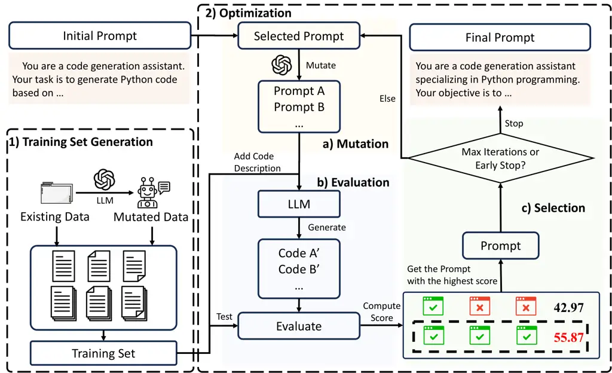
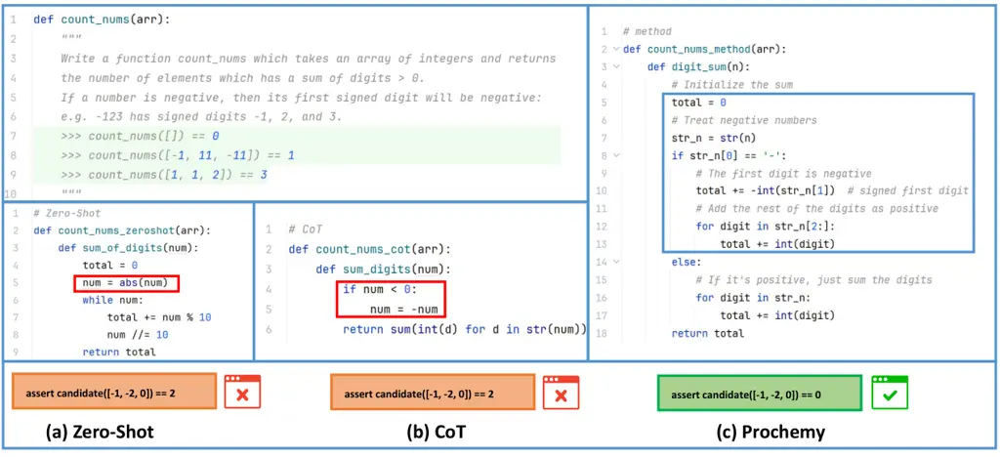
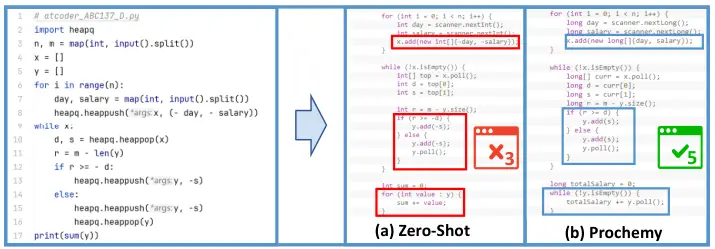

# Prompt Alchemy: Automatic Prompt Refinement for Enhancing Code GenerationThanks: Manuscript received April 19, 2021; revised August 16, 2021.

Sixiang Ye¹, Zeyu Sun², Guoqing Wang³, Liwei Guo¹, Qingyuan Liang³,
Zheng Li¹, Yong Liu¹ Affiliation:  Affiliation: ¹Beijing University of
Chemical Technology  
Beijing, China  
Emails: yesx.sxye@gmail.com, liwei.glw@outlook.com,
lizheng@mail.buct.edu.cn, lyong@mail.buct.edu.cn Affiliation: 
Affiliation: ²National Key Laboratory of Space Integrated Information
System  
Institute of Software, Chinese Academy of Sciences  
Beijing, China  
Email: zeyu.zys@gmail.com Affiliation:  Affiliation: ³Peking
University  
Beijing, China  
Emails: guoqingwang@stu.pku.edu.cn, liangqy@stu.pku.edu.cn Affiliation: 

###### Abstract

Code generation has gained increasing attention as a task to automate
software development by transforming high-level descriptions into
executable code. While large language models (LLMs) are effective in
generating code, their performance heavily relies on the quality of
input prompts. Current prompt engineering methods involve manual effort
in designing prompts, which can be time-consuming and yield inconsistent
results, potentially constraining the efficacy of LLMs in practical
applications. This paper introduces Prochemy, a novel approach for
automatically refining prompts iteratively to enhance code generation.
Prochemy addresses the limitations of manual prompt engineering by
automating the optimization process, ensuring prompt consistency during
inference, and aligning with multi-agent systems. It iteratively refines
prompts based on model performance, using an optimized final prompt to
improve consistency and reliability across tasks. We evaluate Prochemy
on both natural language-based code generation and code translation
tasks using three series of LLMs. Results show that when combining
Prochemy with existing approaches, it outperforms baseline prompting
methods. It achieves improvements of 5.0% (GPT-3.5-Turbo) and 1.9%
(GPT-4o) over zero-shot baselines on HumanEval. For the state-of-the-art
LDB, Prochemy + LDB outperforms standalone methods by 1.2–1.8%. For code
translation, Prochemy elevates GPT-4o’s performance on Java-to-Python
(AVATAR) from 74.5 to 84.1 (+12.9%) and Python-to-Java from 66.8 to 78.2
(+17.1%). Furthermore, considering that the o1-mini model integrates
prompt engineering techniques, Prochemy can continue to show good
performance among it, further validating its effectiveness in code
generation and translation tasks. Additionally, Prochemy is designed to
be plug-and-play, optimizing prompts with minimal human intervention and
seamlessly bridging the gap between simple prompts and complex
frameworks.

###### Index Terms: 

Code Generation, Prompt Refinement, Automation

## I Introduction

Code generation has become a transformative application in software
engineering, allowing the automatic generation of code from high-level
descriptions or specifications \[1, 2, 3\]. This capability accelerates
the development process and reduces human error by automating repetitive
coding tasks. As the demand for efficient software development grows,
the use of large language models (LLM) for code generation has become
increasingly significant \[4\].

To effectively use LLM, prompt engineering plays an important role,
involving design and refinement of input prompts to optimize model
performance and improve the quality of generated code \[5, 6\]. Early
prompt engineering approaches focus on natural language processing
tasks, including text generation and sentiment analysis \[7, 8\]. In
these tasks, few-shot learning enables models to adapt to new tasks with
minimal examples \[9, 10\]. The Chain of Thought (CoT) method enhances
precision in complex tasks by incorporating reasoning steps into
prompts \[6\]. Recently, researchers who supplement prompts with
additional code contextual information \[3\] or adopting multi-agent
system approaches to debugging and regenerating existing code \[11,
12\], these methods demonstrate improvements in the quality of code
results.

Although prompt-based techniques have shown their effectiveness, their
limitations become apparent in the realm of code generation. Such tasks
often involve intricate contextual demands, and different coding
challenges may hinge on specific aspects of the prompt.

However, existing approaches depend on manually crafting optimal
prompts, which is time consuming and susceptible to errors. Human
intuition often fails to meet the stringent demands of coding standards,
which could lead to suboptimal results. Furthermore, human-designed
prompts may not align consistently with the specific needs of LLM, which
can compromise performance \[13\].

To mitigate these problems and enhance code generation, the necessity
for an automated prompt optimization approach becomes evident. This
approach must address two key challenges. The first challenge is
automation: it should leverage algorithms to analyze coding contexts,
automatically generating prompts that accurately capture the specific
needs of LLMs on diverse coding tasks. Once generated, the prompt must
be fixed for use during inference, ensuring that it can be reused
without adjustments. The second challenge is compatibility: the approach
should ensure alignment with existing techniques, such as multi-agent
approaches. This compatibility will enable integration into current
workflows, ultimately enhancing both performance and efficiency in code
generation.

To address these challenges, we propose Prochemy (derived from Prompt
Alchemy), a novel execution-driven automated prompt generation framework
designed to guide LLMs in code generation tasks. For automation,
Prochemy begins with an initial prompt, such as a zero-shot prompt, and
iteratively refines it based on the model’s performance evaluated by
execution. This refinement uses a training set derived from existing
datasets and their generated variations. The process aims to align the
prompt with the needs of LLMs, enhancing its accuracy for specific
tasks. After these refinements, the prompt is finalized and set,
ensuring it can be reused consistently without further adjustments. For
compatibility, Prochemy is designed as a plug-and-play approach that
integrates seamlessly without requiring any modifications to existing
prompt methodologies, such as CoT and multi-agent systems.

We conduct experiments on natural-language-based code generation and
code translation tasks using three series of LLMs: the ChatGPT
series \[14, 9, 15\], the Claude series \[16, 17\], and the DeepSeek
series \[18, 19, 20\]. Prochemy enhances code generation and translation
across LLMs, achieving average gains of $`+4.04\%`$ (zero-shot),
$`+4.55\%`$ (chain-of-thought), and $`+2.00\%`$ (multi-turn) on
HumanEval/MBPP benchmarks. Correctness-critical variants
(HumanEval+/MBPP+) see $`+4.21–7.76\%`$ improvements, with LDB
integration reaching state-of-the-art results (96.3% on HumanEval). On
LiveCodeBench, Prochemy delivers $`+14.15\%`$ (zero-shot) and
$`+12.28\%`$ (chain-of-thought) average gains. For code translation, it
achieves $`+13.68\%`$ (Java-Python) and $`+8.25\%`$ (Python-Java)
average improvements on CodeNet and AVATAR datasets. Considering that
the o1-mini model integrates CoT techniques, we subsequently applied the
same Prochemy approach to this model. Prochemy continues to show good
performance, further validating its effectiveness in code generation and
translation tasks. These results validate Prochemy’s unified framework,
which aligns prompts with task requirements and model capabilities
without architectural changes, establishing a scalable paradigm for
LLM-driven code tasks.

We summarize our contributions in this paper as follows.

- •
  We propose Prochemy, the first approach designed to specifically
  optimize prompts for code generation tasks. It iteratively refines
  prompts by analyzing the model’s performance against a training set
  composed of existing datasets and their generated variations. Prochemy
  requires only a single training run for a given task. After the
  optimization process, the prompt is fixed as the final prompt.
- •
  Prochemy is compatible with existing prompt engineering methodologies,
  offering a plug-and-play solution that integrates seamlessly into
  current frameworks. This adaptability allows for its use without
  requiring modifications to established workflows.
- •
  We conduct extensive empirical validation of Prochemy across multiple
  datasets and language models, demonstrating consistent improvements in
  performance for both natural-language-based code generation and code
  translation tasks. This evaluation confirms the robustness and
  generalizability of Prochemy across diverse architectural frameworks.

## II Related Work

Fine-tuning large language models (LLMs) for different domains is a
daunting task \[21\], particularly when dealing with the sheer volume of
parameters, such as DeepSeek-V$`3`$, which contains $`671`$ billion
parameters \[20\]. In response, prompting techniques have emerged as a
preferred strategy to adapt LLMs for specific tasks by supplying a
specialized prompt \[22\].

Prompt Engineering for Natural Language. Early efforts in prompt
engineering for LLMs revolved around zero-shot and few-shot
prompting \[9, 10\]. In zero-shot prompting, the model is required to
generate code directly based on the task description, without any prior
examples. This method enables LLMs to tackle diverse tasks but may lack
accuracy in more complex scenarios. Few-shot prompting extends this
technique by incorporating a few example pairs of tasks and
corresponding responses, allowing the model to learn from these samples
and adjust its outputs accordingly. This example-based approach enhances
the model’s accuracy, leveraging the provided information to guide its
reasoning process.

Researchers have advanced prompt engineering to enhance models’
reasoning capabilities. Chain-of-Thought (CoT) prompting \[23\]
instructs models to articulate intermediate reasoning steps, improving
performance on tasks that require logical, step-by-step problem-solving.
This technique ensures more coherent and accurate handling of complex
tasks.

Automated methods like the Automatic Prompt Engineer (APE) automate the
optimization of LLM instructions, often exceeding the performance of
human-written prompts by refining model behavior to enhance results like
informativeness and truthfulness \[24\]. Similarly, ProTeGi uses
gradient descent methodology to optimize prompts automatically,
improving task performance by up to 31% \[25\]. The LLM as the Optimizer
(OPRO) method uses LLMs’ natural language understanding to iteratively
refine prompts and enhance solution quality. Without relying on
gradient-based techniques, it adjusts solutions based on past
evaluations, effectively balancing exploration and exploitation to
improve problem-solving efficiency \[26\].

Black-Box Prompt Optimization (BPO) \[27\] enhances LLM alignment for
the natural language processing tasks by optimizing user prompts based
on human preferences without modifying model parameters. It boosts model
output quality across various tasks and outperforms methods like
PPO \[28\] and DPO \[29\], offering an efficient and interpretable
alignment solution.

Prompt Engineering for Code Generation. In the domain of software
engineering, traditional prompt engineering methods designed for natural
language tasks face limitations due to the need for strict adherence to
standards \[4\].

To overcome these challenges, researchers have developed specialized
approaches that integrate structured reasoning and multi-agent systems.
For example, SCoT (Structured Chain-of-Thought) leverages program
architecture to enhance code generation accuracy by using programmatic
structures \[3\], while agent-based systems like AgentCoder combine
specialized agents—such as test designers, executors, and programmers—to
automate testing and improve code quality \[11\]. Self-collaboration
frameworks also simulate human software development processes,
optimizing models for complex programming tasks \[30\]. Furthermore,
techniques like LDB (Debug-Like-Human) use runtime information and
program segmentation to improve debugging \[12\]. Despite their
effectiveness, these methods often struggle with high token consumption,
high iteration counts, and limited applicability across different
models.

Our approach is designed to create a flexible prompt optimization
pipeline that is suitable for a range of models. This pipeline refines
prompts by utilizing insights gained from program execution, aiming to
discover the most effective discrete prompt for code generation. This
approach can be integrated with existing prompt engineering techniques
to achieve improved results.

## III Approach



Fig. 1: Overview of Prochemy

### III-A Overview

To optimize prompts in a plug-and-play manner and iteratively refine
them based on the model’s performance, Prochemy involves two steps, as
illustrated in Fig. 1: 1) Training Set Generation aims to generate the
training set for evaluating the effectiveness of prompts (in
Sec. III-B). 2) Optimization aims to iteratively refine prompts through
three sub-steps III-C: a) Mutation—Generates variations of existing
prompts to introduce diversity and explore different structures,
providing a pool of candidates for further evaluation (in Sec. III-C1).
b) Evaluation—Assesses the performance of these mutated prompts using
the training data, employing a weighted averaging mechanism to determine
their effectiveness (in Sec. III-C2). c) Selection—Chooses the most
effective prompt from the pool based on their evaluated performance,
guiding the subsequent mutation process (in Sec. III-C3).

In particular, Prochemy requires only a single training run for a given
task. After the optimization process, the prompt is finalized and set as
the final prompt. This streamlined approach not only enhances efficiency
but also ensures that the refined prompt is tailored for optimal
performance and can be reused consistently without further adjustments
in the context of the task at hand.

### III-B Training Set Generation

The training set generation step is designed to create a dataset $`T`$
that facilitates the indirect evaluation of prompt quality. In the
context of code generation, this step constructs the dataset where each
data entry $`T_{i}\in T`$ consists of an input natural language
description $`T_{i}^{(NL)}`$ and its corresponding set of executable
test cases $`T_{i}^{(test)}`$, ensuring that each description is
actionable and testable ($`T_{i}=(T_{i}^{(NL)},T_{i}^{(test)})`$). This
dataset is derived from two primary sources: existing training data from
datasets, and new data generated by LLMs through mutation processes
applied to pre-existing data.

##### Existing Data

For existing data, we construct the training set $`D_{\text{existing}}`$
via implementing a sampling strategy. This involves randomly selecting
samples from existing datasets until $`K`$ samples are obtained¹¹ 1 In
our experiments, the selected datasets do not overlap with our test
dataset ($`D_{\text{test}}`$), ensuring the independence of our training
and test datasets..

##### Mutated Data

To enhance the diversity of our training set, we utilize an automated
data augmentation mechanism that generates new data through mutations by
LLMs. Prochemy employs LLMs to create additional samples by mutating
reference data, which is randomly sampled from existing datasets but
does not overlap with the previously mentioned existing data
$`D_{\text{existing}}`$. Specifically, the initial input for mutation is
a random sample from the existing dataset, ensuring that the mutated
data is different from the existing ones.

Formally, we sample $`L`$ distinct reference data from the existing
datasets, ensuring no overlap with $`D_{\text{existing}}`$. For each
reference data, we use the LLM with a specific prompt to mutate it into
new samples that are different from the existing data. The specific
prompt is as follows: ”You are an expert in software engineering. Please
help me generate similar data based on the format provided below. The
reference data format is as follows.” This process is repeated $`K`$
times, resulting in a total of $`K`$ generated samples. To ensure
correctness, each generated sample undergoes validation through two
steps: (1) executing the code to verify functional integrity, and (2)
evaluating against model-provided test cases. Only samples passing both
validation phases are retained. In this paper, we set $`K=10`$. The
resulting samples are retained as the content of $`D_{\text{gen}}`$.

The final training set is a combination of these two data sources,
denoted as $`T=D_{\text{existing}}\cup D_{\text{gen}}`$. This training
set $`T`$ serves as the foundation for further evaluation of prompt
quality and performance.

### III-C Optimization

The optimization step of Prochemy focuses on refining prompts
iteratively to maximize their effectiveness for code generation tasks.
This phase involves three sub-steps, each designed to progressively
enhance the quality of prompts through mutation, evaluation, and
selection. These iterative cycles are aimed at continuously improving
prompt performance, adapting to evolving task requirements, and learning
from previous iterations. The process is designed to repeat for a
maximum of $`k_{\text{max}}`$ iterations, ensuring thorough exploration
while preventing excessive computation. In this paper,
$`k_{\text{max}}`$ is set to 10.

#### III-C1 Mutation

The primary goal of the mutation process is to generate a diverse set of
prompts by mutating existing ones. This approach facilitates the
creation of a broad range of prompt variations, allowing for a
comprehensive exploration and subsequent selection of the most effective
prompts to enhance task performance.

This process is achieved by generating a series of modified prompt
variants $`P_{i}^{(k)}`$ based on prompts selected from the previous
iteration. In particular, for the first iteration, the prompt can be set
to the simple zero-shot prompt or the well-designed prompt of existing
approaches. Each variant $`P_{i}^{(k)}`$ retains the core semantic
structure but incorporates changes in linguistic or structural elements,
allowing for a detailed evaluation of how these variations influence the
performance of the LLM. The modifications include adjustments such as
rephrasing sentences, refining clarity, or altering the presentation of
task instructions.

Formally, given the set of selected prompts $`S^{(k-1)}`$ from iteration
$`k-1`$ (for the first iteration, $`S^{(0)}`$ contains only an initial
prompt like zero-shot or CoT), the mutation process produces a new set
$`P^{(k)}`$ ($`|P^{(k)}|=n`$ ) of prompt variants for iteration $`k`$:

```math
P^{(k)}=\{P_{1}^{(k)},P_{2}^{(k)},\ldots,P_{n}^{(k)}\},
```

where each $`P_{i}^{(k)}`$ is generated by applying a mutation function
$`m`$ to a randomly sampled prompt $`S_{j}^{(k-1)}`$ from the selected
set $`S^{(k-1)}`$:

```math
P_{i}^{(k)}=m(S_{j}^{(k-1)}),\quad S_{j}^{(k-1)}\in S^{(k-1)}.
```

The transformation function $`m(\cdot)`$ introduces variations into the
prompts by adding modifications to the original prompt
$`S_{j}^{(k-1)}`$. These changes are designed to explore different
expressions while preserving the original intent of the prompt. The
specific prompt is as follows: You are an expert prompt engineer. Please
help me improve the given prompt to get a more helpful and harmless
response.

#### III-C2 Evaluation

The evaluation process systematically assesses the effectiveness of
mutated prompts by analyzing execution results of their generated code
implementations, including metrics of functional correctness and runtime
performance. This execution-based analysis enables the identification of
optimal prompt variants in each iteration through quantitative
comparisons of code behavior across different problem instances.

To achieve this, Prochemy applies each mutated prompt $`P_{i}^{(k)}`$ to
every dataset entry $`T_{j}=(T_{i}^{(NL)},T_{i}^{(test)})`$ in the
generated training set $`T`$. It concatenates the prompt $`P_{i}^{(k)}`$
with the natural language description $`T_{i}^{(NL)}`$ of each task.
Then, Prochemy feeds this concatenated input into the LLM, which
produces outputs $`R_{ij}^{(k)}`$. Each output $`R_{ij}^{(k)}`$ is
evaluated against the associated test suite $`T_{i}^{(test)}`$ using
specific criteria $`C`$, resulting in a score $`M_{ij}`$ for each
prompt-task pair. This process ensures that the effectiveness of each
prompt is quantitatively assessed in the context of its ability to
generate correct and functional code. Here, $`C`$ denotes
execution-based evaluation metrics derived from code runtime
verification. In code generation tasks, we employ the pass@1 metric
where $`M_{ij}\in\{0,1\}`$ is determined through automated test case
execution - assigning 1 only if the generated code passes all
ground-truth test cases on initial execution. This execution-driven
paradigm ensures metrics fundamentally reflect functional correctness
rather than surface-level code similarity.

##### Weighted Scoring Mechanism.

To optimize the evaluation process and facilitate informed prompt
selection, a weighted scoring mechanism is employed. This mechanism
prioritizes the evaluation of each dataset entry $`T_{j}`$ based on its
complexity. The underlying principle is that if the code generated by a
multitude of prompts correctly solves a particular dataset entry
$`T_{j}`$, this suggests that the data may be relatively simple and less
critical. Consequently, less weight is assigned to such data entries,
reflecting their lower importance in the overall assessment of prompt
effectiveness. This approach ensures that more complex and challenging
tasks, which are harder to solve correctly, have a greater influence on
the selection of the most effective prompts.

Formally, this mechanism assigns weights $`w_{j}`$ to tasks $`T_{j}`$
based on their complexity and the number of times they are successfully
solved in this iteration:

```math
w_{j}=\frac{|P^{(k)}|}{N_{\text{successful}}(T_{j})},
```

where $`|P^{(k)}|`$ is the total number of prompts variants, and
$`N_{\text{successful}}(T_{j})`$ is the number of times $`T_{j}`$ is
successfully solved in this iteration.

The overall weighted score for each prompt $`P_{i}^{(k)}`$ is calculated
as:

```math
W_{S}(P_{i}^{(k)})=\sum_{j}w_{j}\cdot M_{ij}.
```

#### III-C3 Selection

After evaluating the performance of each mutated prompt, the prompt
selection step focuses on choosing the most effective prompts to carry
forward into subsequent iterations or to serve as the final output
prompt.

In each iteration $`k`$, the selection function is applied to the
results of evaluation $`W_{S}(P)`$. Specifically, the prompt(s) with the
highest weighted average score is selected as the reference for the next
round of mutation:

```math
S^{(k)}=\{P\mid P=\arg\max_{P^{\prime}\in P^{(k)}}W_{S}(P^{\prime})\}.
```

If there is a single prompt with the highest score, it is used directly.
If multiple prompts share the highest score, all are retained. The
selected prompt(s) $`S^{(k)}`$ serve as the basis for generating new
mutations in the next iteration.

If, upon reaching the convergence criteria, there are multiple prompts
with the same highest weighted average score, we randomly select one of
these prompts as the final result.

##### Convergence Toward Optimal Prompt.

The iterative process continues until one of the following termination
conditions is met: (1) Early Stop: the highest weighted score remains
unchanged for three consecutive iterations, or (2) Max Iterations: a
maximum number of iterations is reached. This approach ensures that the
method efficiently converges toward the optimal prompt $`P^{*}`$ without
unnecessary computational effort.

Formally, the convergence condition can be defined as:

```math
\begin{gathered}(W_{S}(S_{j}^{(k)})=W_{S}(S_{j}^{(k-1)})=W_{S}(S_{j}^{(k-2)})\And k\geq 3)\\
\text{or}\quad k\geq k_{\text{max}}.\end{gathered}
```

Here, $`S_{j}^{(k)}\in S^{(k)}`$ (the score of any
$`S_{j}^{(k)}\in S^{(k)}`$ is equal), and $`k`$ represents the current
iteration number. Upon reaching one of these termination conditions, the
prompt with the highest weighted score is selected as the final output
prompt $`P^{*}\in S_{k}`$. If there are multiple prompts with equally
high scores, one is chosen at random to be $`P^{*}\in S_{k}`$.

## IV Experimental Setup

In this section, we describe the dataset, large language models,
evaluation metrics, and experimental platforms. Our evaluation is
designed to answer the following research questions.

RQ1. How does Prochemy perform compared to other methods? To answer this
question, we conduct experiments on two tasks with seven datasets and
compare Prochemy with state-of-the-art approaches.

RQ2. What effects do each component in the Prochemy have? To answer RQ2,
we analyze Prochemy by removing each component to discern its specific
contribution to the overall effectiveness of Prochemy.

RQ3. In what key aspects and to what extent does Prochemy improve
models’ code capabilities compared to previous methods? To answer this
question, we illustrate a case study, analyzing specific code tasks to
assess improvements in accuracy, efficiency, and generalization. We
compare these results with previous methods to highlight Prochemy’s key
advantages.

### IV-A Dataset

We evaluate Prochemy on two distinct types of code generation tasks. The
first type is Natural-Language-Based Code Generation, which involves
generating executable code from natural language descriptions. This task
tests the ability of Prochemy to accurately interpret human language and
produce functional programming code. The second type is Code
Translation, which requires translating a program from one programming
language, which serves as the input description in Prochemy, to another.
This task assesses the capability of Prochemy to maintain logical and
syntactical correctness across different programming languages.

#### IV-A1 Natural-Language-Based Code Generation

We evaluate the effectiveness of Prochemy using five widely adopted
natural-language-based code generation datasets: HumanEval \[1\],
MBPP \[31\] and its enhanced versions, HumanEval+, and MBPP+ \[32\]. To
mitigate data leakage during large language model training, we also use
LiveCodeBench \[33\], a code generation dataset that is updated over
time.

HumanEval and HumanEval+. The HumanEval and HumanEval+ datasets each
consist of $`164`$ programming challenges designed to assess a model’s
problem-solving capabilities in Python. In HumanEval, each problem
includes an average of $`7.7`$ test cases, focusing on fundamental to
intermediate concepts. HumanEval+, on the other hand, extends the
original dataset with more extensive testing, providing test cases that
exceed the original dataset by an average of $`80`$ times. This increase
in test cases raises the difficulty and rigor of the evaluation, making
HumanEval+ particularly suitable for benchmarking advanced models with a
higher emphasis on robustness and accuracy across complex scenarios.

MBPP and MBPP+. These datasets assess a model’s Python proficiency and
ability to handle various coding tasks. MBPP evaluates fundamental
programming skills, and MBPP+ enhances it by providing an average of
over $`35`$ times more test cases than the original, improving the
evaluation of functional correctness under diverse conditions.

LiveCodeBench. This dataset addresses the critical challenge of data
contamination in LLM evaluation by exclusively curating time-stamped
programming problems collected in real-time from competitive coding
platforms and technical interviews. To ensure temporal separation from
pre-training data, our experiments utilize the official release-v4 lite
subset, comprising $`101`$ representative tasks systematically sampled
from problems released between May $`2023`$ and September $`2024`$. Each
challenge integrates dynamically generated test suites encompassing edge
cases, explicitly designed to emphasize real-world problem-solving
patterns rather than synthetic benchmarks. By anchoring evaluations to
chronologically novel programming challenges unavailable during model
training, LiveCodeBench establishes a rigorous framework for assessing
genuine model generalization capabilities while mitigating memorization
effects inherent in static benchmark reuse. The lite subset maintains
statistical parity with the full $`713`$-problem corpus through
stratified sampling across difficulty levels and problem domains.

#### IV-A2 Code Translation

For code translation, we use the CodeNet and AVATAR dataset to evaluate
prompt performance.

CodeNet. The CodeNet dataset consists of programs in various
languages \[34\], each solving specific tasks. Programs are labeled as
submissions (potentially incomplete or incorrect) or solutions
(accepted, executable, and correct across all test cases). This dataset
serves for understanding and improving programming practices and
automated code evaluation.

AVATAR. AVATAR is a corpus of $`9,515`$ programming tasks in Java and
Python, with $`3,391`$ parallel independent functions for training and
evaluating program translation tasks \[35\]. It includes problems from
platforms like CodeForces, AtCoder, AIZU, CodeJam, GeeksforGeeks,
LeetCode, and ProjectEuler, and supports execution-based program
translation evaluation.

Following \[36\], we adopt rigorously validated subsets from two
established code repositories: (1) The CodeNet subset comprises $`200`$
Python and Java programming tasks, each accompanied by implementations
in both languages, and (2) the AVATAR subset contains 250 algorithm
design challenges. All implementations are verified to pass their
respective test cases through automated evaluation pipelines, ensuring
functional correctness prior to experimental usage. On average, the
AVATAR subset has $`25.02`$ test cases per task, while CodeNet has $`1`$
test cases per task.

### IV-B Baselines

In our evaluation, we select a set of baseline methods specifically
designed for code generation and evaluation tasks. These baselines
represent state-of-the-art approaches in the field, categorized broadly
into single-turn and multi-turn (or multi-agent) methods.

##### Single-Turn Methods

rely on a single prompt-response interaction for generating code
solutions. This type of method contains: 1) Traditional Methods include
basic approaches like Zero-Shot and Chain-of-Thought (CoT) prompting,
which represent standard prompting techniques without iterative
optimization or specialized prompt engineering. 2) Prompt Optimization
includes advanced prompt optimization approaches. The Automatic Prompt
Engineer (APE) \[24\] generates candidate instructions via LLMs and
selects optimal prompts through iterative scoring. Optimization by
PROmpting (OPRO) \[26\] leverages LLMs as natural language optimizers,
iteratively refining solutions based on historical evaluations.
Black-box Prompt Optimization (BPO) \[27\] aligns LLMs by optimizing
user prompts without parameter updates, using human preferences to
enhance intent alignment for untrainable models like GPTs. We adopt them
due to the absence of code-specific optimization baselines.

##### Multi-Turn Methods

To better encode the code knowledge. These approaches involve iterative
or collaborative interactions to enhance code generation performance.

Multi-Turn Methods include Self-Collaboration \[30\], AgentCoder\[11\],
CodeCoT  \[37\], MapCoder \[38\] and LDB \[12\] provide structured
interactions between multiple agents to collaboratively refine code
solutions. These methods are designed to improve accuracy through the
collective input of several agents rather than relying on a single
response.

For our experiments, we select three representative and high-performing
methods in the multi-agent approach: Self-Collaboration, AgentCoder, and
LDB.

### IV-C LLMs

For LLMs, we use several widely adopted large language models, including
GPT-3.5-Turbo, GPT-4o, o1-mini, Claude-3-Haiku, Claude-3.5-Sonnet, and
DeepSeek-V3, ensuring the method’s transferability across different
models.

ChatGPT. Based on OpenAI’s GPT architecture, GPT-3.5-Turbo offers faster
processing and lower costs compared to GPT-3.5. GPT-4o-Mini is a
smaller, cost-efficient variant of GPT-4, while GPT-4o provides strong
language capabilities with lower computational demands. Additionally,
the o1-mini model is a compact and lightweight version designed for
scenarios requiring efficient resource utilization, delivering balanced
performance with reduced computational overhead \[14, 9, 15\].

Claude. Developed by Anthropic, Claude focuses on safe and controllable
AI interactions. Claude-3-Haiku is a specialized version designed for
faster, efficient text generation and comprehension, making it ideal for
real-time applications. Additionally, Claude-3.5-Sonnet is an advanced
iteration that enhances the balance between performance and efficiency,
offering improved contextual understanding and nuanced text generation,
suitable for more complex and detailed tasks \[16, 17\].

DeepSeek. The DeepSeek series by DeepSeek Technologies excels in natural
language processing and code-related tasks. The latest version,
DeepSeek-V3, represents a significant advancement, integrating and
enhancing the capabilities of its predecessors into a unified,
state-of-the-art model. DeepSeek-V3 delivers superior general and coding
performance, achieves better alignment with human preferences, and
introduces optimizations for writing tasks and instruction-following
scenarios. This version is designed to meet the growing demands of
complex applications, offering improved efficiency, accuracy, and
versatility \[20\].

### IV-D Parameter Settings

In the experiments, the temperature parameter is set to $`0`$ for both
code generation and code translation, a common practice when employing
large language models for such tasks \[11, 12, 39\]. For the prompt
mutation process, the temperature is set to $`1.0`$ to increase
diversity and creativity, allowing for novel and varied prompt
mutations.

The training set consists of $`20`$ data samples, with $`10`$ samples
sourced from each of the two primary categories: (1) existing data, and
(2) LLM-mutated data. For existing data, to ensure that they are
distinct from the test set, we randomly sample $`10`$ samples from an
external dataset. Specifically, for Code Generation tasks: HumanEval
uses existing data from MBPP, MBPP uses data from HumanEval, and
LiveCodeBench sources its existing data from AVATAR (code generation
version). For Code Translation tasks: AVATAR uses CodeNet data, while
CodeNet uses AVATAR as its existing data source. This cross-dataset
curation ensures the independence of the test set while preserving task
relevance. For the mutation process, in each iteration, $`10`$ different
mutated prompts are generated. This number is selected to introduce
sufficient diversity into the prompt pool, enabling the exploration of
various prompt structures and linguistic variations without incurring
excessive computational costs. Generating $`10`$ mutated prompts per
iteration strikes a balance between diversity and efficiency.

For the parameters in the LLM API calls, including max tokens, top p,
and others, are kept at their default settings as specified by each
model. When extracting code snippets from the model’s results, we aim to
prevent situations where multiple code segments in a single response
could result in the extraction of non-executable code. To address this,
we adopt the method proposed in paper \[32\], extracting the longest
compilable code snippet from each model response.

### IV-E Evaluation Metric

Following previous code generation studies \[40, 41, 3\], we adopt
Pass@1 as our evaluation metric for both generation and translation
tasks. In this metric, the code generation model generates only one
program in response to a given requirement. The requirement is
considered solved if the generated program passes all predefined test
cases. The Pass@1 score is then calculated as the percentage of
requirements for which the model successfully generates a program that
passes all the test cases on the first try. This score provides a direct
measure of a model’s ability to produce fully functional and correct
code in a single attempt, reflecting both its precision and reliability
in practical applications.

### IV-F Experimental Platform

We conduct the experiments on an NF5468M6 server with two Intel Xeon
Gold 6354 C processors and 512 GB of memory (16 x 32 GB DIMM DDR4). The
server includes a 480 GB and a 24 TB logical volume for ample storage.
It is equipped with eight NVIDIA RTX 4090 GPUs for high-performance
computing and has eight Gigabit Ethernet interfaces for reliable data
transmission.

## V Results and Analysis

### V-A RQ1: How does Prochemy perform compared to other methods?

To address the first research question, we assess the performance of
Prochemy on two types of tasks: natural-language-based code generation
and code translation.

|                               |           |        |          |             |            |        |          |             |         |        |          |             |         |        |          |             |
| ----------------------------- | --------- | ------ | -------- | ----------- | ---------- | ------ | -------- | ----------- | ------- | ------ | -------- | ----------- | ------- | ------ | -------- | ----------- |
| Prompting Methods             | HumanEval |        |          |             | HumanEval+ |        |          |             | MBPP    |        |          |             | MBPP+   |        |          |             |
|                               | GPT-3.5   | GPT-4o | Claude-3 | DeepSeek-V3 | GPT-3.5    | GPT-4o | Claude-3 | DeepSeek-V3 | GPT-3.5 | GPT-4o | Claude-3 | DeepSeek-V3 | GPT-3.5 | GPT-4o | Claude-3 | DeepSeek-V3 |
| Single-Turn                   |           |        |          |             |            |        |          |             |         |        |          |             |         |        |          |             |
| Zero-Shot                     | 72.6      | 90.2   | 76.8     | 90.2        | 68.9       | 81.7   | 68.9     | 84.8        | 75.9    | 86.5   | 80.2     | 87.6        | 65.3    | 72.5   | 68.8     | 73.0        |
| Few-shot                      | 75.0      | 90.2   | 78.0     | 90.9        | 70.1       | 84.8   | 68.9     | 86.6        | 76.5    | 88.6   | 80.2     | 88.1        | 68.0    | 73.0   | 69.6     | 73.3        |
| CoT                           | 75.6      | 91.5   | 76.2     | 89.0        | 70.1       | 85.4   | 67.1     | 82.9        | 78.8    | 87.8   | 79.4     | 87.8        | 65.6    | 73.4   | 68.5     | 71.7        |
| APE                           | 73.2      | 90.2   | 77.4     | 90.2        | 68.9       | 83.5   | 69.5     | 85.3        | 78.6    | 88.6   | 80.7     | 87.3        | 64.0    | 73.0   | 69.0     | 72.5        |
| OPRO                          | 75.0      | 89.0   | 74.4     | 89.6        | 69.5       | 83.5   | 67.7     | 86.0        | 78.8    | 88.9   | 80.4     | 86.8        | 65.9    | 73.3   | 67.7     | 72.8        |
| BPO                           | 75.6      | 90.2   | 76.8     | 91.5        | 69.5       | 86.0   | 68.3     | 86.6        | 78.6    | 88.6   | 79.9     | 88.4        | 66.1    | 72.8   | 69.3     | 73.5        |
| Self-Collaboration-noiter     | 74.4      | 90.2   | 77.4     | 90.9        | 68.9       | 86.0   | 69.5     | 86.6        | 80.2    | 88.1   | 80.7     | 91.5        | 67.5    | 72.8   | 69.6     | 77.5        |
| AgentCoder-noiter             | 75.6      | 87.8   | 78.7     | 91.5        | 69.5       | 84.1   | 70.7     | 85.4        | 79.4    | 87.8   | 81.2     | 90.2        | 67.5    | 73.4   | 70.1     | 74.9        |
| LDB-noiter                    | 76.2      | 91.5   | 78.0     | 91.5        | 70.7       | 84.8   | 70.1     | 85.4        | 80.7    | 89.7   | 81.0     | 90.7        | 68.3    | 75.4   | 69.3     | 75.1        |
| Zero-shot + Prochemy          | 76.2      | 92.1   | 79.3     | 92.7        | 71.3       | 86.6   | 72.0     | 87.2        | 81.2    | 89.9   | 81.7     | 91.8        | 68.5    | 75.4   | 70.1     | 78.0        |
| CoT + Prochemy                | 77.4      | 92.7   | 80.5     | 93.3        | 72.0       | 89.3   | 72.6     | 88.4        | 82.5    | 89.9   | 82.0     | 92.3        | 69.0    | 75.7   | 70.9     | 78.3        |
| Multi-Turn                    |           |        |          |             |            |        |          |             |         |        |          |             |         |        |          |             |
| Self-Collaboration            | 78.0      | 90.9   | 81.1     | 92.1        | 70.1       | 87.8   | 71.3     | 87.2        | 82.5    | 88.6   | 82.3     | 91.8        | 69.0    | 74.1   | 70.1     | 77.5        |
| AgentCoder                    | 79.3      | 92.7   | 80.5     | 93.3        | 73.2       | 87.2   | 72.0     | 85.4        | 82.2    | 88.9   | 82.8     | 91.5        | 69.3    | 75.1   | 71.1     | 76.7        |
| LDB                           | 82.3      | 94.5   | 81.1     | 92.7        | 78.0       | 88.4   | 73.2     | 88.4        | 83.1    | 89.9   | 83.6     | 92.3        | 69.3    | 74.9   | 70.6     | 75.7        |
| Self-Collaboration + Prochemy | 79.3      | 92.7   | 81.7     | 93.9        | 72.0       | 89.6   | 72.6     | 90.9        | 83.3    | 90.2   | 83.1     | 92.3        | 69.6    | 76.2   | 70.9     | 79.4        |
| AgentCoder + Prochemy         | 81.1      | 93.9   | 83.5     | 93.3        | 73.8       | 89.3   | 73.8     | 90.2        | 82.8    | 90.7   | 83.3     | 92.1        | 70.1    | 77.2   | 71.7     | 78.3        |
| LDB + Prochemy                | 83.5      | 96.3   | 84.8     | 94.5        | 79.3       | 90.2   | 73.8     | 90.9        | 83.9    | 92.6   | 84.1     | 93.1        | 70.4    | 80.7   | 71.4     | 78.8        |

TABLE I: Prochemy on Different Models (HumanEval and MBPP)

| Prompting Methods         | Models        |        |                   |             |
| ------------------------- | ------------- | ------ | ----------------- | ----------- |
|                           | GPT-3.5-Turbo | GPT-4o | Claude-3.5-Sonnet | DeepSeek-V3 |
| Zero-Shot                 | 10.9          | 22.8   | 12.9              | 24.8        |
| Few-shot                  | 6.9           | 21.8   | 11.9              | 24.8        |
| CoT                       | 11.9          | 20.8   | 16.8              | 22.8        |
| APE                       | 9.9           | 22.8   | 11.9              | 25.7        |
| OPRO                      | 9.9           | 20.8   | 13.9              | 23.8        |
| BPO                       | 10.9          | 22.8   | 11.9              | 20.8        |
| Self-Collaboration-noiter | 7.9           | 19.8   | 14.9              | 19.8        |
| AgentCoder-noiter         | 11.9          | 19.8   | 7.9               | 16.8        |
| LDB-noiter                | 7.9           | 17.8   | 7.9               | 14.9        |
| Zero-shot + Prochemy      | 12.9          | 23.8   | 16.8              | 25.7        |
| CoT + Prochemy            | 12.9          | 24.8   | 16.8              | 27.7        |

TABLE II: Prochemy Performance on Different Models (LiveCodeBench)

| Prompting Methods    | Java2Python |        |         |        |                |        |             |        | Python2Java |        |         |        |                |        |             |        |
| -------------------- | ----------- | ------ | ------- | ------ | -------------- | ------ | ----------- | ------ | ----------- | ------ | ------- | ------ | -------------- | ------ | ----------- | ------ |
|                      | GPT-3.5     |        | GPT-4o  |        | Claude-3-Haiku |        | DeepSeek-V3 |        | GPT-3.5     |        | GPT-4o  |        | Claude-3-Haiku |        | DeepSeek-V3 |        |
|                      | CodeNet     | AVATAR | CodeNet | AVATAR | CodeNet        | AVATAR | CodeNet     | AVATAR | CodeNet     | AVATAR | CodeNet | AVATAR | CodeNet        | AVATAR | CodeNet     | AVATAR |
| Zero-Shot            | 60.5        | 63.8   | 63.5    | 74.5   | 59.0           | 63.0   | 72.0        | 80.9   | 76.5        | 54.4   | 95.5    | 66.8   | 86.0           | 51.5   | 91.0        | 87.7   |
| Few-shot             | 69.5        | 64.4   | 70.0    | 76.2   | 60.5           | 64.4   | 82.0        | 81.6   | 81.0        | 54.9   | 96.0    | 68.1   | 87.5           | 53.2   | 94.0        | 88.5   |
| CoT                  | 63.0        | 62.8   | 63.5    | 73.2   | 58.5           | 61.5   | 64.0        | 78.7   | 81.0        | 51.9   | 96.5    | 64.7   | 86.5           | 49.8   | 92.0        | 86.0   |
| APE                  | 61.0        | 64.9   | 72.0    | 77.0   | 60.0           | 63.6   | 82.0        | 83.4   | 79.0        | 55.3   | 96.5    | 66.0   | 87.0           | 56.2   | 94.0        | 87.2   |
| OPRO                 | 61.0        | 63.8   | 69.5    | 78.7   | 59.5           | 64.9   | 70.5        | 80.3   | 81.5        | 54.4   | 96.5    | 67.7   | 87.0           | 51.9   | 93.5        | 86.8   |
| BPO                  | 60.5        | 65.1   | 64.5    | 63.8   | 60.0           | 60.9   | 67.5        | 79.6   | 80.0        | 56.9   | 95.5    | 65.5   | 86.0           | 46.8   | 91.0        | 85.7   |
| Zero-shot + Prochemy | 73.0        | 66.0   | 79.5    | 84.1   | 64.0           | 68.5   | 86.5        | 88.9   | 83.0        | 57.7   | 97.0    | 78.2   | 88.5           | 61.9   | 95.5        | 91.9   |

TABLE III: Prochemy on Different Models (Code Translation)

#### V-A1 Natural-Language-Based Code Generation

We evaluate natural language-based code generation across five
benchmarks: HumanEval/MBPP (base functionality), their augmented
versions HumanEval+/MBPP+ (strict correctness and robustness), and
LiveCodeBench (dynamically refreshed challenges for advanced code
generation).

We first introduce the experimental results of HumanEval, HumanEval+,
MBPP, and MBPP+, where we select all baseline methods for evaluation.
Subsequently, we provide the results of LiveCodeBench. Due to the
complexity of the problems and the high computational costs associated
with multi-round iterative approaches, we limited the baselines to
include only non-iterative versions of single-round and multi-round
methods(projected to exceed hundreds of hours for full multi-round
evaluation). This choice is driven by the need to balance evaluation
comprehensiveness with resource constraints.

Analysis of Prochemy Across Models on HumanEval, HumanEval+, MBPP, and
MBPP+. The results of these datasets are shown in Table I. We first
examine the performance of Prochemy when integrated with zero-shot
prompting. Across all datasets and models, Zero-shot + Prochemy
consistently boosts performance, delivering an average gain of
$`4.04\%`$. Notably, for the more challenging HumanEval+ and MBPP+
variants, Prochemy lifts average performance by $`4.21\%`$ and
$`4.43\%`$, respectively. Such results also outperform existing prompt
optimization approaches by an average of $`2.33\%`$. This average
improvement is conservatively calculated by comparing the proposed
method with the best-performing approach among APE, OPRO, and BPO for
each model.

Next, we explore the impact of Prochemy when combined with explicit
chain-of-thought reasoning. Here, Prochemy provides an average
improvement of $`4.55\%`$ compared with standalone CoT method. The
synergy between Prochemy and CoT is especially evident in complex
reasoning tasks such as HumanEval+ and MBPP+, which see gains of
$`5.52\%`$ and $`5.26\%`$, respectively. This partnership also mitigates
the occasional instability of standalone CoT methods, which can
sometimes decrease performance (e.g., Claude-3’s baseline CoT). By
adaptively refining the logic in prompts, Prochemy ensures that the
reasoning steps remain coherent. As a concrete example, GPT-4o’s
HumanEval+ performance rises by $`7.6\%`$ when CoT is augmented by
Prochemy—an improvement $`2.45\texttimes`$ greater than using CoT alone.

Finally, we investigate Prochemy’s capacity to optimize multi-turn code
generation approaches such as Self-Collaboration, AgentCoder, and LDB.
In these pipelines, LLMs typically draw on domain knowledge over several
iterations, but the initial and intermediate prompts can still be
refined. In our experiments, we employ Prochemy to optimize the initial
prompt of them, we observe an average improvement of $`2.00\%`$.
HumanEval-series tasks experience the greatest gains ($`+2.23\%`$),
followed by MBPP-series benchmarks ($`+1.77\%`$). This iterative
optimization helps reduce error propagation, ultimately improving the
seed program’s quality. Notably, Prochemy-enhanced LDB establishes new
state-of-the-art results across all benchmarks, including $`96.3\%`$
(GPT-4o on HumanEval), $`90.9\%`$ (DeepSeek-V3 on HumanEval+), and
$`93.1\%`$ (DeepSeek-V3 on MBPP). These results underscore Prochemy’s
strength in refining dynamic prompts for complex multi-stage workflows.

Beyond the above observations, it is particularly noteworthy that
Prochemy delivers strictly positive gains for all tested models and
datasets without any performance regressions. The consistent upward
trend further validates Prochemy’s robustness and reliability as a
prompting optimization framework.

Analysis of Prochemy Across Models on LiveCodeBench. We further validate
Prochemy’s transferability on the more challenging LiveCodeBench
dataset, as presented in Table II. Notably, only single-turn code
generation methods are explored here, in part due to cost constraints
and also to focus on how Prochemy performs under more direct prompting
scenarios. Additionally, the use of a higher-capacity Claude-3.5-Sonnet
model reflects the increased difficulty of LiveCodeBench, enabling a
clearer assessment of Prochemy’s robustness across varying model
strengths.

For all models tested, Prochemy strengthens the baseline Zero-Shot
results, with especially large gains for less advanced architectures.
After applying the Prochemy method, the average performance improved by
$`14.15\%`$ compared to the zero-shot method. Claude-3.5-Sonnet, for
example, improves substantially from $`12.9`$ to $`16.8`$ ($`+30.2\%`$),
emphasizing Prochemy’s ability to refine underperforming baselines.
Meanwhile, DeepSeek-V3 and GPT-4o shows a smaller but still positive
improvement ($`24.8`$ $`\rightarrow`$ $`25.7`$, $`+3.6\%`$, and $`22.8`$
$`\rightarrow`$ $`23.8`$, $`+4.3\%`$).

Beyond Zero-Shot settings, Prochemy also enhances reasoning-oriented
methods, achieving an average improvement of $`12.28\%`$. For GPT-4o,
combining Prochemy with chain-of-thought reasoning yields a pass@1 of
$`24.8`$, translating to a $`19.2\%`$ gain over standalone CoT
($`20.8`$). DeepSeek-V3 demonstrates a similar pattern, where CoT +
Prochemy achieves $`27.7`$, representing a $`21.5\%`$ jump over vanilla
CoT ($`22.8`$). These results affirm that Prochemy can often amplify
structured reasoning, especially in models with well-aligned CoT
capabilities.

Across all tested architectures, Prochemy consistently surpasses
specialized prompt optimization approaches like APE, OPRO, and BPO. For
example, on GPT-4o, Zero-Shot + Prochemy ($`23.8`$) outperforms APE
($`22.8`$), OPRO ($`20.8`$), and BPO ($`22.8`$), underscoring the
effectiveness of systematic prompt refinement over hand-tuned
strategies. These findings illustrate that Prochemy’s improvements hold
even on advanced datasets such as LiveCodeBench.

#### V-A2 Code Translation

We further extend the evaluation of Prochemy to code translation tasks,
systematically investigating its efficacy in code-to-code generation
scenarios beyond conventional natural language-to-programming language
settings. Table III demonstrates Prochemy’s performance across models
and datasets.

Similar results are observed in code generation tasks, Prochemy boosts
Zero-Shot performance, achieving an average improvement of $`13.68\%`$
in Java-to-Python translation tasks, And in Python-to-Java task, this
value is $`8.25\%`$. For instance, in Java-to-Python translation on the
AVATAR dataset, GPT-4o scores $`84.1`$ under Zero-Shot + Prochemy,
representing a $`9.6\%`$ absolute gain over standalone Zero-Shot
($`74.5`$). These results underscore how Prochemy’s adaptive refinement
strategy enhances clarity and precision, even in cross-lingual code
settings.

Across multiple datasets and models, Prochemy outperforms specialized
prompt optimization techniques such as APE, OPRO, and BPO. In
DeepSeek-V3’s Java-to-Python task on CodeNet, Prochemy + Zero-Shot
achieves 86.5, notably exceeding APE’s $`82.0`$ and OPRO’s $`70.5`$.
Moreover, BPO lags further behind at $`67.5`$. This performance gap
aligns with findings in other code generation benchmarks (e.g.,
HumanEval+ and MBPP+), where Prochemy consistently balances specificity
and flexibility without over-constraining the output.

The results in code translation extend the evidence of Prochemy’s
versatility across diverse programming tasks. By dynamically adjusting
prompt structures to accommodate distinct source–target requirements,
Prochemy effectively generalizes beyond single-language code generation
and natural-language-to-code mapping. This adaptability not only cements
Prochemy as a robust solution for a wide range of code generation
challenges but also highlights its potential as a unifying prompting
framework, bridging the gap between specialized transformations and more
generic LLM-driven development workflows.

Answer to RQ1: Prochemy delivers consistent performance gains across
code generation and translation tasks. For code generation, it achieves
$`+4.04\%`$ (zero-shot), $`+4.55\%`$ (CoT), and $`+2.00\%`$ (multi-turn)
average improvements over baselines, with HumanEval+/MBPP+ seeing
$`+4.21–7.76\%`$ gains. It sets new state-of-the-art results (e.g.,
$`96.3\%`$ on HumanEval) through LDB integration. On LiveCodeBench,
Prochemy boosts zero-shot and CoT performance by $`14.15\%`$ and
$`12.28\%`$. In code translation, it achieves $`+13.68\%`$ average
improvement on Java-Python tasks, and $`+8.25\%`$ on Python-Java tasks.
These results validate Prochemy as a unified, efficient framework for
code-related LLM optimization.

### V-B RQ2: What effects do each component in the Prochemy have?

[TABLE]

TABLE IV: Ablation Study of Iteration Effects on Prochemy’s Performance

| Models         | w/o WS     | Prochemy   | Reduction (%) | w/o WS | Prochemy | Improvement (%) |
| -------------- | ---------- | ---------- | ------------- | ------ | -------- | --------------- |
|                | Iterations | Iterations | Iterations    | Pass@1 | Pass@1   | Pass@1          |
| GPT-3.5-Turbo  | 5.2        | 4.0        | 23.1%         | 70.7   | 76.2     | 3.5%            |
| GPT-4o         | 4.2        | 3.3        | 21.4%         | 90.2   | 92.1     | 2.1%            |
| Claude-3-Haiku | 5.4        | 4.3        | 20.4%         | 73.1   | 78.7     | 7.7%            |
| DeepSeek-V3    | 4.4        | 3.6        | 18.2%         | 87.2   | 90.2     | 3.4%            |

TABLE V: Ablation Study of Weighted Score Effects on Prochemy’s
Performance

To thoroughly assess the contributions of individual components within
Prochemy, we conduct ablation experiments by systematically removing
specific elements of the iterative process. Specifically, we examine the
effects of (1) eliminating the iterative optimization to understand its
impact on model performance, (2) using a fixed number of iterations
(e.g., 10 iterations) to evaluate the necessity of adaptive iteration
counts with early stopping, and (3) removing the weighted scoring
mechanism used for selecting prompts during iterations to determine its
role in accelerating convergence and enhancing performance. By isolating
and analyzing these components, we aim to understand their individual
contributions to the overall effectiveness of Prochemy in code
generation tasks. In particular, we conduct this ablation test on the
HumanEval dataset due to the cost.

#### V-B1 Iteration

To evaluate the impact of the iterative process in Prochemy, we conduct
experiments under different iteration settings.

##### No Iteration

We begin by conducting experiments without iterative processing, as
shown in Table IV. A comparison between the non-iterative (w/o Iter) and
original versions of Prochemy indicates that the removal of the
iterative procedure generally reduces the method’s effectiveness in
improving model performance. This decline may be attributed to the
non-iterative method’s limited ability to explore different directions,
constraining its capacity to identify the most effective prompts for the
given tasks.

##### Fixed Iteration Count of 10

We also conduct experiments with a fixed iteration count of $`10`$. This
choice is informed by preliminary findings, which suggest that at this
number of iterations, most models have already produced results that
meet the early stopping criteria.

We evaluate the performance of each model on the HumanEval dataset using
both the early stopping method (Prochemy) and the 10-iteration approach
(Iter_10). The results, as shown in Table IV, demonstrate that Prochemy
using early stopping consistently outperforms the version with a fixed
number of iterations. On average, models show an improvement of around
$`1.50\%`$ in pass@1 scores when using early stopping compared to the
10-iteration approach. This trend is consistent across all models,
suggesting that the early stopping method optimizes prompt refinement
more effectively and efficiently than extending iterations without
significant additional gains.

When comparing the fixed 10-iteration approach (Iter_10) to the
non-iterative version (w/o Iter), it is evident that additional
iterations lead to notable improvements in model performance, with an
average increase of 1.48% across models. This trend confirms that
iterative refinement effectively enhances the models’ ability to
generate more accurate and contextually relevant code.

#### V-B2 Weighted Score

Another ablation experiment aims to evaluate the effectiveness of the
weighted scoring mechanism in Prochemy.

In the w/o WS (without weighted scoring) setting, the weighting
mechanism is not applied; instead, the original pass@1 values are
directly used to select the best prompt for each iteration. This
approach primarily affects both the performance of Prochemy and the
number of iterations required to optimize the prompts effectively.
Without the weighted scoring, which prioritizes prompts based on their
ability to handle complex tasks, the optimization process may take more
iterations to converge to an optimal prompt, as each prompt is evaluated
uniformly regardless of task complexity. This can lead to less efficient
prompt refinement and potentially increase the computational effort
required to achieve similar performance levels that are attained more
swiftly with weighted scoring.

The results are shown in Table  V. The first two columns represent the
number of iterations required to reach the convergence condition without
and with the introduction of the weighted averaging mechanism, whereas
the last two columns represent the pass@1 scores.

We observe that Prochemy consistently outperforms the version without
weighted scoring (w/o WS) in terms of pass@1 scores. The integration of
Prochemy’s weighted scoring mechanism results in an average improvement
of $`4.2\%`$ in pass@1 scores across models, showcasing substantial
enhancement. This highlights the benefits of employing such a mechanism.

Additionally, across all models, fewer iterations are required to
converge when using the weighted scoring mechanism compared to the
unweighted setting. On average, models require $`20.8\%`$ fewer
iterations with weighted scoring compared to the w/o WS setting. This
reduction in iterations is consistent across different models,
highlighting the efficiency of the weighted scoring mechanism.

These findings emphasize that the inclusion of weighted scoring
facilitates a more targeted and efficient optimization process. It not
only reduces the number of iterations needed but also enhances the final
output quality, streamlining the prompt refinement process effectively.

Answer to RQ2: Ablation studies show that each component of Prochemy
enhances its performance. Iterative processing improves pass@1 scores,
as non-iterative methods underperform. The early stopping mechanism and
the weighted scoring mechanism accelerate convergence while improving
the final output.

### V-C RQ3: In what key aspects and to what extent does Prochemy improve models’ code capabilities compared to previous methods?

To evaluate the improvements of the proposed Prochemy over traditional
prompting techniques in code generation within a more specific context,
we conduct a case study based on the results of the GPT-3.5-Turbo model.

Fig. 2: Case 1 for Optimized Prompt

#### V-C1 Interpretability of Prochemy

A key advantage of Prochemy lies in its enhanced interpretability. By
directly comparing the instructions before and after optimization, we
can explicitly examine the mechanisms through which Prochemy operates.
To analyze and generalize the optimization patterns of Prochemy, we
review 300 samples generated during training and identified several
recurring optimization strategies.

As illustrated in Figure 2, using a concrete example of prompt
optimization within a code generation task, we identify four frequently
employed optimization strategies within Prochemy: Role Clarification,
Goal Definition, Efficiency and Accuracy Focus, and Ensuring
Task-Specific Adaptation. These strategies are not mutually exclusive in
practical use, and this example represents a typical instance where all
four are applied concurrently.

- •
  Role Clarification ensures that the model remains focused on the
  current software engineering task, rather than responding to general
  inquiries. This focus enables the model to fully utilize its coding
  capabilities acquired during pre-training.
- •
  Goal Definition specifies the ultimate objective of the current task,
  guiding the assistant to prioritize accuracy and correctness in code
  generation, thereby ensuring that the resulting solution satisfies the
  task requirements.
- •
  Efficiency and Accuracy Focus emphasizes not only correctness but also
  the optimization of code performance. By applying this strategy, the
  model ensures that the generated code maintains logical integrity,
  even in edge cases or under complex testing conditions.
- •
  Ensuring Task-Specific Adaptation encourages the model to take into
  account the unique nuances and requirements of the specific task.
  During simulated gradient descent, feedback from the training set
  enables the model’s prompts to gradually converge towards the optimal
  continuous vector space. In the context of discrete vector
  representations, this process manifests as task-specific adaptation.
  The specific implementation of this strategy varies considerably based
  on the requirements of the task.

In comparison, prompt optimization methods designed for natural language
tasks, such as BPO \[27\], are limited to addressing only certain
aspects of these strategies when applied to code-related tasks.

#### V-C2 Case for Code Generation



Fig. 3: Case 2 HumanEval/108 for Code Generation



Fig. 4: Case 3 atcoder_ABC137_D for Code Translation

Fig. 3 shows the code generation results for HumanEval/108 using
different prompting methods. The Zero-Shot and Chain of Thought (CoT)
methods generate incorrect results, while Prochemy produces the correct
answer.

The task requires implementing a function, count_nums, which takes an
array of integers and returns the number of elements where the sum of
their digits is greater than zero. A key detail is that for negative
integers, the leading digit should be treated as negative.

The problem analysis clarifies why the zero-shot and CoT methods yield
incorrect results. In the count_nums_zeroshot function, the sum_digits
function incorrectly treats negative numbers by converting them to their
absolute values (num = abs(num)) before summing the digits. Thus, for
input \[-1, -2, 0\], it computes -1 and -2 as 1 and 2, leading to
errors.

Similarly, the CoT’s result mishandles negative numbers by taking the
absolute value (num = -num) and summing the digits as positive. This
causes the same issue, incorrectly calculating -1 and -2 as 1 and 2 for
the input \[-1, -2, 0\].

In contrast, the code generated by Prochemy produces correct results by
using string manipulation to check if a number is negative (str_n\[0\]
== ’-’). It treats the leading digit as negative and sums the remaining
digits as positive, adhering to the problem’s requirements. This
approach shows that Prochemy better understands the problem
specifications. Additionally, the code uses conditional logic, allowing
it to handle inputs of varying lengths and types, accurately computing
the sum of digits and their signs for both positive and negative
integers.

This approach remains robust for integers of any magnitude, correctly
handling all valid inputs—even with long integers and complex edge cases
from the enhanced HumanEval-ET dataset. Additionally, code generated by
Prochemy often includes crucial comments that enhance readability by
explaining the logic and intent of each step, making the code’s
structure clearer and more intuitive—features less common in zero-shot
and CoT results.

#### V-C3 Case for Code Translation

In Figure 4, we conduct an analysis of the code translation task using
atcoder_ABC137_D as a case study. The task involves implementing the
function max_total_reward, which takes three inputs: the number of tasks
(N), the number of days (M), and two datasets (Ai and Bi). Ai represents
the days after which the reward Bi can be received if the task is
completed. The goal is to return the maximum total reward obtainable
within M days.

The original Python code uses the “heapq” module to manage tasks in a
min-heap (x), ordered by the latest completion day and reward. To
simulate max-heap behavior, it stores negative reward values. A second
min-heap (y) holds rewards for eligible tasks, with a size limit of M
days.

The algorithm checks each task’s latest completion day (d). If it can be
completed within the remaining days (r), its reward is added to heap y.
If not, the reward is added, and the smallest is removed to keep only
the highest rewards. This ensures that the maximum total reward is
selected at each step.

The Zero-Shot method produces incorrect results due to critical issues
in code translation. The original Python code simulates a max-heap using
“heapq” with negative values, but this is mishandled in the Java
version. In Java, PriorityQueue is a min-heap by default, requiring
either an explicit comparator or negative values to simulate a max-heap,
both of which are missing in the Java code.

The Java code’s custom comparator for PriorityQueue\<int\[\]\>
mishandles negative values, unlike the original Python code that uses
-day and -salary to simulate a max-heap properly. While the comparator
in Java considers negative values, it does not apply them consistently
for task selection and reward comparison. This leads to a logical
inconsistency with the condition $`r\geq-d`$; unlike in Python, the Java
version fails to ensure tasks can be completed within the remaining
days, resulting in incorrect task eligibility determination.

The Java implementation by zero-shot fails to replicate the Python
code’s core max-heap functionality for selecting optimal tasks based on
rewards, leading to an inconsistencies and incorrect results. In
contrast, Prochemy’s code is more reliable and logically consistent. It
utilizes two PriorityQueues: one to store tasks sorted by descending
completion day and reward, and another as a min-heap for the rewards of
eligible tasks. An improvement is the use of the long type for day and
salary variables, preventing overflow in large number operations and
ensuring the code can handle larger datasets safely and efficiently.

Answer to RQ3: Prochemy enhances model code capabilities by improving
interpretability through strategies like Role Clarification and Goal
Definition, optimizing prompts, and simplifying debugging. Case studies
show Prochemy generates accurate, well-structured code, advancing the
programming capabilities of large language models.

## VI Discussion

| Prompting Methods         | o1-mini |
| ------------------------- | ------- |
| Zero-Shot                 | 40.6    |
| Few-shot                  | 38.6    |
| CoT                       | 36.6    |
| APE                       | 43.6    |
| OPRO                      | 41.6    |
| BPO                       | 41.6    |
| Self-Collaboration-noiter | 37.6    |
| AgentCoder-noiter         | 34.7    |
| LDB-noiter                | 41.6    |
| Zero-shot + Prochemy      | 44.6    |
| CoT + Prochemy            | 43.6    |

TABLE VI: Prochemy Performance on o1-mini Model (LiveCodeBench)

|                      |                 |                 |                 |                 |                |                 |                |                |
| -------------------- | --------------- | --------------- | --------------- | --------------- | -------------- | --------------- | -------------- | -------------- |
| Prompting Methods    | HumanEval       |                 |                 |                 | MBPP           |                 |                |                |
|                      | GPT-3.5-Turbo   | GPT-4o          | Claude-3-Haiku  | DeepSeek-V3     | GPT-3.5-Turbo  | GPT-4o          | Claude-3-Haiku | DeepSeek-V3    |
| Single-Turn          |                 |                 |                 |                 |                |                 |                |                |
| Zero-Shot            | 184+358/3.76s   | 184+526/8.68s   | 188+372/3.82s   | 185+544/8.39s   | 124+191/2.14s  | 124+354/4.13s   | 126+273/3.14s  | 124+374/4.18s  |
| Few-shot             | 303+425/2.59s   | 314+484/5.69s   | 322+437/2.61s   | 327+487/5.36s   | 217+254/2.16s  | 242+316/2.30s   | 237+285/3.23s  | 251+364/2.73s  |
| CoT                  | 204+423/3.91s   | 203+632/11.39s  | 209+447/4.34s   | 208+655/9.76s   | 143+246/2.85s  | 144+401/4.15s   | 144+323/3.51s  | 143+442/5.13s  |
| APE                  | 281+482/3.46s   | 314+705/5.53s   | 339+497/4.60s   | 322+712/9.78s   | 197+333/2.25s  | 242+495/4.28s   | 268+414/3.77s  | 295+515/4.78s  |
| OPRO                 | 244+402/3.52s   | 263+657/5.58s   | 310+513/4.87s   | 339+654/7.67s   | 241+248/2.03s  | 258+464/5.51s   | 311+356/3.27s  | 314+482/5.32s  |
| BPO                  | 223+340/2.86s   | 277+549/8.09s   | 323+504/4.42s   | 276+683/8.04s   | 186+229/2.50s  | 237+335/3.21s   | 244+282/2.86s  | 241+347/3.77s  |
| Self-Collab-noiter   | 235+403/2.04s   | 236+551/5.26s   | 241+411/2.92s   | 238+566/6.30s   | 177+160/1.56s  | 178+278/1.93s   | 180+219/1.75s  | 182+281/1.87s  |
| AgentCoder-noiter    | 304+576/4.93s   | 307+749/14.38s  | 309+586/4.95s   | 308+776/10.43s  | 248+404/3.13s  | 250+582/6.17s   | 248+493/4.65s  | 254+619/5.86s  |
| LDB-noiter           | 322+486/3.79s   | 329+870/6.60s   | 324+533/4.92s   | 326+884/11.32s  | 259+303/2.56s  | 258+317/2.93s   | 260+310/2.78s  | 258+420/3.37s  |
| Zero-shot+Prochemy   | 259+483/2.79s   | 312+641/11.45s  | 317+503/4.76s   | 322+702/10.08s  | 251+339/2.94s  | 307+512/4.23s   | 295+463/3.28s  | 337+462/3.91s  |
| CoT+Prochemy         | 294+462/3.51s   | 355+728/11.73s  | 342+542/5.01s   | 357+743/10.94s  | 287+392/3.02s  | 339+537/4.40s   | 311+479/4.07s  | 362+499/4.38s  |
| Multi-Turn           |                 |                 |                 |                 |                |                 |                |                |
| Self-Collaboration   | 407+813/10.42s  | 492+1187/16.06s | 434+891/12.37s  | 474+1171/19.28s | 447+541/14.17s | 527+672/18.36s  | 428+577/15.62s | 547+880/24.01s |
| AgentCoder           | 386+962/11.77s  | 453+1011/14.44s | 408+994/11.96s  | 458+1059/17.41s | 477+492/12.64s | 486+511/16.07s  | 473+519/13.37s | 496+821/20.11s |
| LDB                  | 587+1094/14.49s | 523+1487/20.91s | 548+1169/16.77s | 515+1495/30.87s | 527+814/18.31s | 589+1066/22.16s | 559+798/18.76s | 541+974/29.55s |
| Self-Collab+Prochemy | 388+844/10.36s  | 483+1172/15.49s | 427+906/12.44s  | 490+1202/19.64s | 436+550/14.43s | 586+641/18.82s  | 419+568/15.27s | 532+857/22.17s |
| AgentCoder+Prochemy  | 443+1011/11.91s | 466+1064/14.61s | 489+1071/14.74s | 462+1097/18.02s | 490+516/13.02s | 527+549/16.88s  | 478+551/13.84s | 507+864/20.98s |
| LDB+Prochemy         | 467+1057/11.34s | 504+1390/20.03s | 511+1084/16.48s | 501+1447/29.64s | 499+786/17.18s | 591+1129/22.84s | 513+762/17.84s | 588+942/29.38s |

TABLE VII: Time and Cost Analysis (HumanEval & MBPP)

| Prompting Methods  | LiveCodeBench |                |                   |                |                 |
| ------------------ | ------------- | -------------- | ----------------- | -------------- | --------------- |
|                    | GPT-3.5-Turbo | GPT-4o         | Claude-3.5-Sonnet | DeepSeek-V3    | o1-mini         |
| Single-Turn        |               |                |                   |                |                 |
| Zero-Shot          | 544+370/4.28s | 533+663/19.01s | 584+833/13.31s    | 525+764/11.47s | 587+5947/42.93s |
| Few-shot           | 626+278/3.65s | 626+595/12.85s | 693+819/12.80s    | 620+760/11.53s | 691+3982/25.96s |
| CoT                | 540+388/4.39s | 540+706/19.79s | 591+846/13.99s    | 532+752/11.37s | 594+5308/37.21s |
| APE                | 609+388/4.53s | 609+714/15.42s | 666+842/15.56s    | 600+830/16.25s | 666+4522/45.38s |
| OPRO               | 546+396/4.86s | 546+702/15.96s | 599+852/14.39s    | 538+812/13.35s | 594+5534/52.99s |
| BPO                | 548+328/3.99s | 548+650/13.47s | 599+814/12.83s    | 540+731/11.33s | 605+5551/51.95s |
| Self-Collab-noiter | 658+250/3.24s | 659+243/7.57s  | 716+291/7.14s     | 650+258/6.56s  | 723+2473/15.60s |
| AgentCoder-noiter  | 548+583/5.99s | 548+751/20.22s | 602+845/14.57s    | 540+934/15.87s | 601+4981/44.20s |
| LDB-noiter         | 548+456/4.87s | 517+646/15.24s | 568+845/13.36s    | 509+964/17.55s | 560+8684/76.52s |
| Zero-shot+Prochemy | 589+532/5.83s | 587+745/19.58s | 641+837/13.86s    | 580+830/12.79s | 645+5827/41.60s |
| CoT+Prochemy       | 662+436/6.62s | 662+750/17.34s | 722+989/14.03s    | 651+834/18.38s | 727+4561/41.13s |

TABLE VIII: Time and Token Cost Analysis (LiveCodeBench)

### VI-A Prochemy on Reasoning Models (o1-mini)

In this discussion, we include o1-mini in our experiments both because
it is a high-performance model reportedly equipped with built-in
chain-of-thought capabilities and because OpenAI’s recent guidelines
suggest that elaborate prompt engineering may offer less benefit for
such advanced reasoning models \[42\]. However, the results in Table VI
(pass@1 column for o1-mini) show that Prochemy still contributes
measurable improvements even for o1-mini.

In single-turn settings, zero-shot prompting achieves a pass@1 of
$`40.6`$, whereas few-shot ($`38.6`$) and CoT ($`36.6`$) yield lower
scores. Adding Prochemy leads to zero-shot+Prochemy at $`44.6`$, which
not only outperforms well-known techniques such as APE ($`43.6`$) and
LDB-noiter ($`41.6`$) but also achieves the best overall pass@1 on
o1-mini. This result indicates that Prochemy’s refinement mechanism can
enhance code generation quality, even when the underlying model is
designed for chain-of-thought reasoning. Interestingly, CoT+Prochemy
($`43.6`$) also boosts performance relative to standard CoT but is still
slightly below zero-shot+Prochemy, suggesting that a concise prompting
strategy—one that Prochemy inherently facilitates—can be more effective
for o1-mini. This behavior aligns with OpenAI’s technical report, which
notes that reasoning-oriented models like o1-mini often respond best to
succinct prompts.

Overall, our findings demonstrate that o1-mini can still benefit from
systematic prompt refinements via Prochemy, despite its built-in
chain-of-thought capability and official recommendations favoring
minimal prompt engineering. This underscores the versatility of
Prochemy: it not only elevates performance in standard LLMs but also
proves valuable for next-generation reasoning models.

### VI-B Time and Token Cost Analysis

To systematically evaluate the computational efficiency of Prochemy, we
analyze token consumption and processing overhead across different LLMs
on three benchmarks (HumanEval, MBPP, LiveCodeBench) during inference.
Table VII and Table VIII presents the results with three metrics per
configuration: mean input tokens (first value), mean output tokens
(second value), and average overhead in seconds (third value), measured
under controlled hardware settings.

##### Token Cost Analysis

Prochemy achieves task-level optimization with marginal token overhead
compared to baseline methods. On HumanEval with GPT-3.5-Turbo,
Zero-shot + Prochemy requires $`259`$ input tokens and $`483`$
completion tokens versus $`184/358`$ for standard Zero-shot. This
remains $`15.8\%`$ more efficient than AgentCoder-noiter’s $`304/576`$
tokens. For GPT-4o, Zero-shot + Prochemy maintains better token economy
than both AgentCoder and LDB. On MBPP, the total token consumption of
GPT-3.5-Turbo for Zero-shot + Prochemy ($`251+339=590`$) shows moderate
growth compared to Zero-shot ($`124+191=315`$) yet stays comparable to
specialized methods like AgentCoder ($`248+404=652`$). The pattern
persists in LiveCodeBench, where Prochemy’s input tokens ($`589`$) align
with standard methods while completion tokens ($`532`$) remain $`8.7\%`$
lower than AgentCoder-noiter ($`583`$). Analogous phenomena are also
observed in the multi-turn approach implemented within the Prochemy.

The marginal increase in Prochemy’s input tokens arises from its
optimized prompts, which incorporate richer contextual perspectives
(e.g., error prevention, task decomposition in Fig. 2) to guide LLMs
more comprehensively. Similarly, the increase in completion tokens
reflects Prochemy’s focus on generating standardized, logically
structured code in Fig. 3, with additional comments and documentation
that improve code clarity and maintainability, thereby enhancing overall
readability.

##### Overhead Analysis

For time cost, Prochemy demonstrates competitive time efficiency. In
GPT-3.5-Turbo HumanEval evaluations, Zero-shot + Prochemy completes in
$`2.79`$s versus $`3.76`$s for standard Zero-shot - a $`25.8\%`$
reduction despite higher token usage. This efficiency gain becomes more
pronounced with complex methods: CoT + Prochemy achieves $`3.51`$s
latency compared to $`3.91`$s for vanilla CoT ($`10.2\%`$ improvement).
The trend holds across model architectures, with Claude-3-Haiku showing
$`4.76`$s for Zero-shot + Prochemy versus $`4.95`$s for
AgentCoder-noiter. Multi-turn configurations reveal Prochemy’s
scalability - LDB + Prochemy completes HumanEval’s tasks in $`11.34`$s
(GPT-3.5-Turbo) versus $`14.49`$s for standard LDB, demonstrating
$`21.7\%`$ faster execution despite comparable token counts. The
computational overhead associated with the Prochemy methodology is found
to be comparable to the baseline implementation in the majority of
experimental scenarios.

##### Training

For training, Prochemy’s token and time costs are highly sustainable
compared to manual prompt engineering iterations. The optimization
process incurs only a minimal one-time training cost, which does not
impact inference overhead, making it especially efficient for batch
processing. For instance, training on the HumanEval dataset with GPT-4o
consumes approximately $`18,000`$ tokens in total and takes just
$`60`$–$`80`$ seconds, demonstrating the low training cost. This
efficiency is achieved by consolidating optimization knowledge into
system prompts, rather than performing per-sample tuning, ensuring the
method’s practicality for real-world deployment.

### VI-C Threats to Validity

##### Threats to External Validity

The main threat to Prochemy’s external validity is that different model
versions and architectures might affect its performance. To ensure our
approach is generalizable, we tested it on six diverse large language
models—both proprietary ones like ChatGPT and Claude, and open-source
ones like DeepSeek—to validate its transferability. Although ChatGPT’s
o1 model recommends using simple, direct prompts \[42\], this does not
conflict with Prochemy’s strategy. Prochemy identifies near-optimal
prompts for each model and task using training feedback and employs a
tailored, iterative prompt mutation process for each model, enabling
prompt optimization that is both specific and adaptable. Our
experimental results in Table VI further demonstrate Prochemy’s
compatibility with models adhering to minimalistic prompting guidelines.

##### Threats to Internal Validity

A key threat to internal validity is potential data leakage, as large
language models are trained on extensive open-source code that may
overlap with our experimental benchmarks. However, this risk does not
significantly compromise the fairness of our experiments since all
methods are consistently validated under the same model configuration.
Therefore, the observed relative improvements between the baseline and
Prochemy are deemed reliable under these controlled conditions. To
further mitigate leakage risks, we conducted additional evaluations on
LiveCodeBench, a dynamically refreshed dataset updated over time to
minimize historical training overlap. For the training data used or
generated in our experiments, we ensure that no overlapping occurs
between the training data and the test sets used to evaluate the models.
This precaution helps to maintain the integrity of our experimental
results and ensures that the improvements reported are due to the
effectiveness of Prochemy and not from the models having prior exposure
to the test data.

## VII Conclusion

In this paper, we introduce Prochemy, an automated prompt optimization
framework that systematically enhances code generation and translation
across diverse large language models (LLMs). By aligning prompts with
model capabilities and task requirements through iterative refinement,
Prochemy eliminates manual engineering while maintaining compatibility
with multi-agent and reasoning-driven workflows. The experimental
results show the effectiveness of Prochemy. On code generation
benchmarks, Prochemy achieves average improvements of $`4.04\%`$
(zero-shot), $`4.55\%`$ (chain-of-thought), and $`2.00\%`$ (multi-turn)
across four LLMs in four datasets, setting new state-of-the-art results
such as $`96.3\%`$ accuracy on HumanEval (GPT-4o). The framework
demonstrates cross-model consistency: Claude-3.5-Sonnet achieves
$`30.2\%`$ relative improvement on LiveCodeBench’s zero-shot tasks,
while DeepSeek-V3 sees $`21.5\%`$ gains in CoT settings. For code
translation, Prochemy delivers $`13.68\%`$ and $`8.25\%`$ average
improvements on Java-to-Python and Python-to-Java tasks, respectively.
The further discussion shows that Prochemy also demonstrates good
performance when combining with the o1-mini model, highlighting its
effectiveness across different tasks and model configurations.

Prochemy’s plug-and-play design requires no architectural modifications
or fine-tuning, ensuring computational efficiency. While high-capacity
models exhibit diminishing returns, the framework balances automation
and capability exploitation, unifying optimization across code
synthesis, reasoning, and translation tasks. These results establish
Prochemy as a scalable paradigm for advancing LLM-driven software
development.

## VIII Data Availability

Our code, data, and results are available at
[https://github.com/buriyuanyou/Prochemy](https://github.com/buriyuanyou/Prochemy).

## References

- \[1\] M. Chen, J. Tworek, H. Jun, Q. Yuan, H. P. D. O. Pinto,
  J. Kaplan, H. Edwards, Y. Burda, N. Joseph, G. Brockman _et al._,
  “Evaluating large language models trained on code,” _arXiv preprint
  arXiv:2107.03374_, 2021.
- \[2\] A. Svyatkovskiy, S. K. Deng, S. Fu, and N. Sundaresan,
  “Intellicode compose: Code generation using transformer,” in
  _Proceedings of the 28th ACM joint meeting on European software
  engineering conference and symposium on the foundations of software
  engineering_, 2020, pp. 1433–1443.
- \[3\] J. Li, G. Li, Y. Li, and Z. Jin, “Structured chain-of-thought
  prompting for code generation,” _ACM Trans. Softw. Eng. Methodol._,
  aug 2024. \[Online\]. Available:
  [https://doi.org/10.1145/3690635](https://doi.org/10.1145/3690635)
- \[4\] A. Fan, B. Gokkaya, M. Harman, M. Lyubarskiy, S. Sengupta,
  S. Yoo, and J. M. Zhang, “Large language models for software
  engineering: Survey and open problems,” 2023. \[Online\]. Available:
  [https://arxiv.org/abs/2310.03533](https://arxiv.org/abs/2310.03533)
- \[5\] Y. Liu, S. Tao, W. Meng, F. Yao, X. Zhao, and H. Yang,
  “Logprompt: Prompt engineering towards zero-shot and interpretable log
  analysis,” in _Proceedings of the 2024 IEEE/ACM 46th International
  Conference on Software Engineering: Companion Proceedings_, 2024, pp.
  364–365.
- \[6\] Y. Fu, L. Ou, M. Chen, Y. Wan, H. Peng, and T. Khot,
  “Chain-of-thought hub: A continuous effort to measure large language
  models’ reasoning performance,” 2023. \[Online\]. Available:
  [https://arxiv.org/abs/2305.17306](https://arxiv.org/abs/2305.17306)
- \[7\] Q. Guo, R. Wang, J. Guo, B. Li, K. Song, X. Tan, G. Liu,
  J. Bian, and Y. Yang, “Connecting large language models with
  evolutionary algorithms yields powerful prompt optimizers,” 2024.
  \[Online\]. Available:
  [https://arxiv.org/abs/2309.08532](https://arxiv.org/abs/2309.08532)
- \[8\] J. Wu, T. Yu, R. Wang, Z. Song, R. Zhang, H. Zhao, C. Lu, S. Li,
  and R. Henao, “Infoprompt: Information-theoretic soft prompt tuning
  for natural language understanding,” _Advances in Neural Information
  Processing Systems_, vol. 36, 2024.
- \[9\] A. Radford, J. Wu, R. Child, D. Luan, D. Amodei, I. Sutskever
  _et al._, “Language models are unsupervised multitask learners,”
  _OpenAI blog_, vol. 1, no. 8, p. 9, 2019.
- \[10\] B. Mann, N. Ryder, M. Subbiah, J. Kaplan, P. Dhariwal,
  A. Neelakantan, P. Shyam, G. Sastry, A. Askell, S. Agarwal _et al._,
  “Language models are few-shot learners,” _arXiv preprint
  arXiv:2005.14165_, vol. 1, 2020.
- \[11\] D. Huang, J. M. Zhang, M. Luck, Q. Bu, Y. Qing, and H. Cui,
  “Agentcoder: Multi-agent-based code generation with iterative testing
  and optimisation,” 2024. \[Online\]. Available:
  [https://arxiv.org/abs/2312.13010](https://arxiv.org/abs/2312.13010)
- \[12\] L. Zhong, Z. Wang, and J. Shang, “Debug like a human: A large
  language model debugger via verifying runtime execution
  step-by-step,” 2024. \[Online\]. Available:
  [https://arxiv.org/abs/2402.16906](https://arxiv.org/abs/2402.16906)
- \[13\] T. Ahmed, K. S. Pai, P. Devanbu, and E. Barr, “Automatic
  semantic augmentation of language model prompts (for code
  summarization),” in _Proceedings of the IEEE/ACM 46th International
  Conference on Software Engineering_, ser. ICSE ’24. New York, NY, USA:
  Association for Computing Machinery, 2024. \[Online\]. Available:
  [https://doi.org/10.1145/3597503.3639183](https://doi.org/10.1145/3597503.3639183)
- \[14\] Radford, Alec, Narasimhan, Karthik, Salimans, Tim, Sutskever,
  Ilya _et al._, “Improving language understanding by generative
  pre-training,” 2018.
- \[15\] T. Brown, B. Mann, N. Ryder, M. Subbiah, J. D. Kaplan,
  P. Dhariwal, A. Neelakantan, P. Shyam, G. Sastry, A. Askell _et al._,
  “Language models are few-shot learners,” _Advances in neural
  information processing systems_, vol. 33, pp. 1877–1901, 2020.
- \[16\] Y. Bai, S. Kadavath, S. Kundu, A. Askell, J. Kernion, A. Jones,
  A. Chen, A. Goldie, A. Mirhoseini, C. McKinnon, C. Chen, C. Olsson,
  C. Olah, D. Hernandez, D. Drain, D. Ganguli, D. Li, E. Tran-Johnson,
  E. Perez, J. Kerr, J. Mueller, J. Ladish, J. Landau, K. Ndousse,
  K. Lukosuite, L. Lovitt, M. Sellitto, N. Elhage, N. Schiefer,
  N. Mercado, N. DasSarma, R. Lasenby, R. Larson, S. Ringer,
  S. Johnston, S. Kravec, S. E. Showk, S. Fort, T. Lanham,
  T. Telleen-Lawton, T. Conerly, T. Henighan, T. Hume, S. R. Bowman,
  Z. Hatfield-Dodds, B. Mann, D. Amodei, N. Joseph, S. McCandlish,
  T. Brown, and J. Kaplan, “Constitutional ai: Harmlessness from ai
  feedback,” 2022. \[Online\]. Available:
  [https://arxiv.org/abs/2212.08073](https://arxiv.org/abs/2212.08073)
- \[17\] Y. Bai, A. Jones, K. Ndousse, A. Askell, A. Chen, N. DasSarma,
  D. Drain, S. Fort, D. Ganguli, T. Henighan, N. Joseph, S. Kadavath,
  J. Kernion, T. Conerly, S. El-Showk, N. Elhage, Z. Hatfield-Dodds,
  D. Hernandez, T. Hume, S. Johnston, S. Kravec, L. Lovitt, N. Nanda,
  C. Olsson, D. Amodei, T. Brown, J. Clark, S. McCandlish, C. Olah,
  B. Mann, and J. Kaplan, “Training a helpful and harmless assistant
  with reinforcement learning from human feedback,” 2022. \[Online\].
  Available:
  [https://arxiv.org/abs/2204.05862](https://arxiv.org/abs/2204.05862)
- \[18\] DeepSeek-AI, “Deepseek-v2: A strong, economical, and efficient
  mixture-of-experts language model,” 2024. \[Online\]. Available:
  [https://arxiv.org/abs/2405.04434](https://arxiv.org/abs/2405.04434)
- \[19\] D. Guo, Q. Zhu, D. Yang, Z. Xie, K. Dong, W. Zhang, G. Chen,
  X. Bi, Y. Wu, Y. K. Li, F. Luo, Y. Xiong, and W. Liang,
  “Deepseek-coder: When the large language model meets programming – the
  rise of code intelligence,” 2024. \[Online\]. Available:
  [https://arxiv.org/abs/2401.14196](https://arxiv.org/abs/2401.14196)
- \[20\] DeepSeek-AI, A. Liu, B. Feng, B. Xue, B. Wang, B. Wu, C. Lu,
  C. Zhao, C. Deng, C. Zhang, C. Ruan, D. Dai, D. Guo, D. Yang, D. Chen,
  D. Ji, E. Li, F. Lin, F. Dai, F. Luo, G. Hao, G. Chen, G. Li,
  H. Zhang, H. Bao, H. Xu, H. Wang, H. Zhang, H. Ding, H. Xin, H. Gao,
  H. Li, H. Qu, J. L. Cai, J. Liang, J. Guo, J. Ni, J. Li, J. Wang,
  J. Chen, J. Chen, J. Yuan, J. Qiu, J. Li, J. Song, K. Dong, K. Hu,
  K. Gao, K. Guan, K. Huang, K. Yu, L. Wang, L. Zhang, L. Xu, L. Xia,
  L. Zhao, L. Wang, L. Zhang, M. Li, M. Wang, M. Zhang, M. Zhang,
  M. Tang, M. Li, N. Tian, P. Huang, P. Wang, P. Zhang, Q. Wang, Q. Zhu,
  Q. Chen, Q. Du, R. J. Chen, R. L. Jin, R. Ge, R. Zhang, R. Pan,
  R. Wang, R. Xu, R. Zhang, R. Chen, S. S. Li, S. Lu, S. Zhou, S. Chen,
  S. Wu, S. Ye, S. Ye, S. Ma, S. Wang, S. Zhou, S. Yu, S. Zhou, S. Pan,
  T. Wang, T. Yun, T. Pei, T. Sun, W. L. Xiao, W. Zeng, W. Zhao, W. An,
  W. Liu, W. Liang, W. Gao, W. Yu, W. Zhang, X. Q. Li, X. Jin, X. Wang,
  X. Bi, X. Liu, X. Wang, X. Shen, X. Chen, X. Zhang, X. Chen, X. Nie,
  X. Sun, X. Wang, X. Cheng, X. Liu, X. Xie, X. Liu, X. Yu, X. Song,
  X. Shan, X. Zhou, X. Yang, X. Li, X. Su, X. Lin, Y. K. Li, Y. Q. Wang,
  Y. X. Wei, Y. X. Zhu, Y. Zhang, Y. Xu, Y. Xu, Y. Huang, Y. Li,
  Y. Zhao, Y. Sun, Y. Li, Y. Wang, Y. Yu, Y. Zheng, Y. Zhang, Y. Shi,
  Y. Xiong, Y. He, Y. Tang, Y. Piao, Y. Wang, Y. Tan, Y. Ma, Y. Liu,
  Y. Guo, Y. Wu, Y. Ou, Y. Zhu, Y. Wang, Y. Gong, Y. Zou, Y. He, Y. Zha,
  Y. Xiong, Y. Ma, Y. Yan, Y. Luo, Y. You, Y. Liu, Y. Zhou, Z. F. Wu,
  Z. Z. Ren, Z. Ren, Z. Sha, Z. Fu, Z. Xu, Z. Huang, Z. Zhang, Z. Xie,
  Z. Zhang, Z. Hao, Z. Gou, Z. Ma, Z. Yan, Z. Shao, Z. Xu, Z. Wu,
  Z. Zhang, Z. Li, Z. Gu, Z. Zhu, Z. Liu, Z. Li, Z. Xie, Z. Song,
  Z. Gao, and Z. Pan, “Deepseek-v3 technical report,” 2024. \[Online\].
  Available:
  [https://arxiv.org/abs/2412.19437](https://arxiv.org/abs/2412.19437)
- \[21\] F. F. Xu, U. Alon, G. Neubig, and V. J. Hellendoorn, “A
  systematic evaluation of large language models of code,” in
  _Proceedings of the 6th ACM SIGPLAN International Symposium on Machine
  Programming_, ser. MAPS 2022. New York, NY, USA: Association for
  Computing Machinery, 2022, p. 1–10. \[Online\]. Available:
  [https://doi.org/10.1145/3520312.3534862](https://doi.org/10.1145/3520312.3534862)
- \[22\] C. Wang, Y. Yang, C. Gao, Y. Peng, H. Zhang, and M. R. Lyu, “No
  more fine-tuning? an experimental evaluation of prompt tuning in code
  intelligence,” in _Proceedings of the 30th ACM Joint European Software
  Engineering Conference and Symposium on the Foundations of Software
  Engineering_, ser. ESEC/FSE 2022. New York, NY, USA: Association for
  Computing Machinery, 2022, p. 382–394. \[Online\]. Available:
  [https://doi.org/10.1145/3540250.3549113](https://doi.org/10.1145/3540250.3549113)
- \[23\] J. Wei, X. Wang, D. Schuurmans, M. Bosma, F. Xia, E. Chi, Q. V.
  Le, D. Zhou _et al._, “Chain-of-thought prompting elicits reasoning in
  large language models,” _Advances in neural information processing
  systems_, vol. 35, pp. 24 824–24 837, 2022.
- \[24\] Y. Zhou, A. I. Muresanu, Z. Han, K. Paster, S. Pitis, H. Chan,
  and J. Ba, “Large language models are human-level prompt
  engineers,” 2023. \[Online\]. Available:
  [https://arxiv.org/abs/2211.01910](https://arxiv.org/abs/2211.01910)
- \[25\] R. Pryzant, D. Iter, J. Li, Y. T. Lee, C. Zhu, and M. Zeng,
  “Automatic prompt optimization with ”gradient descent” and beam
  search,” 2023. \[Online\]. Available:
  [https://arxiv.org/abs/2305.03495](https://arxiv.org/abs/2305.03495)
- \[26\] C. Yang, X. Wang, Y. Lu, H. Liu, Q. V. Le, D. Zhou, and
  X. Chen, “Large language models as optimizers,” 2024. \[Online\].
  Available:
  [https://arxiv.org/abs/2309.03409](https://arxiv.org/abs/2309.03409)
- \[27\] J. Cheng, X. Liu, K. Zheng, P. Ke, H. Wang, Y. Dong, J. Tang,
  and M. Huang, “Black-box prompt optimization: Aligning large language
  models without model training,” in _Proceedings of the 62nd Annual
  Meeting of the Association for Computational Linguistics (Volume 1:
  Long Papers)_, L.-W. Ku, A. Martins, and V. Srikumar, Eds. Bangkok,
  Thailand: Association for Computational Linguistics, Aug. 2024, pp.
  3201–3219. \[Online\]. Available:
  [https://aclanthology.org/2024.acl-long.176](https://aclanthology.org/2024.acl-long.176)
- \[28\] J. Schulman, F. Wolski, P. Dhariwal, A. Radford, and O. Klimov,
  “Proximal policy optimization algorithms,” 2017. \[Online\].
  Available:
  [https://arxiv.org/abs/1707.06347](https://arxiv.org/abs/1707.06347)
- \[29\] R. Rafailov, A. Sharma, E. Mitchell, S. Ermon, C. D. Manning,
  and C. Finn, “Direct preference optimization: Your language model is
  secretly a reward model,” 2024. \[Online\]. Available:
  [https://arxiv.org/abs/2305.18290](https://arxiv.org/abs/2305.18290)
- \[30\] Y. Dong, X. Jiang, Z. Jin, and G. Li, “Self-collaboration code
  generation via chatgpt,” 2024. \[Online\]. Available:
  [https://arxiv.org/abs/2304.07590](https://arxiv.org/abs/2304.07590)
- \[31\] J. Austin, A. Odena, M. Nye, M. Bosma, H. Michalewski,
  D. Dohan, E. Jiang, C. Cai, M. Terry, Q. Le, and C. Sutton, “Program
  synthesis with large language models,” 2021. \[Online\]. Available:
  [https://arxiv.org/abs/2108.07732](https://arxiv.org/abs/2108.07732)
- \[32\] J. Liu, C. S. Xia, Y. Wang, and L. Zhang, “Is your code
  generated by chatgpt really correct? rigorous evaluation of large
  language models for code generation,” in _Proceedings of the 37th
  International Conference on Neural Information Processing Systems_,
  ser. NIPS ’23. Red Hook, NY, USA: Curran Associates Inc., 2024.
- \[33\] N. Jain, K. Han, A. Gu, W. Li, F. Yan, T. Zhang, S. Wang,
  A. Solar-Lezama, K. Sen, and I. Stoica, “Livecodebench: Holistic and
  contamination free evaluation of large language models for code,”
  _arXiv preprint_, 2024.
- \[34\] R. Puri, D. S. Kung, G. Janssen, W. Zhang, G. Domeniconi,
  V. Zolotov, J. Dolby, J. Chen, M. Choudhury, L. Decker, V. Thost,
  L. Buratti, S. Pujar, S. Ramji, U. Finkler, S. Malaika, and F. Reiss,
  “Codenet: A large-scale ai for code dataset for learning a diversity
  of coding tasks,” 2021. \[Online\]. Available:
  [https://arxiv.org/abs/2105.12655](https://arxiv.org/abs/2105.12655)
- \[35\] W. U. Ahmad, M. G. R. Tushar, S. Chakraborty, and K.-W. Chang,
  “Avatar: A parallel corpus for java-python program translation,” 2023.
  \[Online\]. Available:
  [https://arxiv.org/abs/2108.11590](https://arxiv.org/abs/2108.11590)
- \[36\] R. Pan, A. R. Ibrahimzada, R. Krishna, D. Sankar, L. P. Wassi,
  M. Merler, B. Sobolev, R. Pavuluri, S. Sinha, and R. Jabbarvand, “Lost
  in translation: A study of bugs introduced by large language models
  while translating code,” in _Proceedings of the IEEE/ACM 46th
  International Conference on Software Engineering_, ser. ICSE ’24,
  vol. 34. ACM, Apr. 2024, p. 1–13. \[Online\]. Available:
  [http://dx.doi.org/10.1145/3597503.3639226](http://dx.doi.org/10.1145/3597503.3639226)
- \[37\] D. Huang, Q. Bu, Y. Qing, and H. Cui, “Codecot: Tackling code
  syntax errors in cot reasoning for code generation,” 2024. \[Online\].
  Available:
  [https://arxiv.org/abs/2308.08784](https://arxiv.org/abs/2308.08784)
- \[38\] M. A. Islam, M. E. Ali, and M. R. Parvez, “Mapcoder:
  Multi-agent code generation for competitive problem solving,” 2024.
  \[Online\]. Available:
  [https://arxiv.org/abs/2405.11403](https://arxiv.org/abs/2405.11403)
- \[39\] S. Ouyang, J. M. Zhang, M. Harman, and M. Wang, “An empirical
  study of the non-determinism of chatgpt in code generation,” _ACM
  Trans. Softw. Eng. Methodol._, vol. 34, no. 2, Jan. 2025. \[Online\].
  Available:
  [https://doi.org/10.1145/3697010](https://doi.org/10.1145/3697010)
- \[40\] B. Chen, F. Zhang, A. Nguyen, D. Zan, Z. Lin, J.-G. Lou, and
  W. Chen, “Codet: Code generation with generated tests,” _arXiv
  preprint arXiv:2207.10397_, 2022.
- \[41\] E. Nijkamp, B. Pang, H. Hayashi, L. Tu, H. Wang, Y. Zhou,
  S. Savarese, and C. Xiong, “Codegen: An open large language model for
  code with multi-turn program synthesis,” _arXiv preprint
  arXiv:2203.13474_, 2022.
- \[42\] OpenAI, “Learning to reason with large language models,”
  [https://openai.com/index/learning-to-reason-with-llms/](https://openai.com/index/learning-to-reason-with-llms/), 2024.
