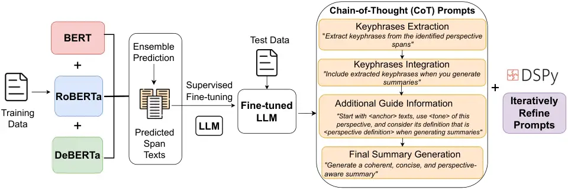

# UMB@PerAnsSumm 2025: Enhancing Perspective-Aware Summarization with Prompt Optimization and Supervised Fine-Tuning

Kristin Qi    Youxiang Zhu    Xiaohui Liang Affiliation: Department of
Computer Science, University of Massachusetts Boston
Affiliation: {yanankristin.qi001, youxiang.zhu001,
xiaohui.liang}@umb.edu

###### Abstract

We present our approach to the PerAnsSumm Shared Task, which involves
perspective span identification and perspective-aware summarization in
community question-answering (CQA) threads. For span identification, we
adopt ensemble learning that integrates three transformer models through
averaging to exploit individual model strengths, achieving an 82.91%
F1-score on test data. For summarization, we design a suite of
Chain-of-Thought (CoT) prompting strategies that incorporate keyphrases
and guide information to structure summary generation into manageable
steps. To further enhance summary quality, we apply prompt optimization
using the DSPy framework and supervised fine-tuning (SFT) on Llama-3 to
adapt the model to domain-specific data. Experimental results on
validation and test sets show that structured prompts with keyphrases
and guidance improve summaries aligned with references, while the
combination of prompt optimization and fine-tuning together yields
significant improvement in both relevance and factuality evaluation
metrics.



Figure 1: Detailed illustration of each component in our proposed
approach for both tasks.

## 1 Introduction

Community question-answering (CQA) platforms have transformed how
medical information is exchanged, allowing users to seek and provide
answers that reflect different perspectives. These responses often
include general medical knowledge, personal experiences, treatment
suggestions, and insights from others with similar health concerns.
However, given the large volume and different viewpoints of responses
presented at different locations in the answers, it is difficult to
extract accurate information efficiently. Perspective-aware
summarization addresses this challenge by organizing responses based on
their perspectives, helping users access relevant information more
effectively Naik et al. (2024a).

Recent developments in large language models (LLMs) have shown strong
performance in summarization tasks. LLM-generated summaries have
demonstrated comparable or superior quality to reference summaries Zhang
et al. (2024); Liu et al. (2023). LLMs trained on medical information
have enhanced their knowledge and reasoning capabilities for tackling
complex problems in the healthcare domain. However, applying LLMs to
perspective-aware summarization for medical CQA presents challenges:
LLMs can struggle with accurately capturing distinct perspectives and
effectively summarizing multiple viewpoints within long medical
contexts. These challenges make it necessary to develop strategies for
structuring summaries with improved accuracy.

In this work, we participate in the PerAnsSumm shared task Agarwal
et al. (2025), which focuses on developing methods for perspective span
identification and perspective-aware summarization Naik et al. (2024a).
Figure 1 presents an overview of our proposed approach. For perspective
span identification, we employ the ensemble learning approach that
integrates three transformer-based models (BERT Devlin et al. (2019),
RoBERTa Liu et al. (2019), and DeBERTa He et al. (2020)) with averaging
to exploit individual model strengths and improve accuracy. For
perspective-aware summarization, we leverage a pretrained LLM (Llama-3)
Dubey et al. (2024) and develop a suite of Chain-of-Thought (CoT)
prompting strategies that incorporate keyphrases and additional guide
information to enhance summary generation. To further improve the model
performance in both relevance and factuality metrics, we apply prompt
optimization using the DSPy framework Khattab et al. (2023) for
automatic prompt refinement. We implement the 0-shot MIPRO optimizer
within DSPy Opsahl-Ong et al. (2024) for iterative prompt refinement.
Additionally, we perform supervised fine-tuning (SFT) on Llama-3
Prottasha et al. (2022) to adapt the model to the domain-specific data
and context-aware requirements.

Our contributions are threefold:

- •
  We integrate multiple transformer models through averaging prediction
  as our ensemble model. It exploits individual model strengths to
  achieve 82.9% F1-score on the test set and 83.9% on the validation set
  for perspective span identification.
- •
  We design a suite of CoT prompting approaches incorporating keyphrases
  and guide information to break down summarization tasks into
  manageable steps. To enhance summary quality, we apply DSPy automatic
  prompt optimization. We also implement SFT to adapt the LLM to the
  domain-specific data.
- •
  We conduct experiments that demonstrate the benefits of combining
  these approaches together. Particularly, the integration of DSPy-based
  prompt optimization with SFT significantly improves performance in
  both relevance and factuality evaluation metrics.

## 2 Related Work

Designing and optimizing prompts have become a crucial technique for
guiding LLMs to generate more accurate and relevant responses for
specific tasks. Recent techniques in prompt optimization have introduced
various automated strategies that are better than manual prompt
engineering. These approaches leverage different techniques, including
gradient-based optimization Pryzant et al. (2023), reinforcement
learning Zhang et al. (2022), and targeted word- or phrase-level edits
Fernando et al. (2023) to automatically search for optimal prompts. The
DSPy framework Opsahl-Ong et al. (2024) represents an development in
this direction, yielding a modular approach that enables automatic
prompt refinement.

DSPy is a programming framework that allows for chaining of LLM calls
through composable modules. This technique facilitates the creation of
dynamic and flexible systems that can automatically optimize both
prompts and weights across multiple components. DSPy enables self-refine
prompts to enhance performance during inference.

The DSPy framework includes several optimizer methods specifically
designed to enhance performance on downstream tasks, such as OPRO and
MIPRO optimizers Opsahl-Ong et al. (2024). The OPRO optimizer leverages
a stochastic mini-batch evaluation function to learn a surrogate model
of the objective and refine instructions over multiple iterations. MIPRO
optimizer employs a meta-optimization procedure to iteratively improve
prompt construction.

Our approach applies the 0-shot MIPRO optimizer within DSPy framework to
iteratively optimize instructions for generating perspective-aware
summaries.

## 3 Dataset and Evaluation Metrics

### 3.1 Shared Task Description

The PerAnsSumm shared task comprises two main components that build upon
each other, each addressing a different aspect of CQA.

Perspective Span Identification: Detecting and labeling text spans in
answers that represent each of the perspectives, including Information,
Cause, Suggestion, Experience, and Question. This task requires
identification of specific perspective types that appear within response
texts.

Perspective-aware Summarization: Generating summaries that preserve and
reflect the identified perspectives and their span texts. This task
creates summaries that are perspective-aware.

### 3.2 Dataset

The task dataset consists of CQA threads from medical forums Naik et al.
(2024b). For each thread, responses contain multiple perspectives and
summaries annotated for medical question-answer pairs. The dataset is
divided into three parts: train, validation, and test. The training and
validation sets are provided for model development, while the test set
remains hidden. The training set contains labeled CQA threads with
annotated perspective spans and reference summaries, while the
validation set provides additional labeled data for hyperparameter
tuning.

The training set contains 2236 samples, and the validation set contains
959 samples. Figure 2 illustrates the distribution of each perspective
type percentage in training and validation sets. Train and validation
sets have a consistent percentage distribution of each perspective.

Figure 2: Percentage distribution of each perspective type in the
training and validation sets. The values displayed on top of each bar
represent the actual counts.

### 3.3 Evaluation Metrics

Perspective-specific metrics include the macro-averaged F1-score to
evaluate classification accuracy. Strict-matching and proportional
matching scores assess the similarity between predicted and reference
spans.

Summarization metrics include two aspects: relevance and factuality.
Relevance evaluation metrics include ROUGE scores (ROUGE-1, ROUGE-2,
ROUGE-L) to measure n-gram overlap, BERTScore to measure semantic
similarity through embeddings, and BLEU and Meteor to evaluate precision
and recall of generated summaries against references. The factuality
evaluation metrics use AlignScore and SummaC. AlignScore checks whether
all information in the summary is in the reference. SummaC measures
factual consistency between the generated and reference summaries.

## 4 Method

This section describes details of our approach to addressing the shared
task: ensemble learning for span identification and prompting strategies
for summarization generation, including CoT, DSPy framework, and SFT.

### 4.1 Span Prediction with Ensemble Learning

We implement an ensemble learning framework that integrates multiple
transformer models. Rather than relying on a single model’s prediction,
ensemble learning combines predictions from multiple models to achieve
better results than any single model that could attain independently.

Our ensemble model implements three pre-trained transformer models, and
we use their base models: BERT¹¹ 1
[https://huggingface.co/bert-base-uncased](https://huggingface.co/bert-base-uncased),
RoBERTa²² 2
[https://huggingface.co/FacebookAI/roberta-base](https://huggingface.co/FacebookAI/roberta-base),
and DeBERTa³³ 3
[https://huggingface.co/microsoft/deberta-base](https://huggingface.co/microsoft/deberta-base).
These models have demonstrated strong performance in various
language-related tasks. During inference, the ensemble model computes
predictions through averaging that accounts for individual model
predictions. Ensemble model is formally defined as:

```math
P_{\text{ensemble}}(y\mid x)=\frac{1}{k}\sum_{i=1}^{k}P_{i}(y\mid x) \tag{1}
```

where $`P_{i}(y\mid x)`$ represents the prediction probability of the
$`i`$-th model, and the final ensemble prediction is obtained by
averaging the predictions of all $`k`$ models.

## 5 CoT for Summarization

We leverage CoT prompting to enhance the reasoning and problem-solving
capabilities of LLMs through breaking down the summarization task into
smaller sequences of manageable steps. This approach guides the model to
maintain high perspective alignment and summarization accuracy.

Our CoT prompting suite incorporates a structured four-step process:

1.  1.  Keyphrase extraction: We first prompt the LLM to identify and
        extract keyphrases from the identified perspective spans. This step
        elicits intermediate reasoning steps in the CoT.
2.  2.  Keyphrase integration: We prompt LLM to incorporate these extracted
        keyphrases when generating summaries. This step ensures that LLM
        preserves key information from the perspective span context.
3.  3.  Guide information integration: Our prompt incorporates a set of
        guide information referred to as the “guide” in our experiments.
        Following the prompt design templates established in PLASMA Naik
        et al. (2024a), our guide consists of three parts:
    - •
      Tone: Perspective-specific tone instructions (e.g., informative
      tone for “Information”, understanding-seeking tone for
      “Question”).
    - •
      Anchor text: Common start phrases found in reference summaries
      (e.g., “For information purposes…” for “Information” and “It is
      inquired…” for “Question”).
    - •
      Perspective definition: Concise descriptions of each perspective’s
      purpose and characteristic features.

    The model is prompted to integrate guide information using the
    format: “Start with \<anchor\> texts. Use the \<tone\> tone of this
    perspective. Consider the following definition when generating the
    summary: \<perspective definition\>.”

4.  4.  Summary generation: Finally, we prompt the LLM to generate a
        coherent, concise, and perspective-aware summary: “Focus on
        \<perspective\>-specific aspects in your summary. Now generate a
        concise and coherent summary.”

The prompt template details are shown in Appendix A. The above
generation process is formalized as:

```math
P_{\text{CoT}}(S\mid x,K,p)=\prod_{t=1}^{T}P(s_{t}\mid x,s_{<t},K,p) \tag{2}
```

where $`x`$ is the input text, $`K`$ represents extracted keyphrases.
$`p`$ is the guide set for each perspective type.
$`S=\{s_{1},s_{2},\ldots,s_{T}\}`$ represents the sequence of reasoning
steps.

### 5.1 Prompt Optimization with DSPy

To further enhance summarization quality, we implement prompt
optimization using the DSPy framework, which enables iterative
refinement of prompts based on the context of each step. In each
iteration, the DSPy compiler automatically generates multiple prompt
variants (3-5) and selects optimal candidates through Bayesian
optimization over the joint metric space. The challenge is defining a
downstream metric that can enhance performance without having access to
module-level labels or gradients.

Our downstream metric aims to balance each of the relevance evaluation
metrics. Specifically, we define a composite metric that assigns equal
weight (0.25) to each of four sub-metrics in the relevance category:
ROUGE-L, BLEU, Meteor, and BERTScore. This process dynamically
synthesizes prompts conditioned on the current step’s context. The
selection of the weights is based on the assumption that each sub-metric
contribution is equal. The optimization objective is written as follows:

```math
\displaystyle\mathcal{L}(T)= \displaystyle 0.25\times\text{ROUGE-L}+0.25\times\text{BLEU} \tag{3}
```

```math
\displaystyle+0.25\times\text{Meteor}+0.25\times\text{BERTScore}
```

The objective function of optimization can be formulated as:

```math
\mathcal{L}(T)=0.25\cdot\sum_{j=1}^{n}\log P(c_{j}\mid x,c_{<j},\mathcal{M}(T)) \tag{4}
```

where $`\mathcal{L}(T)`$ is the optimization objective to be maximized.
$`c_{j}`$ is the generated summaries at step $`j`$, $`\mathcal{M}(T)`$
represents the LLM conditioned on optimized prompt $`T`$, and
$`P(c_{j}\mid x,c_{<j},\mathcal{M}(T))`$ is the probability of
generating the next component $`c_{j}`$ based on prior knowledge.

Optimizer: We select 0-Shot MIPRO, which provides a straightforward
approach for optimizing instructions based on our balanced metric while
remaining cost-effective within our computational budget constraints.

### 5.2 Supervised Fine-Tuning

SFT on LLMs has demonstrated its success in improving performance in
various domains. We implement SFT on the Llama-3-8B-Instruct model⁴⁴ 4
[https://huggingface.co/meta-llama/Meta-Llama-3-8B-Instruct](https://huggingface.co/meta-llama/Meta-Llama-3-8B-Instruct)
(Llama-3) using the Low-Rank Adaption (LoRA) technique Hu et al. (2022).
We fine-tune the model for two epochs on the training set. We report the
results of summarization on both validation and test sets.

Implementation Details: All experiments were conducted on an NVIDIA A100
GPU with 40GB memory. We used a learning rate of $`1e^{-4}`$ with the
AdamW optimizer and a batch size of 32. Token size was set to 256,
temperature was at 0.1, and seed was at 42.

## 6 Results

We conduct all experiments using the Llama-3 model. Table 1 presents the
results for span identification, while Table 2 presents the results for
summarization.

## 7 Performance of Ensemble Models on Span Identification

We evaluate the performance of three individual transformer models
(BERT, RoBERTa, DeBERTa) and their ensemble integration. Ensemble model
exploits the strengths of individual models on different evaluation
metrics. Table 1 presents comparisons on the validation set using three
evaluation metrics: macro F1-score, strict match F1-score, and
proportional match F1-score. The results on the test set are our final
submission.

The ensemble model achieves an F1-score of 82.9% on the test set and
83.9% on the validation set. These results are between the
best-performing (RoBERTa) and worst-performing (BERT) models.
Additionally, we observe that different models outperform in different
aspects of metrics: RoBERTa achieves the highest strict match F1-score,
while DeBERTa performs better in proportional match. These results
indicate how individual models can outperform in an evaluation while
underperforming in others, which supports the ensemble methods that
could combine strengths from multiple models. Our results could be
further improved through advanced ensemble techniques, such as weighted
combination strategies or hierarchical model structures.

| Model               | F1    | Strict Match F1 | Prop. Match F1 |
| ------------------- | ----- | --------------- | -------------- |
| Validation Set      |       |                 |                |
| BERT                | 0.813 | 0.096           | 0.514          |
| RoBERTa             | 0.858 | 0.154           | 0.546          |
| DeBERTa             | 0.845 | 0.110           | 0.559          |
| Ensemble            | 0.839 | 0.120           | 0.540          |
| Test Set Submission |       |                 |                |
| Ensemble            | 0.829 | 0.120           | 0.505          |

Table 1: Comparison of span identification performance on the validation
and test sets. Bold values indicate the best scores, while underscored
values show results from the ensemble model.

|                                                   |       |       |       |       |        |           |            |        |
| ------------------------------------------------- | ----- | ----- | ----- | ----- | ------ | --------- | ---------- | ------ |
| Category                                          | R-1   | R-2   | R-L   | BLEU  | Meteor | BERTScore | AlignScore | SummaC |
| Baseline                                          |       |       |       |       |        |           |            |        |
| Vanilla Prompting                                 | 0.229 | 0.078 | 0.290 | 0.068 | 0.250  | 0.782     | 0.280      | 0.225  |
| Chain-of-Thought (CoT) Prompting (Validation Set) |       |       |       |       |        |           |            |        |
| CoT_keyphrase                                     | 0.310 | 0.110 | 0.315 | 0.074 | 0.268  | 0.797     | 0.300      | 0.238  |
| CoT_guide                                         | 0.318 | 0.108 | 0.328 | 0.081 | 0.290  | 0.805     | 0.315      | 0.247  |
| Prompt Optimization (DSPy)                        |       |       |       |       |        |           |            |        |
| CoT_guide+DSPy                                    | 0.390 | 0.212 | 0.346 | 0.091 | 0.328  | 0.830     | 0.370      | 0.291  |
| Supervised Fine-Tuning (SFT)                      |       |       |       |       |        |           |            |        |
| SFT+CoT_guide+DSPy                                | 0.390 | 0.165 | 0.420 | 0.096 | 0.351  | 0.839     | 0.366      | 0.251  |
| Test Set Submission Results                       |       |       |       |       |        |           |            |        |
| SFT+CoT_guide+DSPy                                | 0.360 | 0.155 | 0.328 | 0.096 | 0.339  | 0.823     | 0.333      | 0.256  |

Table 2: Performance comparison of different strategies for
summarization on the validation and test sets. NOTE: CoT_guide indicates
CoT+keyphrases+guide information.

## 8 Summarization Performance

We experiment with multiple prompting strategies, including vanilla
prompting, CoT, DSPy-based prompt optimization, and SFT. Table 2
presents the comparison across eight evaluation metrics. The test set
performance is our final submission.

Our baseline uses vanilla prompting, where we directly prompt the LLM to
generate concise and coherent summaries. Building on this, CoT approach
with integration of keyphrases and guide information increases ROUGE-1
by +8.1% and BERTScore by +1.5%. These results indicate that structured
reasoning and providing task-relevant external context can better guide
LLM toward generating summaries with improved accuracy.

DSPy Optimization Impact: The application of DSPy optimization to the
CoT+keyphrases+guide (CoT_guide) prompt strategy significantly improves
performance. The DSPy framework iteratively refines prompts, leading to
an additional increase across all relevance metrics (R-1, R-2, R-L,
BLEU, Meteor, BERTScore), with average improvements of +25.6% on
validation set and +9.1% on test set. Factuality metrics also show
substantial improvements, with AlignScore and SummaC increasing by
+17.0% and +4.7%, respectively. These results demonstrate that automated
prompt optimization builds effectively on manual CoT design, and it
scales summary quality through refinement of prompt precision and
contextual awareness.

SFT impacts: Fine-tuning Llama-3 using domain-specific data further
enhances the model’s performance when combined with DSPy optimization.
On the validation set, the SFT+DSPy combination improves performance
over DSPy alone, with ROUGE-L improving by +21.4%, Meteor by +7.0%, and
BLEU by +8.8%. Test set results reveal increases of +3.4% for Meteor and
+5.5% for BLEU. While SFT substantially improves relevance metrics, its
impact on factuality metrics is less effective, suggesting that
fine-tuning primarily enhances the model’s ability to generate content
that aligns with reference summaries rather than improving factuality
scores.

Findings: We observe that combining DSPy optimization with SFT
demonstrates the benefits of integrating both approaches. Fine-tuning
helps the Llama-3 model adapt to domain-specific features in medical
CQAs, while DSPy optimization refines the prompt structure to better
guide the model’s summarization. This combination particularly achieves
a better performance in relevance.

## 9 Limitations

Our approach reveals several limitations. First, we use Llama-3 as our
LLM without benchmarking against API-based models such as GPT-4 or
Claude-3. Compared with other teams’ submissions, it indicates that
Llama-3 underperforms relative to GPT-4 and Claude-3. Second, our
implementation of MIPRO optimizer within the DSPy framework relies on
the balanced metric formulation derived from empirical assumptions. This
equal-weight approach may oversimplify the relationships between
different evaluation metrics and potentially reduce accuracy. The
generalizability of our prompt optimization strategy also remains an
open question. Alternative optimizers, such as MIPRO with bootstrapped
demonstrations or OPRO may yield further improvements. Lastly, our
prompt design is tailored to the medical CQA. The prompt templates do
not account for potential variability within summaries. These suggest
room for future research.

## 10 Conclusions

In this paper, we present our approach to the PerAnsSumm Shared Task.
Our approach adopts ensemble learning with averaging individual model
predictions for span identification, achieving an 82.9% F1-score on test
data. For summary generation, we develop structured Chain-of-Thought
(CoT) prompting with keyphrases and guide information and combine it
with DSPy-based prompt optimization and supervised fine-tuning (SFT) of
the Llama-3 model to improve summary quality.

Our experimental results demonstrate that the integration of keyphrases
and guide information within CoT improves the alignment between
generated summaries and references. Notably, automated prompt
optimization through the DSPy framework substantially improves both
relevance and factuality evaluation metrics, with average improvements
of +25.6% on validation set. This reveals the effectiveness of iterative
prompt refinement. Furthermore, combining DSPy optimization with SFT
further enhances model performance, with particularly improvements in
relevance metrics (ROUGE-L: +21.4%, Meteor: +7.0%, BLEU: +8.8%). Future
work will compare our approach with other LLMs such as GPT-4 to identify
factors that impact summarization quality. Moreover, we will explore
designs for metric-based optimization strategies to improve alignments
with references.

## References

- Agarwal et al. (2025) Siddhant Agarwal, Md Shad Akhtar, and Shweta
  Yadav. 2025. Overview of the peranssumm 2025 shared task on
  perspective-aware healthcare answer summarization. In _Proceedings of
  the Second Workshop on Patient-Oriented Language Processing
  (CL4Health) @ NAACL 2025_, Albuquerque, USA. Association for
  Computational Linguistics.
- Devlin et al. (2019) Jacob Devlin, Ming-Wei Chang, Kenton Lee, and
  Kristina Toutanova. 2019. Bert: Pre-training of deep bidirectional
  transformers for language understanding. In _Proceedings of the 2019
  conference of the North American chapter of the association for
  computational linguistics: human language technologies, volume 1 (long
  and short papers)_, pages 4171–4186.
- Dubey et al. (2024) Abhimanyu Dubey, Abhinav Jauhri, Abhinav Pandey,
  Abhishek Kadian, Ahmad Al-Dahle, Aiesha Letman, Akhil Mathur, Alan
  Schelten, Amy Yang, Angela Fan, et al. 2024. The llama 3 herd of
  models. _arXiv preprint arXiv:2407.21783_.
- Fernando et al. (2023) Chrisantha Fernando, Dylan Banarse, Henryk
  Michalewski, Simon Osindero, and Tim Rocktäschel. 2023. Promptbreeder:
  Self-referential self-improvement via prompt evolution. _arXiv
  preprint arXiv:2309.16797_.
- He et al. (2020) Pengcheng He, Xiaodong Liu, Jianfeng Gao, and Weizhu
  Chen. 2020. Deberta: Decoding-enhanced bert with disentangled
  attention. _arXiv preprint arXiv:2006.03654_.
- Hu et al. (2022) Edward J Hu, Yelong Shen, Phillip Wallis, Zeyuan
  Allen-Zhu, Yuanzhi Li, Shean Wang, Lu Wang, Weizhu Chen, et al. 2022.
  Lora: Low-rank adaptation of large language models. _ICLR_, 1(2):3.
- Khattab et al. (2023) Omar Khattab, Arnav Singhvi, Paridhi Maheshwari,
  Zhiyuan Zhang, Keshav Santhanam, Sri Vardhamanan, Saiful Haq, Ashutosh
  Sharma, Thomas T Joshi, Hanna Moazam, et al. 2023. Dspy: Compiling
  declarative language model calls into self-improving pipelines. _arXiv
  preprint arXiv:2310.03714_.
- Liu et al. (2019) Yinhan Liu, Myle Ott, Naman Goyal, Jingfei Du,
  Mandar Joshi, Danqi Chen, Omer Levy, Mike Lewis, Luke Zettlemoyer, and
  Veselin Stoyanov. 2019. Roberta: A robustly optimized bert pretraining
  approach. _arXiv preprint arXiv:1907.11692_.
- Liu et al. (2023) Yixin Liu, Kejian Shi, Katherine S He, Longtian Ye,
  Alexander R Fabbri, Pengfei Liu, Dragomir Radev, and Arman
  Cohan. 2023. On learning to summarize with large language models as
  references. _arXiv preprint arXiv:2305.14239_.
- Naik et al. (2024a) Gauri Naik, Sharad Chandakacherla, Shweta Yadav,
  and Md Shad Akhtar. 2024a. No perspective, no perception!!
  perspective-aware healthcare answer summarization. _arXiv preprint
  arXiv:2406.08881_.
- Naik et al. (2024b) Gauri Naik, Sharad Chandakacherla, Shweta Yadav,
  and Md Shad Akhtar. 2024b. [No perspective, no perception!!
  perspective-aware healthcare answer
  summarization](https://doi.org/10.18653/v1/2024.findings-acl.942). In
  _Findings of the Association for Computational Linguistics: ACL 2024_,
  pages 15919–15932, Bangkok, Thailand. Association for Computational
  Linguistics.
- Opsahl-Ong et al. (2024) Krista Opsahl-Ong, Michael J Ryan, Josh
  Purtell, David Broman, Christopher Potts, Matei Zaharia, and Omar
  Khattab. 2024. Optimizing instructions and demonstrations for
  multi-stage language model programs. _arXiv preprint
  arXiv:2406.11695_.
- Prottasha et al. (2022) Nusrat Jahan Prottasha, Abdullah As Sami,
  Md Kowsher, Saydul Akbar Murad, Anupam Kumar Bairagi, Mehedi Masud,
  and Mohammed Baz. 2022. Transfer learning for sentiment analysis using
  bert based supervised fine-tuning. _Sensors_, 22(11):4157.
- Pryzant et al. (2023) Reid Pryzant, Dan Iter, Jerry Li, Yin Tat Lee,
  Chenguang Zhu, and Michael Zeng. 2023. Automatic prompt optimization
  with" gradient descent" and beam search. _arXiv preprint
  arXiv:2305.03495_.
- Zhang et al. (2022) Tianjun Zhang, Xuezhi Wang, Denny Zhou, Dale
  Schuurmans, and Joseph E Gonzalez. 2022. Tempera: Test-time prompting
  via reinforcement learning. _arXiv preprint arXiv:2211.11890_.
- Zhang et al. (2024) Tianyi Zhang, Faisal Ladhak, Esin Durmus, Percy
  Liang, Kathleen McKeown, and Tatsunori B Hashimoto. 2024. Benchmarking
  large language models for news summarization. _Transactions of the
  Association for Computational Linguistics_, 12:39–57.

## Appendix A Prompt Template

Figure 3: Prompt template used in our approach.
