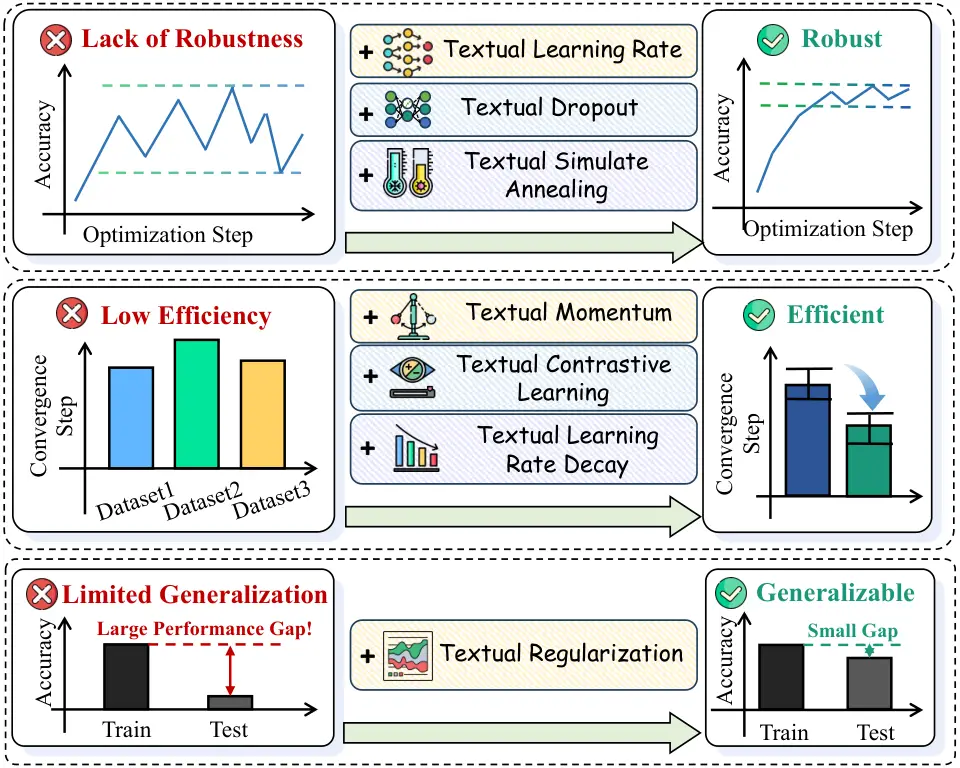
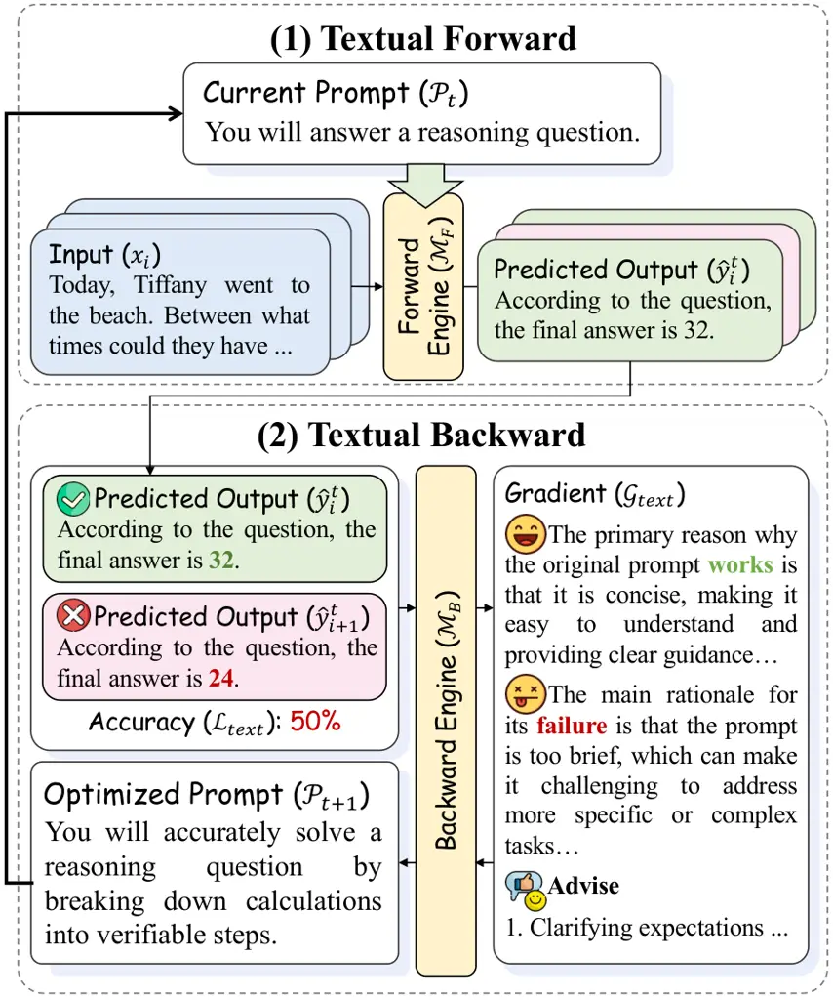
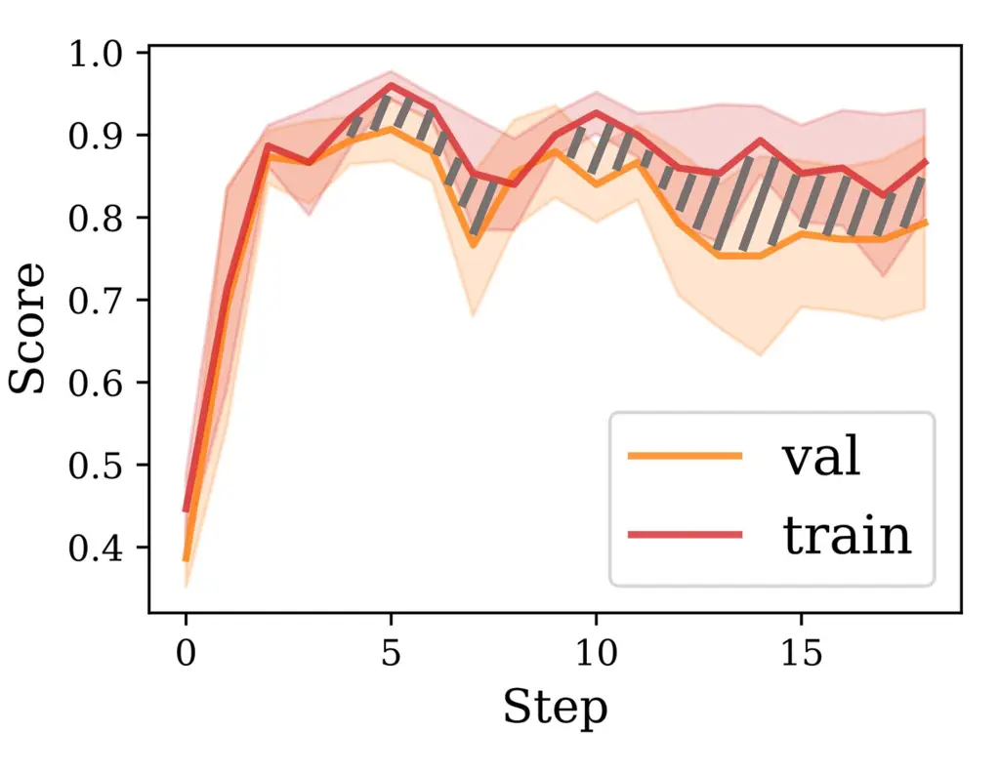

# DLPO : Towards a Robust, Efficient, and Generalizable Prompt Optimization Framework from a Deep-Learning Perspective

Dengyun Peng ^(†)^(†)thanks: Equal Contribution Affiliation:  Research
Center for Social Computing and Interactive Robotics Affiliation: 
Harbin Institute of Technology, China Email: [lbqin@csu.edu.cn](mailto:)
   Yuhang Zhou¹¹footnotemark: 1    Qiguang Chen¹¹footnotemark: 1
Affiliation:  Research Center for Social Computing and Interactive
Robotics Affiliation:  Harbin Institute of Technology, China    Jinhao
Liu Affiliation:  Research Center for Social Computing and Interactive
Robotics Affiliation:  Harbin Institute of Technology, China    Jingjing
Chen Affiliation:  Fudan University, China{dypeng,qgchen}@ir.hit.edu.cn,
ralph.yh.zhou@gmail.com    Libo Qin ^(†)^(†)thanks: Corresponding Author
Affiliation:  School of Computer Science and Engineering, Central South
University, China

###### Abstract

Large Language Models (LLMs) have achieved remarkable success across
diverse tasks, largely driven by well-designed prompts. However,
crafting and selecting such prompts often requires considerable human
effort, significantly limiting its scalability. To mitigate this, recent
studies have explored automated prompt optimization as a promising
solution. Despite these efforts, existing methods still face critical
challenges in robustness, efficiency, and generalization. To
systematically address these challenges, we first conduct an empirical
analysis to identify the limitations of current reflection-based prompt
optimization paradigm. Building on these insights, we propose 7
innovative approaches inspired by traditional deep learning paradigms
for prompt optimization (DLPO), seamlessly integrating these concepts
into text-based gradient optimization. Through these advancements, we
progressively tackle the aforementioned challenges and validate our
methods through extensive experimentation. We hope our study not only
provides valuable guidance for future research but also offers a
comprehensive understanding of the challenges and potential solutions in
prompt optimization. Our code is available at
[https://github.com/sfasfaffa/DLPO](https://github.com/sfasfaffa/DLPO).

## 1 Introduction



(a)

Figure 1: Comparison between traditional reflection-based prompt
optimization methods and DLPO, which incorporates 7 innovative
approaches to progressively enhance the robustness, efficiency, and
generalizability of prompt optimization.

Large Language Models (LLMs) have demonstrated remarkable achievements
across diverse applications (Brown et al., 2020; Ouyang et al., 2022;
Zhao et al., 2023; Qin et al., 2024). Notably, the performance of LLMs
highly relies on well-crafted prompts (Zhu et al., 2023; Li et al.,
2024). Given their sensitivity to prompts, selecting optimal prompts is
crucial for maximizing their performance in downstream tasks, a process
known as Prompt Engineering (Reynolds and McDonell, 2021; Sahoo et al.,
2024), which requires substantial human effort (Zamfirescu-Pereira
et al., 2023). To address this, researchers have developed automated
prompt optimization (PO) techniques, such as reinforcement
learning-based methods (Deng et al., 2022; Zhang et al., 2022; Diao
et al., 2022), search-based methods (Prasad et al., 2022; Pryzant
et al., 2023; Zhou et al., 2022), all aiming to improve efficiency and
stability. Among these methods, a dominant paradigm leverages LLMs’
reflection capabilities, optimizing prompts based on feedback from
external environments (Wang et al., 2023; Tang et al., 2024). Following
Pryzant et al. (2023); Yuksekgonul et al. (2024), this paradigm draws
inspiration from neural network training, reinterpreting key concepts:
treating prompts as model parameters, output metrics as loss, and LLM
reflection as gradients within textual expression. This framework has
proven to be a powerful and widely adopted tool for various downstream
tasks (Zhou et al., 2024; Mañas et al., 2024; Du et al., 2024).

Despite significant advancements in automated PO, our preliminary
exploration reveals that existing methods encounter practical
limitations that hinder their widespread adoption. These challenges can
be categorized into three key issues, as illustrated in Fig.1: (1) Lack
of Robustness. Current update methods often exhibit substantial
oscillations and instability during the update process. (2) Low
Efficiency. Existing PO strategies require massive iterations to achieve
ideal prompts. (3) Limited Generalizability. While existing methods
perform well on in-domain tasks present in training data, they struggle
with distributionally out-of-domain tasks, restricting their
applicability in real-world scenarios.

To address this, we first perform a systematic review of the prevailing
reflection-based PO paradigm to identify its limitations. Inspired by
traditional deep learning approaches, we propose novel techniques for
DLPO to enhance its PO capabilities. Traditional machine learning (ML)
paradigm considers prompts as a single module, and relies on monotonic
and uncontrollable gradient optimization process. In contrast, we view
the semantic dependencies within complex prompts as a neural network,
enabling the application of advanced deep learning methods. (1) Unlike
traditional ML approaches, our method employs Textual Dropout, which
randomly discards certain prompt sentences to improve robustness.
Additionally, we use Textual Learning Rate and Textual Simulated
Annealing to better control the optimization direction, enhancing
robustness over monotonic gradient optimization. (2) In deep learning,
optimization speed often depends on the gradient optimization
difficulty. To accelerate convergence, we apply Textual Learning Rate
Decay, Textual Momentum, and Textual Contrastive Learning for more
efficient gradient optimization. (3) Unlike the single prompt
modularization in the ML paradigm, our method integrates Textual
Regularization to prevent overcomplication of prompt sentences, ensuring
that the model remains concise. The correspondence between all seven
methods we propose and classical deep learning methods is shown in Table

1.

To evaluate the effectiveness of our proposed approach, we conduct
extensive experiments on five datasets covering multiple tasks. The
results indicate that our method significantly enhances the stability,
efficiency, and generalizability of prompt optimization. Notably, it
outperforms the previous state-of-the-art method by 8.1% and even
surpasses manually designed prompts, demonstrating its superiority in
automated prompt optimization.

The contributions of this work are summarized as follows:

- •
  We first identify key challenges in robustness, efficiency, and
  generalization in LLM-based prompt optimization, revealing the
  limitations of existing methods through both theoretical and empirical
  analysis.
- •
  Drawing inspiration from traditional deep learning techniques, we
  propose DLPO to enhance robustness, efficiency, and generalization by
  incorporating 7 novel text-based gradient optimization strategies.
- •
  We conduct extensive experiments across diverse datasets to validate
  our approach, providing a comprehensive understanding of prompt
  optimization challenges and best practices.



Figure 2: Current reflection-based paradigm for prompt optimization.

Traditional Methods DLPO Methods Description Learning Rate Textual
Learning Rate (Tlr) Tlr controls the number of sentence modifications
per step to stabilize updates. Dropout Textual Dropout (Tdo) Tdo
randomly skips sentence updates to reduce overfitting and preserve
beneficial modifications. Simulated Annealing Textual Simulated
Annealing (Tsa) Tsa uses training accuracy as energy, accepting
suboptimal solutions probabilistically. Learning Rate Decay Textual
Learning Rate Decay (Tlrd) Tlrd enables early-stage exploration followed
by gradual refinement of prompts. Momentum Textual Momentum (Tmnt) Tmnt
utilizes past gradients to smooth updates and enhance efficiency.
Contrastive Learning Textual Contrastive Learning (Tcl) Tcl
differentiates high- and low-quality prompts to encourage effective
patterns. L1/L2 Regularization Textual Regularization (Tregu) Tregu
removes redundant phrases and simplifies sentence structures for better
generalization.

Table 1: A brief comparison of traditional deep learning methods and
their textual counterparts in DLPO. Some methods adapt numerical
optimization concepts to the text space through sentence-level
operationalization.

## 2 Problem Formalization

### 2.1 Prompt Optimization

As shown in Figure 2, the paradigm of prompt optimization leverages LLMs
as optimizers by refining and enhancing prompts based on feedback from
external environments. Formally, we consider a training dataset
$`\mathcal{D}={(x_{i},y_{i})}_{i=1}^{n}`$ drawn from a joint
distribution $`\mathbb{D}(X,Y)`$.

##### Textual Forward

Given an input-output pair $`(x_{i},y_{i})`$ and current prompt
$`\mathcal{P}_{t}`$, the LLM $`\mathcal{M}_{F}`$, acts as forward
engine, generating a predicted output:

```math
\hat{y}^{t}_{i}=\mathcal{M}_{F}(y_{i}|x_{i},\mathcal{P}_{t}). \tag{1}
```

##### Textual Backward

To quantify the discrepancy between the predicted output
$`\hat{y}^{t}_{i}`$ and the ground truth $`y_{i}`$, we define the
textual loss function as:

```math
\mathcal{L}_{text}=\mathcal{F}_{loss}(\{\hat{y}^{t}_{1},y_{1}\},\dots,\{\hat{y}^{t}_{i},y_{i}\},\dots), \tag{2}
```

where $`\mathcal{F}_{loss}(\cdot)`$ denotes the human-defined loss
function, such as accuracy or model-generated score.

To guide the improvement of the prompt $`\mathcal{P}_{t}`$, textual
gradient is defined to determine the direction of optimization. Here,
the LLM acts as an implicit gradient estimator, computing the gradient
through reflection:

```math
\mathcal{G}_{text}=\frac{\partial\mathcal{L}_{text}}{\partial\mathcal{P}_{t}}=\mathcal{M}_{B}(\mathcal{G}|x_{i},y_{i},\mathcal{P}_{t},\mathcal{L}_{text}), \tag{3}
```

where $`\mathcal{M}_{B}`$ denotes the LLM that functions as a backward
engine. It is always considered more powerful compared to the forward
engine.

After textual gradient computation, the prompt $`\mathcal{P}_{t}`$ is
iteratively updated using the textual gradient to minimize the loss. At
this stage, the LLM functions as the optimizer, generating an improved
prompt $`\hat{\mathcal{P}}_{t+1}`$ as:

```math
\hat{\mathcal{P}}_{t+1}=\mathcal{M}_{B}(\mathcal{P}_{t+1}|x_{i},y_{i},\mathcal{P}_{t},\mathcal{G}_{text}). \tag{4}
```

### 2.2 Prompt Application

Once optimized, the prompt is applied to previously unseen test data
$`x^{\prime}`$ to generate the predicted output:

```math
\hat{y}^{\prime}=\mathcal{M}(y^{\prime}|x^{\prime},\mathcal{P}^{*}). \tag{5}
```

where $`\mathcal{P}^{*}`$ refers to the optimized prompt. Our primary
framework for implementing prompt optimization is TextGrad (Yuksekgonul
et al., 2024), a widely recognized prompt optimization framework. It
modularly implements the entire pipeline outlined in this section,
making it particularly well-suited for our analysis.

## 3 Experiment Setups

We utilize several benchmarks to evaluate the effectiveness of our
proposed methods, including GSM8K (Cobbe et al., 2021), MATH (Hendrycks
et al., 2021), BigGSM (BGSM) (Chen et al., 2024), BigBenchHard Object
Counting (BBH) (Suzgun et al., 2022), and MGSM (Shi et al., 2022). The
detailed descriptions can be found in Appendix C.1.

(a) BBH

(b) GSM8k

(c) BigGSM



(d) GSM8k-Val-Train

Figure 3: a, b, c respectively show the validation-set accuracy of 3
different seeds and their mean values and standard deviations on BBH,
GSM8K, and BigGSM environments. The mean values are represented by black
solid lines, and the standard deviations are indicated by red shaded
areas. d shows the Training-set and Validation-set mean accuracy results
of 3 different seeds on GSM8K, along with their standard deviations. To
make the image clearer, we use $`\frac{1}{2}`$ standard deviation as the
shaded area.

## 4 Preliminary Analysis

In this section, we explore the following three key drawbacks for
current reflection based prompt optimization paradigm.

### 4.1 Lack of Robustness

The robustness of an optimization process is a critical prerequisite for
both convergence and generalization. In this context, we define
robustness as the stability of the optimization process. As illustrated
in Fig. 3 (a,b), the results reveal significant instability.
Specifically, variations in random seeds lead to substantial
discrepancies in convergence, with the variance at the final step
reaching 20.8% for the GSM8K environment. Moreover, in the BBH, the
current paradigm fails to achieve convergence even by the end of the
training process.

### 4.2 Low Efficiency

Efficiency is defined here as the convergence speed during prompt
optimization. As illustrated in Fig. 3 (c), we aim for the prompt
optimizer to achieve rapid convergence to a stable value. In contrast,
the current approach necessitates over 20 iterations to attain its peak
performance and reach stabilization. This stark difference underscores
the significant inefficiency of the existing method in comparison.

### 4.3 Limited Generalizability

We define generalizability as the degree to which LLMs can generalize to
test sets or diverse data distributions within the same task domain. As
shown in Fig. 3 (d), the grey shadow reveals a large discrepancy between
the validation and training set scores (approximately 10% accuracy at
the optimal point), suggesting that the current update method lacks
sufficient generalization capability.

## 5 Exploration

In this section, we solve the above three problems using methods
inspired by traditional Deep Learning step by step. The detailed
implementation of our methods can be found in appendix B.

### 5.1 Exploration for Robustness

The robustness of optimization is one of the most critical issues in
subsequent work. Only by ensuring the robustness of optimization can
other problems and methods be deemed worthy of consideration and
meaningful.

We meticulously analyze the optimized sequence of prompts and observe
that the variations between updates are highly significant. After just a
single update, the prompts appear entirely different compared to their
previous state. To address this issue, we propose three effective
methods: Textual Learning Rate (Tlr) , Textual Dropout (Tdo) and Textual
Simulated Annealing (Tsa).

(a) GSM8K-Tlr

(b) BBH-Tsa-Tlr

Figure 4: a, mean results of 3 different seeds for Tlr+Tdo and Naive on
GSM8K. We use $`\frac{1}{2}`$ of the standard deviation as the shaded
area. b, mean results of 3 different seeds for Tsa+Tlr+Tdo, Tlr+Tdo and
Naive on BBH. To make the image clearer, we use $`\frac{1}{4}`$ of the
standard deviation as the shaded area.

#### 5.1.1 Textual Learning Rate & Dropout

##### Textual Learning Rate (Tlr)

Traditional ML-based PO often disregards the gradient’s magnitude,
impeding convergence to the optimal solution. To address this, drawing
inspiration from DL, we propose a Textual Learning Rate to regulate the
extent of gradient updates. Specifically, each modification, deletion,
or addition of a sentence in a prompt constitutes an update unit. The
Tlr value, denoted as $`\mathcal{R}`$, sets an upper limit on the number
of update units per step. If an LLM attempts to exceed $`\mathcal{R}`$,
we prompt LLMs to prioritize impactful changes while discarding
non-essential ones.

##### Textual Dropout (Tdo)

Traditional ML-based PO treats the prompt as an indivisible whole,
making local optimization challenging and leading to large updates that
compromise robustness. To address this, we adopt a DL perspective,
viewing the prompt as a structured semantic network. Specifically, we
introduce Textual Dropout (Tdo), which selectively drops or skips
sentence updates to prevent full parameter optimization.

Formally, given a prompt $`\mathcal{P}_{t}`$ with $`\mathcal{S}`$
sentences and a dropout rate $`p`$ , the number of preserved sentences
$`\mathcal{K}`$ is:

```math
\mathcal{K}=\lceil p\cdot\mathcal{S}\rceil. \tag{6}
```

The updated prompt $`\hat{\mathcal{P}}_{t+1}`$ is:

```math
\hat{\mathcal{P}}_{t+1}=\mathcal{P}_{\text{preserved}}\oplus\mathcal{P}_{\text{updated}},
```

where $`\oplus`$ denotes merge operation. Here,
$`\mathcal{P}_{\text{preserved}}`$ consists of the $`\mathcal{K}`$
preserved sentences, while $`\mathcal{P}_{\text{updated}}`$ includes the
modified sentences based on the textual gradient
$`\mathcal{G}_{\text{text}}`$.

Since both Tlr and Tdo regulate gradient updates at the sentence level
and encourage a certain degree of restriction on the magnitude of
single-step updates, we apply them jointly to evaluate their
effectiveness. As shown in Fig. 4 (a,b), experiments on GSM8K and BBH
demonstrate that Tlr+Tdo outperforms the naive approach and
significantly enhances optimization robustness.

#### 5.1.2 Textual Simulated Annealing Tsa

To further enhance the gradient optimization in DL views, we propose
Textual Simulated Annealing scheme to guarantee stable update during
training by dynamically adjusting prompts based on their accuracy to
effectively control the optimization direction. Simultaneously, to
prevent the model from getting stuck in local optima, Tsa encourages the
model to accept suboptimal solutions with a certain probability.
Specifically, we define training set accuracy as the “Energy” function
($`\mathcal{E}(\cdot)`$), and compare the accuracy before and after each
update. If accuracy decreases, the suboptimal solution is accepted with
a probability determined by:

```math
P(\Delta\mathcal{E},\mathcal{T})=\exp\left(\frac{\Delta\mathcal{E}}{\mathcal{T}}\right) \tag{7}
```

where$`\Delta\mathcal{E}=\mathcal{E}(x^{\prime})-\mathcal{E}(x)`$ is the
accuracy change between the new solution $`x^{\prime}`$, derived from
optimized prompt $`\hat{\mathcal{P}}_{t+1}`$, and the current solution
$`x`$, generated with original prompt $`\mathcal{P}_{t}`$. Here, the
temperature $`\mathcal{T}`$ will gradually decrease with each update. As
$`\mathcal{T}`$ reduces, the probability of accepting suboptimal
solutions decreases, enabling the model to escape local optima in the
early stages and converge to better solutions later. Building on this,
Tsa ensures stable and robust accuracy convergence.

In Fig. 4 (b), it is shown that while Tlr methods outperform the Naive
approach in BBH, they still exhibit substantial variability. To address
this issue, we integrate Tsa into the Tlr approach. The results indicate
that the incorporation of Tsa into Tlr significantly improves both
performances and robustness, surpassing the two original baselines.


### 5.2 Exploration for Efficiency

Through our definitions of Tlr, Tdo, and Tsa, we have largely mitigated
the issue of update stability. Next, we shift our focus to convergence
speed. To enhance convergence efficiency, we propose three methods:
Textual Learning Rate Decay (Tlrd), Textual Momentum (Tmnt) and Textual
Contrastive Learning (Tcl)

(a) BigGSM-Tlrd

(b) MGSM-Tlrd

Figure 5: a, b, mean results of 3 different seeds for Tsa+Tlrd and
Tsa+Tlr on validation set of BigGSM and MGSM environment. We use
$`\frac{1}{2}`$ of the standard deviation as the shaded area.

#### 5.2.1 Textual Learning Rate Decay (Tlrd)

Inspired by the role of learning rate decay in deep learning, where
larger updates facilitate exploration in early stages and smaller
updates ensure fine-tuning later, we define Tlrd to enhance convergence
speed and stability in prompt optimization. At the beginning of the
update process, a higher learning rate encourages substantial
modifications to the initial prompt, enabling diverse exploration of
potential solutions. As the optimization progresses and the prompt
approaches a satisfactory level, the learning rate decreases dynamically
to focus on fine-grained refinements.

As shown in Fig. 5 (a,b), we compare the fixed Tlr ($`\mathcal{R}=1`$)
with the learning rate decay strategy in the BigGSM and MGSM. The
results demonstrate that the learning rate decay method achieves faster
convergence compared to the fixed learning rate approach.

#### 5.2.2 Textual Momentum (Tmnt)

During each update, the model samples batches independently, without
incorporating information from previous ones. This can cause notable
bias in gradient optimization, particularly when the batch size is
small, as batch-to-batch variations can significantly impact the
convergence trajectory.

To mitigate this issue, we draw inspiration from classical machine
learning techniques and introduce Textual Momentum (Tmnt). By
incorporating feedback from past updates, our approach allows the
optimizer to recognize previous gradient directions and integrate them
into the current update, ultimately refining the final gradient
direction for more stable optimization. The final ideal gradient
direction $`\mathcal{G}_{\text{final}}`$ is computed as:

```math
\mathcal{G}_{\text{final}}=\mathcal{G}_{\text{current}}+\sum_{i=1}^{3}\gamma^{i}\cdot\mathcal{G}_{\text{past}_{i}} \tag{8}
```

where $`\mathcal{G}_{\text{current}}`$ is the current batch gradient,
$`\mathcal{G}_{\text{past}_{i}}`$ represents the $`i`$-th previous
gradient, and $`\gamma`$ is a decay factor (e.g., $`\gamma=0.9`$)
reducing older gradients’ influence. In practice, we do not explicitly
define certain details, such as the decay coefficient $`\gamma`$.
Instead, we only present the last three feedbacks and encourage the
optimizer to focus more on updates closer to the current step to balance
recent trends without over-relying on outdated information.

As shown in Fig. 6 (a,b), based on our previously proposed Tlr method,
we compare the pure Tlr with Tlr+Tmnt on the validation sets of BigGSM
and MGSM. It is evident that after adding the Tmnt method, the
convergence speed has improved.

(a) BigGSM

(b) MGSM

Figure 6: We tested the Tmnt and Tcl methods on the validation set of
BigGSM and MGSM environment. The convergence steps and their standard
deviations are displayed in the bar chart.

#### 5.2.3 Textual Contrastive Learning (Tcl)

Building on the success of contrastive learning in improving model
efficiency in DL view (Radford et al., 2021; Qin et al., 2022), we
propose Textual Contrastive Learning (Tcl), which encourages the model
to differentiate high-quality (positive) prompts from suboptimal
(negative) ones, thus enhancing the optimization process.

Specifically, we first evaluate each updated prompt on the training set
to obtain its accuracy as a performance metric. Let $`\mathcal{A}(x)`$
denote the accuracy of prompt $`x`$ on the training set. Next, we
categorize historical prompts into positive (higher accuracy) and
negative (lower accuracy) groups. We then sample one prompt from each
group based on an accuracy-weighted probability distribution. If the
accuracy difference between the positive and negative prompts falls
below a predefined margin, we only encourage the LLM to learn from the
positive prompt. Otherwise, we guide the optimizer to: (1) Imitate
distinguishing features of positive prompts, represented by the set
$`\mathcal{F}_{+}`$. (2) Retain shared features between positive and
negative prompts, represented by $`\mathcal{F}_{\cap}`$. (3) Eliminate
undesirable features unique to negative prompts, represented by
$`\mathcal{F}_{-}`$.

The final gradient update $`\mathcal{G}_{\text{final}}`$ is computed as:

```math
\mathcal{G}_{\text{final}}=\mathcal{G}_{\text{current}}+\mathcal{F}_{+}-\mathcal{F}_{-} \tag{9}
```

By refining the gradient in this manner, the optimizer learns to
reinforce beneficial prompt features while suppressing undesirable ones,
ultimately improving the quality of future updates.

To test the effectiveness of Tcl, we compare the convergence step of
Naive and Tcl methods on the validation sets of BigGSM and MGSM. As
shown in Figure 6 (a,b), it is evident that after adding the Tcl method
to naive, the convergence speed have consistently improved.
Unfortunately, we also observe that although Tmnt appears to outperform
the Tcl method in the figure, with a faster convergence speed, its final
convergence effect is inferior to that of the Tcl method and exhibits
higher instability.


### 5.3 Exploration for Generalizablity

Before addressing generalizability, we first propose several methods to
enhance model update stability and accelerate convergence. However, our
ultimate goal is to improve the model’s overall performance,
particularly its ability to generalize beyond the training set.
Specifically, we aim to extend the learned results to: (1) The
validation and test sets of the same dataset. (2) Datasets with similar
content but varying levels of difficulty. (3) Datasets involving similar
tasks.

Therefore, we train on a subset of the GSM8K training set to derive the
final prompt and evaluate its performance on the test sets of GSM8K,
BigGSM, BBH, and MATH. Building on the previously proposed effective
methods, we adjust the training set size and batch size to examine their
impact on the generalizability of our approach. Additionally, we
integrate prior techniques and introduce Textual regularization to
further explore its role in enhancing generalizability. More experiments
on generalization to different LLM models (Gemini (Team et al., 2023),
DeepSeek-R1 (Guo et al., 2025)) are presented in the appendix A.2.2.

|              |          |       |      |      |      |
| ------------ | -------- | ----- | ---- | ---- | ---- |
| expname      | hyper    | GSM8K | BGSM | BBH  | MATH |
| batch size   | bs = 3   | 93.3  | 57.3 | 79.7 | 73.9 |
|              | bs = 6   | 93.2  | 52.7 | 85.0 | 65.6 |
|              | bs = 9   | 93.3  | 57.2 | 77.0 | 70.2 |
|              | bs = 12  | 93.7  | 54.8 | 79.7 | 69.6 |
|              | bs = 15  | 89.7  | 48.4 | 80.0 | 70.8 |
| training set | ts = 50  | 93.2  | 52.7 | 85.0 | 65.6 |
| size         | ts = 100 | 94.3  | 57.0 | 90.3 | 69.7 |

Table 2: Accuracy comparison across different batch sizes and training
set sizes. All results are the average of three different seeds. The
bold is the best while the red is the worst. More details are shown in
the Table 6.

#### 5.3.1 Exploration for Training Set Size

Inspired by the training scaling experience in DL Kaplan et al. (2020),
we manage to scale up the training set size to improve the
generalization. As shown in Table 2, we create two training subsets by
sampling 50 and 100 instances from GSM8K. The model trained on 100
instances consistently outperforms the one trained on 50 across all test
sets. This aligns with intuition, as a larger training set offers
broader sample coverage, reducing distribution shift and improving
generalizability.

#### 5.3.2 Exploration for Batch Size

To explore the impact of different batch sizes on generalizability, we
evaluate five batch sizes in terms of final test accuracy, as shown in
Table 2. The results indicate that: (1) Within a certain range, a
smaller batch size can achieve better performance, but increasing the
batch size has a negligible effect on performance. (2) However, if the
batch size is excessively large, resulting in too few update steps, the
optimization process may fail to converge to the optimal solution.

It is worth noting that the total number of loss calculations remains
constant across different batch sizes, while the number of backward
passes and updates varies. Therefore, when the requirements for final
performance are not overly stringent, it is advisable to appropriately
increase the batch size. This reduces the frequency of backward passes
and updates, thereby saving computational resources, such as token
usage, without significantly compromising model performance.

#### 5.3.3 Textual Regularization (Tregu)

| expname   | GSM8K | BGSM | BBH  | MATH |
| --------- | ----- | ---- | ---- | ---- |
| w/o Tregu | 93.3  | 55.0 | 81.0 | 67.9 |
| w/ Tregu  | 94.0  | 55.9 | 87.2 | 70.5 |

Table 3: We compare the performance with and without the addition of
Tregu on the baseline methods of Tsa, Tlrd, and Tcl. The final results
are obtained by averaging the outcomes across the six seeds. The Bold
data indicates the highest value in each column.

Ockham’s razor in DL suggests that simpler models with fewer parameters
often generalize better. Building on this principle, we investigate
Textual Regularization (Tregu) techniques to reduce prompt complexity
and enhance generalization. Specifically, textual L2 regularization is
applied to reduce prompt complexity, while L1 regularization is used to
promote sparsity by eliminating irrelevant features. Practically,
textual L2 regularization encourages simplifying individual sentences,
whereas L1 regularization helps remove irrelevant ones. As shown in
Table 3, Tregu methods demonstrate significant improvements in
generalization on various tasks.


## 6 Best Practices

By systematically integrating various optimization methods, we
progressively improve update robustness, generalization, and efficiency.
However, identifying the optimal combination of these techniques remains
an open challenge. To address this, we conduct extensive experiments on
BigGSM, MGSM, and BBH, evaluating different method combinations to
determine the most effective approach. Our findings indicate that the
optimal configuration includes Tlrd, Tsa, Tcl, and Tregu, collectively
referred to as DLPO. To assess its effectiveness, we compared our
approach against several baselines: (1) TextGrad (TG) (Yuksekgonul
et al., 2024), a gradient-based prompt optimization method. (2)
APO (Pryzant et al., 2023), a widely recognized automatic prompt
optimization technique. (3) HUMAN, a human-optimized prompt method
derived from the BigGSM dataset.

As shown in Table 4, our method demonstrates state-of-the-art
performance on the test sets of both the training datasets and external
datasets. It consistently outperforms other methods, including TG and
APO, which exhibit lower accuracy across most datasets. This indicates
that our method introduces more effective optimization strategies for
enhancing prompt quality. Even when compared to human-optimized prompts,
our approach still achieves superior results.

| Trainset : BigGSM              |      |       |      |       |
| ------------------------------ | ---- | ----- | ---- | ----- |
| Method                         | BGSM | BBH   | MATH | GSM8K |
| TG                             | 55.7 | 87.3  | 69.7 | 92.7  |
| APO                            | 58.4 | 89.0  | 59.7 | 93.4  |
| DLPO                           | 60.2 | 89.7  | 71.3 | 93.3  |
| HUMAN                          | 54.4 | 89.0  | 72.0 | 90.3  |
| Trainset : MGSM                |      |       |      |       |
| Method                         | MGSM | BBH   | MATH | BGSM  |
| TG                             | 61.8 | 77.7  | 68.8 | 32.5  |
| APO                            | 82.7 | 86.0  | 51.0 | 47.9  |
| DLPO                           | 86.7 | 89.3  | 70.8 | 55.6  |
| Trainset : BBH object counting |      |       |      |       |
| Method                         | BBH  | GSM8K | MATH | BGSM  |
| TG                             | 63.8 | 83.3  | 72.2 | 44.8  |
| APO                            | 90.9 | 92.8  | 68.9 | 55.8  |
| DLPO                           | 94.2 | 93.9  | 71.9 | 56.7  |

Table 4: We test various methods on the trainset of BigGSM, MGSM, and
BBH. Except for the HUMAN method, where the prompt is taken directly
from the original article, each result represents the average of three
different seeds for the corresponding method. The bold data indicates
the highest value in each column, while the underlined data represents
the second-highest value. The complete table is in the appendix 5.

## 7 Related Work

Early prompt optimization methods relied on internal access to LLMs
(Lester et al., 2021; Li and Liang, 2021; Qin and Eisner, 2021; Gu
et al., 2021; Liu et al., 2021). However, these methods often require
access to the logits or internal states of LLMs, which is infeasible for
those only accessible through APIs (Hou et al., 2023; Tang et al.,
2024). To overcome these limitations, recent research has shifted toward
exploring gradient-free methods, such as reinforcement learning based
methods (Deng et al., 2022; Zhang et al., 2022; Diao et al., 2022),
search-based methods (Prasad et al., 2022; Pryzant et al., 2023) and
other techniques like evolutionary algorithms (Sun et al., 2022) and
boosting (Hou et al., 2023). Among them, Reflection-based methods have
gained significant attention due to their ability to iteratively refine
prompts while maintaining interpretability. Several notable frameworks
exemplify this paradigm, such as ProTeGi(APO) (Pryzant et al., 2023),
TextGrad (Yuksekgonul et al., 2024), PromptAgent (Wang et al., 2023),
PE2 (Ye et al., 2023), and GPO (Tang et al., 2024). Apart from the above
methods, researchers have also explored key challenges in LLM-based
prompt optimization.

Li et al. (2023) revealed that existing prompt optimization methods are
vulnerable to distribution shifts, a critical issue for real-world
applications. Ma et al. (2024) conducted a comprehensive analysis of
LLM-based prompt optimization, introducing a novel method that directly
optimizes the target model’s behavior in a more controllable manner.

These advances in automated prompt optimization align with our research
direction. However, as noted in our problem statement, significant
challenges remain in achieving robust, efficient, and generalizable
prompt optimization, limiting broader application. We are the first to
systematically address these issues, introducing innovative techniques
inspired by traditional deep learning to overcome these challenges.

## 8 Conclusion

Through empirical analysis, we identify key limitations in current
reflection-based prompt optimization methods, particularly in
robustness, efficiency, and generalization. To address these issues, we
introduce novel techniques inspired by traditional deep learning
paradigms, integrating concepts like gradient modulation,
regularization, and adaptive learning into text-based optimization. Our
approach enhances stability, convergence speed, and generalizability in
a systematic manner. Experiments on diverse tasks and datasets,
including BBH, GSM8K, BigGSM, MATH, and MGSM, validate the effectiveness
of our methods. By addressing core challenges in prompt optimization,
our work provides valuable insights and guides future research in this
field.

## Limitations

Although we have introduced multiple methods and demonstrated their
effectiveness, a deeper exploration of the intrinsic properties and
potential variants of each method is still lacking. Even for the
approaches we have developed, there remains considerable room for
enhancement in future research. Additionally, we aspire to see our
method applied more broadly, extending beyond prompt optimization to a
wider range of fields.

## Acknowledgments

## References

- Brown et al. (2020) Tom Brown, Benjamin Mann, Nick Ryder, Melanie
  Subbiah, Jared D Kaplan, Prafulla Dhariwal, Arvind Neelakantan, Pranav
  Shyam, Girish Sastry, Amanda Askell, et al. 2020. Language models are
  few-shot learners. _Advances in neural information processing
  systems_, 33:1877–1901.
- Chen et al. (2024) Qiguang Chen, Libo Qin, Jiaqi Wang, Jinxuan Zhou,
  and Wanxiang Che. 2024. Unlocking the capabilities of thought: A
  reasoning boundary framework to quantify and optimize
  chain-of-thought. _arXiv preprint arXiv:2410.05695_.
- Cobbe et al. (2021) Karl Cobbe, Vineet Kosaraju, Mohammad Bavarian,
  Mark Chen, Heewoo Jun, Lukasz Kaiser, Matthias Plappert, Jerry Tworek,
  Jacob Hilton, Reiichiro Nakano, Christopher Hesse, and John
  Schulman. 2021. Training verifiers to solve math word problems. _arXiv
  preprint arXiv:2110.14168_.
- Deng et al. (2022) Mingkai Deng, Jianyu Wang, Cheng-Ping Hsieh, Yihan
  Wang, Han Guo, Tianmin Shu, Meng Song, Eric P Xing, and Zhiting
  Hu. 2022. Rlprompt: Optimizing discrete text prompts with
  reinforcement learning. _arXiv preprint arXiv:2205.12548_.
- Diao et al. (2022) Shizhe Diao, Zhichao Huang, Ruijia Xu, Xuechun Li,
  Yong Lin, Xiao Zhou, and Tong Zhang. 2022. Black-box prompt learning
  for pre-trained language models. _arXiv preprint arXiv:2201.08531_.
- Du et al. (2024) Yingjun Du, Wenfang Sun, and Cees GM Snoek. 2024.
  Ipo: Interpretable prompt optimization for vision-language models.
  _arXiv preprint arXiv:2410.15397_.
- Gu et al. (2021) Yuxian Gu, Xu Han, Zhiyuan Liu, and Minlie
  Huang. 2021. Ppt: Pre-trained prompt tuning for few-shot learning.
  _arXiv preprint arXiv:2109.04332_.
- Guo et al. (2025) Daya Guo, Dejian Yang, Haowei Zhang, Junxiao Song,
  Ruoyu Zhang, Runxin Xu, Qihao Zhu, Shirong Ma, Peiyi Wang, Xiao Bi,
  et al. 2025. Deepseek-r1: Incentivizing reasoning capability in llms
  via reinforcement learning. _arXiv preprint arXiv:2501.12948_.
- Hendrycks et al. (2021) Dan Hendrycks, Collin Burns, Saurav Kadavath,
  Akul Arora, Steven Basart, Eric Tang, Dawn Song, and Jacob
  Steinhardt. 2021. Measuring mathematical problem solving with the math
  dataset. _NeurIPS_.
- Hou et al. (2023) Bairu Hou, Joe O’connor, Jacob Andreas, Shiyu Chang,
  and Yang Zhang. 2023. Promptboosting: Black-box text classification
  with ten forward passes. In _International Conference on Machine
  Learning_, pages 13309–13324. PMLR.
- Kaplan et al. (2020) Jared Kaplan, Sam McCandlish, Tom Henighan, Tom B
  Brown, Benjamin Chess, Rewon Child, Scott Gray, Alec Radford, Jeffrey
  Wu, and Dario Amodei. 2020. Scaling laws for neural language models.
  _arXiv preprint arXiv:2001.08361_.
- Lester et al. (2021) Brian Lester, Rami Al-Rfou, and Noah
  Constant. 2021. The power of scale for parameter-efficient prompt
  tuning. _arXiv preprint arXiv:2104.08691_.
- Li et al. (2023) Moxin Li, Wenjie Wang, Fuli Feng, Yixin Cao, Jizhi
  Zhang, and Tat-Seng Chua. 2023. Robust prompt optimization for large
  language models against distribution shifts. _arXiv preprint
  arXiv:2305.13954_.
- Li and Liang (2021) Xiang Lisa Li and Percy Liang. 2021.
  Prefix-tuning: Optimizing continuous prompts for generation. _arXiv
  preprint arXiv:2101.00190_.
- Li et al. (2024) Zekun Li, Baolin Peng, Pengcheng He, and Xifeng
  Yan. 2024. Evaluating the instruction-following robustness of large
  language models to prompt injection. In _Proceedings of the 2024
  Conference on Empirical Methods in Natural Language Processing_, pages
  557–568.
- Liu et al. (2021) Xiao Liu, Kaixuan Ji, Yicheng Fu, Weng Lam Tam,
  Zhengxiao Du, Zhilin Yang, and Jie Tang. 2021. P-tuning v2: Prompt
  tuning can be comparable to fine-tuning universally across scales and
  tasks. _arXiv preprint arXiv:2110.07602_.
- Ma et al. (2024) Ruotian Ma, Xiaolei Wang, Xin Zhou, Jian Li, Nan Du,
  Tao Gui, Qi Zhang, and Xuanjing Huang. 2024. Are large language models
  good prompt optimizers? _arXiv preprint arXiv:2402.02101_.
- Mañas et al. (2024) Oscar Mañas, Pietro Astolfi, Melissa Hall, Candace
  Ross, Jack Urbanek, Adina Williams, Aishwarya Agrawal, Adriana
  Romero-Soriano, and Michal Drozdzal. 2024. Improving text-to-image
  consistency via automatic prompt optimization. _arXiv preprint
  arXiv:2403.17804_.
- Ouyang et al. (2022) Long Ouyang, Jeffrey Wu, Xu Jiang, Diogo Almeida,
  Carroll Wainwright, Pamela Mishkin, Chong Zhang, Sandhini Agarwal,
  Katarina Slama, Alex Ray, et al. 2022. Training language models to
  follow instructions with human feedback. _Advances in neural
  information processing systems_, 35:27730–27744.
- Prasad et al. (2022) Archiki Prasad, Peter Hase, Xiang Zhou, and Mohit
  Bansal. 2022. Grips: Gradient-free, edit-based instruction search for
  prompting large language models. _arXiv preprint arXiv:2203.07281_.
- Pryzant et al. (2023) Reid Pryzant, Dan Iter, Jerry Li, Yin Tat Lee,
  Chenguang Zhu, and Michael Zeng. 2023. Automatic prompt optimization
  with" gradient descent" and beam search. _arXiv preprint
  arXiv:2305.03495_.
- Qin and Eisner (2021) Guanghui Qin and Jason Eisner. 2021. Learning
  how to ask: Querying lms with mixtures of soft prompts. _arXiv
  preprint arXiv:2104.06599_.
- Qin et al. (2024) Libo Qin, Qiguang Chen, Xiachong Feng, Yang Wu,
  Yongheng Zhang, Yinghui Li, Min Li, Wanxiang Che, and Philip S
  Yu. 2024. Large language models meet nlp: A survey. _arXiv preprint
  arXiv:2405.12819_.
- Qin et al. (2022) Libo Qin, Qiguang Chen, Tianbao Xie, Qixin Li,
  Jian-Guang Lou, Wanxiang Che, and Min-Yen Kan. 2022. [GL-CLeF: A
  global–local contrastive learning framework for cross-lingual spoken
  language
  understanding](https://doi.org/10.18653/v1/2022.acl-long.191). In
  _Proceedings of the 60th Annual Meeting of the Association for
  Computational Linguistics (Volume 1: Long Papers)_, pages 2677–2686,
  Dublin, Ireland. Association for Computational Linguistics.
- Radford et al. (2021) Alec Radford, Jong Wook Kim, Chris Hallacy,
  Aditya Ramesh, Gabriel Goh, Sandhini Agarwal, Girish Sastry, Amanda
  Askell, Pamela Mishkin, Jack Clark, Gretchen Krueger, and Ilya
  Sutskever. 2021. [Learning transferable visual models from natural
  language
  supervision](https://proceedings.mlr.press/v139/radford21a.html). In
  _Proceedings of the 38th International Conference on Machine
  Learning_, volume 139 of _Proceedings of Machine Learning Research_,
  pages 8748–8763. PMLR.
- Reynolds and McDonell (2021) Laria Reynolds and Kyle McDonell. 2021.
  Prompt programming for large language models: Beyond the few-shot
  paradigm. In _Extended abstracts of the 2021 CHI conference on human
  factors in computing systems_, pages 1–7.
- Sahoo et al. (2024) Pranab Sahoo, Ayush Kumar Singh, Sriparna Saha,
  Vinija Jain, Samrat Mondal, and Aman Chadha. 2024. A systematic survey
  of prompt engineering in large language models: Techniques and
  applications. _arXiv preprint arXiv:2402.07927_.
- Shi et al. (2022) Freda Shi, Mirac Suzgun, Markus Freitag, Xuezhi
  Wang, Suraj Srivats, Soroush Vosoughi, Hyung Won Chung, Yi Tay,
  Sebastian Ruder, Denny Zhou, Dipanjan Das, and Jason Wei. 2022.
  [Language models are multilingual chain-of-thought
  reasoners](https://arxiv.org/abs/2210.03057). _Preprint_,
  arXiv:2210.03057.
- Sun et al. (2022) Tianxiang Sun, Yunfan Shao, Hong Qian, Xuanjing
  Huang, and Xipeng Qiu. 2022. Black-box tuning for
  language-model-as-a-service. In _International Conference on Machine
  Learning_, pages 20841–20855. PMLR.
- Suzgun et al. (2022) Mirac Suzgun, Nathan Scales, Nathanael Schärli,
  Sebastian Gehrmann, Yi Tay, Hyung Won Chung, Aakanksha Chowdhery,
  Quoc V Le, Ed H Chi, Denny Zhou, , and Jason Wei. 2022. Challenging
  big-bench tasks and whether chain-of-thought can solve them. _arXiv
  preprint arXiv:2210.09261_.
- Tang et al. (2024) Xinyu Tang, Xiaolei Wang, Wayne Xin Zhao, Siyuan
  Lu, Yaliang Li, and Ji-Rong Wen. 2024. Unleashing the potential of
  large language models as prompt optimizers: An analogical analysis
  with gradient-based model optimizers. _arXiv preprint
  arXiv:2402.17564_.
- Team et al. (2023) Gemini Team, Rohan Anil, Sebastian Borgeaud,
  Jean-Baptiste Alayrac, Jiahui Yu, Radu Soricut, Johan Schalkwyk,
  Andrew M Dai, Anja Hauth, Katie Millican, et al. 2023. Gemini: a
  family of highly capable multimodal models. _arXiv preprint
  arXiv:2312.11805_.
- Wang et al. (2023) Xinyuan Wang, Chenxi Li, Zhen Wang, Fan Bai,
  Haotian Luo, Jiayou Zhang, Nebojsa Jojic, Eric P Xing, and Zhiting
  Hu. 2023. Promptagent: Strategic planning with language models enables
  expert-level prompt optimization. _arXiv preprint arXiv:2310.16427_.
- Ye et al. (2023) Qinyuan Ye, Maxamed Axmed, Reid Pryzant, and Fereshte
  Khani. 2023. Prompt engineering a prompt engineer. _arXiv preprint
  arXiv:2311.05661_.
- Yuksekgonul et al. (2024) Mert Yuksekgonul, Federico Bianchi, Joseph
  Boen, Sheng Liu, Zhi Huang, Carlos Guestrin, and James Zou. 2024.
  Textgrad: Automatic" differentiation" via text. _arXiv preprint
  arXiv:2406.07496_.
- Zamfirescu-Pereira et al. (2023) JD Zamfirescu-Pereira, Richmond Y
  Wong, Bjoern Hartmann, and Qian Yang. 2023. Why johnny can’t prompt:
  how non-ai experts try (and fail) to design llm prompts. In
  _Proceedings of the 2023 CHI Conference on Human Factors in Computing
  Systems_, pages 1–21.
- Zhang et al. (2022) Tianjun Zhang, Xuezhi Wang, Denny Zhou, Dale
  Schuurmans, and Joseph E Gonzalez. 2022. Tempera: Test-time prompting
  via reinforcement learning. _arXiv preprint arXiv:2211.11890_.
- Zhao et al. (2023) Wayne Xin Zhao, Kun Zhou, Junyi Li, Tianyi Tang,
  Xiaolei Wang, Yupeng Hou, Yingqian Min, Beichen Zhang, Junjie Zhang,
  Zican Dong, et al. 2023. A survey of large language models. _arXiv
  preprint arXiv:2303.18223_.
- Zhou et al. (2024) Wangchunshu Zhou, Yixin Ou, Shengwei Ding, Long Li,
  Jialong Wu, Tiannan Wang, Jiamin Chen, Shuai Wang, Xiaohua Xu, Ningyu
  Zhang, et al. 2024. Symbolic learning enables self-evolving agents.
  _arXiv preprint arXiv:2406.18532_.
- Zhou et al. (2022) Yongchao Zhou, Andrei Ioan Muresanu, Ziwen Han,
  Keiran Paster, Silviu Pitis, Harris Chan, and Jimmy Ba. 2022. Large
  language models are human-level prompt engineers. _arXiv preprint
  arXiv:2211.01910_.
- Zhu et al. (2023) Kaijie Zhu, Jindong Wang, Jiaheng Zhou, Zichen Wang,
  Hao Chen, Yidong Wang, Linyi Yang, Wei Ye, Yue Zhang, Neil
  Zhenqiang Gong, et al. 2023. Promptbench: Towards evaluating the
  robustness of large language models on adversarial prompts. _arXiv
  e-prints_, pages arXiv–2306.

## Appendix

## Appendix A Detailed and Additional Experiments

### A.1 Detailed Experiments in Best Practices

We use GPT-4o as the backward engine and GPT-4o-mini as the forward
engine. The models are trained on the BigGSM training set and tested on
the BigGSM, BBH, MATH, and GSM8K test sets. The detailed results,
including standard deviations, are presented below.

| Trainset : BigGSM              |           |           |           |           |
| ------------------------------ | --------- | --------- | --------- | --------- |
| Method                         | BGSM      | BBH       | MATH      | GSM8K     |
| DLPO                           | 60.2±2.1  | 89.7±1.5  | 71.3±4.4  | 93.3±3.4  |
| TG                             | 55.7±2.5  | 87.3±3.7  | 69.7±3.5  | 92.7±2.1  |
| APO                            | 58.4±0.4  | 89.0±3.4  | 59.7±9.0  | 93.4±0.4  |
| HUMAN                          | 54.4      | 89.0      | 72.0      | 90.3      |
| Trainset : MGSM                |           |           |           |           |
| Method                         | MGSM      | BBH       | MATH      | BGSM      |
| DLPO                           | 86.7±0.2  | 89.3±3.5  | 70.8±2.5  | 55.6±1.2  |
| TG                             | 61.8±17.6 | 77.7±12.0 | 68.8±3.9  | 32.5±13.3 |
| APO                            | 82.7±3.4  | 86.0±9.9  | 51.0±25.9 | 47.9±12.2 |
| Trainset : BBH object counting |           |           |           |           |
| Method                         | BBH       | GSM8K     | MATH      | BGSM      |
| DLPO                           | 94.2±2.0  | 93.9±0.5  | 71.9±1.0  | 56.7±0.2  |
| TG                             | 63.8±2.4  | 83.3±12.0 | 72.2±2.6  | 44.8±13.6 |
| APO                            | 90.9±2.3  | 92.8±1.9  | 68.9±2.6  | 55.8±0.7  |

Table 5: We test various methods on the trainset of BigGSM, MGSM and
BBH. Except for the HUMAN method, where the prompt is taken directly
from the original article, each result represents the average and the
standard deviation of three different seeds for the corresponding
method. The bold data indicates the highest value in each column.

### A.2 Detailed and Additional Experiments in Generalizablity

#### A.2.1 Detailed Experiments in Batch Size and Training set Size

We use GSM8K as the prompt training set and test the performance of
different batch sizes and training set sizes on the test sets of GSM8K,
BigBSM, BBH, and MATH. The detailed results with standard deviations are
as follows:

|               |            |          |           |           |          |
| ------------- | ---------- | -------- | --------- | --------- | -------- |
| expname       | hyper      | GSM8K    | BGSM      | BBH       | MATH     |
| batch size    | bs = 3     | 93.3±1.0 | 57.3±1.2  | 79.7±12.7 | 73.9±3.1 |
|               | bs = 6     | 93.2±2.3 | 52.7±4.2  | 85.0±13.9 | 65.6±5.7 |
|               | bs = 9     | 93.3±1.6 | 57.2±0.3  | 77.0±8.7  | 70.2±1.6 |
|               | bs = 12    | 93.7±1.5 | 54.8±1.6  | 79.7±13.6 | 69.6±1.8 |
|               | bs = 15    | 89.7±7.5 | 48.4±12.4 | 80.0±12.3 | 70.8±2.5 |
| trainset size | size = 50  | 93.2±2.3 | 52.7±4.2  | 85.0±13.9 | 65.6±5.7 |
|               | size = 100 | 94.3±0.5 | 57.0±0.8  | 90.3±0.6  | 69.7±3.7 |

Table 6: Accuracy comparison across different batch sizes and training
set sizes. For the batch size experiments, we utilize the Tsa, Tlrd, and
Tcl methods, which have shown promising results in previous approaches.
Under the benchmark of a training set size of 50, we conduct experiments
with batch sizes of 3, 6, 9, 12, and 15. For the training set size
experiments, we fix the batch size at 6 and employ the Tsa, Tlrd, and
Tcl methods to compare the performance with training set sizes of 50 and 100. All experiments are run with three different seeds, and the mean
and standard deviation are calculated from the results. The bold data
indicates the highest value in each column. The red data indicates the
lowest value in each column.

#### A.2.2 Additional Experiments in Generalizablity of Different LLM

We also test whether the optimized prompts obtained from specific
forward (inference LLM models) and backward engines (optimizer LLM
models) can generalize to other forward engines. Typically, different
forward engines possess varying capabilities and excel in different
domains, leading to distinct errors (loss) encountered during reasoning.
This, in turn, results in different feedback (gradients), ultimately
yielding varied prompts. This presents a significant challenge for
generalizing optimized prompts to different forward engine.

We use the optimized prompt results obtained from training on BigGSM,
with GPT-4o-mini as the forward engine and GPT-4o as the backward
engine, as the system prompt for other forward LLM engines. We test
these prompts in the BigGSM environment. The results for GPT-4o and
GEMINI-2.0-flash are presented in table 7. The results demonstrate the
potential of our DLPO method to generalize to other different forward
engines.

| Method | GPT-4o-mini (original) | GPT-4o   | Gemini-2.0-flash |
| ------ | ---------------------- | -------- | ---------------- |
| DLPO   | 60.2±2.1               | 77.9±1.1 | 84.0±2.7         |
| TG     | 55.7±2.5               | 75.6±3.4 | 83.4±1.7         |
| APO    | 58.4±0.4               | 75.5±0.2 | 83.5±1.6         |
| HUMAN  | 54.4                   | 62.2     | 80.5             |

Table 7: We test the optimized results of DLPO, TG, APO of specific
backward engine and forward engine on the trainset of BigGSM. Except for
the HUMAN method, where the prompt is taken directly from the original
article, each result represents the average and the standard deviation
of two different optimized prompts of the corresponding method. The bold
data indicates the highest value in each column.

To explore the capabilities of the latest reasoning models, such as
DeepSeek-R1, as the backward engine, we test three methods. The results
in Table 8 show that our approach can effectively use DeepSeek-R1 as the
backward engine and achieves the best performance among the three
methods.

| Method | DeepSeek-R1 |
| ------ | ----------- |
| DLPO   | 61.2        |
| TG     | 49.8        |
| APO    | 58.0        |

Table 8: We test the DeepSeek-R1 as the backward engine for DLPO, TG and
APO methods. The bold data indicates the highest value in each column.

Although DeepSeek-R1 demonstrates strong performance in optimizing
prompts, it requires extended thinking time to generate feedback.
Moreover, the improvement it offers over GPT-4o as the optimizer is
relatively modest (1.66%). We believe this is likely because GPT-4o has
already approached the optimization limit of the prompt for the forward
engine (GPT-4o-mini). Therefore, there is currently no compelling need
to adopt R1-like models in practice. We plan to conduct further
investigations into this in the future.

## Appendix B Implementation Details

### B.1 Implementation details of Textual Learning Rate

To address excessively large single-step updates in text optimization,
we introduce the Textual Learning Rate (Tlr) mechanism. This mechanism
operates at the sentence level and controls the maximum number of update
units allowed in a single optimization step. Each update unit
corresponds to one of the following operations: (1).Adding a sentence.
(2).Deleting a sentence. (3).Modifying a sentence. The value of Tlr,
denoted as $`\mathcal{R}`$, represents the maximum number of update
units allowed in a single step. If the LLM intends to make more changes
than $`\mathcal{R}`$, we encourage it to retain impactful changes and
discard non-critical ones.

Below is the original prompt that describes the concept and usage of Tlr
for LLM prompt optimizer:


### B.2 Implementation details of Textual Dropout

To address the high randomness of LLM updates, we introduce Textual
Dropout (Tdo). Tdo requires the optimizer to randomly "drop" (skip
updating) a portion of sentences during each update. This mechanism
mitigates the risk of deleting or altering sentences with positive
impact and encourages LLM to focus on updating the remaining sentences.

Formally, for $`\mathcal{S}`$ total sentences and dropout rate $`p`$,
the number of preserved sentences $`\mathcal{K}`$ is:

```math
\mathcal{K}=\lceil p\cdot\mathcal{S}\rceil \tag{10}
```

The final set of sentences $`\mathcal{P}_{\text{new}}`$ is:

```math
\mathcal{P}_{\text{new}}=\mathcal{P}_{\text{preserved}}+\mathcal{P}_{\text{updated}},
```

where $`\mathcal{P}_{\text{preserved}}`$ are the preserved sentences,
and $`\mathcal{P}_{\text{updated}}`$ are the updated sentences based on
gradient text $`\mathcal{G}_{\text{text}}`$.

Below is the algorithm design for implementing Tdo:

0:  Original text $`T_{\text{original}}`$, Dropout rate $`p`$

0:  Modified text $`T_{\text{new}}`$

1:  Split $`T_{\text{original}}`$ into sentences $`\mathcal{S}`$ using
punctuation marks (e.g., ., !, ?)

2:  Compute the number of preserved sentences:
$`\mathcal{K}=\lceil p\cdot|\mathcal{S}|\rceil`$

3:  Randomly select $`\mathcal{K}`$ sentences from $`\mathcal{S}`$ as
$`\mathcal{P}_{\text{preserved}}`$

4:  Generate a Tdo instruction using $`\mathcal{P}_{\text{preserved}}`$

5:  return Tdo Instruction

Algorithm 1 Textual Dropout Algorithm

The selected sentences are passed to the LLM optimizer instruction,
which ensures that these sentences remain unchanged during the current
optimization step. The prompt is formatted as follows:


Here, sentences is replaced with the randomly selected sentences from
the Tdo process.

### B.3 Implementation details of Textual Simulated Annealing

Our Textual Simulated Annealing (Tsa) scheme dynamically combines
simulated annealing principles with text optimization, allowing the
prompt to escape local optima and converge to better solutions. Below is
the pseudocode for implementing Tsa:

0:  initial prompt $`x_{0}`$, initial temperature $`\mathcal{T}_{0}`$,
cooling rate $`\alpha`$, maximum iterations $`N`$

1:  initialize $`x\leftarrow x_{0}`$,
$`\mathcal{T}\leftarrow\mathcal{T}_{0}`$

2:  for $`i\leftarrow 1`$ to $`N`$ do

3:   generate a new solution $`x^{\prime}`$ by perturbing $`x`$

4:   compute accuracy difference:
$`\Delta\mathcal{E}=\mathcal{E}(x^{\prime})-\mathcal{E}(x)`$

5:   if $`\Delta\mathcal{E}\geq 0`$ then

6:    accept the new solution: $`x\leftarrow x^{\prime}`$

7:   else

8:    compute acceptance probability:
$`P=\exp\left(\frac{\Delta\mathcal{E}}{\mathcal{T}}\right)`$

9:    generate a random number $`r\in[0,1]`$

10:    if $`r<P`$ then

11:     accept the worse solution: $`x\leftarrow x^{\prime}`$

12:    end if

13:   end if

14:   update temperature:
$`\mathcal{T}\leftarrow\alpha\cdot\mathcal{T}`$

15:  end for

16:  return $`x`$

Algorithm 2 Textual Simulated Annealing Algorithm

#### Brief Explanation

The algorithm starts with an initial set of prompts and gradually
adjusts them based on training set accuracy. The temperature parameter
$`\mathcal{T}`$ controls the probability of accepting worse solutions,
which decreases over time. This allows the model to explore the solution
space early and converge to better solutions later.

### B.4 Implementation details of Textual Learning Rate Decay

Since we emphasize the exploration of different prompting approaches at
the beginning of the update process, it is crucial to encourage the LLM
to make substantial modifications to the initial prompt. As the updates
progress and the prompt reaches a satisfactory level, the focus shifts
to fine-grained refinements, necessitating a lower learning rate for
more stable and precise improvements. To achieve this, the learning rate
lr decreases by one after each update step. For small learning rates
($`\texttt{lr}\leq 4`$), the system appends the instruction B.1 to the
prompt, enabling fine-tuning with smaller adjustments. Conversely, for
large learning rates ($`\texttt{lr}>10`$), the system appends the
instruction B.4, which encourages more substantial modifications to
explore diverse solutions. This dynamic adjustment ensures a smooth
transition from exploration to refinement throughout the optimization
process.


### B.5 Implementation Details of Textual Momentum

To address the issue of batch-to-batch variability in optimization, we
introduce Textual Momentum (Tmnt), which leverages feedback from past
updates to stabilize and refine the optimization process. During each
update, the optimizer considers historical feedback from the last three
iterations, presented using the following instruction:


This instruction encourages the backward engine to analyze trends in
historical feedback and propose meaningful adjustments when necessary.
The final gradient direction is computed by incorporating past gradients
with a decay factor $`\gamma`$, as follows:

```math
\mathcal{G}_{\text{final}}=\mathcal{G}_{\text{current}}+\sum_{i=1}^{3}\gamma^{i}\cdot\mathcal{G}_{\text{past}_{i}}, \tag{11}
```

where $`\mathcal{G}_{\text{current}}`$ is the gradient computed from the
current batch, $`\mathcal{G}_{\text{past}_{i}}`$ represents the gradient
from the $`i`$-th previous iteration, and $`\gamma`$ is a decay factor
(e.g., $`\gamma=0.9`$) that reduces the influence of older gradients. To
balance recent trends without over-relying on outdated information, only
the last three feedbacks are considered, and the decay factor ensures
that older feedback has diminishing influence. In practice, the
optimizer dynamically adjusts its reliance on past feedback based on the
consistency and relevance of the trends observed in the historical data,
ensuring that the optimization process is both stable and adaptive.

### B.6 Implementation Details of Textual Contrastive Learning

To refine the optimization process, we introduce Textual Contrastive
Learning (Tcl), which encourages the backward engine to distinguish
high-quality (positive) prompts from low-quality (negative) ones. The
historical prompts are split into two groups: the first half represents
positive prompts, while the second half represents negative prompts. For
positive prompts, a decreasing weight scheme prioritizes earlier
high-quality samples, whereas for negative prompts, an increasing weight
scheme emphasizes more recent low-quality samples. If a valid negative
prompt is found (accuracy difference exceeds a predefined threshold),
both positive and negative prompts are included in the final template;
otherwise, only the positive prompt is used. The final gradient update
is computed as:

```math
\mathcal{G}_{\text{final}}=\mathcal{G}_{\text{current}}+\mathcal{F}_{+}-\mathcal{F}_{-}, \tag{12}
```

where $`\mathcal{F}_{+}`$ represents beneficial features from positive
prompts, and $`\mathcal{F}_{-}`$ represents undesirable features from
negative prompts.

Below is the pseudocode for implementing Tcl:

0:  Historical Prompts ($`\mathcal{H}`$), Accuracy Threshold ($`\tau`$)

0:  Updated Prompt Template

1:  Split $`\mathcal{H}`$ into Positive Prompts ($`\mathcal{P}`$) and
Negative Prompts ($`\mathcal{N}`$).

2:  Assign decreasing weights to $`\mathcal{P}`$ and increasing weights
to $`\mathcal{N}`$.

3:  Sample two prompts from $`\mathcal{P}`$ and two from
$`\mathcal{N}`$, using their respective weights.

4:  for each sampled $`n\in\mathcal{N}`$ do

5:   if $`\max(\mathcal{P}.\text{accuracy})-n.\text{accuracy}\geq\tau`$
then

6:    Mark $`n`$ as valid.

7:   end if

8:  end for

9:  if valid Negative Prompts exist then

10:   Generate a instruction using both $`\mathcal{P}`$ and valid
$`\mathcal{N}`$.

11:  else

12:   Generate a instruction using only $`\mathcal{P}`$.

13:  end if

14:  return Generated Textual Contrastive Learning Instruction

Algorithm 3 Textual Contrastive Learning Algorithm (Tcl)

The following is the instruction that uses both Positive and valid
Negative Instruction for contrastive learning.


The following is the instruction that only encourages imitation of
positive prompts.


It is worth noting that if we use both Tsa and Tcl, the solutions
rejected by Tsa are actually tested for accuracy on the train set, and
as a result, we will also include this result in our historical prompts
for Tcl.

### B.7 Implementation Details of Textual Regularization

To enhance the generalization capability of our approach, we incorporate
regularization techniques into the text optimization process.
Specifically, we apply L2 regularization to simplify overly complex
sentences and L1 regularization to eliminate irrelevant ones. In the
context of text gradients, each sentence is treated as a distinct
feature.

The implementation involves the following steps:

- •
  L2 Regularization (Simplification): We encourage simplifying
  individual sentences by reducing their complexity while preserving
  their core meaning. This is achieved through the following
  instruction:

  

- •
  L1 Regularization (Sparsity): We promote sparsity by removing
  sentences that are deemed irrelevant or detrimental to the overall
  meaning. The corresponding instruction is as follows:

  

This approach ensures that the optimized text is both concise and
meaningful, striking a balance between simplicity and relevance.

## Appendix C Experimental Setup

Apart from the additional experiments provided in the appendix A.2.2,
all experiments in the main text consistently use GPT-4o as the Backward
engine and GPT-4o-mini as the Forward engine.

### C.1 Benchmark Description

In our experiments, we utilize the below benchmarks to evaluate the
effectiveness of our proposed methods:

- •
  GSM8K: A collection of 8.5K high-quality grade school math word
  problems designed to assess language models’ multi-step mathematical
  reasoning capabilities.
- •
  MATH: A dataset covering a wide range of topics to test advanced
  mathematical reasoning.
- •
  BigGSM: An extension of the GSM8K dataset, including more complex and
  diverse grade school math problems to further challenge model
  performance.
- •
  BigBenchHard (BBH): A subset of the BIG-Bench benchmark focusing on
  particularly challenging tasks across various domains, designed to
  push the limits of language model understanding and reasoning.
- •
  MGSM: A multilingual version of the GSM8K dataset, containing grade
  school math problems translated into multiple languages to evaluate
  models’ cross-lingual mathematical reasoning abilities.

### C.2 Experimental Setup in Exploration for TMnt and Tcl

In the Exploration for Efficiency section, we employ Textual Contrastive
Learning and Textual Momentum methods to expedite convergence speed. We
define convergence as the validation set accuracy of the prompt reaching
a certain threshold and maintaining this level for three consecutive
update steps (the threshold is set at 0.5 for BigGSM and 0.8 for MGSM).
We showcase the average and standard deviation of the convergence steps
using five different seeds.

### C.3 Experimental Setup in Best Practices Section

In the context of best practices, our DLPO, classical TG, and APO
methods are assessed on the training datasets of BigGSM, MGSM, and BBH.
The final step results are chosen for evaluation. With the exception of
the HUMAN technique, which relied on prompts extracted directly from the
source articles, each reported performance metric reflects the average
of three distinct seed values per method. The hyperparameters utilize
across the three distinct training datasets are detailed in Table 9.

|                 |             |             |             |
| --------------- | ----------- | ----------- | ----------- |
| Argument        | BigGSM      | MGSM        | BBH         |
| Trainset Size   | 200         | 50          | 50          |
| Backward Engine | GPT-4o      | GPT-4o      | GPT-4o      |
| Forward Engine  | GPT-4o-mini | GPT-4o-mini | GPT-4o-mini |
| Batch Size      | 3           | 2           | 3           |
| Epochs          | 1           | 1           | 2           |
| Tlr             | False       | False       | False       |
| Tdo             | False       | False       | False       |
| Tregu           | True        | True        | True        |
| Tcl             | True        | True        | True        |
| Tsa             | True        | True        | True        |
| Tmnt            | False       | False       | False       |
| Tlrd            | 60          | 25          | 30          |

Table 9: Hyperparameter settings for different trainsets in Best
Practices section

## Appendix D Optimized Results on Benchmark Datasets

In this section, we present the three original prompts before averaging
in the best practices section, each generated with the same
hyperparameters but different random seeds. Additionally, the updated
results are influenced by the uncertainty of the API interface. Each
prompt represents the last prompt obtained throughout the entire
updating process. It is worth noting that our prompt will be sent into
the API as a system prompt, rather than directly concatenated with the
question.

### D.1 Results on BigGSM Dataset


### D.2 Results on MGSM Dataset


### D.3 Results on BBH Object Counting Trainset


