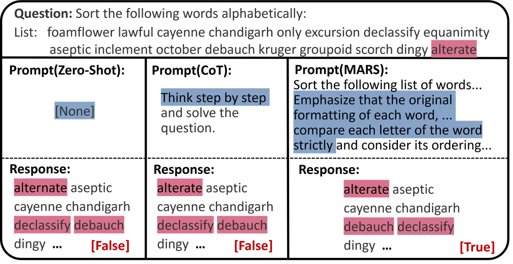
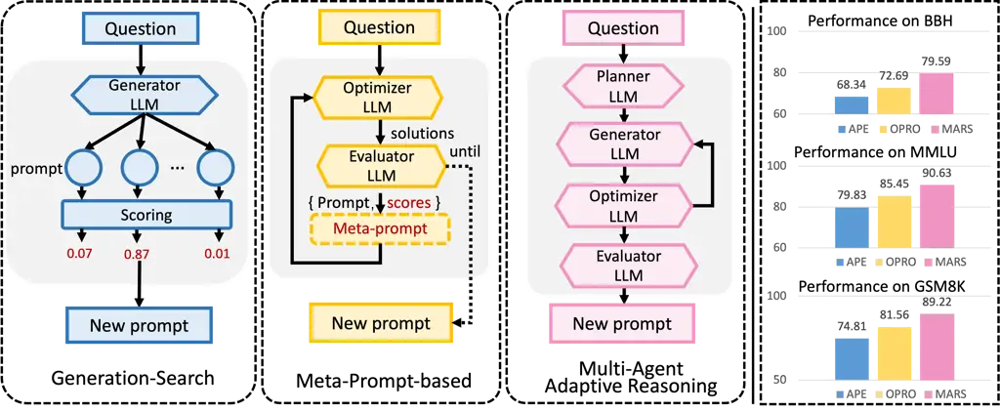
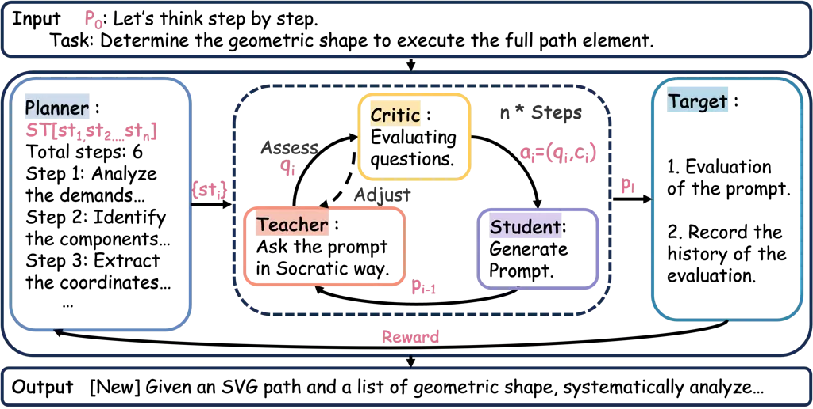
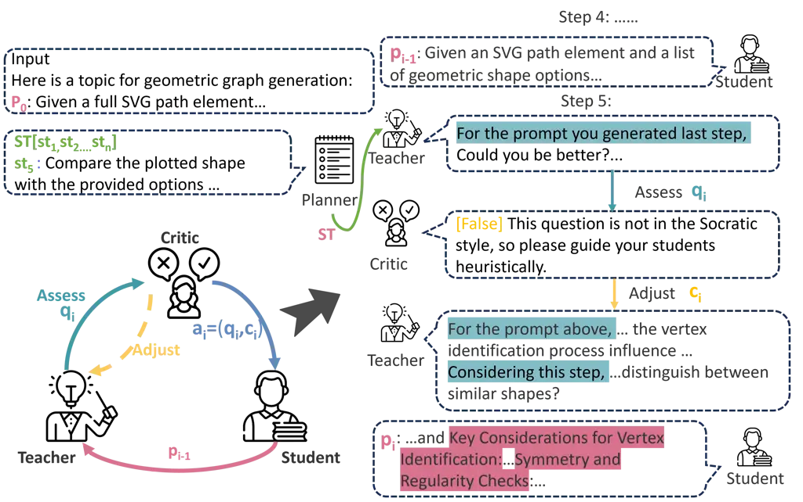
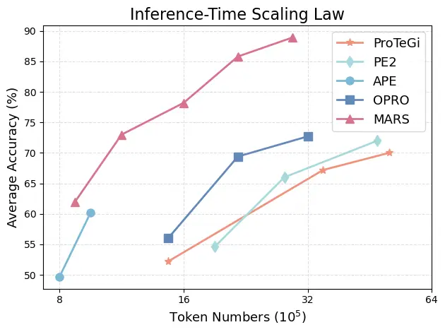
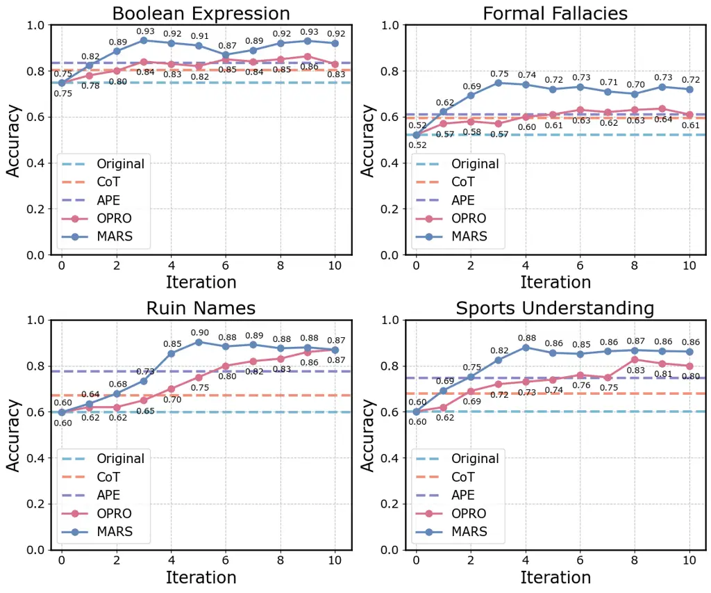
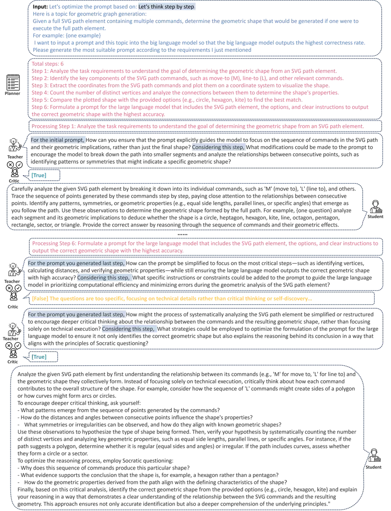

# MARS: Multi-Agent Adaptive Reasoning with Socratic Guidance for Automated Prompt Optimization

Jian Zhang    Zhangqi Wang    Haiping Zhu ^(†)^(†)thanks: Corresponding
Author    Kangda Cheng    Kai He    Bo Li    Qika Lin²²footnotemark: 2
   Jun Liu    Erik Cambria

###### Abstract

Large language models (LLMs) typically operate in a question-answering
paradigm, where the quality of the input prompt critically affects the
response. Automated Prompt Optimization (APO) aims to overcome the
cognitive biases of manually crafted prompts and explore a broader
prompt design space. However, existing APO methods often suffer from
rigid template structures and inefficient exploration in the prompt
space. To this end, we propose a Multi-Agent Adaptive Reasoning with
Socratic guidance framework (MARS) for APO. MARS consists of five
complementary agents and formulates the optimization process as a
Partially Observable Markov Decision Process (POMDP), enabling adaptive
prompt refinement through explicit state modeling and interactive
feedback. Specifically, a Planner agent generates flexible optimization
trajectories, a Teacher-Critic-Student triad engages in Socratic-style
dialogue to iteratively optimize the prompt based on pseudo-gradient
signals in the text space, and a Target agent executes the prompt in
downstream tasks to provide performance feedback. MARS integrates
reasoning, feedback, and state transition into a unified hidden-state
evolution process, improving both the effectiveness and interpretability
of optimization. Extensive experiments on multiple datasets demonstrate
that MARS outperforms existing APO methods in terms of optimization
performance, search efficiency, and interpretability.

¹School of Computer Science and Technology, Xi’an Jiaotong University,
China

²MOE KLINNS Lab, Xi’an Jiaotong University, China

³Shaanxi Province Key Laboratory of Big Data Knowledge Engineering,
Xi’an Jiaotong University, China

⁴School of Electronics and Information Engineering, Harbin Institute of
Technology, Harbin, China

⁵Saw Swee Hock School of Public Health, National University of
Singapore, Singapore

⁶College of Computing and Data Science, Nanyang Technological
University, Singapore

zhangjian062422@stu.xjtu.edu.cn, zhuhaiping@xjtu.edu.cn

Code — https://github.com/exoskeletonzj/MARS

## Introduction

Large language models (LLMs) such as GPT-4 (Achiam et al. 2023) and
Deepseek-R1 (Guo et al. 2025) provide robust support for thousands of
natural language processing tasks (Yuan et al. 2025). By providing a
natural language prompt that includes instructions and a task
description, LLMs can quickly adapt and respond (Lin et al. 2025a) (Shen
et al. 2025) (Yan et al. 2025). Consequently, the quality of the prompt
is of critical importance, leading to wide interest in Automated Prompt
Optimization (APO) (Pryzant et al. 2023). As shown in Figure 1, we
provide LLMs with three different inputs for the word sorting task: a
zero-shot prompt, a Chain of Thought (CoT) prompt, and our optimized
prompt. The responses are produced in a markedly distinct way.
Specifically, the zero-shot prompt incorrectly identifies the _alterate_
as the more common word _alternate_. However, the task requires
faithfully preserving the given sequence of words rather than correcting
them. With the CoT prompt, the sorting remains incorrect because the LLM
does not fully grasp the sorting task and the word sequence. In
contrast, our optimized prompt produces the correct answer. This is
because our prompt includes specific requirements, such as maintaining
the original letter casing and specifying the sorting method.



Figure 1: Three different prompts along with their corresponding
responses for the word sorting task.



Figure 2: Comparison of APO strategies. Generation-search and
meta-prompt. Multi-Agent Adaptive Reasoning enables dynamic,
collaborative reasoning. Right: With GPT-4o, MARS outperforms all
baselines on three benchmarks.

Thus, it is evident that APO can lead to improved performance in
downstream tasks. As shown in Figure 2, recent studies (Zhou et al.
2022; Xu et al. 2023; Wang et al. 2023) have explored prompt
optimization by generating multiple candidates combined with diverse
search strategies, while others (Yang et al. 2024a; Ye et al. 2023)
focus on designing sophisticated _meta-prompts_ to guide optimization.
Despite these advances, two key issues remain: the limited flexibility
of fixed prompt templates, and the inefficiency of prompt space
exploration.

The first issue is the limited flexibility of fixed templates. Prior
works (Yang et al. 2024a; Ye et al. 2023) often rely on _meta-prompts_,
which are predefined optimization templates that cannot be dynamically
adapted to different tasks. Unlike domains such as event
extraction (Zhang et al. 2024b) or text-to-symbol generation (Xu et al.
2024), where fixed templates suffice due to the task’s structural
regularity, APO requires more adaptability. Rigid templates may
introduce biases or fail to capture task-specific nuances, resulting in
suboptimal performance when applied to diverse or complex scenarios.

The second issue is the inefficiency of prompt space exploration.
Several approaches (Zhou et al. 2022; Xu et al. 2023; Wang et al. 2023)
adopt a _generation-search_ strategy, where a set of candidate prompts
is first generated and then refined using local search techniques.
However, this approach typically performs only local exploration around
the initial candidates, without sufficiently covering the broader prompt
space. As a result, the optimization may converge prematurely or
overlook better-performing prompts, limiting overall effectiveness.

To this end, we propose a Multi-Agent Adaptive Reasoning with Socratic
guidance framework (MARS) for APO. MARS consists of five complementary
agents and formulates the optimization process as a Partially Observable
Markov Decision Process (POMDP), enabling adaptive prompt refinement
through explicit state modeling and interactive feedback. Functionally,
to address the first challenge, MARS introduces a Planner agent that
generates task-specific optimization trajectories, allowing prompts to
be flexibly adapted to diverse task requirements. To tackle the second
challenge, MARS employs a Socratic-style Teacher-Critic-Student dialogue
mechanism, which iteratively guides prompt refinement. This module
enables effective exploration of the prompt space by simulating a
gradient-inspired optimization process, while also promoting
interpretability. The overall process is modeled as a POMDP, where the
hidden state represents the latent reasoning state of the Student agent.
Through multi-agent interactions and performance feedback from a Target
agent, MARS approximates a pseudo-gradient trajectory in the discrete
prompt space, progressively refining the prompt toward an optimal
solution. Our contributions are three-fold:

$`\bullet`$ This work is the first to introduce a multi-agent
architecture with POMDP modeling for APO. It proposes MARS, which
enables hidden-state reasoning and adaptive planning through agent
collaboration.

$`\bullet`$ A Teacher-Critic-Student Socratic dialogue mechanism is
designed to enable interpretable, iterative prompt refinement via a
gradient-inspired optimization trajectory.

$`\bullet`$ We demonstrate the effectiveness and generalizability of
MARS through extensive experiments on both general and domain-specific
benchmarks, and validate the interpretability of its optimization
process.



Figure 3: The overall architecture of the MARS model. It consists of
five LLM agents. The Planner agent that autonomously generates
task-specific optimization trajectories, and a Teacher-Critic-Student
Socratic dialogue mechanism that iteratively refines prompts, with the
evaluation and iterative refinement process guided by feedback from the
Target agent.

## Methodology

MARS comprises two main modules: (i) a high-level Planner that generates
task-specific optimization trajectories, and (ii) a
Teacher-Critic-Student triad that performs Socratic-style iterative
refinement. The overall architecture is shown in Figure 3, with the
complete workflow detailed in Algorithm 1. This section introduces: (1)
the APO task and its POMDP formulation, (2) the Planner design, (3) the
gradient-inspired Socratic dialogue mechanism, and (4) the
evaluation-feedback loop via the Target agent.

### Task Formulation and POMDP Modeling

Given a task-specific Target model $`\mathcal{M}_{\text{tar}}`$, the
goal of APO is to iteratively refine an initial prompt $`p_{0}`$ to an
optimal version $`p^{*}`$ that maximizes performance on a downstream
dataset $`D=\{(x,y)\}`$. A training subset $`D_{\text{train}}\subset D`$
guides the optimization, while $`D_{\text{test}}`$ is used for
evaluation. The objective can be formalized as:

```math
p^{*}=\arg\max_{p}\sum_{(x,y)\in D_{\text{test}}}f\left(\pi_{\text{tar}}(x;p),y\right), \tag{1}
```

where $`\pi_{\text{tar}}(x;p)`$ denotes the model output conditioned on
$`x`$ and prompt $`p`$, and $`f`$ is a task-specific metric (e.g.,
accuracy, BLEU).

To capture the sequential, partially observable nature of the
optimization, we model APO as a Partially Observable Markov Decision
Process (POMDP) defined by:

```math
\langle\mathcal{S},\mathcal{A},\mathcal{T},\mathcal{R},\mathcal{O}\rangle,
```

where: - $`\mathcal{S}`$: latent state space, representing the internal
reasoning state of the Student agent; - $`\mathcal{A}`$: action space,
comprising instructional signals (e.g., questions, critiques) from
Teacher and Critic; -
$`\mathcal{T}\!:\mathcal{S}\times\mathcal{A}\rightarrow\mathcal{S}`$:
transition dynamics, updating student states; -
$`\mathcal{O}\!:\mathcal{S}\rightarrow\mathcal{P}`$: observation
function, mapping hidden states to prompts; -
$`\mathcal{R}(s,a)=f(\pi_{\text{tar}}(x;\mathcal{O}(s)),y)`$: reward
function, based on performance of the generated prompt.

This formulation allows MARS to perform gradient-inspired prompt
refinement in a partially observable, discrete text space. Via iterative
multi-agent reasoning and feedback, the system progressively transitions
from $`p_{0}`$ to $`p^{*}`$.

### Optimization Trajectory Planning

As illustrated in Figure 3, MARS begins with a Planner agent that
initiates the prompt optimization process.

Planner. Given task goal $`g`$, input $`x\in D_{\text{train}}`$, and
initial prompt $`p_{0}`$, the Planner decomposes the optimization into a
sequence of sub-goals:

```math
\mathbf{ST}=[st_{1},st_{2},\dots,st_{n}]=\pi_{\text{plan}}(g,x,p_{0}), \tag{2}
```

where $`\pi_{\text{plan}}`$ is the planning policy that adaptively
generates an optimization trajectory.

To formalize $`\pi_{\text{plan}}`$, we introduce a latent planning
variable $`z\in\mathcal{Z}`$, and model trajectory generation as:

```math
\pi_{\text{plan}}(g,x,p_{0})=\arg\max_{\mathbf{ST}}\,\mathbb{E}_{z\sim q(z|g,x)}\left[\log P(\mathbf{ST}\mid z,p_{0})\right], \tag{3}
```

where $`q(z|g,x)`$ captures task semantics, and
$`P(\mathbf{ST}\mid z,p_{0})`$ models the trajectory conditioned on
latent intent and initial prompt. This hierarchical formulation induces
structured plans over latent space $`\mathcal{S}`$, guiding local agent
decisions under global coherence and improving adaptability over static
templates.

### Socratic Prompt Refinement as Joint Policy Optimization

Prompt refinement in discrete language space presents unique challenges
due to its non-differentiability, high variance, and semantic ambiguity.
To address these issues, MARS employs a structured Socratic dialogue
mechanism involving three collaborative agents—Teacher
($`\pi_{\text{t}}`$), Critic ($`\pi_{\text{c}}`$), and Student
($`\pi_{\text{s}}`$)—each fulfilling a complementary role in exploring
and improving prompts through guided interaction. This framework
transforms prompt optimization into an interpretable, policy-driven
reasoning process grounded in pedagogical principles.

At each refinement step $`i`$, given a sub-goal
$`st_{i}\in\mathbf{ST}`$, the Teacher proposes a Socratic-style question
$`q_{i}`$ to stimulate reasoning, based on the prior prompt $`p_{i-1}`$.
The Critic then assesses its clarity, relevance, and coherence,
producing feedback $`c_{i}`$ to revise or validate the proposed
direction. Finally, the Student responds by updating its internal state
and generating a new prompt $`p_{i}`$. This process is formalized as:

```math
\displaystyle q_{i} \displaystyle=\pi_{\text{t}}(st_{i},p_{i-1}), \tag{4}
```

```math
\displaystyle c_{i} \displaystyle=\pi_{\text{c}}(q_{i}),
```

```math
\displaystyle p_{i} \displaystyle=\pi_{\text{s}}((q_{i},c_{i}),p_{i-1}),
```

```math
\displaystyle s_{i} \displaystyle\sim\mathcal{T}(s_{i-1},(q_{i},c_{i})),\quad o_{i}=p_{i}.
```

Each agent performs a partial update to the joint optimization process:
Teacher drives semantic direction, Critic provides quality control, and
Student synthesizes the final output.

#### Context-Aware Interaction.

To improve reasoning consistency and avoid step-wise myopia, each agent
conditions not only on the current sub-goal and prompt, but also on the
dialogue history
$`\mathcal{H}_{<i}=\{(q_{j},c_{j},p_{j})\}_{j=1}^{i-1}`$. The full
context-aware behavior is given by:

```math
\displaystyle q_{i} \displaystyle=\pi_{\text{t}}(st_{i},p_{i-1},\mathcal{H}_{<i}), \tag{5}
```

```math
\displaystyle c_{i} \displaystyle=\pi_{\text{c}}(q_{i},\mathcal{H}_{<i}),
```

```math
\displaystyle p_{i} \displaystyle=\pi_{\text{s}}((q_{i},c_{i}),p_{i-1},\mathcal{H}_{<i}).
```

By attending to prior reasoning steps, the system forms coherent,
memory-informed trajectories across iterations.

#### Joint Optimization Objective.

We define the multi-agent policy as
$`\Pi=\{\pi_{\text{t}},\pi_{\text{c}},\pi_{\text{s}}\}`$, and optimize
it jointly to maximize task performance while ensuring interpretability
and alignment with sub-goals:

```math
\max_{\Pi}\,\mathbb{E}_{(x,y)\sim D}\left[\mathcal{R}(\Pi)-\lambda\sum_{i=1}^{n}\mathcal{L}_{\text{align}}((q_{i},c_{i}),st_{i})\right], \tag{6}
```

where $`\mathcal{R}(\Pi)`$ denotes the cumulative reward from the Target
agent, and $`\mathcal{L}_{\text{align}}`$ penalizes semantic drift from
intended optimization goals.

This tri-agent structure enables interpretable, step-wise refinement of
prompts through structured reasoning and localized feedback, offering
both flexibility and transparency in discrete prompt optimization.

Proposition 1 (Socratic Policy Improvement Bound). Let
$`\Pi=\{\pi_{\text{t}},\pi_{\text{c}},\pi_{\text{s}}\}`$ denote the
joint policy, and suppose the Socratic signal $`a_{i}=(q_{i},c_{i})`$
induces expected advantage $`\bar{A}_{i}>0`$ over the prior state
$`s_{i-1}`$. Then, under bounded variance $`\sigma^{2}`$, the cumulative
improvement over $`n`$ steps satisfies:

```math
\mathbb{E}[\mathcal{R}(p_{n})]-\mathcal{R}(p_{0})\geq\sum_{i=1}^{n}\left(\bar{A}_{i}-\frac{\sigma^{2}}{2\lambda}\right), \tag{7}
```

where $`\lambda`$ is the local Lipschitz constant of the reward surface.

This provides a lower bound on improvement, formally linking guidance
signal quality to reward trajectory.

Derivation is in Appendix A.1.



Figure 4: A specific illustration of a Teacher-Critic-Student Socratic
guidance dialogue pattern. The case shows the fifth step optimization
iteration.

1: Input: Dataset $`\mathcal{D}`$, initial prompt $`p_{0}`$, threshold
$`\delta`$, max iterations $`I`$

2: Output: Optimized prompt $`p^{*}`$

3: Planner: Generate sub-goal trajectory
$`\mathbf{ST}=\{st_{1},\dots,st_{n}\}`$

4: Initialize $`p_{0}^{(1)}\leftarrow p_{0}`$,
$`\mathcal{R}^{(0)}\leftarrow 0`$

5: for iteration $`t=1`$ to $`I`$ do

6:   for step $`i=1`$ to $`n`$ do // Generate question

7:    Teacher generates question
$`q_{i}\leftarrow\pi_{\text{t}}(st_{i},p_{i-1}^{(t)})`$

8:    repeat

9:      Critic evaluates $`q_{i}`$ & returns feedback
$`c_{i}\leftarrow\pi_{\text{c}}(q_{i})`$

10:      Teacher revises $`q_{i}`$ if $`c_{i}`$ is unsatisfactory

11:    until Socratic quality is satisfied

12:    Set $`a_{i}\leftarrow(q_{i},c_{i})`$

13:    Student updates
$`p_{i}^{(t)}\leftarrow\pi_{\text{s}}(a_{i},p_{i-1}^{(t)})`$

14:   end for

15:   Let $`p_{\ell}^{(t)}\leftarrow p_{n}^{(t)}`$ // Final prompt

16:   Target evaluates reward

17:
  $`\mathcal{R}^{(t)}=\sum_{(x,y)\in D_{\text{test}}}f(\pi_{\text{tar}}(x;p_{\ell}^{(t)}),y)`$

18:   if $`\mathcal{R}^{(t)}-\mathcal{R}^{(t-1)}<\delta`$ then

19:    break //Early stopping

20:   end if

21: end for

22: return $`p^{*}\leftarrow p_{\ell}^{(t)}`$

Algorithm 1 MARS Optimization Procedure

### Evaluation and Iteration

Upon completing the Socratic refinement trajectory, the final prompt
$`p_{\ell}=p_{n}`$—produced through successive dialogue transitions from
latent state $`s_{0}`$ to $`s_{\ell}`$—is evaluated by the Target agent
$`\pi_{\text{tar}}`$ on the held-out test set $`D_{\text{test}}`$. The
evaluation provides an external signal to measure the effectiveness of
the entire optimization trajectory:

```math
\mathcal{R}^{(t)}=\sum_{(x,y)\in D_{\text{test}}}f\left(\pi_{\text{tar}}(x;p_{\ell}^{(t)}),y\right), \tag{8}
```

where $`f(\cdot)`$ is a task-specific scoring function (e.g., accuracy,
BLEU, F1), and $`p_{\ell}^{(t)}`$ denotes the final prompt obtained at
iteration $`t`$. This scalar reward serves as the global performance
metric, closing the loop between prompt generation and task-level
effectiveness.

#### Adaptive Termination.

To ensure efficient convergence and prevent over-refinement, we adopt an
adaptive early stopping criterion based on marginal reward improvement.
The gain between two consecutive iterations is defined as:

```math
\Delta\mathcal{R}^{(t)}=\mathcal{R}^{(t)}-\mathcal{R}^{(t-1)}. \tag{9}
```

The refinement continues only if:

```math
\Delta\mathcal{R}^{(t)}>\delta,\quad t<I, \tag{10}
```

where $`\delta`$ is a minimum improvement threshold, and $`I`$ is the
maximum number of allowed iterations.

This iterative control mechanism enforces a form of performance-aware
policy halting under the POMDP framework. It ensures that MARS focuses
on high-impact updates while avoiding excessive computation on
marginally beneficial revisions. As a result, the system adaptively
determines the optimal stopping point based on observable task
performance.

Proposition 2 (Monotonic Reward Stability). Assume $`\mathcal{R}(p)`$ is
$`\lambda`$-Lipschitz and each step satisfies
$`\|p_{i}-p_{i-1}\|\leq\varepsilon`$. Then the reward trajectory
$`\{\mathcal{R}(p_{i})\}`$ satisfies:

```math
|\mathcal{R}(p_{i+1})-\mathcal{R}(p_{i})|\leq\lambda\varepsilon.
```

In particular, if $`\mathcal{R}(p_{i})<\mathcal{R}(p_{i+1})`$ for some
$`i`$, then improvement is bounded and monotonic. This result guarantees
bounded gain/loss and motivates early stopping under stable improvement.

Derivation is in Appendix A.2.

| Models  | B.E   | D.QA  | F.F.  | G.S.  | R.N.  | S.U.  | C.B.  | C.M.  | E.E.  | W.H.  | H.A.  | M.T.  | Avg.  |
| ------- | ----- | ----- | ----- | ----- | ----- | ----- | ----- | ----- | ----- | ----- | ----- | ----- | ----- |
| Origin  | 74.70 | 51.41 | 52.20 | 43.37 | 59.84 | 60.24 | 82.52 | 69.77 | 63.89 | 73.73 | 66.22 | 81.55 | 64.95 |
| CoT(ZS) | 80.32 | 54.22 | 59.44 | 47.39 | 67.07 | 67.87 | 83.91 | 73.25 | 74.31 | 76.27 | 68.47 | 84.98 | 69.79 |
| CoT(FS) | 81.93 | 57.43 | 66.26 | 49.40 | 70.68 | 72.29 | 86.71 | 76.74 | 79.17 | 78.81 | 72.07 | 90.99 | 73.54 |
| APE     | 83.53 | 61.85 | 61.04 | 51.41 | 77.51 | 74.70 | 88.11 | 75.58 | 69.44 | 82.20 | 75.68 | 87.98 | 74.09 |
| ProTeGi | 83.93 | 63.86 | 62.65 | 52.21 | 80.32 | 76.71 | 90.91 | 78.49 | 73.61 | 84.75 | 77.48 | 90.56 | 76.29 |
| OPRO    | 86.34 | 66.67 | 63.45 | 53.81 | 83.13 | 82.73 | 93.70 | 83.14 | 77.01 | 86.44 | 79.73 | 92.70 | 79.07 |
| PE2     | 87.95 | 65.46 | 63.86 | 54.62 | 84.34 | 75.90 | 93.01 | 81.40 | 76.39 | 88.14 | 81.08 | 93.56 | 78.81 |
| Ours    | 93.17 | 71.89 | 74.70 | 59.44 | 90.36 | 87.95 | 97.90 | 86.05 | 84.03 | 93.22 | 85.59 | 97.00 | 85.11 |

Table 1: In the performance comparison across 12 general tasks, we
carefully select 6 representative subtasks from both BBH and MMLU, two
commonly used evaluation benchmarks, to comprehensively assess MARS’s
performance in diverse general-task settings. The evaluation results of
these subtasks indicate that MARS surpasses all existing baseline
methods.

| Models  | Chinese |        |       | Math  | Law   | Avg.  |
| ------- | ------- | ------ | ----- | ----- | ----- | ----- |
|         | A.S.    | U.R.P. | CL.M. | GSM.  | L.A.  |       |
| Origin  | 56.25   | 48.89  | 57.14 | 67.07 | 23.14 | 50.50 |
| CoT(ZS) | 59.38   | 53.33  | 61.90 | 70.26 | 30.57 | 55.09 |
| CoT(FS) | 65.63   | 57.78  | 66.67 | 77.54 | 35.81 | 60.69 |
| APE     | 65.63   | 62.22  | 71.43 | 74.81 | 29.69 | 60.76 |
| ProTeGi | 68.75   | 66.67  | 76.19 | 77.47 | 31.88 | 64.19 |
| OPRO    | 71.88   | 73.33  | 80.95 | 81.56 | 31.44 | 67.83 |
| PE2     | 75.00   | 77.78  | 76.19 | 83.46 | 34.50 | 69.39 |
| MARS    | 81.25   | 84.44  | 85.71 | 89.22 | 38.42 | 75.81 |

Table 2: Performance comparison on three types of domain-specific tasks:
Chinese, law, and mathematics. The Chinese domain consists of three
datasets, while the law and mathematics domains each have one dataset.

## Experiments

In this section, we present extensive experiments conducted on 12
general task datasets and 5 domain-specific datasets. We begin by
introducing the datasets and hyperparameters, followed by the main
experimental results. A detailed analysis of the efficiency of the
proposed framework is also provided.

More detailed descriptions of the tasks and datasets can be found in
Appendix B. The abbreviations used for the tasks in Tables 1 and 2,
along with their full names and dataset descriptions, are provided in
Appendix B. Baseline methods and additional experimental details are
introduced in Appendix C.

### Experimental Settings

#### Datasets.

We select a total of 17 datasets covering both general-purpose and
domain-specific tasks. Specifically, we use 6 tasks from the Big-Bench
Hard (BBH) suite (Suzgun et al. 2022) and 6 tasks from MMLU (Wang et al.
2024b) to represent general reasoning and knowledge-intensive
benchmarks. For domain-specific evaluation, we include 3 Chinese
subject-area tasks from C-Eval (Huang et al. 2024), 1 legal reasoning
task from LSAT-AR (Zhong et al. 2023), and 1 arithmetic reasoning task
from GSM8K (Zhang et al. 2024a).

#### Hyperparameters and Evaluation Protocol.

We adopt deepseek-v2.5-1210 (Guo et al. 2025) as the primary backbone
LLM for all APO tasks. The generation temperature is set to 0.6 to
balance creativity and coherence. We configure the maximum number of
optimization iterations as $`I=10`$, with an early stopping threshold of
$`\delta=0.01`$ based on accuracy improvement. To enhance efficiency,
each assess-adjust cycle is limited to a single revision per step. Final
evaluation is performed using accuracy, computed by comparing the model
prediction $`y_{\text{pred}}`$ with the ground truth label $`y`$.

### Main Results

#### MARS enhances the average performance across diverse task types.

The experimental results in Table 1 and Table 2 present a comprehensive
comparison between the prompts optimized by MARS and the baselines for
the 12 tasks. As shown in Table 1, on general tasks, MARS outperforms
the previous SOTA by 6.04%, and exceeds the original prompt and CoT(ZS)
by 20.16% and 15.32%, respectively. This indicates that the prompts
optimized by MARS enable LLMs to better understand the task
requirements, providing stronger instructions for tasks across different
scenarios. MARS surpasses existing APO methods, highlighting the
limitations of both the _generate-search_ approach and the _meta
prompts_ approach. These methods fail to fully grasp the deeper essence
of the APO process, which constrains their optimization effectiveness.
In contrast, MARS thoughtfully considers the prompt optimization
pathways for different tasks and incorporates heuristic optimization
strategies, making the prompt refinement process more efficient and
precise.



Figure 5: Inference-time scaling law. The horizontal axis denotes the
inference-time computational cost, while the vertical axis represents
the average performances on all tasks.

MARS achieves strong and consistent performance gains across
domain-specific tasks, highlighting its effectiveness in
knowledge-intensive reasoning. Table 2 presents the experimental results
of MARS on domain-specific tasks, covering areas like Chinese, law, and
mathematics, all of which require specialized knowledge and reasoning.
In these tasks, MARS outperforms the previous SOTA methods to 6.42%,
further demonstrating its ability to better guide LLMs in
domain-specific knowledge discovery and application. This not only
lowers the barrier to utilizing LLMs but also enhances their
generalization capability. Moreover, compared to the original prompt and
CoT(ZS), MARS achieves improvements of 25.31% and 20.72%, respectively,
underscoring its effectiveness and practicality in these specialized
domains.

### Efficiency Analysis

#### MARS Consistently Achieves the Highest Computational Efficiency.

The balance between resource consumption and performance improvement is
a crucial analysis metric (Yang et al. 2024b). As shown in Figure 5,
MARS consistently outperforms all baseline methods in terms of
computational efficiency, as demonstrated by its superior inference-time
scaling behavior across multiple APO tasks.

Notably, under the same number of output tokens, MARS achieves the
highest performance across all evaluated tasks. Conversely, to reach
comparable performance levels, baseline methods require more output
tokens—indicating higher computational cost.

These results highlight MARS’s strong ability to balance performance and
resource usage through its structured optimization strategy. By
performing high-level task planning followed by step-wise Socratic
refinement, MARS enables more efficient resource allocation, reduces
unnecessary computation, and ensures both effectiveness and robustness
throughout the APO process.

| Variation               | B.E.    | D.QA    | F.F.     | G.S.    | R.N.     | S.U.     | Avg.     |
| ----------------------- | ------- | ------- | -------- | ------- | -------- | -------- | -------- |
| MARS                    | 93.17   | 71.89   | 74.70    | 59.44   | 90.36    | 87.95    | 79.59    |
| $`{w/o}_{\text{Plan}}`$ | 86.35   | 65.86   | 68.67    | 54.21   | 82.33    | 79.52    | 72.82    |
| $`\quad\Delta`$         | (-6.82) | (-6.03) | (-6.03)  | (-5.23) | (-8.03)  | (-8.43)  | (-6.77)  |
| $`{w/o}_{\text{Soc}}`$  | 84.74   | 63.86   | 62.25    | 49.80   | 74.30    | 74.70    | 68.28    |
| $`\quad\Delta`$         | (-8.43) | (-8.03) | (-12.45) | (-9.64) | (-16.06) | (-13.25) | (-11.31) |
| $`{w/o}_{\text{Cri}}`$  | 89.16   | 68.27   | 72.28    | 56.22   | 86.34    | 83.94    | 76.04    |
| $`\quad\Delta`$         | (-4.01) | (-3.62) | (-2.42)  | (-3.22) | (-4.02)  | (-4.01)  | (-3.55)  |

Table 3: Performance under different ablation settings are analyzed. We
performed ablation experiments on the planner module
$`{w/o}_{\text{Plan}}`$, the Teacher-Critic-Student module
$`{w/o}_{\text{Soc}}`$, and the Critic Agent $`{w/o}_{\text{Cri}}`$ to
evaluate the impact of removing these components. w/o indicates the
experiment was run without the specified module.

## Supplementary Analysis

To further validate the effectiveness of MARS, we conduct three
additional analyses in this section: an ablation study to assess the
contribution of each component, a convergence analysis to examine the
optimization stability over iterations, and an investigation of the
sensitivity to Other Target LLMs.

In addition, Appendix D reports MARS’s generalization performance when
applied to GPT-4o and different initial prompt $`p_{0}`$. Appendix E
analyzes the effect of sample size on performance. Appendix F provides
the internal prompts used by each agent to clarify their roles. Appendix
G presents the full multi-agent interaction process on a representative
APO task. Appendix H offers the optimized prompts for all 17 tasks to
facilitate reproducibility.

### Ablation Study

The Socratic dialogue mechanism plays the most critical role in MARS, as
shown by the largest performance drop upon its removal. Table 3 presents
the impact of removing three key components: the Planner agent, the
Teacher-Critic-Student Socratic module, and the Critic agent. Removing
the Socratic module leads to the most substantial degradation, as the
system loses its iterative refinement capability and sends unprocessed
sub-goals directly to the Target agent, resulting in poor optimization
quality. Eliminating the Planner also causes a notable drop, since the
Socratic dialogue lacks structured guidance without its sub-goal
trajectory. Finally, while the Critic contributes less overall, its
feedback loop with the Teacher improves prompt quality; removing it
leads to a 3.55% performance loss, as shown in Table 3.

### Converagence Analysis

MARS achieves faster convergence in most tasks, improving both
efficiency and optimization quality. Figure 6 presents the convergence
analysis across four BBH tasks. To better monitor the APO process, we
visualize the iterative optimization trajectory within a 10-iteration
observation window.

The results show that MARS exhibits an upward reward trend in the early
stages. For instance, in Task ‘Ruin Names’, it converges to the optimal
solution by iteration 5. In contrast, in the OPRO task, convergence is
not reached even after 10 iterations, resulting in higher resource
consumption. This comparison highlights MARS’s ability to reach optimal
prompts in fewer steps, reducing computational cost and enhancing
efficiency.

|         |          |       |       |       |       |       |
| ------- | -------- | ----- | ----- | ----- | ----- | ----- |
| Base    | Deepseek |       | GPT   |       |       | Avg.  |
|         | -V2.5    | -R1   | -3.5  | -4    | -4o   |       |
| Origin  | 56.96    | 61.48 | 44.79 | 49.70 | 55.84 | 53.75 |
| CoT(ZS) | 62.72    | 73.82 | 63.45 | 66.94 | 70.38 | 67.46 |
| MARS    | 79.59    | 83.05 | 69.30 | 73.21 | 80.86 | 77.20 |

Table 4: Performance comparison on BBH tasks under different Target
model settings.

### Other Target LLMs

MARS demonstrates strong cross-model generalization, maintaining high
performance across diverse LLM backbones. We further evaluate MARS on
additional Target LLMs—Deepseek-R1, GPT-3.5, GPT-4, and GPT-4o—using the
optimized prompts from previous experiments to assess robustness across
model families. As shown in Table 4, prompts optimized on the
Deepseek-V2.5 base model generalize well, preserving strong performance
even on larger or structurally different LLMs. MARS consistently
achieves notable gains across models, validating its model-agnostic
design and broad applicability.

## Related Works

The related work is structured into two main aspects: first, an
introduction to prompt optimization; and second, an exploration of
multi-agent techniques.

#### Prompt Optimization.

Early work primarily focused on two aspects: discrete optimization of
hard prompts (Shin et al. 2020; Wen et al. 2024; Chen et al. 2023; Zhang
et al. 2022) and continuous vector optimization of soft prompts (Lester
et al. 2021; Li and Liang 2021; Liu et al. 2024). However, these methods
are highly task-dependent and exhibit locality. With the advent of LLMs,
traditional methods have become outdated. APE (Zhou et al. 2022)
pioneered the use of generative methods to optimize instructions. Since
APE, there have been two major approaches. The first approach (Zhou et
al. 2022; Xu et al. 2023; Pryzant et al. 2023; Wang et al. 2023) is the
_generate-search_ model, where multiple candidate sequences are
generated, and methods like Monte Carlo search are used to optimize the
prompt. The second approach (Yang et al. 2024a; Ye et al. 2023; Zhang et
al. 2025a) is the _meta prompts_ method, where sophisticated _meta
prompts_ are designed to optimize the prompt. In contrast to these two
approaches, MARS employs a planned optimization path, iteratively
generating high-quality prompts. This approach alleviates the
inefficient search in prompt spaces issues in the first approach and
addresses the challenges of limited flexibility of fixed templates in
the second approach.



Figure 6: The convergence curves across different tasks show the
learning progress as the number of iterations increases. We compare the
iterative convergence process of MARS with four different baseline
methods across four tasks to assess MARS’s advantage in convergence
speed.

#### Multi-Agent.

Based on LLMs, a combination of AI agents capable of performing specific
functions forms a multi-agent system  (Richards 2023; Yang et al. 2023;
Wu et al. 2023; Zhang et al. 2025c). Given a statement of a specific
task, AI agents can attempt to break complex problem statements into
subtasks and use tools, including data retrieval from the internet, to
solve them step-by-step through automatic iterations. Some
studies (Poldrack et al. 2023; Wang et al. 2024a; Xi et al. 2025; Ni and
Gao 2021; Lin et al. 2025b) use multi-agent systems to address issues
such as problem identification, code development and debugging, plotting
results and analysis, and providing interactive feedback with the human
user. Ni and Buehler (2024) (Zhang et al. 2025b) demonstrates the
potential of organizing an AI multi-agent collaborative team to
automatically solve mechanical problems, showcasing an enhanced ability
to understand, formulate, and validate engineering problem solutions
through self-correction and mutual correction. Inspired by their work,
we leverage multi-agent technology to autonomously plan the APO
optimization path and design a Teacher-Critic-Student collaborative
approach for iterative optimization.

## Conclusion

We propose MARS, a novel multi-agent framework for adaptive APO that
integrates Socratic guidance within a POMDP formulation. It includes:
(1) a Planner that generates task-specific optimization trajectories,
and (2) a Teacher-Critic-Student dialogue enabling interpretable prompt
refinement. This simulates pseudo-gradient paths in discrete prompt
space, narrowing the search scope. Modeled as a POMDP: the Student’s
latent state is the hidden state, Teacher-Critic interactions define
actions, and prompt outputs serve as observations. A Target agent guides
iteration via performance rewards. Experiments show MARS consistently
outperforms baselines while maintaining transparent optimization
trajectories.

## Acknowledgments

This work was supported by the National Natural Science Foundation of
China (No. 62137002, 62277042, 62293553, 62450005, 62437002, 62477036,
62477037, 62176209, 62192781, 62306229), the “LENOVO-XJTU” Intelligent
Industry Joint Laboratory Project, the Shaanxi Provincial Social Science
Foundation Project (No. 2024P041), the Natural Science Basic Research
Program of Shaanxi (No. 2023-JC-YB-593), and the Youth Innovation Team
of Shaanxi Universities “Multi-modal Data Mining and Fusion”.

## References

- Achiam et al. (2023) J. Achiam, S. Adler, S. Agarwal, L. Ahmad, I.
  Akkaya, F. L. Aleman, D. Almeida, J. Altenschmidt, S. Altman, S.
  Anadkat, et al. Gpt-4 technical report. arXiv preprint
  arXiv:2303.08774. Cited by: Introduction, Experiment Settings and
  Baselines, Base Model of GPT-4o.
- Chen et al. (2023) L. Chen, J. Chen, T. Goldstein, H. Huang, and T.
  Zhou Instructzero: efficient instruction optimization for black-box
  large language models. arXiv preprint arXiv:2306.03082. Cited by:
  Prompt Optimization..
- Guo et al. (2025) D. Guo, D. Yang, H. Zhang, J. Song, R. Zhang, R.
  Xu, Q. Zhu, S. Ma, P. Wang, X. Bi, et al. Deepseek-r1: incentivizing
  reasoning capability in llms via reinforcement learning. arXiv
  preprint arXiv:2501.12948. Cited by: Introduction, Experiment Settings
  and Baselines, Hyperparameters and Evaluation Protocol..
- Huang et al. (2024) Y. Huang, Y. Bai, Z. Zhu, J. Zhang, J. Zhang, T.
  Su, J. Liu, C. Lv, Y. Zhang, Y. Fu, et al. C-eval: a multi-level
  multi-discipline chinese evaluation suite for foundation models.
  Advances in Neural Information Processing Systems 36. Cited by:
  Datasets., Domain-Specific Task Evaluation..
- Lester et al. (2021) B. Lester, R. Al-Rfou, and N. Constant The power
  of scale for parameter-efficient prompt tuning. arXiv preprint
  arXiv:2104.08691. Cited by: Prompt Optimization..
- Li and Liang (2021) X. L. Li and P. Liang Prefix-tuning: optimizing
  continuous prompts for generation. arXiv preprint arXiv:2101.00190.
  Cited by: Prompt Optimization..
- Lin et al. (2025a) Q. Lin, T. Zhao, K. He, Z. Peng, F. Xu, L.
  Huang, J. Ma, and M. Feng Self-supervised quantized representation for
  seamlessly integrating knowledge graphs with large language models.
  arXiv preprint arXiv:2501.18119. External Links:
  [Link](https://arxiv.org/pdf/2501.18119) Cited by: Introduction.
- Lin et al. (2025b) Q. Lin, Y. Zhu, B. Pu, L. Huang, H. Luo, J. Ma, Z.
  Peng, T. Zhao, F. Xu, J. Zhang, et al. A foundation model for chest
  x-ray interpretation with grounded reasoning via online reinforcement
  learning. arXiv preprint arXiv:2509.03906. Cited by: Multi-Agent..
- Liu et al. (2024) X. Liu, Y. Zheng, Z. Du, M. Ding, Y. Qian, Z. Yang,
  and J. Tang GPT understands, too. AI Open 5, pp. 208–215. Cited by:
  Prompt Optimization..
- Ni and Buehler (2024) B. Ni and M. J. Buehler MechAgents: large
  language model multi-agent collaborations can solve mechanics
  problems, generate new data, and integrate knowledge. Extreme
  Mechanics Letters 67, pp. 102131. Cited by: Multi-Agent..
- Ni and Gao (2021) B. Ni and H. Gao A deep learning approach to the
  inverse problem of modulus identification in elasticity. Mrs Bulletin
  46, pp. 19–25. Cited by: Multi-Agent..
- Poldrack et al. (2023) R. A. Poldrack, T. Lu, and G. Beguš AI-assisted
  coding: experiments with gpt-4. arXiv preprint arXiv:2304.13187. Cited
  by: Multi-Agent..
- Pryzant et al. (2023) R. Pryzant, D. Iter, J. Li, Y. T. Lee, C. Zhu,
  and M. Zeng Automatic prompt optimization with ”gradient descent” and
  beam search. In Proceedings of the 2023 Conference on Empirical
  Methods in Natural Language Processing, (EMNLP), pp. 7957–7968.
  External Links:
  [Link](https://doi.org/10.18653/v1/2023.emnlp-main.494) Cited by:
  Introduction, Experiment Settings and Baselines, Prompt Optimization..
- Richards (2023) T. B. Richards Auto-gpt: an experimental open-source
  attempt to make gpt-4 fully autonomous. Cited by: Multi-Agent..
- Shen et al. (2025) T. Shen, R. Mao, J. Wang, X. Zhang, and E. Cambria
  Flow-guided direct preference optimization for knowledge graph
  reasoning with trees. In Proceedings of the 48th International ACM
  SIGIR Conference on Research and Development in Information Retrieval,
  SIGIR ’25, New York, NY, USA, pp. 1165–1175. External Links: ISBN
  9798400715921, [Document](https://dx.doi.org/10.1145/3726302.3729980)
  Cited by: Introduction.
- Shin et al. (2020) T. Shin, Y. Razeghi, R. L. Logan IV, E. Wallace,
  and S. Singh Autoprompt: eliciting knowledge from language models with
  automatically generated prompts. arXiv preprint arXiv:2010.15980.
  Cited by: Prompt Optimization..
- Suzgun et al. (2022) M. Suzgun, N. Scales, N. Schärli, S. Gehrmann, Y.
  Tay, H. W. Chung, A. Chowdhery, Q. V. Le, E. H. Chi, D. Zhou, et al.
  Challenging big-bench tasks and whether chain-of-thought can solve
  them. arXiv preprint arXiv:2210.09261. Cited by: Datasets., General
  Task Evaluation..
- Wang et al. (2024a) L. Wang, C. Ma, X. Feng, Z. Zhang, H. Yang, J.
  Zhang, Z. Chen, J. Tang, X. Chen, Y. Lin, et al. A survey on large
  language model based autonomous agents. Frontiers of Computer Science
  18 (6), pp. 186345. Cited by: Multi-Agent..
- Wang et al. (2023) X. Wang, C. Li, Z. Wang, F. Bai, H. Luo, J.
  Zhang, N. Jojic, E. P. Xing, and Z. Hu Promptagent: strategic planning
  with language models enables expert-level prompt optimization. arXiv
  preprint arXiv:2310.16427. Cited by: Introduction, Introduction,
  Prompt Optimization..
- Wang et al. (2024b) Y. Wang, X. Ma, G. Zhang, Y. Ni, A. Chandra, S.
  Guo, W. Ren, A. Arulraj, X. He, Z. Jiang, et al. Mmlu-pro: a more
  robust and challenging multi-task language understanding benchmark.
  arXiv preprint arXiv:2406.01574. Cited by: Datasets., General Task
  Evaluation..
- Wen et al. (2024) Y. Wen, N. Jain, J. Kirchenbauer, M. Goldblum, J.
  Geiping, and T. Goldstein Hard prompts made easy: gradient-based
  discrete optimization for prompt tuning and discovery. Advances in
  Neural Information Processing Systems 36. Cited by: Prompt
  Optimization..
- Wu et al. (2023) Q. Wu, G. Bansal, J. Zhang, Y. Wu, S. Zhang, E.
  Zhu, B. Li, L. Jiang, X. Zhang, and C. Wang Autogen: enabling next-gen
  llm applications via multi-agent conversation framework. arXiv
  preprint arXiv:2308.08155. Cited by: Multi-Agent..
- Xi et al. (2025) Z. Xi, W. Chen, X. Guo, W. He, Y. Ding, B. Hong, M.
  Zhang, J. Wang, S. Jin, E. Zhou, et al. The rise and potential of
  large language model based agents: a survey. Science China Information
  Sciences 68 (2), pp. 121101. Cited by: Multi-Agent..
- Xu et al. (2024) F. Xu, Z. Wu, Q. Sun, S. Ren, F. Yuan, S. Yuan, Q.
  Lin, Y. Qiao, and J. Liu Symbol-llm: towards foundational
  symbol-centric interface for large language models. In Proceedings of
  the ACL, pp. 13091–13116. Cited by: Introduction.
- Xu et al. (2023) W. Xu, A. Banburski-Fahey, and N. Jojic Reprompting:
  automated chain-of-thought prompt inference through gibbs sampling.
  arXiv preprint arXiv:2305.09993. Cited by: Introduction, Introduction,
  Prompt Optimization..
- Yan et al. (2025) H. Yan, F. Xu, R. Xu, Y. Li, J. Zhang, H. Luo, X.
  Wu, L. A. Tuan, H. Zhao, Q. Lin, et al. Mur: momentum uncertainty
  guided reasoning for large language models. arXiv preprint
  arXiv:2507.14958. Cited by: Introduction.
- Yang et al. (2024a) C. Yang, X. Wang, Y. Lu, H. Liu, Q. V. Le, D.
  Zhou, and X. Chen Large language models as optimizers. In The Twelfth
  International Conference on Learning Representations, ICLR 2024,
  Vienna, Austria, May 7-11, 2024, External Links:
  [Link](https://openreview.net/forum?id=Bb4VGOWELI) Cited by:
  Introduction, Introduction, Experiment Settings and Baselines, Prompt
  Optimization..
- Yang et al. (2023) H. Yang, S. Yue, and Y. He Auto-gpt for online
  decision making: benchmarks and additional opinions. arXiv preprint
  arXiv:2306.02224. Cited by: Multi-Agent..
- Yang et al. (2024b) J. Yang, H. Jin, R. Tang, X. Han, Q. Feng, H.
  Jiang, S. Zhong, B. Yin, and X. Hu Harnessing the power of llms in
  practice: a survey on chatgpt and beyond. ACM Transactions on
  Knowledge Discovery from Data 18 (6), pp. 1–32. Cited by: MARS
  Consistently Achieves the Highest Computational Efficiency..
- Ye et al. (2023) Q. Ye, M. Axmed, R. Pryzant, and F. Khani Prompt
  engineering a prompt engineer. arXiv preprint arXiv:2311.05661. Cited
  by: Introduction, Introduction, Experiment Settings and Baselines,
  Prompt Optimization..
- Yuan et al. (2025) L. Yuan, Y. Cai, X. Shen, Q. Li, Q. Huang, Z. Deng,
  and T. Wang Collaborative multi-lora experts with achievement-based
  multi-tasks loss for unified multimodal information extraction. In
  Proceedings of the Thirty-Fourth International Joint Conference on
  Artificial Intelligence, IJCAI-25, J. Kwok (Ed.), pp. 6940–6948. Note:
  Main Track External Links:
  [Document](https://dx.doi.org/10.24963/ijcai.2025/772),
  [Link](https://doi.org/10.24963/ijcai.2025/772) Cited by:
  Introduction.
- Zhang et al. (2024a) H. Zhang, J. Da, D. Lee, V. Robinson, C. Wu, W.
  Song, T. Zhao, P. Raja, D. Slack, Q. Lyu, et al. A careful examination
  of large language model performance on grade school arithmetic. arXiv
  preprint arXiv:2405.00332. Cited by: Datasets., Domain-Specific Task
  Evaluation..
- Zhang et al. (2025a) J. Zhang, Z. Wang, H. Zhu, J. Liu, Q. Lin, and E.
  Cambria MARS: a multi-agent framework incorporating socratic guidance
  for automated prompt optimization. arXiv preprint arXiv:2503.16874.
  Cited by: Prompt Optimization..
- Zhang et al. (2025b) J. Zhang, Z. Wang, Z. Wang, X. Zhang, F. Xu, Q.
  Lin, R. Mao, E. Cambria, and J. Liu MAPS: a multi-agent framework
  based on big seven personality and socratic guidance for multimodal
  scientific problem solving. arXiv preprint arXiv:2503.16905. Cited by:
  Multi-Agent..
- Zhang et al. (2025c) J. Zhang, B. Wei, S. Qi, J. Liu, Q. Lin, et al.
  GKG-llm: a unified framework for generalized knowledge graph
  construction. arXiv preprint arXiv:2503.11227. Cited by: Multi-Agent..
- Zhang et al. (2024b) J. Zhang, C. Yang, H. Zhu, Q. Lin, F. Xu, and J.
  Liu A semantic mention graph augmented model for document-level event
  argument extraction. arXiv preprint arXiv:2403.09721. Cited by:
  Introduction.
- Zhang et al. (2022) T. Zhang, X. Wang, D. Zhou, D. Schuurmans,
  and J. E. Gonzalez Tempera: test-time prompting via reinforcement
  learning. arXiv preprint arXiv:2211.11890. Cited by: Prompt
  Optimization..
- Zhong et al. (2023) W. Zhong, R. Cui, Y. Guo, Y. Liang, S. Lu, Y.
  Wang, A. Saied, W. Chen, and N. Duan Agieval: a human-centric
  benchmark for evaluating foundation models. arXiv preprint
  arXiv:2304.06364. Cited by: Datasets., Domain-Specific Task
  Evaluation..
- Zhou et al. (2022) Y. Zhou, A. I. Muresanu, Z. Han, K. Paster, S.
  Pitis, H. Chan, and J. Ba Large language models are human-level prompt
  engineers. arXiv preprint arXiv:2211.01910. Cited by: Introduction,
  Introduction, Experiment Settings and Baselines, Prompt Optimization..

## Proof of Proposition

### Proof of Proposition 1 (Socratic Policy Improvement Bound)

Let $`\Pi=\{\pi_{\text{t}},\pi_{\text{c}},\pi_{\text{s}}\}`$ denote the
joint policy composed of the Teacher, Critic, and Student agents. Let
$`p_{i}`$ denote the prompt state at refinement step $`i`$, and define
the associated latent state as $`s_{i}`$. At each step, the action
$`a_{i}=(q_{i},c_{i})`$ induces a transition from $`s_{i-1}`$ to
$`s_{i}`$, and yields a prompt $`p_{i}=\pi_{\text{s}}(a_{i},p_{i-1})`$.

We assume the existence of an underlying task reward function:

```math
\mathcal{R}(p)=\mathbb{E}_{(x,y)\sim D}\left[f\left(\pi_{\text{tar}}(x;p),y\right)\right], \tag{11}
```

which is Lipschitz-continuous with constant $`\lambda>0`$. Our goal is
to lower-bound the cumulative reward improvement from $`p_{0}`$ to
$`p_{n}`$ based on Socratic signal quality.

#### Step 1: Define Local Advantage.

Let the local reward gain be defined as:

```math
A_{i}:=\mathcal{R}(p_{i})-\mathcal{R}(p_{i-1}). \tag{12}
```

We assume the expected advantage at each step satisfies:

```math
\mathbb{E}[A_{i}]\geq\bar{A}_{i}>0, \tag{13}
```

i.e., the expected contribution of the composite action $`a_{i}`$ is
beneficial.

#### Step 2: Control for Socratic Variance.

We define the conditional variance of $`A_{i}`$ given the state
$`s_{i-1}`$ as:

```math
\text{Var}[A_{i}\mid s_{i-1}]\leq\sigma^{2}. \tag{14}
```

This variance captures uncertainty due to imperfect questions or noisy
feedback in the Socratic interaction.

#### Step 3: Apply Jensen-Bernstein Inequality.

Since $`\mathcal{R}(p)`$ is Lipschitz, and prompt updates occur in a
discrete space, we use a Bernstein-style bound:

```math
\mathbb{E}[\mathcal{R}(p_{i})]\geq\mathcal{R}(p_{i-1})+\bar{A}_{i}-\frac{\sigma^{2}}{2\lambda}. \tag{15}
```

#### Step 4: Accumulate Across Steps.

Summing over all $`n`$ refinement steps, we obtain:

```math
\displaystyle\mathbb{E}[\mathcal{R}(p_{n})]-\mathcal{R}(p_{0}) \displaystyle=\sum_{i=1}^{n}\mathbb{E}[A_{i}] \tag{16}
```

```math
\displaystyle\geq\sum_{i=1}^{n}\left(\bar{A}_{i}-\frac{\sigma^{2}}{2\lambda}\right).
```

This completes the proof of the lower bound. It shows that as long as
the Socratic actions are informative ($`\bar{A}_{i}>0`$) and the
variance $`\sigma^{2}`$ is controlled, the cumulative reward is
guaranteed to improve linearly with the number of refinement steps.

### Proof of Proposition 2 (Monotonic Reward Stability)

Let $`\{p_{i}\}_{i=0}^{n}`$ denote the sequence of prompts generated by
the MARS refinement process, where each prompt is updated via:

```math
p_{i}=\pi_{\text{s}}(a_{i},p_{i-1}),\quad\text{with}\quad a_{i}=(q_{i},c_{i}), \tag{17}
```

i.e., a Socratic action $`a_{i}`$ is used to refine the prompt at step
$`i`$.

Assume the reward function
$`\mathcal{R}:\mathcal{P}\rightarrow\mathbb{R}`$ is
$`\lambda`$-Lipschitz continuous with respect to the prompt
representation, i.e., for all $`i=1,\dots,n`$,

```math
|\mathcal{R}(p_{i})-\mathcal{R}(p_{i-1})|\leq\lambda\cdot\|p_{i}-p_{i-1}\|, \tag{18}
```

where $`\|\cdot\|`$ denotes a norm over the prompt space (e.g.,
token-level edit distance or embedding-based distance).

Suppose further that the update step size is bounded as:

```math
\|p_{i}-p_{i-1}\|\leq\varepsilon. \tag{19}
```

Then, combining (2) and (3), the reward change per step is bounded by:

```math
|\mathcal{R}(p_{i})-\mathcal{R}(p_{i-1})|\leq\lambda\varepsilon. \tag{20}
```

This implies that the reward improvement (or degradation) at each
refinement step is at most linear in the prompt change size.

Now suppose the process satisfies a minimum improvement requirement:

```math
\mathcal{R}(p_{i})\geq\mathcal{R}(p_{i-1})+\delta, \tag{21}
```

for some $`\delta>0`$. Then combining (4) and (5), we obtain:

```math
\lambda\varepsilon\geq\delta\quad\Rightarrow\quad\varepsilon\geq\delta/\lambda. \tag{22}
```

Thus, for a reward gain of at least $`\delta`$, the update must induce a
prompt change of at least $`\delta/\lambda`$. Conversely, if

```math
\|p_{i}-p_{i-1}\|\ll\delta/\lambda, \tag{23}
```

then the step is too small to yield meaningful improvement, and further
refinement is unlikely to be effective.

This result provides a formal justification for the early stopping rule:
once consecutive prompt updates fall below a semantic change threshold,
reward improvement will necessarily be bounded, indicating convergence.

## Tasks and Datasets

To comprehensively evaluate the expert-level prompt optimization
capabilities of our framework, we curate 17 tasks from two broad
categories: General Tasks and Domain-Specific Tasks.

#### General Task Evaluation.

We select six tasks from the BBH (Suzgun et al. 2022) and MMLU (Wang et
al. 2024b) datasets, respectively. BBH tasks consist of six challenging
reasoning tasks that assess logical inference and problem-solving
skills, including boolean expressions, disambiguation QA, formal
fallacies, geometric shapes, ruin names, and sports understanding. MMLU
tasks cover six subject-specific tasks designed to evaluate general
knowledge across diverse fields, including college biology, college
medicine, electrical engineering, high school world history, human
aging, and marketing.

#### Domain-Specific Task Evaluation.

We include three benchmarks: C-Eval (Huang et al. 2024), GSM8K (Zhang et
al. 2024a), and LSAT-AR (Zhong et al. 2023). C-Eval is a Chinese
evaluation benchmark that covers domain-specific topics such as art
studies, clinical medicine, and Urban and Rural Planner. GSM8K is a
widely used mathematical reasoning dataset. LSAT-AR focuses on legal
reasoning, evaluating AI performance in law-related tasks.

#### Dataset Split.

In this study, we adopt a minimal training paradigm by selecting only a
single instance from each dataset for training. Despite this extremely
limited supervision, our method demonstrates strong and consistent
performance across a diverse range of datasets. This suggests that our
approach possesses exceptional few-shot ability, enabling effective
adaptation to various tasks with minimal prior knowledge. The detailed
partition of the dataset is presented in Table 5.

One of the key highlights of this study is that the training data
consists of only a single sample—MARS utilizes just one data point from
the current task for the entire optimization process. This minimal setup
is enabled by the Planner agent’s strong capacity to identify the task
definition and interpret the provided example, allowing it to infer the
underlying task structure and semantics effectively. Since the primary
function of the Planner is to generate an optimization trajectory based
on the prompt-task alignment, a single representative instance is
sufficient to guide downstream agents. We further analyze the impact of
different sample sizes on performance in Appendix E.

|                               |        |       |      |
| ----------------------------- | ------ | ----- | ---- |
| Tasks                         | ABBR.  | Train | Test |
| Bigbench                      |        |       |      |
|      Boolean Expressions      | B.E.   | 1     | 249  |
|      Disambiguation QA        | D.QA   | 1     | 249  |
|      Formal Fallacies         | F.F.   | 1     | 249  |
|      Geometric Shapes         | G.S.   | 1     | 249  |
|      Ruin Names               | R.N.   | 1     | 249  |
|      Sports Understanding     | S.U.   | 1     | 249  |
| MMLU                          |        |       |      |
|      College Biology          | C.B.   | 1     | 143  |
|      College Medicine         | C.M.   | 1     | 172  |
|      Electrical Engineering   | E.E.   | 1     | 144  |
|      HighSchool World History | W.H.   | 1     | 236  |
|      Human Aging              | H.A.   | 1     | 222  |
|      Marketing                | M.T.   | 1     | 233  |
| C-EVAL                        |        |       |      |
|      Art Studies              | A.S.   | 1     | 32   |
|      Urban And Rural Planner  | U.R.P. | 1     | 45   |
|      Clinical Medicine        | CL.M.  | 1     | 21   |
| GSM8K                         | GSM.   | 1     | 1318 |
| LSAT-AR                       | L.A.   | 1     | 229  |

Table 5: Data split of general tasks and domain-specific tasks. One
instance for training and others for testing. The ‘ABBR.’ column
represents the abbreviations for all the tasks.

## Experiment Settings and Baselines

We select a powerful LLM, deepseek-V2.5-1210 (Guo et al. 2025), as our
primary agent for the APO tasks. Not only does deepseek-V2.5-1210
exhibit strong reasoning and generation capabilities in a variety of
natural language processing tasks, but it also efficiently explores
multiple angles when facing complex prompt optimization requirements,
making it well-suited for adapting to different tasks and datasets in
the APO process. We adopt accuracy as our primary evaluation metric to
comprehensively assess the performance of different methods across
various task scenarios. Table 1 presents our experimental results on 12
general task datasets, illustrating the performance of APO in diverse
scenarios, while Table 2 summarizes its performance on five
domain-specific datasets, underscoring the model’s versatility and
stability across different fields. To further validate the generality
and robustness of our method, we additionally employed another
high-performance LLM, GPT-4o (Achiam et al. 2023), for extended
comparative experiments, with the corresponding findings reported in
Appendix D.

We compare MARS with three categories of baselines: original prompts,
CoT prompts, and some of the latest APO methods. Specifically, (1)
original prompts refer to the prompts used in the datasets, where each
dataset often provides some initial guidance for the tasks. (2) To build
the CoT (Zero-Shot) baseline, we add the prompt Let’s think step by step
at the beginning of each task; based on this, we further include a
specific example to create the CoT (Few-Shot) baseline. (3) Finally, we
compare MARS with some strong baseline methods from recent years,
including Automatic Prompt Engineer (APE) (Zhou et al. 2022), Prompt
Optimization with Textual Gradients (ProTeGi) (Pryzant et al. 2023),
Optimization by PROmpting (OPRO) (Yang et al. 2024a), and Prompt
Engineer 2 (PE2) (Ye et al. 2023). APE and ProTeGi generate multiple
prompts and perform search optimization to find the optimal prompt,
while OPRO and PE2 optimize prompts by designing a sophisticated _meta
prompts_.

## Generalization Across Different Base and Target Models

In this section, we present the optimization performance of the method
from this study on another base model, as well as the optimization
results of our APO on other Target LLMs.

### Base Model of GPT-4o

To verify the generality and effectiveness of the proposed method in
this study, we conduct further experiments by replacing the base model
with GPT-4o (Achiam et al. 2023).

As shown in Table 6, in the datasets of the 17 tasks adopted by this
study, MARS achieves a new SOTA performance when using the GPT-4o base
model, surpassing the previous SOTA by 2.3%. This result demonstrates
that MARS not only performs excellently on the existing base models but
also exhibits strong transferability, continuously improving performance
across different base models. This further validates the versatility and
robustness of the MARS method, highlighting its effectiveness on a
variety of base models.

### Different Initial Prompts $`p_{0}`$

As shown in the Table 7, MARS consistently achieves strong performance
across different initial prompts $`p_{0}`$, demonstrating robust
optimization capabilities. Although the choice of $`p_{0}`$ can lead to
variations in absolute performance, MARS maintains a relatively stable
improvement margin across tasks. This indicates that MARS effectively
adapts its optimization trajectory regardless of the quality of the
starting prompt, highlighting its reliability and generalization ability
in diverse initialization scenarios.

| Tasks   | BBH   | MMLU  | Chinese | GSM.  | L.A.  | Avg.  |
| ------- | ----- | ----- | ------- | ----- | ----- | ----- |
| Origin  | 60.92 | 83.73 | 58.26   | 72.31 | 20.96 | 59.24 |
| CoT(ZS) | 62.81 | 85.62 | 64.26   | 76.25 | 24.45 | 62.68 |
| CoT(FS) | 63.42 | 88.27 | 68.69   | 83.92 | 28.82 | 66.62 |
| APE     | 64.36 | 86.72 | 69.03   | 81.18 | 30.13 | 66.28 |
| ProTeGi | 76.43 | 86.35 | 73.52   | 82.70 | 31.88 | 70.18 |
| OPRO    | 78.73 | 88.25 | 75.79   | 84.74 | 32.75 | 72.05 |
| PE2     | 77.59 | 91.89 | 74.67   | 85.43 | 35.81 | 73.08 |
| MARS    | 81.13 | 92.82 | 78.11   | 90.97 | 40.17 | 76.58 |

Table 6: Performance comparison on difference tasks based on GPT-4o.

| Model     | 1                         | 2                                 | 3                                        | Avg   |
| --------- | ------------------------- | --------------------------------- | ---------------------------------------- | ----- |
| $`p_{0}`$ | Let’s think step by step. | Let’s work this out step by step. | Let’s proceed with our tasks one by one. |       |
| MARS      | 79.59                     | 78.53                             | 75.30                                    | 77.81 |

Table 7: Performance comparison of MARS on BBH tasks under different
initial prompts $`p_{0}`$.

## Sample Size Analysis

To analyze the rationality of one-shot training, we present a comparison
of 0-shot, 1-shot, 3-shot, and baseline methods in Table 8.

| Tasks   | Train | B.E.  | D.QA  | F.F.  | G.S.  | R.N.  | S.U.  |
| ------- | ----- | ----- | ----- | ----- | ----- | ----- | ----- |
| APE     | 100   | 83.53 | 61.85 | 61.04 | 51.41 | 77.51 | 74.70 |
| ProTeGi | 20    | 83.93 | 63.86 | 62.65 | 52.21 | 80.32 | 76.71 |
| OPRO    | 50    | 86.34 | 66.67 | 63.45 | 53.81 | 83.13 | 82.73 |
| PE2     | 100   | 87.95 | 65.46 | 63.86 | 54.62 | 84.34 | 75.90 |
| MARS    | 0     | 90.76 | 70.28 | 73.09 | 57.83 | 88.35 | 85.94 |
| MARS    | 1     | 93.17 | 71.89 | 74.70 | 59.43 | 90.36 | 87.95 |
| MARS    | 3     | 93.57 | 72.69 | 74.30 | 60.24 | 89.96 | 88.35 |

Table 8: Performance comparison of different sampling strategies on the
evaluation metric. Train means the training data.

The results indicate that the performance difference between 1-shot and
3-shot is minimal, yet the 1-shot approach is more resource-efficient
while also enhancing task time efficiency. This demonstrates that in
resource-constrained scenarios, 1-shot training offers a better
trade-off between performance and computational cost. Other strong
baseline models, such as PromptAgent and OPRO, use at least 20% of the
data for training, while our framework, using 1-shot training, achieves
better performance than these models. This clearly demonstrates the
effectiveness and resource efficiency of the MARS method.

## Prompts for Agents

Table 9 summarizes the prompts used for all agents in this paper, each
playing a crucial role in the overall optimization workflow.

The Planner first constructs a structured plan based on the task
requirements, defining a trajectory of sub-goals to guide the
optimization process. Beyond laying out the overall flow, the Planner
provides semantic anchors that structure the interactions among
downstream agents.

In the refinement phase, the Teacher generates Socratic-style questions
aligned with the current sub-goal, designed to elicit reasoning rather
than direct edits. The Student responds by proposing refined prompts,
while the Critic evaluates the quality and pedagogical alignment of the
guidance, forming an interactive loop for iterative improvement.

Finally, the Target agent validates the final prompt on downstream
tasks, providing external performance feedback that closes the
optimization loop. This validation ensures that the generated prompt is
not only structurally coherent but also effective for the intended task.

## Full-process Prompt Optimization

Figure 7 presents a comprehensive example of full-process prompt
optimization, using the Geometry Shapes task from the BBH dataset. This
visualization clearly illustrates the end-to-end workflow of the MARS
framework, highlighting how the multi-agent system approximates a
policy-guided trajectory over a discrete prompt space.

The process begins with the Planner agent, which decomposes the input
task into a series of interpretable sub-goals
$`\{st_{1},\dots,st_{n}\}`$, forming a high-level optimization
trajectory. These steps serve as a form of global guidance for the
subsequent reasoning path, representing the initial policy direction in
the POMDP formulation.

Then, through the iterative interaction among the Teacher, Critic, and
Student agents, MARS executes a sequence of transitions
$`(s_{i-1},a_{i},s_{i})`$, where each composite action
$`a_{i}=(q_{i},c_{i})`$ is derived from the Socratic-style question and
its critique. The Student agent updates its internal latent state
$`s_{i}`$ based on this feedback and outputs the observable prompt
$`o_{i}=p_{i}`$. This dialogue-driven process simulates a soft
pseudo-gradient trajectory in the POMDP landscape, gradually refining
the prompt through interpretable and feedback-aligned steps.

MARS enables dual-level interpretability: process interpretability
arises from the explicit optimization path planned by the Planner and
the Socratic dialogue structure, which makes each state transition
traceable and rational. Result interpretability is embodied in the final
prompt, which integrates task-specific constraints—such as tolerance
thresholds or validation rules—as shown in Figure 7, indicating the
policy-converged output under the POMDP framework.

## Universal Optimum Solution

This section introduces the final optimized prompts for all general
tasks and domain-specific tasks, obtained through the MARS optimization
process. After multiple iterations for each of the 17 sub-tasks, a
prompt strategy that yields optimal performance was identified for each
one. Tables 10 through Table 26 sequentially present the best solutions
for these 17 sub-tasks along with their respective experimental results,
demonstrating the adaptability and effectiveness of MARS across a broad
range of tasks.

|                                                                                                                                                                                                                                                                                                                                                                                                                                                                                                                                                                                                                                                                                                                                                                                                                                                                                                                                                                                                                                                                                                                                                                                                                                                                                                                                                                                                                                                                                                                                                                                           |
| ----------------------------------------------------------------------------------------------------------------------------------------------------------------------------------------------------------------------------------------------------------------------------------------------------------------------------------------------------------------------------------------------------------------------------------------------------------------------------------------------------------------------------------------------------------------------------------------------------------------------------------------------------------------------------------------------------------------------------------------------------------------------------------------------------------------------------------------------------------------------------------------------------------------------------------------------------------------------------------------------------------------------------------------------------------------------------------------------------------------------------------------------------------------------------------------------------------------------------------------------------------------------------------------------------------------------------------------------------------------------------------------------------------------------------------------------------------------------------------------------------------------------------------------------------------------------------------------- |
| Planner                                                                                                                                                                                                                                                                                                                                                                                                                                                                                                                                                                                                                                                                                                                                                                                                                                                                                                                                                                                                                                                                                                                                                                                                                                                                                                                                                                                                                                                                                                                                                                                   |
| Split the task ’Here is a topic for geometric graph generation: Given a full SVG path element containing multiple commands, determine the geometric shape that would be generated if one were to execute the full path element. For example: This SVG path element ¡path d=M 64.00,63.00 L 44.00,63.00 L 44.00,50.00 L 64.00,50.00 L 64.00,45.00 L 85.00,57.00 L 64.00,68.00 L 64.00,63.00””/¿ draws a Options: (A) circle (B) heptagon (C) hexagon (D) kite (E) line (F) octagon (G) pentagon (H) rectangle (I) sector (J) triangle I want to input a prompt and this topic into the big language model so that the big language model outputs the highest correctness rate. Please generate the most suitable prompt according to the requirements I just mentioned.’ into detailed steps and details. For example, for the clinical medicine Test, the task is planned as follows: Total steps: 4 Step 1: Analyze the input requirements, focusing on the type of clinical medicine question and the format of the options. Step 2: Design a prompt that encourages the model to consider the specific clinical characteristics of the condition described in the question and match the most appropriate option based on medical knowledge. Step 3: Request the model to evaluate each option in the context of clinical presentation, symptoms, and diagnostic characteristics of the condition to ensure it selects the most accurate answer. Step 4: Test and refine the prompt to ensure the model produces the highest correctness rate for similar clinical medicine questions. |
| Teacher                                                                                                                                                                                                                                                                                                                                                                                                                                                                                                                                                                                                                                                                                                                                                                                                                                                                                                                                                                                                                                                                                                                                                                                                                                                                                                                                                                                                                                                                                                                                                                                   |
| You are a teacher who asks questions in the Socratic manner based on objectives and student responses. Please ask a total of two questions: The first one is for the problem that appeared in the prompt given by the students in the last round. The second one is an optimization solution based on the current steps of the task. Please include only questions in your output and do not make answers for your students.                                                                                                                                                                                                                                                                                                                                                                                                                                                                                                                                                                                                                                                                                                                                                                                                                                                                                                                                                                                                                                                                                                                                                              |
| Student                                                                                                                                                                                                                                                                                                                                                                                                                                                                                                                                                                                                                                                                                                                                                                                                                                                                                                                                                                                                                                                                                                                                                                                                                                                                                                                                                                                                                                                                                                                                                                                   |
| You are a prompt generator, please proceed to iterate over the existing prompts as required. Note that you should only output the new prompt you generated.                                                                                                                                                                                                                                                                                                                                                                                                                                                                                                                                                                                                                                                                                                                                                                                                                                                                                                                                                                                                                                                                                                                                                                                                                                                                                                                                                                                                                               |
| Critic                                                                                                                                                                                                                                                                                                                                                                                                                                                                                                                                                                                                                                                                                                                                                                                                                                                                                                                                                                                                                                                                                                                                                                                                                                                                                                                                                                                                                                                                                                                                                                                    |
| You are an evaluator responsible for judging the correctness of a given task. Your output must strictly follow these rules: 1. If the task is judged as correct, output only: \[True\] 2. If the task is judged as incorrect, output: \[False\] \[suggestion: ¡reason for the incorrect judgment¿\] Replace ‘¡reason for the incorrect judgment¿‘ with a clear and concise explanation of why the task is incorrect. Do not include any additional text, comments, or explanations beyond the specified format.                                                                                                                                                                                                                                                                                                                                                                                                                                                                                                                                                                                                                                                                                                                                                                                                                                                                                                                                                                                                                                                                           |
| Target                                                                                                                                                                                                                                                                                                                                                                                                                                                                                                                                                                                                                                                                                                                                                                                                                                                                                                                                                                                                                                                                                                                                                                                                                                                                                                                                                                                                                                                                                                                                                                                    |
| Prompt: Systematically analyze the given SVG path element by first breaking it down into its individual commands, such as ’M’ (move to), ’L’ (line to), and others. For each command, map the sequence of points it generates, ensuring you accurately trace the path step by step. As you follow the path, focus on identifying key geometric properties, such as equal side lengths, parallel lines, specific angles, or symmetries, that emerge between consecutive points. Use these properties to classify the shape based on its defining characteristics. For example, given the path ¡path d=M 64.00,63.00 L 44.00,63.00 L 44.00,50.00 L 64.00,50.00 L 64.00,45.00 L 85.00,57.00 L 64.00,68.00 L 64.00,63.00/¿, calculate the distances between points to check for equal side lengths, measure angles to identify parallelism or perpendicularity, and look for symmetries that align with known geometric shapes. Based on these observations, determine whether the shape is a circle, heptagon, hexagon, kite, line, octagon, pentagon, rectangle, sector, or triangle. Provide the correct answer by reasoning through the geometric properties derived from the path commands. Question: question Please don’t output the process of doing the question, only the content of the answer.The answer should be a parenthesis containing the capital letter of the chosen answer. please do not add any other spaces or symbols.                                                                                                                                               |

Table 9: The table summarizes the prompts used for all Agents in this
paper. The examples in the table are from the Geometry Shapes Task of
the BBH dataset.



Figure 7: This figure presents a complete example of the collaborative
output from all agents in a single iteration, using the Geometry Shapes
task from the BBH dataset.

|                                                                                                                                                                                                                                                                                                                                                                                                                                                              |
| ------------------------------------------------------------------------------------------------------------------------------------------------------------------------------------------------------------------------------------------------------------------------------------------------------------------------------------------------------------------------------------------------------------------------------------------------------------ |
| Boolean Expressions                                                                                                                                                                                                                                                                                                                                                                                                                                          |
| Evaluate the truth value of the following Boolean expression step by step. The expression consists of Boolean constants (True, False) and basic Boolean operators (and, or, not). Carefully analyze each part of the expression, apply the correct Boolean logic, and provide the final truth value as your answer. For example, if the input is ’not ( True ) and ( True ) is’, the correct output is ’False’. Ensure your reasoning is clear and accurate. |

Table 10: The table shows the final optimized prompt for the Boolean
Expressions task of BBH using the MARS method.

|                                                                                                                                                                                                                                                                                                                                                                                                                                                                                                                                                                                                                                                                                                                                                                                                                                                                                                                                                                                               |
| --------------------------------------------------------------------------------------------------------------------------------------------------------------------------------------------------------------------------------------------------------------------------------------------------------------------------------------------------------------------------------------------------------------------------------------------------------------------------------------------------------------------------------------------------------------------------------------------------------------------------------------------------------------------------------------------------------------------------------------------------------------------------------------------------------------------------------------------------------------------------------------------------------------------------------------------------------------------------------------------- |
| Disambiguation QA                                                                                                                                                                                                                                                                                                                                                                                                                                                                                                                                                                                                                                                                                                                                                                                                                                                                                                                                                                             |
| Analyze the following sentence to determine whether the pronoun is inherently ambiguous or if it can be linked to a specific antecedent. Follow these streamlined steps to efficiently evaluate pronoun disambiguation while maintaining accuracy, especially in complex sentence structures: 1. Identify the Pronoun and Its Grammatical Role: 2. Identify Key Contextual Cues: 3. List and Filter Potential Antecedents: 4. Evaluate Plausibility: 5. Determine Ambiguity or Specific Antecedent: 6. Align with Provided Options: Evaluation Metrics for Model Output: 1. Correctness: 2. Clarity: 3. Efficiency: 4. Consistency: Additional Considerations: 1. Grammatical Structure Influence: 2. Optimizing Contextual Cue Identification: By simplifying the steps and focusing on key evaluation metrics, the model can process and apply the disambiguation process more efficiently while maintaining high accuracy and clarity in its outputs, even in complex sentence structures. |

Table 11: The table shows the final optimized prompt for the
Disambiguation QA task of BBH using the MARS method.

|                                                                                                                                                                                                                                                                                                                                                                                                                                                                                                                                               |
| --------------------------------------------------------------------------------------------------------------------------------------------------------------------------------------------------------------------------------------------------------------------------------------------------------------------------------------------------------------------------------------------------------------------------------------------------------------------------------------------------------------------------------------------- |
| Formal Fallacies Syllogisms Negation                                                                                                                                                                                                                                                                                                                                                                                                                                                                                                          |
| Analyze the following argument step by step to determine its logical validity. Carefully consider the premises provided and assess whether the conclusion necessarily follows from them. Pay special attention to the role of negations in the argument. After evaluating the logical structure, decide whether the argument is deductively valid or invalid based on the given premises. Choose the correct option from the provided choices: valid or invalid. Ensure your reasoning is thorough and aligns with formal logical principles. |

Table 12: The table shows the final optimized prompt for the Formal
Fallacies Syllogisms Negation task of BBH using the MARS method.

|                                                                                                                                                                                                                                                                                                                                                                                                                                                                                                                                                                                                                                                                                                                                                                                                                                                                                                                                                                                                                                                                                                                                                                   |
| ----------------------------------------------------------------------------------------------------------------------------------------------------------------------------------------------------------------------------------------------------------------------------------------------------------------------------------------------------------------------------------------------------------------------------------------------------------------------------------------------------------------------------------------------------------------------------------------------------------------------------------------------------------------------------------------------------------------------------------------------------------------------------------------------------------------------------------------------------------------------------------------------------------------------------------------------------------------------------------------------------------------------------------------------------------------------------------------------------------------------------------------------------------------- |
| Geometric Shapes                                                                                                                                                                                                                                                                                                                                                                                                                                                                                                                                                                                                                                                                                                                                                                                                                                                                                                                                                                                                                                                                                                                                                  |
| Given an SVG path element and a list of geometric shape options, systematically analyze and interpret the sequence of SVG path commands to determine the number of vertices and the overall structure of the geometric shape. Follow this structured and optimized approach: 1. Dynamic Tolerance Threshold for Vertex Identification: Detailed Explanation 2. Optimized Vertex Counting and Connection: Detailed Explanation 3. Critical SVG Path Command Analysis:Detailed Explanation 4. Accurate Vertex Counting and Connection:Detailed Explanation 5. Distinguishing Between Similar Shapes:Detailed Explanation 6. Systematic Comparison with Provided Options:Detailed Explanation 7. Validation and Refinement:Detailed Explanation 8. Optimization for Similar Shapes:Detailed Explanation Key Considerations for Dynamic Tolerance and Vertex Identification:Detailed Explanation Optimized Comparison Process:Detailed Explanation By integrating these considerations into the analysis, the model can achieve a higher correctness rate in identifying geometric shapes from SVG paths, even when dealing with shapes that have similar properties. |

Table 13: The table shows the final optimized prompt for the Geometric
Shapes task of BBH using the MARS method.

|                                                                                                                                                                                                                                                                                                                                                                                                                                                                                                                                                                                                                                                                                                                                                                                                                                                                                                                                                                                                                                                                                                                                                                                                                      |
| -------------------------------------------------------------------------------------------------------------------------------------------------------------------------------------------------------------------------------------------------------------------------------------------------------------------------------------------------------------------------------------------------------------------------------------------------------------------------------------------------------------------------------------------------------------------------------------------------------------------------------------------------------------------------------------------------------------------------------------------------------------------------------------------------------------------------------------------------------------------------------------------------------------------------------------------------------------------------------------------------------------------------------------------------------------------------------------------------------------------------------------------------------------------------------------------------------------------- |
| Ruin Names                                                                                                                                                                                                                                                                                                                                                                                                                                                                                                                                                                                                                                                                                                                                                                                                                                                                                                                                                                                                                                                                                                                                                                                                           |
| Given an artist, band, or movie name, create a one-character edit that changes the name in a humorous and universally recognizable way. The edit must involve only a single-character change (adding, removing, or substituting one letter) and should prioritize simplicity, absurdity, and surprise to evoke humor effectively. Ensure the edit maintains a clear connection to the original name, making the humor immediately recognizable and universally understandable, while avoiding overly specific or niche references. Key Guidelines: 1. Simplicity and Surprise: 2. Cultural Universality: 3. Absurdity and Creativity: Evaluation Metrics: Strategies for Simplicity and Surprise: Systematic Testing Strategies: Examples: Refinement for Evaluation Metrics: Focus on generating edits that are simple, surprising, and universally amusing, ensuring they strictly adhere to the one-character constraint and meet the evaluation criteria for humor, cultural relevance, and clarity. Test each edit with a diverse set of sample inputs and audiences to validate its humor consistency and cultural universality, ensuring the edit is immediately recognizable and universally understandable. |

Table 14: The table shows the final optimized prompt for the Ruin Names
task of BBH using the MARS method.

|                                                                                                                                                                                                                                                                                                                                                                                                                                                                                                                                                                                                                                                                                                                                                                                                                                                                                                                                                                                                                                                                                                                                                                                                                                                        |
| ------------------------------------------------------------------------------------------------------------------------------------------------------------------------------------------------------------------------------------------------------------------------------------------------------------------------------------------------------------------------------------------------------------------------------------------------------------------------------------------------------------------------------------------------------------------------------------------------------------------------------------------------------------------------------------------------------------------------------------------------------------------------------------------------------------------------------------------------------------------------------------------------------------------------------------------------------------------------------------------------------------------------------------------------------------------------------------------------------------------------------------------------------------------------------------------------------------------------------------------------------ |
| Sports Understanding                                                                                                                                                                                                                                                                                                                                                                                                                                                                                                                                                                                                                                                                                                                                                                                                                                                                                                                                                                                                                                                                                                                                                                                                                                   |
| Evaluate the plausibility of the following sports-related sentence by considering the following key aspects: 1. Player Abilities and Historical Performance: 2. Event Context and Historical Significance: 3. Terminology and Sport-Specific Knowledge: 4. Rarity vs. Impossibility: Guidelines: - If the action is rare but historically documented or consistent with the player’s abilities, consider it plausible. - For lesser-known players or niche sports, evaluate based on typical performance levels and historical precedents within that sport. - Prioritize consistency with the sport’s rules, norms, and historical records. Examples: Additional Context for Ambiguous Cases: Rationale Requirement: Potential Biases and Limitations: Edge Cases and Testing: Simplified Evaluation Process: - Focus on the core aspects of player abilities, event context, and sport-specific knowledge to streamline the evaluation. - Use historical examples and edge cases as supplementary references rather than primary determinants to avoid over-reliance and potential biases. Output ’yes’ if the sentence is plausible, or ’no’ if it is not, followed by a brief rationale. Now, evaluate the following sentence: \[input sentence\]. |

Table 15: The table shows the final optimized prompt for the Sports
Understanding task of BBH using the MARS method.

|                                                                                                                                                                                                                                                                                                                                                                                                                                                                                                                                                                                                                                                                                                                                                                                                                                                                                                                                                                                                                                                                                                                                                                                                                                                                                                                                                                                                                                                                                                                                                                                                                                                                                                                                                                                                                                                                                                                                                                                                                                                                                                                                                                                                                                                                                                                                                                                                                                                                                                                                                                                               |
| --------------------------------------------------------------------------------------------------------------------------------------------------------------------------------------------------------------------------------------------------------------------------------------------------------------------------------------------------------------------------------------------------------------------------------------------------------------------------------------------------------------------------------------------------------------------------------------------------------------------------------------------------------------------------------------------------------------------------------------------------------------------------------------------------------------------------------------------------------------------------------------------------------------------------------------------------------------------------------------------------------------------------------------------------------------------------------------------------------------------------------------------------------------------------------------------------------------------------------------------------------------------------------------------------------------------------------------------------------------------------------------------------------------------------------------------------------------------------------------------------------------------------------------------------------------------------------------------------------------------------------------------------------------------------------------------------------------------------------------------------------------------------------------------------------------------------------------------------------------------------------------------------------------------------------------------------------------------------------------------------------------------------------------------------------------------------------------------------------------------------------------------------------------------------------------------------------------------------------------------------------------------------------------------------------------------------------------------------------------------------------------------------------------------------------------------------------------------------------------------------------------------------------------------------------------------------------------------- |
| College Biology                                                                                                                                                                                                                                                                                                                                                                                                                                                                                                                                                                                                                                                                                                                                                                                                                                                                                                                                                                                                                                                                                                                                                                                                                                                                                                                                                                                                                                                                                                                                                                                                                                                                                                                                                                                                                                                                                                                                                                                                                                                                                                                                                                                                                                                                                                                                                                                                                                                                                                                                                                               |
| Generate a set of multiple-choice biology questions that explicitly test higher-order thinking skills, such as application, analysis, and synthesis, within the specific contexts of cellular structure, molecular biology, and ecology. Each question should require students to apply biological principles to novel scenarios, analyze complex biological systems, or synthesize information from multiple disciplines to arrive at a solution. Ensure that the questions are scientifically accurate, grounded in established biological principles, and reflect current research trends in these areas. For each question, provide a clear, concise, and scientifically valid explanation for the correct answer, detailing how the interdisciplinary nature of biology informs the reasoning. The explanations should not only justify the correct answer but also deepen understanding of the underlying biological concepts, fostering both accuracy and conceptual clarity. Additionally, include specific examples of how higher-order thinking skills are integrated into the questions, such as requiring students to predict outcomes based on molecular interactions, analyze ecological data to infer population dynamics, or synthesize cellular and molecular processes to explain organismal behavior. To optimize the challenge level, ensure that the questions are neither too simplistic nor overly complex, striking a balance that is appropriate for college-level biology students. This approach will ensure the questions are comprehensive, robust, and aligned with the goal of testing advanced cognitive skills in biology while maintaining relevance to the specified topics. Furthermore, refine the prompt to explicitly guide the language model to generate questions that test higher-order thinking skills while maintaining scientific accuracy and relevance to college-level biology. Optimize specific elements of the current prompt to better align with the goal of producing questions that balance challenge and clarity, ensuring they are neither too simplistic nor overly complex. This includes emphasizing the need for questions to be contextually rich, requiring students to integrate multiple biological concepts, and ensuring that the difficulty level is calibrated to challenge students without overwhelming them. The refined prompt should also encourage the generation of questions that are clear, concise, and free from ambiguity, while still requiring deep biological reasoning to arrive at the correct answer. |

Table 16: The table shows the final optimized prompt for the College
Biology task of MMLU using the MARS method.

|                                                                                                                                                                                                                                                                                                                                                                                                                                                                                                                                                                                                                                                                                                                                                                                                                                                                                                                                                                                                                                                                                                                                                                                                                                                                                                                                                                                                                                                                                                                                                                                                                                                                                                                                                                                                                                                                                                                                                                                                                                                                                                                                                                                                                                                                                                                                                                                                                                                                                                                                                                                                                                                                                                                                                                                                                                                                                                                                                                                                                                                                                                                                                                                                                                                                                                                                                                                                                                                                                                                                 |
| ------------------------------------------------------------------------------------------------------------------------------------------------------------------------------------------------------------------------------------------------------------------------------------------------------------------------------------------------------------------------------------------------------------------------------------------------------------------------------------------------------------------------------------------------------------------------------------------------------------------------------------------------------------------------------------------------------------------------------------------------------------------------------------------------------------------------------------------------------------------------------------------------------------------------------------------------------------------------------------------------------------------------------------------------------------------------------------------------------------------------------------------------------------------------------------------------------------------------------------------------------------------------------------------------------------------------------------------------------------------------------------------------------------------------------------------------------------------------------------------------------------------------------------------------------------------------------------------------------------------------------------------------------------------------------------------------------------------------------------------------------------------------------------------------------------------------------------------------------------------------------------------------------------------------------------------------------------------------------------------------------------------------------------------------------------------------------------------------------------------------------------------------------------------------------------------------------------------------------------------------------------------------------------------------------------------------------------------------------------------------------------------------------------------------------------------------------------------------------------------------------------------------------------------------------------------------------------------------------------------------------------------------------------------------------------------------------------------------------------------------------------------------------------------------------------------------------------------------------------------------------------------------------------------------------------------------------------------------------------------------------------------------------------------------------------------------------------------------------------------------------------------------------------------------------------------------------------------------------------------------------------------------------------------------------------------------------------------------------------------------------------------------------------------------------------------------------------------------------------------------------------------------------- |
| College Medicine                                                                                                                                                                                                                                                                                                                                                                                                                                                                                                                                                                                                                                                                                                                                                                                                                                                                                                                                                                                                                                                                                                                                                                                                                                                                                                                                                                                                                                                                                                                                                                                                                                                                                                                                                                                                                                                                                                                                                                                                                                                                                                                                                                                                                                                                                                                                                                                                                                                                                                                                                                                                                                                                                                                                                                                                                                                                                                                                                                                                                                                                                                                                                                                                                                                                                                                                                                                                                                                                                                                |
| Refined Prompt: Analyze the following scenario step by step, integrating interdisciplinary knowledge from biochemistry, sociology, and reasoning to identify the psychological framework that best explains unconscious bias in medical practice… Next, evaluate each option (Behaviorist, Psychoanalytic, Cognitive Behavioral, Humanistic) by considering how well it explains the influence of unconscious bias on clinical decision-making. … To encourage deeper critical thinking, incorporate elements of Socratic questioning by asking probing questions such as… Ensure the prompt is structured clearly and concisely, balancing detailed theoretical explanations with clarity to guide the model effectively toward identifying the correct psychological framework. … To optimize the prompt for generating high-quality, contextually appropriate multiple-choice questions for a college medicine test, incorporate the following elements: 1. Clarity and Precision: 2. Depth and Relevance: 3. Alignment with Learning Objectives: 4. Distractor Quality: 5. Contextual Examples: 6. Theoretical and Practical Balance: By incorporating these elements, the prompt will guide the model to generate questions that are not only accurate and relevant but also aligned with the objectives of a college medicine test, ensuring a high correctness rate and educational value. … Additional Instructions for Generating High-Quality Distractors: Enhancements Based on New Questions:1. Inclusion of Real-World Examples: 2. Iterative Testing and Refinement: By following these steps, the prompt will be continuously improved to generate questions that are both challenging and aligned with the learning objectives of a college medicine test, ensuring that students are effectively tested on their ability to apply interdisciplinary knowledge to real-world medical scenarios involving unconscious bias. Specific Adjustments for Enhanced Critical Analysis and Practical Application:1. Interdisciplinary Integration: 2. Scenario-Based Questions: 3. Critical Thinking Emphasis:4. Practical Mitigation Strategies: By making these adjustments, the prompt will better align with the learning objectives of a college medicine test, ensuring that students are not only tested on foundational knowledge but also challenged to critically analyze and apply interdisciplinary concepts in real-world medical scenarios involving unconscious bias. Further Refinement for Detailed Explanation and High-Quality Distractors: Final Refinement for Enhanced Real-World Application and Iterative Testing: 1. Real-World Application: 2. Iterative Testing and Refinement: By following these steps, the prompt will be continuously improved to generate questions that are both challenging and aligned with the learning objectives of a college medicine test, ensuring that students are effectively tested on their ability to apply interdisciplinary knowledge to real-world medical scenarios involving unconscious bias. Specific Adjustments for Enhanced Real-World Application and Distractor Quality: 1. Interdisciplinary Integration: 2. High-Quality Distractors: By making these adjustments, the prompt will guide the model to generate questions that not only accurately identify the correct psychological framework but also provide a detailed explanation of how unconscious bias manifests in specific medical scenarios and its impact on patient outcomes… |

Table 17: The table shows the final optimized prompt for the College
Medicine task of MMLU using the MARS method.

|                                                                                                                                                                                                                                                                                                                                                                                                                                                                                                                                                                                                                                                                                                                                                                                                                                                                                                                                                                                                                                                                                                                                                                                                                                                                                                                                                                                                                                                                                                                                                                                                                                                                                                                                                                                                                                                                                                                                                                                                                                                                                                                                                                                                                                                                                                                                                                                                                                                                                                                                                                                                                                                                                                                                                                                                                                                                                                                                                                                                                                                                                                                                                                                                                                                                                                                                                                                                                                                                                                                                                                                                                                                                                                                                                                                                                                                                                                                                                                                                                                                                                                                                                                                                     |
| --------------------------------------------------------------------------------------------------------------------------------------------------------------------------------------------------------------------------------------------------------------------------------------------------------------------------------------------------------------------------------------------------------------------------------------------------------------------------------------------------------------------------------------------------------------------------------------------------------------------------------------------------------------------------------------------------------------------------------------------------------------------------------------------------------------------------------------------------------------------------------------------------------------------------------------------------------------------------------------------------------------------------------------------------------------------------------------------------------------------------------------------------------------------------------------------------------------------------------------------------------------------------------------------------------------------------------------------------------------------------------------------------------------------------------------------------------------------------------------------------------------------------------------------------------------------------------------------------------------------------------------------------------------------------------------------------------------------------------------------------------------------------------------------------------------------------------------------------------------------------------------------------------------------------------------------------------------------------------------------------------------------------------------------------------------------------------------------------------------------------------------------------------------------------------------------------------------------------------------------------------------------------------------------------------------------------------------------------------------------------------------------------------------------------------------------------------------------------------------------------------------------------------------------------------------------------------------------------------------------------------------------------------------------------------------------------------------------------------------------------------------------------------------------------------------------------------------------------------------------------------------------------------------------------------------------------------------------------------------------------------------------------------------------------------------------------------------------------------------------------------------------------------------------------------------------------------------------------------------------------------------------------------------------------------------------------------------------------------------------------------------------------------------------------------------------------------------------------------------------------------------------------------------------------------------------------------------------------------------------------------------------------------------------------------------------------------------------------------------------------------------------------------------------------------------------------------------------------------------------------------------------------------------------------------------------------------------------------------------------------------------------------------------------------------------------------------------------------------------------------------------------------------------------------------------------------- |
| Electrical Engineering                                                                                                                                                                                                                                                                                                                                                                                                                                                                                                                                                                                                                                                                                                                                                                                                                                                                                                                                                                                                                                                                                                                                                                                                                                                                                                                                                                                                                                                                                                                                                                                                                                                                                                                                                                                                                                                                                                                                                                                                                                                                                                                                                                                                                                                                                                                                                                                                                                                                                                                                                                                                                                                                                                                                                                                                                                                                                                                                                                                                                                                                                                                                                                                                                                                                                                                                                                                                                                                                                                                                                                                                                                                                                                                                                                                                                                                                                                                                                                                                                                                                                                                                                                              |
| Analyze the question by focusing on the specific conditions of the Barkhausen criterion for oscillators, which are loop gain and phase shift. … Next, provide a clear, step-by-step explanation of the Barkhausen criterion, emphasizing the two fundamental requirements: 1. Loop gain must be exactly unity for sustained oscillations.2. Phase shift of the feedback signal must be 0° or 360° relative to the input. To enhance understanding, include specific real-world examples, such as the design of an LC oscillator or a phase-locked loop, to illustrate how the Barkhausen criterion is applied in practical scenarios… Proceed to evaluate each option (A, B, C, D) systematically, using the following structure for clarity… For each option, connect the reasoning back to fundamental electrical engineering principles and provide real-world examples or applications where the Barkhausen criterion is critical… Conclude the response by reiterating the correct answer (D) and summarizing its significance in practical electrical engineering applications… To ensure the prompt’s structure and depth enhance the language model’s ability to generate accurate and relevant responses, consider the following adjustments: 1. Clarify the introduction 2. Focus on critical concepts 3. Use structured evaluation: Systematically evaluate each option with clear, logical reasoning and real-world examples to reinforce understanding and relevance. 4. Iterative refinement By structuring the response in this manner and iteratively refining the prompt… Additional Considerations: 1. Influence of Real-World Examples 2. Structural Adjustments Refinement for Multiple-Choice Evaluation: 1. Explicitly state the evaluation criteria 2. Incorporate real-world scenarios 3. Maintain brevity and clarity 4. Highlight key takeaways By refining the prompt in this manner, the language model will be better equipped to… Iterative Refinement Process: 1. Initial Response Generation 2. Review for Accuracy and Relevance 3. Adjust Prompt Accordingly 4. Repeat the Process This iterative approach ensures that the prompt evolves to better guide the language model, resulting in responses that are not only theoretically sound but also practically relevant and aligned with real-world electrical engineering applications. Optimizing the Iterative Refinement Process: 1. Incorporating Feedback Loops: 2. Enhancing Real-World Context: 3. Balancing Depth and Brevity: 4. Focusing on Key Concepts: By implementing these optimizations, the iterative refinement process… Explicit Guidance for Multiple-Choice Evaluation: 1. Explicitly State the Evaluation Criteria 2. Incorporate Real-World Scenarios 3. Maintain Brevity and Clarity 4. Highlight Key Takeaways Adjustments for Balancing Theoretical Depth and Practical Application: 1. Focus on Core Principles 2. Use Structured Evaluation 3. Avoid Overloading with Details 4. Incorporate Real-World Examples By refining the prompt in this manner, the language model will be better equipped to generate responses… Specific Adjustments for Real-World Examples: 1. Demonstrate Practical Implications 2. Highlight Design Considerations 3. Provide Contextual Understanding Balancing Theoretical Depth and Practical Relevance: 1. Integrate Theoretical and Practical Elements 2. Maintain Focus on Core Principles 3. Use Clear, Concise Language By incorporating these adjustments, the prompt will guide the language model to… Influence of Real-World Examples: 1. Illustrate Practical Applications 2. Highlight Consequences of Deviations 3. Provide Contextual Understanding Optimizing the Iterative Refinement Process: 1. Incorporating Feedback Loops 2. Enhancing Real-World Context 3. Balancing Depth and Brevity 4. Focusing on Key Concepts By implementing these optimizations, the iterative refinement process will enhance the language model’s ability to generate responses that are both theoretically accurate and practically relevant, ensuring a high correctness rate and alignment with real-world electrical engineering applications. |

Table 18: The table shows the final optimized prompt for the Electrical
Engineering task of MMLU using the MARS method.

|                                                                                                                                                                                                                                                                                                                                                                                                                                                                                                                                                                                                                                                                                                                                                                                                                                                                                                                                                                                                                                                                                                                                                                                                                                                                                                                                                                                                                                                                                                                                                                                                                                                                                                                                                                                                                                                                                     |
| ----------------------------------------------------------------------------------------------------------------------------------------------------------------------------------------------------------------------------------------------------------------------------------------------------------------------------------------------------------------------------------------------------------------------------------------------------------------------------------------------------------------------------------------------------------------------------------------------------------------------------------------------------------------------------------------------------------------------------------------------------------------------------------------------------------------------------------------------------------------------------------------------------------------------------------------------------------------------------------------------------------------------------------------------------------------------------------------------------------------------------------------------------------------------------------------------------------------------------------------------------------------------------------------------------------------------------------------------------------------------------------------------------------------------------------------------------------------------------------------------------------------------------------------------------------------------------------------------------------------------------------------------------------------------------------------------------------------------------------------------------------------------------------------------------------------------------------------------------------------------------------- |
| High School World History                                                                                                                                                                                                                                                                                                                                                                                                                                                                                                                                                                                                                                                                                                                                                                                                                                                                                                                                                                                                                                                                                                                                                                                                                                                                                                                                                                                                                                                                                                                                                                                                                                                                                                                                                                                                                                                           |
| Generate a set of multiple-choice questions that test both factual knowledge and critical analysis of the interconnected historical developments of the Ottoman Empire, economic imperialism, and World War I. Each question should require students to analyze how these events influenced each other, leading to the outbreak of World War I, with a focus on cause-and-effect relationships and broader historical significance. Instructions for Question Design: 1. Interconnectedness and Cause-and-Effect: 2. Accessibility and Rigor: 3. Balanced Difficulty: 4. Critical Thinking and Historical Significance: 5. Format and Contextual Accuracy: Example Question with Passage:: one example Additional Constraints: - Engagement and Relatability: Use engaging and relatable examples or analogies where appropriate to make the questions more accessible and interesting to students. For instance, compare historical events to modern-day scenarios to help students draw parallels. - Depth of Analysis: Include questions that require students to analyze multiple layers of historical causation, such as how economic imperialism not only influenced European powers but also destabilized regions like the Balkans, contributing to the outbreak of World War I. - Historical Contextualization: Ensure that each question provides enough historical context for students to understand the significance of the events being discussed, without overwhelming them with unnecessary details. By following these guidelines, generate a set of 5-10 multiple-choice questions that effectively test students’ understanding of the interconnectedness of the Ottoman Empire’s decline, economic imperialism, and World War I, while promoting critical thinking, historical analysis, and a deeper appreciation of cause-and-effect relationships in history. |

Table 19: The table shows the final optimized prompt for the High School
World History task of MMLU using the MARS method.

|                                                                                                                                                                                                                                                                                                                                                                                                                                                                                                                                                                                                                                                                                                                                                                                                                                                                                                                                                                                                                                          |
| ---------------------------------------------------------------------------------------------------------------------------------------------------------------------------------------------------------------------------------------------------------------------------------------------------------------------------------------------------------------------------------------------------------------------------------------------------------------------------------------------------------------------------------------------------------------------------------------------------------------------------------------------------------------------------------------------------------------------------------------------------------------------------------------------------------------------------------------------------------------------------------------------------------------------------------------------------------------------------------------------------------------------------------------- |
| Human Aging                                                                                                                                                                                                                                                                                                                                                                                                                                                                                                                                                                                                                                                                                                                                                                                                                                                                                                                                                                                                                              |
| Refine the hierarchical elimination process to ensure the model accurately distinguishes between overlapping themes like cognitive decline and personality changes, especially when new terminology such as ’neuroinflammation’ is introduced, by implementing the following steps: 1. Test the Hierarchical Elimination Process with a Sample Question: 2. Optimize the Dynamic Scoring System and Contextual Weighting: 3. Enhance the Focus Identification Protocol with Continuous Learning: 4. Dynamic Evidence Integration with Contextual Weighting: 5. Source Reliability Scoring with Provisional Scoring for Emerging Evidence: 6. Evidence Strength Assessment with Contextual Weighting: 7. Specific Metrics for Question Evaluation: By refining the hierarchical elimination process with these steps and incorporating specific metrics, the model can more effectively navigate overlapping themes in human aging questions, ensuring the highest correctness rate while maintaining precision and contextual relevance. |

Table 20: The table shows the final optimized prompt for the Human Aging
task of MMLU using the MARS method.

|                                                                                                                                                                                                                                                                                                                                                                                                                                                                                                                                                                                                                                                   |
| ------------------------------------------------------------------------------------------------------------------------------------------------------------------------------------------------------------------------------------------------------------------------------------------------------------------------------------------------------------------------------------------------------------------------------------------------------------------------------------------------------------------------------------------------------------------------------------------------------------------------------------------------- |
| Marketing                                                                                                                                                                                                                                                                                                                                                                                                                                                                                                                                                                                                                                         |
| Analyze the following marketing-related question step by step, considering the principles of segmentation, pricing, market research, and other relevant marketing concepts. Carefully evaluate each of the provided options (A, B, C, D) and select the most suitable answer based on your analysis. Ensure your reasoning is clear and aligns with established marketing theories and practices. For example, if the question involves a hierarchy of effects or sequential model used in advertising, identify the correct model from the options provided and justify your choice. Proceed methodically to arrive at the most accurate answer. |

Table 21: The table shows the final optimized prompt for the Marketing
task of MMLU using the MARS method.

|                                                                                                                                                                                                                                                                                                                                                                                                                                                                                                                                                                                                                                                                                                                                                                                                                                                                                                                                      |
| ------------------------------------------------------------------------------------------------------------------------------------------------------------------------------------------------------------------------------------------------------------------------------------------------------------------------------------------------------------------------------------------------------------------------------------------------------------------------------------------------------------------------------------------------------------------------------------------------------------------------------------------------------------------------------------------------------------------------------------------------------------------------------------------------------------------------------------------------------------------------------------------------------------------------------------ |
| GSM8K                                                                                                                                                                                                                                                                                                                                                                                                                                                                                                                                                                                                                                                                                                                                                                                                                                                                                                                                |
| Think step by step to solve linguistically diverse elementary school math application problems. Break down the problem into 2-8 logical steps, perform the necessary calculations at each step, and provide the final result. Ensure accuracy by carefully following the problem’s instructions and verifying each intermediate step. For example: Input: Janet’s ducks lay 16 eggs per day. She eats three for breakfast every morning and bakes muffins for her friends every day with four. She sells the remainder at the farmers’ market daily for \$2 per fresh duck egg. How much in dollars does she make every day at the farmers’ market? Step 1: Calculate the total eggs used daily: 3 (eaten) + 4 (baked) = 7 eggs. Step 2: Subtract the used eggs from the total laid: 16 - 7 = 9 eggs. Step 3: Calculate the daily earnings: 9 eggs × $`2=`$18. Answer: 18 Follow this structured approach to solve similar problems. |

Table 22: The table shows the final optimized prompt for the GSM8K task
using the MARS method.

|                                                                                                                                                                                                                                                                                                                                                                                                                                                                                                                                                                                                                                                                                                                                                                                                                                                                                                                                                                                                                                                                                                                                                                                |
| ------------------------------------------------------------------------------------------------------------------------------------------------------------------------------------------------------------------------------------------------------------------------------------------------------------------------------------------------------------------------------------------------------------------------------------------------------------------------------------------------------------------------------------------------------------------------------------------------------------------------------------------------------------------------------------------------------------------------------------------------------------------------------------------------------------------------------------------------------------------------------------------------------------------------------------------------------------------------------------------------------------------------------------------------------------------------------------------------------------------------------------------------------------------------------ |
| LSAT-AR                                                                                                                                                                                                                                                                                                                                                                                                                                                                                                                                                                                                                                                                                                                                                                                                                                                                                                                                                                                                                                                                                                                                                                        |
| Carefully analyze the given scheduling problem step by step, prioritizing logical reasoning, reading comprehension, and analytical reasoning to ensure a thorough evaluation. Begin by explicitly listing and understanding all the constraints, with a focus on the most critical ones first. Follow this structured approach to systematically eliminate options that violate any of the given conditions: 1. Prioritize the most restrictive constraints first. 2. Evaluate secondary constraints. 3. Assess the implications of Nina’s scheduling. Throughout this process, avoid making assumptions beyond the provided constraints. Do not infer additional rules or conditions that are not explicitly stated. Stick strictly to the given information and apply logical reasoning to interpret and enforce the constraints. By adhering to this structured, methodical approach, you will systematically eliminate incorrect options and arrive at the correct schedule with the highest accuracy. This process mirrors the analytical rigor required in legal reasoning and ensures that the model’s output aligns with the principles of logical and legal analysis. |

Table 23: The table shows the final optimized prompt for the LSAT-AR
task of AGIEval using the MARS method.

|                                                                                                                                                                                                                                                                                                                                                                                                                                                                                                                                                                                                                                                                                                                                                                                                                                                                                                                      |
| -------------------------------------------------------------------------------------------------------------------------------------------------------------------------------------------------------------------------------------------------------------------------------------------------------------------------------------------------------------------------------------------------------------------------------------------------------------------------------------------------------------------------------------------------------------------------------------------------------------------------------------------------------------------------------------------------------------------------------------------------------------------------------------------------------------------------------------------------------------------------------------------------------------------- |
| Art Studies                                                                                                                                                                                                                                                                                                                                                                                                                                                                                                                                                                                                                                                                                                                                                                                                                                                                                                          |
| Please delve into the historical period represented by each option, paying particular attention to major breakthroughs or developments in textile technology and dye processes. First, collate the cultural context and technological advances of each period and analyze which period’s technological achievements are most likely to be relevant to the method of blue print fabric printing. Based on this, the accuracy of the model in answering questions related to these historical and technological contexts is assessed. The output of the model is evaluated by setting specific judgment criteria, such as accurate description of the historical context, sound reasoning about process characteristics, and coherence of conclusions. Based on these criteria, the presentation of the prompts is iteratively adjusted and optimized to improve the model’s performance in selecting correct answers. |

Table 24: The table shows the final optimized prompt for the Art Studies
task of C-Eval using the MARS method.

|                                                                                                                                                                                                                                                                                                                                                                                                                                                                                                                                                                                                                 |
| --------------------------------------------------------------------------------------------------------------------------------------------------------------------------------------------------------------------------------------------------------------------------------------------------------------------------------------------------------------------------------------------------------------------------------------------------------------------------------------------------------------------------------------------------------------------------------------------------------------- |
| Urban And Rural Planner                                                                                                                                                                                                                                                                                                                                                                                                                                                                                                                                                                                         |
| When optimizing prompts for assessing waste management plans in urban and rural planning, how can identifying aspects of solid pollutant control planning that are less emphasized (e.g., e-pollutants) help us improve our assessment methods? When testing prompts, what specific criteria should we consider to effectively assess their accuracy and relevance with respect to nuances in waste management programs? In addition, how can we ensure that models can accurately understand and prioritize the treatment of different types of waste to effectively guide urban and rural planning decisions? |

Table 25: The table shows the final optimized prompt for the Urban And
Rural Planner task of C-Eval using the MARS method.

|                                                                                                                                                                                                                                                                                                                                                                                                                                                                                                                                                                                                                                                                                                                                                                                                                                                                                                                                                                                                                                                                                                                                         |
| --------------------------------------------------------------------------------------------------------------------------------------------------------------------------------------------------------------------------------------------------------------------------------------------------------------------------------------------------------------------------------------------------------------------------------------------------------------------------------------------------------------------------------------------------------------------------------------------------------------------------------------------------------------------------------------------------------------------------------------------------------------------------------------------------------------------------------------------------------------------------------------------------------------------------------------------------------------------------------------------------------------------------------------------------------------------------------------------------------------------------------------- |
| Clinical Medicine                                                                                                                                                                                                                                                                                                                                                                                                                                                                                                                                                                                                                                                                                                                                                                                                                                                                                                                                                                                                                                                                                                                       |
| In order to improve the accuracy of choosing the most appropriate answer in a clinical medicine test question, it is crucial to systematically compare the key symptoms in the question stem with each of the options on a case-by-case basis. The key to this process is to 1) accurately identify diagnosticallysymptoms and features in the question stem, 2) logically assess and eliminate these features based on their association with the options, and 3) apply clinically typical presentations and relevant background knowledge to validate the plausibility of each option. Based on this, the following iterative adjustments should be made: first, by continuously acquiring clinical knowledge to strengthen the identification of difficult symptoms; second, by adjusting the strategy in order to be more flexible in matching potential answers; and finally, by utilizing reflection and evaluating the effectiveness of the model in responding to similar questions over time, to identify and correct deficiencies. This fine-tuning and analysis can increase the probability of choosing the correct answer. |

Table 26: The table shows the final optimized prompt for the Clinical
Medicine task of C-Eval using the MARS method.
