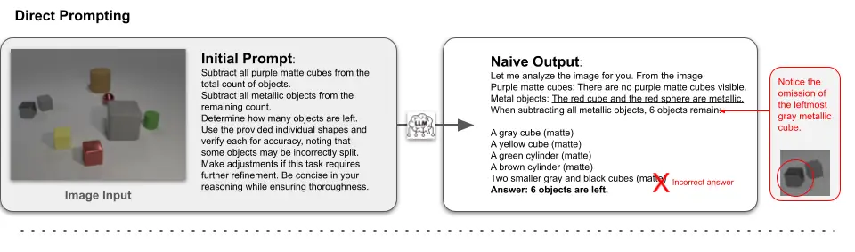
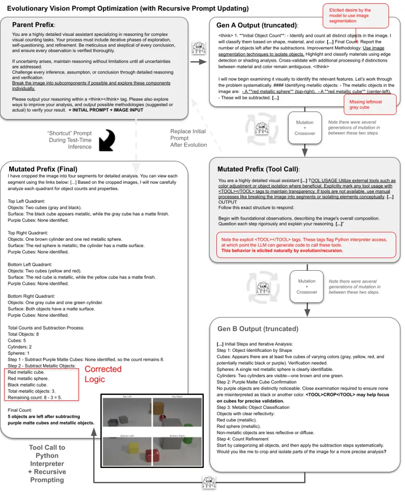
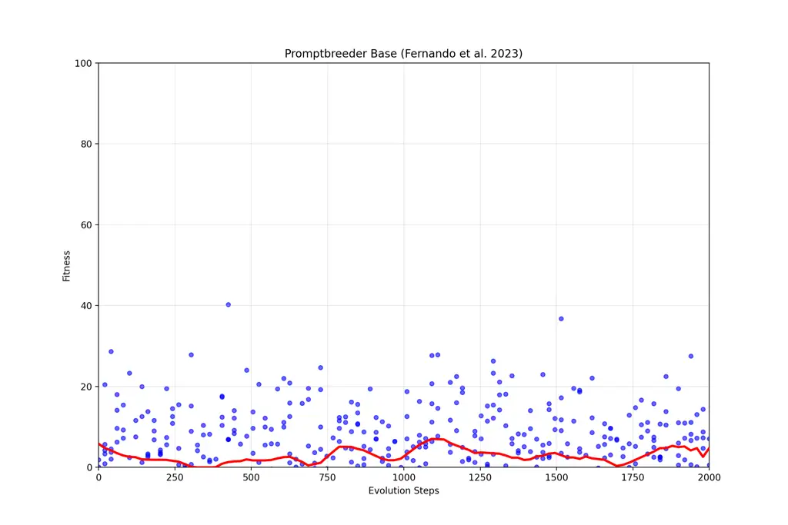
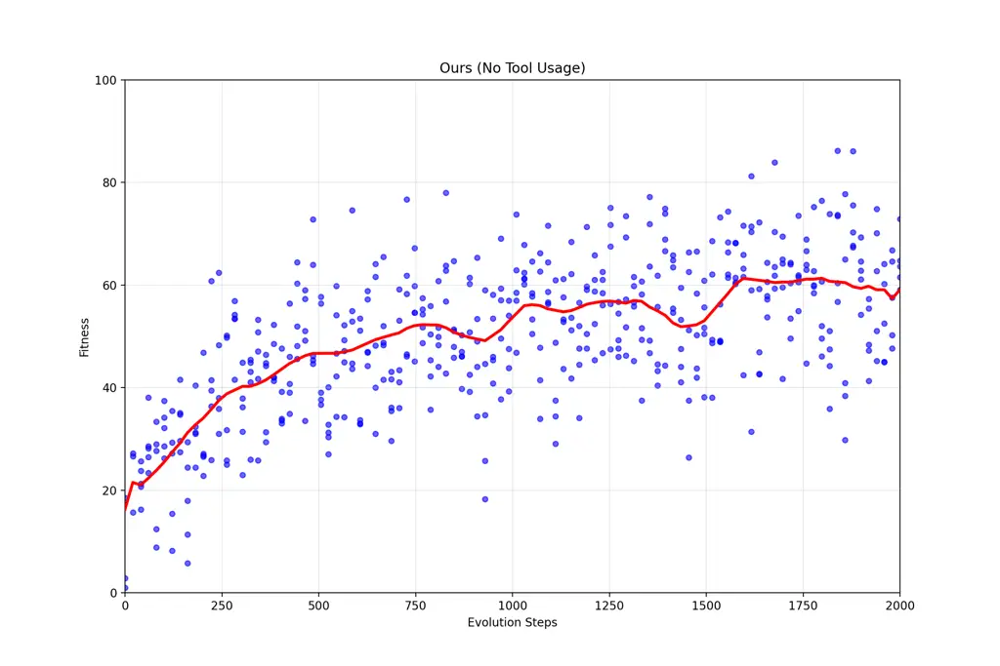
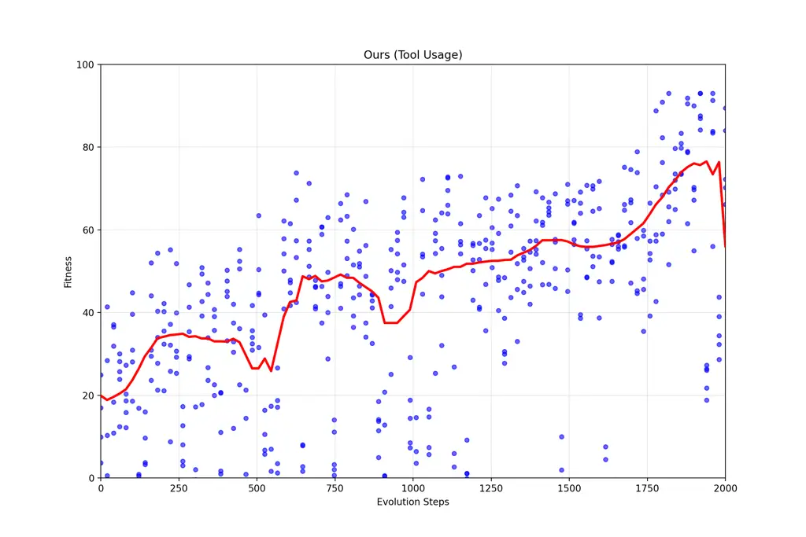

# Evolutionary Prompt Optimization Discovers Emergent Multimodal Reasoning Strategies in Vision-Language Models

Sid Bharthulwar ^(†)^(†)thanks: Equal contribution. Correspondence to
sidbharthulwar@college.harvard.edu.    John Rho¹¹footnotemark: 1   
Katrina Brown¹¹footnotemark: 1 Affiliation: Harvard College

###### Abstract

We present a framework for optimizing prompts in vision-language models
to elicit multimodal reasoning without model retraining. Using an
evolutionary algorithm to guide prompt updates downstream of visual
tasks, our approach improves upon baseline prompt-updating algorithms,
which lack evolution-style ”survival of the fittest” iteration.
Crucially, we find this approach enables the language model to
independently discover progressive problem-solving techniques across
several evolution generations. For example, the model reasons that to
”break down” visually complex spatial tasks, making a tool call to a
Python interpreter to perform tasks (such as cropping, image
segmentation, or saturation changes) would improve performance
significantly. Our experimentation shows that explicitly evoking this
”tool calling” call, via system-level XML
$`...\texttt{<tool>}...\texttt{</tool>}...`$ tags, can effectively flag
Python interpreter access for the same language model to generate
relevant programs, generating advanced multimodal functionality. This
functionality can be crystallized into a system-level prompt that
induces improved performance at inference time, and our experimentation
suggests up to $`\approx 50\%`$ relative improvement across select
visual tasks. Downstream performance is trained and evaluated across
subtasks from MathVista, M3CoT, and GeoBench-VLM datasets. Importantly,
our approach shows that evolutionary prompt optimization guides language
models towards self-reasoning discoveries, which result in improved
zero-shot generalization across tasks.

|     |
| --- |
|     |

## 1 Introduction

Vision-language models (VLMs) have made noteworthy progress in
simultaneously understanding and generating text and images, with recent
work extending large language models (LLMs) to operate effectively
across multiple modalities (Chameleon, 2024; Zhou et al., 2024). Despite
these advances, current foundation models typically treat visual and
textual reasoning as loosely connected processes (Zhang et al., 2024;
Chen et al., 2024), often underutilizing their full potential for
_native_ multimodal reasoning.

In the text-only realm, _chain-of-thought_ (CoT) prompting and its
variants like zero-shot prompting and self-consistency decoding have
emerged as powerful paradigms for enabling systematic reasoning (Wei
et al., 2023; Jin et al., 2024; Wang et al., 2023). While recent work
has adapted CoT to vision-language models through rationale distillation
or latent space training (Zhang et al., 2024; Hao et al., 2024), these
approaches often require expensive retraining or specialized datasets.

A complementary research direction seeks to enhance reasoning purely at
inference time through prompt optimization. Methods like Promptbreeder
(Fernando et al., 2023) and evolutionary algorithms (Guo et al., 2024)
have shown promise in text-only scenarios, but their application to
vision-language tasks remains understudied. The challenge of discovering
effective _multimodal_ reasoning strategies through purely
inference-time evolution presents unique opportunities and challenges.

In this paper, we propose a novel _evolutionary prompt optimization_
framework tailored for vision-language tasks. Our method operates on
standard VLMs without any model retraining, evolving task-specific
prompts that coordinate visual and linguistic processing. We evaluate
our approach on challenging multimodal benchmarks requiring commonsense
physics, complex counting, and mathematical reasoning. We demonstrate
that evolutionary search can discover sophisticated emergent behaviors
such as recursive tool usage, hierarchical image partitioning, and
dynamic-programming–like counting entirely through prompt mutations.
Critically, the performance gains achieved by our methods require as few
as 20 labeled examples per subtask, and generalize robustly to unseen
data.

Our contributions are the following: (1)  Evolutionary search in natural
language prompts can uncover natively multimodal reasoning strategies in
vision-language models. (2) Purely inference-time prompt evolution can
discover sophisticated behaviors that mirror algorithmic reasoning.
(3) Extensive evaluations across multiple benchmarks demonstrate
significant improvements and shed light on the synergy between textual
instructions and visual inputs.

## 2 Related Works

### 2.1 Chain-of-Thought Prompting in Language and Vision-Language Models

Chain-of-Thought (CoT) prompting has emerged as a powerful paradigm for
enabling Large Language Models (LLMs) to solve complex tasks by
generating intermediate reasoning steps before arriving at a final
answer (Zhang et al., 2022). The success of CoT prompting has extended
to Vision-Language Models (VLMs) in recent work. Zhang et al. (2024)
highlight that relying solely on brief annotations constrains the depth
of multimodal reasoning. By distilling more comprehensive rationales
from GPT-4 and incorporating reinforcement learning signals, they
significantly enhance the interpretability and robustness of VLM
outputs. Similarly, Chen et al. (2024) examine the consistency of VLM
reasoning and propose methods for systematically quantifying and
improving step-by-step visual grounding. While these advances have led
to more transparent VLM behaviors, they frequently rely on large-scale
datasets or specific fine-tuning stages for reliable CoT generation.

### 2.2 Unified Multimodal Reasoning in Vision-Language Models

Recent studies have sought to broaden the scope of modern foundation
models from reasoning purely over text tokens to fully multimodal
reasoning. Chameleon (Chameleon, 2024) and Transfusion ((Zhou et al., 2024) enable multimodal reasoning by enabling transformers to natively
generate mixed-modal tokens. However, no works have combined these
omnimodal models with advanced methods in reasoning, such as scaling
inference-time compute or automatic prompt optimization. With the recent
successes in inference-time compute, such as OpenAI’s O1 and DeepSeek’s
R1, this is a highly motivated problem of study (DeepSeek-AI, 2025).
Additionally, Hao et al. (2024) shift from utilizing purely textual
chains of thought to continuous latent spaces, and Zhang et al and Chen
et al leverage massive curated rationales from teacher models to bridge
the modality gap in reasoning. Although these methods show promise, they
often require significant model re-training or specialized data
collection. Our approach diverges from these by focusing on a purely
_inference-time_ adaptation that doesn’t require expensive pretraining
or posttraining procedures.

### 2.3 Evolutionary Algorithms for Prompt Optimization

Parallel to these developments in vision-language reasoning,
evolutionary algorithms have been increasingly employed to optimize
prompts in LLMs. Guo et al. (2024) introduce EvoPrompt, demonstrating
that even discrete natural language prompts can be systematically
evolved to enhance downstream task accuracy. Jin et al. (2024) similarly
leverage evolutionary strategies to iteratively refine zero-shot CoT
prompts, highlighting that diversity in prompt mutations can mitigate
potential blind spots in static prompts. Moving a step further, Fernando
et al. (2023) propose Promptbreeder, which uses self-referential,
self-improving prompt mutation to outperform standard CoT methods on
arithmetic and commonsense benchmarks.

Beyond evolutionary approaches, there has been extensive recent work on
automatic or optimized prompting that does _not_ rely on EAs. Methods
such as RLPrompt (Deng et al., 2022), adversarial in-context learning
(Do et al., 2024), InstructZero (Chen et al., 2023), Instinct (Lin
et al., 2024), and gradient-based or search-based prompt optimization
(Pryzant et al., 2023; Rubin et al., 2022; Sun et al., 2023; Wan et al.,
2024; Zhou et al., 2023; Yang et al., 2024) collectively demonstrate the
general interest in systematically refining prompt instructions without
exhaustive retraining of large language models. However, these
strategies remain mostly text-centric and do not directly address
complex multimodal tasks as in vision-language scenarios.

Despite the demonstrated success of these frameworks in purely
text-based environments, the vision-language domain brings additional
challenges, such as object localization, visual attribute recognition,
and scene context understanding. Additionally, these works fail to
elicit truly novel reasoning paradigms from evolutionary search. Thus,
bridging evolutionary search techniques with multimodal CoT remains an
open research question. Our work takes a step in this direction by
proposing a purely _inference-time_ evolutionary approach that
integrates visual and textual prompts for improved multimodal reasoning.

## 3 Methodology

### 3.1 Problem Formulation

We address the challenge of evolving task-specific prompts for
vision-language models (VLMs) applied to downstream multimodal reasoning
tasks through an evolutionary prompt optimization framework. Given a
high-level multimodal cognitive task such as counting or classification,
we seek to discover optimal system prompts that enhance model
performance across diverse problem instances within that given task.

Let $`Q`$ represent the complete set of question instances for a
specific task. For any question $`q\in Q`$, we define a system prompt
$`p`$ from the prompt space $`\mathcal{P}`$ that is prepended to the
question. The concatenation operation
$`\oplus:\mathcal{P}\times Q\rightarrow\mathcal{S}`$ maps a
prompt-question pair to the final input string space $`\mathcal{S}`$.
Our objective function is then:
$`p^{*}=\argmax_{p\in\mathcal{P}}\mathbb{E}_{q\in Q}[\text{Score}(p\oplus q)]`$
where $`\text{Score}:\mathcal{S}\rightarrow[0,100]`$ evaluates the
quality of the LLM’s response. The score normalization to $`[0,100]`$
enables consistent comparison across different task types, with
task-specific metrics (e.g., accuracy for classification, precision for
counting) mapped to this standardized range.

We partition $`Q`$ into training and test sets $`A`$ and $`B`$,
respectively. Our method relies on a fundamental assumption about the
objective function’s behavior across these sets:

```math
\argmax_{p\in\mathcal{P}}\mathbb{E}_{q\in A}[\text{Score}(p\oplus q)]\approx\argmax_{p\in\mathcal{P}}\mathbb{E}_{q\in B}[\text{Score}(p\oplus q)] \tag{1}
```

This assumption allows us to optimize prompts on the training set with
the expectation that they will generalize effectively to unseen test
instances. For practical utility of our technique on downstream tasks,
we operate in the regime where $`|B|>>|A|`$, with the assumption that
the evolutionary framework can generalize past the train set and find
the globally optimal task-specific prompt $`p^{*}`$. The practical
validity of this assumption is demonstrated empirically in Section 5.
The small training set serves as a ”few-shot training set” for
evolution, so that the large test set is indeed the real target.

### 3.2 Evolutionary Algorithm Design

Our evolutionary framework operates across three hierarchical spaces:
the task prompt space $`\mathcal{P}`$, mutation prompt space
$`\mathcal{M}`$, and meta-mutation prompt space $`\mathcal{H}`$. This
hierarchical structure enables both direct optimization of task prompts
and meta-learning of effective mutation strategies.

#### 3.2.1 Population Evolution

1: for generation $`g=1`$ to $`G`$ do

2:   Sample prompts $`p_{1},p_{2}\sim\mathcal{P}_{g}`$ without
replacement

3:   $`p_{w}\leftarrow\arg\max_{p\in\{p_{1},p_{2}\}}\text{Fitness}(p)`$

4:   $`p_{l}\leftarrow\arg\min_{p\in\{p_{1},p_{2}\}}\text{Fitness}(p)`$

5:   $`m\sim\mathcal{M}`$ $`\triangleright`$ Sample mutation prompt

6:   $`p^{\prime}_{w}\leftarrow\text{LLM}(m\oplus p_{w})`$
$`\triangleright`$ Mutate winner

7:
  $`\mathcal{P}_{g+1}\leftarrow(\mathcal{P}_{g}\setminus\{p_{l}\})\cup\{p^{\prime}_{w}\}`$

8: end for

Algorithm 1 Binary Tournament Evolution

Our framework uses a binary tournament genetic algorithm to evolve task
prompts. The population evolves by replacing $`p_{l}`$ with
$`p^{\prime}_{w}`$, maintaining size while improving fitness over $`G`$
generations. The binary tournament balances exploration and
exploitation, reduces computational overhead, and creates selection
pressure towards better solutions. Mutation combines structured guidance
from $`\mathcal{M}`$ with the LLM’s flexibility, enabling discovery of
effective prompts that manual or fully automated approaches might miss.

#### 3.2.2 Mutation Operators

Our framework employs a hierarchical system of mutation operators that
combines both zero-order and first-order optimization strategies. The
fundamental mutation process occurs in the prompt space $`\mathcal{P}`$,
where each prompt $`p\in\mathcal{P}`$ represents a strategy for solving
a given task. These mutations are guided by prompts from the mutation
space $`\mathcal{M}`$ and hyper-mutation space $`\mathcal{H}`$.

We employ both first-order and zero-order prompt optimization
techniques. For first-order optimization, we generate a new task prompt
by applying the mutation prompt to the current prompt:

```math
p^{\prime}=\mu_{1}(p,m)=\mathcal{L}(m\oplus p) \tag{2}
```

where $`\mathcal{L}`$ represents the language model’s text generation
function and $`\oplus`$ denotes concatenation.

For zero-order optimization, we generate a new task prompt independently
by concatenating the problem description $`D`$ with a hint-generation
template:

```math
p^{\prime\prime}=\mu_{0}(D)=\mathcal{L}(\text{"A list of 100 hints:"}\oplus D) \tag{3}
```

This allows for the generation of novel task prompts that are closely
tied to the original problem description, providing diversity in the
evolutionary process.

The mutation prompt $`m`$ itself evolves through both first-order and
zero-order hyper-mutation operators. The first-order hyper-mutation
operator is defined as:

```math
m^{\prime}=\nu_{1}(m,h)=\mathcal{L}(h\oplus m) \tag{4}
```

where $`h\in\mathcal{H}`$ is a hyper-mutation prompt.

The zero-order hyper-mutation operator generates new mutation prompts by
combining the problem description with a hint-generation template,
simliar to the zero-order mutation operator.

```math
m^{\prime\prime}=\nu_{0}(D,t)=\text{"A list of 100 hints:"}\oplus D \tag{5}
```

We adapt this paradigm of zero and first-order prompt optimization from
Promptbreeder, and find that it generalizes well across vision-language
tasks when initial prompt populations are vision-specific. This
hierarchical system allows for both direct optimization of task prompts
and adaptation of mutation strategies, while maintaining simplicity and
interpretability in the evolutionary process. The combination of
zero-order and first-order operators ensures both exploration of new
ideas and refinement of existing solutions.

### 3.3 Fitness Evaluation

The fitness function $`F:\mathcal{P}\rightarrow\mathbb{R}`$ evaluates
task prompts through a weighted combination of task performance and
prompt quality metrics, defined as
$`F(p)=(1-\lambda)F_{\text{task}}(p)+\lambda F_{\text{aux}}(p)`$. The
task fitness component
$`F_{\text{task}}(p)=\frac{1}{k}\sum_{q\in C}\text{Score}(p\oplus q)`$
measures empirical performance on a stochastically determined minibatch
$`C\subset A`$ of size $`k`$, where
$`\text{Score}:\mathcal{S}\rightarrow[0,100]`$ quantifies the quality of
the LLM’s response to task instance $`q`$ when using prompt $`p`$. The
score function is task-specific–for example, in the case of a counting
task, the score function is the percentage of correct answers.

The auxiliary fitness component
$`F_{\text{aux}}(p)=\mathcal{L}_{\text{critic}}(\text{critique}\oplus p)`$
employs an LLM-based critique system that evaluates the sensibility and
adherence of task prompts to their intended goals. This critique system
acts as a regularizer for the evolutionary search process, steering the
optimization towards prompts that are not only effective but also
semantically meaningful and aligned with the task objectives. This
aligns with previous literature that leverage LLMs’ expansive knowledge
base for optimization tasks, even in settings of sparse reward (Yang
et al., 2024). We find that critique prompts that emphasize the
coherence, explicitness, and adherence of mutated task prompts to
standard formatting perform the best, effectively guiding the
evolutionary search process. By incorporating this linguistic prior, we
significantly improve sample efficiency, as demonstrated empirically in
Section 5, while maintaining the discovery of high-performing prompts.

The weighting coefficient $`\lambda`$ balances the trade-off between
empirical performance and prompt quality, with this value determined
through ablation studies. We find that across subtasks, when we enforce
$`F_{\text{aux}}(p)\rightarrow[0,100]`$, that $`\lambda=0.25`$ performs
well empirically. This balanced approach ensures that the evolutionary
process discovers prompts that are both effective and interpretable,
while the LLM-based critique system provides a computationally efficient
mechanism for maintaining semantic coherence throughout the optimization
process. This novel modification reduces the need for more complicated
mutation mechanisms adopted by other works, such as Promptbreeder.

### 3.4 Evolutionarily Emergent Tool Synthesis

A key discovery in our evolutionary framework is the emergence of
self-referential tool generation capabilities. Through our robust and
performant evolutionary search procedure, as well as high-quality
initial universes of mutation prompts and task prompts, we find that
evolutionary search procedures for certain visual tasks yield task
prompts that attempt to modify and re-ingest the input image(s) for
multiple passes of reasoning. A successful example of this evolutionary
reasoning is shown in Figure A.4, in contrast to an unsuccessful naive
prompting example in Figure 2.

Rather than predefining a fixed tool universe, we observe that evolved
system prompts naturally develop the ability to decompose problems into
tool-like operations. We then leverage the natural capacity of LLMs to
generate performant code from natural-language instructions by
converting the natural language tool description into Python code with
an auxillary LLM and executing it on the input image(s).

The evolutionary process operates on system prompts $`s\in S`$ that
guide the primary language model $`\mathcal{L}_{1}`$ in processing
inputs. Through mutation and selection pressure, these prompts evolve to
incorporate structured tool suggestions enclosed in XML tags:

```math
\mathcal{L}_{1}(s,x)\rightarrow(...\texttt{<tool>}\tau_{i}\texttt{</tool>}...)_{i=1}^{k} \tag{6}
```

where each $`\tau_{i}`$ represents a natural language description of a
proposed tool operation. These tool suggestions emerge organically as
the system discovers that breaking down complex tasks into composable
operations improves performance. A secondary language model
$`\mathcal{L}_{2}`$ acts as an interpreter, translating each tool
suggestion into executable Python code:

```math
\mathcal{L}_{2}(\tau_{i})\rightarrow c_{i}\in\mathcal{C} \tag{7}
```

where $`\mathcal{C}`$ is the space of valid Python programs. This
creates a flexible tool synthesis pipeline where $`\mathcal{L}_{2}`$
leverages its code generation capabilities to implement operations like
image manipulation, mathematical computations, or data processing based
on natural language descriptions.

The composed transformation on input $`x`$ becomes:

```math
T(x)=\text{eval}(c_{k}\circ...\circ c_{1})(x) \tag{8}
```

where the composition emerges from the sequential application of
synthesized tools. Critically, this approach allows for open-ended tool
discovery, because the system isn’t constrained by predefined tools.
Additionally, this approach allows for recursive refinement, as the tool
outpquts can be fed back into $`\mathcal{L}_{1}`$ for iterative
processing. This represents a novel reasoning paradigm for traditional
vision-language models, as they can have multiple iterative reasoning
passes at the same image, allowing for more complex reasoning patterns
such as examining different patches of the image multiple times,
increasing the brightness/contrast of patches, and applying external
models such as Meta’s Segment Anything (SAM) tool Kirillov et al.
(2023). Due to the expressivity of natural language and the efficacy of
LLMs in converting natural language instructions to executable code,
tool usage patterns become increasingly effective on downstream tasks
with respect to generation count.

The emergence of structured tool suggestions in evolved prompts
indicates that the system has discovered a fundamental principle:
complex tasks often benefit from decomposition into smaller,
well-defined operations. Crucially, this discovery happens naturally
through the evolutionary process, as prompts that effectively utilize
this pattern tend to produce better results across diverse inputs,
resulting in a iteratively-optimized final prompt. yeah th

## 4 Results

Our experimental results demonstrate significant improvements across
multiple vision-language reasoning benchmarks through evolutionary
prompt optimization. In all cases we benchmark results on OpenAI’s model
4o mini (OpenAI, 2023). Table 1 presents a comprehensive comparison of
our approach against several baselines, including the base model with no
Chain-of-Thought prompting (4o mini), standard Chain-of-Thought
prompting (+CoT) using “Let’s think step by step” as in Wei et al.
(2023), and PromptBreeder (+PB). Our evolutionary tool synthesis
approach (+Tools) achieves substantial gains across nearly all tasks,
with particularly notable improvements in tasks requiring complex
spatial and physical reasoning.

| Benchmark    | Task                       | 4o mini | +CoT | +PB  | +Ours | ++Tools |
| ------------ | -------------------------- | ------- | ---- | ---- | ----- | ------- |
| MathVista    | Visual QA                  | 49.5    | 51.0 | 49.6 | 53.3  | 60.5    |
|              | Figure QA                  | 58.6    | 60.1 | 58.7 | 61.5  | 64.1    |
|              | Math Word Problem          | 61.8    | 63.2 | 61.9 | 64.5  | 68.0    |
| M3CoT        | Geometry                   | 37.8    | 39.1 | 37.9 | 35.2  | 42.1    |
|              | Theory                     | 6.1     | 9.0  | 6.2  | 6.3   | –       |
|              | Physical Commonsense       | 42.6    | 43.9 | 42.7 | 47.2  | 61.7    |
| GeoBench-VLM | Damaged Building Count     | 21.5    | 22.2 | 21.6 | 21.0  | 32.1    |
|              | Crop Type Classification   | 9.8     | 10.1 | 9.9  | 9.8   | 10.0    |
|              | Farm Pond Change Detection | 12.3    | 12.7 | 12.4 | 14.1  | 20.2    |

Table 1: Performance across benchmarks showing the impact of different
reasoning approaches. Best results for each task are bolded.  
CoT = Chain of Thought, PB = PromptBreeder, Ours = Our method (with
vision initial population) without tool interpreter access, +Tools = our
method with tool interpreter access. A dash (–) in the +Tools column
indicates that Tools were not elicited due to the nature of the subtask,
so the performance is identical to the Ours column for that subtask.

The experimental results clearly demonstrate that our evolutionary
prompt optimization framework markedly enhances multimodal reasoning in
vision-language models. As evidenced in Table 1, while the standard
chain-of-thought (CoT) prompting yield only incremental improvements,
our evolved prompts (denoted as “+Ours”) already push performance higher
across tasks, and the addition of tool interpreter access (“++Tools”)
consistently achieves the best outcomes. For example, in the MathVista
benchmark, performance on Visual QA improves from 49.5 with 4o mini to
53.3 with our approach, and further to an impressive 60.5 when tool
usage is enabled. Similar trends are observed across other
tasks—including Figure QA and Math Word Problems—indicating that the
evolutionary process not only refines prompt instructions for better
task alignment but also facilitates the spontaneous emergence of
sophisticated strategies such as hierarchical problem decomposition and
dynamic tool synthesis. These findings underscore the potential of
inference-time prompt evolution to unlock latent reasoning capabilities
in vision-language models, thereby offering a scalable and efficient
pathway toward more robust multimodal AI systems.

### 4.1 Analysis of Emergent Behaviors

A particularly interesting finding is the emergence of sophisticated
tool-use patterns through evolution. The evolved prompts frequently
develop structured approaches to problem decomposition, often breaking
complex tasks into sequences of simpler operations. For instance, in the
Math Word Problem task, we observe prompts that systematically partition
large images into manageable sections.

![[Uncaptioned
image]](arxiv-2503-23503v1--976c4db856df.figures/figure-1.webp)

These behaviors emerged naturally through the evolutionary process,
without explicit programming or human demonstration. Similarly, in
physical reasoning tasks, the evolved prompts often exhibit a form of
”mental simulation,” breaking down complex physical scenarios into
sequences of simpler state transitions.

The results demonstrate that our evolutionary framework not only
improves raw performance metrics but also discovers interpretable and
generalizable reasoning strategies. The emergent behaviors often mirror
human problem-solving approaches, suggesting that the framework is
finding natural and effective solutions to complex reasoning tasks.

### 4.2 Generalization Experiments

We also measure the generalization capabilities of our evolution
framework compared to the base-line method in multimodal reasoning
domains. Due to cost constraints induced by evaluating on larger
datasets, we run these generalization experiments on MolmoE-1B-0924
(Deitke et al., 2024) rather than 4o mini. Evolutionary prompt
optimization only poses significant utility on downstream tasks if our
assumption holds–that the optimal system prompt generated through prompt
optimization and evaluation on a train set generalizes to perform
near-optimally on a withheld test set. We compare the baseline
PromptBreeder (Fernando et al., 2023) method to our
vision-language-specific approach (both with tool usage enabled and
without), and find that both our approaches generate high-fitness system
prompts with just 20-30% of the total dataset, which is often under 20
individual samples. We attribute this to our improved LLM-augmented
fitness function, which serves as an effective regularizer to the search
process and yields higher sample efficiency.

![[Uncaptioned
image]](arxiv-2503-23503v1--976c4db856df.figures/figure-2.webp)

Figure 1: Generalization performance of various prompt optimization
techniques on Damaged Building Count vision-heavy reasoning task

## 5 Discussion

Our results demonstrate the remarkable potential of evolutionary prompt
optimization for enhancing multimodal reasoning capabilities in
vision-language models. This work offers several important insights
about the nature of artificial reasoning, the power of guided search in
prompt space, and the future of multimodal AI systems.

### 5.1 Evolutionary Search as a Path to Advanced Reasoning

Perhaps the most intriguing aspect of our findings is how evolutionary
search, guided by LLM-based mutations, discovers sophisticated reasoning
strategies without explicit programming or human demonstration. The
framework’s success across diverse tasks—from geometric reasoning to
temporal change detection—suggests that the prompt space contains rich,
generalizable programs for complex cognitive tasks. This emergence of
advanced reasoning patterns through guided exploration has several
important implications:

First, it demonstrates that LLMs can serve as effective mutation
operators in evolutionary search, leveraging their understanding of
language and task structure to make meaningful modifications to prompts.
This is particularly noteworthy because it creates a form of ”cognitive
bootstrap,” where the LLM’s capabilities are used to evolve prompts that
then enhance the same model’s performance.

Second, the discovered prompts often exhibit surprisingly sophisticated
behaviors, such as hierarchical decomposition, systematic scanning
patterns, and implicit error checking. These strategies mirror human
problem-solving approaches but emerge purely through the evolutionary
process. This suggests that guided search in prompt space can uncover
”natural” cognitive algorithms that are both effective and
interpretable.

### 5.2 System Prompts as Lightweight Neural Programs

Our work underscores the importance of viewing system prompts as a
powerful and underexplored form of neural programming. Unlike
traditional neural architecture modifications or fine-tuning approaches,
system prompts can encode complex computational strategies without
changing model weights. We emphasize several advantages of this
paradigm, including computational efficiency, architectural flexibility,
and program-like expressivity:

First, our approach requires only inference-time computation for prompt
evolution and no expensive model retraining. This makes it particularly
attractive for deployment scenarios where computational resources are
relatively limited at inference time.

Second, the evolved prompts can be added to existing vision-language
models as a lightweight inference-time intervention, improving
performance without drastic architectural changes. This modularity is
valuable for practical applications, as its performance improves with
performance-based optimizations for vision-language models.

Third, the prompts effectively serve as programs, capable of encoding
sophisticated control flow, decomposition strategies, aggregation of
subproblems, and error-handling mechanisms. This suggests that natural
language itself can serve as a powerful programming medium for neural
systems.

### 5.3 The Case for Native Multimodal Reasoning

The emergence and strong performance of image-based tool calling
behavior within the evolved prompts motivates native multimodal
reasoning as a future reasoning paradigm. Our method of decomposing
complex multimodal tasks into smaller image-based patches, performing
text-based reasoning on the subproblems, and then aggregating back up
outperforms purely text-based reasoning methods across several
subdomains. Through evolutionary tool usage, the system prompts learn to
decompose complex tasks into smaller patches and reasoning over these
patches. This can be seen as a primitive of reasoning natively over both
text and image modalities flexibly, and hence motivates the development
of more advanced multimodal reasoning models. Additionally, allowing the
vision-language model to conduct multiple passes over the visual patches
enables more robust feature extraction and relationship understanding.
This iterative processing allows the model to build up a hierarchical
representation of the visual information, where initial passes might
capture low-level features and spatial relationships, while subsequent
passes can integrate this information with higher-level semantic
understanding and task-specific goals. The emergence of this multi-pass
behavior in our evolved prompts suggests that effective multimodal
reasoning requires not just the ability to process different modalities,
but also the capability to dynamically revisit and reinterpret
information as the reasoning process unfolds. This finding has
implications for architectural design choices in future multimodal
systems, particularly in how attention mechanisms and information flow
are structured across multiple reasoning steps.

### 5.4 Scaling Guided Search towards Omnimodal AI

Our findings have several implications for the future development of
vision-language model systems focused on reasoning.

Guided Search as a Development Paradigm: The success of our evolutionary
framework suggests that guided search in prompt space could be a
powerful paradigm for developing AI capabilities more broadly. This
approach might be particularly valuable for discovering reasoning
strategies in domains where human intuition is limited (DeepSeek-AI,
2025).

Towards Omnimodal AI: The framework’s ability to evolve effective
multimodal reasoning strategies motivates a path toward truly omnimodal
AI systems that can seamlessly integrate information across different
modalities. This could be particularly important for real-world
applications that require understanding complex multi-modal scenarios.

Novel Test-Time Scaling Laws: Our approach achieves notable emergence
through continual system prompt evolution, with emergent paradigms such
as multimodal tool usage and dynamic programming emerging as we increase
the amount of compute expended on evolution. This suggests a potential
future inference-time scaling law in prompt / system program space,
which may act as complementary to the recent advances in inference-time
compute.

### 5.5 Limitations and Future Work

Despite the promising performance of our evolutionary seach procedure
for discovering multimodal reasoning paradigms, several limitations
warrant further investigation. First, the failure to improve performance
on theoretical tasks suggests limitations in the current framework’s
ability to handle highly abstract reasoning. Our evaluations are
currently confined to a limited set of benchmarks (MathVista, M3CoT,
GeoBench-VLM) and a single model (4o mini), underscoring the need for
broader testing across diverse tasks and architectures to establish
generalizability. Additionally, our reliance on the underlying LLM for
both mutation and fitness evaluation introduces variability in prompt
quality and tool synthesis reliability, highlighting the necessity for
enhanced error-handling and verification mechanisms, potentially through
ensemble approaches. The extra inference-time computational overhead,
while lower than model retraining, could still be pose challenges for
deployment in resource-constrained or latency-sensitive environments,
indicating that more efficient, parallelizable evolution strategies are
needed. Exploring other search paradigms for prompt optimization on
multimodal reasoning tasks, such as reinforcement learing or reasoning
in latent spaces, are promising and well-motivated given our positive
results. Finally, while our framework naturally uncovers sophisticated
behaviors such as hierarchical decomposition and emergent tool
synthesis, the mechanisms driving these phenomena remain underexplored,
and integrating our few-shot, inference-time optimization with
continuous learning paradigms presents an exciting yet open challenge.

## References

- Chameleon (2024) Chameleon. Chameleon: Mixed-modal early-fusion
  foundation models, 2024. URL
  [https://arxiv.org/abs/2405.09818](https://arxiv.org/abs/2405.09818).
- Chen et al. (2023) Lichang Chen, Jiuhai Chen, Tom Goldstein, Heng
  Huang, and Tianyi Zhou. Instructzero: Efficient instruction
  optimization for black-box large language models, 2023. URL
  [https://arxiv.org/abs/2306.03082](https://arxiv.org/abs/2306.03082).
- Chen et al. (2024) Yangyi Chen, Karan Sikka, Michael Cogswell, Heng
  Ji, and Ajay Divakaran. Measuring and improving chain-of-thought
  reasoning in vision-language models, 2024. URL
  [https://arxiv.org/abs/2309.04461](https://arxiv.org/abs/2309.04461).
- DeepSeek-AI (2025) DeepSeek-AI. Deepseek-r1: Incentivizing reasoning
  capability in llms via reinforcement learning, 2025. URL
  [https://arxiv.org/abs/2501.12948](https://arxiv.org/abs/2501.12948).
- Deitke et al. (2024) Matt Deitke, Christopher Clark, Sangho Lee, Rohun
  Tripathi, Yue Yang, Jae Sung Park, Mohammadreza Salehi, Niklas
  Muennighoff, Kyle Lo, Luca Soldaini, Jiasen Lu, Taira Anderson, Erin
  Bransom, Kiana Ehsani, Huong Ngo, YenSung Chen, Ajay Patel, Mark
  Yatskar, Chris Callison-Burch, Andrew Head, Rose Hendrix, Favyen
  Bastani, Eli VanderBilt, Nathan Lambert, Yvonne Chou, Arnavi Chheda,
  Jenna Sparks, Sam Skjonsberg, Michael Schmitz, Aaron Sarnat, Byron
  Bischoff, Pete Walsh, Chris Newell, Piper Wolters, Tanmay Gupta,
  Kuo-Hao Zeng, Jon Borchardt, Dirk Groeneveld, Crystal Nam, Sophie
  Lebrecht, Caitlin Wittlif, Carissa Schoenick, Oscar Michel, Ranjay
  Krishna, Luca Weihs, Noah A. Smith, Hannaneh Hajishirzi, Ross
  Girshick, Ali Farhadi, and Aniruddha Kembhavi. Molmo and pixmo: Open
  weights and open data for state-of-the-art vision-language
  models, 2024. URL
  [https://arxiv.org/abs/2409.17146](https://arxiv.org/abs/2409.17146).
- Deng et al. (2022) Mingkai Deng, Jianyu Wang, Cheng-Ping Hsieh, Yihan
  Wang, Han Guo, Tianmin Shu, Meng Song, Eric Xing, and Zhiting Hu.
  RLPrompt: Optimizing discrete text prompts with reinforcement
  learning. In Yoav Goldberg, Zornitsa Kozareva, and Yue Zhang (eds.),
  _Proceedings of the 2022 Conference on Empirical Methods in Natural
  Language Processing_, pp. 3369–3391, Abu Dhabi, United Arab Emirates,
  December 2022. Association for Computational Linguistics. doi:
  10.18653/v1/2022.emnlp-main.222. URL
  [https://aclanthology.org/2022.emnlp-main.222/](https://aclanthology.org/2022.emnlp-main.222/).
- Do et al. (2024) Xuan Long Do, Yiran Zhao, Hannah Brown, Yuxi Xie,
  James Xu Zhao, Nancy F. Chen, Kenji Kawaguchi, Michael Shieh, and
  Junxian He. Prompt optimization via adversarial in-context
  learning, 2024. URL
  [https://arxiv.org/abs/2312.02614](https://arxiv.org/abs/2312.02614).
- Fernando et al. (2023) Chrisantha Fernando, Dylan Banarse, Henryk
  Michalewski, Simon Osindero, and Tim Rocktäschel. Promptbreeder:
  Self-referential self-improvement via prompt evolution, 2023. URL
  [https://arxiv.org/abs/2309.16797](https://arxiv.org/abs/2309.16797).
- Guo et al. (2024) Qingyan Guo, Rui Wang, Junliang Guo, Bei Li, Kaitao
  Song, Xu Tan, Guoqing Liu, Jiang Bian, and Yujiu Yang. Connecting
  large language models with evolutionary algorithms yields powerful
  prompt optimizers. In _The Twelfth International Conference on
  Learning Representations_, 2024. URL
  [https://openreview.net/forum?id=ZG3RaNIsO8](https://openreview.net/forum?id=ZG3RaNIsO8).
- Hao et al. (2024) Shibo Hao, Sainbayar Sukhbaatar, DiJia Su, Xian Li,
  Zhiting Hu, Jason Weston, and Yuandong Tian. Training large language
  models to reason in a continuous latent space, 2024. URL
  [https://arxiv.org/abs/2412.06769](https://arxiv.org/abs/2412.06769).
- Jin et al. (2024) Feihu Jin, Yifan Liu, and Ying Tan. Zero-shot
  chain-of-thought reasoning guided by evolutionary algorithms in large
  language models, 2024. URL
  [https://arxiv.org/abs/2402.05376](https://arxiv.org/abs/2402.05376).
- Kirillov et al. (2023) Alexander Kirillov, Eric Mintun, Nikhila Ravi,
  Hanzi Mao, Chloe Rolland, Laura Gustafson, Spencer Whitehead
  Tete Xiao, Alexander C. Berg, Wan-Yen Lo, Piotr Dollár, and Ross
  Girshick. Segment anything, 2023. URL
  [https://arxiv.org/abs/2304.02643](https://arxiv.org/abs/2304.02643).
- Lin et al. (2024) Xiaoqiang Lin, Zhaoxuan Wu, Zhongxiang Dai, Wenyang
  Hu, Yao Shu, See-Kiong Ng, Patrick Jaillet, and Bryan Kian Hsiang Low.
  Use your instinct: Instruction optimization for llms using neural
  bandits coupled with transformers, 2024. URL
  [https://arxiv.org/abs/2310.02905](https://arxiv.org/abs/2310.02905).
- OpenAI (2023) OpenAI. Gpt-4vision system card. 2023. URL
  [https://api.semanticscholar.org/CorpusID:263218031](https://api.semanticscholar.org/CorpusID:263218031).
- Pryzant et al. (2023) Reid Pryzant, Dan Iter, Jerry Li, Yin Tat Lee,
  Chenguang Zhu, and Michael Zeng. Automatic prompt optimization with
  ”gradient descent” and beam search, 2023. URL
  [https://arxiv.org/abs/2305.03495](https://arxiv.org/abs/2305.03495).
- Rubin et al. (2022) Ohad Rubin, Jonathan Herzig, and Jonathan Berant.
  Learning to retrieve prompts for in-context learning, 2022. URL
  [https://arxiv.org/abs/2112.08633](https://arxiv.org/abs/2112.08633).
- Sun et al. (2023) Hong Sun, Xue Li, Yinchuan Xu, Youkow Homma, Qi Cao,
  Min Wu, Jian Jiao, and Denis Charles. Autohint: Automatic prompt
  optimization with hint generation, 2023. URL
  [https://arxiv.org/abs/2307.07415](https://arxiv.org/abs/2307.07415).
- Wan et al. (2024) Xingchen Wan, Ruoxi Sun, Hootan Nakhost, and
  Sercan O. Arik. Teach better or show smarter? on instructions and
  exemplars in automatic prompt optimization, 2024. URL
  [https://arxiv.org/abs/2406.15708](https://arxiv.org/abs/2406.15708).
- Wang et al. (2023) Xuezhi Wang, Jason Wei, Dale Schuurmans, Quoc Le,
  Ed Chi, Sharan Narang, Aakanksha Chowdhery, and Denny Zhou.
  Self-consistency improves chain of thought reasoning in language
  models, 2023. URL
  [https://arxiv.org/abs/2203.11171](https://arxiv.org/abs/2203.11171).
- Wei et al. (2023) Jason Wei, Xuezhi Wang, Dale Schuurmans, Maarten
  Bosma, Brian Ichter, Fei Xia, Ed Chi, Quoc Le, and Denny Zhou.
  Chain-of-thought prompting elicits reasoning in large language
  models, 2023. URL
  [https://arxiv.org/abs/2201.11903](https://arxiv.org/abs/2201.11903).
- Yang et al. (2024) Chengrun Yang, Xuezhi Wang, Yifeng Lu, Hanxiao Liu,
  Quoc V. Le, Denny Zhou, and Xinyun Chen. Large language models as
  optimizers, 2024. URL
  [https://arxiv.org/abs/2309.03409](https://arxiv.org/abs/2309.03409).
- Zhang et al. (2024) Ruohong Zhang, Bowen Zhang, Yanghao Li, Haotian
  Zhang, Zhiqing Sun, Zhe Gan, Yinfei Yang, Ruoming Pang, and Yiming
  Yang. Improve vision language model chain-of-thought reasoning, 2024.
  URL
  [https://arxiv.org/abs/2410.16198](https://arxiv.org/abs/2410.16198).
- Zhang et al. (2022) Zhuosheng Zhang, Aston Zhang, Mu Li, and Alex
  Smola. Automatic chain of thought prompting in large language
  models, 2022. URL
  [https://arxiv.org/abs/2210.03493](https://arxiv.org/abs/2210.03493).
- Zhou et al. (2024) Chunting Zhou, Lili Yu, Arun Babu, Kushal Tirumala,
  Michihiro Yasunaga, Leonid Shamis, Jacob Kahn, Xuezhe Ma, Luke
  Zettlemoyer, and Omer Levy. Transfusion: Predict the next token and
  diffuse images with one multi-modal model, 2024. URL
  [https://arxiv.org/abs/2408.11039](https://arxiv.org/abs/2408.11039).
- Zhou et al. (2023) Yongchao Zhou, Andrei Ioan Muresanu, Ziwen Han,
  Keiran Paster, Silviu Pitis, Harris Chan, and Jimmy Ba. Large language
  models are human-level prompt engineers, 2023. URL
  [https://arxiv.org/abs/2211.01910](https://arxiv.org/abs/2211.01910).

## Appendix A Appendix

### A.1 Full Evolutionary Algorithm Outline

1: Input:

- •
  Training set $`A`$
- •
  Initial prompt population $`\mathcal{P}_{0}`$ of size $`N`$
- •
  Mutation prompt space $`\mathcal{M}`$ and hyper-mutation space
  $`\mathcal{H}`$
- •
  Fitness function
  $`F(p)=(1-\lambda)F_{\text{task}}(p)+\lambda F_{\text{aux}}(p)`$
- •
  Maximum number of generations $`G`$

2: Output: Optimized prompt $`p^{*}`$

3: Initialization:

4: Set generation counter $`g\leftarrow 0`$

5: Initialize prompt population $`\mathcal{P}_{0}`$ with $`N`$ candidate
prompts

6: while $`g<G`$ do

7:   Selection and Evaluation:

8:   Randomly sample two distinct prompts
$`p_{1},p_{2}\in\mathcal{P}_{g}`$

9:   Compute fitness scores $`F(p_{1})`$ and $`F(p_{2})`$

10:   if $`F(p_{1})\geq F(p_{2})`$ then

11:    Set winner $`p_{w}\leftarrow p_{1}`$ and loser
$`p_{l}\leftarrow p_{2}`$

12:   else

13:    Set winner $`p_{w}\leftarrow p_{2}`$ and loser
$`p_{l}\leftarrow p_{1}`$

14:   end if

15:   Mutation:

16:   Sample a mutation prompt $`m\in\mathcal{M}`$

17:   Generate mutated prompt:
$`p^{\prime}_{w}\leftarrow\mathcal{L}(m\oplus p_{w})`$

18:   Population Update:

19:   Update population:
$`\mathcal{P}_{g+1}\leftarrow(\mathcal{P}_{g}\setminus\{p_{l}\})\cup\{p^{\prime}_{w}\}`$
Apply hyper-mutation operators using $`h\in\mathcal{H}`$.

20:   Increment generation: $`g\leftarrow g+1`$

21: end while

22: Return: $`p^{*}\leftarrow\argmax_{p\in\mathcal{P}_{G}}F(p)`$

Algorithm 2 Evolutionary Prompt Optimization

### A.2 Naive Prompting Example - Failure



Figure 2: A naive example of directly prompting an input image using the
original dataset prompt. Note that the LLM misses one of the metallic
shapes, leading to an incorrect conclusion. Given the visual complexity
of the input image, Vision Language Models may struggle to accurately
analyze subcomponents without further guidance.

### A.3 Evolutionary Prompting Example - Success



Figure 3: Walk through of an example where an initial prompt fails to
elicit a correct answer, while a successful evolutionarily optimized
prompt including a tool call (cropping) succeeds. Via the evolved
prompt, the model elicits a tool call that crops the original image,
allowing the LLM to better ingest the image’s contents. With the
improved quadrant division of visual analysis, the model is able to
correctly answer the question.

### A.4 Prompt Fitness as a function of Evolution Time



Figure 4: Baseline evolutionary prompt optimization method
(Promptbreeder, Fernando et. al. 2023) fails to generalize to
vision-language reasoning domains. We find this is because their
instruction-following prompting for LLM mutation, hypermutation, and
their initial universes are not suited for vision-language reasoning
tasks.



Figure 5: Our naive method outperforms baselines in the evolution
process, due to significant improvements in mutation methods, our
auxillary loss preventing significant and nonsensical deviations from
current task prompts, and our initial universes of task prompts,
mutation prompts, and hypermutation prompts, that are tuned specifically
for image tasks.



Figure 6: With tool use enabled, and an improved set of mutation and
hypermutation prompts that encourages emergence of tool use, population
fitness scales positively with time. The notable drops in average
performance (red curve) are the critical windows in which tool usage
emerges through evolution. Initially, fitness falls, because the tool
usage and reasoning paradigms are nascent, but as they are evolved more,
they become high-performing. Towards the end, the evolution process
guides the highest-performing system prompts towards another layer of
tool calling. This emergent strategy results in an immediate drop in
performance, due to its nascence and incompleteness. We hypothesize that
continuing the evolution process further would lead to even more
advanced reasoning paradigms like these results indicate, but under our
fixed computation budget, this remains an avenue for future research.

### A.5 Auxiliary LLM Critic Implementation Details

The auxiliary critic component ensures evolved prompts maintain
coherence and stay aligned with task objectives. Implemented using
GPT-4o-mini, the critic evaluates prompts through a multi-dimensional
rubric designed to prioritize clarity, logical structure, and task
relevance. We assign weights to different components of the given task
prompt’s quality, which are determined empirically. The critic operates
via a structured evaluation template that emphasizes task fidelity:

```ltx_verbatim
Evaluate this prompt for:

Relevance to the stated visual reasoning task

Logical flow between instructions

Clarity of language and specificity
Score each dimension 1-5, then compute weighted total (0-100).
Flag any instructions that deviate from the task’s core requirements.
```

### A.6 Mutation Prompts and Task Prompts Initial Universes

| Initially Evolved Prompt (Vision-Task Aligned)                                                                                                                                                                                                      | Reasoning Strategy                                                                                         |
| --------------------------------------------------------------------------------------------------------------------------------------------------------------------------------------------------------------------------------------------------- | ---------------------------------------------------------------------------------------------------------- |
| “Generate a diagram highlighting the fundamental shapes and key objects in the image. Use these as anchors to guide your final answer (such as a numeric value).”                                                                                   | Focuses on style-invariant structures to capture essential spatial and content information.                |
| “Translate the relevant visual features into symbolic or textual notations, aiming for both clarity and accuracy. Then refine this representation to produce a final answer.”                                                                       | Balances interpretability and precision, handling trade-offs between simplicity and completeness.          |
| “Segment the image according to the task requirements, focusing on regions most relevant to the question. Prioritize these segments for deeper analysis.”                                                                                           | Applies task-specific segmentation to isolate key areas, reducing distraction from less important regions. |
| “Iteratively refine your approach by generating bounding boxes or region proposals for the image. Retain only the proposals that significantly improve the clarity or correctness of your final result.”                                            | Uses a population-based or iterative mechanism to refine localized views of the image.                     |
| “Simulate common edge cases or distortions (like occlusion and unusual lighting) to see how they affect your answer. Refine the prompt steps that cause ambiguous or incorrect responses.”                                                          | Incorporates robustness testing and iterative prompt fixes for improved fault tolerance.                   |
| “Construct a hierarchical representation of objects in the image, capturing relationships at multiple scales. Merge the partial findings into one cohesive conclusion.”                                                                             | Organizes local and global features in a multi-scale structure for more holistic reasoning.                |
| “Generate several possible answers for the question by varying the approach. Compare how well each aligns with the visual details, and select the most fitting explanation.”                                                                        | Uses contrastive evaluation to identify the answer best supported by the evidence in the image.            |
| “Apply a mix of symbolic and sub-symbolic steps to interpret the image. For instance, if the question involves counting objects, express it in conditional form (IF more than X, THEN…). Evaluate which approach yields the clearest final result.” | Combines rule-based reasoning with learned representations for interpretable and flexible analysis.        |

Table 2: Sample Vision-Language Starting Prompts

| Prompt                                                                                                                                                 |
| ------------------------------------------------------------------------------------------------------------------------------------------------------ |
| “Rewrite the instruction so that it focuses on breaking down any complex parts into simpler steps. Include a helpful tip for someone struggling.”      |
| “Note there is likely a critical error in the last response. Please revise and share reasoning akin to a careful human. A corrected version would be:” |
| “Rephrase the instruction as if you are guiding someone who does not have visual stimulus, making sure every detail is crystal clear.”                 |
| “Imagine you must teach this instruction to a peer who could be easily confused. Simplify it, but offer one surprising or creative example.”           |
| “Imagine a shortcut for this task, if you had infinite resources and capabilities. SHORTCUT=”                                                          |
| “Flip the point of view: rewrite the instruction as if the user is already an expert, and you are simply double-checking their approach.”              |
| “Break the instruction into two different methods—one for someone who learns best by doing, and another for someone who prefers planning.”             |
| “If useful for the task, explicitly highlight additional external functionality that you would find beneficial using XML tags.”                        |
| “Create a more visual-oriented version of the instruction by prompting the user to sketch out key steps or components before proceeding.”              |
| “Rewrite the instruction in a step-by-step checklist format, then add a final insight or reminder that ensures the goal is met.”                       |

Table 3: Sample Mutator Prompts

|                                                                                                                                                                                                                                                                                                                                                                                                                                                                                                                                                                                                                 |
| --------------------------------------------------------------------------------------------------------------------------------------------------------------------------------------------------------------------------------------------------------------------------------------------------------------------------------------------------------------------------------------------------------------------------------------------------------------------------------------------------------------------------------------------------------------------------------------------------------------- |
| Prompt                                                                                                                                                                                                                                                                                                                                                                                                                                                                                                                                                                                                          |
| You are an expert visual reasoning assistant specializing in detailed image analysis and precise counting. Break the image into key components and analyze each individually using iterative reasoning. Document your steps briefly and employ image tools (e.g., cropping, segmentation) when beneficial. Clearly mark any tool usage with \<TOOL\> tags (e.g., \<TOOL\>CROP\</TOOL\>, \<TOOL\>Segment\</TOOL\>); if no tools are used, output \<TOOL\>n/a\</TOOL\>. Begin with an overview of the image, provide concise reasoning and segmentation strategies, and conclude with your final verified result. |

Table 4: Sample System Prompt via Evolution
