# Prompt Optimization with Logged Bandit Data

Haruka Kiyohara    Daniel Yiming Cao    Yuta Saito    Thorsten Joachims
Affiliation: Cornell University Affiliation: {hk844, dyc33, ys552, tj36
}@cornell.edu

###### Abstract

We study how to use naturally available user feedback, such as clicks,
to optimize large language model (LLM) pipelines for generating
personalized sentences using prompts. Naive approaches, which estimate
the policy gradient in the prompt space, suffer either from variance
caused by the large action space of prompts or bias caused by inaccurate
reward predictions. To circumvent these challenges, we propose a novel
kernel-based off-policy gradient method , which estimates the policy
gradient by leveraging similarity among generated sentences,
substantially reducing variance while suppressing the bias. Empirical
results on our newly established suite of benchmarks, demonstrate the
effectiveness of the proposed approach in generating personalized
descriptions for movie recommendations, particularly when the number of
candidate prompts is large.

|     |
| --- |
|     |

## 1 Introduction

As more systems with large language model (LLM)-generated text are
starting to become operational, we are naturally collecting increasing
amounts of logged user feedback from their system interactions. These
feedback signals provide valuable information on whether the prompt or
generated sentence was effective for the user. Unlike conventional
datasets used for LLM training (Stiennon et al., 2020), this feedback is
available for all users at little cost, providing opportunities for
personalizing sentence generation in applications like search,
recommendations, and educational chatbots. Thus, it is worth developing
a method to use such naturally logged user feedback to enhance the
quality and outcome (i.e., reward) of language generation.

To optimize sentence generation, we focus on learning a prompt policy
(i.e., which prompt to use for a particular user or situation). As
detailed in the following, learning a prompt policy is attractive for
reasons of (1) safety, (2) cost, and (3) accessibility. First, for most
applications it is a key requirement to not produce harmful outputs (Bai
et al., 2022). By only adapting the prompts without fine-tuning the LLM
itself, we do not run the risk of removing the safety properties of the
underlying LLM. Second, compared to the LLM itself, a prompt policy can
be a small model, which reduces the required computational resources and
the amount of data needed for training (Deng et al., 2022).
Additionally, compared to using a hand-engineered prompt, a prompt
policy enables automated prompt optimization and promises greater
personalization. Third, a prompt policy can be trained even in
situations where the LLM is closed-weights and available only through an
inference API, which makes prompt-policy learning feasible even for
small companies or individuals.

While learning a prompt policy is attractive as argued above, using
logged user feedback and performing Off-Policy Learning (OPL) of a new
prompt policy entails several challenges due to the partial nature of
the feedback. Specifically, the logged data is bandit feedback,
containing the reward for only the action (prompt) chosen by the logging
policy (i.e., the one used in past operations) and not for the other
actions that a new policy may choose. This data-generating process is
outlined in Figure 1: for each coming user, the logging policy chooses
which prompt to use for generating the sentence; then, each user
observes only the sentence generated by the chosen prompt and thus
reveals the reward (e.g., click) for only this sentence. A naive way to
deal with such counterfactuals is to regress the reward and use imputed
rewards instead (Stiennon et al., 2020; Jaques et al., 2017; Snell
et al., 2022b). However, imputation is often not accurate enough under
covariate shift (Swaminathan & Joachims, 2015) and complex relations
between prompts and rewards. An alternative is importance sampling,
which re-weighs reward observations w.r.t. the ratio of prompt
distribution between the logging and target policies. Nonetheless, this
approach suffers from severe variance when the action space is
large (Saito et al., 2024) and bias when the logging policy does not
fully explore the action space (Sachdeva et al., 2020). These challenges
can be particularly problematic in our language generation setting,
where we need to deal with a rich and diverse set of candidate prompts
as actions.

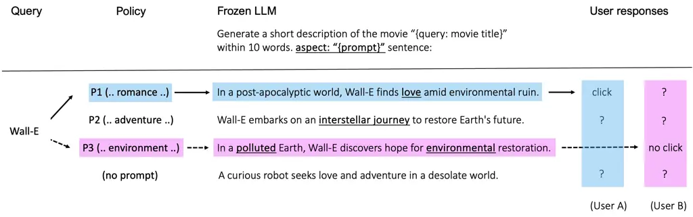

Figure 1: Overview of the prompt-based sentence personalization with
logged bandit feedback. For each coming user, a policy chooses which
prompt to use to generate sentences with a frozen LLM. Each user
observes only the sentence generated by the chosen prompt and provides
the reward for the corresponding sentence. Logged bandit feedback is
partial in that we cannot observe rewards for the sentences generated by
prompts not chosen by the logging policy. Examples are generated by
ChatGPT-3.5 (Brown et al., 2020).

The key shortcoming of the standard approaches lies in treating each
prompt independently, not taking the information about the generated
sentence into account. In response, this paper explores and presents a
method to leverage the similarity among generated sentences to make
large-scale OPL for prompt-guided language generation efficient and
tractable. Specifically, our Direct Sentence Off-policy gradient (DSO)
estimates the policy gradient in the sentence space (i.e., not in the
action space of prompts) to take the generated sentence into account. We
enable this by applying the importance weight in the (marginalized)
sentence space and by re-sampling the action conditioned on the sentence
when calculating the score function. Because the former effort
contributes to reducing the scale of the importance weight and the
latter works as an implicit data augmentation about the prompt, we can
expect variance reduction of DSO compared to typical OPL methods.
Moreover, by aggregating similar prompts and sentences using kernels,
DSO also keeps the bias small.

Finally, we develop and conduct experiments on a newly-developed OPL
benchmark suite, called OfflinePrompts (Kiyohara et al., 2025), in both
synthetic and full-LLM settings. The results demonstrate the
effectiveness of our approach, particularly when the number of prompts
is large, showing a 5x increase in the performance in the full-LLM
experiment. We also provide our benchmark suite, including the full-LLM
environment for generating personalized movie descriptions for
recommendations based on the MovieLens (Harper & Konstan, 2015) dataset,
as an open-source resource. Its easy-to-use API will accelerate both
future research and practical applications of OPL of prompt-guided
language generation with logged bandit feedback.

Our contributions are summarized as follows.

- •
  Problem formulation: We present a view of prompt-policy learning from
  naturally available feedback as OPL of contextual bandits, providing a
  pathway for advancing OPL for prompts.
- •
  Tailoring OPL methods for language generation: We identify how to
  effectively leverage similarity in generated sentences by taking the
  gradient directly in the sentence space.
- •
  Benchmarks and open-source: We conduct extensive experiments and
  provide a new benchmark suite as open-source software for future
  research and applications.

## 2 Related Work

This section summarizes notable related work. Extended discussion can be
found in Appendix A.

##### Prompt Tuning.

Prompt tuning is a cost-efficient approach for optimizing language
generation for some specific downstream applications, including
translation, summarization, and sentiment analysis. Unlike fine-tuning,
which requires the updates of the millions of parameters of the LLM
itself, prompt tuning reuses a “frozen” pre-trained LLM and optimizes
only the choice of the special tokens added to the original input
sentence called prompts (Brown et al., 2020). Deng et al. (2022)
presented a reinforcement learning (RL) formulation of prompt tuning,
which optimizes the prompts via policy gradient by treating a frozen LLM
as a black-box reward generator. While this formulation is relevant to
ours, the critical limitation of Deng et al. (2022) and similar online
exploration papers (Dwaracherla et al., 2024) is to assume that feedback
(i.e., reward) is easily accessible. Unfortunately, such an assumption
is unrealistic in many real-world applications where online interactions
with users can be costly, harmful, or sometimes even
unethical (Matsushima et al., 2021; Gilotte et al., 2018). Instead, we
present a way to leverage logged user feedback naturally collected
through past operations.

##### Reinforcement Learning for Language Generation.

RL from Human Feedback (RLHF) is a widely-studied approach to align the
output of LLMs using human annotation (Christiano et al., 2017; Stiennon
et al., 2020; Ouyang et al., 2022; Lin et al., 2024). Specifically, RLHF
asks human annotators to compare two sentences and provide labels to
indicate which sentence is more appropriate for a downstream task (e.g.,
translation). Then, using the pairwise feedback, RLHF trains a model to
predict the task-specific score of each sentence to preserve the
preference. The key challenges of RLHF are in two folds: (1) RLHF incurs
substantial cost and ethical concerns for human annotation (Bai et al.,
2022; Lee et al., 2023) and (2) monitoring if annotators provide
sufficiently reliable labels for RLHF, as done in Stiennon et al.
(2020); Ouyang et al. (2022), can be difficult when preferred sentences
change among annotators in tasks related to personalization. Our
approach of learning a contextual prompt policy using logged bandit
feedback naturally resolves the above difficulties of RLHF.

##### Off-Policy Evaluation and Learning.

Off-Policy Evaluation and Learning (OPE/OPL) studies how to use
naturally collected user feedback to evaluate and learn new contextual
bandit or RL policies (Saito et al., 2021; Fu et al., 2020).
Regression-based and importance sampling (IS)-based approaches are
prevalent in OPL. First, the regression-based approach trains a reward
predictor and then optimizes a new policy using imputed rewards. While
this approach performs well when the reward predictor is accurate for
the entire action (i.e., prompt) space, such an accurate regression is
often demanding due to the issues such as counterfactuals and covariate
shift (Swaminathan & Joachims, 2015). In contrast, the IS-based approach
aims to estimate the policy gradient unbiasedly from actually observed
rewards by correcting the distribution shift (Precup et al., 2000).
However, IS often suffers from high variance and deficient support,
particularly when the action space is large (Saito & Joachims, 2022;
Saito et al., 2023; Sachdeva et al., 2024). To overcome the limitations
of naive approaches, Saito et al. (2024) has recently proposed a
two-stage OPL framework called POTEC, which first chooses which cluster
among pre-defined action-clusters to use by applying cluster-wise IS and
then chooses which action within the chosen cluster to use. However,
good clusterings are often hard to identify, and this approach discards
information about the generated sentences. In response, we present a way
to leverage similarity among sentences by estimating the policy gradient
directly in the sentence space. Another related literature is Kallus &
Zhou (2018), which discuss OPE of deterministic policies in a continuous
action space. While we share the ideas of using kernels with Kallus &
Zhou (2018), our idea comes from a different notion of deriving the
gradient directly in the (marginalized) sentence space. Moreover, the
theoretical analysis is entirely different, as we apply kernels to the
logging policy, while Kallus & Zhou (2018) do not. Finally, our new
benchmark, which simulates the personalized generation of sentences, is
a unique contribution of ours to the OPE/OPL community.

## 3 Problem Formulation

We start by formulating prompt optimization as a new type of OPL
problem, which we call contextual bandits with auxiliary outputs.

Let $`u\in\mathcal{U}\subseteq\mathbb{R}^{d_{u}}`$ be a
$`d_{u}`$-dimensional user feature vector (e.g., demographic profile or
user id), sampled from an unknown distribution $`p(u)`$. Let
$`q\in\mathcal{Q}\subseteq\mathbb{R}^{d_{q}}`$ be a query (e.g., query
to a frozen LLM), sampled from a conditional distribution $`p(q|u)`$.
Let $`a\in\mathcal{A}`$ be a (discrete) prompt, where each prompt is
associated with some vectorial embedding,
$`e_{a}\in\mathbb{R}^{d_{e}}`$, where $`d_{e}`$ is the dimension of the
embeddings. The prompt is used to generate a sentence via a frozen LLM.
This process can be formulated as a procedure of sampling sentence
$`s\in\cal{S}`$ as an auxiliary output from the stochastic output
distribution of the LLM: $`p_{\text{LLM}}(s|q,a)`$. A user will respond
to the output sentence and provide some reward $`r\in\mathbb{R}`$ (e.g.,
click or purchase), where $`r`$ follows $`p(r|u,q,s)`$. Let
$`\pi\in\Pi`$ be a prompt policy where $`\pi(a|u,q)`$ is the probability
of choosing prompt $`a`$ for context $`x:=(u,q)\in\mathcal{X}`$. Our
goal is to optimize the prompt policy to maximize the expected reward,
defined as

```math
\displaystyle V(\pi) \displaystyle:=\mathbb{E}_{\underbrace{\scalebox{0.7}{$p(u)p(q|u)$}}_{=p(u,q)}\pi(a|u,q)\underbrace{\scalebox{0.7}{$p_{\text{LLM}}(s|q,a)p(r|u,q,s)$}}_{=p(r,s|u,q,a)}}[r]=\mathbb{E}_{p(x)\pi(a|x)p(r,s|x,a)}[r].
```

When running a prompt policy $`\pi_{0}\,(\neq\pi)`$ as part of an
operational system, it works as a logging policy and generates logged
feedback of the following form:

```math
\displaystyle\mathcal{D} \displaystyle:=\{x_{i},a_{i},s_{i},r_{i}\}_{i=1}^{n}\,\sim\prod_{i=1}^{n}p(x)\pi_{0}(a|x)p_{\text{LLM}}(s|x,a)p(r|x,s)
```

where $`n`$ is the data size and $`i`$ is its index. The logged data
informs us whether the prompt ($`a_{i}`$) results in a high reward or
not ($`r_{i}`$) for a particular context ($`x_{i}`$). However, a
difficult aspect of using the logged data is that the reward observation
is partial, i.e., it is observed only for the prompt chosen by the
logging policy ($`\pi_{0}`$) but not for all the other actions. This can
be particularly challenging when training a new policy $`\pi`$ on the
logged data, as $`\pi`$ may choose actions that are not chosen by
$`\pi_{0}`$. Thus, we need to address such counterfactuals and
distribution shift between the logging and learning policies when using
logged data for a reliable policy optimization (Swaminathan & Joachims,
2015).

In the rest of the paper, we parameterize the policy as $`\pi_{\theta}`$
using some parameters $`\theta\in\Theta`$ (e.g., a neural network). We
also define $`q(x,a):=\mathbb{E}[r|x,a]`$ and
$`q(x,s):=\mathbb{E}[r|x,s]`$. Finally, $`z\sim p(z)`$ indicates that we
sample a single random variable $`z`$ from the probability distribution
$`p(\cdot)`$, for any random variable $`z`$ and its corresponding
probability distribution.

### 3.1 Conventional approaches

We first review direct applications of typical OPL methods and discuss
their limitations.

Regression (Konda & Tsitsiklis, 1999).   A typical way of using logged
data is to train a reward predictor $`\hat{q}`$ (Stiennon et al., 2020;
Jaques et al., 2017; Snell et al., 2022b), and then use the predicted
reward to estimate the policy gradient (PG)¹¹ 1 The estimation target is
the true PG defined as
$`\nabla_{\theta}V(\pi_{\theta})=\mathbb{E}_{p(x)\pi_{\theta}(a|x)p(r|x,a)}[\nabla_{\theta}\log\pi_{\theta}(a|x)r]`$..

```math
\displaystyle\nabla_{\theta}V(\pi_{\theta})\approx\frac{1}{n}\sum_{i=1}^{n}\mathbb{E}_{a\sim\pi_{\theta}(a|x_{i})}\left[\nabla_{\theta}\log\pi_{\theta}(a|x_{i})\hat{q}(x_{i},a)\right].
```

Oftentimes, an accurate regression for OPL is difficult to obtain when
the relation between prompts and reward is complex. This is because the
reward observation is partial and covariate shift arises between the
logging policy ($`\pi_{0}`$) and the target policy ($`\pi_{\theta}`$).
If the learned regression model $`\hat{q}`$ is inaccurate, the estimated
PG can be heavily biased (Swaminathan & Joachims, 2015).

Importance sampling (IS) (Swaminathan & Joachims, 2015).   Instead of
using potentially inaccurate regression, IS corrects the distribution
shift between $`\pi_{0}`$ and $`\pi_{\theta}`$ by reweighing the
observations:

```math
\displaystyle\nabla_{\theta}V(\pi_{\theta})\approx\frac{1}{n}\sum_{i=1}^{n}\frac{\pi_{\theta}(a_{i}|x_{i})}{\pi_{0}(a_{i}|x_{i})}\nabla_{\theta}\log\pi_{\theta}(a_{i}|x_{i})r_{i}.
```

IS is unbiased under the action support condition, i.e.,
$`\forall(x,a)\in\mathcal{X}\times\mathcal{A},\,\pi_{\theta}(a|x)>0\implies\pi_{0}(a|x)>0`$.
However, IS produces considerable bias due to the violation of the
condition (deficient support) (Sachdeva et al., 2020) and extremely high
variance due to large importance weight (Saito et al., 2023; Saito
et al., 2024; Sachdeva et al., 2024), which are likely when the action
space is large. The key shortcoming here is that the typical methods
treat each prompt independently and discard the rich information about
the generated sentence when estimating the policy gradient.

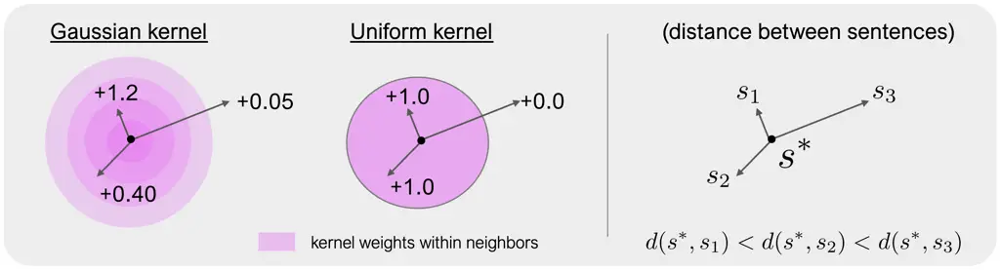

Figure 2: Examples of the kernel weights and (soft) rejection sampling
in the marginalized sentence space. DSO implicitly augments the data to
take the observations for the neighboring sentences into account. (Left)
uses a smooth kernel like a Gaussian kernel, and (Right) uses a
piecewise constant kernel like a uniform kernel.

## 4 Proposal: Direct Sentence Off-Policy Gradient (DSO)

The key idea is to make the most of the information about the generated
sentence by taking the policy gradient directly in the sentence space as
follows.

```math
\displaystyle\nabla_{\theta}V(\pi_{\theta}) \displaystyle=\mathbb{E}_{p(x)\pi_{\theta}(s|x)}[\nabla_{\theta}\log\pi_{\theta}(s|x)q(x,s)].
```

Even when we parameterize the policy in the prompt space, this is
conceptually possible because we can write the sentence distribution and
the score function as
$`\pi_{\theta}(s|x)=\sum_{a\in\mathcal{A}}p_{\text{LLM}}(s|x,a)\pi_{\theta}(a|x)`$
and
$`\nabla_{\theta}\log\pi_{\theta}(s|x)=\mathbb{E}_{\pi_{\theta}(a|x,s)}[\nabla_{\theta}\log\pi_{\theta}(a|x)]`$,
respectively (See Appendix D.1 for the derivation). However, one
potential concern of this approach is that we may suffer from data
sparsity when estimating the gradient for each sentence $`s`$, as
sentences are high-dimensional. Thus, we further consider taking the
gradient in the marginalized sentence space to enable data-efficient OPE
as

```math
\displaystyle\nabla_{\theta}V(\pi_{\theta}) \displaystyle=\mathbb{E}_{p(x)\pi_{\theta}(\phi(s)|x)}[\nabla_{\theta}\log\pi_{\theta}(\phi(s)|x)q^{\pi_{\theta}}(x,\phi(s))],
```

where $`\phi(s)\in\Phi(\mathcal{S})`$ is the kernel-based neighbors of
sentence $`s`$. Its probability density, policy distribution, and
expected reward are defined as follows.

- •
  $`\mathbb{P}(\phi(s)|\cdot):=\int_{s^{\prime}\in\mathcal{S}}K(s^{\prime},s;\,x,\tau)\mathbb{P}(s^{\prime}|\cdot)ds^{\prime},\,\forall\mathbb{P}.`$
   (marginal density)
- •
  $`\pi(\phi(s)|x):=\sum_{a\in\mathcal{A}}p_{\text{LLM}}(\phi(s)|x,a)\pi(a|x),\,\forall\pi.`$
   (policy marginal distribution)
- •
  $`q^{\pi}(x,\phi(s)):=\int_{s^{\prime}\in\mathcal{S}}\frac{K(s,s^{\prime};\,x,\tau)\pi(s^{\prime}|x)}{\pi(\phi(s)|x)}q(x,s^{\prime})ds^{\prime},\,\forall\pi.`$
   (expected reward)

$`K(\cdot)`$ is a kernel function, which must satisfy
$`\int_{s^{\prime}\in\mathcal{S}}K(s^{\prime},s;x,\tau)=1`$, and
$`\tau`$ is a bandwidth hyperparameter that controls the magnitude of
marginalization. The intuition behind DSO is to implicitly augment the
data by taking the observations for the neighboring sentences into
account, as illustrated in Figure 2. Specifically, when using a smooth
kernel like a Gaussian kernel, neighboring sentences are weighted
proportional to
$`K(s^{\prime},s;\,x,\tau)\propto\exp(-d(s,s^{\prime}))`$, where
$`d(s,s^{\prime})`$ is the distance between two sentences (e.g.,
sentence embedding distance). In contrast, when using a piecewise
constant kernel like a uniform kernel, all the sentences within a
certain threshold is equally weighted, while all the others are rejected
with the weight of 0.

To estimate the policy gradient in the marginalized sentence space
induced by kernels, Direct Sentence Off-policy Gradient (DSO) applies IS
as follows.

```math
\displaystyle\nabla_{\theta}V(\pi_{\theta}) \displaystyle\approx\frac{1}{n}\sum_{i=1}^{n}\underbrace{\frac{\pi_{\theta}(\phi(s_{i})|x_{i})}{\pi_{0}(\phi(s_{i})|x_{i})}}_{:=w(\phi(s_{i}),x_{i})}\nabla_{\theta}\log\pi_{\theta}(\phi(s_{i})|x_{i})\,r_{i}.
```

By applying IS on the marginalized sentence space
($`\Phi(\mathcal{S})`$), DSO avoids large importance weights, making
large-scale OPL more scalable regarding the number of candidate prompts,
while keeping the bias small by leveraging the similarity among
sentences. Moreover, even though we observe only a single prompt in the
original logged data, DSO can further distribute the reward observation
among multiple prompts that generate similar sentences. This implicit
data augmentation among multiple counterfactual prompts also contributes
to reducing variance. While the precise computation of the marginal
importance weight ($`w(\phi(s),x)`$) and the score function
($`\nabla_{\theta}\pi_{\theta}(\phi(s)|x)`$) seems non-trivial, below we
present how to train a model to estimate these distributions in a
tractable way.

### 4.1 Estimation of the weighted score function

The key trick of DSO is to use the following expression of the weighted
score function:

```math
\displaystyle w(\phi(s),x)\nabla_{\theta}\log\pi_{\theta}(\phi(s)|x) \displaystyle=\mathbb{E}_{(a,s^{\prime})\sim\pi_{\theta}(a|x)p_{\text{LLM}}(s^{\prime}|x,a)}\biggl[\frac{K(s,s^{\prime};\,x,\tau)\nabla_{\theta}\log\pi_{\theta}(a|x)}{\pi_{0}(\phi(s)|x)}\biggr].
```

We provide the derivation in Appendix D.2. This expression indicates
that DSO can be seen as performing soft rejection sampling on the data
$`(a,s^{\prime})`$ augmented by $`\pi_{\theta}`$, while correcting the
bias in the logged data by applying the inverse propensity of
$`\pi_{0}`$ in the marginalized sentence space. The above equation also
suggests that our estimation problem of the weighted score function is
reduced to only the estimation of $`\pi_{0}(\phi(s)|x)`$. This is
useful, as $`\pi_{0}(\phi(s)|x)`$ does not depend on the parameterized
policy ($`\pi_{\theta}`$), and it thus suffices to fit a marginal
density model only once before running the policy gradient method.
Because the marginal distribution is defined as
$`\pi_{0}(\phi(s)|x)=\mathbb{E}_{\pi_{0}(s^{\prime}|x)}[K(s,s^{\prime};\,x,\tau)]`$,
we can estimate the marginal density via the monte-carlo sampling as

```math
\displaystyle\pi_{0}(\phi(s_{i})|x_{i})\approx\frac{1}{m}\sum_{j=1}^{m}\mathbb{E}_{s_{j}\sim\pi_{0}(s_{j}|x)}[K(s_{i},s_{j};x_{i},\tau)],
```

where $`m`$ is the number of the monte-carlo samples. Similarly, we can
also estimate the marginal density with function approximation
($`f_{\psi}(x,s)\approx\pi_{0}(\phi(s)|x)`$) using the following loss:

```math
\displaystyle\ell(f_{\psi}) \displaystyle\approx\frac{1}{n}\sum_{i=1}^{n}\mathbb{E}_{(s,s^{\prime})\sim\pi_{0}(s|x_{i})\pi_{0}(s^{\prime}|x_{i})}[(f_{\psi}(x_{i},s)-K(s,s^{\prime};\,x_{i},\tau))^{2}].
```

Since the computation of this loss does not scale with the size of the
action space $`|\mathcal{A}|`$, we can easily apply DSO even when the
action (i.e., prompt) space is large.

### 4.2 Theoretical Analysis

Here, we analyze the bias and variance of the DSO estimator (the proofs
are in Appendix D). We first introduce a new condition about support in
the marginalized sentence space.

###### Definition 1.

(Similar sentence support) Similar sentence support is satisfied when
$`\pi_{\theta}(\phi(s)|x)>0\implies\pi_{0}(\phi(s)|x)>0`$ holds for all
$`(x,\phi(s))\in\mathcal{X}\times\Phi(\mathcal{S})`$.

The similar sentence support condition relaxes the action support
condition of IS. That is, because we have
$`\pi(\phi(s)|x)=\sum_{a\in\mathcal{A}}p_{\text{LLM}}(\phi(s)|a,x)\pi(a|x)`$
by definition, the similar sentence support condition is always
satisfied when the action support condition is satisfied. This means
that deficient support under the similar sentence support is more
unlikely happening compared to the action support. Under this condition,
we have the following degree of bias.


Theorem 1 suggests that the bias of DSO comes from three factors. The
first term is the dominant term, which arises from the within-neighbor
reward shift (i.e., the difference between $`q^{\pi_{0}}(x,\phi(s))`$
and $`q^{\pi_{\theta}}(x,\phi(s))`$), as illustrated in Figure 3. This
term becomes small in two cases: (i) when reward does not change too
much within $`\phi(s)`$, and (ii) when the within-cluster distribution
shift of $`\pi(s^{\prime}|x,\phi(s))`$ is small. Either case is
satisfied when the radius of neighbors (i.e., kernel bandwidth
hyperparameter $`\tau`$) is small. At the same time, smooth kernels like
a Gaussian kernel are also useful, as they allocates larger weights to
similar sentences depending on the distance from the pivotal sentence.
In contrast, the second and third terms are caused by calculating the
gradient in the marginalized sentence space ($`\Phi(\mathcal{S})`$)
instead of the original sentence space ($`\mathcal{S}`$). These terms
also become small when the bandwidth hyperparameter $`\tau`$ is small.
Thus, a small value of $`\tau`$ is preferable in reducing the bias.

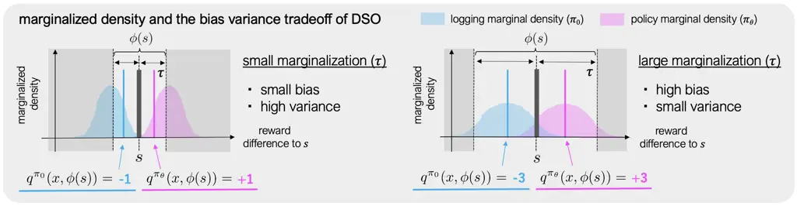

Figure 3: Bias-variance tradeoff of DSO and its relations to the
bandwidth hyperparameter ($`\tau`$) of a kernel function: When $`\tau`$
is large, the overlap between the logging policy ($`\pi_{0}`$) and the
current policy ($`\pi_{\theta}`$) within $`\phi(s)`$ becomes large, thus
the scale of the importance weight becomes small. This contributes to
reducing the variance compared to naive IS. In contrast, a small value
of $`\tau`$ helps keep the bias small, as the within-neighbor reward
shift (i.e., the difference between $`q^{\pi_{0}}(x,\phi(s))`$ and
$`q^{\pi_{\theta}}(x,\phi(s))`$) becomes small. The gray regions are
rejected when using a uniform kernel.

Next, we have the following degree of variance using DSO.


Theorem 2 suggests that DSO gains variance reduction from two sources:
$`\nabla_{\theta}\log\pi_{\theta}(\phi(s)|x)`$ and $`w(\phi(s)|x)`$. The
first variance reduction of
$`\nabla_{\theta}\log\pi_{\theta}(\phi(s)|x)`$ comes from the fact that
the sentence-based score function is expressed as
$`\mathbb{E}_{\pi_{\theta}(a|x,\phi(s))}[\nabla_{\theta}\log\pi_{\theta}(a|x)]`$,
demonstrating the benefit of applying the implicit data augmentation and
soft rejection sampling (instead of applying hard rejection sampling).
The variance reduction becomes especially large when multiple different
prompts result in similar sentences; thus, $`\pi_{\theta}(a|x,\phi(s))`$
becomes adequately stochastic. Moreover, by using $`w(\phi(s),x)`$
instead of $`w(a,x)`$, we can expect a significant variance reduction as
we avoid the variance caused by the within-neighbor importance weight,
i.e.,
$`w(a,x;\phi(s)):=\pi_{\theta}(a|x,\phi(s))/\pi_{0}(a|x,\phi(s))`$. This
means that a larger value of $`\tau`$ (i.e., the radius of neighbors)
leads to a larger variance reduction. Together with the analysis of
bias, we can see that the value of $`\tau`$ plays an important role in
trading off the bias and variance of DSO, as shown in Figure 3. Later in
the experiment section, we study how the performance changes with
varying values of the bandwidth hyperparameter $`\tau`$.

## 5 Benchmarks and open-source software

Due to the lack of existing benchmark suites for OPL of prompt policies,
we implemented and will release open-source software called
OfflinePrompts. This benchmark suite come with two settings: synthetic
and full-LLM to enable extensive and reproducible experiments. In
particular, the full-LLM benchmark simulates movie recommendation tasks
with personalized sentence descriptions based on the
(sentence-augmented) MovieLens dataset (Harper & Konstan, 2015) (See
Appendix B for the details). Moreover, OfflinePrompts also enables
prompt tuning on users’ own logged data, facilitating the practical
application of OPL. Appendix A summarizes related benchmarks and the
distinctive features of our software. Appendix F also demonstrates the
easy-to-use APIs of OfflinePrompts.

## 6 Synthetic Experiments

We first evaluate the proposed DSO approach on synthetic benchmarks in
OfflinePrompts, since they allow us to explore a wide range of
conditions.²² 2 Our code will be available at a GitHub repository upon
publication.

### 6.1 Experiment setting

To generate candidate actions, we first sample 5-dimensional embedding
$`e_{a}`$, from a normal distribution. Each embedding $`e_{a}`$ is a
deterministic embedding associated with an action $`a`$. Then, to
generate logged data, we sample 5-dimensional user and query vectors
from a multivariate normal distribution. Next, for each query-action
pair $`(q,a)`$, we sample 5-dimensional sentence embeddings $`s`$ as

```math
\displaystyle s\sim\mathcal{N}(f_{s}(q,e_{a}),\sigma_{s}^{2}),\quad f_{s}(q,e_{a})=c\cdot\text{sine}(q^{\top}M_{q}+e_{a}^{\top}M_{e}),
```

where $`M_{q}`$ and $`M_{e}`$ are coefficient matrices sampled from a
uniform distribution. $`c=5.0`$ is a scaling factor and
$`\sigma_{s}=1.0`$ is the noise level of the action-output mapping. By
using the sine function, we simulate a situation where two different
prompts ($`e_{a}`$) can result in a similar sentence ($`s`$), while
preserving the smoothness between the prompt and sentence embedding
spaces. Then, a user responds to the generated sentence ($`s`$) with the
following reward function:

```math
\displaystyle r\sim\mathcal{N}(f_{r}(x,s),\sigma_{r}^{2}),\quad f_{r}(x,s)=(u^{\top}M_{u}+q^{\top}M_{q})M_{s}s^{\top},
```

where $`M_{u}`$, $`M_{q}`$, and $`M_{s}`$ are the coefficient matrices
and $`\sigma_{r}`$ is the reward noise.

We generate logged data with the following softmax logging policy:
$`\pi_{0}(a|x):=\exp(\beta_{0}\,\hat{R}_{0}(x,a))/(\sum_{a\in\mathcal{A}}\exp(\beta_{0}\,\hat{R}_{0}(x,a)))`$.
$`\hat{R}_{0}`$ is the base reward model, trained on $`n_{0}=10000`$ of
data points collected by the uniform random policy. $`\beta_{0}=1.0`$ is
the inverse temperature.

We compare DSO to four baselines: regression, IS, DR, and POTEC.
DR (Dudík et al., 2011) combines IS and regression efficiently.
POTEC (Saito et al., 2024) employs a two-stage policy learning, which
first chooses which cluster to use via DR and then chooses which action
within the cluster to use via regression. All the baselines estimate the
gradient in the action space. For the metrics to compare the OPL
methods, we use the optimality of the learned policy, defined as
$`(V(\pi)-V(\pi_{\text{unif}}))/V(\pi_{\text{opt}}-V(\pi_{\text{unif}}))`$,
where $`\pi_{\text{opt}}`$ is the optimal policy and
$`\pi_{\text{unif}}`$ is the uniform random policy. The definitions of
DR and POTEC, and the implementation details are in Appendix C.

The experiment varies the following configurations (the bold font
represents the default value): (1) data size:
$`n\in\{500,1000,2000,4000,\underline{\textbf{8000}}\}`$, (2) number of
candidate actions:
$`|\mathcal{A}|\in\{10,50,100,500,\underline{\textbf{1000}}\}`$, and (3)
reward noises:
$`\sigma_{r}\in\{0.0,\underline{\textbf{1.0}},2.0,3.0\}`$. For the
ablation of DSO, we additionally report the results with the varying
bandwidth hyperparameters of
$`\tau\in\{0.5,\underline{\textbf{1.0}},2.0,4.0\}`$, {w/ and w/o}
function approximation of the marginal density, and two different
kernels, {Gaussian and uniform}. When not using function approximation,
we estimate the marginal density via monte-carlo sampling with $`m=100`$
samples. Finally, to evaluate the robustness of DSO to the accuracy of
the distance measure in the kernel, we add noise sampled from a normal
distribution with std $`\Delta_{s}=1.0`$ to the sentence embeddings. We
report the mean and standard deviation of the performance based on the
results with 20 random seeds.

![[Uncaptioned
image]](arxiv-2504-02646v1--4774edd8ca9a.figures/figure-4.webp)

![[Uncaptioned
image]](arxiv-2504-02646v1--4774edd8ca9a.figures/figure-5.webp)

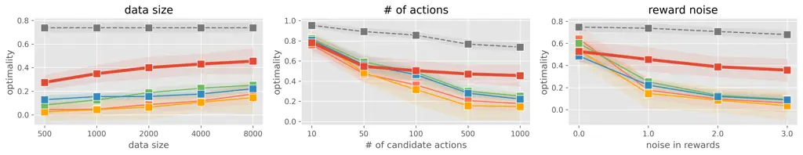

Figure 4: Comparing the performance of the policies learned by various
OPL methods with (Left) varying data sizes ($`n`$), (Middle) varying
number of candidate actions ($`|\mathcal{A}|`$), and (Right) varying
reward noises ($`\sigma_{r}`$). DSO uses a Gaussian kernel and function
approximation of $`\pi_{0}(\phi(s)|x)`$.

![[Uncaptioned
image]](arxiv-2504-02646v1--4774edd8ca9a.figures/figure-5.webp)

![[Uncaptioned
image]](arxiv-2504-02646v1--4774edd8ca9a.figures/figure-7.webp)

![[Uncaptioned
image]](arxiv-2504-02646v1--4774edd8ca9a.figures/figure-5.webp)

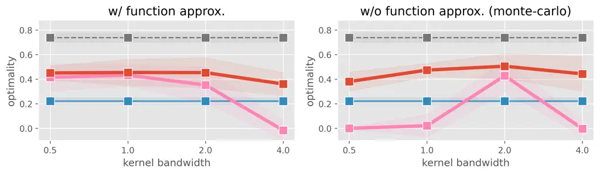

Figure 5: Ablation results of DSO with varying bandwidth hyperparameters
($`\tau`$), w/ and w/o function approximation of $`\pi_{0}(\phi(s)|x)`$,
and two kernels, Gaussian and uniform.

### 6.2 Result

Figure 5 compares the policy learning results of the OPL methods with
varying data sizes ($`n`$), number of candidate actions
($`|\mathcal{A}|`$), and reward noises ($`\sigma_{r}`$), respectively.
The results demonstrate that DSO works particularly well in challenging
scenarios where the baselines fall short due to variance. Specifically,
while we observe a sharp drop of performance for the baselines when the
action space is large ($`|\mathcal{A}|\geq 500)`$ and reward noise is
large ($`\sigma_{r}\geq 1.0`$), DSO maintains a favorable performance
even under these configurations. Moreover, comparing the performance
with $`|\mathcal{A}|=1000`$ and $`\sigma_{r}=1.0`$, we observe that the
performance of DSO at $`n=500`$ outperforms that of the baselines at
$`n=8000`$. This indicates that DSO is far more data-efficient than the
baselines when the action space is large, leveraging the similarity
among sentences via kernels and performing implicit data augmentation.

Next, we study how the choice of kernels affects the performance of DSO,
as shown in Figure 5. The results tell us several interesting findings:
using (1) a Gaussian kernel and (2) function approximation improve the
robustness of DSO to the choice of bandwidth hyperparameter $`\tau`$.
The first observation is evident from the fact that a Gaussian kernel
allocates larger weights to closer sentences compared to a uniform
kernel. However, when using monte-carlo estimation, we observe that even
a Gaussian kernel needs careful tuning of $`\tau`$, where a small value
of $`\tau`$ incurs high variance and a large value of $`\tau`$ produces
non-negligible bias. In contrast, by using function approximation, we
can avoid a small value of $`\hat{\pi}_{0}(\phi(s)|x)`$, which
contributes to the variance reduction³³ 3 This is because, for example,
when the true marginal density is 1e-5, estimating it as 1e-5 and 1e-4
does not change the MSE loss too much. However, in terms of variance,
1e-4 and 1e-5 make a significant difference. Using function
approximation, we can avoid being too precise about small values of the
marginal density.. Therefore, using function approximation helps improve
the robustness to a small value of $`\tau`$, and we do not need
extensive hyperparameter tuning of $`\tau`$. This implies that DSO is
applicable to practical situations, where a pre-trained model of
$`\hat{\pi}_{0}(\phi(s)|x)`$ can provide substantial efficiency gains.

## 7 Full-LLM Experiment with MovieLens

This section compares OPL methods in a personalized generation task of
movie descriptions using the MovieLens-10M (Harper & Konstan, 2015)
dataset. The MovieLens dataset contains 10M ratings between 71,567 users
and 10,681 movies. To use this data in our personalized sentence
generation task, we first augment the data by generating a (general)
movie description using Mistral-7B (Jiang et al., 2023). Then, we train
a sentence-based reward simulator on the augmented dataset using
DistilBert (Sanh et al., 2019). After obtaining a reward simulator, we
collect the logged data in the following procedure. First, we randomly
sample a user ($`u`$) and a movie (query) ($`q`$) as a context ($`x`$).
Next, a logging policy ($`\pi_{0}`$) chooses which prompt ($`a`$) to use
in the sentence generation task. Then, a frozen LLM generates sentence
$`s`$, taking the prompt $`a`$ and query $`q`$ as the input. Finally, we
generate a reward ($`r`$) using the reward simulator. Appendix B.2 and
Figure 10 describe the workflow of OPL and that of pre-training a reward
simulator in detail.

In the full-LLM experiment, we define the logging policy by applying the
softmax function on top of the logits learned by the online policy,
where we set the inverse temperature hyperparameter to be
$`\beta_{0}=0.2`$. The candidate prompts ($`\mathcal{A}`$) are retrieved
from [relatedwords.io](https://relatedwords.io/) with keywords {"movie",
"genre", "culture"}, where $`|\mathcal{A}|=1000`$. The reward is defined
as $`10\times(q(x,s(a))-q(x,s(\emptyset)))`$, where $`q(\cdot)`$ is the
\[0, 1\]-score simulated by the aforementioned DistilBert sentence
discriminator and $`s(\emptyset)`$ is the sentence generated without
adding prompts. The data size is $`n=50000`$ and the reward noise is
$`\sigma_{r}=0.05`$. For DSO, we use a Gaussian kernel with $`\tau=1.0`$
to estimate the logging marginal density. The distance between two
sentences are measured by the sentence embeddings obtained from the
frozen Mistral-7B model (see Appendix C for the details). We report the
results with a total of 25 trials, on 5 different datasets and 5 runs on
each data with different random seeds.

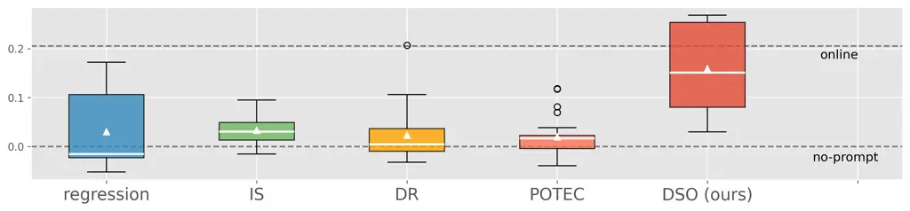

Figure 6: Performance comparison of OPL methods in the full-LLM
experiment.: The policy value indicates how much improvement of reward
we have by using a (learned) prompt policy compared to the sentence
generation without prompts (called no-prompt baseline). From the top,
the horizontal lines refer to the value of the online policy, logging
policy, and no-prompt baseline.

##### Result

Figure 6 compares the performance of the OPL methods by the degree of
improvement that the learned policy observed over the sentences
generated without prompts (which we call no-prompt baseline). The
results indicate that DSO often improves the effectiveness of the
sentences more than other OPL methods, by effectively leveraging the
information about similar sentences. Specifically, DSO is more resilient
to performance corruption than IS by substantially reducing the variance
and than regression by reducing the bias. As a result, we have 5x
increase of the performance than other baselines on average. It should
also be worth noting that this result is observed for the off-the-shelf
embeddings of sentences, which do not require extensive tuning of the
embedding model. This minimizes the difficulty in applying the proposed
OPL method in practice. However, learning (application-specific)
embeddings that further improve the performance of DSO is an interesting
direction for future work.

## 8 Conclusion and Future Work

This paper studied how to use naturally logged user feedback to optimize
a prompt policy for language generation. We started by formulating the
problem as OPL of contextual bandits with auxiliary outputs. Then, we
pointed out the limitations of the naive approaches – (1) existing OPL
methods often suffer from the large action space of prompts and (2) even
though we observe generated sentences, existing methods do not use the
information about these sentences. To overcome these shortfalls, we
proposed Direct Setence Off-policy gradient (DSO), which applies
importance sampling taking the similarity of sentences into account. We
also show the effectiveness of the proposed approach in both theoretical
and empirical ways. Furthermore, our benchmarks suite called
OfflinePrompts, provided as open-source software, accelerates future
research and practical application of prompt-guided language generation
from logged bandit feedback.

As a remark, deriving a DR-style variant, which introduces a control
variate for further variance reduction (Dudík et al., 2011), is
non-trivial for DSO, as we discuss in detail in Appendix E. Studying a
way to efficiently combine IS and regression in the DSO framework would
be a promising future direction. Additionally, a good representation or
distance measure of sentences that further improves the performance of
DSO would also be worth exploring. Finally, applying a similar idea to
other generative AI applications, such as text-to-image diffusion
models (Saharia et al., 2022), and extending the benchmark by publishing
relevant real-world data can be interesting future works.

#### Acknowledgments

This research was supported in part by NSF Awards IIS-2312865 and
OAC-2311521. Haruka Kiyohara and Yuta Saito are supported by Funai
Overseas Scholarship.

Additionally, we thank Kiante Brantley and Aaron Tucker for the advices
on the usages of LLMs and large computational resources, and Zhaolin Gao
for the discussion on the sentence-based reward simulator in the
full-LLM benchmark. We also thank the anonymous reviewers for the
valuable discussion to improve the manuscripts.

## References

- Agrawal & Goyal \[2013\] Shipra Agrawal and Navin Goyal. Thompson
  sampling for contextual bandits with linear payoffs. In _Proceedings
  of the 30th International Conference on Machine Learning_, pp.
  127–135, 2013.
- Bai et al. \[2022\] Yuntao Bai, Saurav Kadavath, Sandipan Kundu,
  Amanda Askell, Jackson Kernion, Andy Jones, Anna Chen, Anna Goldie,
  Azalia Mirhoseini, Cameron McKinnon, et al. Constitutional ai:
  Harmlessness from ai feedback. _arXiv preprint
  arXiv:2212.08073_, 2022.
- Brown et al. \[2020\] Tom Brown, Benjamin Mann, Nick Ryder, Melanie
  Subbiah, Jared Kaplan, Prafulla Dhariwal, Arvind Neelakantan, Pranav
  Shyam, Girish Sastry, Amanda Askell, Sandhini Agarwal, Ariel
  Herbert-Voss, Gretchen Krueger, Tom Henighan, Rewon Child, Aditya
  Ramesh, Daniel M. Ziegler, Jeffrey Wu, Clemens Winter, Christopher
  Hesse, Mark Chen, Eric Sigler, Mateusz Litwin, Scott Gray, Benjamin
  Chess, Jack Clark, Christopher Berner, Sam McCandlish, Alec Radford,
  Ilya Sutskever, and Dario Amodei. Language models are few-shot
  learners. _Advances in Neural Information Processing Systems_,
  33:1877–1901, 2020.
- Chowdhury & Gopalan \[2017\] Sayak Ray Chowdhury and Aditya Gopalan.
  On kernelized multi-armed bandits. In _Proceedings of the 34th
  International Conference on Machine Learning_, pp. 844–853, 2017.
- Christiano et al. \[2017\] Paul F Christiano, Jan Leike, Tom Brown,
  Miljan Martic, Shane Legg, and Dario Amodei. Deep reinforcement
  learning from human preferences. _Advances in Neural Information
  Processing Systems_, 30, 2017.
- Deng et al. \[2022\] Mingkai Deng, Jianyu Wang, Cheng-Ping Hsieh,
  Yihan Wang, Han Guo, Tianmin Shu, Meng Song, Eric Xing, and Zhiting
  Hu. Rlprompt: Optimizing discrete text prompts with reinforcement
  learning. In _Proceedings of the 2022 Conference on Empirical Methods
  in Natural Language Processing_, pp. 3369–3391, 2022.
- Ding et al. \[2022\] Ning Ding, Shengding Hu, Weilin Zhao, Yulin Chen,
  Zhiyuan Liu, Haitao Zheng, and Maosong Sun. Openprompt: An open-source
  framework for prompt-learning. In _Proceedings of the 60th Annual
  Meeting of the Association for Computational Linguistics: System
  Demonstrations_, pp. 105–113, 2022.
- Dudík et al. \[2011\] Miroslav Dudík, John Langford, and Lihong Li.
  Doubly robust policy evaluation and learning. In _Proceedings of the
  28th International Conference on International Conference on Machine
  Learning_, pp. 1097–1104, 2011.
- Dwaracherla et al. \[2024\] Vikranth Dwaracherla, Seyed Mohammad
  Asghari, Botao Hao, and Benjamin Van Roy. Efficient exploration for
  llms. In _Proceedings of the 41th International Conference on Machine
  Learning_, volume 235, pp. 12215–12227, 2024.
- Fu et al. \[2020\] Justin Fu, Mohammad Norouzi, Ofir Nachum, George
  Tucker, Alexander Novikov, Mengjiao Yang, Michael R Zhang, Yutian
  Chen, Aviral Kumar, Cosmin Paduraru, et al. Benchmarks for deep
  off-policy evaluation. In _International Conference on Learning
  Representations_, 2020.
- Gao et al. \[2023\] Yunfan Gao, Tao Sheng, Youlin Xiang, Yun Xiong,
  Haofen Wang, and Jiawei Zhang. Chat-rec: Towards interactive and
  explainable llms-augmented recommender system. _arXiv preprint
  arXiv:2303.14524_, 2023.
- Gilotte et al. \[2018\] Alexandre Gilotte, Clément Calauzènes, Thomas
  Nedelec, Alexandre Abraham, and Simon Dollé. Offline a/b testing for
  recommender systems. In _Proceedings of the 11th ACM International
  Conference on Web Search and Data Mining_, pp. 198–206, 2018.
- Harper & Konstan \[2015\] F Maxwell Harper and Joseph A Konstan. The
  movielens datasets: History and context. _Acm transactions on
  interactive intelligent systems (tiis)_, 5(4):1–19, 2015.
- He et al. \[2017\] Xiangnan He, Lizi Liao, Hanwang Zhang, Liqiang Nie,
  Xia Hu, and Tat-Seng Chua. Neural collaborative filtering. In
  _Proceedings of the 26th International Conference on World Wide Web_,
  pp. 173–182, 2017.
- Jaques et al. \[2017\] Natasha Jaques, Shixiang Gu, Dzmitry Bahdanau,
  José Miguel Hernández-Lobato, Richard E Turner, and Douglas Eck.
  Sequence tutor: Conservative fine-tuning of sequence generation models
  with kl-control. In _International Conference on Machine Learning_,
  pp. 1645–1654. PMLR, 2017.
- Jaques et al. \[2020\] Natasha Jaques, Judy Hanwen Shen, Asma
  Ghandeharioun, Craig Ferguson, Agata Lapedriza, Noah Jones, Shixiang
  Gu, and Rosalind Picard. Human-centric dialog training via offline
  reinforcement learning. In _Proceedings of the 2020 Conference on
  Empirical Methods in Natural Language Processing_, pp.
  3985–4003, 2020.
- Jiang et al. \[2023\] Albert Q Jiang, Alexandre Sablayrolles, Arthur
  Mensch, Chris Bamford, Devendra Singh Chaplot, Diego de las Casas,
  Florian Bressand, Gianna Lengyel, Guillaume Lample, Lucile Saulnier,
  Lélio Renard Lavaud, Marie-Anne Lachaux, Pierre Stock, Teven Le Scao,
  LavrilThibaut  , Thomas Wang, Timothée Lacroix, and William El Sayed.
  Mistral 7b. _arXiv preprint arXiv:2310.06825_, 2023.
- Kallus & Zhou \[2018\] Nathan Kallus and Angela Zhou. Policy
  evaluation and optimization with continuous treatments. In
  _International Conference on Artificial Intelligence and Statistics_,
  pp. 1243–1251, 2018.
- Kingma \[2014\] Diederik P Kingma. Adam: A method for stochastic
  optimization. _arXiv preprint arXiv:1412.6980_, 2014.
- Kiyohara et al. \[2023a\] Haruka Kiyohara, Ren Kishimoto, Kosuke
  Kawakami, Ken Kobayashi, Kazuhide Nakata, and Yuta Saito. Scope-rl: A
  python library for offline reinforcement learning and off-policy
  evaluation. _arXiv preprint arXiv:2311.18206_, 2023a.
- Kiyohara et al. \[2023b\] Haruka Kiyohara, Ren Kishimoto, Kosuke
  Kawakami, Ken Kobayashi, Kazuhide Nakata, and Yuta Saito. Towards
  assessing and benchmarking risk-return tradeoff of off-policy
  evaluation. _arXiv preprint arXiv:2311.18207_, 2023b.
- Kiyohara et al. \[2025\] Haruka Kiyohara, Daniel Yiming Cao, Yuta
  Saito, and Thorsten Joachims. Offlineprompts: Benchmark suites for
  prompt-guided language personalization. _arXiv preprint arXiv:_, 2025.
- Konda & Tsitsiklis \[1999\] Vijay Konda and John Tsitsiklis.
  Actor-critic algorithms. _Advances in Neural Information Processing
  Systems_, 12, 1999.
- Lee et al. \[2023\] Harrison Lee, Samrat Phatale, Hassan Mansoor,
  Kellie Lu, Thomas Mesnard, Colton Bishop, Victor Carbune, and Abhinav
  Rastogi. Rlaif: Scaling reinforcement learning from human feedback
  with ai feedback. _arXiv preprint arXiv:2309.00267_, 2023.
- Levine et al. \[2020\] Sergey Levine, Aviral Kumar, George Tucker, and
  Justin Fu. Offline reinforcement learning: Tutorial, review, and
  perspectives on open problems. _arXiv preprint
  arXiv:2005.01643_, 2020.
- Li et al. \[2010\] Lihong Li, Wei Chu, John Langford, and Robert E
  Schapire. A contextual-bandit approach to personalized news article
  recommendation. In _Proceedings of the 19th international conference
  on World wide web_, pp. 661–670, 2010.
- Lin et al. \[2024\] Xiaoqiang Lin, Zhongxiang Dai, Arun Verma,
  See-Kiong Ng, Patrick Jaillet, and Bryan Kian Hsiang Low. Prompt
  optimization with human feedback. _arXiv preprint
  arXiv:2405.17346_, 2024.
- Maćkiewicz & Ratajczak \[1993\] Andrzej Maćkiewicz and Waldemar
  Ratajczak. Principal components analysis (pca). _Computers &
  Geosciences_, 19(3):303–342, 1993.
- Matsushima et al. \[2021\] Tatsuya Matsushima, Hiroki Furuta, Yutaka
  Matsuo, Ofir Nachum, and Shixiang Gu. Deployment-efficient
  reinforcement learning via model-based offline optimization. In
  _International Conference on Learning Representations_, 2021.
- Nie et al. \[2024\] Allen Nie, Yi Su, Bo Chang, Jonathan N Lee, Ed H
  Chi, Quoc V Le, and Minmin Chen. Evolve: Evaluating and optimizing
  llms for exploration. _arXiv preprint arXiv:2410.06238_, 2024.
- Ouyang et al. \[2022\] Long Ouyang, Jeffrey Wu, Xu Jiang, Diogo
  Almeida, Carroll Wainwright, Pamela Mishkin, Chong Zhang, Sandhini
  Agarwal, Katarina Slama, Alex Ray, et al. Training language models to
  follow instructions with human feedback. _Advances in Neural
  Information Processing Systems_, 35:27730–27744, 2022.
- Paszke et al. \[2019\] Adam Paszke, Sam Gross, Francisco Massa, Adam
  Lerer, James Bradbury, Gregory Chanan, Trevor Killeen, Zeming Lin,
  Natalia Gimelshein, Luca Antiga, et al. Pytorch: An imperative style,
  high-performance deep learning library. _Advances in neural
  information processing systems_, 32, 2019.
- Pedregosa et al. \[2011\] Fabian Pedregosa, Gaël Varoquaux, Alexandre
  Gramfort, Vincent Michel, Bertrand Thirion, Olivier Grisel, Mathieu
  Blondel, Peter Prettenhofer, Ron Weiss, Vincent Dubourg, Jake
  Vanderplas, Alexandre Passos, David Cournapeau, Matthieu Brucher,
  Matthieu Perrot, and Édouard Duchesnay. Scikit-learn: Machine learning
  in python. _the Journal of Machine Learning Research_,
  12:2825–2830, 2011.
- Precup et al. \[2000\] Doina Precup, Richard S. Sutton, and
  Satinder P. Singh. Eligibility traces for off-policy policy
  evaluation. In _Proceedings of the 17th International Conference on
  Machine Learning_, pp. 759–766, 2000.
- Ramamurthy et al. \[2022\] Rajkumar Ramamurthy, Prithviraj
  Ammanabrolu, Kianté Brantley, Jack Hessel, Rafet Sifa, Christian
  Bauckhage, Hannaneh Hajishirzi, and Yejin Choi. Is reinforcement
  learning (not) for natural language processing: Benchmarks, baselines,
  and building blocks for natural language policy optimization. In _The
  11th International Conference on Learning Representations_, 2022.
- Rusmevichientong & Tsitsiklis \[2010\] Paat Rusmevichientong and
  John N Tsitsiklis. Linearly parameterized bandits. _Mathematics of
  Operations Research_, 35(2):395–411, 2010.
- Sachdeva et al. \[2020\] Noveen Sachdeva, Yi Su, and Thorsten
  Joachims. Off-policy bandits with deficient support. In _Proceedings
  of the 26th ACM SIGKDD International Conference on Knowledge Discovery
  & Data Mining_, pp. 965–975, 2020.
- Sachdeva et al. \[2024\] Noveen Sachdeva, Lequn Wang, Dawen Liang,
  Nathan Kallus, and Julian McAuley. Off-policy evaluation for large
  action spaces via policy convolution. In _Proceedings of the ACM on
  Web Conference 2024_, pp. 3576–3585, 2024.
- Saharia et al. \[2022\] Chitwan Saharia, William Chan, Saurabh Saxena,
  Lala Li, Jay Whang, Emily L Denton, Kamyar Ghasemipour, Raphael
  Gontijo Lopes, Burcu Karagol Ayan, Tim Salimans, et al. Photorealistic
  text-to-image diffusion models with deep language understanding.
  _Advances in neural information processing systems_,
  35:36479–36494, 2022.
- Saito & Joachims \[2022\] Yuta Saito and Thorsten Joachims. Off-policy
  evaluation for large action spaces via embeddings. In _Proceedings of
  the 39th International; Conference of Machine Learning_, volume 162,
  pp. 19089–19122, 2022.
- Saito et al. \[2021\] Yuta Saito, Shunsuke Aihara, Megumi Matsutani,
  and Yusuke Narita. Open bandit dataset and pipeline: Towards realistic
  and reproducible off-policy evaluation. In _35th Conference on Neural
  Information Processing Systems Datasets and Benchmarks Track_, 2021.
- Saito et al. \[2023\] Yuta Saito, Qingyang Ren, and Thorsten Joachims.
  Off-policy evaluation for large action spaces via conjunct effect
  modeling. In _Proceedings of the 40th International; Conference of
  Machine Learning_, volume 202, pp. 29734–29759, 2023.
- Saito et al. \[2024\] Yuta Saito, Jihan Yao, and Thorsten Joachims.
  Potec: Off-policy learning for large action spaces via two-stage
  policy decomposition. _arXiv preprint arXiv:2402.06151_, 2024.
- Sanh et al. \[2019\] Victor Sanh, Lysandre Debut, Julien Chaumond, and
  Thomas Wolf. Distilbert, a distilled version of bert: smaller, faster,
  cheaper and lighter. _arXiv preprint arXiv:1910.01108_, 2019.
- Snell et al. \[2022a\] Charlie Snell, Sherry Yang, Justin Fu, Yi Su,
  and Sergey Levine. Context-aware language modeling for goal-oriented
  dialogue systems. In _Findings of the Association for Computational
  Linguistics_, pp. 2351–2366, 2022a.
- Snell et al. \[2022b\] Charlie Victor Snell, Ilya Kostrikov, Yi Su,
  Sherry Yang, and Sergey Levine. Offline rl for natural language
  generation with implicit language q learning. In _The 11th
  International Conference on Learning Representations_, 2022b.
- Stiennon et al. \[2020\] Nisan Stiennon, Long Ouyang, Jeffrey Wu,
  Daniel Ziegler, Ryan Lowe, Chelsea Voss, Alec Radford, Dario Amodei,
  and Paul F Christiano. Learning to summarize with human feedback.
  _Advances in Neural Information Processing Systems_,
  33:3008–3021, 2020.
- Swaminathan & Joachims \[2015\] Adith Swaminathan and Thorsten
  Joachims. Batch learning from logged bandit feedback through
  counterfactual risk minimization. _The Journal of Machine Learning
  Research_, 16(1):1731–1755, 2015.
- Valko et al. \[2013\] Michal Valko, Nathan Korda, Rémi Munos, Ilias
  Flaounas, and Nello Cristianini. Finite-time analysis of kernelised
  contextual bandits. In _Proceedings of the Twenty-Ninth29th Conference
  on Uncertainty in Artificial Intelligence_, pp. 654–663, 2013.
- Verma et al. \[2022\] Siddharth Verma, Justin Fu, Sherry Yang, and
  Sergey Levine. Chai: A chatbot ai for task-oriented dialogue with
  offline reinforcement learning. In _Proceedings of the 2022 Conference
  of the North American Chapter of the Association for Computational
  Linguistics: Human Language Technologies_, pp. 4471–4491, 2022.
- Wei et al. \[2022\] Jason Wei, Xuezhi Wang, Dale Schuurmans, Maarten
  Bosma, Fei Xia, Ed Chi, Quoc V Le, Denny Zhou, et al. Chain-of-thought
  prompting elicits reasoning in large language models. _Advances in
  Neural Information Processing Systems_, 35:24824–24837, 2022.
- Wolf et al. \[2019\] Thomas Wolf, Lysandre Debut, Victor Sanh, Julien
  Chaumond, Clement Delangue, Anthony Moi, Pierric Cistac, Tim Rault,
  Rémi Louf, Morgan Funtowicz, Joe Davison, Sam Shleifer, Patrick von
  Platen, Clara Ma, Yacine Jernite, Julien Plu, Canwen Xu, Teven Le
  Scao, Sylvain Gugger, Mariama Drame, Quentin Lhoest, and Alexander M.
  Rush. Huggingface’s transformers: State-of-the-art natural language
  processing. _arXiv preprint arXiv:1910.03771_, 2019.
- Wu et al. \[2023\] Zhenyu Wu, YaoXiang Wang, Jiacheng Ye, Jiangtao
  Feng, Jingjing Xu, Yu Qiao, and Zhiyong Wu. Openicl: An open-source
  framework for in-context learning. _arXiv preprint
  arXiv:2303.02913_, 2023.
- Xie et al. \[2023\] Tianbao Xie, Fan Zhou, Zhoujun Cheng, Peng Shi,
  Luoxuan Weng, Yitao Liu, Toh Jing Hua, Junning Zhao, Qian Liu, Che
  Liu, et al. Openagents: An open platform for language agents in the
  wild. _arXiv preprint arXiv:2310.10634_, 2023.
- Yang et al. \[2023\] Fan Yang, Zheng Chen, Ziyan Jiang, Eunah Cho,
  Xiaojiang Huang, and Yanbin Lu. Palr: Personalization aware llms for
  recommendation. _arXiv preprint arXiv:2305.07622_, 2023.
- Zhou et al. \[2020\] Dongruo Zhou, Lihong Li, and Quanquan Gu. Neural
  contextual bandits with ucb-based exploration. In _Proceedings of the
  37th International Conference on Machine Learning_, pp.
  11492–11502, 2020.

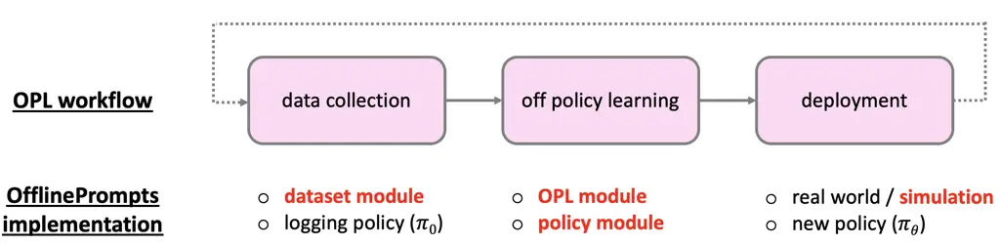

Figure 7: Off-policy learning (OPL) workflow and OfflinePrompts modules.

## Appendix A Extended Related Work

##### (Online) linear and kernelized contextual bandits.

Linear bandits \[Li et al., 2010, Agrawal & Goyal, 2013,
Rusmevichientong & Tsitsiklis, 2010\] and kernelized contextual
bandits \[Chowdhury & Gopalan, 2017, Valko et al., 2013, Zhou et al.,
2020\] is relevant to ours in using the similarity among actions and
rewards for improving data efficiency. Specifically, linear bandits
assume that the reward function is expressed as an inner-product between
(non-linear representations of) context features and action-specific
coefficients and aims to learn the linear action features \[Li et al.,
2010\]. By assuming the linear structure in the reward function, the
corresponding bandit algorithm makes the exploration more efficient than
treating each action independently. Similarly, kernelized
bandits \[Valko et al., 2013\] generalize the idea of leveraging
similarity among action representations under less restrictive
assumptions on the rewards. Specifically, it assumes that similar
features can result in similar rewards without assuming a linear
structure and implicitly augments the reward observation using the
Reproducing kernel Hilbert space (RKHS). Our paper demonstrates that
leveraging the similarity among auxiliary outputs (i.e., sentences) of
action can improve the data efficiency in the offline learning setting,
not only limited to the online exploration discussed in the existing
literature.

##### Offline reinforcement learning (Offline RL) for dialog generation.

Offline RL \[Levine et al., 2020\] has emerged as a new paradigm for
fine-tuning language models in dialog systems \[Jaques et al., 2020,
Snell et al., 2022a, Snell et al., 2022b, Verma et al., 2022\]. Among
them, Snell et al. \[2022a\] and Verma et al. \[2022\] focus on
goal-oriented dialog system, which aims to solve some specific tasks by
combining RL-based planning and dialog generation. Jaques et al.
\[2020\] and Snell et al. \[2022a\] aim to improve the quality of
conversations by maximizing the users’ sentiment signals observed in
text or interface (e.g., thumb up). While these works are relevant to
ours in using offline data, our work has several distinctions over
existing works. First, while existing work focuses on RL-based
fine-tuning, which requires expensive computation and is affordable only
for the companies releasing pre-trained models, our work considers
prompt tuning. Since prompt tuning is available for some third-party
companies (e.g., advertising agencies) or even individual users that
access models through APIs (e.g., ChatGPT), a more diverse population
can customize language generation with our framework. Moreover, while
existing work formulates the problem as an RL problem and considers only
the regression-based approach for policy learning, ours formulates the
problem as contextual bandits and considers applying IS in the
marginalized sentence space. This makes the bias-variance tradeoff of
policy learning more controllable than existing works. Thus, we can
expect an improved policy performance, as we have shown in the
experiments.

##### Relevant open-source softwares and benchmarks.

There are several open-source libraries for language generation relevant
to ours. First, RL4LMs \[Ramamurthy et al., 2022\] provides a framework
for RL-based fine-tuning of LLMs for optimizing language generation for
reward maximization. In prompt tuning, OpenPrompt \[Ding et al., 2022\]
works as a testbed for comparing (online) gradient-based prompting
strategies with various frozen LLMs. OpenICL \[Wu et al., 2023\] also
benchmarks (more sophisticated) prompt conditioning strategies called
in-context learning (ICL), such as chain-of-thoughts reasoning for
solving complex mathematical problems \[Wei et al., 2022\]. Similarly,
OpenAgents \[Xie et al., 2023\] provides an interface for generating
text for various real-world web applications using frozen LLMs,
especially for the purpose of providing a platform for online RL-based
prompt tuning. However, these platforms are not capable of handling
logged bandit feedback, and ours are the first to streamline OPL
procedures for prompt tuning with naturally collected user feedback
data.

In an independent field of benchmark study, OpenBanditPipeline \[Saito
et al., 2021\] and SCOPE-RL \[Kiyohara et al., 2023a, Kiyohara et al.,
2023b\] are representative open-source libraries to handle OPE and OPL
procedures in contextual bandits and RL. Although these libraries
streamline the workflow of using logged data in organized ways, they are
not applicable to language generation. Thus, we release a new benchmark
suite for OPL of prompt tuning for language generation, putting emphasis
on connecting OPL modules and language generation modules, while
following the basic design principles of OpenBanditPipeline \[Saito
et al., 2021\] and SCOPE-RL \[Kiyohara et al., 2023a, Kiyohara et al.,
2023b\].

Finally, there is also a benchmark called BanditBench \[Nie et al.,
2024\] , which simulates the LLM-based item recommendations based on the
MovieLens \[Harper & Konstan, 2015\] dataset. While this benchmark uses
the same MovieLens dataset for semi-synthetic simulation, the tasks are
different from each other. Specifically, BanditBench \[Nie et al.,
2024\] aims to use LLMs as recommender policies that choose items \[Yang
et al., 2023, Gao et al., 2023\], while our work focuses on steering the
generation of sentence description with prompts given (already chosen)
items as a query.

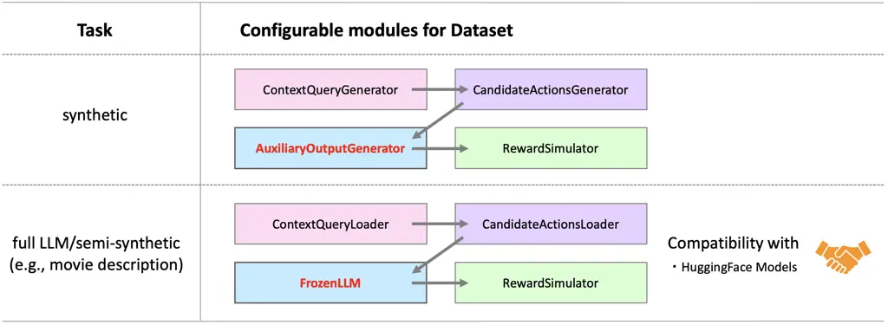

Figure 8: Two benchmarks (synthetic and full-LLM) of OfflinePrompts with
four configurable submodules. Compared to the existing OPE/OPL
frameworks \[Saito et al., 2021, Kiyohara et al., 2023a, Kiyohara
et al., 2023b\], our benchmark is distinctive in providing
AuxiliaryOutputGenerator/FrozenLLM to simulate language generation tasks
as contextual bandits with auxiliary outputs.

## Appendix B OfflinePrompts: Open-source software of OPL for language generation

### B.1 Overview and workflow

The primal goals of OfflinePrompts are to (1) provide a standardized
benchmark to compare OPL methods and (2) facilitate the smooth
implementation of the OPL workflow. For these purposes, OfflinePrompts
(1) provides two standardized benchmarks and (2) streamlines the
implementation with three modules: dataset, OPL, and policy, as shown in
Figure 7. All implementations are based on PyTorch \[Paszke et al.,
2019\]. We elaborate on the details of each feature below.

##### Dataset module and benchmarks

OfflinePrompts provides two benchmarks including synthetic and movie
description. First, the synthetic benchmark simulates (general)
contextual bandits with auxiliary outputs with feature vectors, without
involving language generation tasks. In contrast, the movie description
task is a full-LLM, semi-synthetic benchmark, which simulates
personalized generation of movie description (i.e., actual language
generation) based on the MovieLens datasets \[Harper & Konstan, 2015\].
These benchmarks can be used for separate purposes. The synthetic
benchmark is lighter and more suitable for extensive studies of how the
performance of OPL methods changes with various configurations than the
actual full-LLM benchmark. In contrast, the movie description benchmark
is preferable to see the performance of OPL methods in more realistic
settings than the synthetic benchmark. The key remark is that the movie
description benchmark is the first benchmark for prompt-guided language
generation from logged user feedback.

Both benchmarks provide a standardized setting and configurable
submodules to control the data generation process. Specifically, as
illustrated in Figure 8, each benchmark consists of four submodules:
ContextQueryModule, CandidateActionsModule,
AuxiliaryOutputGenerator/FrozenLLM, and RewardSimulator. Compared to the
existing OPE/OPL benchmarks \[Saito et al., 2021, Kiyohara et al.,
2023a, Kiyohara et al., 2023b\], our benchmark is distinctive in
modeling AuxiliaryOutputGenerator/FrozenLLM, which enable us to simulate
language generation tasks as contextual bandits with auxiliary outputs.
Moreover, since our FrozenLLM and RewardSimulator modules are compatible
with HuggingFace \[Wolf et al., 2019\], users can easily employ various
language models in the full-LLM experiments. The semi-synthetic/full-LLM
dataset module can also load custom dataset in a manner similar to the
movie description benchmark. We believe this feature of OfflinePrompts
also facilitates practical applications of prompt tuning from naturally
logged feedback.

##### OPL and policy modules

Figure 9 summarizes the implementation choices of OPL modules:

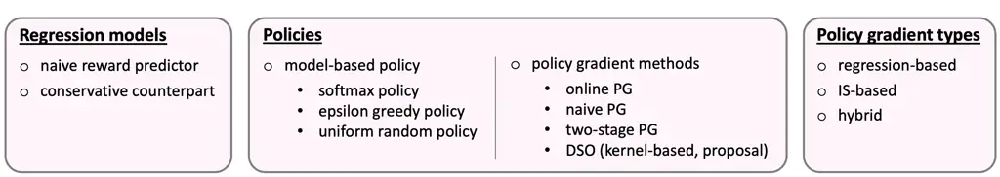

Figure 9: Implementation choices of OPL modules of OfflinePrompts.

As shown above, we implement two regression models (naive and
conservative), three model-based policies (softmax, epsilon-greedy, and
uniform random), and four policy gradient methods (online, naive,
two-stage, DSO), and three gradient types (regression-based, IS-based,
and hybrid). Each component is independently configurable. Thus, we can
easily try any combination of the above policies and OPL methods.
Moreover, by following the abstract base implementation provided in
OfflinePrompts, researchers can test their own policies and policy
gradient methods.

Example codes for streamlining OPL workflow and customizing each module
are available in Appendix F. The documentation of OfflinePrompts, which
describes further details of the software, is also available at:
(forthcoming).

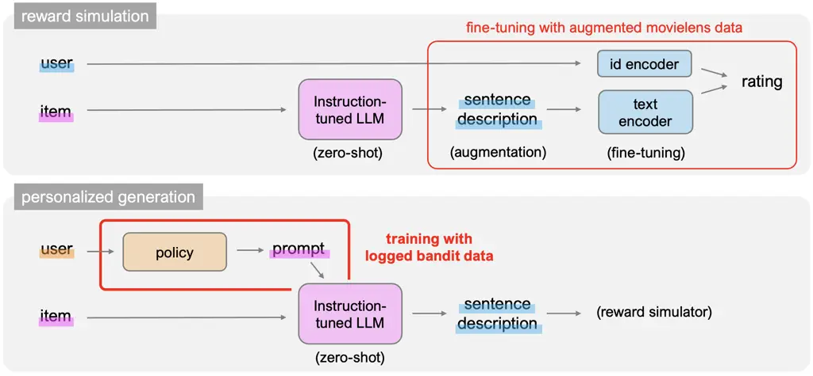

Figure 10: Procedures of reward simulation (Top) and personalized
sentence generation (Bottom). The reward simulator uses a sentence
encoder to get item embeddings. In the personalized sentence generation
task, a policy aims to identify a suitable prompt (e.g., genres of the
movie) for each user so the generated sentence aligns with the
user-dependent preference.

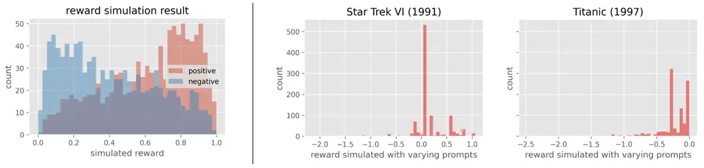

Figure 11: The reward simulation results on the MovieLens
dataset \[Harper & Konstan, 2015\]. (Left) Showing the original reward
simulated by the fine-tuned DistilBert model \[Sanh et al., 2019\] for
2000 samples of the validation data. "positive" indicates the data that
originally received the rating of 5 by users, and "negative" indicates
the data that received 0-3 ratings. (Right) Showing the normalized
reward generated for a single user and two movies with varying prompts.
This demonstrates how much reward difference each prompt can make
compared to without prompts (which we call prompt effect), suggesting
that effective prompts are sparse among the candidate set, and we have
skewed distribution on the prompt effect.

### B.2 Task description and reward simulation for the movie description task

We build a semi-synthetic simulator using the MovieLens dataset \[Harper
& Konstan, 2015\] for the personalized generation task of movie
descriptions. The movies consist of (partially observed) 5-star ratings
between users and items and have movie title information as the
metadata. To learn a reward simulator, which generates reward depending
on the generated movie description, we first augmented the movielens
dataset with item description using a frozen LLM as follows.

1.  1.  For each movie, retrieve its title.
2.  2.  Then, using zero-shot inference of a frozen LLM, we generate the
        movie description by providing instruction: "Broadly describe in a
        sentence the genres of the movie without including the name or any
        specifics of the movie. Title: {title of the movie}, Movie
        description: ".

In our standardized benchmark, we use Mistral
("mistralai/Mistral-7B-Instruct-v0.2") \[Jiang et al., 2023\] as the
frozen LLM. Once augmenting the dataset with item description, we train
a sentence encoder-based collaborative filtering model (as shown in
Figure 10 (Top)) in the following procedures.

1.  1.  Using movielens dataset without item description, we first train a
        naive neural collaborative filtering (CF) model \[He et al., 2017\],
        which uses user and item id embeddings.
2.  2.  Initialize the encoder-based CF model, which uses user id embeddings
        and encoded item description features, with the user id embeddings
        learned by naive CF model.
3.  3.  Finetune the encoder-based CF model with the (augmented) movielens
        dataset with item description.

The default reward simulator in our benchmark uses the fine-tuned
DistilBert model \[Sanh et al., 2019\] as the item description encoder,
and the user and item embeddings are set to be 20 dimensional. Note
that, before training the models, we preprocess the MovieLens-10M to
have binary labels – the rating of 5 is positive, and the ratings of 0-3
are negative. Then, we prune the dataset so that the dataset has
balanced positive and negative labels, and each user and item has at
least 10 positive and negative labels. After processing the data, 36,395
users, 4,796 items, and 2,316,912 ratings remained. When using the
fine-tuned model as the reward simulator in our benchmark, we use the
following normalized reward: $`10\times(q(x,s(a))-q(x,s(\emptyset)))`$,
where $`q(\cdot)`$ is the original \[0, 1\]-score simulated by the
model. $`s(a)`$ is the sentence generated by the prompt $`a`$, and
$`s(\emptyset)`$ is the sentence generated without any prompt. We report
the reward simulation results in Figure 11.

Finally, we simulate the data generation of the movie description task
as follows.

1.  1.  Randomly sample user and item id and let the user embedding learned
        by the naive CF as the user context $`u`$. We also let the title of
        the movie be query $`q`$. This is handled by ContextQueryLoader.
        ($`x`$)
2.  2.  (A policy chooses which prompt to use, taking the user and query
        embeddings as inputs.) ($`a`$)
3.  3.  FrozenLLM takes query and prompt as input in the following
        instruction: "Broadly describe in a sentence the genres of the movie
        without including the name or any specifics of the movie. Title:
        {title of the movie}, Keyword: {prompt} Movie description: " and
        generate movie description. ($`s`$).
4.  4.  RewardSimulator simulates reward by taking user id, item id, and the
        generated sentence as inputs. User and item ids are used to retrieve
        user-and item-specific bias terms. ($`r`$)

Note that by pre-training the reward simulator with item descriptions,
we expect the model to learn matchings between user preferences and
movie genres (e.g., user A prefers sci-fi movies). We expect this
differentiates the reward among varying prompts in the movie description
task – e.g., for sci-fi lovers, we should focus on the sci-fi aspects
rather than the romance aspects of a movie. The goal of OPL task is to
identify specific features or keywords that generate suitable sentence
for each user from the logged data. For reference, Figure 12 shows the
example of sentences generated with varying prompts and their rewards
simulated in our benchmark.

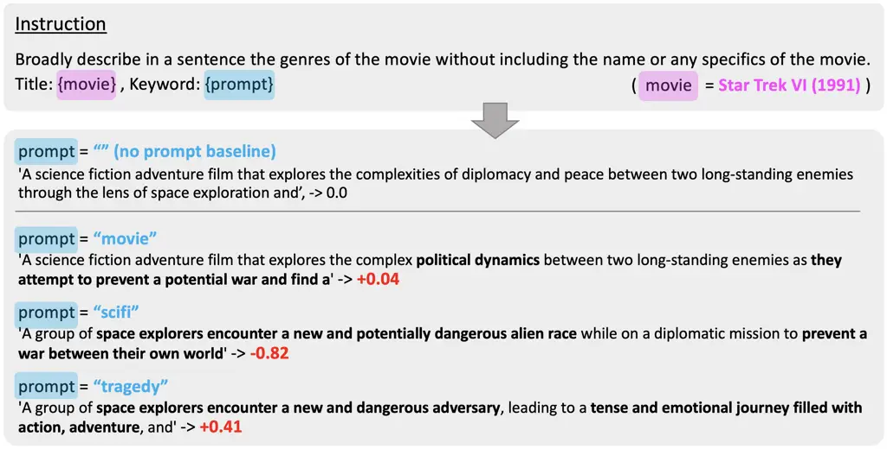

Figure 12: Example of sentences generated with varying prompts and their
reward simulated in the full-LLM benchmark. We use the frozen
Mistral-7B \[Jiang et al., 2023\] model to generate descriptions of the
movie Star Trek VI (1991) with three different prompts, { movie, scifi,
tragedy } and highlight sentences that differ from the baseline
generated without prompts. The red font indicates the reward simulated
by the DistilBert model fine-tuned on the MovieLens dataset. While
abstract keywords like "movie" do not make much difference, more
specific keywords like "scifi" or "tragedy" can be impactful in the
reward simulation.

### B.3 Data generation process for the synthetic benchmark

The synthetic benchmark simulates the contextual bandits with auxiliary
output using feature vectors without involving actual language
generation. Specifically, the synthetic benchmark generates the logged
data in the following process:

1.  1.  Sample size $`n`$ of context and query from ContextQueryGenerator.
        ($`x`$)
2.  2.  Sample embeddings ($`e_{a}`$) for size $`|\mathcal{A}|`$ of actions
        to define a candidate set of actions. Then, for each context, sample
        action from the candidates with some logging policy. ($`a`$)
3.  3.  Input both query and the chosen action to AuxiliaryOutputGenerator
        to generate a feature vector as an auxiliary output. The auxiliary
        output corresponds to output sentence in language generation tasks.
        ($`s`$)
4.  4.  Finally, simulate base reward $`R(x,s)`$ by inputting context and
        auxiliary output into RewardSimulator. Then, sample reward from a
        normal distribution $`\mathcal{N}(R(x,s),\sigma_{r})`$ for the
        auxiliary output observed by the logging policy. ($`r`$)

By running a synthetic experiment, we can easily control and study the
effect of various relationship between prompt and sentence (action
$`a,e`$ and auxiliary output $`s`$) and that between sentence and reward
(auxiliary output $`s`$ and reward $`r`$) through varying
AuxiliaryOutputGenerator and RewardSimulator, respectively. Therefore,
we expect our synthetic benchmark to be a easy-to-use testbed for
checking the behaviors of OPL methods before working on a more complex,
actual language generation task.

## Appendix C Implementation details of experiments

Basically, we follow the default implementation of OfflinePrompts.

### C.1 Synthetic experiments

The policy is parameterized by a two-layer neural network, where the
hidden dimension is 100, the activation function is ReLU, and the
optimizer is Adam \[Kingma, 2014\]. All single-stage policies (which are
used in regression-based, IS-based, and DSO) take $`(x,e_{a})`$ as
inputs and generate logit values. The probability of each prompt chosen
by the policy is calculated by taking the softmax of the logit values.
Similarly, the first stage policy of POTEC takes $`(x,e_{c})`$ as
inputs, where $`e_{c}`$ is the cluster centers of prompts in the action
embedding space. For all IS and DR-type methods, we apply the weight
clipping with a maximum of 200. To avoid the extensive tuning of
learning rates, we use the one that worked well for the online policy
gradient in all the compared methods, which is 5e-4. The regression
model ($`\hat{q}(x,e_{a})`$), used for regression-based, DR, and POTEC,
and the logging marginal density model used for DSO are parameterized by
a two-layer neural network with a 100 dimensional hidden state. The
regression model is trained on the logged data with the following MSE
loss: $`\sum_{i=1}^{n}(r_{i}-\hat{q}(x_{i},a_{i}))^{2}`$, while the
marginal density model is trained by the loss function described in
Section 4.1. The learning rates of the regression and the marginal
density models are both based on the validation loss, and are set to
1e-4. Note that because $`\phi(s)`$ ranges within $`[-3\tau,3\tau]`$
with probability more than 99% under the Gaussian kernel, we let
$`\phi(s)`$ of the uniform kernel to range $`[-3\tau,3\tau]`$ to the
corresponding value of $`\tau`$. Finally, the action clustering used by
POTEC is based on $`k`$-means clustering with $`k=10`$, implemented in
scikit-learn \[Pedregosa et al., 2011\].

### C.2 Full-LLM experiment

The implementation of the full-LLM experiment is almost the same as the
synthetic experiment. The only difference is that, because $`(q,a,s)`$
are words or sentences, we applied some encoding to get vectorial
embeddings of these variables. We learn the embeddings by the following
steps. We first randomly sample 1000 movies and sentences from the
(augmented) MovieLens dataset and sample 1000 prompts from the action
set. Then, we get the last hidden states of Mistral-7B \[Jiang et al.,
2023\] by providing the following instructions:

- •
  "Broadly describe in a sentence the genres of the movie without
  including the name or any specifics of the movie. Title: { title of
  the movie }" for each movie ($`q`$),
- •
  "Associate the word - { prompt } - in the context of movie genres" for
  each prompt ($`a`$),
- •
  " { sentence } " for each sentence $`s`$.

After obtaining (high-dimensional) embeddings from Mistral-7B, we fit
PCA \[Maćkiewicz & Ratajczak, 1993\] to reduce the dimension of
embeddings to 20. In contrast, for the user context $`x`$, we use
20-dimensional embeddings of user ids learned by (naive) collaborative
filtering, which is different from that used in the reward simulator. We
use the learning rate of 8e-4 with Adagrad for policy gradients. The
learning rate of the regression and the marginal density models are 1e-4
with Adam.

It is worth mentioning that because the full-LLM benchmark is
challenging due to the sparsity of effective prompts as demonstrated in
Figure 11, a similar learning instability to the OPL results is also
observed for the online policy (e.g., even the online policy sometimes
fall short with a near-zero policy value like 0.01, regardless the
choice of the learning rates). Therefore, in the experiment, we picked
an online policy that performed well when defining a logging policy, so
that meaningful reward signals should be included in the logged data.

### C.3 Doubly Robust (DR) estimators

Here, we provide the details of the DR estimators used in the
experiments.

Doubly Robust (DR) \[Dudík et al., 2011\]. DR is a hybrid approach,
which effectively combines the regression and IS to exploit the benefits
of the two.

```math
\displaystyle\nabla_{\theta}V(\pi_{\theta}) \displaystyle\approx\frac{1}{n}\sum_{i=1}^{n}\frac{\pi_{\theta}(a_{i}|x_{i})}{\pi_{0}(a_{i}|x_{i})}\nabla_{\theta}\log\pi_{\theta}(a_{i}|x_{i})(r_{i}-\hat{q}(x_{i},a_{i}))
```

```math
\displaystyle+\frac{1}{n}\sum_{i=1}^{n}\mathbb{E}_{a\sim\pi_{\theta}(a|x_{i})}[\nabla_{\theta}\log\pi_{\theta}(a_{i}|x_{i})\hat{q}(x_{i},a)].
```

By using the regressed reward as a control variate, DR often reduces the
variance of IS, while remaining unbiased under the same condition as IS.
However, when the regression is inaccurate, the variance reduction is
limited and DR often suffers from high variance when the action space is
large \[Saito & Joachims, 2022\].

POTEC \[Saito et al., 2024\]. To deal with the variance issue of DR,
POTEC considers the clustering in the action space and decomposes the
policy into two stages as follows.

```math
\displaystyle\pi_{\theta}(a|x)=\sum_{c\in\mathcal{C}}\pi_{\theta}^{\text{1st}}(c|x)\pi^{\text{2nd}}(a|x,c),
```

where $`c`$ indicates the cluster of the action $`a`$, which can be
learned by applying an off-the-shelf clustering method to action
embeddings. Using this decomposition, POTEC chooses clusters via a
DR-style approach as follows, and chooses actions within a cluster via
regression.

```math
\displaystyle\nabla_{\theta}V(\pi_{\theta}) \displaystyle\approx\frac{1}{n}\sum_{i=1}^{n}\frac{\pi_{\theta}^{\text{1st}}(c(a_{i})|x_{i})}{\pi_{0}^{\text{1st}}(c(a_{i})|x_{i})}\nabla_{\theta}\log\pi_{\theta}^{\text{1st}}(c(a_{i})|x_{i})(r_{i}-\hat{q}(x_{i},a_{i}))
```

```math
\displaystyle+\frac{1}{n}\sum_{i=1}^{n}\mathbb{E}_{a\sim\pi_{\theta}(a|x_{i})}[\nabla_{\theta}\log\pi_{\theta}^{\text{1st}}(c(a_{i})|x_{i})\hat{q}(x_{i},a)],
```

where
$`\pi_{0}^{\text{1st}}(c(a)|x)=\sum_{a^{\prime}\in\mathcal{A},c(a^{\prime})=c(a)}\pi_{0}(a|x)`$.
The second-stage policy greedily chooses action as
$`\pi^{\text{2nd}}(a|x,c)=\mathbb{I}\{\hat{q}(x,a)=\argmax_{a^{\prime}\in\mathcal{A},c(a^{\prime})=c(a)}\hat{q}(x,a^{\prime})\}`$.
By applying IS on the clustered action space, POTEC reduces the variance
of naive IS. POTEC is also able to convert regression to a pair-wise
regression within a cluster. However, especially when the relation
between actions and rewards is complex, a good clustering is often hard
to identify, and POTEC cannot take the rich information about generated
sentences into account.

## Appendix D Omitted proofs and derivations

This section provide proofs and derivations ommited in the main text.

### D.1 Derivation of the PG in the sentence space

We first derive
$`\nabla_{\theta}\log\pi_{\theta}(s|x)=\mathbb{E}_{a\sim\pi_{\theta}(a|x,s)}[\nabla_{\theta}\log\pi_{\theta}(a|x)]`$.

```math
\displaystyle\nabla_{\theta}\log\pi_{\theta}(s|x) \displaystyle=\frac{\nabla_{\theta}\pi_{\theta}(s|x)}{\pi_{\theta}(s|x)}
```

```math
\displaystyle=\frac{\sum_{a\in\mathcal{A}}\nabla_{\theta}\pi_{\theta}(a|x)p_{\text{LLM}}(s|x,a)}{\pi_{\theta}(s|x)}
```

```math
\displaystyle=\sum_{a\in\mathcal{A}}\frac{\nabla_{\theta}\pi_{\theta}(a|x)}{\pi_{\theta}(a|x)}\pi_{\theta}(a|x,s)
```

```math
\displaystyle=\mathbb{E}_{\pi_{\theta}(a|x,s)}[\nabla_{\theta}\log\pi_{\theta}(a|x)]
```

Similarly, we also have
$`\nabla_{\theta}\log\pi_{\theta}(\phi(s)|x)=\mathbb{E}_{\pi_{\theta}(s^{\prime}|x,\phi(s))}[\nabla_{\theta}\log\pi_{\theta}(s^{\prime}|x)]`$
thus
$`\nabla_{\theta}\log\pi_{\theta}(\phi(s)|x)=\mathbb{E}_{\pi_{\theta}(s^{\prime}|x,\phi(s))}[\mathbb{E}_{\pi_{\theta}(a|x,s^{\prime})}[\nabla_{\theta}\log\pi_{\theta}(a|x)]]=\mathbb{E}_{\pi_{\theta}(a|x,\phi(s))}[\nabla_{\theta}\log\pi_{\theta}(a|x)]`$.

### D.2 Derivation of the weighted score function

We first show
$`w(\phi(s),x)=\mathbb{E}_{\pi_{0}(a|x,\phi(s))}[w(a,x)]`$.

```math
\displaystyle\mathbb{E}_{\pi_{0}(a|x,\phi(s))}[w(a,x)] \displaystyle=\sum_{a\in\mathcal{A}}\pi_{0}(a|x,\phi(s))\frac{\pi_{\theta}(a|x)}{\pi_{0}(a|x)}
```

```math
\displaystyle=\sum_{a\in\mathcal{A}}\pi_{0}(a|x,\phi(s))\frac{\frac{\pi_{\theta}(a|x,\phi(s))\pi_{\theta}(\phi(s)|x)}{p_{\text{LLM}}(\phi(s)|x,a)}}{\frac{\pi_{0}(a|x,\phi(s))\pi_{0}(\phi(s)|x)}{p_{\text{LLM}}(\phi(s)|x,a)}}
```

```math
\displaystyle=\sum_{a\in\mathcal{A}}\pi_{0}(a|x,\phi(s))\frac{\pi_{\theta}(a|x,\phi(s))}{\pi_{0}(a|x,\phi(s))}\frac{\pi_{\theta}(\phi(s)|x)}{\pi_{0}(\phi(s)|x)}
```

```math
\displaystyle=\mathbb{E}_{\pi_{\theta}(a|x,\phi(s))}[w(x,\phi(s))]
```

```math
\displaystyle=w(\phi(s),x)
```

Next, using the above expression and that derived in Appendix D.1, we
have

```math
\displaystyle w(\phi(s)|x)\nabla_{\theta}\log\pi_{\theta}(\phi(s)|x)
```

```math
\displaystyle=\frac{\pi_{\theta}(\phi(s)|x)}{\pi_{0}(\phi(s)|x)}\mathbb{E}_{\pi_{\theta}(s^{\prime}|x,\phi(s))}[\mathbb{E}_{\pi_{\theta}(a|x,s^{\prime})}[\nabla_{\theta}\log\pi_{\theta}(a|x)]]
```

```math
\displaystyle=\frac{\pi_{\theta}(\phi(s)|x)}{\pi_{0}(\phi(s)|x)}\int_{s^{\prime}\in\mathcal{S}}\pi_{\theta}(s^{\prime}|x,\phi(s))\sum_{a\in\mathcal{A}}\pi_{\theta}(a|x,s^{\prime})\nabla_{\theta}\log\pi_{\theta}(a|x)ds^{\prime}
```

```math
\displaystyle=\frac{\pi_{\theta}(\phi(s)|x)}{\pi_{0}(\phi(s)|x)}\int_{s^{\prime}\in\mathcal{S}}\frac{p_{K}(\phi(s)|x,s^{\prime})\pi_{\theta}(s^{\prime}|x)}{\pi_{\theta}(\phi(s)|x)}\sum_{a\in\mathcal{A}}\frac{p_{\text{LLM}}(s^{\prime}|x,a)\pi_{\theta}(a|x)}{\pi_{\theta}(s^{\prime}|x)}\nabla_{\theta}\log\pi_{\theta}(a|x)ds^{\prime}
```

```math
\displaystyle=\frac{1}{\pi_{0}(\phi(s)|x)}\int_{s^{\prime}\in\mathcal{S}}K(s,s^{\prime};\,x,\tau)\sum_{a\in\mathcal{A}}p_{\text{LLM}}(s^{\prime}|x,a)\pi_{\theta}(a|x)\nabla_{\theta}\log\pi_{\theta}(a|x)ds^{\prime}
```

```math
\displaystyle=\sum_{a\in\mathcal{A}}\pi_{\theta}(a|x)\int_{s^{\prime}\in\mathcal{S}}p_{\text{LLM}}(s^{\prime}|x,a)\frac{K(s,s^{\prime};\,x,\tau)}{\pi_{0}(\phi(s)|x)}\nabla_{\theta}\log\pi_{\theta}(a|x)ds^{\prime}
```

```math
\displaystyle=\mathbb{E}_{\pi_{\theta}(a|x)p_{\text{LLM}}(s^{\prime}|x,a)}\biggl[\frac{K(s,s^{\prime};\,x,\tau)}{\pi_{0}(\phi(s)|x)}\nabla_{\theta}\log\pi_{\theta}(a|x)\biggr]
```

where $`p_{K}(\phi(s)|x,s^{\prime})=K(s,s^{\prime};\,x,\tau)`$.

### D.3 Derivation of the bias of DSO (Proofs of Theorem 1)

###### Proof.

To derive the bias of DSO, we first decompose the expectation of DSO as
follows.

```math
\displaystyle\mathbb{E}_{\mathcal{D}}[w(\phi(s^{\prime}),x)\nabla_{\theta}\log\pi_{\theta}(\phi(s^{\prime})|x)r]
```

```math
\displaystyle=\mathbb{E}_{\pi_{0}(s^{\prime}|x)}[w(\phi(s^{\prime}),x)\nabla_{\theta}\log\pi_{\theta}(\phi(s^{\prime})|x)q(x,s^{\prime})]
```

```math
\displaystyle=\mathbb{E}_{\pi_{0}(\phi(s)|x)\pi_{0}(s^{\prime}|x,\phi(s))}[w(\phi(s^{\prime}),x)\nabla_{\theta}\log\pi_{\theta}(\phi(s^{\prime})|x)q(x,s^{\prime})]
```

```math
\displaystyle=\mathbb{E}_{\pi_{0}(\phi(s)|x)\pi_{0}(s^{\prime}|x,\phi(s))}[w(\phi(s^{\prime}),x)\nabla_{\theta}\log\pi_{\theta}(\phi(s^{\prime})|x)q(x,s^{\prime})]
```

```math
\displaystyle\quad-\mathbb{E}_{\pi_{0}(\phi(s)|x)\pi_{0}(s^{\prime}|x,\phi(s))}[w(\phi(s),x)\nabla_{\theta}\log\pi_{\theta}(\phi(s)|x)q(x,s^{\prime})]
```

```math
\displaystyle\quad+\mathbb{E}_{\pi_{0}(\phi(s)|x)\pi_{0}(s^{\prime}|x,\phi(s))}[w(\phi(s),x)\nabla_{\theta}\log\pi_{\theta}(\phi(s)|x)q(x,s^{\prime})]
```

```math
\displaystyle=\mathbb{E}_{\pi_{0}(\phi(s)|x)\pi_{0}(s^{\prime}|x,\phi(s))}[(w(\phi(s^{\prime}),x)\nabla_{\theta}\log\pi_{\theta}(\phi(s^{\prime})|x)-w(\phi(s),x)\nabla_{\theta}\log\pi_{\theta}(\phi(s)|x))q(x,s^{\prime})]
```

```math
\displaystyle\quad+\mathbb{E}_{\pi_{0}(\phi(s)|x)\pi_{0}(s^{\prime}|x,\phi(s))}[w(\phi(s),x)\nabla_{\theta}\log\pi_{\theta}(\phi(s)|x)q(x,s^{\prime})]
```

```math
\displaystyle=\mathbb{E}_{\pi_{0}(\phi(s)|x)\pi_{0}(s^{\prime}|x,\phi(s))}[\Delta_{(w\nabla_{\theta})}(\phi(s^{\prime}),\phi(s);x)q(x,s^{\prime})]
```

```math
\displaystyle\quad+\mathbb{E}_{\pi_{0}(\phi(s)|x)}[w(\phi(s),x)\nabla_{\theta}\log\pi_{\theta}(\phi(s)|x)q^{\pi_{0}}(x,\phi(s))].
```

Then, for the second term, we have

```math
\displaystyle\mathbb{E}_{\pi_{0}(\phi(s)|x)}[w(\phi(s),x)\nabla_{\theta}\log\pi_{\theta}(\phi(s)|x)q^{\pi_{0}}(x,\phi(s))]
```

```math
\displaystyle\mathbb{E}_{\pi_{0}(\phi(s)|x)}\left[\frac{\pi_{\theta}(\phi(s)|x)}{\pi_{0}(\phi(s)|x)}\nabla_{\theta}\log\pi_{\theta}(\phi(s)|x)q^{\pi_{0}}(x,\phi(s))\right]
```

```math
\displaystyle=\sum_{\phi(s)\in\Phi(S)}\pi_{0}(\phi(s)|x)\frac{\pi_{\theta}(\phi(s)|x)}{\pi_{0}(\phi(s)|x)}\nabla_{\theta}\log\pi_{\theta}(\phi(s)|x)q^{\pi_{0}}(x,\phi(s))
```

```math
\displaystyle=\sum_{\phi(s)\in\Phi(S)}\pi_{\theta}(\phi(s)|x)\nabla_{\theta}\log\pi_{\theta}(\phi(s)|x)q^{\pi_{0}}(x,\phi(s))
```

```math
\displaystyle=\mathbb{E}_{\pi_{\theta}(\phi(s)|x)}[\nabla_{\theta}\log\pi_{\theta}(\phi(s)|x)q^{\pi_{0}}(x,\phi(s))].
```

Next, we also transform the true gradient in the sentence space as
follows:

```math
\displaystyle\mathbb{E}_{\pi_{\theta}(s^{\prime}|x)}[\nabla_{\theta}\log\pi_{\theta}(s^{\prime}|x)q(x,s^{\prime})]
```

```math
\displaystyle=\mathbb{E}_{\pi_{\theta}(\phi(s)|x)\pi_{\theta}(s^{\prime}|x,\phi(s))}[\nabla_{\theta}\log\pi_{\theta}(s^{\prime}|x)q(x,s^{\prime})]
```

```math
\displaystyle=\mathbb{E}_{\pi_{\theta}(\phi(s)|x)\pi_{\theta}(s^{\prime}|x,\phi(s))}[\nabla_{\theta}\log\pi_{\theta}(s^{\prime}|x)q(x,s^{\prime})]
```

```math
\displaystyle\quad-\mathbb{E}_{\pi_{\theta}(\phi(s)|x)\pi_{\theta}(s^{\prime}|x,\phi(s))}[\nabla_{\theta}\log\pi_{\theta}(\phi(s)|x)q(x,s^{\prime})]
```

```math
\displaystyle\quad+\mathbb{E}_{\pi_{\theta}(\phi(s)|x)\pi_{\theta}(s^{\prime}|x,\phi(s))}[\nabla_{\theta}\log\pi_{\theta}(\phi(s)|x)q(x,s^{\prime})]
```

```math
\displaystyle=\mathbb{E}_{\pi_{\theta}(\phi(s)|x)\pi_{\theta}(s^{\prime}|x,\phi(s))}[(\nabla_{\theta}\log\pi_{\theta}(s^{\prime}|x)-\nabla_{\theta}\log\pi_{\theta}(\phi(s)|x))q(x,s^{\prime})]
```

```math
\displaystyle\quad+\mathbb{E}_{\pi_{\theta}(\phi(s)|x)\pi_{\theta}(s^{\prime}|x,\phi(s))}[\nabla_{\theta}\log\pi_{\theta}(\phi(s)|x)q(x,s^{\prime})]
```

```math
\displaystyle=\mathbb{E}_{\pi_{\theta}(\phi(s)|x)\pi_{\theta}(s^{\prime}|x,\phi(s))}[\Delta_{(\nabla_{\theta})}(s^{\prime},\phi(s))q(x,s^{\prime})]
```

```math
\displaystyle\quad+\mathbb{E}_{\pi_{\theta}(\phi(s)|x)}[\nabla_{\theta}\log\pi_{\theta}(\phi(s)|x)q^{\pi_{\theta}}(x,\phi(s))].
```

Therefore, the bias is

```math
\displaystyle\mathrm{Bias}(\widehat{(\nabla_{\theta}V)}_{\mathrm{DSO}})
```

```math
\displaystyle=\mathbb{E}_{\mathcal{D}}[w(\phi(s^{\prime}),x)\nabla_{\theta}\log\pi_{\theta}(\phi(s^{\prime})|x)r]-\mathbb{E}_{\pi_{\theta}(s^{\prime}|x)}[\nabla_{\theta}\log\pi_{\theta}(s^{\prime}|x)q(x,s^{\prime})]
```

```math
\displaystyle=\mathbb{E}_{\pi_{\theta}(\phi(s)|x)}[\nabla_{\theta}\log\pi_{\theta}(\phi(s)|x)q^{\pi_{0}}(x,\phi(s))]
```

```math
\displaystyle\quad+\mathbb{E}_{\pi_{0}(\phi(s)|x)\pi_{0}(s^{\prime}|x,\phi(s))}[\Delta_{(w\nabla_{\theta})}(\phi(s^{\prime}),\phi(s);x)q(x,s^{\prime})]
```

```math
\displaystyle\quad-\mathbb{E}_{\pi_{\theta}(\phi(s)|x)}[\nabla_{\theta}\log\pi_{\theta}(\phi(s)|x)q^{\pi_{\theta}}(x,\phi(s))]
```

```math
\displaystyle\quad-\mathbb{E}_{\pi_{\theta}(\phi(s)|x)\pi_{\theta}(s^{\prime}|x,\phi(s))}[\Delta_{(\nabla_{\theta})}(s^{\prime},\phi(s))q(x,s^{\prime})]
```

```math
\displaystyle=\mathbb{E}_{\pi_{\theta}(\phi(s)|x)}[\nabla_{\theta}\log\pi_{\theta}(\phi(s)|x)(q^{\pi_{0}}(x,\phi(s))-q^{\pi_{\theta}}(x,\phi(s)))]
```

```math
\displaystyle\quad+\mathbb{E}_{\pi_{0}(\phi(s)|x)\pi_{0}(s^{\prime}|x,\phi(s))}[\Delta_{(w\nabla_{\theta})}(\phi(s^{\prime}),\phi(s);x)q(x,s^{\prime})]
```

```math
\displaystyle\quad+\mathbb{E}_{\pi_{\theta}(\phi(s)|x)\pi_{\theta}(s^{\prime}|x,\phi(s))}[\Delta_{(\nabla_{\theta})}(\phi(s),s^{\prime})q(x,s^{\prime})]
```

```math
\displaystyle=\mathbb{E}_{\pi_{\theta}(\phi(s)|x)}[\nabla_{\theta}\log\pi_{\theta}(\phi(s)|x)\Delta_{q}(\pi_{\theta},\pi_{0};\,x,\phi(s))]
```

```math
\displaystyle\quad+\mathbb{E}_{\pi_{0}(\phi(s)|x)\pi_{0}(s^{\prime}|x,\phi(s))}[\Delta_{(w\nabla_{\theta})}(\phi(s^{\prime}),\phi(s);x)q(x,s^{\prime})]
```

```math
\displaystyle\quad+\mathbb{E}_{\pi_{\theta}(\phi(s)|x)\pi_{\theta}(s^{\prime}|x,\phi(s))}[\Delta_{(\nabla_{\theta})}(\phi(s),s^{\prime})q(x,s^{\prime})].
```

where we define

```math
\displaystyle\Delta_{q}(\pi_{\theta},\pi_{0};\,x,\phi(s)):=q^{\pi_{\theta}}(x,\phi(s))-q^{\pi_{0}}(x,\phi(s)),
```

```math
\displaystyle\Delta_{(w\nabla_{\theta})}(\phi(s^{\prime}),\phi(s);x):=w(\phi(s^{\prime}),x)\nabla_{\theta}\log\pi_{\theta}(\phi(s^{\prime})|x)-w(\phi(s),x)\nabla_{\theta}\log\pi_{\theta}(\phi(s)|x),
```

```math
\displaystyle\Delta_{(\nabla_{\theta})}(\phi(s),s^{\prime}):=\nabla_{\theta}\log\pi_{\theta}(s^{\prime}|x)-\nabla_{\theta}\log\pi_{\theta}(\phi(s)|x).
```

∎

### D.4 Derivation of the variance of DSO (Proofs of Theorem 2)

###### Proof.

From the total law of variance, we have

```math
\displaystyle n\mathbb{V}(\widehat{(\nabla_{\theta}V)}_{\text{DSO}}) \displaystyle=\mathbb{V}_{p(x)}(\mathbb{E}_{\mathcal{D}}[\widehat{(\nabla_{\theta}V)}_{\text{DSO}}|x])
```

```math
\displaystyle\quad+\mathbb{E}_{p(x)}[\mathbb{V}_{\pi_{0}(s|x)}(w(\phi(s)|x)\nabla_{\theta}\log\pi_{\theta}(\phi(s)|x)q(x,s))]
```

```math
\displaystyle\quad+\mathbb{E}_{p(x)\pi_{0}(s|x)}[(w(\phi(s)|x))^{2}(\nabla_{\theta}\log\pi_{\theta}(\phi(s)|x))^{2}\sigma^{2}(x,s)].
```

Because we have
$`w(\phi(s)|x)=\mathbb{E}_{\pi_{0}(a|x,\phi(s))}[w(x,a)]`$ and
$`\nabla_{\theta}\log\pi_{\theta}(\phi(s)|x)=\mathbb{E}_{\pi_{0}(a|x,\phi(s))}[\nabla_{\theta}\log\pi_{\theta}(a|x)]`$,
the following holds.

```math
\displaystyle\mathbb{V}_{\pi_{0}(a,s|x)}(w(a,x))-\mathbb{V}_{\pi_{0}(a,s|x)}(w(\phi(s)|x)) \displaystyle=\mathbb{E}_{\pi_{0}(s|x)}[\mathbb{V}_{\pi_{0}(a|\phi(s)|x)}(w(a,x))]
```

```math
\displaystyle\mathbb{V}_{\pi_{0}(a,s|x)}(\nabla_{\theta}\log\pi_{\theta}(s|x))-\mathbb{V}_{\pi_{0}(a,s|x)}(\nabla_{\theta}\log\pi_{\theta}(a|x)) \displaystyle=\mathbb{E}_{\pi_{0}(s|x)}[\mathbb{V}_{\pi_{0}(a|\phi(s)|x)}(\nabla_{\theta}\log\pi_{\theta}(a|x))]
```

∎

## Appendix E Future work: Discussion about DR variants of DSO

From the above theoretical analysis, the regression-based baseline
required for a DR-style estimator like Dudík et al. \[2011\], Saito
et al. \[2023\] should be

```math
\displaystyle\mathbb{E}_{\pi_{\theta}(\phi(s)|x)}[\nabla_{\theta}\log\pi_{\theta}(\phi(s)|x)\hat{q}^{\pi_{0}}(x,\phi(s))]
```

in expectation to achieve the same degree of bias as IS. However, a way
of computing such baselines is not trivial because estimating
$`\log\pi_{\theta}(\phi(s)|x)`$ from data without applying importance
sampling is challenging. Specifically, while it is possible to estimate
the score function as follows, as we did in estimating the weighted
score function,

```math
\displaystyle\nabla_{\theta}\log\pi_{\theta}(\phi(s)|x) \displaystyle=\frac{\pi_{0}(\phi(s)|x)}{\pi_{0}(\phi(s)|x)}\nabla_{\theta}\log\pi_{\theta}(\phi(s)|x)
```

```math
\displaystyle=\mathbb{E}_{(a,s^{\prime})\sim\pi_{0}(a|x)p_{\text{LLM}}(s^{\prime}|x,a)}\left[\frac{K(s,s^{\prime};\,x,\tau)\nabla_{\theta}\log\pi_{\theta}(a|x)}{\pi_{0}(\phi(s)|x)}\right],
```

we need additional importance sampling in the regression-based baseline
term, not only in the original IS term. Therefore, even though DR
approaches often aim for a further variance reduction, this naive
definition of DSO-hybrid does not reduce the variance of DSO-IS.
Figuring out an efficient way of combining IS and regression would be a
promising future work.

## Appendix F Example usages of OfflinePrompts

### F.1 Semi-synthetic benchmark with language generation

Here, we provide example codes to streamline the OPL procedure using
OfflinePrompts. While we focus on the movie description (semi-synthetic)
benchmark in this section, a similar workflow is also applicable to the
synthetic benchmark. Please also refer to additional example codes
including those with the synthetic benchmark at: (forthcoming).

#### F.1.1 Setting up a semi-synthetic simulation

To set up the default movie description benchmark, users can follow the
codes in Code snippet 1. The default datasets, candidate prompts, and
finetuned parameters are stored in src/dataset/assets/ in the
OfflinePrompts repository.

To customize the benchmark setting, it is also possible to use
configurable submodules: ContextQueryLoader, CandidateActionsLoader,
FrozenLLM, and RewardSimulator. Specifically, users can first create
customized instances of these submodules and then pass them to
SemiSyntheticDataset as exemplified in Code snippet 2-5.

#### F.1.2 Logging policy

After setting up the simulator, the next step is to define a logging
policy to collect logged feedback. We describe the procedure in Code
snippets 6 and 7. Specifically, in Code snippet 6, we first fit the
dimension reduction model to obtain low dimensional embeddings of query,
prompt, and sentence. These encoders are used across various models,
e.g., to define the logging policy and to define a reward preditor, etc.
Then, Code snippet 7 describes how to define a softmax logging policy.
In the example code, we first train a regression model used in the
logging policy and then pass it to the softmax policy class.

#### F.1.3 Data collection and regressions

Once defining a logging policy, we collect logged data as shown in Code
snippets 8. The outputs, including logged_feedback and meta_data,
contain the following keys.

- •
  logged_feedback:  
  { user_id, item_id, context, query, action,
  action_choice_probability^(∗), sentence, expected_reward^(∗), reward }
- •
  meta_data^(∗):  
  { size,   reward_type,   reward_std,  action_list }

Note that the keys with an asterisk (^(∗)) are optional outputs, and
action is returned by index. reward_type indicates whether the reward is
binary or continuous, and action_list contains the list of candidate
prompts, corresponding to each action index.

After obtaining the logged data, we regress the reward and train a
logging marginal density model as described in Code snippets 8 and 9.
prompt_reward_predictor is used by naive PG and two-stage PG, while
sentence_reward_predictor and marginal_density_model are used by DSO.

#### F.1.4 (Online policy gradient)

In OPL experiments, we often use the performance of online policy
gradient as a baseline. To learn a policy online, we can run online
policy gradient as shown in Code snippet 10.

#### F.1.5 Single stage policy gradients

Code snippet 11 shows the example codes to run naive PGs, including
regression-based, IS-based, and hybrid ones. The procedure consists of
only 3 steps: (1) define a policy, (2) then setup a learner class
(PolicyLearner), and (3) call one of the policy gradient methods. As
seen in the example code, all policy gradient methods can be called in
similar formats. Researchers can also implement their own policy
gradient methods in a similar way.

#### F.1.6 Direct Sentence Off-Policy Gradient (DSO)

DSO can also be run in a very similar way as the naive policy gradient.
As exemplified in Code snippet 12, the key difference is that DSO uses
KernelPolicyLearner, logging_marginal_density_model, and
sentence_reward_predictor. Only the IS-based policy gradient is
implemented for DSO.

### F.2 (Online) performance evaluation

Finally, after learning a policy, we test its performance through online
interaction. This can be done in a single line of code, as shown in Code
snippet 13.

We also provide additional quickstart examples at: (forthcoming)

![[Uncaptioned
image]](arxiv-2504-02646v1--4774edd8ca9a.figures/figure-16.webp)

![[Uncaptioned
image]](arxiv-2504-02646v1--4774edd8ca9a.figures/figure-17.webp)

![[Uncaptioned
image]](arxiv-2504-02646v1--4774edd8ca9a.figures/figure-18.webp)

![[Uncaptioned
image]](arxiv-2504-02646v1--4774edd8ca9a.figures/figure-19.webp)

![[Uncaptioned
image]](arxiv-2504-02646v1--4774edd8ca9a.figures/figure-20.webp)

![[Uncaptioned
image]](arxiv-2504-02646v1--4774edd8ca9a.figures/figure-21.webp)

![[Uncaptioned
image]](arxiv-2504-02646v1--4774edd8ca9a.figures/figure-22.webp)

![[Uncaptioned
image]](arxiv-2504-02646v1--4774edd8ca9a.figures/figure-23.webp)

![[Uncaptioned
image]](arxiv-2504-02646v1--4774edd8ca9a.figures/figure-24.webp)

![[Uncaptioned
image]](arxiv-2504-02646v1--4774edd8ca9a.figures/figure-25.webp)

![[Uncaptioned
image]](arxiv-2504-02646v1--4774edd8ca9a.figures/figure-26.webp)

![[Uncaptioned
image]](arxiv-2504-02646v1--4774edd8ca9a.figures/figure-27.webp)

![[Uncaptioned
image]](arxiv-2504-02646v1--4774edd8ca9a.figures/figure-28.webp)
