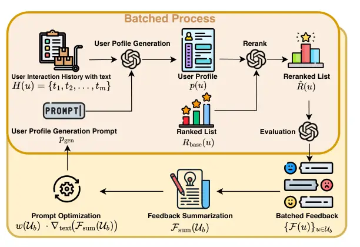
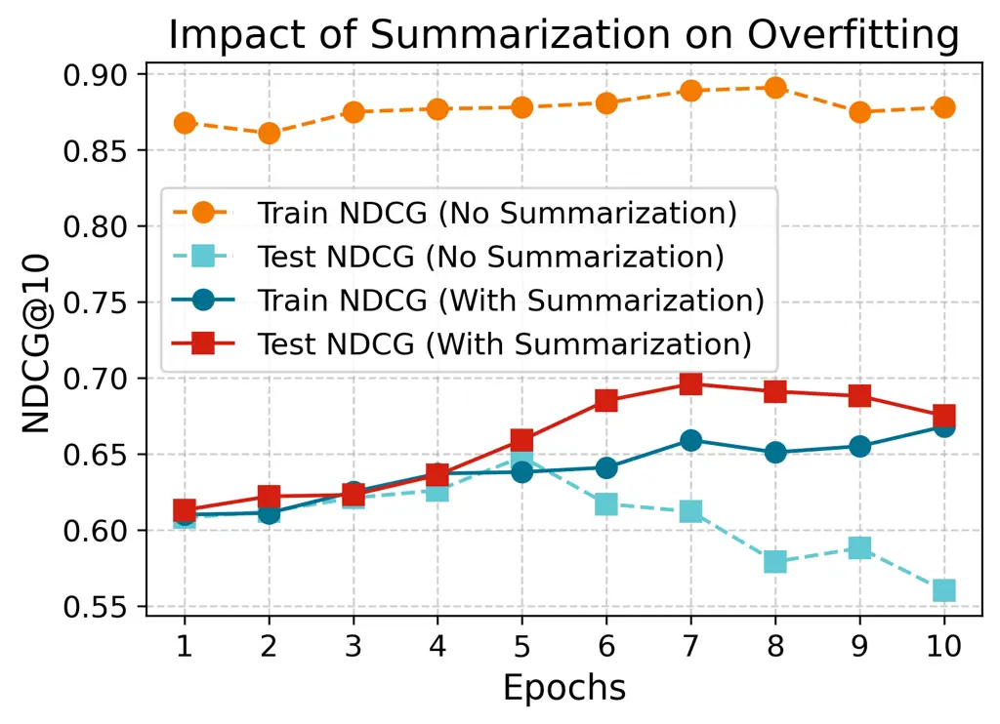
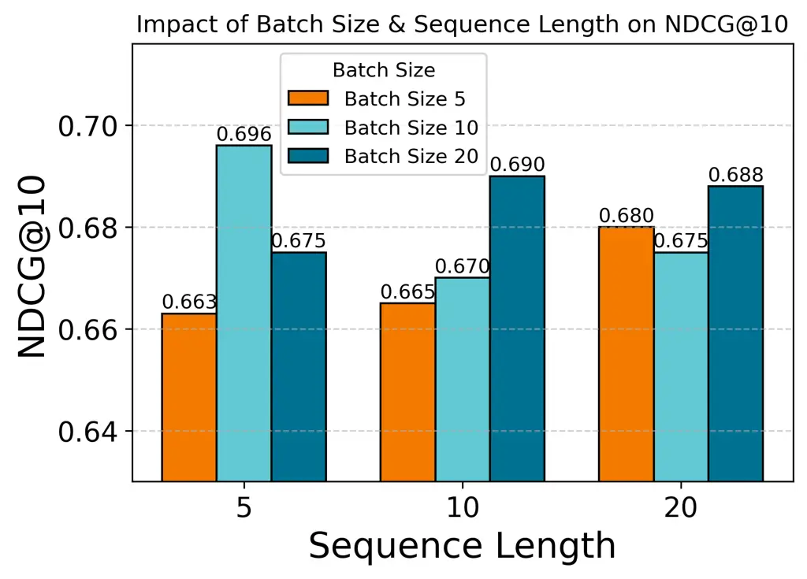
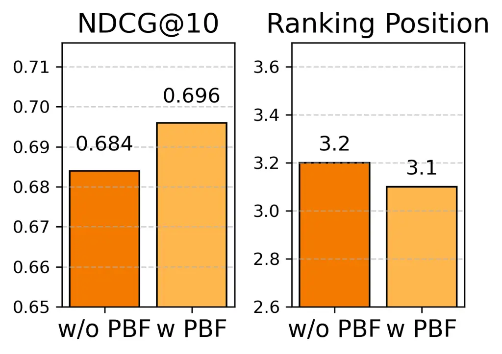
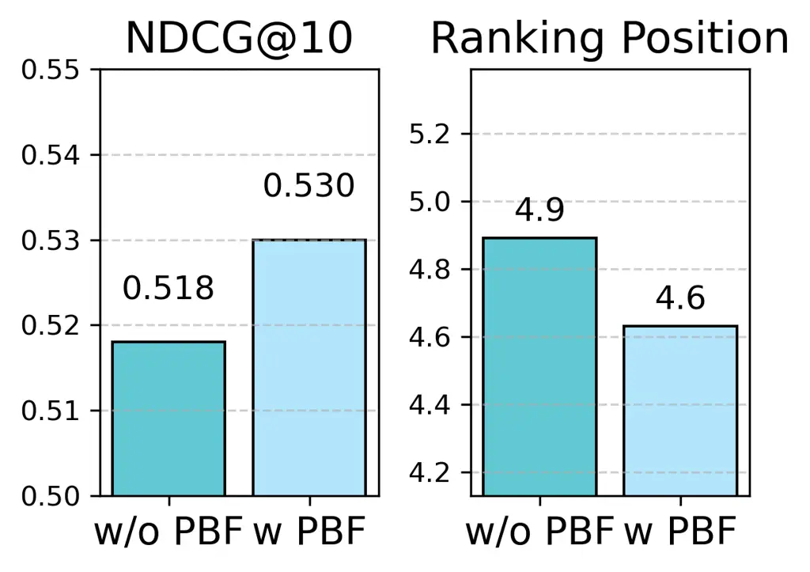
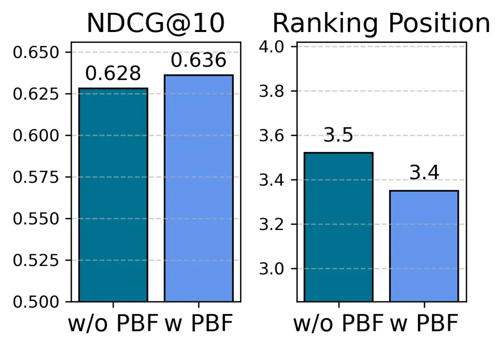

# Automating Personalization: Prompt Optimization for Recommendation Reranking

DOI: [XXXXXXX.XXXXXXX](https://doi.org/XXXXXXX.XXXXXXX)Conference: Make
sure to enter the correct conference title from your rights confirmation
emai; July 13–18, 2025; Padova,
ItalyPrice: 15.00ISBN: 978-1-4503-XXXX-X/18/06CCS: Information
systems Recommender systems

Chen Wang
[](https://orcid.org/0000-0001-5264-3305)
Note: Equal Contributions Affiliation: University of Illinois Chicago…,
Chicago, Illinois, USA, 60607 email: <cwang266@uic.edu> , Mingdai Yang
[](https://orcid.org/0000-0002-2868-8965)
Affiliation: The University of Chicago, Chicago, Illinois, USA, 60607
email: <frankyang@uchicago.edu> , Zhiwei Liu
[](https://orcid.org/0000-0003-1525-1067)
Note: Corresponding author Affiliation: Salesforce AI Research, Palo
Alto, California, USA email: <zhiweiliu@salesforce.com> , Pan Li
Affiliation: Georgia Tech, Atlanta, Georgia, USA email:
<pan.li@scheller.gatech.edu> , Linsey Pang Affiliation: Salesforce AI
Research, Palo Alto, California, USA email: <panglinsey@gmail.com> ,
Qingsong Wen Affiliation: Squirrel Ai Learning, California, USA email:
<qingsongedu@gmail.com> and Philip Yu Affiliation: The University of
Chicago, Chicago, Illinois, USA, 60607 email: <psyu@uic.edu>

© acmcopyright

###### Abstract.

Modern recommender systems increasingly leverage large language models
(LLMs) for reranking to improve personalization. However, existing
approaches face two key limitations: (1) heavy reliance on manually
crafted prompts that are difficult to scale, and (2) inadequate handling
of unstructured item metadata that complicates preference inference. We
present AGP (Auto-Guided Prompt Refinement), a novel framework that
automatically optimizes user profile generation prompts for personalized
reranking. AGP introduces two key innovations: (1) position-aware
feedback mechanisms for precise ranking correction, and (2) batched
training with aggregated feedback to enhance generalization. Extensive
experiments across three diverse datasets (Amazon Movies & TV, Yelp, and
Goodreads) demonstrate AGP’s effectiveness, achieving improvements of
5.61–20.68% in NDCG@10 over baseline models with just 100 training
users. Our results show AGP’s particular strength in enhancing
graph-based recommenders (9.36–20.68% gains for LightGCN) while
maintaining strong performance with sequential models.

###### Keywords: 

Prompt Optimization, Recommender Systems, Large Language Models (LLMs),
Collaborative Filtering, Reranking

## 1. Introduction

_Reranking_, which refines initial recommendations to better align with
user preferences, plays a pivotal role in improving recommendation
quality (Pei et al., 2019; Li et al., 2019; Lin et al., 2024). Recent
advancements in large language models (LLMs) have shown promise for
reranking tasks by capturing complex user interests via contextual
understanding (Zhang et al., 2025; Luo et al., 2024; Carraro and Bridge,
2024; Zhang et al., 2024).

However, their effectiveness relies heavily on manually crafting prompts
– a labor-intensive process that demands significant domain expertise
and limits scalability. Moreover, manually designed prompts struggle to
address the complexity and diversity of user preferences. For instance,
crafting prompts to capture nuanced user interests from user-item
interactions, such as item titles or descriptions, often requires
iterative trial-and-error. This process is not only time-consuming but
also prone to suboptimal results due to its reliance on intuition rather
than systematic optimization. Moreover, static prompts fail to adapt to
dynamic datasets and evolving user behaviors, limiting their ability to
deliver personalized recommendations at scale.

Existing research on prompt optimization largely focuses on tasks like
question answering (Sabbatella et al., 2024), mathematical
reasoning (Shao et al., 2024), and news recommendation (Liu et al.,
2024). RecPrompt (Liu et al., 2024) introduces a self-tuning prompting
framework incorporating TopicScore to enhance explainability in news
recommendations. However, this approach relies on structured content and
topical consistency, making it less applicable to heterogeneous item
recommendation scenarios, where item metadata can be inconsistent,
unstructured, and user-generated. Current optimization methods (Liu
et al., 2024; Gao et al., 2024) usually rely on aggregated ranking
metrics like AUC or NDCG, which are useful for performance evaluation
but insufficient for direct optimization guidance. Input reranking
approaches (Dehghankar and Asudeh, 2024) reorder items based on
relevance and exposure but do not offer structured feedback to refine
user preference modeling. A more interpretable and systematic strategy
is needed to close the gap between LLM-based reranking and explicit user
feedback.

To address these challenges, in this paper we propose AGP: Auto-Guided
Prompt Refinement for Personalized Reranking, a novel framework that
optimizes user profile generation prompts rather than directly modifying
reranking prompts. By refining user profiles, AGP enables LLMs to better
capture personalized interests, leading to more effective and
explainable reranking. AGP improves optimization through a batched
training with batched feedback mechanism. Instead of refining prompts on
a per-user basis, AGP evaluates multiple users simultaneously,
preventing overfitting to individual cases and enhancing generalization.
During each iteration, AGP systematically analyzes why a generated user
profile fails to prioritize ground-truth items, ensuring that
refinements are both meaningful and robust. To further enhance
optimization, AGP introduces position-based feedback, which explicitly
signals ranking misalignment. Unlike traditional ranking metrics such as
NDCG, which serve as indirect optimization objectives, position-based
feedback provides actionable instructions by identifying discrepancies
between predicted and ideal item rankings. For example, if an item is
ranked 3rd but should be 1st, AGP generates structured feedback to
adjust the user profile generation prompt accordingly. This feedback is
then aggregated across batches, allowing learned refinements to
generalize across different users. AGP’s optimization process follows an
iterative batch-based strategy, where feedback is collected over
multiple iterations. Each batch generates actionable instructions that
refine the user profile prompt in a gradient-like manner, ensuring
continuous improvement without overfitting. By integrating structured
user profile optimization with position-aware feedback, AGP enables a
more interpretable and scalable approach to personalized reranking.

#### Our Contributions.

- •
  User Profile Generation Prompt. We propose refining a _user profile
  generation prompt_—as opposed to a single-step rerank prompt—to more
  effectively capture user preferences from noisy textual data. This
  design enables more nuanced and robust personalization.
- •
  Position-Based Feedback. We introduce a _position-based feedback_
  mechanism that pinpoints item-level ranking misalignments, providing
  interpretable signals for iterative refinement. This approach proves
  more actionable than relying solely on aggregated metrics like NDCG.
- •
  Batched Training and Summarized Feedback. We devise a _batched_
  optimization framework that aggregates feedback across multiple users,
  mitigating overfitting to individual quirks and ensuring updates
  remain broadly applicable.

## 2. Methodology

In this section, we formalize the reranking task, introduce our Auto
Prompt Optimization Framework, and detail each of its components. We
first define the problem setup and notation, then elaborate on the user
profile generation process, the evaluation and feedback mechanism, and
finally the iterative prompt optimization strategy.



Figure 1. The pipeline of the AutoGuidePrompt (AGP) framework,
illustrating the process from user interaction history to optimized
reranked lists.

### 2.1. Problem Setup and Notation

Given a set of users $`\mathcal{U}`$, each user $`u\in\mathcal{U}`$ has
an interaction history $`H(u)=\{t_{1},t_{2},\ldots,t_{m}\}`$, where each
$`t_{j}`$ is the textual title of an interacted item. Unlike ID-based
approaches, this representation leverages semantic knowledge, enabling
LLMs to infer preferences.

A recommender system provides a baseline ranking
$`R_{\text{base}}(u)=\{i_{1},i_{2},\ldots,i_{k}\}`$, where items are
ranked by predicted relevance. The goal is to refine
$`R_{\text{base}}(u)`$ into an optimized ranking $`R_{\text{LLM}}(u)`$
that better aligns with user preferences, and the reranking function is:

```math
f:(\mathcal{U},R_{\text{base}})\rightarrow R_{\text{LLM}}. \tag{1}
```

#### Challenges.

Applying LLMs to item recommendations presents two key challenges:

- •
  Disparate and Noisy Item Information: Unlike structured domains like
  news recommendation, item representations in recommender systems vary
  widely, with metadata that can be incomplete, inconsistent, or
  redundant (e.g., short titles, varying descriptions, or noisy
  user-generated content). This variability makes it difficult for LLMs
  to infer structured user preferences.
- •
  Lack of Direct Optimization Signals: Existing methods (e.g.,
  RecPrompt) optimize prompts using aggregated ranking metrics (AUC,
  NDCG), which measure performance but do not directly provide
  optimization guidance. A more interpretable strategy is needed to
  refine prompts using explicit ranking signals.

To address these, we propose AGP, which optimizes user profile
generation prompts instead of reranking prompts, incorporates structured
feedback, and iteratively refines prompts to improve personalization and
ranking quality.

### 2.2. User Profile Generation with a Learned Prompt

AGP optimizes a shared _profile-generation prompt_ $`p_{\mathrm{gen}}`$
to construct personalized user profiles. Unlike manually crafted
prompts, $`p_{\mathrm{gen}}`$ is iteratively refined through batch
training to capture generalizable patterns across users.

For each user $`u`$, AGP generates a profile based on two inputs: (1)
the user’s text-based interaction history $`H(u)`$ and (2) the current
version of $`p_{\mathrm{gen}}`$. The LLM synthesizes these inputs to
generate a structured profile:

```math
p(u)=\text{LLM}\bigl(H(u),\,p_{\mathrm{gen}}\bigr). \tag{2}
```

Since $`H(u)`$ consists of item titles, the LLM extracts thematic
preferences (e.g., science fiction, deep learning) while
$`p_{\mathrm{gen}}`$ provides structure and emphasis.

The generated profile $`p(u)`$ is then used to _rerank_ the baseline
recommendation list $`R_{\text{base}}(u)`$, where the LLM refines
rankings as:

```math
\hat{R}(u)=\text{LLM}\bigl(p(u),\,R_{\text{base}}(u)\bigr). \tag{3}
```

This two-step process enhances LLM reasoning by summarizing user
interests before reranking, allowing informed and context-aware ranking
decisions. Since AGP refines profile generation rather than modifying
raw rankings, it preserves user-specific insights while generalizing
effectively across different users.

### 2.3. Position-Based Evaluation and Feedback

To refine reranking, we introduce _position-based feedback_, a more
interpretable alternative to aggregated metrics like NDCG. Given a user
$`u`$, we define a set of ground-truth relevant items
$`G(u)\subseteq\hat{R}(u)`$ in the reranked list $`\hat{R}(u)`$. For
each item $`i\in G(u)`$, we record its actual position
$`r_{\hat{R}}(i,u)`$ and compare it to its target position
$`r_{\text{target}}(i,u)`$. If an item should ideally be ranked in the
top-3 but appears at position 5, the LLM receives a correction signal.

This process generates feedback signals:

```math
\mathcal{F}(u)=\bigl\{\bigl(r_{\hat{R}}(i,u),\,r_{\text{target}}(i,u)\bigr)\;\big|\;i\in G(u)\bigr\}. \tag{4}
```

These signals specify ranking deviations, providing direct and
interpretable instructions for refinement. Unlike aggregated ranking
metrics, which provide an overall evaluation score, position-based
feedback delivers explicit corrections for each item, making adjustments
more targeted.

Position-based feedback offers two key advantages. First, it improves
interpretability by providing explicit positional corrections rather
than relying on abstract scores. Second, it enables fine-grained ranking
adjustments, ensuring that high-relevance items receive stronger
refinements while less critical items undergo minor tweaks. This process
naturally integrates with AGP’s optimization strategy by offering direct
ranking signals that guide systematic improvements.

### 2.4. Batch Formation and Optimization

AGP optimizes the profile-generation prompt $`p_{\mathrm{gen}}`$ using
batch training. In each iteration, a batch $`\mathcal{U}_{b}`$ of users
is processed, where each user $`u\in\mathcal{U}_{b}`$ generates a
profile $`p(u)=\text{LLM}\bigl(H(u),\,p_{\mathrm{gen}}\bigr)`$, which is
then used to compute the reranked list $`\hat{R}(u)`$. Feedback
$`\mathcal{F}(u)`$, derived from position-based evaluation (Sec. 2.3),
guides prompt refinement.

Batch-based training has been previously explored for improving ranking
robustness (Dehghankar and Asudeh, 2024), where partitioned input
evaluation helps mitigate bias. Inspired by this, AGP extends batch
training to structured prompt optimization by aggregating feedback
across users, ensuring refinements are driven by explicit ranking
misalignments rather than indirect scoring metrics. Given individual
position-based signals $`\mathcal{F}(u)`$, AGP generates a summarized
set of batch-level improvements:

```math
\mathcal{F}_{\mathrm{sum}}(\mathcal{U}_{b})=\sum_{u\in\mathcal{U}_{b}}w(u)\mathcal{F}(u), \tag{5}
```

where $`w(u)=\frac{1}{\text{avgPos}(u)}`$ assigns a higher weight to
users whose ground-truth items rank lower on average.

The prompt is iteratively updated as:

```math
p_{\mathrm{gen}}\;\leftarrow\;p_{\mathrm{gen}}-w(\mathcal{U}_{b})\cdot\nabla_{\mathrm{text}}\!\bigl(\mathcal{F}_{\mathrm{sum}}(\mathcal{U}_{b})\bigr), \tag{6}
```

where $`w(\mathcal{U}_{b})=\frac{1}{\text{avgPos}(\mathcal{U}_{b})}`$
ensures stronger updates when ranking errors are larger.

This iterative process refines $`p_{\mathrm{gen}}`$ by adjusting user
profile descriptions based on ranking misalignment. After each update,
new user profiles $`p(u)`$ and reranked lists $`\hat{R}(u)`$ are
generated, and feedback is recalculated until convergence. By
summarizing batch-wide trends, AGP prevents overfitting to specific user
preferences and ensures adaptability across diverse user populations.

## 3. Experiments

### 3.1. Experimental Settings

We use three public datasets: Amazon Movies & TV (Movies), Yelp, and
Goodreads. The Amazon dataset has 95,593 users, 43,117 items, and
750,081 interactions; Yelp has 65,348 users, 33,626 items, and 1,041,540
interactions; and Goodreads has 13,100 users, 25,434 items, and 856,280
interactions. Using a leave-one-out (LOO) strategy, we designate the
most recent user interaction as the test item and the second-most recent
as validation. To establish a baseline, we train two recommender models:
(1) LightGCN (He et al., 2020), a graph-based collaborative filtering
method, and (2) SASRec (Kang and McAuley, 2018), a sequential
transformer-based recommender. Each model generates top-10 predictions
per user, from which we randomly select 300 users for evaluation,
ensuring each ground-truth item is included. On this subset, we apply
our AGP framework to _rerank_ the top-10 list. AGP is trained on 100
randomly selected user interaction histories with a maximum of 10
epochs. We explore user history sequence lengths of 5, 10, and 20 as a
hyperparameter, along with batch size values of 5, 10, and 20.
Evaluation is conducted using NDCG@10, which measures ranking quality
(higher is better). We also compare against two non-iterative baselines:
_LLM-Dir_ (single-pass prompt for reranking) and _LLM-CoT_ (single-pass
chain-of-thought prompt (Kojima et al., 2022) for reranking).
Additionally, we include four LLMs for performance comparison: GPT-4o
(4o), GPT-4o-Mini (4o-Mini), GPT-o3-Mini (o3-Mini), and DeepSeek-V3
(DeepSeek) (et al., 2024).

### 3.2. Results and Discussion

The results are shown in Table 1, highlighting key findings. AGP
effectiveness in item recommendation: AGP proves effective for reranking
tasks, demonstrating that LLMs can self-optimize prompts within our
framework. This adaptability reduces the need for manual prompt tuning
and enhances ranking quality, particularly in personalized
recommendation scenarios. LLM reranker performance on SASRec vs.
LightGCN: LLM rerankers show greater improvements on SASRec rankings
than on LightGCN. This is likely due to SASRec and LLMs both leveraging
time-series modeling, making them more effective in capturing sequential
user behaviors. LightGCN, a graph-based collaborative filtering model,
focuses on global user-item interactions, which limits LLMs’ ability to
enhance its ranking list. CoT effectiveness: The best performance on the
Yelp dataset is achieved by o3-Mini, indicating that in scenarios with
insufficient textual context and noisy data, multi-step reasoning is
beneficial. This suggests that structured thinking models like o3-Mini
can extract better signals in complex and sparse text environments,
improving reranking effectiveness. Yelp dataset challenges: The Yelp
dataset sees minor improvements due to the lack of rich textual features
and presence of noisy text. Many business descriptions are sparse or
inconsistent, making it difficult for LLMs to infer meaningful item
relationships. Despite these challenges, AGP remains effective by
dynamically refining prompts, allowing LLMs to better interpret
available textual information and improve reranking performance.

|            |                       |       |       |       |
| ---------- | --------------------- | ----- | ----- | ----- |
| Model      | Method                | N@10  |       |       |
|            |                       | AMZ   | YELP  | GR    |
| _LightGCN_ | Base                  | 0.513 | 0.501 | 0.474 |
|            | + LLM-Dir (4o)        | 0.547 | 0.491 | 0.555 |
|            | + LLM-CoT (4o)        | 0.551 | 0.491 | 0.560 |
|            | + AGP-T100 (4o)       | 0.553 | 0.502 | 0.572 |
|            | + LLM-Dir (4o-Mini)   | 0.553 | 0.484 | 0.548 |
|            | + LLM-CoT (4o-Mini)   | 0.553 | 0.481 | 0.547 |
|            | + AGP-T100 (4o-Mini)  | 0.561 | 0.493 | 0.553 |
|            | + LLM-Dir (o3-Mini)   | 0.542 | 0.538 | 0.540 |
|            | + LLM-CoT (o3-Mini)   | 0.543 | 0.531 | 0.542 |
|            | + AGP-T100 (o3-Mini)  | 0.558 | 0.541 | 0.548 |
|            | + LLM-Dir (DeepSeek)  | 0.546 | 0.496 | 0.533 |
|            | + LLM-CoT (DeepSeek)  | 0.547 | 0.498 | 0.544 |
|            | + AGP-T100 (DeepSeek) | 0.551 | 0.504 | 0.564 |
| _SASRec_   | Base                  | 0.659 | 0.528 | 0.599 |
|            | + LLM-Dir (4o)        | 0.671 | 0.510 | 0.624 |
|            | + LLM-CoT (4o)        | 0.664 | 0.521 | 0.610 |
|            | + AGP-T100 (4o)       | 0.696 | 0.530 | 0.636 |
|            | + LLM-Dir (4o-Mini)   | 0.654 | 0.502 | 0.631 |
|            | + LLM-CoT (4o-Mini)   | 0.656 | 0.507 | 0.615 |
|            | + AGP-T100 (4o-Mini)  | 0.658 | 0.517 | 0.627 |
|            | + LLM-Dir (o3-Mini)   | 0.658 | 0.527 | 0.587 |
|            | + LLM-CoT (o3-Mini)   | 0.663 | 0.528 | 0.585 |
|            | + AGP-T100 (o3-Mini)  | 0.683 | 0.541 | 0.595 |
|            | + LLM-Dir (DeepSeek)  | 0.648 | 0.512 | 0.622 |
|            | + LLM-CoT (DeepSeek)  | 0.655 | 0.519 | 0.610 |
|            | + AGP-T100 (DeepSeek) | 0.687 | 0.523 | 0.636 |

Table 1. Reranking performance (N@10) across datasets. “T100” denotes
AGP trained on 100 users. Bold values indicate the best performance
within the same LLM model.

### 3.3. Ablation Study

To evaluate the impact of design choices in our framework, we conduct an
ablation study using GPT-4o on the AMZ dataset, focusing on three key
aspects: the effect of summarization in reducing overfitting, the
influence of batch size and sequence length on reranking performance,
and the effectiveness of position-based feedback.

Summarization Impact on Overfitting: We analyze the effect of
summarization by comparing training and test performance with and
without summarization. As shown in Figure (2, left), summarization
prevents excessive fitting to the training data while improving test
performance, enhancing generalization by filtering redundant information
and refining prompt optimization. Effectiveness of Batch Size and
Sequence Length: We examine how batch size and sequence length impact
reranking effectiveness. Figure (2, middle) shows that the best
performance is achieved with a batch size of 10 and a sequence length of
5, suggesting an optimal balance between convergence and generalization.
Larger batch sizes stabilize training, while shorter sequences reduce
noise from long interaction histories, highlighting the importance of
careful hyperparameter selection for improving LLM reranking.
Effectiveness of Position-Based Feedback (PBF): We further investigate
the impact of PBF on reranking quality across datasets. Figure 3
demonstrates that incorporating PBF improves both NDCG@10 and average
ranking position across all datasets. The gains are more significant in
datasets with high variability in ranking scores, indicating that PBF
helps LLMs better capture relative item importance. This result
highlights its potential in enhancing ranking stability and improving
personalization in LLM-based reranking systems.





Figure 2. Ablation study on summarization (left) and batch size/sequence
length impact (right) using GPT-4o on the AMZ dataset. Summarization
reduces overfitting, while batch size 10 and sequence length 5 yield
optimal ranking performance.



(a) Amazon Dataset



(b) Yelp Dataset



(c) Goodreads Dataset

Figure 3. Ablation study on Position-Based Feedback.

### 3.4. Training Efficiency

We evaluate the efficiency of AGP training by analyzing the API call
calculations and performance scaling. The total API calls per training
stage follow the formula:

```math
\text{API Calls}=(\text{batch\_size}\times 3+2)\times\frac{100}{\text{batch\_size}} \tag{7}
```

where 3 corresponds to generating a user profile, reranking, and
computing the loss per user, while 2 accounts for summarization and
prompt optimization per batch. To further assess AGP’s efficiency, we
trained it on the AMZ dataset with GPT-4o using 700 users instead of 100. The NDCG@10 increased marginally from 0.696 to 0.705 (a 1.29%
increase), demonstrating that AGP maintains competitive performance with
significantly fewer training samples. This result underscores AGP’s
effectiveness and efficiency, reducing computational costs while
preserving high reranking quality.

## 4. Conclusion

We propose AGP, a framework optimizing user profile generation prompts
for better LLM-based reranking. reduce one word: AGP employs batched
feedback and position-based feedback for improved generalization and
ranking accuracy. Experiments confirm its effectiveness, with future
work exploring reinforcement learning and broader use.

## References

- Carraro and Bridge (2024) Diego Carraro and Derek Bridge. 2024.
  Enhancing recommendation diversity by re-ranking with large language
  models. _ACM Transactions on Recommender Systems_ (2024).
- Dehghankar and Asudeh (2024) Mohsen Dehghankar and Abolfazl
  Asudeh. 2024. Rank It, Then Ask It: Input Reranking for Maximizing the
  Performance of LLMs on Symmetric Tasks. _arXiv preprint
  arXiv:2412.00546_ (2024).
- et al. (2024) DeepSeek-AI et al. 2024. DeepSeek-V3 Technical Report.
  arXiv:2412.19437 \[cs.CL\]
  [https://arxiv.org/abs/2412.19437](https://arxiv.org/abs/2412.19437)
- Gao et al. (2024) Jingtong Gao, Bo Chen, Xiangyu Zhao, Weiwen Liu,
  Xiangyang Li, Yichao Wang, Zijian Zhang, Wanyu Wang, Yuyang Ye, Shanru
  Lin, et al. 2024. LLM-enhanced Reranking in Recommender Systems.
  _arXiv preprint arXiv:2406.12433_ (2024).
- He et al. (2020) Xiangnan He, Kuan Deng, Xiang Wang, Yan Li, Yongdong
  Zhang, and Meng Wang. 2020. Lightgcn: Simplifying and powering graph
  convolution network for recommendation. In _Proceedings of the 43rd
  International ACM SIGIR conference on research and development in
  Information Retrieval_. 639–648.
- Kang and McAuley (2018) Wang-Cheng Kang and Julian McAuley. 2018.
  Self-attentive sequential recommendation. In _2018 IEEE International
  Conference on Data Mining (ICDM)_. IEEE, 197–206.
- Kojima et al. (2022) Takeshi Kojima, Shixiang Shane Gu, Machel Reid,
  Yutaka Matsuo, and Yusuke Iwasawa. 2022. Large language models are
  zero-shot reasoners. _Advances in neural information processing
  systems_ 35 (2022), 22199–22213.
- Li et al. (2019) Xinyi Li, Yifan Chen, Benjamin Pettit, and Maarten De
  Rijke. 2019. Personalised reranking of paper recommendations using
  paper content and user behavior. _ACM Transactions on Information
  Systems (TOIS)_ 37, 3 (2019), 1–23.
- Lin et al. (2024) Xiao Lin, Xiaokai Chen, Chenyang Wang, Hantao Shu,
  Linfeng Song, Biao Li, and Peng Jiang. 2024. Discrete conditional
  diffusion for reranking in recommendation. In _Companion Proceedings
  of the ACM on Web Conference 2024_. 161–169.
- Liu et al. (2024) Dairui Liu, Boming Yang, Honghui Du, Derek Greene,
  Neil Hurley, Aonghus Lawlor, Ruihai Dong, and Irene Li. 2024.
  RecPrompt: A Self-tuning Prompting Framework for News Recommendation
  Using Large Language Models. In _Proceedings of the 33rd ACM
  International Conference on Information and Knowledge Management_
  (Boise, ID, USA) _(CIKM ’24)_. Association for Computing Machinery,
  New York, NY, USA, 3902–3906.
  [https://doi.org/10.1145/3627673.3679987](https://doi.org/10.1145/3627673.3679987)
- Luo et al. (2024) Sichun Luo, Bowei He, Haohan Zhao, Wei Shao, Yanlin
  Qi, Yinya Huang, Aojun Zhou, Yuxuan Yao, Zongpeng Li, Yuanzhang Xiao,
  et al. 2024. Recranker: Instruction tuning large language model as
  ranker for top-k recommendation. _ACM Transactions on Information
  Systems_ (2024).
- Pei et al. (2019) Changhua Pei, Yi Zhang, Yongfeng Zhang, Fei Sun,
  Xiao Lin, Hanxiao Sun, Jian Wu, Peng Jiang, Junfeng Ge, Wenwu Ou,
  et al. 2019. Personalized re-ranking for recommendation. In
  _Proceedings of the 13th ACM conference on recommender systems_. 3–11.
- Sabbatella et al. (2024) Antonio Sabbatella, Andrea Ponti, Ilaria
  Giordani, Antonio Candelieri, and Francesco Archetti. 2024. Prompt
  Optimization in Large Language Models. _Mathematics_ 12, 6
  (2024), 929.
- Shao et al. (2024) Zhihong Shao, Peiyi Wang, Qihao Zhu, Runxin Xu,
  Junxiao Song, Mingchuan Zhang, YK Li, Yu Wu, and Daya Guo. 2024.
  Deepseekmath: Pushing the limits of mathematical reasoning in open
  language models. _arXiv preprint arXiv:2402.03300_ (2024).
- Zhang et al. (2025) Haobo Zhang, Qiannan Zhu, and Zhicheng Dou. 2025.
  Enhancing Reranking for Recommendation with LLMs through User
  Preference Retrieval. In _Proceedings of the 31st International
  Conference on Computational Linguistics_. 658–671.
- Zhang et al. (2024) Yongfeng Zhang, Zhiwei Liu, Qingsong Wen, Linsey
  Pang, Wei Liu, and Philip S Yu. 2024. AI Agent for Information
  Retrieval: Generating and Ranking. In _Proceedings of the 33rd ACM
  International Conference on Information and Knowledge Management_.
  5605–5607.
