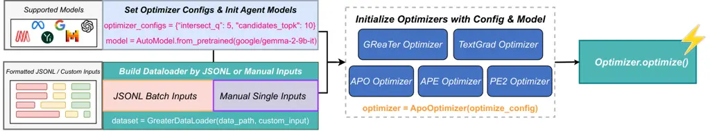
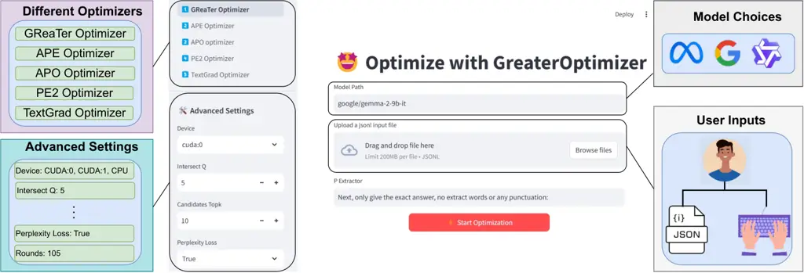

# ![[Uncaptioned image]](arxiv-2504-03975v1--4aa927dc90af.figures/figure-1.webp) GreaTerPrompt: A Unified, Customizable, and High-Performing Open-Source Toolkit for Prompt Optimization

Wenliang Zheng    Sarkar Snigdha Sarathi Das    Yusen Zhang    Rui Zhang
Affiliation: Penn State University
Email: [{wmz5132,sfd5525,yfz5488,rmz5227}@psu.edu](mailto:)

###### Abstract

LLMs have gained immense popularity among researchers and the general
public for its impressive capabilities on a variety of tasks. Notably,
the efficacy of LLMs remains significantly dependent on the quality and
structure of the input prompts, making prompt design a critical factor
for their performance. Recent advancements in automated prompt
optimization have introduced diverse techniques that automatically
enhance prompts to better align model outputs with user expectations.
However, these methods often suffer from the lack of standardization and
compatibility across different techniques, limited flexibility in
customization, inconsistent performance across model scales, and they
often exclusively rely on expensive proprietary LLM APIs. To fill in
this gap, we introduce GreaTerPrompt, a novel framework that
democratizes prompt optimization by unifying diverse methods under a
unified, customizable API while delivering highly effective prompts for
different tasks. Our framework flexibly accommodates various model
scales by leveraging both text feedback-based optimization for larger
LLMs and internal gradient-based optimization for smaller models to
achieve powerful and precise prompt improvements. Moreover, we provide a
user-friendly Web UI that ensures accessibility for non-expert users,
enabling broader adoption and enhanced performance across various user
groups and application scenarios. GreaTerPrompt is available at
[https://github.com/psunlpgroup/GreaterPrompt](https://github.com/psunlpgroup/GreaterPrompt)
via GitHub, [PyPI](https://pypi.org/project/greaterprompt/), and web
user interfaces.

[TABLE]

Table 1: Comparison of different prompt optimization tools. While all
existing methods rely on LLM feedback for Text-Based Optimization,
GreaTerPrompt uniquely also supports Gradient-based Optimization, for
more precise prompt tuning. Unlike methods requiring Few-Shot prompts,
GreaTerPrompt deliver Zero-Shot optimized prompts. It also allows
optimization for custom metrics—an option missing in many proprietary
tools. Finally, GreaTerPrompt is the only method offering both an
intuitive Web-UI and a Python library, with high compatibility across
both small (locally deployed) and large (API-based) LLMs.



Figure 1: Architecture Overview of GreaTerPrompt.

## 1 Introduction

LLMs have demonstrated impressive capabilities across a wide variety of
natural language tasks, establishing prompting as the primary means of
communication between humans and machines Gu et al. (2023). However,
despite the remarkable advances, LLMs remain highly sensitive to the
prompt designs and formulations - that subtle variations in wordings of
prompts can dramatically alter model outputs and affect
performance Chatterjee et al. (2024); Zhuo et al. (2024). This
persistent prompt sensitivity implies that even the recent
state-of-the-art LLMs do not entirely eliminate the need for careful
prompt design, which traditionally relies on human expertise and
iterative trial-and-error Chen et al. (2024); Wu et al. (2024). In
response, recent efforts have increasingly focused on developing
automated prompt optimization methods Pryzant et al. (2023); Ye et al.
(2023); Zhou et al. (2023); Yuksekgonul et al. (2024); Das et al.
(2024), systematically enhancing prompt quality and ensuring robust
model performance without exhaustive manual tuning Wu et al. (2024);
Tang et al. (2025).

However, as shown in Table 1, existing prompt optimization techniques
and tools exhibit considerable variability in terms of usability, scope,
and their performance often fluctuates inconsistently across different
model scales. This variability and specialized nature often makes it
challenging for non-expert users, who otherwise could derive substantial
benefits from prompt optimization techniques while using LLMs. Moreover,
existing prompt optimization methods rely on expensive proprietary LLM
APIs, significantly undermining their affordability and privacy
protection.

To bridge these gaps and encourage broad adoption of prompt optimization
techniques, we introduce GreaTerPrompt, a novel framework designed to
enhance accessibility, adaptability, and efficacy of prompt
optimization. As shown in Figure 1, GreaTerPrompt provides a streamlined
workflow from inputs and model initialization to optimization execution,
supporting flexible optimizer configurations that can be easily
customized. GreaTerPrompt is designed and implemented based on the
following three principles:

1. Methodological Perspective: GreaTerPrompt unifies diverse prompt
   optimization methodologies under a cohesive implementation framework.
   Currently, GreaTerPrompt support five prominent prompt optimization
   techniques across two families based on model scales: i) Iterative
   Prompt Rewriting through LM feedback Zhou et al. (2023); Ye et al.
   (2023); Pryzant et al. (2023); Yuksekgonul et al. (2024), and ii)
   Gradient based prompt optimization Das et al. (2024). This unification
   ensures users can leverage different types of LM feedback or gradient
   computations for optimizing LLM prompts.
2. Model-Centric Perspective: Larger, closed-source API-based LLMs like
   GPT Achiam et al. (2023) and Gemini Team et al. (2024a) generally offer
   superior performance but are computationally expensive and require
   transmitting sensitive data externally; in contrast, smaller open-source
   LLMs like Llama 3 Grattafiori et al. (2024) and Gemma 2 Team et al.
   (2024b) provide cost-effective alternatives that better ensure data
   confidentiality. Recognizing the critical importance of model
   flexibility, GreaTerPrompt provides extensive support across both
   closed-source and open-source model families, ranging from compact,
   efficient models suitable for local deployment to large-scale models
   available via cloud APIs. By incorporating both gradient-based
   optimization techniques suitable for smaller models and feedback-driven
   optimization techniques for larger models, our framework ensures optimal
   performance irrespective of model choice and resource constraints.
3. Integration Perspective: GreaTerPrompt is designed with ease of use
   and integrability as key principles. To make it accessible for both
   expert and non-expert users, GreaTerPrompt offers both a Python package
   (a [GitHub repository](https://github.com/psunlpgroup/GreaTer) and a
   [pip](https://pypi.org/project/greaterprompt/) package) for simple
   incorporation into any existing pipeline and a user-friendly Web UI
   (Figure 2) tailored for non-expert users. This dual interface design
   democratizes prompt optimization by enabling both expert and general
   users to benefit equally from state-of-the-art techniques. As shown in
   Table 1, GreaTerPrompt offers a comprehensive set of features compared
   to other libraries, supporting both text-based and gradient-based
   optimization while maintaining broad compatibility with smaller and
   larger models.

Overall, GreaTerPrompt combines flexible methodological support,
extensive model compatibility, seamless integration, and comprehensive
evaluation functionalities. GreaTerPrompt not only advances the
state-of-the-art in prompt optimization but also makes these
sophisticated techniques accessible to a broader audience, bridging the
gap between research innovations and practical applications. Our release
include a GitHub repo
[https://github.com/psunlpgroup/GreaterPrompt](https://github.com/psunlpgroup/GreaterPrompt),
a PyPI installable package
[https://pypi.org/project/greaterprompt/](https://pypi.org/project/greaterprompt/),
and a demo video
[https://youtu.be/aSLSnE17lBQ](https://youtu.be/aSLSnE17lBQ).



Figure 2: Screenshot of Web UI for GreaTerPrompt. Optimizer list is on
the top left bar, bottom left bar is parameter settings for each
optimizer. On the main area, there is a textbox for the model path
input, and an area to upload user’s prompt data. “P Extractor” is a
system prompt for GReaTer optimizer to extract answer to calculate loss.

## 2 Background

### 2.1 Prompt Optimization Algorithms

Given a task execution language model $`f_{\text{LLM}}`$, and a small
representative task dataset,
$`\mathcal{D}_{task}=\{(x_{1},y_{1}),\ldots(x_{n},y_{n})\}`$, the goal
of prompt optimization is to find a prompt $`p^{*}`$ such that:

```math
p^{*}=\argmax_{p}\sum_{(x,y)\in\mathcal{D}_{task}}m\left(f_{\text{LLM}}(x;p),y\right) \tag{1}
```

where $`f_{\text{LLM}}(x;p)`$ is the output from $`f_{\text{LLM}}`$ upon
channeling the input $`x`$ with the prompt $`p`$, and $`m(\cdot)`$ is
the evaluation function for this task.

Textual Feedback Based Prompt Optimization. Prompt optimization methods
based on textual feedback use an optimizer model
$`f_{\text{optimizer}}`$ which is usually substantially larger and more
expensive than $`f_{\text{LLM}}`$ (Zhou et al., 2023; Ye et al., 2023;
Pryzant et al., 2023). Conceptually,
$`f_{\text{optimizer}}\big(m(f_{\text{LLM}}(x;p),y)|(x,y)\in\mathcal{D}_{task}\big)`$
drives the optimization process by assessing and providing feedback for
refining the prompt.

Gradient Based Prompt Optimization. Traditional textual feedback-based
prompt optimization relies heavily on the heuristic capabilities of
large language models (LLMs) and often leads to poor performance when
applied to smaller models. To overcome this, GreaTerPrompt introduces a
stronger optimization signal in the form of loss gradients. The method
begins by generating reasoning chains for task inputs using a small
model. Then, it extracts final answer logits via a formatted prompt and
computes loss. By backpropagating through this reasoning-informed
output, optimizers will get a list of gradients with respect to
candidate prompt tokens. These gradients are used to select optimal
tokens, enabling efficient and effective prompt refinement—even for
lightweight models.

### 2.2 Prompt Optimization Services/Libraries

Looking at Table 1, we can observe various prompt optimization methods
currently available in the field. LangChain Promptim LangChain (2025)
offers text-based optimization with zero-shot capabilities and Python
API integration. Stanford DsPy Khattab et al. (2022) Khattab et al.
(2024) and AutoPrompt Levi et al. (2024) provide similar text-based
approaches with few-shot capabilities. Google Vertex Prompt
Optimizer Google Cloud (2025), AWS Bedrock Optimizer Amazon Web Service
(2025), and Anthropic Claude Improver Anthropic (2025) are cloud-based
solutions with varying optimization techniques but limited model
compatibility. Jina PromptPerfect Jina (2025) offers cloud integration
with Web UI support but has limited model compatibility. GreaTerPrompt
stands out by combining both text-based and gradient-based optimization
approaches while supporting diverse integration options and high
compatibility across model sizes. All of the existing services had some
downsides and there was no unified way to use them until the
introduction of GreaTerPrompt.

### 2.3 Evaluation Metrics and Datasets for Prompt Optimization

To evaluate the efficacy of the prompts produced by our library, in our
experiments (Section 3.3), we select two popular datasets for
performance evaluation: BBH Suzgun et al. (2022), a diverse suite
testing capabilities beyond current language models, and GSM8k Cobbe
et al. (2021) for mathematical reasoning assessment. All optimizers
demonstrated performance improvements over the Zero-Shot
Chain-of-Thought Kojima et al. (2022).

## 3 GreaTerPrompt

GreaTerPrompt is a unified (Section 3.1), customizable (Section 3.2),
and high-performing (Section 3.3) library for prompt optimization.

### 3.1 Unified Implementation

GreaTerPrompt unifies the following five different prompt optimization
methods under a single API. Even though existing methods already have
released code, it is still challenging for beginner users for daily use.
In our library, we build a unified data loading class. It supports both
manual inputs by passing a list to the dataloader class and batch inputs
by loading a jsonl file. With our data loader class, users could easily
use all the supported optimizers with the same function calling,
eliminating the need to initialize and optimize respectively by
different methods.

1. APE: APE (Automatic Prompt Evolution) Zhou et al. (2023) is an
   optimization method that iteratively refines prompts for LLMs by
   automatically generating, evaluating, and evolving variations based on
   performance metrics. Inspired by evolutionary algorithms, it selects
   high-performing prompts, applies mutations, and repeats the process
   without requiring gradient-based tuning. This method reduces manual
   effort, enhances prompt effectiveness across tasks, and improves LLM
   performance in instruction following, reasoning, and factual accuracy.

2. APO: APO (Automated Prompt Optimization) Pryzant et al. (2023) is a
   technique that systematically refines prompts for large language models
   by leveraging iterative improvements. It evaluates multiple prompt
   variations, selects high-performing ones, and applies controlled
   modifications to enhance clarity, coherence, and effectiveness. Unlike
   manual tuning, APO automates the process using heuristic or model-driven
   feedback, ensuring better task-specific performance. This approach
   minimizes human effort, improves response reliability, and adapts to
   diverse use cases efficiently.

3. GReaTer: GReaTer Das et al. (2024) is a novel prompt optimization
   method that enhances smaller language models by leveraging numerical
   gradients over task-specific reasoning instead of relying solely on
   textual feedback from large LLMs. Unlike existing techniques that depend
   on costly proprietary models like GPT-4, GReaTer enables
   self-optimization by computing loss gradients over generated reasoning
   steps. This approach improves prompt effectiveness and task performance
   in various reasoning benchmarks, achieving results comparable to or
   surpassing those of prompts optimized using massive LLMs.

4. TextGrad: TextGrad Yuksekgonul et al. (2024) is a prompt optimization
   method that automates prompt refinement by leveraging textual feedback
   as a form of "textual gradient." Instead of using numerical loss
   gradients like GReaTer, TextGrad iteratively improves prompts based on
   feedback from a larger LLM, which critiques and suggests modifications
   to enhance task performance. This method relies on natural language
   evaluations of prompt effectiveness, guiding optimizations without
   requiring direct gradient computations. While effective in improving
   reasoning tasks, TextGrad can be computationally expensive and highly
   dependent on the quality of the feedback provided by the larger model.

5. PE2: PE2 (Prompt Engineering a Prompt Engineer) Ye et al. (2023) is a
   prompt optimization method that enhances prompts through meta-prompt
   engineering techniques. It iteratively refines prompts by analyzing
   model responses and leveraging structured feedback from large LLMs. PE2
   systematically improves prompts by identifying patterns in successful
   completions and making targeted adjustments to optimize performance.
   While effective in improving reasoning and structured tasks, its
   reliance on external LLM-generated feedback can introduce variability,
   making optimization results dependent on the feedback model’s quality.

| Optimizer                          | movie_rec. | object_count. | tracking_five. | hyperbaton | causal | Average |
| ---------------------------------- | ---------- | ------------- | -------------- | ---------- | ------ | ------- |
| ZS-CoT                             | 47         | 67            | 49             | 68         | 51     | 56.4    |
| TextGrad Yuksekgonul et al. (2024) | 48         | 80            | 55             | 66         | 42     | 58.2    |
| GReaTer Das et al. (2024)          | 57         | 90            | 70             | 84         | 57     | 71.6    |

| Optimizer                 | movie_rec. | object_count. | tracking_five. | hyperbaton | causal | Average |
| ------------------------- | ---------- | ------------- | -------------- | ---------- | ------ | ------- |
| ZS-CoT                    | 54         | 64            | 56             | 86         | 48     | 61.6    |
| APE Zhou et al. (2023)    | 66         | 70            | 44             | 92         | 49     | 64.2    |
| APO Pryzant et al. (2023) | 66         | 66            | 58             | 92         | 59     | 68.2    |
| PE2 Ye et al. (2023)      | 68         | 74            | 60             | 90         | 56     | 69.6    |

Table 2: Performance in BBH tasks with GReaTer and TextGrad optimizers,
with Llama3-8B-Instruction model. Here ZS-COT refers to: Zero-Shot Chain
of Thought prompt i.e. "Let’s think step by step".

Table 3: Performance in BBH tasks with APE, APO and PE2 optimized (with
gpt-4-turbo) prompt used on gpt-3.5-turbo task model. Here ZS-COT refers
to: Zero-Shot Chain of Thought prompt i.e. "Let’s think step by step".

### 3.2 User Customization

GreaTerPrompt allows users to choose task exemplar samples, evaluation
functions, and model choices.

User-defined Task Examples. User can upload their task examples
consisting of input and output pairs in a JSON format, providing a
demonstration of the target task which our library can use as oracle to
produce the optimized prompts.

Customized Task Evaluation Functions. We found that cross entropy
doesn’t meet the needs of all tasks. To address this, we added support
for custom loss functions in the GReaTer optimizer in our library. Users
can define their own loss functions and pass them as a parameter to the
model. The custom loss will then be used during backpropagation and
gradient computation to help the optimizer choose better tokens.

Flexible Model Choices. Our library supports two types of model
deployment: API-based and local. Both deployment modes are compatible
with all model sizes. For the GReaTer method, users can choose smaller
models like meta-llama/Meta-Llama-3-8B-Instruct for efficient
optimization, or larger models like meta-llama/Meta-Llama-3-70B-Instruct
to generate higher-quality token replacements. For the APO, APE, and PE2
methods, users can flexibly select GPT models ranging from the legacy
gpt-35-turbo to the latest gpt-4o for evaluation and testing.

### 3.3 High-Performing Prompts

To demonstrate the performance of our five optimizers, we randomly
sampled 5 subtasks from BBH for evaluation. For GReaTer and TextGrad
optimizers, we choose Llama3-8B-Instruction as the optimization models,
evaluation results can be found in Table 3 and Table 4. For APE, APO and
PE2 optimizers, gpt-4-turbo as the optimization model and results can be
found in Table 3 and Table 5. The resulting prompts are in Table 6.

Based on the tables, the results demonstrate noteworthy performance
differences between the various optimizers across the BBH subtasks. With
the Llama3-8B-Instruction model, GReaTer achieves the highest average
performance (71.6), outperforming both TextGrad (64.9) and the ZS-CoT
baseline (56.4). For the gpt-4-turbo optimization model, PE2 shows the
best overall performance (69.6), followed by APO (68.2), APE (64.2), and
the ZS-CoT baseline (61.6). Notably, all optimizers demonstrate
task-specific strengths, with hyperbaton being particularly receptive to
optimization across both model types, while performance on causal
reasoning remains more challenging. These results highlight the
effectiveness of our optimizers across both large and small models on
different tasks.

## 4 Usage Examples

GreaTerPrompt supports two ways of usage: Python package (Section 4.1)
and web UI (Section 4.2). Our [demo video](https://youtu.be/aSLSnE17lBQ)
shows more details.

### 4.1 Python Package

The following code snippets demonstrate a quick view of our library as a
python package.

Data Loading. GreaTerPrompt supports two methods to build the
dataloader. Users can either provide a jsonl file path to the predefined
GreaterDataloader, which will automatically load batch inputs, or
manually input samples. Each sample only needs to contain three
mandatory keys: question, prompt, and answer.


Configs Initialization. GreaTerPrompt supports comprehensive and
flexible configurations for each optimizer. Users can choose their
desired model for optimization, either local or online. For the GReaTer
optimizer, there are more advanced settings, and users can even
customize their loss function to meet expectations for different tasks.
For beginners, these fields can be left blank, as optimizers will
initialize with default configurations.


Optimizer Loading and Prompt Optimization. The initialization for
optimizers is also very simple. If configurations have been defined,
users can pass them to the optimizer as a parameter when initializing;
otherwise, they can leave it blank. After that, users only need to call
 .optimize() for each optimizer and pass the predefined dataloader and
initial prompt to the optimizer. After a brief waiting period, the
optimizer will return either a single optimized prompt or a sequence of
optimized prompts to the user. All processes are simple and highly
integrated, requiring no specialized domain knowledge.


### 4.2 User Friendly Web Interface

A primary goal in building our library, GreaTerPrompt, is to democratize
prompt optimization for both expert and non-expert users. Traditionally,
as discussed in Section 2, prompt optimization techniques have required
a significant degree of technical expertise and coding proficiency,
rendering them inaccessible to many end users. GreaTerPrompt addresses
this barrier through a comprehensive and user-friendly web interface
(see Figure 2) that brings the power of automated prompt optimization to
a broader audience. Through this interface, users only have to: (i)
select from various prompt optimization methods; (ii) for API-based
models, simply provide their model API key; (iii) for locally hosted
models, specify the model path and select the target GPU. Finally, the
interface exposes all core functionalities of the code-based library,
including hyperparameter tuning, via intuitive controls such as steppers
and dropdown menus—no coding required. We believe this UI-driven
solution lowers the barrier to entry, making prompt optimization more
accessible to users with varying levels of technical expertise.

## 5 Conclusion

GreaTerPrompt is a comprehensive open-source toolkit that supports
features many other prompt optimization libraries lack. As shown in our
comparison, it uniquely offers both iterative LLM-rewrite and
gradient-guided optimization alongside zero-shot prompting and custom
metrics. Its user-friendly web interface makes advanced prompt
engineering accessible even to non-programmers, while supproting both
smaller and larger models. We hope this tool will prove highly useful to
a wide range of users, and that contributors will continue to enhance
the platform by adding support for future prompt optimization
techniques.

## References

- Achiam et al. (2023) Josh Achiam, Steven Adler, Sandhini Agarwal, Lama
  Ahmad, Ilge Akkaya, Florencia Leoni Aleman, Diogo Almeida, Janko
  Altenschmidt, Sam Altman, Shyamal Anadkat, et al. 2023. Gpt-4
  technical report. _arXiv preprint arXiv:2303.08774_.
- Amazon Web Service (2025) Amazon Web Service. 2025. [AWS Bedrock
  Optimizer](https://docs.aws.amazon.com/bedrock/latest/userguide/prompt-management-optimize.html).
- Anthropic (2025) Anthropic. 2025. [Claude
  Improver](https://docs.anthropic.com/en/docs/build-with-claude/prompt-engineering/prompt-improver).
- Chatterjee et al. (2024) Anwoy Chatterjee, H. S. V. N. S. Kowndinya
  Renduchintala, Sumit Bhatia, and Tanmoy Chakraborty. 2024. POSIX: A
  prompt sensitivity index for large language models. In _Findings of
  EMNLP 2024_, pages 14550–14565. Association for Computational
  Linguistics.
- Chen et al. (2024) Yongchao Chen, Jacob Arkin, Yilun Hao, Yang Zhang,
  Nicholas Roy, and Chuchu Fan. 2024. PRompt optimization in multi-step
  tasks (PROMST): Integrating human feedback and heuristic-based
  sampling. In _Proceedings of EMNLP 2024_, pages 3859–3920. Association
  for Computational Linguistics.
- Cobbe et al. (2021) Karl Cobbe, Vineet Kosaraju, Mohammad Bavarian,
  Mark Chen, Heewoo Jun, Lukasz Kaiser, Matthias Plappert, Jerry Tworek,
  Jacob Hilton, Reiichiro Nakano, et al. 2021. Training verifiers to
  solve math word problems. _arXiv preprint arXiv:2110.14168_.
- Das et al. (2024) Sarkar Snigdha Sarathi Das, Ryo Kamoi, Bo Pang,
  Yusen Zhang, Caiming Xiong, and Rui Zhang. 2024. Greater: Gradients
  over reasoning makes smaller language models strong prompt optimizers.
  _arXiv preprint arXiv:2412.09722_.
- Google Cloud (2025) Google Cloud. 2025. [Vertex AI Prompt
  Optimizer](https://cloud.google.com/blog/products/ai-machine-learning/announcing-vertex-ai-prompt-optimizer).
- Grattafiori et al. (2024) Aaron Grattafiori, Abhimanyu Dubey, Abhinav
  Jauhri, Abhinav Pandey, Abhishek Kadian, Ahmad Al-Dahle, Aiesha
  Letman, Akhil Mathur, Alan Schelten, Alex Vaughan, et al. 2024. The
  llama 3 herd of models. _arXiv preprint arXiv:2407.21783_.
- Gu et al. (2023) Jindong Gu, Zhen Han, Shuo Chen, Ahmad Beirami,
  Bailan He, Gengyuan Zhang, Ruotong Liao, Yao Qin, Volker Tresp, and
  Philip Torr. 2023. A systematic survey of prompt engineering on
  vision-language foundation models. _arXiv preprint arXiv:2307.12980_.
- Jina (2025) Jina. 2025.
  [PromptPerfect](https://promptperfect.jina.ai/).
- Khattab et al. (2022) Omar Khattab, Keshav Santhanam, Xiang Lisa Li,
  David Hall, Percy Liang, Christopher Potts, and Matei Zaharia. 2022.
  Demonstrate-search-predict: Composing retrieval and language models
  for knowledge-intensive NLP. _arXiv preprint arXiv:2212.14024_.
- Khattab et al. (2024) Omar Khattab, Arnav Singhvi, Paridhi Maheshwari,
  Zhiyuan Zhang, Keshav Santhanam, Sri Vardhamanan, Saiful Haq, Ashutosh
  Sharma, Thomas T. Joshi, Hanna Moazam, Heather Miller, Matei Zaharia,
  and Christopher Potts. 2024. Dspy: Compiling declarative language
  model calls into self-improving pipelines. In _The Twelfth
  International Conference on Learning Representations_.
- Kojima et al. (2022) Takeshi Kojima, Shixiang Shane Gu, Machel Reid,
  Yutaka Matsuo, and Yusuke Iwasawa. 2022. Large language models are
  zero-shot reasoners. _Advances in neural information processing
  systems_, 35:22199–22213.
- LangChain (2025) LangChain. 2025. [LangChain
  Promptim](https://blog.langchain.dev/promptim/).
- Levi et al. (2024) Elad Levi, Eli Brosh, and Matan Friedmann. 2024.
  [Intent-based prompt calibration: Enhancing prompt optimization with
  synthetic boundary cases](https://arxiv.org/abs/arXiv:2402.03099).
- Pryzant et al. (2023) Reid Pryzant, Dan Iter, Jerry Li, Yin Tat Lee,
  Chenguang Zhu, and Michael Zeng. 2023. Automatic prompt optimization
  with" gradient descent" and beam search. _arXiv preprint
  arXiv:2305.03495_.
- Suzgun et al. (2022) Mirac Suzgun, Nathan Scales, Nathanael Schärli,
  Sebastian Gehrmann, Yi Tay, Hyung Won Chung, Aakanksha Chowdhery,
  Quoc V Le, Ed H Chi, Denny Zhou, et al. 2022. Challenging big-bench
  tasks and whether chain-of-thought can solve them. _arXiv preprint
  arXiv:2210.09261_.
- Tang et al. (2025) Xinyu Tang, Xiaolei Wang, Wayne Xin Zhao, Siyuan
  Lu, Yaliang Li, and Ji-Rong Wen. 2025. Unleashing the potential of
  large language models as prompt optimizers: Analogical analysis with
  gradient-based model optimizers. _arXiv preprint arXiv:2402.17564_.
- Team et al. (2024a) Gemini Team, R Anil, S Borgeaud, Y Wu, JB Alayrac,
  J Yu, R Soricut, J Schalkwyk, AM Dai, A Hauth, et al. 2024a. Gemini: A
  family of highly capable multimodal models, 2024. _arXiv preprint
  arXiv:2312.11805_.
- Team et al. (2024b) Gemma Team, Morgane Riviere, Shreya Pathak,
  Pier Giuseppe Sessa, Cassidy Hardin, Surya Bhupatiraju, Léonard
  Hussenot, Thomas Mesnard, Bobak Shahriari, Alexandre Ramé, et al.
  2024b. Gemma 2: Improving open language models at a practical size.
  _arXiv preprint arXiv:2408.00118_.
- Wu et al. (2024) Zhaoxuan Wu, Xiaoqiang Lin, Zhongxiang Dai, Wenyang
  Hu, Yao Shu, See-Kiong Ng, Patrick Jaillet, and Bryan Kian Hsiang
  Low. 2024. Prompt optimization with EASE? efficient ordering-aware
  automated selection of exemplars. _arXiv preprint arXiv:2405.16122_.
- Ye et al. (2023) Qinyuan Ye, Maxamed Axmed, Reid Pryzant, and Fereshte
  Khani. 2023. Prompt engineering a prompt engineer. _arXiv preprint
  arXiv:2311.05661_.
- Yuksekgonul et al. (2024) Mert Yuksekgonul, Federico Bianchi, Joseph
  Boen, Sheng Liu, Zhi Huang, Carlos Guestrin, and James Zou. 2024.
  Textgrad: Automatic “differentiation" via text (2024). _arXiv preprint
  arXiv:2406.07496_.
- Zhou et al. (2023) Yongchao Zhou, Andrei Ioan Muresanu, Ziwen Han,
  Keiran Paster, Silviu Pitis, Harris Chan, and Jimmy Ba. 2023. [Large
  language models are human-level prompt
  engineers](https://arxiv.org/abs/2211.01910). _Preprint_,
  arXiv:2211.01910.
- Zhuo et al. (2024) Jingming Zhuo, Songyang Zhang, Xinyu Fang, Haodong
  Duan, Dahua Lin, and Kai Chen. 2024. ProSA: Assessing and
  understanding the prompt sensitivity of LLMs. In _Findings of EMNLP
  2024_, pages 1950–1976. Association for Computational Linguistics.

## Appendix A GSM8K Results

For mathematical reasoning, we compare the performance of different
optimization algorithms with GreaTerPrompt on GSM8K Cobbe et al. (2021).
We evaluate the prompt performance on the dedicated test set of 1319
examples. Table 4 shows the performance of GreaTer Das et al. (2024) and
TextGrad Yuksekgonul et al. (2024) with Llama-3-8B-Instruct optimized
prompts.

| Optimizer                          | GSM8K |
| ---------------------------------- | ----- |
| ZS-CoT                             | 79.6  |
| TextGrad Yuksekgonul et al. (2024) | 81.1  |
| GReaTer Das et al. (2024)          | 82.6  |

Table 4: GSM8K performance for ZS-CoT, TextGrad, and GReaTer with
Llama-3-8B-Instruct

Larger Models For prompt optimization performance comparison with larger
model, we compare the performance in GSM8K with APE, APO, and PE2 as
shown in Table 5. Prompts are tested on Mistral-7B-Instruct-v0.2 as in
Ye et al. (2023).

| Optimizer                 | GSM8K |
| ------------------------- | ----- |
| ZS-CoT                    | 48.1  |
| APE Zhou et al. (2023)    | 49.7  |
| APO Pryzant et al. (2023) | 51.0  |
| PE2 Ye et al. (2023)      | 50.5  |

Table 5: GSM8K performance for ZS-CoT, APE, APO, and PE2, with
gpt-4-turbo optimizer and Mistral-7B-Instruct-v0.2

## Appendix B Optimized Prompts

Table 6 gives a list of optimized prompts for 5 randomly sampled BBH
tasks by different prompt optimizers in GreaTerPrompt.

|                           |          |                                                                                                                                                                                                                                    |
| ------------------------- | -------- | ---------------------------------------------------------------------------------------------------------------------------------------------------------------------------------------------------------------------------------- |
| Task                      | Method   | Prompt                                                                                                                                                                                                                             |
| Movie Recommendation      | TextGrad | You will answer a reasoning question by explicitly connecting the events and outcomes, considering multiple perspectives and potential counterarguments.                                                                           |
|                           | GREATER  | Use causal diagram. The correct option asks whether the variable C has a causal relationship with D, based on changes in the probability P that C occurs given E.                                                                  |
|                           | APE      | Approach each stage sequentially.                                                                                                                                                                                                  |
|                           | APO      | Identify the direct cause of the outcome: was it the immediate action or condition without which the event wouldn’t have occurred?                                                                                                 |
|                           | PE2      | Determine if the action was intentional and a contributing factor to the outcome. Answer ’Yes’ if intentional and causative, ’No’ otherwise.                                                                                       |
| Object Counting           | TextGrad | You will answer a reasoning question about counting objects. Think step by step, considering the context of the question and using it to inform your answer. Be explicit in your counting process, breaking it down.               |
|                           | GREATER  | Use only addition. Add step by step. Finally, give the correct answer.                                                                                                                                                             |
|                           | APE      | Let’s continue by taking systematic, sequential steps.                                                                                                                                                                             |
|                           | APO      | Let’s think step by step.                                                                                                                                                                                                          |
|                           | PE2      | Let’s identify and count the instances of the specified category of items mentioned, tallying multiples to determine their total quantity.                                                                                         |
| Tracking Shuffled Objects | TextGrad | You will answer a reasoning question by providing a step-by-step breakdown of the process. Use vivid and descriptive language to describe the events, and make sure to highlight the key connections…                              |
|                           | GREATER  | Use this process as an explanation stepwise for each step until you get to as given above Alice has got originaly the following as follows.                                                                                        |
|                           | APE      | We’ll tackle this systematically, one stage at a time.                                                                                                                                                                             |
|                           | APO      | Track ball swaps and position changes separately. List each swap, update positions and ball ownership after each, and determine final states for both.                                                                             |
|                           | PE2      | Let’s carefully track each player’s position swaps step by step to determine their final positions.                                                                                                                                |
| Hyperbaton                | TextGrad | You will answer a reasoning question. Think step by step. Provide explicit explanations for each step. Consider breaking down complex concepts into smaller, more manageable parts…                                                |
|                           | GREATER  | Use the reasoning and examples you would step. Finally give the actual correct answer.                                                                                                                                             |
|                           | APE      | Approach this gradually, step by step                                                                                                                                                                                              |
|                           | APO      | Choose the sentence with adjectives in the correct order: opinion, size, age, shape, color, origin, material, purpose, noun."                                                                                                      |
|                           | PE2      | Let’s think step by step, considering the standard order of adjectives in English: opinion, size, age, shape, color, origin, material, purpose.                                                                                    |
| Causal Judgment           | TextGrad | You will answer a reasoning question by explicitly connecting the events and outcomes, considering multiple perspectives and potential counterarguments…                                                                           |
|                           | GREATER  | Use causal diagram. The correct option ask about whether there the variable C of about whether a specific cause is sufficient. The answer a causal relationship between C to D if the probability P that C occurs given E changes. |
|                           | APE      | Approach each stage sequentially.                                                                                                                                                                                                  |
|                           | APO      | Identify the direct cause of the outcome: was it the immediate action or condition without which the event wouldn’t have occurred?                                                                                                 |
|                           | PE2      | Determine if the action was intentional and a contributing factor to the outcome. Answer ’Yes’ if intentional and causative, ’No’ otherwise.                                                                                       |

Table 6: Results for 5 randomly sampled BBH tasks by 5 different
optimizers
