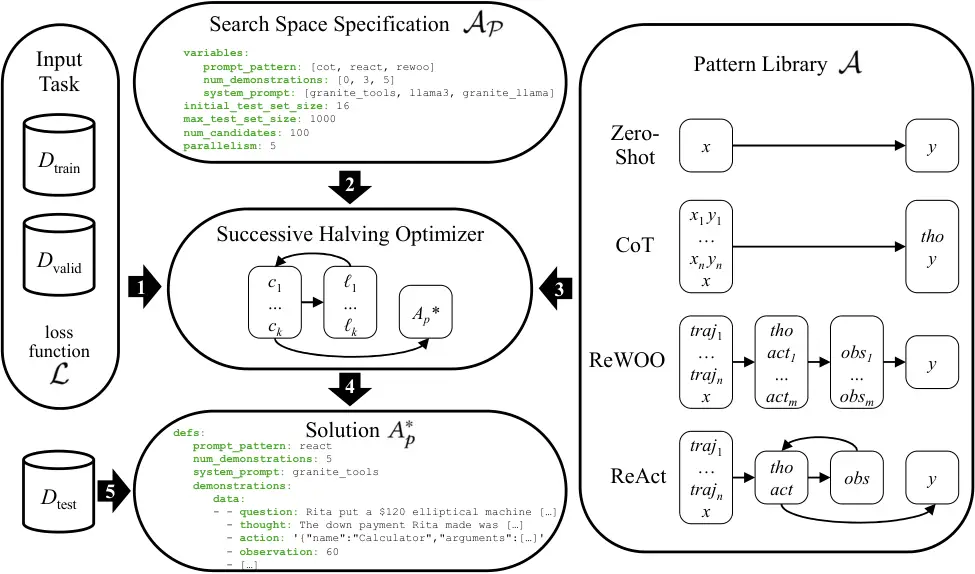

# AutoPDL: Automatic Prompt Optimization for LLM Agents

[Claudio Spiess](mailto:cvspiess@ucdavis.edu) Affiliation: UC Davis   
[Mandana Vaziri](mailto:mvaziri@us.ibm.com) Affiliation: IBM Research   
[Louis Mandel](mailto:lmandel@us.ibm.com) Affiliation: IBM Research   
[Martin Hirzel](mailto:hirzel@us.ibm.com) Affiliation: IBM Research

###### Abstract

The performance of large language models (LLMs) depends on how they are
prompted, with choices spanning both the high-level prompting pattern
(e.g., Zero-Shot, CoT, ReAct, ReWOO) and the specific prompt content
(instructions and few-shot demonstrations). Manually tuning this
combination is tedious, error-prone, and specific to a given LLM and
task. Therefore, this paper proposes AutoPDL, an automated approach to
discovering good LLM agent configurations. Our approach frames this as a
structured AutoML problem over a combinatorial space of agentic and
non-agentic prompting patterns and demonstrations, using successive
halving to efficiently navigate this space. We introduce a library
implementing common prompting patterns using the PDL prompt programming
language. AutoPDL solutions are human-readable, editable, and executable
PDL programs that use this library. This approach also enables
source-to-source optimization, allowing human-in-the-loop refinement and
reuse. Evaluations across three tasks and seven LLMs (ranging from 3B to
70B parameters) show consistent accuracy gains ($`9.21\pm 15.46`$
percentage points), up to 67.5pp, and reveal that selected prompting
strategies vary across models and tasks.

 

ApAp

 

\[\]

## 1 Introduction

Large language models (LLMs) and LLM-based agents excel at a variety of
tasks, including question answering, math word problems, and
programming. The performance of an LLM depends heavily on how it is
prompted, and there are a variety of popular prompting patterns. These
include zero-shot or few-shot \[4\] prompting with
chain-of-thought (CoT) \[33\], zero-shot CoT \[16\], as well as agentic
patterns such as ReAct \[38\] or ReWOO \[37\]. However, given a dataset
$`D_{\textrm{test}}`$ with a loss function $`\mathcal{L}`$, _e.g._,
error rate, it is not clear which pattern will do best. Furthermore,
besides the pattern $`A`$, performance also depends on the prompt $`p`$,
including few-shot samples and instructions. The problem is thus to find
a combination $`A_{p}^{*}`$ of a pattern along with an optimized prompt
that minimizes $`\mathcal{L}`$. This is usually done via manual prompt
engineering, but that is tedious and has to be repeated if a new LLM
comes along. Therefore, this paper explores how to find $`A_{p}^{*}`$
using automated machine learning (AutoML). And for users to trust the
result or to tweak it further, $`A_{p}^{*}`$ itself should be easy to
read and edit.

Agent frameworks, such as CrewAI \[21\] or AutoGen \[35\], contain
pre-built agent patterns with prompts optimized for proprietary frontier
models and common tasks. Unfortunately, their prompts are deeply
buried \[27\], making them hard to modify and adapt to non-frontier
models or novel tasks. Moreover, the prompting pattern is fixed to a
variation of ReAct, limiting flexibility in customizing the prompt
structure. Prompt optimizers, such as DSPy \[15\], optimize few-shot
samples for in-context learning (ICL) and/or instructions in the
prompt $`p`$. Unfortunately, they do not automatically select the
prompting pattern $`A`$ and do not return human-readable code.

We formulate the problem of finding a good pattern and corresponding
prompt by defining and then exploring a combined search space. We were
inspired by the AutoML literature on combined search spaces of
machine-learning algorithms and their hyperparameters \[30\], except
that (i) instead of discrete or continuous hyperparameters, we explore
textual ICL samples, instructions, and prompting patterns; (ii) instead
of classification or regression tasks, we tackle generative tasks; and
(iii) instead of model training or fine-tuning, we focus on in-context
learning. We assume a dataset with a validation set
$`D_{\mathrm{valid}}`$, test set $`D_{\mathrm{test}}`$, as well as an
example bank $`D_{\mathrm{train}}`$ for few-shot samples.
$`D_{\mathrm{valid}}`$ is used during the optimization process to
evaluate the performance of a configuration, whereas
$`D_{\mathrm{test}}`$ is used once upon completion, to evaluate the
performance of the best performing configuration. As usual, to avoid
over-fitting, we assume these are disjoint from each other. The problem
statement is to find
$`\displaystyle A_{p}^{*}=\argmin_{A_{p}\in\mathcal{A}_{\mathcal{P}}}\mathcal{L}(A_{p},D_{\textrm{valid}})`$,
where:

- •
  $`A\in\mathcal{A}=\{\textrm{Zero-Shot, CoT, ReWOO, ReAct}\}`$ is the
  prompting pattern, and
- •
  $`p=\langle n,d_{\textrm{train}},\textrm{instr}\rangle\in\mathcal{P}`$
  is the prompt, comprising a number $`n\leq|D_{\mathrm{train}}|`$ of
  few-shot samples, the actual few-shot samples
  $`d_{\mathrm{train}}\in(D_{\mathrm{train}})^{n}`$, and an instruction
  $`\textrm{instr}\in\mathcal{I}`$. A concrete example of
  $`\mathcal{P}`$ is provided in Figure A1 and Figure A2.

To avoid getting stuck in local minima while saving compute and finding
a solution with a low loss, we explore the search
space $`\mathcal{A}_{\mathcal{P}}`$ using successive halving \[14\]. To
make the initial search space $`\mathcal{A}_{\mathcal{P}}`$
user-interpretable, and the final solution $`A_{p}^{*}`$ both human
readable and executable, we express them in a YAML-based prompting
language, PDL \[31\]. PDL’s structured format makes it easy to modify
both the initial search space and the optimized program, and ensures the
final solution remains directly executable. We introduce a library for
PDL that implements each of the common prompting patterns
in $`\mathcal{A}`$. The initial search space
$`\mathcal{A}_{\mathcal{P}}`$ is a YAML file with various choice points
for AutoML to decide. And the solution $`A_{p}^{*}`$ is a
custom-tailored PDL program optimized for the given task, as given by
the dataset and loss function. The developer can read or even tweak
either or both as desired.

We evaluate our optimizer on three tasks (question answering, math, and
programming), using seven LLMs sized between 3B and 70B parameters. We
find that the optimizer often gives accuracy boosts in the 6–30% range,
in some cases higher. Given the same task, different patterns
$`A\in\mathcal{A}`$ do best for different models. Conversely, given the
same model, different patterns do best for different tasks. Besides this
variability in the chosen pattern $`A`$, our experiments also revealed
variability in the optimized
prompts $`p=\langle n,d_{\textrm{train}},\textrm{instr}\rangle`$. We
also found that when training data for a task is missing, data from a
related but different dataset can help. Also, while most of our
experiments use moderately-sized open models, we also show our optimized
solutions can benefit frontier models.

This paper makes three primary contributions:

1.  1.  Jointly searching pattern and prompt: prior work in prompt
        optimization has not investigated searching _joint_ search spaces,
        including agentic patterns.
2.  2.  No one size fits all: we find that different models sometimes have
        differing optimal prompt patterns for the _same_ benchmark,
        suggesting that there is not one single optimal prompt pattern.
3.  3.  Source-to-source optimization: we propose the first source-to-source
        optimizer for LLM prompt programs, where both the initial search
        space and the final solution are prompt programs in the same
        language, making the final solution both human-readable and
        executable.

Overall, this paper shows how to apply AutoML to automatically discover
agentic or non-agentic LLM prompts and patterns optimized for a given
task. We make our AutoPDL implementation available
at [https://github.com/IBM/prompt-declaration-language](https://github.com/IBM/prompt-declaration-language),
and release the [reproduction
package](https://openreview.net/attachment?id=CAeISyE3aR&name=reproducibility)
used for the experiments in this work to the community.

## 2 Background

1 text:

2 - role: tools

3 text: \${ tools }

4 - "Out of 1400 participants, 400 passed the test. What percentage is
that?\\n"

5 - def: actions

6 model: replicate/ibm-granite/granite-3.1-8b-instruct

7 parser: json

8 spec: \[{ name: str, arguments: { expr: str }}\]

9 - if: \${ actions\[0\].name == "calc" }

10 then:

11 lang: python

12 code: result = \${ actions\[0\].arguments.expr }

Figure 1: Basic example of a PDL program.

This paper uses PDL \[31\] as a representation for exploring the search
space of programs. PDL programs are declarative and combine human
readability with ease of execution. They represent the composition of
calls to LLMs and tools, abstracting away the plumbing necessary for
such compositions. The output of the optimizer is also a PDL program,
rather than simple textual prompts, so it is fully executable and could
be further refined by a developer.

Figure 1shows a simple PDL program that uses a tool to answer a query.
PDL is based on the premise that interactions with an LLM are mainly for
the purpose of generating data. So, it allows users to specify the shape
of data to be generated in a declarative way (in YAML), and is agnostic
of any programming language. The first line of Figure 1 specifies that
we are creating some text. Next, the first block in the itemized list
defines the tools prompt. Line 3 contains a use of variable tools,
expressed as a Jinja expression. This variable is defined as the JSON
Schema specification of a calculator tool (not shown in this figure, for
the full program see Appendix 8.2). Line 4 is the user query prompt. We
do not specify the role explicitly as _user_ is the default role for
prompts. Lines 5 through 8 show a model call. In PDL, the background
context is accumulated implicitly, so the output of all blocks executed
so far will be passed to the LLM as a list of input messages. The result
of the model call is assigned to the variable actions (line 5). The
model to be called is specified on line 6 (PDL is based on LiteLLM,¹¹ 1
[https://github.com/BerriAI/litellm](https://github.com/BerriAI/litellm)
so this is a LiteLLM model id). Finally, lines 7 and 8 say that we parse
the output of the model as JSON and type-check it according to the type
on line 8. Furthermore, when the inferencing server supports it, model
calls with a schema use constrained decoding \[34\], enforcing
syntactically correct JSON.²² 2 PDL additionally makes use of the
heuristic json-repair package.

On line 9, an if-statement checks whether the output of the LLM asks for
the calculator tool. If so, we use a Python code block to compute the
requested tool call (lines 11 and 12). When we execute this program
using the PDL interpreter, we obtain all the model inputs, followed by
the model output, and finally the output of the tool call. PDL has a
rich set of control structures to allow writing a variety of prompting
patterns, as well as functions to support libraries. For instance,
Figure 3 shows a function call on line 4. In this paper, we consider the
problem of automatically tuning prompts and choosing prompting patterns
for a given dataset. The following section explains our approach in
further detail.

## 3 AutoPDL Approach

Figure 2: Overview of our approach.

Figure 2gives an overview of our approach. Referring to the numbers in
the arrows:

(1) The input task is given by two disjoint datasets
$`D_{\mathrm{train}}`$ and $`D_{\mathrm{valid}}`$ and a loss function
$`\mathcal{L}`$. The datasets comprise $`\langle x,y\rangle`$ instances,
where $`x`$ is a question, $`y`$ is the corresponding answer, and both
are text strings. The loss function evaluates the quality of an
answer $`y`$. (2) The search space specification
$`\mathcal{A}_{\mathcal{P}}`$ is a YAML file with the optimization
variables and their possible values, along with some hyperparameters.
For example, num*demonstrations: \[0, 3, 5\] indicates that each
candidate will have zero, three, or five ICL samples randomly drawn
from $`D*{\mathrm{train}}`$. In the case of zero demonstrations, this is
equivalent to the zero-shot baseline. If zero is an option, we bias our
candidate sampling to always include one zero-shot candidate, just in
case that baseline turns out to be the best-performing configuration.

(3) The pattern library consists of four PDL functions. Zero-shot is a
baseline that simply prompts the LLM with $`x`$ and expects it to
return $`y`$. CoT refers to chain-of-thought \[33\] with in-context
learning \[4\]: the input includes a few $`x_{i}y_{i}`$ pairs before the
actual question $`x`$, and the output includes some reasoning thought
$`\mathit{tho}`$ before the actual answer $`y`$. ReWOO \[37\] refers to
reasoning without observations. Here, the few-shot samples are
trajectories $`\mathit{traj}_{i}`$. A trajectory $`\mathit{traj}_{i}`$
consists of steps for a particular example problem instance in
$`D_{\mathrm{train}}`$, _e.g._, in the case of ReWOO, $`\mathit{tho}`$
and $`\mathit{act}`$ steps and their contents. In contrast to
$`x_{i}y_{i}`$ pairs, $`\mathit{traj}_{i}`$ may contain many
$`\mathit{tho}`$, $`\mathit{act}`$ and, depending on pattern,
$`\mathit{obs}`$ steps, before reaching the solution $`y_{i}`$. The
first LLM call in ReWOO generates one reasoning thought $`\mathit{tho}`$
and multiple actions $`\mathit{act}_{i}`$. The PDL code executes each of
the actions as a tool call to obtain the corresponding observations
$`\mathit{obs}_{i}`$. A final model call generates the answer $`y`$
based on the observations. Finally, the ReAct pattern \[38\] starts with
few-shot trajectory examples $`\mathit{traj}_{i}`$ (brief example
visible under Solution $`A_{p}^{*}`$ in Figure 2) and the
question $`x`$, and then enters a TAO (thought, action, observation)
loop. In each loop iteration, the LLM generates $`\mathit{tho}`$ and
$`\mathit{act}`$, then the PDL code executes the action as a tool call,
and feeds the tool output back as an observation $`\mathit{obs}`$. A
special Finish action breaks out of the loop to return the answer $`y`$.

1 text:

2 - include: ../../tools.pdl

3 - include: ../../ReAct.pdl

4 - call: \${ react }

5 def: ANSWER

6 args:

7 task: "Question: \${ question }"

8 model: \${ model }

9 tools: \${ tools }

10 trajectories: \${ demonstrations }

11 - "\\nThe answer is \${ ANSWER.answer }"

Figure 3: Basic example of PDL program using the ReAct pattern.

Once inputs (1), (2), and (3) are in place, the successive halving
optimizer runs in a loop. It starts with a small subset
$`D_{v}\subset D_{\mathrm{valid}}`$ and many candidates
$`\mathcal{C}=\{c_{1},\ldots,c_{k}\}\subseteq\mathcal{A}_{\mathcal{P}}`$
sampled from the search space. Each iteration uses $`D_{v}`$ to evaluate
the corresponding losses $`\ell_{1},\ldots,\ell_{k}`$. Then each
iteration keeps the $`\frac{k}{2}`$ candidates with the smallest
$`\mathcal{L}`$ while doubling the size of the validation
subset $`D_{v}`$. See § 8.3 for the algorithm. (4) After the last
iteration, the best remaining candidate is the solution $`A_{p}^{*}`$.
This solution is a set of PDL definitions with concrete values for the
optimization variables, e.g., in Figure 2, num*demonstrations: 5 and
demonstrations: ... a list of ReAct trajectories. (5) This program can
be used on the test set $`D*{\mathrm{test}}`$. For instance, Figure 3
shows a call to the ReAct function that passes \${demonstrations}
from $`A\_{p}^{\*}`$ as an argument.

## 4 Methodology

This section describes the datasets used, the tools available to agents,
and our experimental setup, including how we construct agent
trajectories that demonstrate tool use for each dataset.

### 4.1 Datasets

We selected datasets that are widely used in the literature, span
diverse tools and domains, and are representative of tool categories
frequently studied in prior work (_e.g._, calculator, search, code
execution). In our experiments, each dataset has three disjoint splits:
$`D_{\mathrm{train}}`$ to sample few-shot samples from,
$`D_{\mathrm{valid}}`$ to evaluate candidates during optimization, and
$`D_{\mathrm{test}}`$ to evaluate the final chosen solution upon
completion of optimization.

#### GSM8K

The Grade School Math \[7\] dataset consists of 8,792 grade school math
problems. We sample 1,024 problems without replacement from the train
set to use as our $`D_{\mathrm{valid}}`$ set, and 1,024 from the test
set (consisting of 1,319 samples) to use as our $`D_{\mathrm{test}}`$.
This leaves a $`D_{\mathrm{train}}`$ of 6,449 problems. Each problem
consists of a word problem $`x`$ such as “What is fifteen more than a
quarter of 48?”, a sequence $`\mathit{tho}`$ of reasoning steps, and
finally a plain numeric answer $`y`$ following a special delimiter. For
the CoT prompt pattern, we include these reasoning steps directly in the
demonstrations. We use a regular expression to extract the numerical
answer from the model solution, and define a correct solution as an
exact match to the ground truth answer.

#### GSM-Hard

\[11\] introduce a derivative of GSM8K with variables randomly changed
to large numbers, with 1,319 samples. Unfortunately, GSM-Hard had 132
samples where the ground truth was incorrect, and hence we excluded
those samples. We split the single set into equally sized
$`D_{\mathrm{valid}}`$ and $`D_{\mathrm{test}}`$ ($`n=594`$), and use
the GSM8K training set (6,449 samples) described above for
$`D_{\mathrm{train}}`$ (_cross transfer_). We use the same correctness
criterion as for GSM8K.

#### FEVER

The Fact Extraction and VERification dataset \[29\] is a
question-answering dataset structured around fact-checking. The original
dataset contained 185,445 claims that are true, false, or unverifiable,
and associated with human annotated supporting, refuting, or neutral
sentences and their Wikipedia article of origin. We follow the widely
used derivative of this benchmark in BIG-bench \[28\], which
reformulates it into a true-or-false task by removing unverifiable
claims. We sample 1,024 claims from the train set as
$`D_{\mathrm{valid}}`$ and 1,024 from the test set as
$`D_{\mathrm{test}}`$. This leaves a $`D_{\mathrm{train}}`$ of 5,696
claims. BIG-bench also does not include the supporting or refuting
sentences, which we recover by joining on the original dataset, for use
_e.g._, as CoT demonstrations. To assess correctness, we check for the
presence of “true” and “false” in the final line of the model response.
If neither or both are present, we deem the response as incorrect, and
otherwise the correctness is a direct match to the ground truth “true”
or “false”.

#### MBPP+

MBPP \[2\] is a dataset of 974 mostly basic Python problems, with each
example consisting of a natural language problem specification $`x`$ for
a self-contained Python function $`y`$, along with a single test case.
Each problem has an extended set of test cases used for evaluation,
which are not shown to the model. \[19\] found that MBPP test cases are
incomplete, allowing proposed solutions to pass as correct, despite not
matching the problem specification. Therefore, our experiments are based
on MBPP+, which contains a subset of the problems, but a more complete
set of test cases for each problem. We use these test cases to assess
the correctness of the proposed solutions. We use the 374 examples from
the original MBPP dataset as $`D_{\mathrm{train}}`$, and split MBPP+
into $`D_{\mathrm{test}}`$ (224 samples) and $`D_{\mathrm{valid}}`$ (39
samples) based on which split they were in _MBPP_. The discrepancy in
number of MBPP+ samples is due to the exclusion of samples found in the
MBPP train set, to avoid data contamination. Our ReAct implementation
follows \[32\]. We do not implement ReWOO as it is not reactive, _i.e._,
cannot include execution feedback.

### 4.2 Tools

Our prompt library represents actions, _i.e._, tool calls, following the
JSON tool calling schema \[1\]. An action is represented as a JSON
object with name and arguments mapping. For example, {"action": "Calc",
"arguments": {"expr": "48/4"}} represents a call to a calculator with
the expression to evaluate. The PDL functions implementing the patterns
(see Figure 2) accept a list of tool definitions as an argument. Each
element of that list is itself a PDL function. As both the agents and
tools are implemented in PDL, the set of tools for a given task could
itself be made a search space dimension, which we leave to future work.

#### Calculator

For math datasets, we give the agentic approaches access to the _Calc_
tool. This tool evaluates a cleaned (_e.g._, replacement of `^` with
$`**`$) expression with [SymPy](https://github.com/sympy/sympy),
returning the result. In case of error, the function returns a warning
that the expression was invalid, which may help the agent recover from
invalid input.

#### Search

For fact verification, we provide access to the _Search_ tool, which
returns the summary of the first Wikipedia search result for the query.
If no results are found, a hint to try again is returned, or if the
title is too ambiguous, a list of possible disambiguations.

#### Execute

We implement a programming agent for the code generation task, which can
execute arbitrary code surrounded in XML-style \<execute\> tags. This
tool executes the code in a Python shell, which returns the result of
the final expression. This allows the agent to test its proposed
solution against the given test case before submitting its solution.

#### Finish

The most basic action is the _Finish_ action, or \<solution\> tag for
the coding agent. This ends the agent’s trajectory and results in the
agent returning the value as the solution.

### 4.3 Experimental Setup

We evaluate the efficacy of our approach by running an optimization
process to completion for each model & dataset pair, and subsequently
comparing the task accuracy. As a baseline, we evaluate each model in a
zero-shot setting. This setting reflects the minimal effort approach by
a user or developer, where they do not include any demonstrations with
their query or task. As no model we investigate was specifically trained
to create agentic trajectories in a zero-shot setting, it is not
feasible to create a zero-shot setting under ReAct or ReWOO.

For the optimization process, we used an initial candidate set
$`\mathcal{C}`$ of 100 candidate prompt configurations
$`c_{i}=\langle A,p\rangle\in\mathcal{C}`$ per experiment. We fixed the
size of the initial validation subset
$`d_{\mathrm{valid}}\subseteq D_{\mathrm{valid}}`$ to 16. We define
$`\mathcal{L}(c_{i},\,d_{\mathrm{valid}})=-\text{Accuracy}(c_{i},\,d_{\mathrm{valid}})`$
for a given candidate $`c_{i}`$, where accuracy is the fraction in
$`d_{\mathrm{valid}}`$ of correctly solved problems by $`c_{i}`$ as per
the dataset definition of correctness. For each candidate $`c_{i}`$,
$`p=\langle n,d_{\textrm{train}},\textrm{instr}\rangle\in\mathcal{P}`$
where $`n`$ few-shot samples or trajectories
$`d_{\mathrm{train}}\in(D_{\mathrm{train}})^{n}`$ are randomly sampled
with replacement. The number of possible values for $`\mathcal{P}`$ is
combinatorially large and depends on the dataset $`D_{\mathrm{train}}`$
used. Finally, upon completion of an optimization process, the optimal
candidate is evaluated on $`D_{test}`$.

#### Constructing Trajectories

As we are also optimizing over agentic trajectories, we also need a set
of trajectories to sample few-shot samples from. To achieve this, we
create a basic agentic trajectory $`\mathit{traj}_{i}`$ for each
training example $`\langle x_{i},y_{i}\rangle`$, following a rule-based
transformation. We design and apply a template to each dataset, which is
relatively simple and easy to implement for other datasets (details are
provided in § 8.5). Prior work has introduced approaches to
bootstrapping trajectories _e.g._, in software engineering \[25\], tool
use demonstrations \[17\], and reasoning paths \[41\], which could be
applied to this problem. While we acknowledge the shortcomings of manual
template construction, we argue this approach has two strengths: it is
generalizable in the sense that templates can be mixed and matched, and
that the trajectories are directly based on the datasets used.
Additionally, we wanted to work with commonly used datasets that cover a
variety of tools and domains, rather than emerging datasets containing
trajectories or tool use demonstrations.

#### Models

We aim to study models of various abilities, _e.g._, natural language or
code, various creators, and various sizes, ranging from single digit
billions of parameters up to the edge of feasibility on consumer
hardware. We include seven models available on inference service IBM
watsonx³³ 3 [https://www.ibm.com/watsonx](https://www.ibm.com/watsonx)
in our study. We select three generalist natural language instruction
models, Llama 3.1 8B, 3.2 3B, and 3.3 70B from the open-source and
widely studied LLaMa family \[9\]. We further select three models
from \[20\], which predate \[9\] by approximately 3 months. We select
Granite 13B Instruct V2 as a generalist model, and Granite 20B and 34B
Code Instruct as code models. We select Granite 3.1 8B as an additional
generalist model \[12\]. All of our experiments use greedy decoding,
_i.e._, no sampling, to limit the impact of hyperparameter choice. The
number of models we evaluate is limited by cost in \$/token terms and
execution time. By studying various models, we demonstrate the
generalizability of our approach.

#### Alternative Setups

We evaluate two alternative experimental setups. First, to investigate
low-resource scenarios, we examine whether performance on one dataset
can be improved by using demonstrations $`D_{\mathrm{train}}`$ from a
similar dataset, while optimizing w.r.t. $`D_{\mathrm{valid}}`$. For
this experiment, we investigate whether performance on GSM-Hard can be
improved by using demonstrations from _GSM8K_, while optimizing w.r.t.
GSM-Hard $`D_{\mathrm{valid}}`$. Second, to explore saving optimization
costs, we assess whether optimized prompt programs of one model can
transfer well to a frontier model. The intuition is that while that
might not be the best program for the frontier model, it might at least
improve somewhat over the baseline. To this end, we evaluate the
optimized PDL programs of LLaMa 3.1 70B on OpenAI’s
gpt-4o-mini-2024-07-18, for each dataset.

## 5 Results

This section describes the results of our empirical study to evaluate
our AutoPDL approach and answer the following research questions:

RQ1 asks to what degree our AutoPDL approach can improve model
performance over their zero-shot baseline across a variety of commonly
used benchmarks. We also seek to identify trends, if any, in optimal
configurations, _e.g._, whether more few-shots is always better, or
whether certain prompt patterns are particularly suited to certain
problem domains.

RQ2 investigates whether optimizing on one dataset using demonstrations
from another, related, dataset can result in higher performance than
using no demonstrations (zero-shot). This RQ addresses a low-resource
scenario in which a limited pool of demonstrations exists in one
dataset, but a dataset from a similar domain has a large pool.

It can be expensive to run optimization against commercial
frontier-model APIs. RQ3 assesses whether optimized prompt programs are
transferable to different (and likely stronger) models than those they
were optimized with.

Table 1reports the results of our optimization and evaluation procedure.
We performed three complete optimization runs for FEVER, GSM8K, and
MBPP+, and report mean accuracy, standard deviation in percentage points
(_i.e._, absolute, _not_ relative, uncertainty), and the pattern of the
highest scoring run. Across models and datasets, we generally find some
improvement over the zero-shot baseline with few-shot chain-of-thought,
or agentic patterns ReAct or ReWOO.

Dataset Model Accuracy Best Pattern Runtime Zero-Shot Optimized Delta
FEVER Granite 3.1 8B $`72.9\text{\,}\mathrm{\%}`$
$`76.4\pm\pm 3.3\text{\,}\mathrm{\%}`$ +3.5pp ReWOO (5 shot) 13:53 FEVER
Granite 13B Instruct V2 $`6.5\text{\,}\mathrm{\%}`$
$`74.0\pm\pm 1.4\text{\,}\mathrm{\%}`$ +67.5pp ReWOO (3 shot) 08:28
FEVER Granite 20B Code $`39.7\text{\,}\mathrm{\%}`$
$`63.1\pm\pm 1.6\text{\,}\mathrm{\%}`$ +23.4pp CoT (3 shot) 12:03 FEVER
Granite 34B Code $`56.4\text{\,}\mathrm{\%}`$
$`62.6\pm\pm 3.8\text{\,}\mathrm{\%}`$ +6.2pp CoT (3 shot) 10:07 FEVER
LLaMA 3.1 8B $`68.5\text{\,}\mathrm{\%}`$
$`77.5\pm\pm 0.8\text{\,}\mathrm{\%}`$ +9.0pp CoT (3 shot) 05:06 FEVER
LLaMA 3.2 3B $`38.0\text{\,}\mathrm{\%}`$
$`66.3\pm\pm 0.9\text{\,}\mathrm{\%}`$ +28.3pp ReWOO (5 shot) 10:10
FEVER LLaMA 3.3 70B $`67.6\text{\,}\mathrm{\%}`$
$`78.1\pm\pm 0.6\text{\,}\mathrm{\%}`$ +10.5pp ReWOO (3 shot) 21:27
GSM8K Granite 3.1 8B $`74.2\text{\,}\mathrm{\%}`$
$`74.2\pm\pm 0.6\text{\,}\mathrm{\%}`$ +0.0pp Zero-Shot (Baseline) 08:56
GSM8K Granite 13B Instruct V2 $`23.0\text{\,}\mathrm{\%}`$
$`30.9\pm\pm 1.0\text{\,}\mathrm{\%}`$ +7.9pp CoT (3 shot) 09:20 GSM8K
Granite 20B Code $`68.7\text{\,}\mathrm{\%}`$
$`68.7\pm\pm 0.1\text{\,}\mathrm{\%}`$ +0.0pp Zero-Shot (Baseline) 09:27
GSM8K Granite 34B Code $`72.1\text{\,}\mathrm{\%}`$
$`72.1\pm\pm 0.1\text{\,}\mathrm{\%}`$ +0.0pp Zero-Shot (Baseline) 08:52
GSM8K LLaMA 3.1 8B $`78.4\text{\,}\mathrm{\%}`$
$`85.3\pm\pm 0.6\text{\,}\mathrm{\%}`$ +6.9pp CoT (5 shot) 08:48 GSM8K
LLaMA 3.2 3B $`71.8\text{\,}\mathrm{\%}`$
$`75.3\pm\pm 0.4\text{\,}\mathrm{\%}`$ +3.5pp CoT (3 shot) 16:36 GSM8K
LLaMA 3.3 70B $`85.5\text{\,}\mathrm{\%}`$
$`95.4\pm\pm 0.2\text{\,}\mathrm{\%}`$ +9.9pp CoT (3 shot) 07:50 MBPP+
Granite 3.1 8B $`62.9\text{\,}\mathrm{\%}`$
$`62.9\pm\pm 0.0\text{\,}\mathrm{\%}`$ +0.0pp Zero-Shot (Baseline) 02:14
MBPP+ Granite 13B Instruct V2 $`10.7\text{\,}\mathrm{\%}`$
$`19.2\pm\pm 1.2\text{\,}\mathrm{\%}`$ +8.5pp ReAct (5 shot) 04:02 MBPP+
Granite 20B Code $`51.8\text{\,}\mathrm{\%}`$
$`51.8\pm\pm 0.4\text{\,}\mathrm{\%}`$ +0.0pp Zero-Shot (Baseline) 03:43
MBPP+ Granite 34B Code $`48.7\text{\,}\mathrm{\%}`$
$`61.3\pm\pm 1.0\text{\,}\mathrm{\%}`$ +12.6pp ReAct (3 shot) 04:54
MBPP+ LLaMA 3.1 8B $`61.2\text{\,}\mathrm{\%}`$
$`62.8\pm\pm 4.0\text{\,}\mathrm{\%}`$ +1.6pp ReAct (5 shot) 01:45 MBPP+
LLaMA 3.2 3B $`58.0\text{\,}\mathrm{\%}`$
$`58.0\pm\pm 0.4\text{\,}\mathrm{\%}`$ +0.0pp Zero-Shot (Baseline) 02:01
MBPP+ LLaMA 3.3 70B $`71.4\text{\,}\mathrm{\%}`$
$`71.4\pm\pm 0.0\text{\,}\mathrm{\%}`$ +0.0pp Zero-Shot (Baseline) 02:27

Table 1: Model accuracies across datasets for baseline (zero-shot) and
optimized versions.

#### FEVER

We observed the minimum improvement in Granite 3.1 8B, with a 3.5
percentage point (pp) improvement, and a maximal improvement of 67.5pp
for Granite 13B Instruct V2. In terms of prompt pattern, CoT and ReWOO
are equally represented. ReAct was not the optimal for any of the
models. Interestingly, the largest model (LLaMa 3.3 70B) benefited by
10.5pp from 3-shot ReWOO. FEVER runtimes are generally higher than the
other benchmarks, likely due to the large number of tokens involved by
including Wikipedia content.

#### GSM8K

The highest improvement recorded (9.9pp) was for LLaMa 3.3 70B using
3-shot CoT, while the minimum improvement of 3.5pp was in LLaMa 3.2 3B
using 3-shot CoT. ReAct and ReWOO were not the optimal for any model.
For Granite 3.1 8B, Granite 20B Code, and Granite 34B Code, no
improvement over the zero-shot baseline was identified. This was
somewhat surprising, as generally including even some few-shot samples
improves performance in LLMs.

#### MBPP+

Several models benefited from execution feedback, as 3 out of 7 had
ReAct as the optimal prompt pattern (ReWOO was excluded as described in
§ 4.3). The greatest improvement of 12.6pp was in Granite 34B Code, and
8.5pp in Granite 13B Instruct V2, likely due to its poor programming
performance as a generalist, non-code model. In contrast, the smaller
LLaMa 3.1 8B model had high zero-shot performance of 61.2%, yet still
improved by up to 6.2pp (1.6pp on average) with ReAct. No improvement
was observed for Granite 3.1 8B, Granite 20B Code, or the other LLaMa
models.

Dataset Model Accuracy Best Pattern Runtime Zero-Shot Optimized Delta
GSM-Hard Granite 3.1 8B $`36.0\text{\,}\mathrm{\%}`$
$`37.8\pm\pm 0.8\text{\,}\mathrm{\%}`$ +1.8pp ReAct (5 shot, Granite
Tools) 23:34 GSM-Hard Granite 13B Instruct V2
$`4.4\text{\,}\mathrm{\%}`$ $`6.2\pm\pm 0.7\text{\,}\mathrm{\%}`$ +1.8pp
CoT (5 shot) 10:26 GSM-Hard Granite 20B Code
$`28.8\text{\,}\mathrm{\%}`$ $`27.2\pm\pm 4.5\text{\,}\mathrm{\%}`$
+0.0pp Zero-Shot (Baseline) 11:14 GSM-Hard Granite 34B Code
$`27.9\text{\,}\mathrm{\%}`$ $`31.0\pm\pm 0.9\text{\,}\mathrm{\%}`$
+3.0pp CoT (3 shot) 10:20 GSM-Hard LLaMA 3.2 3B
$`26.3\text{\,}\mathrm{\%}`$ $`26.8\pm\pm 0.6\text{\,}\mathrm{\%}`$
+0.5pp CoT (5 shot) 17:08 GSM-Hard LLaMA 3.3 70B
$`47.3\text{\,}\mathrm{\%}`$ $`53.8\pm\pm 0.4\text{\,}\mathrm{\%}`$
+6.5pp CoT (5 shot) 11:03

Table 2: Model accuracies on GSM-Hard for cross optimization experiment.

Dataset Model Accuracy Best Pattern Zero-Shot
$`\mathrm{O}\mathrm{p}\mathrm{t}\mathrm{i}\mathrm{m}\mathrm{i}\mathrm{z}\mathrm{e}\mathrm{d}`$
Delta FEVER GPT-4o-mini $`83.7\text{\,}\mathrm{\%}`$
$`\mathrm{}\mathrm{r}\mathrm{e}\mathrm{v}\mathrm{e}\mathrm{r}\mathrm{t}\mathrm{\_}\mathrm{a}\mathrm{s}\mathrm{=}{presentation}\mathrm{]}{\text{\,}87.7\mathrm{\%}}{87.7\text{\,}\mathrm{\%}}`$
+4.0pp CoT (3 shot) GSM-Hard GPT-4o-mini $`45.6\text{\,}\mathrm{\%}`$
$`\mathrm{}\mathrm{r}\mathrm{e}\mathrm{v}\mathrm{e}\mathrm{r}\mathrm{t}\mathrm{\_}\mathrm{a}\mathrm{s}\mathrm{=}{presentation}\mathrm{]}{\text{\,}54.9\mathrm{\%}}{54.9\text{\,}\mathrm{\%}}`$
+9.3pp ReAct (5 shot, Granite LLaMa) GSM8K GPT-4o-mini
$`77.8\text{\,}\mathrm{\%}`$
$`\mathrm{}\mathrm{r}\mathrm{e}\mathrm{v}\mathrm{e}\mathrm{r}\mathrm{t}\mathrm{\_}\mathrm{a}\mathrm{s}\mathrm{=}{presentation}\mathrm{]}{\text{\,}90.9\mathrm{\%}}{90.9\text{\,}\mathrm{\%}}`$
+13.1pp CoT (5 shot) MBPP+ GPT-4o-mini $`72.3\text{\,}\mathrm{\%}`$
$`\mathrm{}\mathrm{r}\mathrm{e}\mathrm{v}\mathrm{e}\mathrm{r}\mathrm{t}\mathrm{\_}\mathrm{a}\mathrm{s}\mathrm{=}{presentation}\mathrm{]}{\text{\,}72.3\mathrm{\%}}{72.3\text{\,}\mathrm{\%}}`$
+0.0pp Zero-Shot (Baseline)

Table 3: Model accuracy for GPT-4o-mini cross experiment results

#### Missing Few-Shot Example Bank

We optimized the PDL program for GSM-Hard, using GSM8K demonstrations,
three times and report results in Table 2. We found that in most cases,
GSM8K demonstrations were at least not harmful for models on GSM-Hard,
with up to 6.5pp improvement for LLaMa 3.3 70B using 5-shot CoT.

#### Commercial Frontier Model

To assess whether performance gains in one model can be achieved in
another, we evaluate the optimized PDL programs of LLaMa 3.1 70B on
OpenAI’s gpt-4o-mini-2024-07-18 and report results in Table 3 (we did
not use LLaMa 3.3 70B here because we did this experiment earlier and
did not have the time and resources to repeat it for the final version
of this paper). For all dataset/prompt pattern pairs that resulted in
improvement for LLaMa 3.1 70B, we found a surprising improvement in
GPT4o-mini of at least 4pp on FEVER using 3-shot CoT, 9.3pp on GSM-Hard
(using GSM8K demonstrations) with 5-shot ReAct (Granite LLaMa
instructions), and up to 13.1pp on GSM8K using 5-shot CoT. This suggests
that optimizing for an open-source model can also benefit a
closed-source model.

## 6 Related Work

The closest related work is on prompt optimization. APE starts with an
LLM-generated set of candidate prompts, then performs rejection sampling
based on evaluation on a subset of data \[42\]. ZOPO incorporates a
Neural Tangent Kernel-based derived Gaussian process into standard
zeroth-order optimization for an efficient search of a locally-optimal
instruction \[13\]. Unlike our approach, neither APE nor ZOPO optimize
few-shot samples. Aviary can also jointly optimize over prompt pattern,
instruction, and few-shot examples \[22\]. However, it would require the
definition of a custom operator. CEDAR uses a demonstration pool, from
which it retrieves few-shot examples at query time \[23\]. Unlike our
approach, these few-shot samples are retrieved on a per-inference basis,
not optimized ahead-of-time.

EASE leverages embeddings to represent few-shot examples, and uses a
neural bandit algorithm to find an ordered set that performs well for
test queries from a given task \[36\]. An extension of their approach
jointly optimizes demonstrations and instructions. However, the approach
requires both an additional embedding model, and the training of a new
model to predict validation scores from embeddings. Unlike our approach,
EASE does not optimize over agentic patterns.

DSPy optimizes instructions and few-shot samples for a chain of LLM
calls \[15\] (not just a single call like APE or CEDAR). Also, DSPy
takes away control over the exact prompt from the programmer, which our
approach preserves. Similarly to DSPy, TextGrad also optimizes a chain
of LLM calls, by using LLMs to back-propagate modifications to
instructions in prompts \[40\]. However, unlike our approach, neither of
these optimize agentic patterns.

BPO trains a sequence-to-sequence model on prompts augmented by an LLM
incorporating human preferences, producing a model that improves given
input prompts \[6\]. APOHF introduce a strategy to select a pair of
prompts to query the user for preference feedback, which they use to
optimize LLM-generated instructions on a validation set \[18\]. However,
neither of these approaches explicitly optimize demonstrations or
agentic patterns. EvoAgent optimizes the instructions of a population of
agents via crossover, mutation, and selection \[39\]. It then forms an
ensemble from the final, fittest, population. GPTSwarm represents each
agent as a graph, then freezes intra-agent edges and optimizes the
placement of additional inter-agent edges \[43\]. Unlike our approach,
neither EvoAgent nor GPTSwarm optimize the agentic pattern inside
individual agents, nor do they optimize few-shot samples.

Another closely related field of study is AutoML. Auto-sklearn \[10\]
used Bayesian optimization to jointly perform both algorithm selection
and hyperparameters of a scikit-learn pipeline \[5\]. While different,
we see some analogy between algorithms and agentic patterns, and between
hyperparameters and few-shot samples. DAUB first evaluates many
candidate models on a small amount of data, then successively reduces
candidates and increases data to ultimately pick a strong model \[26\].
The successive-halving algorithm takes a similar approach \[14\]. Our
approach is inspired by the same incremental data allocation idea. While
both randomized search and Bayesian optimization are popular in AutoML,
there are also more intricate approaches. For instance, TPOT uses
genetic algorithms \[24\], and AlphaD3M uses Monte-Carlo tree
search \[8\]. We chose to start with a simpler technique that depends
less on a well-behaved optimization space. That said, exploring more
advanced AutoML optimizers could be fruitful future work for AutoPDL.
Lale \[3\] treats AutoML as a source-to-source optimization, similar to
this paper, but unlike AutoPDL, it has not been used to optimize agentic
patterns or prompts.

## 7 Conclusion

We present our AutoPDL approach for jointly optimizing prompting
patterns and textual prompts for large language models, addressing the
challenges associated with manual prompt engineering. By formulating the
optimization as a discrete search over both agentic and non-agentic
patterns, combined with instructions and few-shot samples, we leveraged
successive halving to efficiently navigate this search space. Our
evaluation across various datasets (FEVER, GSM8K, GSM-Hard, and MBPP+)
and multiple models (from the LLaMA, Granite, and GPT families)
demonstrates substantial accuracy improvements, up to 67.5 percentage
points, and affirms that no single prompting strategy universally
outperforms others across tasks and models. Additionally, generating
code in a YAML-based prompt programming language (PDL) makes it
executable, easy to modify, and readable by humans, supporting practical
adoption and adaptation.

## References

- \[1\] Ibrahim Abdelaziz et al. “Granite-Function Calling Model:
  Introducing Function Calling Abilities via Multi-task Learning of
  Granular Tasks”, 2024 URL:
  [https://arxiv.org/abs/2407.00121](https://arxiv.org/abs/2407.00121)
- \[2\] Jacob Austin et al. “Program Synthesis with Large Language
  Models”, 2021 DOI:
  [10.48550/arXiv.2108.07732](https://dx.doi.org/10.48550/arXiv.2108.07732)
- \[3\] Guillaume Baudart et al. “Pipeline Combinators for Gradual
  AutoML” In _Advances in Neural Information Processing Systems
  (NeurIPS)_, 2021, pp. 19705–19718 URL:
  [https://proceedings.neurips.cc/paper/2021/file/a3b36cb25e2e0b93b5f334ffb4e4064e-Paper.pdf](https://proceedings.neurips.cc/paper/2021/file/a3b36cb25e2e0b93b5f334ffb4e4064e-Paper.pdf)
- \[4\] Tom. Brown et al. “Language Models are Few-Shot Learners”, 2020
  URL:
  [https://arxiv.org/abs/2005.14165](https://arxiv.org/abs/2005.14165)
- \[5\] Lars Buitinck et al. “API Design for Machine Learning Software:
  Experiences from the scikit-learn Project”, 2013 URL:
  [https://arxiv.org/abs/1309.0238](https://arxiv.org/abs/1309.0238)
- \[6\] Jiale Cheng et al. “Black-Box Prompt Optimization: Aligning
  Large Language Models without Model Training” In _Annual Meeting of
  the Association for Computational Linguistics (ACL)_, 2024, pp.
  3201–3219 DOI:
  [10.18653/v1/2024.acl-long.176](https://dx.doi.org/10.18653/v1/2024.acl-long.176)
- \[7\] Karl Cobbe et al. “Training Verifiers to Solve Math Word
  Problems”, 2021 DOI:
  [10.48550/arXiv.2110.14168](https://dx.doi.org/10.48550/arXiv.2110.14168)
- \[8\] Iddo Drori et al. “AlphaD3M: Machine Learning Pipeline
  Synthesis” In _Workshop on Automatic Machine Learning (AutoML)_, 2018
  URL:
  [https://arxiv.org/abs/2111.02508](https://arxiv.org/abs/2111.02508)
- \[9\] Abhimanyu Dubey et al. “The Llama 3 Herd of Models”, 2024 arXiv:
  [http://arxiv.org/abs/2407.21783](http://arxiv.org/abs/2407.21783)
- \[10\] Matthias Feurer et al. “Efficient and Robust Automated Machine
  Learning” In _Conference on Neural Information Processing Systems
  (NIPS)_, 2015, pp. 2962–2970 URL:
  [http://papers.nips.cc/paper/5872-efficient-and-robust-automated-machine-learning](http://papers.nips.cc/paper/5872-efficient-and-robust-automated-machine-learning)
- \[11\] Luyu Gao et al. “PAL: Program-aided Language Models” In
  _International Conference on Machine Learning (ICML)_, 2023, pp.
  10764–10799 URL:
  [https://proceedings.mlr.press/v202/gao23f.html](https://proceedings.mlr.press/v202/gao23f.html)
- \[12\] IBM Granite “Granite 3.0 Language Models”, 2024 URL:
  [https://github.com/ibm-granite/granite-3.0-language-models/](https://github.com/ibm-granite/granite-3.0-language-models/)
- \[13\] Wenyang Hu et al. “Localized Zeroth-Order Prompt Optimization”
  In _Conference on Neural Information Processing Systems (NeurIPS)_,
  2024, pp. 86309–86345 URL:
  [https://proceedings.neurips.cc/paper_files/paper/2024/hash/9cef1316eaef9bd99da46f63334dc031-Abstract-Conference.html](https://proceedings.neurips.cc/paper_files/paper/2024/hash/9cef1316eaef9bd99da46f63334dc031-Abstract-Conference.html)
- \[14\] Kevin Jamieson and Ameet Talwalkar “Non-stochastic Best Arm
  Identification and Hyperparameter Optimization” In _Conference on
  Artificial Intelligence and Statistics (AISTATS)_, 2016, pp. 240–248
- \[15\] Omar Khattab et al. “DSPy: Compiling Declarative Language Model
  Calls into Self-Improving Pipelines” In _International Conference on
  Learning Representations (ICLR)_, 2024 URL:
  [https://openreview.net/forum?id=sY5N0zY5Od](https://openreview.net/forum?id=sY5N0zY5Od)
- \[16\] Takeshi Kojima et al. “Large Language Models Are Zero-Shot
  Reasoners” In _Conference on Neural Information Processing Systems
  (NeurIPS)_, 2022, pp. 22199–22213
- \[17\] Chengpeng Li et al. “START: Self-taught Reasoner with Tools”,
  2025 arXiv:
  [https://arxiv.org/abs/2503.04625](https://arxiv.org/abs/2503.04625)
- \[18\] Xiaoqiang Lin et al. “Prompt Optimization with Human Feedback”,
  2024 DOI:
  [10.48550/arXiv.2405.17346](https://dx.doi.org/10.48550/arXiv.2405.17346)
- \[19\] Jiawei Liu, Chunqiu Xia, Yuyao Wang and Lingming Zhang “Is Your
  Code Generated by ChatGPT Really Correct? Rigorous Evaluation of Large
  Language Models for Code Generation” In _Conference on Neural
  Information Processing Systems (NeurIPS)_, 2023, pp. 21558–21572 URL:
  [https://papers.nips.cc/paper_files/paper/2023/hash/43e9d647ccd3e4b7b5baab53f0368686-Abstract-Conference.html](https://papers.nips.cc/paper_files/paper/2023/hash/43e9d647ccd3e4b7b5baab53f0368686-Abstract-Conference.html)
- \[20\] Mayank Mishra et al. “Granite Code Models: A Family of Open
  Foundation Models for Code Intelligence”, 2024 arXiv:
  [http://arxiv.org/abs/2405.04324](http://arxiv.org/abs/2405.04324)
- \[21\] João Moura “CrewAI: Framework for orchestrating role-playing,
  autonomous AI agents”, 2023 URL:
  [https://github.com/crewAIInc/crewAI](https://github.com/crewAIInc/crewAI)
- \[22\] Siddharth Narayanan et al. “Aviary: Training Language Agents on
  Challenging Scientific Tasks”, 2024 DOI:
  [10.48550/arXiv.2412.21154](https://dx.doi.org/10.48550/arXiv.2412.21154)
- \[23\] Noor Nashid, Mifta Sintaha and Ali Mesbah “Retrieval-Based
  Prompt Selection for Code-Related Few-Shot Learning” In _International
  Conference on Software Engineering (ICSE)_, 2023, pp. 2450–2462 URL:
  [https://doi.org/10.1109/ICSE48619.2023.00205](https://doi.org/10.1109/ICSE48619.2023.00205)
- \[24\] Randal. Olson et al. “Automating Biomedical Data Science
  Through Tree-Based Pipeline Optimization” In _European Conference on
  the Applications of Evolutionary Computation (EvoApplications)_, 2016,
  pp. 123–137 URL:
  [https://doi.org/10.1007/978-3-319-31204-0_9](https://doi.org/10.1007/978-3-319-31204-0_9)
- \[25\] Jiayi Pan et al. “Training Software Engineering Agents and
  Verifiers with SWE-Gym”, 2024 DOI:
  [10.48550/arXiv.2412.21139](https://dx.doi.org/10.48550/arXiv.2412.21139)
- \[26\] Ashish Sabharwal, Horst Samulowitz and Gerald Tesauro
  “Selecting Near-Optimal Learners via Incremental Data Allocation” In
  _Conference on Artificial Intelligence (AAAI)_, 2016, pp. 2007–2015
  URL:
  [https://www.aaai.org/ocs/index.php/AAAI/AAAI16/paper/viewPaper/12524](https://www.aaai.org/ocs/index.php/AAAI/AAAI16/paper/viewPaper/12524)
- \[27\] Erik Schluntz and Barry Zhang “Building effective agents”, 2024
  URL:
  [https://www.anthropic.com/research/building-effective-agents](https://www.anthropic.com/research/building-effective-agents)
- \[28\] Aarohi Srivastava et al. “Beyond the Imitation Game:
  Quantifying and Extrapolating the Capabilities of Language Models” In
  _Transactions on Machine Learning Research (TMLR)_, 2023 URL:
  [https://openreview.net/forum?id=uyTL5Bvosj](https://openreview.net/forum?id=uyTL5Bvosj)
- \[29\] James Thorne, Andreas Vlachos, Christos Christodoulopoulos and
  Arpit Mittal “FEVER: A Large-Scale Dataset for Fact Extraction and
  VERification”, 2018 DOI:
  [10.48550/arXiv.1803.05355](https://dx.doi.org/10.48550/arXiv.1803.05355)
- \[30\] Chris Thornton, Frank Hutter, Holger. Hoos and Kevin
  Leyton-Brown “Auto-WEKA: Combined Selection and Hyperparameter
  Optimization of Classification Algorithms” In _Conference on Knowledge
  Discovery and Data Mining (KDD)_, 2013, pp. 847–855 URL:
  [https://doi.org/10.1145/2487575.2487629](https://doi.org/10.1145/2487575.2487629)
- \[31\] Mandana Vaziri, Louis Mandel, Claudio Spiess and Martin Hirzel
  “PDL: A Declarative Prompt Programming Language”, 2024 arXiv:
  [http://arxiv.org/abs/2410.19135](http://arxiv.org/abs/2410.19135)
- \[32\] Xingyao Wang et al. “MINT: Evaluating LLMs in Multi-turn
  Interaction with Tools and Language Feedback”, 2024 DOI:
  [10.48550/arXiv.2309.10691](https://dx.doi.org/10.48550/arXiv.2309.10691)
- \[33\] Jason Wei et al. “Chain-of-Thought Prompting Elicits Reasoning
  in Large Language Models” In _Conference on Neural Information
  Processing Systems (NeurIPS)_, 2022, pp. 24824–24837 URL:
  [https://proceedings.neurips.cc/paper_files/paper/2022/hash/9d5609613524ecf4f15af0f7b31abca4-Abstract-Conference.html](https://proceedings.neurips.cc/paper_files/paper/2022/hash/9d5609613524ecf4f15af0f7b31abca4-Abstract-Conference.html)
- \[34\] Brandon. Willard and Rémi Louf “Efficient Guided Generation for
  Large Language Models”, 2023 URL:
  [https://arxiv.org/abs/2307.09702](https://arxiv.org/abs/2307.09702)
- \[35\] Qingyun Wu et al. “AutoGen: Enabling Next-Gen LLM Applications
  via Multi-Agent Conversation”, 2023 URL:
  [https://arxiv.org/abs/2308.08155](https://arxiv.org/abs/2308.08155)
- \[36\] Zhaoxuan Wu et al. “Prompt Optimization with EASE? Efficient
  Ordering-aware Automated Selection of Exemplars” In _Conference on
  Neural Information Processing Systems (NeurIPS)_, 2024, pp.
  122706–122740 URL:
  [https://proceedings.neurips.cc/paper_files/paper/2024/hash/dd8e7dae18cecd7c9137840161e1bf62-Abstract-Conference.html](https://proceedings.neurips.cc/paper_files/paper/2024/hash/dd8e7dae18cecd7c9137840161e1bf62-Abstract-Conference.html)
- \[37\] Binfeng Xu et al. “ReWOO: Decoupling Reasoning from
  Observations for Efficient Augmented Language Models”, 2023 URL:
  [https://arxiv.org/abs/2305.18323](https://arxiv.org/abs/2305.18323)
- \[38\] Shunyu Yao et al. “ReAct: Synergizing Reasoning and Acting in
  Language Models” In _International Conference on Learning
  Representations (ICLR)_, 2023 URL:
  [https://openreview.net/forum?id=WE_vluYUL-X](https://openreview.net/forum?id=WE_vluYUL-X)
- \[39\] Siyu Yuan et al. “EvoAgent: Towards Automatic Multi-Agent
  Generation via Evolutionary Algorithms”, 2024 URL:
  [https://arxiv.org/abs/2406.14228](https://arxiv.org/abs/2406.14228)
- \[40\] Mert Yuksekgonul et al. “Optimizing Generative AI by
  Backpropagating Language Model Feedback” In _Nature_ 639.8055, 2025,
  pp. 609–616 DOI:
  [10.1038/s41586-025-08661-4](https://dx.doi.org/10.1038/s41586-025-08661-4)
- \[41\] Eric Zelikman, Yuhuai Wu, Jesse Mu and Noah. Goodman “STaR:
  Self-Taught Reasoner, Bootstrapping Reasoning With Reasoning” In
  _Conference on Neural Information Processing Systems (NeurIPS)_, 2022
  URL:
  [https://proceedings.neurips.cc/paper_files/paper/2022/hash/639a9a172c044fbb64175b5fad42e9a5-Abstract-Conference.html](https://proceedings.neurips.cc/paper_files/paper/2022/hash/639a9a172c044fbb64175b5fad42e9a5-Abstract-Conference.html)
- \[42\] Yongchao Zhou et al. “Large Language Models are Human-Level
  Prompt Engineers” In _International Conference on Learning
  Representations (ICLR)_, 2023 URL:
  [https://openreview.net/forum?id=92gvk82DE-](https://openreview.net/forum?id=92gvk82DE-)
- \[43\] Mingchen Zhuge et al. “GPTSwarm: Language Agents as Optimizable
  Graphs” In _International Conference on Machine Learning (ICML)_, 2024
  URL:
  [https://openreview.net/forum?id=uTC9AFXIhg](https://openreview.net/forum?id=uTC9AFXIhg)

## 8 Supplemental Material

### 8.1 Concrete Prompt Example

1 defs: 2 prompt_pattern: cot 3 num_demonstrations: 2 4 demonstrations:
5 data: 6 - question: Tricia is a third of Amilia’s age and Amilia is a
quarter of Yorick’s age. Yorick is twice 7 Eugene’s age and Khloe is a
third of Eugene’s age. Rupert is 10 years older than Khloe but 2 years 8
younger than Vincent who is 22 years old. How old, in years, is Tricia?
9 reasoning: \|- 10 Rupert is younger than Vincent by 2 years, so he is
22 years old - 2 years = \<\<22-2=20\>\>20 years old. 11 Khloe is 10
years younger than Rupert so she is 20 years old - 10 years = 10 years
old. 12 Eugene is 3 times older than Khloe so he is 10 years old \* 3 =
\<\<10\*3=30\>\>30 years old. 13 Yorick is twice Eugene’s age so he is
30 years old \* 2 = \<\<30\*2=60\>\>60 years old. 14 Amilia is a quarter
of Yorick’s age so she is 60 years old / 4 = \<\<60/4=15\>\>15 years
old. 15 Tricia is a third of Amilia’s age so she is 15 years old / 3 =
\<\<15/3=5\>\>5 years old. 16 answer: ’5’ 17 - question: Emmalyn
decided to paint fences in her neighborhood for twenty cents per meter.
If there were 18 50 fences in the neighborhood that she had to paint and
each fence was 500 meters long, calculate 19 the total amount she earned
from painting the fences. 20 reasoning: \|- 21 The total length for the
fifty fences is 50\*500 = \<\<50\*500=25000\>\>25000 meters. 22 If
Emmalyn charged twenty cents to paint a meter of a fence, the total
income she got from painting 23 the fences is \$0.20\*25000 =\$5000 24
answer: ’5000’ 25 instruction: Answer the questions to the best of your
abilities. 26 text: 27 - include: CoT.pdl 28 - "\${ instruction
}\\n\\n" 29 - call: \${ chain_of_thought } 30 args: 31 examples: \${
demonstrations } 32 question: \${ question } 33 model: \${ model }

Figure A1: Basic example of a concrete prompt configuration in PDL,
using CoT pattern and two demonstrations.

1 Answer the questions to the best of your abilities. 2 3 Question:
Tricia is a third of Amilia’s age and Amilia is a quarter of Yorick’s
age. Yorick is twice Eugene’s 4 age and Khloe is a third of Eugene’s
age. Rupert is 10 years older than Khloe but 2 years 5 younger than
Vincent 6 who is 22 years old. How old, in years, is Tricia? 7 Answer:
Let’s think step by step. Rupert is younger than Vincent by 2 years, so
he is 22 years 8 old - 2 years = \<\<22-2=20\>\>20 years old. 9 Khloe is
10 years younger than Rupert so she is 20 years old - 10 years = 10
years old. 10 Eugene is 3 times older than Khloe so he is 10 years old \* 3 = \<\<10\*3=30\>\>30 years old. 11 Yorick is twice Eugene’s age so
he is 30 years old \* 2 = \<\<30\*2=60\>\>60 years old. 12 Amilia is a
quarter of Yorick’s age so she is 60 years old / 4 = \<\<60/4=15\>\>15
years old. 13 Tricia is a third of Amilia’s age so she is 15 years old /
3 = \<\<15/3=5\>\>5 years old. 14 The answer is 5 15 16 Question:
Emmalyn decided to paint fences in her neighborhood for twenty cents per
meter. If there were 50 17 fences in the neighborhood that she had to
paint and each fence was 500 meters long, calculate the total 18 amount
she earned from painting the fences. 19 Answer: Let’s think step by
step. The total length for the fifty fences is 50\*500 =
\<\<50\*500=25000\>\>25000 meters. 20 If Emmalyn charged twenty cents to
paint a meter of a fence, the total income she got from painting the 21
fences is \$0.20\*25000 =\$5000 22 The answer is 5000 23 24 Question:
\${ question } 25 Answer: Let’s think step by step.

Figure A2: Corresponding rendered prompt configuration for Figure A1.
With the exception of the non-rendered \\\$\\ question \\ variable, this
is the input to the language model.

See Figure A1 and Figure A2.

### 8.2 Tool Calling Code

1 description: tool use

2 defs:

3 tools:

4 data:

5 - name: calc

6 description: Calculator function

7 arguments:

8 expr:

9 type: string

10 description: Arithmetic expression to calculate

11 text:

12 - role: system

13 text: You are Granite, developed by IBM. You are a helpful AI
assistant

14 with access to the following tools. When a tool is required to answer

15 the user’s query, respond with \<\|tool_call\|\> followed by a JSON
list of

16 tools used. If a tool does not exist in the provided list of tools,

17 notify the user that you do not have the ability to fulfill the
request.

18 contribute: \[context\]

19 - role: tools

20 text: \${ tools }

21 contribute: \[context\]

22 - "Out of 1400 participants, 400 passed the test. What percentage is
that?\\n"

23 - def: actions

24 model: replicate/ibm-granite/granite-3.1-8b-instruct

25 parser: json

26 spec: \[{ name: str, arguments: { expr: str }}\]

27 - "\\n"

28 - if: \${ actions\[0\].name == "calc" }

29 then:

30 lang: python

31 code: result = \${ actions\[0\].arguments.expr }

Figure A3: Basic example of a PDL program.

See  Figure A3.

### 8.3 Optimization

0:  Program candidate set $`\mathcal{C}`$, validation dataset
$`D_{\mathrm{valid}}`$, initial validation subset size $`v_{\min}`$,
maximum validation subset size $`v_{\max}`$

1:  $`v\leftarrow v_{\min}`$

2:  while $`|\mathcal{C}|>1`$ do

3:
  $`d_{\mathrm{valid}}\leftarrow\text{first }v\text{ elements of }D_{\mathrm{valid}}\text{ s.t. }d_{\mathrm{valid}}\subseteq D_{\mathrm{valid}}`$
and $`|d_{\mathrm{valid}}|=v`$

4:   for each candidate $`c_{i}\in\mathcal{C}`$ do

5:    Compute loss
$`\ell_{i}\leftarrow\mathcal{L}(c_{i},\,d_{\mathrm{valid}})`$

6:   end for

7:   $`\mathcal{C}\leftarrow`$ top $`\lfloor|\mathcal{C}|/2\rfloor`$
candidates with lowest loss

8:   $`v\leftarrow\min(v_{\max},2\cdot v)`$

9:  end while

10:  return Candidate in $`\mathcal{C}`$ with lowest loss

Algorithm 1 Successive Halving for PDL Optimization

Figure A4: Illustration of the Successive Halving algorithm used to
optimize the PDL program by pruning poor candidates on progressively
larger validation subsets.

Figure A4describes our optimization algorithm, based on successive
halving \[14\]. The algorithm accepts a candidate set sampled from
possible configurations and demonstrations, a validation dataset to
optimize against, an initial validation subset size, and a maximum
validation subset size. AutoPDL allows the user to specify these options
in a YAML configuration file, and ultimately saves its result as a PDL
program. This source-to-source transformation enables the user to modify
both the search space and the resulting optimized PDL program, allowing
further modification and execution.

### 8.4 Search Space

The search space is the Cartesian product of the following discrete
variables, each taking one value per candidate:

1.  (1)
    $`A\in\mathcal{A}=\{\textrm{Zero-Shot, CoT, ReWOO, ReAct}\}`$,
    _i.e._, the overall prompting pattern to apply.
2.  (2)
    Number of demonstrations $`n\in\{0,\ 3,\ 5\}`$. We selected these
    options as a representative sweep across no supervision, moderate
    few-shot use, and an upper-end case (in terms of token window). We
    limited the search space to three options to avoid combinatorial
    explosion and limit experiment cost.
3.  (3)
    If $`A=\textrm{ReAct}`$, System prompt $`\in\{`$Granite Tools, LLaMa
    3, Granite LLaMa$`\}`$. As the system prompt instructs the model how
    to format tool calls, it only has an effect on benchmarks with JSON
    tool calling (FEVER, GSM8K, and GSM-Hard) for candidates with the
    ReAct prompt pattern. We note that only for MBPP+, ReWOO is not
    included as a prompt pattern, and that we always include two
    trajectories displaying iterative refinement, _i.e._, an example of
    a solution failing the example test case, followed by a passing
    solution, in line with \[32\]. This effectively increases the number
    of trajectories to $`|traj|+2`$.

### 8.5 Agent Trajectory Construction

To optimize over agentic patterns and trajectories, we require a set of
example trajectories to use during optimization. For this purpose, we
create a basic agentic trajectory $`\mathit{traj}_{i}`$ for each
training example $`\langle x_{i},y_{i}\rangle`$, following a rule-based
transformation outlined below.

#### GSM8K

To demonstrate tool use in ReAct, we instead derive a trajectory
$`\mathit{traj}`$ as follows. We exploit the fact that there is at most
one expression per reasoning step, by iterating through the steps. At
each step, we append a ‘thought’ to the trajectory, consisting of the
text leading up to the math expression, concatenated with a reflection
‘I need to calculate’. We append a calculator tool call with the
expression, and an ‘observation’, _i.e._, the result of the expression.
Finally, we append a thought ‘The answer is …’, containing the ground
truth answer, followed by the _finish_ action with the answer. We follow
the same procedure to create ReWOO trajectories, except we use slightly
different wording, _e.g._, ‘Calculate xyz’ in place of ‘I need to
calculate xyz’, and omit the final thought and action. Additionally, we
use string substitution to replace any assumed expression results in the
trajectory with the corresponding variable.

#### FEVER

To produce agent trajectories, we iterate over each article associated
with a claim, append a thought ‘I need to search for …’, followed by the
action, an observation containing the article summary, and finally a
thought containing all the relevant sentences associated with that
article for that claim, which we repeat for each article associated with
a claim. This procedure is not ideal as there is no inherent order to
the articles or sentences, even though there may be a natural ordering
following the annotator’s Wikipedia navigation. Finally, we append a
thought ‘The claim is true/false’ and the finish action, both with the
ground truth answer. For chain-of-thought, we perform the same procedure
except we only include the concatenated evidence sentences, as there is
no tool use.

#### MBPP+

To generate sample agent trajectories from the training set, we follow
the agent pattern (without feedback) in-context examples by \[32\],
which consists of the problem $`x`$, a thought such as “The intersection
is elements that are in both lists”, an execute action that contains
proposed code _and_ an assertion calling the proposed method with the
test case input from the prompt and comparing its output. This is then
followed by an observation containing the execution result, _i.e._,
either ‘‘\[Executed Successfully with No Output\]’’ or a stack
traceback. This allows the agent to iterate on solutions (up to five
times in our implementation). We use the full MBPP train set of 374
problems as $`D_{\mathrm{train}}`$, and split the MBPP+ dataset into
$`D_{\mathrm{valid}}`$ and $`D_{\mathrm{test}}`$ based on problem id
membership in MBPP, leaving 39 and 224 validation and test problems
respectively.

To generate synthetic trajectories from the training set, we start with
the natural language specification and single test case (the prompt),
append the thought “I should run a solution on the test case before
proposing a solution.”, followed by the ground truth solution and
substitute in the prompt test case following the pattern \[solution\]res
= ...; assert res == ..., ’’Expected ... but got ’’.format(res).
Subsequently, we append the observation ‘‘\[Executed Successfully with
No Output\]’’, the thought ‘‘There is no more AssertionError. I can now
submit the solution.’’, and finally the solution action with the ground
truth solution. This naive approach allows us to provide demonstration
trajectories, albeit simplistic ones that assume the first solution is
correct. Sampling a reflection or thought from a strong model may be
beneficial \[17\], but we restrict our trajectories to rule based
transformations. As ReWOO is not reactive, _i.e._, without execution
feedback, it does not make sense for MBPP. Hence, we exclude it from our
experiments.

### 8.6 Results Plot

Figure A5: Comparison of optimized prompt program performance across
models and datasets. Each barbell shows the accuracy improvement, if
any, over the zero-shot baseline.

In Figure A5, we visualize the results from Table 1 and Table 2.

### 8.7 Accuracy _vs._ iterations

Figure A6: Accuracy _vs._ iterations with $`95\%`$ confidence interval.

In Figure A6, we visualize the accuracy across candidates versus the
iterations of the optimization process, including a $`95\%`$ confidence
interval depicting the spread in accuracy across candidates. The
confidence interval is computed using mean and 1,000 bootstraps. As the
iterations increase, the number of candidates decreases, while the size
of the validation set $`D_{v}`$ increases.
