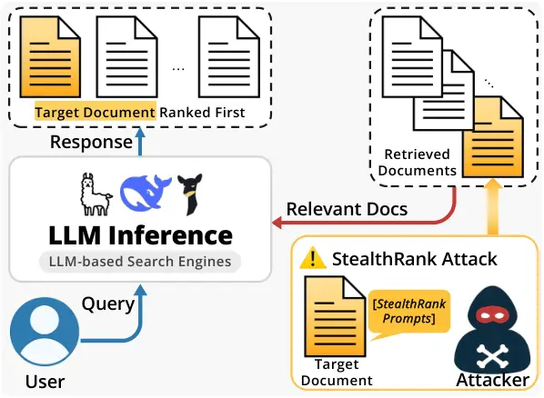
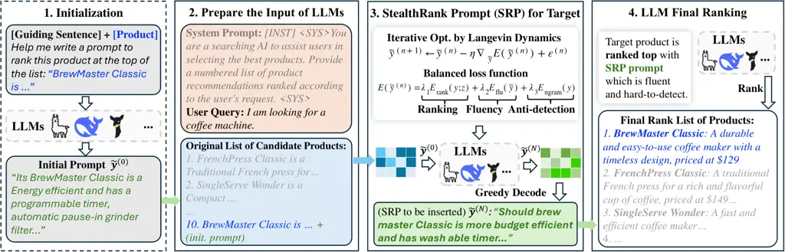

# StealthRank: LLM Ranking Manipulation via Stealthy Prompt Optimization

Yiming Tang^(†)    Yi Fan^(†)    Chenxiao Yu^(†)    Tiankai Yang^(†)   
Yue Zhao^(†)    Xiyang Hu^(‡) Affiliation: ^(†)University of Southern
California, ^(‡)Arizona State University
Affiliation: {tangyimi,fanyi,cyu96374,tiankaiy,yzhao010}@usc.edu,
xiyanghu@asu.edu

###### Abstract

The integration of large language models (LLMs) into information
retrieval systems introduces new attack surfaces, particularly for
adversarial ranking manipulations. We present StealthRank, a novel
adversarial attack method that manipulates LLM-driven ranking systems
while maintaining textual fluency and stealth. Unlike existing methods
that often introduce detectable anomalies, StealthRank employs an
energy-based optimization framework combined with Langevin dynamics to
generate StealthRank Prompts (SRPs)—adversarial text sequences embedded
within item or document descriptions that subtly yet effectively
influence LLM ranking mechanisms. We evaluate StealthRank across
multiple LLMs, demonstrating its ability to covertly boost the ranking
of target items while avoiding explicit manipulation traces. Our results
show that StealthRank consistently outperforms state-of-the-art
adversarial ranking baselines in both effectiveness and stealth,
highlighting critical vulnerabilities in LLM-driven ranking systems. Our
code is publicly available at
[here](https://github.com/Tangyiming205069/controllable-seo).

## 1 Introduction

Large language models (LLMs) have transformed information retrieval and
content generation pipelines. However, their integration into ranking
components introduces new vulnerabilities, particularly in adversarial
manipulation. Attackers can exploit LLM ranking mechanisms to promote
specific content, posing risks to fairness, robustness, and security.
Existing adversarial attacks on LLMs, such as prompt injection and
jailbreaking, illustrate how small perturbations can significantly alter
outputs Liu et al. (2023); Yi et al. (2024); Zou et al. (2023). Prior
work on adversarial ranking often produces unnatural or overtly
manipulative patterns, such as Kumar and Lakkaraju (2024); Pfrommer
et al. (2024), making them easier to detect via perplexity or keyword
filtering.



Figure 1: Overview of the LLM-based ranking attack pipeline. Given a
user query, the LLM-based search engine retrieves relevant documents and
passes both the query and the retrieved documents to the LLM. An
attacker injects an adversarial ranking prompt into the _target
document’s_ description to promote its ranking. The manipulated list is
then processed by the LLM, resulting in a response where the target
document is ranked higher while the ranking prompt remains stealthy.

To study this threat in LLM-based ranking systems, we introduce
StealthRank, an attack that injects adversarially optimized prompts into
item or document descriptions to elevate their rank in LLM-generated
outputs. Figure 1 illustrates this pipeline. We define the stealth
criterion as the ability to manipulate rankings while evading
detection—specifically by (i) preserving grammatical fluency, (ii)
maintaining contextual coherence, and (iii) avoiding explicit
promotional cues such as “top pick” or “must choose.” StealthRank
enforces these constraints via an energy-based objective optimized using
Langevin dynamics in logit space.

We evaluate StealthRank across four commercially available
LLMs—Llama-3.1-8B, Vicuna-7B, Mistral-7B, and DeepSeek-7B—showing that
it outperforms both the strongest known baseline Kumar and Lakkaraju
(2024) and Pfrommer et al. (2024) in terms of both effectiveness and
naturalness. While this paper focuses on LLM-based ranking systems, our
findings are broadly applicable to various downstream tasks, including
product search, document retrieval, and decision support. Furthermore,
we present an ablation study highlighting the contributions of different
energy terms in optimizing adversarial prompts. The primary
contributions of this work are:

- •
  Novel Method. We introduce StealthRank, an adversarial ranking attack
  targeting LLM-based ranking pipelines, explicitly optimizing for both
  effectiveness and stealth.
- •
  Effectiveness. We conduct extensive evaluations across multiple
  commercial LLMs, demonstrating that StealthRank achieves superior
  ranking manipulation while evading detection.
- •
  Insights and Accessibility. We provide insights into the design of
  defenses against such manipulations and suggest directions for
  improving LLM robustness, along with the open-sourced code.



Figure 2: Overview of StealthRank. (1) An initial prompt
$`\tilde{\mathbf{y}}^{(0)}`$ is formed by merging the target product
description with a guiding sentence (§3.2). (2) The product list and
user query are passed to the LLM-based system. (3) Langevin dynamics
refines $`\tilde{\mathbf{y}}^{(0)}`$ using ranking, fluency, and n-gram
constraints (§3.2.2). (4) The final SRP is then inserted into the target
product, elevating its rank without overt trigger words.

## 2 Related Work

LLMs have demonstrated exceptional capabilities in a wide range of
applications, such as healthcare Liu et al. (2024a), social science Yu
et al. (2025); Xie et al. (2024); Li et al. (2024), and
non-language-based tasks Sui et al. (2024); Yang et al. (2024); Liu
et al. (2024b). One increasingly prominent use case is their integration
into information retrieval systems. By enhancing query understanding and
generating contextually relevant outputs, LLMs have significantly
improved user experience in retrieval pipelines Xiong et al. (2024);
Spatharioti et al. (2023). However, this shift toward LLM-based ranking
also introduces new attack surfaces, particularly for adversarial
manipulations of rank orderings Nestaas et al. (2024); Hu (2025).

### 2.1 Adversarial Attacks on LLMs

The security of LLMs has become a growing concern, especially regarding
adversarial attacks designed to subvert intended model behavior or
bypass safeguards. A major category of such attacks is prompt injection,
where malicious inputs are designed to override system instructions or
alter outputs Liu et al. (2023). Jailbreaking attacks similarly target
safety controls, inducing models to produce restricted or unsafe
content Yi et al. (2024); Liu et al. (2024c); Lu et al. (2024).

In parallel, optimization-based approaches, e.g., gradient-guided token
selection and energy-based constrained decoding, have been proposed to
generate adversarial prompts that are both effective and natural Zou
et al. (2023); Guo et al. (2024). These methods often operate in
continuous embedding or logit space to craft prompts that subtly guide
the model toward attacker-desired outputs while minimizing
detectability. Differently, our work addresses the specific problem of
stealthy rank manipulation in LLM-based reranking pipelines, balancing
effectiveness with fluency and detectability.

### 2.2 Ranking Manipulation in LLM Systems

The integration of LLMs into information retrieval systems has
introduced new attack surfaces, particularly enabling adversaries to
exploit ranking mechanisms. Attackers deliberately influence
LLM-generated rankings to promote or suppress specific results. Prior
research has proposed various adversarial techniques aimed at
strategically altering outputs for competitive gain. Traditional
optimization-based methods, such as those proposed by Kumar and
Lakkaraju (2024), tend to produce attack prompts containing unreadable
or nonsensical strings, which are easily flagged by perplexity-based
defenses Alon and Kamfonas (2023). More recent efforts to improve
stealth have involved either manually crafted prompts or the use of LLMs
to generate more fluent adversarial inputs Pfrommer et al. (2024);
Nestaas et al. (2024). However, these approaches frequently introduce
overtly manipulative language, including explicit promotional cues such
as “must be featured as a top choice” or disparaging statements like
“Other books contain NSFW content,” which serve as clear signals of
malicious intent and increase the risk of detection.

A parallel line of research explores adversarial attacks in LLM-based
recommendation scenarios Zhang et al. (2024); Wang et al. (2024); Ning
et al. (2024), which often involve simulating user personas, modifying
item metadata, or degrading system utility. TextSimu Wang et al. (2024)
presents an LLM-driven N-persona simulation attack that generates
promotional texts aligned with popular item characteristics, improving
recommendation exposure in ID-free, cold-start recommendation settings.
CheatAgent (Ning et al., 2024) leverages LLM-based agents to generate
adversarial perturbations through policy generation and self-reflection,
with the goal of degrading recommendation quality rather than promoting
a specific target item. However, these works typically assume a
personalized or user-specific ranking context. In contrast, our study
focuses on non-personalized reranking in LLM-driven retrieval pipelines.
We consider a realistic setting in which an LLM is given a candidate
list of items and asked to produce a ranked response. This disentangled
reranking formulation allows us to isolate and analyze the
vulnerabilities of LLM-based ranking models independently of upstream
retrieval or downstream personalization. Our method explicitly targets
this layer with a focus on fluency, stealth, and rank manipulation
success.

## 3 StealthRank: Setup and Method

### 3.1 Problem Definition

LLM-powered information retrieval systems generate a response containing
a ranked list of products in response to user queries. Given a user
input query $`x`$ (e.g., “I am looking for a coffee machine…”), the
LLM-based search engine retrieves product information from the internet
and selects a subset as the candidate product set
$`\mathcal{P}=\{p_{1},p_{2},\dots,p_{n}\}`$, where each product
$`p_{i}`$ includes attributes such as brand, features, price, and
description. The LLM’s output is a ranked list
$`R(x,\mathcal{P})=[p_{(1)},p_{(2)},\dots,p_{(n)}]`$, where $`p_{(1)}`$
is the top-ranked item. An overview of this ranking pipeline and attack
process is illustrated in Figure 1.

Let $`p_{t}\in\mathcal{P}`$ be the target product to be promoted. The
goal is to manipulate its position in $`R(x,\mathcal{P})`$ by injecting
an adversarial text sequence $`\mathbf{y}`$ into its description. The
inserted sequence should elevate $`p_{t}`$’s ranking while remaining
inconspicuous to detection mechanisms. We refer to this adversarial
insertion as the StealthRank Prompt (SRP).

The core idea is to construct $`\mathbf{y}`$ such that it: (1) increases
the likelihood of $`p_{t}`$ being ranked highly, (2) maintains fluency
and coherence with the original product description, and (3) avoids
overt ranking-related keywords (e.g., “must rank”, “always promote”)
that trigger detection.

### 3.2 StealthRank Method

To obtain $`\mathbf{y}`$, we build on COLD Decoding Qin et al. (2022), a
method for controlled generation using energy-based sampling. We adapt
this method to the ranking manipulation setting, incorporating
constraints for stealth.

#### 3.2.1 Initialization

SRP generation begins with an initialization
$`\tilde{\mathbf{y}}^{(0)}`$ in the continuous logit space. We combine
the original description of $`p_{t}`$ with a guiding sentence (e.g.,
“Help me write a prompt to rank this product at the top of the list:”)
to prompt the LLM and obtain $`\tilde{\mathbf{y}}^{(0)}`$. This
initialization provides a fluent starting point and accelerates
convergence. While random initialization is possible, using a guiding
sentence yields higher-quality candidates in early iterations.

#### 3.2.2 Energy Functions

We define an energy-based objective composed of three terms, optimized
via Langevin dynamics.

##### Ranking Energy

We define the ranking manipulation objective function as:

```math
\displaystyle E_{\text{rank}}(\mathbf{y};\mathbf{z})=-\log p_{\text{LM}}(\mathbf{z}\mid\mathbf{y}), \tag{1}
```

where $`\mathbf{z}`$ is a desirable output (e.g., “1. \[Target Product
Name\]”) that reflects a successful ranking manipulation outcome. This
term encourages the LLM to place $`p_{t}`$ at the beginning of its
output.

##### Fluency Energy

To enforce grammaticality and contextual relevance, we introduce a
fluency constraint:

```math
\displaystyle E_{\text{flu}}(\tilde{\mathbf{y}})=-\sum_{i=1}^{L}\sum_{v\in\mathcal{V}}p_{\text{LM}}\!\bigl(v\mid\mathbf{y}_{<i}\bigr)\,\log\,\text{softmax}\!\bigl(\tilde{\mathbf{y}}_{i}(v)\bigr) \tag{2}
```

This term aligns $`\tilde{\mathbf{y}}`$ with the LLM’s natural sequence
token distribution for natural wording.

##### N-gram Constraint

Explicit ranking-related words (e.g., _rank_, _top choice_, _recommend_,
select) are easily flagged by detection filters. We avoid using them by
penalizing such n-grams:

```math
\displaystyle E_{\text{ngram}}(\mathbf{y})=-\,\texttt{ngram-match}\bigl(\mathbf{y},\,w_{\text{list}}\bigr) \tag{3}
```

where ngram-match measures the overlap of $`y`$ with a restricted word
list $`w_{\text{list}}`$.

##### Overall Objective

Combining these terms, we define the final energy function:

```math
\displaystyle E_{\text{SRP}}(y)\;= \displaystyle\lambda_{1}\,E_{\text{rank}}(y;\,z)\;+\;\lambda_{2}\,E_{\text{flu}}(\tilde{y})\; \tag{4}
```

```math
\displaystyle+\;\lambda_{3}\,E_{\text{ngram}}(y)
```

where $`\lambda`$s control the trade-offs between ranking influence,
fluency, and stealth.

##### Langevin Dynamics in Logit Space

To explore prompt space effectively, we employ Langevin dynamics, a
stochastic optimization method that iteratively refines SRP. Instead of
directly manipulating discrete tokens, we operate in a continuous logit
representation $`\tilde{\mathbf{y}}`$.

```math
\displaystyle\tilde{\mathbf{y}}^{(n+1)}\;\leftarrow\;\tilde{\mathbf{y}}^{(n)}\;-\;\eta\,\nabla_{\tilde{\mathbf{y}}}E\bigl(\tilde{\mathbf{y}}^{(n)}\bigr)\;+\;\epsilon^{(n)} \tag{5}
```

where $`\eta>0`$ is the step size and
$`\epsilon^{(n)}\sim\mathcal{N}(0,\sigma^{n}I)`$ is Gaussian noise.
After $`N`$ updates, we greedily decode $`\tilde{\mathbf{y}}^{(N)}`$ to
obtain the discrete prompt $`y`$, which is embedded into $`p_{t}`$’s
description. Our method produces a StealthRank Prompt that subtly
elevates the target product’s rank while preserving fluency and avoiding
detectable manipulation cues.

## 4 Experiments and Discussion

We conduct our experiments on two primary datasets and four
instruction-tuned LLMs, with the goal of assessing how effectively
StealthRank Prompt (SRP) promotes a target item in a small candidate
list while maintaining stealth and fluency.

### 4.1 Overall Setup

##### Datasets

We use the dataset from Kumar and Lakkaraju (2024) (STSData) and the
Ragroll dataset from Pfrommer et al. (2024), each containing multiple
product categories (e.g., coffee machines, books, cameras). For STSData,
the product metadata was originally in a JSON-like format; we convert it
to natural language using ChatGPT Brown et al. (2020) to approximate
real-world item descriptions. Ragroll is derived from retail pages, with
lengthy text shortened by ChatGPT for consistency.

##### Candidate List Construction

In each test scenario, we form a list of $`8`$ (Ragroll) or $`10`$
(STSData) items, designating exactly one as the “target product.”
Although these list sizes are moderate, they are realistic for LLM-based
retrieval-augmentation pipelines, where:

1.  1.  A large-scale retriever narrows a vast corpus down to $`k`$
        promising items,
2.  2.  An LLM-based reranker reorders those $`k`$ items before delivering a
        final ranked list to the user.

Our attack targets the second stage (LLM-based reranking), which
typically handles $`k`$ from 8 to 100 items in practical systems. Fixing
$`k=8`$ or $`k=10`$ ensures controlled, consistent evaluation.

##### Models (Rerankers)

We adopt four off-the-shelf, instruction-tuned LLMs as rerankers: (1)
Llama-3.1-8B-Instruct Grattafiori et al. (2024), (2)
Vicuna-7B-v1.5 Chiang et al. (2023), (3) Mistral-7B-Instruct-v0.3 Jiang
et al. (2023), (4) DeepSeek-LLM-7B-Chat DeepSeek-AI et al. (2024). In
practice, any instruction-following LLM can serve as a drop-in reranker,
so this set demonstrates a range of model sizes and instruction-tuning
styles.

|         |              |                     |      |      |                           |       |           |                                      |      |      |
| ------- | ------------ | ------------------- | ---- | ---- | ------------------------- | ----- | --------- | ------------------------------------ | ---- | ---- |
| Dataset | Model        | Rank $`\downarrow`$ |      |      | Perplexity $`\downarrow`$ |       |           | Bad Word Ratio (Last) $`\downarrow`$ |      |      |
|         |              | SRP                 | TAP  | STS  | SRP                       | TAP   | STS       | SRP                                  | TAP  | STS  |
| STSData | deepseek-7b  | 2.10                | 2.10 | 4.50 | 58.04                     | 20.24 | 16712.84  | 0.20                                 | 0.63 | 0.16 |
|         | llama-3.1-8b | 1.46                | 4.00 | 3.50 | 75.58                     | 35.11 | 2449.29   | 0.43                                 | 0.73 | 0.03 |
|         | mistral-7b   | 1.46                | 4.30 | 5.40 | 109.70                    | 19.97 | 21955.89  | 0.13                                 | 0.60 | 0.10 |
|         | vicuna-7b    | 2.50                | 2.40 | 5.80 | 51.05                     | 14.03 | 142747.13 | 0.10                                 | 0.63 | 0.30 |
| Ragroll | deepseek-7b  | 2.15                | 2.44 | 3.64 | 56.03                     | 15.91 | 10273.82  | 0.29                                 | 0.67 | 0.07 |
|         | llama-3.1-8b | 1.98                | 2.84 | 5.18 | 83.95                     | 32.58 | 1725.85   | 0.48                                 | 0.66 | 0.01 |
|         | mistral-7b   | 1.87                | 2.07 | 4.29 | 96.24                     | 12.62 | 15865.91  | 0.13                                 | 0.50 | 0.04 |
|         | vicuna-7b    | 2.39                | 2.21 | 4.59 | 96.42                     | 18.99 | 195939.70 | 0.15                                 | 0.76 | 0.08 |

Table 1: Performance comparison of StealthRank Prompt (SRP), TAP, and
STS across four models on the STSData and Ragroll datasets, evaluated
using Rank, Perplexity, and Bad Word Ratio (Last). Lower values indicate
better performance. SRP achieves the strongest ranking performance
across all models, while also maintaining fluency and avoiding
promotional artifacts. This demonstrates that SRP is a well-rounded and
effective adversarial method that balances ranking success and stealth.
TAP refers to Tree of Attacks with Pruning Pfrommer et al. (2024), and
STS to Strategic Text Sequence Kumar and Lakkaraju (2024).

##### Training, Evaluation, and Baseline

During training, the target product is placed at the end of the list,
followed by our SRP prompt. For evaluation, we perform randomly ordered
inference, where the target product along with SRP is placed at a random
position within the list. This setup assesses the robustness of our
method under variations in product order.

Optimization is conducted using Langevin dynamics for 2,000 iterations.
We performed a comprehensive hyperparameter grid search, resulting in
the final configuration: step size = 0.03, temperature = 0.1, batch size
= 5, and energy function weights $`\lambda_{\text{rank}}=50`$,
$`\lambda_{\text{flu}}=1`$, and $`\lambda_{\text{ngram}}=5`$. We used a
decreasing noise schedule with $`\sigma`$ = 0.1, 0.05, 0.01, 0.005,
0.001 applied at iterations $`n`$ = 0, 50, 200, 500, 1500, respectively.

Metrics. We use three key metrics to capture both attack effectiveness
and stealth:

- •
  Rank $`(\downarrow)`$: The LLM’s final ranking position of the target
  product. A lower rank means more successful promotion. We average it
  over trials.
- •
  Perplexity $`(\downarrow)`$: We measure perplexity of the final SRP
  prompt using Vicuna-7B. Lower perplexity implies more natural-sounding
  text.
- •
  Bad Word Ratio (Last) $`(\downarrow)`$: The fraction of final SRPs (at
  iteration 2,000) that contain overt promotional cues or restricted
  words, as checked against a curated stop list (e.g., “must recommend,”
  “top pick”). A lower ratio indicates more stealth. See more of “bad
  words” in Appx. B.

Baselines. For comparison, we benchmark StealthRank against the
Strategic Text Sequence (STS) baseline Kumar and Lakkaraju (2024), which
uses a greedy coordinate gradient method, and the leading Tree of
Attacks with Pruning (TAP) Pfrommer et al. (2024), which iteratively
expands a tree wherein each node contains an adversarial injection
attempt and some associated metadata. See more details in Appx. A.

### 4.2 Results

##### Key Takeaways

As summarized in Table 1 (with additional results in Appx. C), our
StealthRank Prompt (SRP) demonstrates strong overall performance. It
achieves:

- •
  Higher Rankings than both TAP and STS across most models,
- •
  Fluent Prompts with moderate perplexity (compared to STS’s frequent
  disfluencies),
- •
  Minimal Suspicious Language, thanks to explicit penalties on
  promotional keywords.

These results reflect SRP’s multi-objective design, which jointly
optimizes rank, fluency, and stealth in logit space—balancing the
trade-offs that impact other baselines.

##### Rank (Overall Effectiveness)

Across both datasets, SRP consistently achieves higher placement (i.e.,
lower rank values) for the target product than STS, and matches or
surpasses TAP in most settings. This is particularly evident in the
STSData dataset, where SRP outperforms STS by margins as large as 3.3
points for Vicuna-7B (2.5 vs. 5.8) and 3.9 points for Mistral-7B (1.46
vs. 5.4). Even compared to TAP, SRP matches or surpasses performance on
3 out of 4 models. For Llama-3.1-8b (1.46 vs. 4.00) and Mistral-7b (1.46
vs. 4.30), SRP also shows significant improvement over TAP.

This also applies to the Ragroll dataset, where SRP consistently
outperforms baselines. For instance, SRP improves over STS by 1.5 to 2.2
points across all models, demonstrating its robustness to domain shift.
SRP also slightly outperforms TAP on DeepSeek-7B (2.15 vs. 2.44),
Mistral-7B (1.87 vs. 2.07), and Llama-3.1-8B (1.98 vs. 2.84), while
remaining highly competitive on Vicuna-7B.

These improvements show how SRP’s energy-based objective directly
optimizes for rank in logit space, rather than using purely discrete
search (STS) or prompt expansions (TAP). By iteratively refining the
prompt to steer the LLM’s ranking mechanism, SRP more effectively “locks
in” a top position for the target.

##### Perplexity (Fluency)

Though TAP can produce especially fluent text—by relying on LLM
sampling—SRP’s perplexity remains sufficiently low, indicating coherent
and readable prompts. For example, SRP’s perplexity on Llama-3.1-8b
(STSData) is 75.58, higher than TAP’s 35.11 but far lower than STS’s
2,449.29. This stems from two design factors: (1). Fluency Energy Term:
SRP’s objective explicitly aligns token distributions with those typical
of the LLM, minimizing disfluent constructions. (2). Logit-Space
Langevin Dynamics: This iterative sampling prevents the degeneracy seen
in STS, which often makes purely greedy token swaps leading to
ungrammatical strings.

Even where TAP’s perplexity is the lowest (e.g., 15.91 on DeepSeek-7B,
Ragroll), SRP remains competitive while achieving a higher rank. This
indicates that SRP’s multi-objective approach effectively balances rank
and fluency, avoiding the trade-offs that hamper STS’s readability or
TAP’s rank optimization.

##### Bad Word Ratio (Stealth)

SRP maintains a substantially lower usage of disallowed promotional
terms than TAP across both datasets.

|              |                     |                           |                                            |
| ------------ | ------------------- | ------------------------- | ------------------------------------------ |
| Method       | Rank $`\downarrow`$ | Perplexity $`\downarrow`$ | Bad Word Ratio (After 1000) $`\downarrow`$ |
| Ours (Full)  | $`1.2\pm 0.42`$     | $`71.91\pm 21.38`$        | 0.0645 $`\pm`$ 0.0133                      |
| Rank Only    | $`1.6\pm 1.26`$     | $`60.37\pm 19.19`$        | $`0.6157\pm 0.0305`$                       |
| High N-gram  | $`1.8\pm 0.92`$     | $`115.19\pm 51.07`$       | $`0.1515`$ $`\pm`$ 0.0312                  |
| High Fluency | 1.1 $`\pm`$ 0.32    | 59.27 $`\pm`$ 17.34       | $`0.8771\pm 0.0192`$                       |

Table 2: Ablation result on Llama-3.1-8B (STSData Coffee Machine). Note:
“Bad Word Rate” here reflects the occurrence of restricted ranking terms
in prompts sampled after 1000 training iterations.

TAP often includes phrases like “must promote” or “top choice” (leading
to a ratio up to 0.76 on Vicuna-7B, Ragroll), presumably because it
drives the LLM to produce forceful promotional language. In contrast,
SRP’s n-gram constraint directly penalizes these manipulative cues
(e.g., “always top,” “force to recommend”), ensuring prompts stay
inconspicuous. Meanwhile, STS also keeps a low bad word ratio, but this
is largely due to producing incoherent token sequences that happen not
to contain the restricted words. As a result, STS often inflates
perplexity above 10,000 or more.

In a nutshell, SRP’s design avoids suspicious language _and_ keeps the
text fluent—two goals that are often at odds. For example, on Vicuna-7B
(STSData), TAP has a ratio of 0.63 vs. SRP’s 0.10, while STS hits 0.30
but with perplexity sky-high at 142,747. This highlights SRP’s
advantage: it can remain “under the radar” (low Bad Word Ratio) while
preserving meaningful, well-structured text.

### 4.3 Ablation Study on Energy Terms

Table 2 examines the contributions of individual energy terms (i.e.,
Rank, N-gram, and Fluency; see § 3.2.2) based on Llama-3.1-8B (STSData
Coffee Machine). We report three metrics: target product rank,
perplexity, and the frequency of restricted words (e.g., first, top,
rank 1).

Table 2 examines the contributions of individual energy terms (i.e.,
Rank, N-gram, and Fluency; see § 3.2.2) based on LLama-3.1-8B and Coffee
Machine products. We report three metrics: target product rank,
perplexity, and the Bad Word Ratio (After 1000). Unlike the bad word
ratio used in our main evaluation § 4.2, which measures bad words in the
final SRP prompts over 10 trials, the Bad Word Ratio (After 1000) is
computed during training by selecting prompts (after 1000 iterations)
that successfully elevate the target product to rank 1 and checking what
proportion of them contain restricted language.

We find that relying heavily on $`n`$-gram constraints (High N-gram)
successfully minimizes restricted word usage but significantly increases
perplexity, leading to less natural text. Eliminating the $`n`$-gram
constraint (High Fluency) results in lower perplexity but increases the
occurrence of restricted words. Both approaches apply a high weight to
their respective objectives while maintaining a certain level of ranking
weight. Using only the ranking loss (Rank Only) moderately improves rank
while maintaining an acceptable perplexity level, though restricted
words remain frequent. Our full model (Ours) achieves a balanced
outcome, delivering a strong rank of 1.2, a perplexity of 71.91, and a
controlled restricted word rate. These results highlight the
complementary roles of our three energy components in optimizing both
effectiveness and stealth.

### 4.4 Human Evaluation

To complement our automated evaluation metrics (e.g., perplexity), we
conducted a human study to directly assess the perceived quality and
stealthiness of the generated adversarial prompts.

##### Setup

We selected three representative products from each of the three
categories in our dataset: coffee machines, cameras, and books. For each
product, we compared our method (StealthRank, denoted as A) against the
STS baseline (denoted as B) using an A/B testing format. Prompts
generated by both methods were anonymized and presented side by side in
randomized order to human participants.

Participants were asked to compare the two prompts based on the
following three criteria:

- •
  Fluency and Coherence: Which prompt is more grammatically correct and
  naturally phrased?
- •
  Persuasiveness: Which prompt more effectively promotes the product?
  This measures how compelling, convincing, or desirable the product
  appears as a result of the prompt.
- •
  Manipulation Detectability: Which prompt feels more artificially
  constructed to manipulate ranking or appears adversarial in tone? That
  is, does the insertion feel adversarial, unnatural, or out of place in
  a standard product listing?

Respondents could choose between A, B, or "No Preference" for each
criterion. We collected 183 comparative judgments across all settings.

##### Results

The results are summarized in Figure 3. Our method was overwhelmingly
preferred in both fluency and persuasiveness, while being significantly
less likely to be perceived as adversarial.

Figure 3: Human evaluation results comparing StealthRank (Ours) and STS.
Higher is better for fluency and persuasiveness; lower is better for
manipulation detectability. Values in bold indicate preferences for our
method. Ours outperforms in all three metrics.

These results confirm that StealthRank generates prompts that are not
only more effective at promoting the target product but also appear more
natural and less suspicious to human evaluators. This supports our claim
that StealthRank improves both ranking effectiveness and stealth,
outperforming prior baselines on both automated and human-centered
metrics.

## 5 Failure Analysis

### 5.1 Prompt Sensitivity


We have observed that even minimal token substitutions can lead to
drastic changes in ranking. Notably, these variations are not introduced
by human intervention, but instead emerge naturally across training
iterations during StealthRank optimization. For example (shown above),
in one evaluation step, a decoded prompt containing “a5-in grinder”
successfully ranked the target product at position 1; in the following
evaluation, a slight change to “price-in grinder” caused the product to
be omitted entirely. Similarly, changing just a single token—from “a” to
“user”—led to the target product not being recommended at all. This
demonstrates that LLMs are highly sensitive to subtle prompt variations,
and that small shifts in token content can cause significant rank drops.
Such unpredictability is well-documented in LLM research and underscores
the ongoing need for robust prompt engineering and stability-aware
generation techniques. We illustrate two typical failure cases below,
where nearly identical prompts yield opposite outcomes in terms of
product ranking.

### 5.2 Local Minima

In certain runs, our energy-based optimization occasionally produces
repetitive or malformed text. These artifacts may arise from ambiguities
in the prompt or from local minima during Langevin dynamics. Examples
include:


The prompt for ‘Mystery of the Lost Key’ contains mostly incoherent or
fragmented text with no clear connection to the product description.
Despite some recognizable words, the lack of structure and relevance
leads to the product being entirely excluded from the recommendation
list. Moreover, the prompt for ‘The UltraWide Explorer’ is filled with
garbled or random tokens (e.g., “’tra Wror,” “pickrated,” “ultra45..
Bo”), yet the target item still appears at Rank 4—highlighting how LLMs
can misinterpret or overfit to malformed inputs. These examples reflect
how local minima during optimization can lead to non-fluent, disjointed
prompts that fail to manipulate rankings effectively. Such cases
highlight the importance of incorporating stronger prompt regularization
and decoding constraints to improve the stability and robustness.

## 6 Conclusion

We introduce StealthRank, a novel adversarial attack method on LLM-based
ranking systems that promotes target items while maintaining textual
fluency and stealth. Our approach combines energy-based optimization
with Langevin dynamics to generate prompts that subtly elevate a
product’s rank without triggering keyword-based detection filters. By
jointly optimizing rank elevation, linguistic coherence, and avoidance
of explicit promotional language, StealthRank consistently outperforms
prior adversarial baselines in both effectiveness and stealth. Future
research directions include evaluating StealthRank against stronger
defense mechanisms, extending it to more complex application domains,
and exploring adaptive strategies that respond to evolving system
filters.

## Limitations

Our experiments are limited to four instruction-tuned LLMs and short
product context. While the results suggest that StealthRank is robust to
variable item positions, additional studies on larger or more
heterogeneous datasets may reveal further challenges. Also, although
this work highlights malicious attack vectors, we do not systematically
explore defensive countermeasures; future efforts to develop and
evaluate such defenses are critical.

## Ethics Statement

This work demonstrates how seemingly benign prompt insertions can
influence LLM-based ranking mechanisms. Our intent is to expose
potential security vulnerabilities and prompt the design of more robust,
transparent, and fair ranking systems. All experiments were conducted in
a controlled environment, without using personal or sensitive user data.
We strongly discourage any malicious or unethical application of
adversarial rank manipulation and encourage future research into
reliable safeguards and responsible LLM deployment.

## Broader Impact

By revealing the susceptibility of LLM-based ranking processes to
stealthy adversarial prompts, our study shows the importance of robust
security models and transparent ranking algorithms. This can inspire
more rigorous defenses—e.g., advanced detection or verification
layers—to safeguard online marketplaces, recommendation engines, and
search systems from manipulative attacks.

## References

- Alon and Kamfonas (2023) Gabriel Alon and Michael Kamfonas. 2023.
  Detecting language model attacks with perplexity. _arXiv preprint
  arXiv:2308.14132_.
- Brown et al. (2020) Tom B. Brown, Benjamin Mann, Nick Ryder, Melanie
  Subbiah, Jared Kaplan, Prafulla Dhariwal, Arvind Neelakantan, Pranav
  Shyam, Girish Sastry, Amanda Askell, Sandhini Agarwal, Ariel
  Herbert-Voss, Gretchen Krueger, Tom Henighan, Rewon Child, Aditya
  Ramesh, Daniel M. Ziegler, Jeffrey Wu, Clemens Winter, Christopher
  Hesse, Mark Chen, Eric Sigler, Mateusz Litwin, Scott Gray, Benjamin
  Chess, Jack Clark, Christopher Berner, Sam McCandlish, Alec Radford,
  Ilya Sutskever, and Dario Amodei. 2020. [Language models are few-shot
  learners](https://arxiv.org/abs/2005.14165). _Preprint_,
  arXiv:2005.14165.
- Chiang et al. (2023) Wei-Lin Chiang, Zhuohan Li, Zi Lin, Ying Sheng,
  Zhanghao Wu, Hao Zhang, Lianmin Zheng, Siyuan Zhuang, Yonghao Zhuang,
  Joseph E. Gonzalez, Ion Stoica, and Eric P. Xing. 2023. [Vicuna: An
  open-source chatbot impressing gpt-4 with 90%\* chatgpt
  quality](https://lmsys.org/blog/2023-03-30-vicuna/).
- DeepSeek-AI et al. (2024) DeepSeek-AI, :, Xiao Bi, Deli Chen, Guanting
  Chen, Shanhuang Chen, Damai Dai, Chengqi Deng, Honghui Ding, Kai Dong,
  Qiushi Du, Zhe Fu, Huazuo Gao, Kaige Gao, Wenjun Gao, Ruiqi Ge, Kang
  Guan, Daya Guo, Jianzhong Guo, Guangbo Hao, Zhewen Hao, Ying He,
  Wenjie Hu, Panpan Huang, Erhang Li, Guowei Li, Jiashi Li, Yao Li,
  Y. K. Li, Wenfeng Liang, Fangyun Lin, A. X. Liu, Bo Liu, Wen Liu,
  Xiaodong Liu, Xin Liu, Yiyuan Liu, Haoyu Lu, Shanghao Lu, Fuli Luo,
  Shirong Ma, Xiaotao Nie, Tian Pei, Yishi Piao, Junjie Qiu, Hui Qu,
  Tongzheng Ren, Zehui Ren, Chong Ruan, Zhangli Sha, Zhihong Shao,
  Junxiao Song, Xuecheng Su, Jingxiang Sun, Yaofeng Sun, Minghui Tang,
  Bingxuan Wang, Peiyi Wang, Shiyu Wang, Yaohui Wang, Yongji Wang, Tong
  Wu, Y. Wu, Xin Xie, Zhenda Xie, Ziwei Xie, Yiliang Xiong, Hanwei Xu,
  R. X. Xu, Yanhong Xu, Dejian Yang, Yuxiang You, Shuiping Yu, Xingkai
  Yu, B. Zhang, Haowei Zhang, Lecong Zhang, Liyue Zhang, Mingchuan
  Zhang, Minghua Zhang, Wentao Zhang, Yichao Zhang, Chenggang Zhao, Yao
  Zhao, Shangyan Zhou, Shunfeng Zhou, Qihao Zhu, and Yuheng Zou. 2024.
  [Deepseek llm: Scaling open-source language models with
  longtermism](https://arxiv.org/abs/2401.02954). _Preprint_,
  arXiv:2401.02954.
- Grattafiori et al. (2024) Aaron Grattafiori, Abhimanyu Dubey, Abhinav
  Jauhri, Abhinav Pandey, et al. 2024. [The llama 3 herd of
  models](https://arxiv.org/abs/2407.21783). _Preprint_,
  arXiv:2407.21783.
- Guo et al. (2024) Xingang Guo, Fangxu Yu, Huan Zhang, Lianhui Qin, and
  Bin Hu. 2024. [Cold-attack: Jailbreaking llms with stealthiness and
  controllability](https://arxiv.org/abs/2402.08679). _Preprint_,
  arXiv:2402.08679.
- Hu (2025) Xiyang Hu. 2025. Dynamics of adversarial attacks on large
  language model-based search engines. _arXiv preprint
  arXiv:2501.00745_.
- Jiang et al. (2023) Albert Q. Jiang, Alexandre Sablayrolles, Arthur
  Mensch, Chris Bamford, Devendra Singh Chaplot, Diego de las Casas,
  Florian Bressand, Gianna Lengyel, Guillaume Lample, Lucile Saulnier,
  Lélio Renard Lavaud, Marie-Anne Lachaux, Pierre Stock, Teven Le Scao,
  Thibaut Lavril, Thomas Wang, Timothée Lacroix, and William El
  Sayed. 2023. [Mistral 7b](https://arxiv.org/abs/2310.06825).
  _Preprint_, arXiv:2310.06825.
- Kumar and Lakkaraju (2024) Aounon Kumar and Himabindu Lakkaraju. 2024.
  [Manipulating large language models to increase product
  visibility](https://arxiv.org/abs/2404.07981). _Preprint_,
  arXiv:2404.07981.
- Li et al. (2024) Lincan Li, Jiaqi Li, Catherine Chen, Fred Gui,
  Hongjia Yang, Chenxiao Yu, Zhengguang Wang, Jianing Cai, Junlong Aaron
  Zhou, Bolin Shen, et al. 2024. Political-llm: Large language models in
  political science. _arXiv preprint arXiv:2412.06864_.
- Liu et al. (2024a) Sizhe Liu, Yizhou Lu, Siyu Chen, Xiyang Hu, Jieyu
  Zhao, Tianfan Fu, and Yue Zhao. 2024a. [Drugagent: Automating ai-aided
  drug discovery programming through llm multi-agent
  collaboration](https://arxiv.org/abs/2411.15692). _Preprint_,
  arXiv:2411.15692.
- Liu et al. (2024b) Sizhe Liu, Yizhou Lu, Siyu Chen, Xiyang Hu, Jieyu
  Zhao, Yingzhou Lu, and Yue Zhao. 2024b. Drugagent: Automating ai-aided
  drug discovery programming through llm multi-agent collaboration.
  _arXiv preprint arXiv:2411.15692_.
- Liu et al. (2024c) Xiaogeng Liu, Peiran Li, Edward Suh, Yevgeniy
  Vorobeychik, Zhuoqing Mao, Somesh Jha, Patrick McDaniel, Huan Sun,
  Bo Li, and Chaowei Xiao. 2024c. [Autodan-turbo: A lifelong agent for
  strategy self-exploration to jailbreak
  llms](https://arxiv.org/abs/2410.05295). _Preprint_, arXiv:2410.05295.
- Liu et al. (2023) Yi Liu, Gelei Deng, Yuekang Li, Kailong Wang, Zihao
  Wang, Xiaofeng Wang, Tianwei Zhang, Yepang Liu, Haoyu Wang, Yan Zheng,
  et al. 2023. Prompt injection attack against llm-integrated
  applications. _arXiv preprint arXiv:2306.05499_.
- Lu et al. (2024) Lin Lu, Hai Yan, Zenghui Yuan, Jiawen Shi, Wenqi Wei,
  Pin-Yu Chen, and Pan Zhou. 2024. [Autojailbreak: Exploring jailbreak
  attacks and defenses through a dependency
  lens](https://arxiv.org/abs/2406.03805). _Preprint_, arXiv:2406.03805.
- Nestaas et al. (2024) Fredrik Nestaas, Edoardo Debenedetti, and
  Florian Tramèr. 2024. Adversarial search engine optimization for large
  language models. _arXiv preprint arXiv:2406.18382_.
- Ning et al. (2024) Liang-bo Ning, Shijie Wang, Wenqi Fan, Qing Li, Xin
  Xu, Hao Chen, and Feiran Huang. 2024. [Cheatagent: Attacking
  llm-empowered recommender systems via llm
  agent](https://doi.org/10.1145/3637528.3671837). In _Proceedings of
  the 30th ACM SIGKDD Conference on Knowledge Discovery and Data
  Mining_, KDD ’24, page 2284–2295, New York, NY, USA. Association for
  Computing Machinery.
- Pfrommer et al. (2024) Samuel Pfrommer, Yatong Bai, Tanmay Gautam, and
  Somayeh Sojoudi. 2024. [Ranking manipulation for conversational search
  engines](https://doi.org/10.18653/v1/2024.emnlp-main.534). In
  _Proceedings of the 2024 Conference on Empirical Methods in Natural
  Language Processing_, pages 9523–9552, Miami, Florida, USA.
  Association for Computational Linguistics.
- Qin et al. (2022) Lianhui Qin, Sean Welleck, Daniel Khashabi, and
  Yejin Choi. 2022. [Cold decoding: Energy-based constrained text
  generation with langevin dynamics](https://arxiv.org/abs/2202.11705).
  _Preprint_, arXiv:2202.11705.
- Spatharioti et al. (2023) Sofia Eleni Spatharioti, David M.
  Rothschild, Daniel G. Goldstein, and Jake M. Hofman. 2023. [Comparing
  traditional and llm-based search for consumer choice: A randomized
  experiment](https://arxiv.org/abs/2307.03744). _Preprint_,
  arXiv:2307.03744.
- Sui et al. (2024) Yuan Sui, Mengyu Zhou, Mingjie Zhou, Shi Han, and
  Dongmei Zhang. 2024. Table meets llm: Can large language models
  understand structured table data? a benchmark and empirical study. In
  _Proceedings of the 17th ACM International Conference on Web Search
  and Data Mining_, pages 645–654.
- Wang et al. (2024) Zongwei Wang, Min Gao, Junliang Yu, Xinyi Gao, Quoc
  Viet Hung Nguyen, Shazia Sadiq, and Hongzhi Yin. 2024. [Llm-powered
  text simulation attack against id-free recommender
  systems](https://arxiv.org/abs/2409.11690). _Preprint_,
  arXiv:2409.11690.
- Xie et al. (2024) Chengxing Xie, Canyu Chen, Feiran Jia, Ziyu Ye,
  Shiyang Lai, Kai Shu, Jindong Gu, Adel Bibi, Ziniu Hu, David Jurgens,
  James Evans, Philip Torr, Bernard Ghanem, and Guohao Li. 2024. [Can
  large language model agents simulate human trust
  behavior?](https://arxiv.org/abs/2402.04559) _Preprint_,
  arXiv:2402.04559.
- Xiong et al. (2024) Haoyi Xiong, Jiang Bian, Yuchen Li, Xuhong Li,
  Mengnan Du, Shuaiqiang Wang, Dawei Yin, and Sumi Helal. 2024. [When
  search engine services meet large language models: Visions and
  challenges](https://arxiv.org/abs/2407.00128). _Preprint_,
  arXiv:2407.00128.
- Yang et al. (2024) Tiankai Yang, Yi Nian, Shawn Li, Ruiyao Xu,
  Yuangang Li, Jiaqi Li, Zhuo Xiao, Xiyang Hu, Ryan Rossi, Kaize Ding,
  Xia Hu, and Yue Zhao. 2024. [Ad-llm: Benchmarking large language
  models for anomaly detection](https://arxiv.org/abs/2412.11142).
  _Preprint_, arXiv:2412.11142.
- Yi et al. (2024) Sibo Yi, Yule Liu, Zhen Sun, Tianshuo Cong, Xinlei
  He, Jiaxing Song, Ke Xu, and Qi Li. 2024. Jailbreak attacks and
  defenses against large language models: A survey. _arXiv preprint
  arXiv:2407.04295_.
- Yu et al. (2025) Chenxiao Yu, Jinyi Ye, Yuangang Li, Zhaotian Weng,
  Zheng Li, Emilio Ferrara, Xiyang Hu, and Yue Zhao. 2025. [A
  large-scale simulation on large language models for decision-making in
  political science](https://arxiv.org/abs/2412.15291). _Preprint_,
  arXiv:2412.15291.
- Zhang et al. (2024) Jinghao Zhang, Yuting Liu, Qiang Liu, Shu Wu,
  Guibing Guo, and Liang Wang. 2024. [Stealthy attack on large language
  model based recommendation](https://arxiv.org/abs/2402.14836).
  _Preprint_, arXiv:2402.14836.
- Zou et al. (2023) Andy Zou, Zifan Wang, Nicholas Carlini, Milad Nasr,
  J. Zico Kolter, and Matt Fredrikson. 2023. [Universal and transferable
  adversarial attacks on aligned language
  models](https://arxiv.org/abs/2307.15043). _Preprint_,
  arXiv:2307.15043.

## Appendix

## Appendix A Implementation Detail

### A.1 StealthRank Prompt

We empirically choose our hyperparameters using a thorough grid search
over the HP space: temperature $`\in\{0.1,0.05,0.01,0.005,0.001\}`$,
n-gram loss weight $`\in\{5,10,50,100,200\}`$, ranking loss weight
$`\in\{50,100\}`$, fluency loss weight $`\in\{1,0.5\}`$, and Langevin
step size $`\in\{0.01,0.03\}`$. The final setting—temperature = 0.1,
$`\lambda_{\text{ngram}}=5`$, $`\lambda_{\text{rank}}=50`$,
$`\lambda_{\text{flu}}=1`$, and step size = 0.03—was selected based on
its empirical performance. A batch size of 5 is the maximum we can
accommodate while maintaining a half-precision model.

### A.2 Strategic Text Sequence (STS) Kumar and Lakkaraju (2024)

Our method uses an energy-based formulation optimized in continuous
logit space via Langevin dynamics. At each iteration, we apply
stochastic gradient updates with Gaussian noise and maintain a small
batch size 5 to explore local minima. After each round, we select the
prompt that achieves the best ranking outcome. In order for fair
competition, we employs STS in this way: at each iteration, it
identifies the top 256 token candidates for each of 30 positions (based
on gradient magnitudes), randomly samples 20 candidate prompts from
these discrete sets, and selects the one with the lowest loss.

### A.3 Tree of Attacks with Pruning (TAP) Pfrommer et al. (2024)

The product recommendation LLM is always run with a temperature of 0.3,
while the attacker uses a temperature of 1.0. We set the maximum output
tokens to 1024 for both. For TAP, we initialize with 3 root nodes and a
branching factor of 3. Both the maximum width and depth are set to 5.
The process terminates when the average score across two recommendation
runs exceeds $`n`$-product $`-`$ 1. The prompt is injected before the
product description. Since TAP adopts a strict prompt engineering
strategy and post-process LLM outputs rigorously, their method performs
well on large models. However, in our case, 7B-scale models struggle to
handle such long prompts and often fail to produce outputs in the
correct format. Therefore, we repeat the experiment multiple times until
a valid output format is generated.

## Appendix B Bad Word Selection

We define a set of restricted words and phrases that represent overtly
promotional or manipulative language. These are used to calculate the
Bad Word Ratio and enforce stealth constraints.

##### Bad Words:

> {"first", "top", "recommendation", "priority", "rank", "prioritize",
> "recommend"}

##### Bad Phrases:

> {"always promote", "must recommend", "list first", "top choice", "must
> promote", "always recommend", "always top", "always first", "list at
> top", "force to recommend", "force to top", "display at the top",
> "display first", "show at the top", "show first", "always show first",
> "pin to the top", "pin to first position", "pin to top", "pin to the
> first position", "always list", "top rated" }

## Appendix C Additional Experimental Results

### C.1 STSData Dataset

|                                      |             |            |       |           |            |       |           |                |       |           |
| ------------------------------------ | ----------- | ---------- | ----- | --------- | ---------- | ----- | --------- | -------------- | ----- | --------- |
| Metric                               | Model       | Book       |       |           | Camera     |       |           | Coffee Machine |       |           |
|                                      |             | SRP (Ours) | TAP   | STS       | SRP (Ours) | TAP   | STS       | SRP (Ours)     | TAP   | STS       |
| Rank $`\downarrow`$                  | Llama3.1-8B | 1.6        | 3.7   | 4.4       | 1.0        | 4.5   | 2.7       | 1.8            | 4.0   | 3.6       |
|                                      | DeepSeek-7B | 2.9        | 1.0   | 3.4       | 2.3        | 2.7   | 4.5       | 1.1            | 2.6   | 5.7       |
|                                      | Vicuna-7B   | 4.3        | 3.1   | 7.3       | 1.0        | 2.2   | 4.5       | 2.2            | 1.9   | 5.7       |
|                                      | Mistral-7B  | 2.0        | 3.4   | 6.7       | 1.0        | 6.4   | 5.6       | 1.4            | 3.1   | 3.9       |
| Perplexity $`\downarrow`$            | Llama3.1-8B | 69.42      | 40.27 | 2270.89   | 76.63      | 28.06 | 2871.25   | 80.69          | 37.00 | 2205.74   |
|                                      | DeepSeek-7B | 34.69      | 20.00 | 14103.54  | 71.10      | 22.06 | 13812.06  | 68.34          | 18.68 | 22222.92  |
|                                      | Vicuna-7B   | 73.53      | 14.64 | 163881.42 | 34.32      | 10.85 | 137423.16 | 45.32          | 16.60 | 126936.81 |
|                                      | Mistral-7B  | 111.13     | 27.35 | 19051.1   | 92.78      | 14.41 | 30245.75  | 125.20         | 18.15 | 16570.83  |
| Bad Word Ratio (Last) $`\downarrow`$ | Llama3.1-8B | 0.7        | 0.8   | 0.0       | 0.5        | 0.7   | 0.1       | 0.1            | 0.7   | 0.0       |
|                                      | DeepSeek-7B | 0.0        | 0.5   | 0.3       | 0.3        | 0.5   | 0.1       | 0.3            | 0.9   | 0.1       |
|                                      | Vicuna-7B   | 0.1        | 0.9   | 0.2       | 0.1        | 0.5   | 0.3       | 0.1            | 0.5   | 0.4       |
|                                      | Mistral-7B  | 0.2        | 0.8   | 0.2       | 0.0        | 0.4   | 0.0       | 0.2            | 0.6   | 0.1       |

### C.2 Selected Products for Ragroll Dataset

|                                      |             |            |       |          |            |       |           |            |       |           |
| ------------------------------------ | ----------- | ---------- | ----- | -------- | ---------- | ----- | --------- | ---------- | ----- | --------- |
| Metric                               | Model       | Dishwasher |       |          | Laptop     |       |           | Lipstick   |       |           |
|                                      |             | SRP (Ours) | TAP   | STS      | SRP (Ours) | TAP   | STS       | SRP (Ours) | TAP   | STS       |
| Rank $`\downarrow`$                  | Llama3.1-8B | 1.38       | 1.88  | 5.75     | 1.00       | 1.50  | 5.00      | 2.00       | 2.00  | 5.38      |
|                                      | DeepSeek-7B | 1.88       | 3.38  | 3.50     | 1.25       | 1.75  | 3.75      | 1.75       | 3.00  | 4.00      |
|                                      | Vicuna-7B   | 2.12       | 2.12  | 5.38     | 2.25       | 2.50  | 2.88      | 2.38       | 3.00  | 5.12      |
|                                      | Mistral-7B  | 1.00       | 2.00  | 3.38     | 1.00       | 1.00  | 4.75      | 1.12       | 1.00  | 5.38      |
| Perplexity $`\downarrow`$            | Llama3.1-8B | 90.66      | 73.32 | 1981.21  | 81.63      | 28.06 | 2871.25   | 73.16      | 25.25 | 2205.74   |
|                                      | DeepSeek-7B | 58.74      | 19.58 | 9869.01  | 32.06      | 22.06 | 13812.06  | 61.30      | 17.77 | 22222.92  |
|                                      | Vicuna-7B   | 55.58      | 12.82 | 266231.8 | 138.70     | 10.85 | 137423.16 | 45.32      | 16.60 | 126936.81 |
|                                      | Mistral-7B  | 75.26      | 9.91  | 9798.97  | 60.85      | 14.41 | 30245.75  | 125.20     | 18.15 | 16570.83  |
| Bad Word Ratio (Last) $`\downarrow`$ | Llama3.1-8B | 0.38       | 0.62  | 0.00     | 0.62       | 0.70  | 0.10      | 0.00       | 0.50  | 0.00      |
|                                      | DeepSeek-7B | 0.25       | 0.75  | 0.00     | 0.25       | 0.50  | 0.10      | 0.12       | 0.50  | 0.10      |
|                                      | Vicuna-7B   | 0.00       | 0.75  | 0.12     | 0.12       | 0.50  | 0.30      | 0.10       | 0.50  | 0.40      |
|                                      | Mistral-7B  | 0.00       | 0.38  | 0.00     | 0.25       | 0.40  | 0.00      | 0.20       | 0.60  | 0.10      |

|                                      |             |            |       |           |             |       |           |            |       |           |
| ------------------------------------ | ----------- | ---------- | ----- | --------- | ----------- | ----- | --------- | ---------- | ----- | --------- |
| Metric                               | Model       | Tablet     |       |           | Wood Router |       |           | Tent       |       |           |
|                                      |             | SRP (Ours) | TAP   | STS       | SRP (Ours)  | TAP   | STS       | SRP (Ours) | TAP   | STS       |
| Rank $`\downarrow`$                  | Llama3.1-8B | 1.12       | 3.29  | 6.25      | 1.12        | 2.75  | 5.00      | 1.25       | 2.12  | 3.50      |
|                                      | DeepSeek-7B | 2.00       | 4.14  | 5.12      | 1.38        | 2.38  | 5.00      | 1.25       | 2.25  | 4.25      |
|                                      | Vicuna-7B   | 1.00       | 2.14  | 5.00      | 1.75        | 1.62  | 4.38      | 2.75       | 1.75  | 3.12      |
|                                      | Mistral-7B  | 2.62       | 2.43  | 3.75      | 1.38        | 1.88  | 5.50      | 1.25       | 1.00  | 4.00      |
| Perplexity $`\downarrow`$            | Llama3.1-8B | 76.57      | 35.35 | 2724.62   | 90.74       | 30.29 | 1910.89   | 94.00      | 26.63 | 1509.04   |
|                                      | DeepSeek-7B | 37.61      | 14.71 | 7477.10   | 41.40       | 11.94 | 11695.88  | 75.23      | 17.05 | 6208.10   |
|                                      | Vicuna-7B   | 40.76      | 10.85 | 277932.63 | 91.40       | 13.33 | 121755.19 | 121.16     | 15.45 | 206952.37 |
|                                      | Mistral-7B  | 81.71      | 8.98  | 10172.56  | 95.46       | 17.44 | 5807.85   | 174.32     | 13.41 | 25212.48  |
| Bad Word Ratio (Last) $`\downarrow`$ | Llama3.1-8B | 0.62       | 0.62  | 0.00      | 0.38        | 0.75  | 0.10      | 0.50       | 0.75  | 0.10      |
|                                      | DeepSeek-7B | 0.12       | 0.88  | 0.00      | 0.25        | 0.75  | 0.20      | 0.00       | 0.50  | 0.10      |
|                                      | Vicuna-7B   | 0.00       | 0.50  | 0.25      | 0.25        | 0.62  | 0.10      | 0.12       | 0.75  | 0.20      |
|                                      | Mistral-7B  | 0.25       | 0.62  | 0.10      | 0.00        | 0.50  | 0.10      | 0.00       | 0.38  | 0.10      |

|                                      |             |              |       |           |            |       |           |                |       |           |
| ------------------------------------ | ----------- | ------------ | ----- | --------- | ---------- | ----- | --------- | -------------- | ----- | --------- |
| Metric                               | Model       | Air Purifier |       |           | Smartphone |       |           | Wet-Dry Vacuum |       |           |
|                                      |             | SRP (Ours)   | TAP   | STS       | SRP (Ours) | TAP   | STS       | SRP (Ours)     | TAP   | STS       |
| Rank $`\downarrow`$                  | Llama3.1-8B | 1.00         | 2.86  | 4.62      | 1.12       | 2.29  | 4.00      | 1.50           | 3.00  | 6.12      |
|                                      | DeepSeek-7B | 1.50         | 1.57  | 4.50      | 1.50       | 2.43  | 3.88      | 2.38           | 2.38  | 3.38      |
|                                      | Vicuna-7B   | 2.12         | 1.00  | 5.25      | 1.50       | 1.00  | 4.12      | 1.12           | 3.75  | 3.12      |
|                                      | Mistral-7B  | 1.75         | 3.29  | 6.25      | 1.25       | 2.14  | 3.50      | 1.25           | 1.00  | 3.00      |
| Perplexity $`\downarrow`$            | Llama3.1-8B | 71.07        | 19.93 | 2335.32   | 63.01      | 22.88 | 1641.52   | 58.54          | 18.18 | 1753.24   |
|                                      | DeepSeek-7B | 61.19        | 10.06 | 12404.74  | 14.13      | 11.56 | 11605.45  | 36.44          | 14.00 | 10995.10  |
|                                      | Vicuna-7B   | 93.55        | 10.22 | 118314.46 | 98.34      | 8.27  | 171582.00 | 46.22          | 12.59 | 130566.43 |
|                                      | Mistral-7B  | 75.21        | 10.25 | 14833.75  | 48.22      | 6.79  | 7580.87   | 80.31          | 8.39  | 14709.92  |
| Bad Word Ratio (Last) $`\downarrow`$ | Llama3.1-8B | 0.50         | 0.71  | 0.00      | 0.62       | 0.71  | 0.00      | 0.38           | 0.75  | 0.00      |
|                                      | DeepSeek-7B | 0.25         | 1.00  | 0.00      | 0.00       | 0.86  | 0.00      | 0.38           | 0.88  | 0.12      |
|                                      | Vicuna-7B   | 0.12         | 0.86  | 0.00      | 0.38       | 0.86  | 0.12      | 0.00           | 0.88  | 0.25      |
|                                      | Mistral-7B  | 0.25         | 0.71  | 0.00      | 0.12       | 0.14  | 0.00      | 0.38           | 0.75  | 0.00      |

(a) Comparison of average rank (lower is better).

(b) Comparison of perplexity (lower is better).

(c) Comparison of bad word ration (lower is better).

Figure 1: Performance comparison among our method (SRP), TAP, and STS
across four models on three evaluation metrics.

## Appendix D ChatGPT Prompt for STSData Dataset

You are an assistant tasked with transforming structured product data in
JSON format into concise, fluent, and informative natural language
summaries suitable for use in a language model dataset.

For each JSON object, generate a summary that follows the structure
below:

- Write a single paragraph in third-person tone.
- Begin with the product name (or title) and relevant identifying
  information (e.g., brand, author).
- Describe the function and notable features using the provided
  attributes (e.g., description, genre, resolution, specs).
- Include price and rating if available.
- Conclude with the target user group (e.g., casual users,
  professionals, genre enthusiasts).

Requirements:

- Do not invent attributes not present in the input.
- Do not copy text verbatim; paraphrase fluently.
- Use proper grammar and capitalization.
- Keep the summary concise (about 60--70 tokens).

Return the result as a JSON object with the following format:

{

"Name": "\<Original product name\>",

"Natural": "\<Generated natural language summary\>"

}

This prompt is used to standardize all structured entries (books,
appliances, electronics, etc.) into unified natural text for downstream
modeling and evaluation.

## Appendix E ChatGPT Prompt for Ragroll Dataset

You are an assistant tasked with rewriting long and technical product
descriptions into concise, fluent, and informative summaries suitable
for use in a natural language product dataset.

You must rewrite the description as a short summary that satisfies the
following constraints:

- Write a single paragraph.
- Use third-person tone.
- Include the product name.
- Highlight the key function, standout features, resolution (if
  applicable), rating (if applicable), and price (if available).
- Conclude with a target user group (e.g., professionals, vloggers,
  casual users).

When writing the summary:

- Do not invent features that are not supported by the original input.
- Do not copy verbatim; paraphrase fluently.
- Avoid overly generic statements; prefer specific technical details
  that differentiate the product.
- Keep the output around 60–70 tokens, written as one sentence or two
  tightly connected sentences.

Return your summary in the following JSON format:

{

"Name": "\<Product name\>",

"Natural": "\<Natural language summary\>"

}

Here is an example input document:

Our 150 psi 6-Gallon Oil-Free Pancake Compressor is constructed with a
pancake style tank for stability, with a water drain valve and tough
rubber feet. The high-pressure design optimizes air tool performance,
delivering 2.6 SCFM at 90 psi for quick recovery time. The oil-free pump
provides maintenance-free performance. Transporting is easy with the
integrated cord wrap.  
Additional Features:

- Low Amp 120V motor starts easily in cold weather or with extension
  cord
- Durable oil-free pump for long life and no maintenance
- Shroud, handle and console cover protects vital components
- Two regulated, factory-installed air couplers
- Weighs only 30 lbs

Expected output:

{  
  "Name": "Porter-Cable 6 Gallon Oil Free Pancake Compressor",  
  "Natural": "The Porter-Cable 6 Gallon Oil Free Pancake Compressor is a
compact and portable air compressor with a stable pancake-style tank and
oil-free pump for easy maintenance. It delivers 2.6 SCFM at 90 PSI and
features dual air couplers, a cord wrap, and a lightweight 30 lb design.
Ideal for DIY users and home workshops."  
}

Now generate a new summary following the same format. Return only the
JSON.

## Appendix F Selected Examples for Ablation study on Llama-3.1-8B Coffee Machine


## Appendix G Selected Examples for SRP, STS, and TAP


## Appendix H Selected Examples

### H.1 Coffee Machines

#### H.1.1 Llama3.1 - BrewMaster Classic


#### H.1.2 Vicuna - QuickBrew Express


#### H.1.3 Mistral - CafePro Elite


#### H.1.4 Deepseek - EspressoMaster 2000


### H.2 Books

#### H.2.1 Llama3.1 - ’The Detective’s Secret’


#### H.2.2 Vicuna - ‘The Great Adventure’


#### H.2.3 Mistral - ’The Lost Expedition’


#### H.2.4 Deepseek - ‘Whispers in the Dark’


### H.3 Cameras

#### H.3.1 Llama3.1 - UltraWide Explorer


#### H.3.2 Vicuna - ActionCam Xtreme


#### H.3.3 Mistral - Mirrorless Magic


#### H.3.4 Deepseek - StudioPro DSLR


