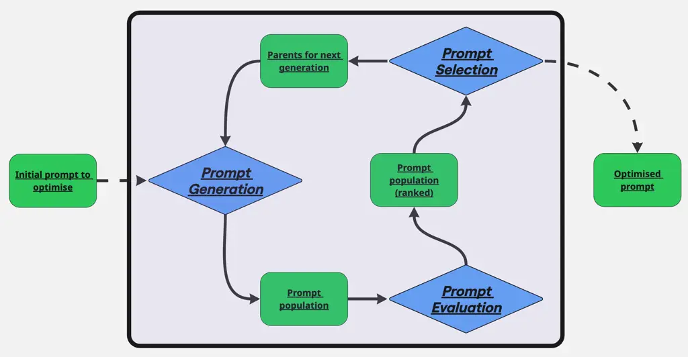
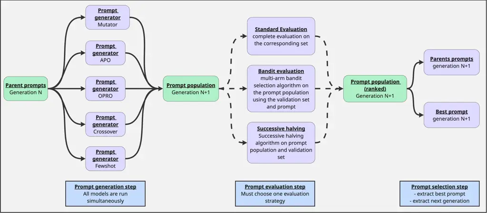
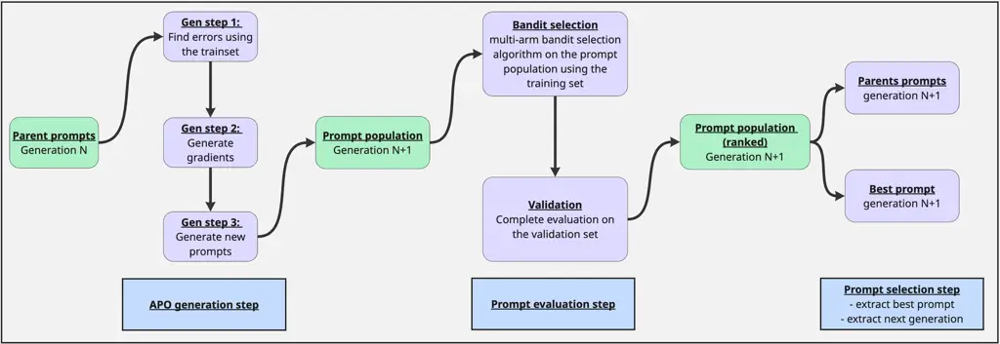
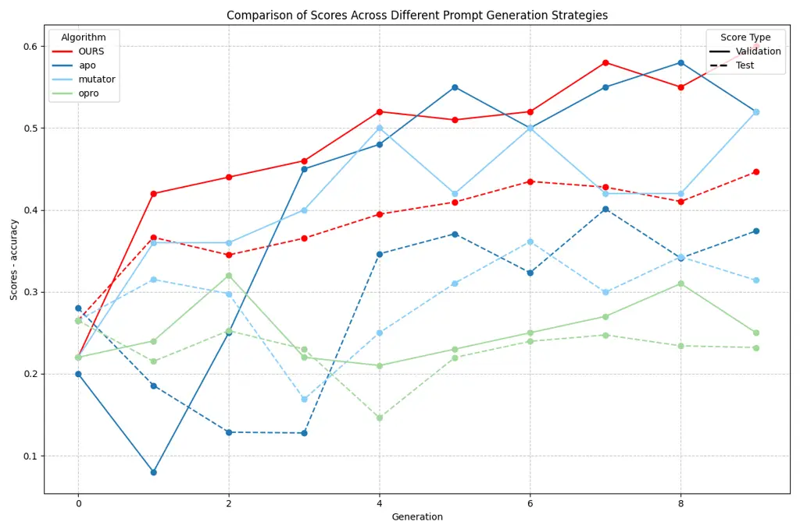
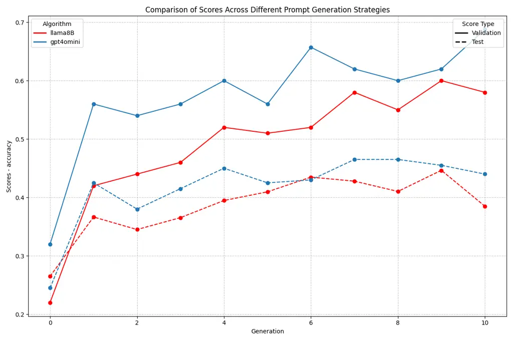
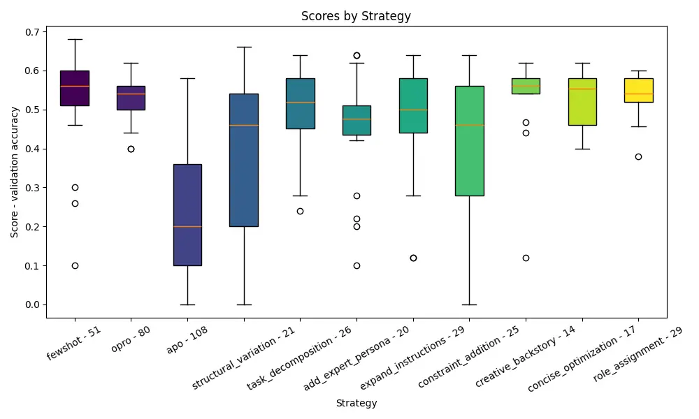
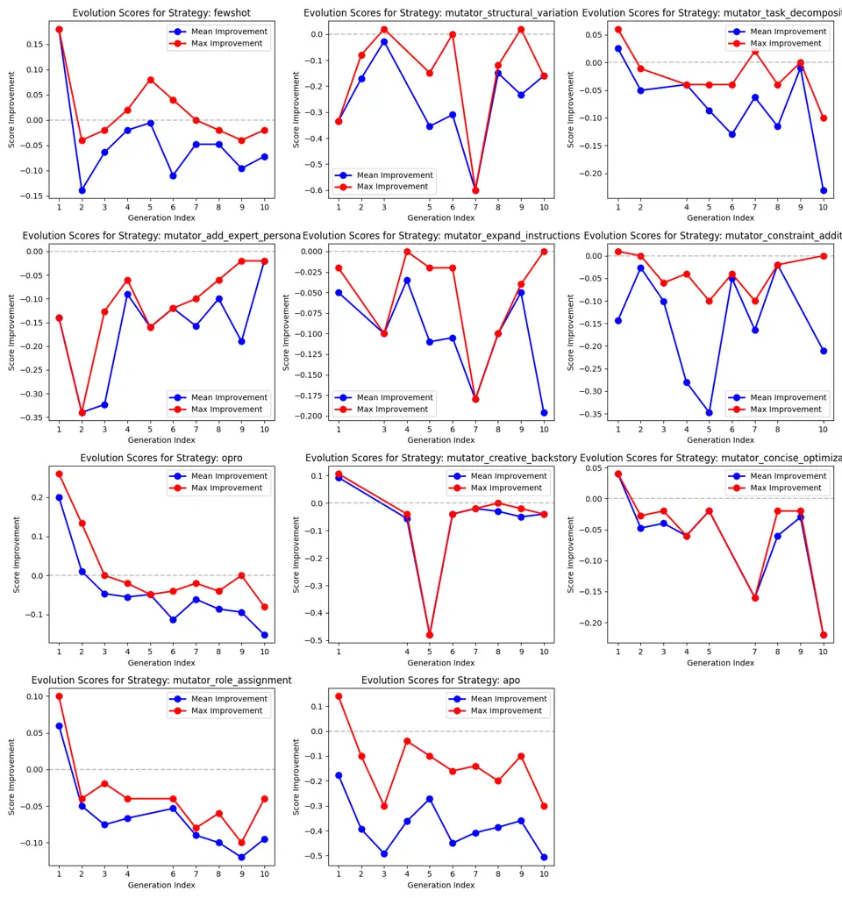
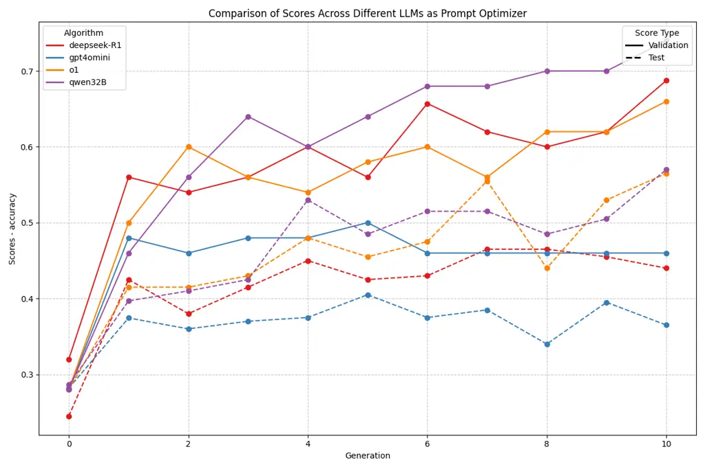
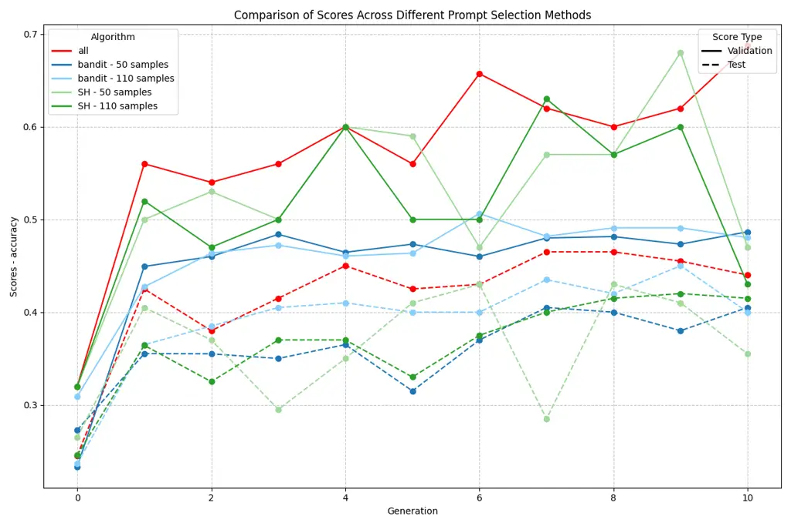

# GAAPO: Genetic Algorithmic Applied to Prompt Optimization

Xavier Sécheresse Affiliation: Biolevate    Jacques-Yves Guilbert–Ly
Affiliation: Biolevate    Antoine Villedieu de Torcy
Affiliation: Biolevate

August 24, 2026

Keywords: Artificial Intelligence, Prompt engineering, Genetic
algorithmic, LLM, Prompt optimization.

## Abstract

Large Language Models (LLMs) have demonstrated remarkable capabilities
across various tasks, with their performance heavily dependent on the
quality of input prompts \[1\] \[2\]. While prompt engineering has
proven effective, it typically relies on manual adjustments, making it
time-consuming and potentially suboptimal. This paper introduces GAAPO
(Genetic Algorithm Applied to Prompt Optimization), a novel hybrid
optimization framework that leverages genetic algorithm \[3\] principles
to evolve prompts through successive generations. Unlike traditional
genetic approaches that rely solely on mutation and crossover
operations, GAAPO integrates multiple specialized prompt generation
strategies within its evolutionary framework. Through extensive
experimentation on diverse datasets including ETHOS, MMLU-Pro, and GPQA,
our analysis reveals several important point for the future development
of automatic prompt optimization methods: importance of the tradeoff
between the population size and the number of generations, effect of
selection methods on stability results, capacity of different LLMs and
especially reasoning models to be able to automatically generate prompts
from similar queries… Furthermore, we provide insights into the relative
effectiveness of different prompt generation strategies and their
evolution across optimization phases. These findings contribute to both
the theoretical understanding of prompt optimization and practical
applications in improving LLM performance.

## 1 Introduction

Large Language Models (LLMs) have gained significant attention following
the public release of generative AI assistants such as ChatGPT (2022)
and Claude (2023). A critical factor in maximizing these models’
effectiveness lies in the quality of input prompts - the instructions
that guide LLMs toward generating relevant outputs. While the impact of
prompting on LLM performance has been well-documented through various
benchmarks \[1\], the process typically relies on manual adjustments,
making it both time-consuming and susceptible to human error. This
highlights the necessity for developing automated methods to fully
harness the capabilities of modern LLMs.

In response to this need, several machine learning approaches have been
developed to automate prompt optimization. Reinforcement learning has
been employed to optimize evaluation costs and computational efficiency
\[4\] \[5\], while in-context learning focuses on improving prompt
performance through example-based learning \[6\]. Regression techniques
have been explored to establish direct relationships between prompt
characteristics and model performance \[7\]. These diverse approaches
aim to streamline the prompting process, reducing the reliance on manual
intervention while addressing different aspects of prompt optimization.

Recent research has shown that smaller language models can achieve
performance comparable to larger LLMs through various optimization
techniques such as distillation \[8\] and prompt engineering \[1\].
While traditional approaches like distillation modify model weights,
prompt optimization offers a more flexible alternative: it enhances
model performance without altering the underlying architecture. This
approach is particularly valuable as it can be applied to any LLM
regardless of size or architecture, providing a generalizable framework
for task-specific optimization while maintaining cost-effectiveness.

In this work, we introduce GAAPO (Genetic Algorithmic Applied to Prompt
Optimization), an algorithm that integrates different prompt generation
strategies into a hybrid prompt optimizer. This innovative approach
capitalizes on the strengths of diverse techniques, ensuring optimal
performance. Crucially, it maintains a detailed record of the evolution
of prompting strategies, which is essential for tracking progress and
making informed adjustments. The design of this optimizer prioritizes
adaptability, ensuring it can seamlessly incorporate future advancements
in the field, thereby remaining relevant and effective as new techniques
and models emerge.

## 2 Related works

### 2.1 Prompt Engineering

Prompt engineering is a critical aspect of working with large language
models (LLMs), as it involves crafting inputs that guide the model to
produce desired outputs. It has been demonstrated that this step is
critical to enhance LLM capabilities \[1\]. However, this process
requires a deep understanding of both the model’s capabilities and the
specific task at hand. Traditionally, prompt engineering has been a
manual process \[9\], relying on human intuition and expertise to
iteratively refine prompts for optimal performance.

### 2.2 Automatic Prompt Engineering

The limitations of manual prompt engineering have led to the development
of automated approaches. These methods utilize machine learning
algorithms to automatically generate and optimize prompts, reducing the
need for manual intervention and democratizing access to advanced
language processing capabilities. To standardize these developments,
frameworks like DSPy \[10\] have emerged, providing a systematic
approach to develop and evaluate automatic prompt optimization methods.
Various approaches have been explored in this field, from
"gradient-oriented" prompt evolution \[11\] to more sophisticated
optimization techniques. Notable advances include APO \[12\], which
introduced gradient-based prompt optimization, while OPRO \[4\]
demonstrated the effectiveness of using LLMs themselves as optimizers.
These automated methods can efficiently explore vast prompt spaces,
identifying optimal prompts that maximize model performance on specific
tasks. This systematic approach has become increasingly important as
LLMs are deployed in diverse applications, where task-specific prompt
optimization can significantly impact performance.



Figure 1: Schema of the general automatic prompt optimization process

Most prompt optimization techniques follow the same architecture,
described in the figure 1.

### 2.3 Genetic algorithm

Genetic algorithms (GAs) are a class of optimization techniques inspired
by the principles of natural selection and genetics \[3\]. By mimicking
the evolutionary process, GAs have been successfully applied to various
machine learning and artificial intelligence tasks \[13\]. They are
particularly effective in solving complex optimization problems where
traditional methods struggle, thanks to their ability to explore large
and poorly understood search spaces. The GA process begins with a
randomly initialized population of candidate solutions, each evaluated
based on a fitness function that measures its effectiveness in solving
the problem. The best-performing individuals are selected for
reproduction using evolutionary operators such as crossover, which
recombines elements from two solutions, and mutation, which introduces
random modifications to enhance diversity.

Over the years, GAs have been widely adopted in nearly every field of
machine learning, including feature selection \[14\], neural network
optimization \[15\], hyperparameter tuning \[16\], clustering \[17\],
and reinforcement learning \[18\]. For example, GAs have been used to
optimize neural network architectures by evolving network topologies and
weight configurations, improving model performance and efficiency
\[15\]. In reinforcement learning, they have been leveraged to evolve
policies and reward functions, enabling agents to learn complex
behaviors \[18\]. Additionally, hybrid approaches combining GAs with
local search techniques have been developed to improve convergence speed
and accuracy \[19\]. Parallel implementations of GAs further enhance
their scalability, allowing them to tackle large-scale optimization
problems efficiently \[20\]. The adaptability and robustness of genetic
algorithms make them a powerful tool for advancing machine learning
methodologies and solving a diverse range of computational challenges.

### 2.4 Application to prompt optimization

Genetic algorithms have been previously explored in prompt optimization,
though their implementations often focus on specific aspects of the
prompt space. EvoPrompt \[21\] introduces a basic evolutionary approach
where new prompts are primarily generated through crossover operations,
combining successful segments from parent prompts followed by linguistic
refinement. This method, while effective, primarily explores structural
variations within a limited scope of the prompt space. A more
sophisticated approach is demonstrated by PhaseEvo \[22\], which
implements a two-phase evolutionary strategy. The first phase employs
global mutations to identify promising regions in the prompt space,
effectively searching for potential global optima. The second phase then
applies more focused optimizations through semantic mutations and
gradient-based refinements.

However, despite their innovative contributions, these approaches
operate within relatively narrow paradigms of prompt generation and
modification. While they effectively handle structural and semantic
modifications, they don’t fully explore the broader spectrum of prompt
transformation strategies. Moreover, they lack a comprehensive framework
that could integrate existing prompt optimization techniques or adapt to
emerging methodologies in the field. This limitation in extensibility
and modularity restricts their ability to evolve alongside new
developments in prompt engineering.

## 3 Data

ETHOS dataset

The ETHOS (Ethics in Text - Hate and Offensive Speech) multilabel
dataset \[23\] is a specialized benchmark designed to evaluate hate
speech recognition capabilities in language models. It consists of 443
carefully annotated text samples categorized across eight distinct
dimensions of hate speech and offensive content, including race, gender,
and violence. Each sample in the dataset is labeled to indicate the
presence or absence of specific types of harmful content, enabling
fine-grained evaluation of model performance in detecting various forms
of hate speech. The dataset’s multi-label structure allows for
comprehensive assessment of language models’ ability to identify
intersecting forms of discriminatory or offensive content, making it
particularly valuable for evaluating ethical content moderation
capabilities. The balanced distribution across different categories of
hate speech ensures robust evaluation across the spectrum of harmful
content typically encountered in real-world applications.

Complementary datasets

To assess performances of our approach on a wide range of tasks, we
evaluated our model on 3 other datasets, alongside with
ETHOS-multilabel:

- •
  The MMLU-Pro (Massive Multitask Language Understanding
  Professional)\[24\] dataset extends the famous MMLU \[25\] dataset by
  complexifying it to a professional level, with our focus on two key
  subcategories. The Engineering subcategory evaluates technical
  understanding across various engineering disciplines, testing
  knowledge of fundamental principles, technical specifications, and
  complex problem-solving approaches encountered in professional
  practice. The Business subcategory assesses comprehension of
  management principles, corporate strategy, financial decision-making,
  and organizational behavior through practical business scenarios.
  Repartition of MMLU-Pro dataset in subcategories is detailed in annex 6.
- •
  GPQA (General Physics Question Answering)\[26\] presents a specialized
  evaluation framework for physics understanding through multiple-choice
  questions. The dataset covers a broad spectrum of physics topics, from
  mechanics to quantum physics, requiring both theoretical knowledge and
  practical problem-solving abilities. Questions are designed to test
  not only recall of physical principles but also their application in
  solving concrete problems, making it an effective benchmark for
  assessing scientific reasoning capabilities in LLMs.

## 4 Methods

### 4.1 Models

#### 4.1.1 GAAPO: Genetic Algorithmic Applied to Prompt Optimization

GAAPO (Genetic Algorithm Applied to Prompt Optimization) follows the
principles of genetic algorithms to evolve and optimize prompts through
successive generations. The algorithm combines multiple prompt
optimization strategies to explore a broader prompt space than previous
methods, leveraging the strengths of each approach while maintaining the
evolutionary nature of genetic algorithms. The optimization pipeline,
inspired by existing works \[12\]\[27\] and described in the figure 2,
operates in three distinct phases during each generation:

- •
  Generation phase: New prompt candidates are created using multiple
  strategies, with each strategy operating on a subset of
  high-performing prompts from the previous generations.
- •
  Evaluation phase: The newly generated population is evaluated on the
  validation set using either exhaustive evaluation or a bandit-based
  approach to optimize computational resources.
- •
  Selection phase: Top-performing prompts are selected based on their
  evaluation scores to serve as parents for the next generation,
  ensuring best performers are used as parents at all time for the
  future generations.



Figure 2: Description of the GAAPO optimization process.

This iterative process combines the exploration capabilities of genetic
algorithms with specialized prompt optimization techniques, enabling
efficient navigation of the prompt space while maintaining diversity in
the population.

Prompt generation

The genetic algorithm framework incorporates multiple prompt generation
methods, each implementing distinct optimization strategies as detailed
in sections 4.1.2 and 4.1.3. These methods, summarized in Table 1,
represent diverse approaches to prompt optimization, each with its own
strengths and limitations. The hybrid nature of GAAPO leverages this
diversity by combining these complementary strategies within a single
optimization framework. This integration enables the algorithm to
capitalize on the advantages of each method while mitigating their
individual limitations through iterative application of varied
optimization approaches. The synergistic combination of these methods
allows for more comprehensive exploration of the prompt space than would
be possible with any single strategy. Examples of generated prompts on a
real-world task are presented in annex .

To streamline the optimization process, we unified the selection and
evaluation phases across all different optimization methods into a
single coherent framework. This architectural decision maintains only
the generative (expansion) phases of these algorithms, integrating them
as candidate generation strategies within GAAPO’s evolutionary cycle.
This simplification allows for consistent evaluation metrics and
selection criteria across all generated candidates while preserving the
unique prompt generation characteristics of each method.

Compared to already existing GA-related prompt optimization methods,
this framework allows a wider exploration of the prompt space,
leveraging advantages of all implemented methods and not focusing on
single-algorithm local improvements.

Evaluation

To meaningfully compare new prompts, we evaluate them on a subset of the
task we have at hand and compare their accuracy (in the current
setting).

Several strategies has been implemented for the evaluation process to
rank the individuals in each generation:

- •
  Complete evaluation: Run a standard evaluation of each prompt on the
  evaluation set and rank new prompts according to their accuracy.
- •
  Successive halving (SH) process \[28\]: prompt accuracies are compared
  on a subset of the dataset, the top-performing half of the models is
  retained, and the survivors are evaluated on a new subset. This
  process is repeated iteratively until only a few models remain. This
  approach allows to drastically reduce the number of API calls but
  increases the risk to remove interesting prompts from the evaluation
  very early due to the disparity of evaluations results on subsets.
- •
  Bandit selection algorithm\[29\]: run a multi-arm selection bandit
  algorithm. Evaluate subsets of the prompt population on batches of
  data, and apply the UCB-E reward model \[30\] to identify the best
  arms. Note that this method was also used in the original paper of APO
  \[12\].

Selection

The selection step used to generate the new parents at each generation
is quite simple. We simply chose, among all the prompts which have been
evaluated, the best according to their evaluation score.

#### 4.1.2 Generation methods: "forced" evolutions

The first categories of generators were directly inspired from standard
prompt optimization models, described below. This methods directly use
previous prompts to generate new ones, by using the errors made (APO) or
trying to expand a prompt trajectory (OPRO), hence the "forced"
evolution.

OPRO: Optimization by PROmpting

OPRO (Optimization by PROmpting) \[4\] is an iterative prompt
optimization algorithm that leverages large language models to generate
and refine prompts through a trajectory-based optimization approach. The
algorithm maintains a trajectory of the top-performing prompts, ranked
by their performance scores, and uses this historical information to
guide the generation of new candidates. During training, OPRO employs a
stochastic dropout mechanism on the trajectory of best-performing
prompts to maintain diversity and prevent convergence to local optima.
The filtered trajectory then serves as input for the generation of new
candidate prompts, which are subsequently evaluated on the current set.
This evaluation process updates the trajectory, maintaining a dynamic
optimization path.

ProTeGi: Prompt Optimization with Textual Gradients



Figure 3: Description of the APO optimisation process, which served as a
basis for GAAPO.

The Automatic Prompt Optimizer (APO/ProTeGi) \[12\] is an iterative
algorithm designed to automatically optimize prompts for Large Language
Models through a three-phase process described in figure 3. The
expansion phase begins by evaluating existing prompts to identify
errors, which are then grouped for focused analysis. The algorithm
generates improvement "gradients" from these errors and creates new
candidate prompts. In the selection phase, APO employs multi-armed
bandit strategies (such as epsilon-greedy \[31\] or Bayesian UCB \[30\])
to efficiently identify promising candidates. This approach balances the
exploration of new prompt variations with the exploitation of proven
patterns, evaluating candidates on small batches for computational
efficiency. The validation phase assesses selected candidates on a
separate validation set ensuring the robustness of the optimized
prompts. Key features include parallel processing, adaptive error
analysis, and gradient-guided refinement.

#### 4.1.3 Generation methods: random evolutions

To complement the "forced" evolution optimization strategies, we
developed three additional prompt generation methods that were
incorporated into GAAPO’s framework. These supplementary approaches
expand the algorithm’s capacity to explore diverse regions of the prompt
space. They all use already existing prompts to generate new ones by
randomly modifying them.

Random Mutator: Prompt random mutation

The Random Mutator serves as a mutation operator within a genetic
algorithm framework, designed to explore the vast prompt space through
controlled random modifications. This approach draws inspiration from
biological mutations in genetic evolution, where random changes can lead
to beneficial adaptations. The mutation process operates by randomly
selecting from eight distinct mutation strategies, each targeting
different aspects of prompt engineering:

- •
  instruction expansion: adds detailed guidelines,
- •
  expert persona injection: introduces specialized viewpoints,
- •
  structural variation: modifies the prompt’s architecture,
- •
  constraint addition: introduces new boundaries,
- •
  creative backstory: weaves narrative elements,
- •
  task decomposition: breaks down complex instructions,
- •
  concise optimization: streamlines the content,
- •
  role assignment: establishes specific model behaviors.

Each mutation creates a new variant of the original prompt (examples are
presented in annex 6), potentially discovering more effective
formulations. Like genetic mutations in nature, these modifications can
range from subtle adjustments to significant transformations, allowing
for both local and global exploration of the prompt space. This random
but structured approach enables the discovery of novel prompt variations
that might not be obvious through deterministic methods.

Crossover: random prompt merging

Crossover operations in prompt engineering also draw inspiration from
genetic algorithms’ recombination mechanisms, but require careful
adaptation for text-based prompts. While traditional genetic algorithms
can perform straightforward splitting and merging of genetic sequences,
prompt crossover needs to maintain semantic coherence and structural
integrity. In our implementation, we developed a simple yet effective
crossover mechanism: given two parent prompts that have demonstrated
good performance, the operation splits each prompt approximately at its
midpoint and combines the first half of one prompt with the second half
of the other. This approach, while basic (and which could be optimized),
provides several advantages:

- •
  It preserves coherent instruction blocks from each parent
- •
  It enables the combination of different strategic elements (e.g.,
  merging a prompt with strong reasoning guidelines with another that
  has effective constraint definitions)
- •
  It maintains a balance between exploration and preservation of
  successful prompt components

However, this straightforward approach could be enhanced in future work
through more sophisticated crossover mechanisms, such as semantic block
identification and recombination, or intelligent selection of crossover
points based on prompt structure analysis.

Note: Already existing GA-related prompt optimization methods such as
EvoPrompt \[21\] are a combination of these first two categories of
methods.

Fewshot: In-context learning for prompt optimization

In-context learning is a fundamental capability of large language models
(LLMs)\[6\] that allows them to adapt their behavior based on examples
provided within the prompt, without requiring model parameter updates.
This ability enables LLMs to understand and emulate patterns from
demonstrated examples in real-time. The few-shot algorithm for prompt
optimization leverages this capability by augmenting existing prompts
with selected examples while maintaining the original prompt’s structure
and purpose. The process begins by randomly selecting 1 to 3 labeled
examples from the training dataset for each parent prompt. These
examples are then appended to the original prompt in a structured
format, with clear input-output pairs. The algorithm is computationally
efficient as it doesn’t require complex prompt modifications or
extensive evaluations. Instead, it relies on the natural ability of LLMs
to learn from examples, making it a practical approach for prompt
enhancement while maintaining the original prompt’s core functionality.

| Method    | Advantages                                                                                                                           | Drawbacks                                                                                                                        |
| --------- | ------------------------------------------------------------------------------------------------------------------------------------ | -------------------------------------------------------------------------------------------------------------------------------- |
| Mutations | • Simple and efficient implementation • Multiple mutation strategies available • Maintains prompt diversity • Low computational cost | • Can produce invalid prompts • Changes might be too random • Limited by predefined mutation strategies                          |
| APO       | • Error-driven optimization • Targeted improvements based on failure analysis • Systematic approach to prompt refinement             | • Computationally expensive • Requires error examples • May overfit to specific error patterns                                   |
| OPRO      | • Learns from successful prompts • Efficient use of historical information                                                           | • Dependent on quality of previous generations • Can converge to local optima • Higher LLM usage per generation                  |
| Crossover | • Combines successful prompt features • Preserves effective components • Low computational cost                                      | • Simple splitting might break prompt coherence • Requires multiple good parents • Can produce semantically invalid combinations |
| FewShot   | • Improves prompt with concrete examples • Helps model understand edge cases • Direct performance feedback                           | • Can make prompts too lengthy • Risk of overfitting to examples • Limited by example quality and availability                   |

Table 1: Comparison of Prompt Generation Methods in Hybrid Genetic
Optimizer

#### 4.1.4 Examples

Table 4.1.4 presents prompts obtained by several methodologies on the
ETHOS multilabel dataset after 10 generations. The original prompt from
where all optimization trajetories started is:

A message from a user, your goal is to determine if this message is a
hate speech or not: user_message. Possible class for the hate speech
are: violence, directed_vs_generalized, gender, race, national_origin,
disability, religion, sexual_orientation.

| Method  | Obtained Prompt                                                                                                                                                                                                                                                                                                                                                                                                                                                                                                                                                                                                                                                                                                                                                                                                                                                                                                                |
| ------- | ------------------------------------------------------------------------------------------------------------------------------------------------------------------------------------------------------------------------------------------------------------------------------------------------------------------------------------------------------------------------------------------------------------------------------------------------------------------------------------------------------------------------------------------------------------------------------------------------------------------------------------------------------------------------------------------------------------------------------------------------------------------------------------------------------------------------------------------------------------------------------------------------------------------------------ |
| APO     | Analyze the given message to determine if it contains hate speech: user_message. Definition: Hate speech is defined as language that attacks or diminishes a person or group based on attributes such as race, religion, sexual orientation, gender, disability, national origin, or other protected characteristics. Your task is to: - Provide a detailed reasoning justifying your classification. - Categorize the message into the most relevant categories from the following list. Each category should be clearly justified in your reasoning: + sexual_orientation: Attacks or offensive language targeting individuals based on their sexual orientation or gender identity. + religion: Language that attacks or demeans individuals based on their religious beliefs or affiliation. + \[... definitions of other categories...\]                                                                                  |
| OPRO    | Analyze the message to determine if it is hate speech: user_message. Consider the following factors in your analysis: - Presence of derogatory language or slurs targeting race, gender, religion, or other protected characteristics. - Any explicit or implicit threats, calls to violence, or incitement of harm. - Discriminatory statements that demean or degrade individuals or groups. - The overall tone, intent, and context of the message. Ensure your reasoning is thorough and your solution is actionable and clear. Possible categories for hate speeches are: violence, directed_vs_generalized, gender, race, national_origin, disability, religion, sexual_orientation.                                                                                                                                                                                                                                     |
| Mutator | Analyze the message to determine if it is hate speech, using the following structured approach: - Identify offensive language targeting protected characteristics. - Assess intent and context. - Evaluate potential harm. - Ensure bias-free analysis adhering to hate speech policies. Provide evidence-based reasoning and actionable solutions. Examples: Racial slurs dehumanize based on race; messages promoting violence incite harm; derogatory gender terms cause marginalization. Analyze: user_message.                                                                                                                                                                                                                                                                                                                                                                                                            |
| Ours    | You are a team of experts tasked with determining if a given message contains hate speech. Your team consists of three roles: \*\*The Critic\*\*: Your first responsibility is to carefully analyze the message for any indicators of hate speech, such as offensive language, derogatory terms, or discriminatory content. Consider the context and tone of the message. \*\*The Problem Solver\*\*: After the critic has provided their analysis, your role is to determine whether the message qualifies as hate speech based on the indicators identified. Consider the broader implications of labeling the message as hate speech. \*\*The Expert Reviewer\*\*: Your role is to review the analysis and solution provided by the previous roles. Ensure that the reasoning is thorough, the solution is accurate, and the output is consistent with the examples provided. Here is the message to analyze: user_message. |

### 4.2 Optimization framework

HOPR (Hint Optimization and Prompt Refinement) is a Python framework
designed for systematic prompt optimization and evaluation. Like DSPy
\[10\], it provides a structured approach to prompt engineering, but
with a distinct focus on evolutionary optimization techniques. While
DSPy emphasizes the composition and chaining of language model
operations through programmatic interfaces, HOPR specializes in
automated prompt optimization through a variety of implemented
strategies extracted from the state of the art methods for automatic
prompt engineering.

The framework is built around modular components: optimizers that
implement different prompt generation strategies, metrics for
evaluation, and a core system for managing prompt evolution. HOPR’s
architecture allows researchers to easily implement and compare
different prompt optimization techniques, track the evolution of prompts
to study the best optimization methods, and maintain a "hall of fame" of
top-performing candidates.

Unlike DSPy’s focus on prompt composition and application, HOPR
emphasizes the development of automatic prompting methods by
facilitating the implementation of concurrent strategies on the same
problem. While being easily adaptible to new models, this allow a sain
and reproducible comparative analysis of different prompt engineering
approaches.

A key differentiator is HOPR’s hybrid approach, which allows multiple
optimization strategies to work in parallel, potentially discovering
more effective prompts than single-strategy approaches. This makes it
especially valuable for researchers studying prompt optimization methods
and practitioners seeking to automatically optimize prompts for specific
tasks.

### 4.3 Training pipeline

#### 4.3.1 Dataset Organization

The optimization process requires careful data partitioning to ensure
robust evaluation and prevent overfitting. We divide each dataset into
three distinct subsets:

- •
  Training set: Used during prompt generation for strategy-specific
  optimization. APO leverages this set for error analysis and
  improvement, while the few-shot strategy uses it to select examples
  for in-context learning.
- •
  Validation set: Employed during the optimization process to evaluate
  and compare generated prompts, enabling the selection of promising
  candidates for subsequent generations.
- •
  Test set: Reserved exclusively for final evaluation, measuring
  generalization capability and tracking performance evolution across
  optimization steps.

#### 4.3.2 Population Management

Each strategy is assigned a weight determining its contribution to the
next generation’s population. The number of candidates per strategy is
calculated by multiplying these weights by the total population size. To
maintain the exact desired population size, any remaining slots are
allocated to the strategy with the highest weight. This weighted
approach ensures:

- •
  Balanced exploration across different optimization techniques
- •
  Customizable strategy emphasis based on task requirements
- •
  Consistent population size maintenance throughout generations

#### 4.3.3 Evaluation Process

The evaluation of generated prompts follows a systematic approach:

- •
  Initial evaluation on validation set to establish baseline
  performance.
- •
  Generational evaluation to select promising candidates. Evaluations
  concerning advocated results in the paper where conducted twice, due
  to disparities in LLM response and their probabilistic answers
  construction.
- •
  Final testing on the held-out test set to measure true generalization.

This structured pipeline ensures robust optimization while maintaining
the flexibility to adapt to different tasks and requirements through
adjustable strategy weights and evaluation parameters.

#### 4.3.4 Metrics

ETHOS multilabel dataset

For the multi-label classification task of the ETHOS dataset, we employ
strict accuracy as our evaluation metric. A prediction is considered
correct if and only if the set of predicted labels exactly matches the
set of true labels, regardless of their order. Formally, for a sample
with true labels $`Y`$ and predicted labels $`\hat{Y}`$, the binary
accuracy is defined as:

```math
\text{accuracy}(Y,\hat{Y})=\begin{cases}1&\text{if }Y=\hat{Y}\\
0&\text{otherwise}\end{cases}
```

where $`Y`$ and $`\hat{Y}`$ are treated as sets, meaning
$`\{a,b\}=\{b,a\}`$. The final accuracy score is then computed as the
average of these binary evaluations across all samples in the dataset.

MMLU & GPQA

For MMLU-Pro and GPQA datasets, we employ standard accuracy as our
evaluation metric, where a prediction is considered correct if and only
if it matches the correct answer. Formally, for a sample with true
answer $`y`$ and predicted answer $`\hat{y}`$, the binary accuracy is
defined as:

```math
\text{accuracy}(y,\hat{y})=\begin{cases}1&\text{if }y\equiv\hat{y}\\
0&\text{otherwise}\end{cases}
```

where $`\equiv`$ denotes semantic equivalence rather than strict string
matching. This equivalence consideration was necessary as these datasets
provide multiple-choice answers in a standardized format (typically
including punctuation marks like commas), but the LLM sometimes
generated correct answers with slight formatting variations. To address
this, we implemented an LLM-based evaluation system that validates
semantic correctness, ensuring that superficial differences in
formatting do not impact the accuracy assessment. The reliability of
this approach was verified through manual inspection of a representative
sample of model outputs.

### 4.4 Experiments

Datasets

300 samples were extracted to the orignal ETHOS dataset and separated in
3 subsets: 50 samples for the training set (used in the APO and the
fewshot algorithms), 50 samples for the validation set (used for the
selection of prompts at each generation) and 200 were used as test set
to allow a meaningful comparison of different prompts while limiting the
risks of overfitting on other subsets during the optimzation process.
Those numbers were chosen as a tradeoff between the budget allowed to
the optimization process and the typical size of the datasets which can
be obtained in real life optimization tasks. Most results displayed in
this paper use the ETHOS dataset.

Models

We computed prompt optimization for several methods, which we
reimplemented, respecting the original description made in their
respective papers. In detail, APO \[12\], OPRO\[4\] were used as
baselines, along with a random mutator described above.

In the GAAPO implementation, prompt generation was distributed across
strategies with the following proportions: random mutations accounted
for 40% of new prompts, while APO and OPRO each contributed 20%. The
remaining 20% was equally divided between few-shot learning and
crossover operations, each generating 10% of new prompts.

These numbers were chosen as a trade-off between random prompt
modifications (mutations and crossover), local prompt optimization (APO
and OPRO) and in-context learning (fewshot). We deliberately choose to
limit the importance of in-context learning as it has already been
demonstrated that prompt efficiency scales with the number of given
examples. Our goal here is to increase prompt efficiency for very small
datasets to have a prompting method which can be used on real life
prompts (comparison results are presented in section 5.1).

For each experiment, the number of generations and number of prompt
generated at each generation was experimentally determined and will be
justified in the Results section 5.3.

LLMs

The experimental setup employs two distinct Large Language Models (LLMs)
for different aspects of the optimization process.

For prompt generation, we utilize in most experiments
DeepSeek-R1-distill-LLaMA-70B-versatile, a state-of-the-art open-source
LLM based on the LLaMA architecture. This model, accessed through Groq’s
inference platform, offers a balance between performance (with
state-of-the-art performances on LLM tasks \[32\]) and computational
efficiency (with inference times sensibly lower using Groq platform
\[33\]). We compared the performance optimization obtained by this model
to others in section 5.5.

For the target model to be optimized through our prompting process, we
employ GPT-4o-mini or llama3-8B-instant \[34\]. We decided to use 2
models to assess the difference in evolution performance (which can be
seen in section 5.2) across different experiment settings, arguing that
a prompt optimization could be model dependent.

This configuration allows us to assess the generalizability of our
prompt optimization approach while maintaining a clear separation
between the prompt generation and evaluation phases of our methodology.

Generalization

We evaluated our prompt optimization approach across several widely used
datasets, with results presented in section 5.6. For each dataset, we
maintained a consistent splitting strategy: 50 samples for training, 50
for validation, and up to 200 samples for testing (or the maximum
available if fewer than 200 samples remained). This standardized
approach, first validated on ETHOS, ensures fair comparison across
different datasets while maintaining sufficient samples for reliable
evaluation. Complementary datasets used for this study are presented in
section 3. Note that for GPQA, only 98 samples were used in the testing
set.

Optimization of the selection process

To optimize the computational budget while maintaining effective prompt
selection, we implemented and compared three different selection
strategies (see section 5.7 for results): complete evaluation,
successive halving, and bandit selection. These methods present
different trade-offs between evaluation accuracy and computational
efficiency. For a representative scenario with a test dataset of 50
samples and a population of 50 prompts, the computational requirements
vary significantly across methods.

- •
  Complete evaluation, which tests every prompt against every sample,
  requires 2,500 LLM calls
  ($`50\text{ prompts}\times 50\text{ samples}`$), providing exhaustive
  but computationally intensive evaluation.
- •
  Successive halving \[28\] offers a more efficient approach by
  progressively eliminating underperforming prompts. In our
  implementation, we evaluate prompts on 20% of the dataset at each
  iteration and eliminate 40% of the lowest-performing prompts. This
  process continues until reaching a predetermined number of prompts.
  This strategy reduces the number of LLM calls to approximately 1,200,
  representing a 55% reduction in computational cost compared to
  complete evaluation while maintaining robust selection pressure.
- •
  The bandit selection method \[29\] provides the most efficient
  tradeoff \[12\], evaluating only 20 prompts on 15 samples over 5
  iterations. This approach requires approximately 1,500 LLM calls
  ($`20\text{ prompts}\times 15\text{ samples}\times 5\text{ iterations}`$),
  achieving a 40% reduction in computational cost compared to complete
  evaluation. While this method samples less extensively, it leverages
  statistical efficiency to identify high-performing prompts.

These selection strategies offer different balances between evaluation
thoroughness and computational efficiency, allowing practitioners to
choose based on their specific constraints and requirements. Our
empirical results suggest that both successive halving and bandit
selection maintain effective prompt identification while significantly
reducing computational overhead.

## 5 Results & Discussions

### 5.1 Comparison with baselines



Figure 4: Results obtained by using several prompt generation
strategies. LLM-optimizer used: llama-3.1-8B

The experimental results demonstrate the effectiveness of our proposed
GAAPO (Genetic Algorithm Assisted Prompt Optimization) approach on the
ETHOS multilabel hate speech classification task. Figure 4 illustrates
the validation performance across different prompt optimization
strategies over multiple iterations, while Table 3 presents the final
test and validation scores. Additionnally, obtained prompts are
presented in table 4.1.4.

| Model   | Validation score | Test score |
| ------- | ---------------- | ---------- |
| Ours    | 0.60             | 0.46       |
| APO     | 0.52             | 0.38       |
| OPRO    | 0.26             | 0.24       |
| Mutator | 0.52             | 0.34       |

Table 3: Test and validations scores for the ETHOS dataset. Comparison
of performance of prompt optimization using llama3-8B-instant \[34\]

GAAPO demonstrates strong performance on the validation set, achieving a
score of 0.46, which significantly surpasses baseline methods including
OPRO (0.24), Mutator (0.34), and APO (0.38). The evolution curve in
Figure 3 shows GAAPO’s ability to maintain consistent improvement
throughout the optimization process.

A critical analysis of test and validation scores reveals an important
phenomenon common to genetic algorithms: selection bias. This is
particularly evident in APO’s performance, where results at some
iterations highlight a very high difference score between test and
validation sets (culminating at 0.3 for the 2nd generation). This
extreme disparity illustrates how genetic algorithms can inadvertently
optimize for specific test set characteristics rather than general
problem-solving capabilities. GAAPO mitigates this selection bias
through its diverse strategy portfolio, resulting in more balanced
performance between test (0.60) and validation (0.46) scores, suggesting
better generalization.

The lower performance of OPRO (test: 0.26, validation: 0.24) indicates
that reinforcement learning-based approaches struggle with exploring
vast prompt spaces effectively. The Mutator approach achieves
intermediate results (test: 0.52, validation: 0.34), but still shows
signs of selection bias with its significant test-validation gap. These
observations highlight how selection bias can affect different
optimization strategies to varying degrees, with GAAPO’s hybrid approach
providing the most robust defense against this common genetic algorithm
limitation.

Moreover, we can see a difference in the original score of the models
(at iteration 0, all scores should be identicals). However, due to the
disparity in LLM performance and their probabilistic caracters, results
are not always exactly consistent across time.

### 5.2 Model evaluation comparison

Comparing the optimization trajectories between GPT-4o-mini and
LLaMA3-8B (displayed in figure 5) reveals few differences in how these
models respond to prompt optimization. Both models show significant
improvement from their initial performance, but their learning patterns
and final achievements slightly differ.



Figure 5: Comparison of optimization trajectories between GPT-4o-mini
and LLaMA3-8B models on the ETHOS dataset for GAAPO. The plot shows the
evolution of validation scores (solid lines) and test scores (dashed
lines) across generations for both models.

Both GPT-4o-mini and LLaMA3-8B demonstrate stable optimization
trajectories, with consistent learning patterns and similar
generalization characteristics across generations. However, GPT-4o-mini
achieves notably superior performance, reaching validation scores of up
to 0.70 compared to LLaMA3-8B’s 0.60. Both models maintain steady
optimization paths with comparable stability in their generalization
gaps.

Examining test scores reveals GPT-4o-mini’s consistent edge in
performance, maintaining a 0-0.05 point advantage over LLaMA3-8B
throughout the optimization process. However, this superior performance
must be interpreted with caution, as both models show signs of potential
overfitting in later generations. The increasing gap between validation
and test scores after generation 8 suggests that while GPT-4o-mini
achieves better absolute performance, careful monitoring of
generalization remains crucial for both models.

Given the higher performance metrics of GPT-4o-mini and comparable
computational costs between the two models in our experimental setup, we
selected GPT-4o-mini as our primary LLM-optimizer for subsequent
experiments. This choice was driven by the quantitative advantages in
optimization outcomes, while both models demonstrate equally reliable
optimization stability.

### 5.3 Influence of population size

|                 |                       |            |                  |                     |
| --------------- | --------------------- | ---------- | ---------------- | ------------------- |
| Population size | Number of generations | Test score | Validation score | Number of LLM calls |
| 20              | 25                    | 0.50       | 0.42             | 25000               |
| 30              | 17                    | 0.56       | 0.50             | 25500               |
| 40              | 13                    | 0.62       | 0.46             | 24500               |
| 50              | 10                    | 0.68       | 0.46             | 25000               |

Table 4: Test and validations scores for the ETHOS dataset. Comparison
of different population size and number of generations for GPT-4o-mini.
\[34\]

We conducted experiments with varying population sizes while maintaining
a comparable total number of LLM calls across configurations, as shown
in Table 4. The results demonstrate a clear trade-off between population
size and the number of generations required. Larger populations (50
prompts) with fewer generations (10) achieve higher test scores (0.68)
compared to smaller populations running for more generations (20
prompts, 25 generations, 0.50 test score).

While the configuration with 30 prompts shows the best validation score
(0.50) and a smaller generalization gap, we opted for the 50-10
configuration for several practical advantages. First, larger
populations enable better parallelization of prompt evaluation,
significantly reducing wall-clock time. Second, this configuration
aligns well with optimized selection strategy, which benefits from a
larger pool of candidates to select from in each generation.

However, the increased generalization gap in the 50-10 configuration
(0.22 points between test and validation scores, compared to 0.08 points
for 20-25) suggests a higher risk of overfitting. This observation
indicates that while larger populations can explore the prompt space
more effectively within fewer generations, they may require more robust
validation strategies to ensure generalization. Despite this limitation,
the practical benefits of faster convergence and improved
parallelization potential make the 50-10 configuration our recommended
choice for prompt optimization tasks.

### 5.4 Prompt generators comparison

We can now study in detail the prediction made by each prompt generator
in GAAPO.

We conducted a detailed analysis of each prompt generator’s performance
in GAAPO through two complementary perspectives. Figure 6 presents the
overall distribution of validation scores for each strategy through
boxplots, while Figure 7 tracks the improvement potential of each
strategy across generations, showing both mean and maximum improvements
in score relative to parent prompts.

To obtain these visualizations, we first aggregated all prompts
generated by each strategy and analyzed their validation scores (Figure
6). Additionally, we computed the improvement in validation score
between each generated prompt and its parent prompt across generations
(Figure 7), allowing us to understand not just absolute performance but
also each strategy’s ability to improve upon existing prompts.



Figure 6: Performance distribution of individual prompt generation
strategies in GAAPO on the validation set. Model used: GPT-4o-mini.



Figure 7: Evolution of improvement scores for each prompt generation
strategy across generations. For each strategy, we track both mean
improvement (blue) and maximum improvement (red) relative to parent
prompts. Mean improvement represents the average score difference
between generated prompts and their parents, while maximum improvement
shows the best improvement achieved in each generation. Negative values
indicate that generated prompts performed worse than their parents.
Model used: GPT-4o-mini.

The analysis reveals several key insights about strategy effectiveness
and the importance of maintaining diversity in optimization approaches:

- •
  Strategy Effectiveness and Stability: Few-shot learning demonstrates
  superior performance (median $`\sim`$0.57) with consistent results, as
  shown by its compact boxplot and positive improvement scores in early
  generations. This aligns with existing literature \[6\], highlighting
  the value of example-based learning. OPRO maintains strong and stable
  performance (median $`\sim`$0.55), though its evolution plot shows
  diminishing improvements over generations. role_assignment and
  concise_optimization show reliable performance with tight
  distributions, but their improvement potential decreases in later
  generations.
- •
  Evolution patterns: Most strategies show declining improvement
  potential over generations, with negative mean improvements in later
  stages, suggesting they work best in early exploration. APO’s boxplot
  shows high variability (0.10-0.35), but its evolution plot reveals
  strong initial improvements followed by declining effectiveness,
  supporting its potential role as an early-stage optimizer. Few-shot
  learning uniquely maintains positive maximum improvements even in
  later generations, indicating sustained ability to generate beneficial
  variations.
- •
  Underperforming Strategies: Several mutation strategies, particularly
  structural_variation and task_decomposition, consistently show
  negative improvement scores across generations, suggesting limited
  effectiveness for the current task. However, completely removing these
  strategies could be counterproductive for two reasons:
  - –
    Task Dependency: Different tasks may benefit from different prompt
    modification approaches. What appears ineffective for one task might
    be crucial for another as every optimization task is learned in a
    different optimization space.
  - –
    Exploration Value: Even seemingly underperforming strategies
    contribute to maintaining genetic diversity, potentially enabling
    the discovery of novel promising prompt variations through
    combination with other approaches.

- •
  Strategic Implications: The analysis suggests implementing a dynamic,
  task-adaptive strategy:
  - –
    Early generations: Leverage APO and mutation strategies for broad
    exploration
  - –
    Mid-generations: Emphasize few-shot learning and OPRO for stable
    improvements
  - –
    Later generations: Focus on strategies showing consistent positive
    improvements (few-shot, role_assignment) for refinement
  - –
    Maintain a minimum weight for all strategies to preserve
    optimization flexibility across different tasks

This comprehensive analysis reinforces the value of GAAPO’s adaptable
framework, which can accommodate varying strategy effectiveness across
different tasks while maintaining the potential benefits of diverse
optimization approaches. The framework’s ability to dynamically adjust
strategy weights while preserving all methods makes it particularly
robust for general-purpose prompt optimization across diverse
applications.

It should be notice that optimization methods tend to have descending
curves which is logical: as we compare new prompts with their parent
prompts, the task is more and more difficult (given that the reference
prompt improves with the generations). Moreover, studies on other
datasets tend to highlight the fact that different prompt optimization
methods can perform very differently between tasks, highlightning the
importance to keep methods in a general framework and the risk to select
optimizers based on their results on a unique dataset.

### 5.5 Model generators comparison

The comparison of different language models as prompt optimizers reveals
striking patterns (which can be seen in Figure 8 in both performance and
generalization capabilities. Most notably, reasoning-specialized models
(QwQ32B and deepseek-R1) and O1 demonstrate superior performance
compared to general-purpose models like GPT-4o-mini.



Figure 8: Comparison of different LLMs as prompt optimizers in GAAPO.
The plot shows validation (solid lines) and test (dashed lines) scores
across generations for four models: QwQ32B, DeepSeek-R1, O1, and
GPT-4o-mini. While reasoning-specialized models achieve higher absolute
scores, O1 demonstrates better generalization with smaller gaps between
validation and test performance.

QwQ32B emerges as the top performer, showing consistent improvement in
validation scores from an initial 0.28 to a remarkable 0.70 by
generation 10. Its learning trajectory is particularly stable, with
steady increases and minimal fluctuations. However, its test scores
(dashed line) plateau around 0.55, indicating a significant
generalization gap of approximately 0.15 points.

A particularly interesting comparison emerges between DeepSeek-R1 and O1
models. While both achieve strong final validation scores (0.68 and 0.65
respectively), O1 demonstrates notably better generalization
characteristics. By generation 10, O1 maintains test scores around 0.55,
nearly matching its validation performance, while DeepSeek-R1 shows a
larger disparity with test scores around 0.45. This suggests that O1’s
optimization process, while slightly lower in absolute validation
performance, produces more robust and generalizable prompts.

In contrast, GPT-4o-mini shows notably inferior performance. While it
achieves quick initial improvement, its validation scores stagnate
around 0.45-0.50 after generation 2, with minimal subsequent
improvement. However, like O1, it maintains a smaller generalization gap
between validation and test scores, suggesting more robust, if modest,
optimization capabilities.

The evolution of scores across generations reveals an interesting
pattern: while reasoning models continue to improve validation
performance until the final generations, o1 maintains a more balanced
improvement in both validation and test scores. This suggests that o1
might be particularly valuable for applications where generalization
reliability is crucial, even if peak performance is slightly lower than
specialized reasoning models.

These findings indicate that while reasoning-specialized models achieve
higher absolute performance, o1 offers an attractive compromise between
performance and generalization stability, potentially making it more
suitable for practical applications where robust generalization is
essential.

### 5.6 Applications on other datasets

The experimental results across multiple datasets demonstrate both the
effectiveness of our approach and the varying potential for prompt
optimization across different tasks. Table 5 presents validation scores
for four distinct datasets, revealing several important patterns.

|                |                  |                      |                   |      |
| -------------- | ---------------- | -------------------- | ----------------- | ---- |
| Dataset        | ETHOS multilabel | MMLU-Pro engineering | MMLU-Pro Business | GPQA |
| Initialization | 0.28             | 0.39                 | 0.72              | 0.38 |
| APO            | 0.44             | 0.45                 | 0.73              | 0.42 |
| OPRO           | 0.38             | 0.44                 | 0.76              | 0.43 |
| Mutator        | 0.40             | 0.43                 | 0.735             | 0.43 |
| OURS           | 0.46             | 0.48                 | 0.74              | 0.43 |

Table 5: Validations scores for different datasets. Models used:
Deepseek-R1 as Prompt Generator and GPT-4o-mini as Optimizer.

We can see on Table 5 that our method achieves superior performance on
datasets where prompt engineering shows significant potential for
improvement. For the ETHOS multilabel classification task, we observe a
substantial improvement from the initial score of 0.28 to 0.46,
outperforming all baseline methods including APO (0.44), OPRO (0.38),
and Mutator (0.40). Similarly, on the MMLU-Pro engineering dataset, our
approach reaches 0.48, showing meaningful improvement over the
initialization score of 0.39 and competing methods.

However, the results also reveal that not all tasks benefit equally from
prompt optimization. The MMLU-Pro Business dataset, with its high
initialization score of 0.72, shows minimal room for improvement, with
our method and the Mutator achieving only marginal gains (0.73 and 0.735
respectively). This suggests that some tasks may already be well-aligned
with LLMs’ base capabilities, limiting the potential impact of prompt
optimization. The GPQA dataset presents another interesting case where
all optimization methods, including ours, achieve similar modest
improvements (from 0.38 to 0.43), indicating that some tasks may have
inherent complexity barriers that prompt optimization alone cannot
overcome.

The varying effectiveness of prompt optimization across tasks can be
attributed to multiple underlying factors. First, the overlap between an
LLM’s training data and the target dataset can create a ceiling effect -
if similar examples were present in the training corpus, the model may
already demonstrate near-optimal performance with simple prompts.
Second, task-specific characteristics such as domain specificity and
reasoning complexity influence the optimization potential; technical
domains often benefit more from structured prompting than general
knowledge tasks. Third, the nature of the required output (e.g.,
multiple-choice vs. multi-label classification) affects the scope for
improvement through prompt engineering. Finally, the fundamental
alignment between the task’s requirements and the model’s learned
representations determines whether performance limitations can be
addressed through prompt optimization alone or require more substantial
interventions such as fine-tuning.

### 5.7 Selection method comparison

We conducted a comparative analysis of the three selection methods on
the ETHOS dataset, evaluating their efficiency and performance
trade-offs. The computational requirements varied significantly across
methods: for a test set of 50 samples, the complete evaluation ("all")
requires 2,500 LLM calls per generation, the bandit approach
approximately 1,500 calls, while successive halving (SH) uses only 1,500
calls per generation.

To ensure fair comparison, we also plotted results where the number of
calls are equivalent between all methods. We adjusted the test size to
110 samples to obtain the right number of calls for both bandit and SH
selection methods.

Figure 9 presents the evaluation for both validation and test scores for
the 5 mentioned processes: "all", "bandit" with 50 samples, "bandit"
with 110 samples, "SH" with 50 samples and "SH" with 110 samples.



Figure 9: Comparison of different prompt selection strategies during
GAAPO optimization. The plot shows the evolution of validation (solid
lines) and test (dashed lines) scores across generations for different
selection methods. Model used: GPT-4o-mini.

The comparison of different selection strategies reveals compelling
insights about the trade-offs between sample size, computational
efficiency, and performance stability. The complete evaluation method
("all"), using 50 samples, achieves the highest validation scores
(peaking at 0.68) but requires significantly more computational
resources. However, our analysis demonstrates that increasing the sample
size from 50 to 110 samples for alternative strategies does not
necessarily lead to better performance, suggesting that efficient
sampling is more crucial than sample size.

The bandit method emerges as particularly noteworthy, showing remarkable
stability in both its 50 and 110 sample configurations. Despite using
40% fewer LLM calls, it maintains consistent performance around
0.45-0.50 validation score with minimal fluctuations between
generations. More importantly, the bandit approach exhibits a smaller
generalization gap between test and validation scores, indicating better
resistance to overfitting. However, we can observe a certain drop of
performance between this selection method and "all".

In contrast, successive halving (SH) displays considerable volatility,
especially evident in its performance spikes and drops across
generations. While SH occasionally matches or exceeds the bandit’s
performance (reaching peaks around 0.60-0.70), its inconsistency makes
it less reliable for practical applications. Interestingly, increasing
the sample size for SH from 50 to 110 samples does not significantly
mitigate this volatility, nor does it critically improve performances.

These findings suggest that while complete evaluation with 50 samples
provides the highest absolute performance, the bandit approach with its
reduced computational footprint and stable optimization trajectory
offers an interesting alternative. The stability and efficiency of the
bandit method, combined with its robust generalization characteristics,
make it a choice for resource-conscious prompt optimization scenarios.

## 6 Conclusion

GAAPO (Genetic Algorithm Applied to Prompt Optimization) represents a
significant advancement in prompt optimization, combining evolutionary
strategies with established optimization methods. Our comprehensive
evaluation demonstrates its effectiveness across multiple dimensions:
superior validation performance with better generalization than baseline
methods, efficient resource utilization through several prompt selection
methods, and robust performance across different language models
(GPT-4o-mini and LLaMA3-8B). The framework’s modular architecture,
incorporating multiple prompt generation strategies and selection
methods, enables flexible adaptation to various tasks while maintaining
optimization effectiveness.

However, several limitations warrant attention in future work. The
framework shows increased generalization gaps with larger population
sizes, suggesting the need for more sophisticated validation strategies.
The computational overhead, while reduced through bandit selection,
remains significant for resource-constrained applications. Future
improvements could focus on developing more efficient prompt evaluation
methods, incorporating active learning to reduce the number of required
examples, and implementing adaptive population sizing strategies.
Additionally, investigating the framework’s effectiveness across a
broader range of tasks and language models would enhance its
generalizability and practical applicability.

## Acknowledgments

We extend our sincere appreciation to Joël Belafa, Florence Armstrong,
Lina Faik, Maxime Gobin and Charles-Albert Lehalle whose insightful
comments and suggestions substantially enhanced this work. Their
expertise and careful attention to detail helped us improve various
aspects of the paper, from theoretical foundations to experimental
validation. Their feedback not only improved the current work but also
provided valuable directions for future research in this area.

## References

- \[1\] Sander Schulhoff, Michael Ilie, Nishant Balepur, Konstantine
  Kahadze, Amanda Liu, Chenglei Si, Yinheng Li, Aayush Gupta, HyoJung
  Han, Sevien Schulhoff, Pranav Sandeep Dulepet, Saurav Vidyadhara,
  Dayeon Ki, Sweta Agrawal, Chau Pham, Gerson Kroiz, Feileen Li, Hudson
  Tao, Ashay Srivastava, Hevander Da Costa, Saloni Gupta, Megan L.
  Rogers, Inna Goncearenco, Giuseppe Sarli, Igor Galynker, Denis
  Peskoff, Marine Carpuat, Jules White, Shyamal Anadkat, Alexander
  Hoyle, and Philip Resnik. The prompt report: A systematic survey of
  prompt engineering techniques, 2025.
- \[2\] Pranab Sahoo, Ayush Kumar Singh, Sriparna Saha, Vinija Jain,
  Samrat Mondal, and Aman Chadha. A systematic survey of prompt
  engineering in large language models: Techniques and
  applications, 2025.
- \[3\] De Jong K. Learning with genetic algorithms: An overview. Mach
  Learn 3, 1988.
- \[4\] Chengrun Yang, Xuezhi Wang, Yifeng Lu, Hanxiao Liu, Quoc V. Le,
  Denny Zhou, and Xinyun Chen. Large language models as
  optimizers, 2024.
- \[5\] Yecheng Jason Ma, William Liang, Guanzhi Wang, De-An Huang,
  Osbert Bastani, Dinesh Jayaraman, Yuke Zhu, Linxi Fan, and Anima
  Anandkumar. Eureka: Human-level reward design via coding large
  language models, 2024.
- \[6\] Qingxiu Dong, Lei Li, Damai Dai, Ce Zheng, Jingyuan Ma, Rui Li,
  Heming Xia, Jingjing Xu, Zhiyong Wu, Tianyu Liu, Baobao Chang, Xu Sun,
  Lei Li, and Zhifang Sui. A survey on in-context learning, 2024.
- \[7\] Michael Feffer, Ronald Xu, Yuekai Sun, and Mikhail Yurochkin.
  Prompt exploration with prompt regression, 2024.
- \[8\] Xiaohan Xu, Ming Li, Chongyang Tao, Tao Shen, Reynold Cheng,
  Jinyang Li, Can Xu, Dacheng Tao, and Tianyi Zhou. A survey on
  knowledge distillation of large language models, 2024.
- \[9\] Sondos Mahmoud Bsharat, Aidar Myrzakhan, and Zhiqiang Shen.
  Principled instructions are all you need for questioning llama-1/2,
  gpt-3.5/4, 2024.
- \[10\] Omar Khattab, Arnav Singhvi, Paridhi Maheshwari, Zhiyuan Zhang,
  Keshav Santhanam, Sri Vardhamanan, Saiful Haq, Ashutosh Sharma,
  Thomas T. Joshi, Hanna Moazam, Heather Miller, Matei Zaharia, and
  Christopher Potts. Dspy: Compiling declarative language model calls
  into self-improving pipelines. 2024.
- \[11\] Taylor Shin, Yasaman Razeghi, Robert L. Logan IV, Eric Wallace,
  and Sameer Singh. Autoprompt: Eliciting knowledge from language models
  with automatically generated prompts, 2020.
- \[12\] Reid Pryzant, Dan Iter, Jerry Li, Yin Tat Lee, Chenguang Zhu,
  and Michael Zeng. Automatic prompt optimization with "gradient
  descent" and beam search, 2023.
- \[13\] Annu Lambora, Kunal Gupta, and Kriti Chopra. Genetic algorithm-
  a literature review. In 2019 International Conference on Machine
  Learning, Big Data, Cloud and Parallel Computing (COMITCon), pages
  380–384, 2019.
- \[14\] J. Yang and V. Honavar. Feature subset selection using a
  genetic algorithm. IEEE Intelligent Systems, 1998.
- \[15\] K. O. Stanley and R. Miikkulainen. Evolving neural networks
  through augmenting topologies. Evolutionary Computation, 2002.
- \[16\] T. Beielstein, C. Schumacher, and S. Markon. Parallel genetic
  algorithm tuning for optimization problems. IEEE Transactions on
  Evolutionary Computation, 2003.
- \[17\] U. Maulik and S. Bandyopadhyay. Genetic algorithm-based
  clustering technique. Pattern Recognition, 2000.
- \[18\] S. Whiteson and P. Stone. Evolutionary function approximation
  for reinforcement learning. Journal of Machine Learning
  Research, 2006.
- \[19\] P. Merz and B. Freisleben. Fitness landscape analysis and
  memetic algorithms for the quadratic assignment problem. IEEE
  Transactions on Evolutionary Computation, 2000.
- \[20\] E. Cantú-Paz. Efficient and accurate parallel genetic
  algorithms. Kluwer Academic Publishers, 2001.
- \[21\] Qingyan Guo, Rui Wang, Junliang Guo, Bei Li, Kaitao Song,
  Xu Tan, Guoqing Liu, Jiang Bian, and Yujiu Yang. Connecting large
  language models with evolutionary algorithms yields powerful prompt
  optimizers, 2024.
- \[22\] Wendi Cui, Jiaxin Zhang, Zhuohang Li, Hao Sun, Damien Lopez,
  Kamalika Das, Bradley Malin, and Sricharan Kumar. Phaseevo: Towards
  unified in-context prompt optimization for large language
  models, 2024.
- \[23\] Ioannis Mollas, Zoe Chrysopoulou, Stamatis Karlos, and
  Grigorios Tsoumakas. Ethos: a multi-label hate speech detection
  dataset. Complex &amp; Intelligent Systems, 8(6):4663–4678,
  january 2022.
- \[24\] Yubo Wang, Xueguang Ma, Ge Zhang, Yuansheng Ni, Abhranil
  Chandra, Shiguang Guo, Weiming Ren, Aaran Arulraj, Xuan He, Ziyan
  Jiang, et al. Mmlu-pro: A more robust and challenging multi-task
  language understanding benchmark. arXiv preprint
  arXiv:2406.01574, 2024.
- \[25\] Dan Hendrycks, Collin Burns, Steven Basart, Andy Zou, Mantas
  Mazeika, Dawn Song, and Jacob Steinhardt. Measuring massive multitask
  language understanding, 2021.
- \[26\] David Rein, Betty Li Hou, Asa Cooper Stickland, Jackson Petty,
  Richard Yuanzhe Pang, Julien Dirani, Julian Michael, and Samuel R.
  Bowman. Gpqa: A graduate-level google-proof q&a benchmark, 2023.
- \[27\] Anthony Cui, Pranav Nandyalam, and Kevin Zhu. Introducing mapo:
  Momentum-aided gradient descent prompt optimization, 2025.
- \[28\] Robin Schmucker, Michele Donini, Muhammad Bilal Zafar, David
  Salinas, and Cédric Archambeau. Multi-objective asynchronous
  successive halving, 2021.
- \[29\] Aleksandrs Slivkins. Introduction to multi-armed bandits, 2024.
- \[30\] Qiyang Han, Koulik Khamaru, and Cun-Hui Zhang. Ucb algorithms
  for multi-armed bandits: Precise regret and adaptive inference, 2024.
- \[31\] Volodymyr Kuleshov and Doina Precup. Algorithms for multi-armed
  bandit problems, 2014.
- \[32\] DeepSeek-AI, Daya Guo, Dejian Yang, Haowei Zhang, Junxiao Song,
  Ruoyu Zhang, Runxin Xu, Qihao Zhu, Shirong Ma, Peiyi Wang, Xiao Bi,
  Xiaokang Zhang, Xingkai Yu, Yu Wu, Z. F. Wu, Zhibin Gou, Zhihong Shao,
  Zhuoshu Li, Ziyi Gao, Aixin Liu, Bing Xue, Bingxuan Wang, Bochao Wu,
  Bei Feng, Chengda Lu, Chenggang Zhao, Chengqi Deng, Chenyu Zhang,
  Chong Ruan, Damai Dai, Deli Chen, Dongjie Ji, Erhang Li, Fangyun Lin,
  Fucong Dai, Fuli Luo, Guangbo Hao, Guanting Chen, Guowei Li, H. Zhang,
  Han Bao, Hanwei Xu, Haocheng Wang, Honghui Ding, Huajian Xin, Huazuo
  Gao, Hui Qu, Hui Li, Jianzhong Guo, Jiashi Li, Jiawei Wang, Jingchang
  Chen, Jingyang Yuan, Junjie Qiu, Junlong Li, J. L. Cai, Jiaqi Ni, Jian
  Liang, Jin Chen, Kai Dong, Kai Hu, Kaige Gao, Kang Guan, Kexin Huang,
  Kuai Yu, Lean Wang, Lecong Zhang, Liang Zhao, Litong Wang, Liyue
  Zhang, Lei Xu, Leyi Xia, Mingchuan Zhang, Minghua Zhang, Minghui Tang,
  Meng Li, Miaojun Wang, Mingming Li, Ning Tian, Panpan Huang, Peng
  Zhang, Qiancheng Wang, Qinyu Chen, Qiushi Du, Ruiqi Ge, Ruisong Zhang,
  Ruizhe Pan, Runji Wang, R. J. Chen, R. L. Jin, Ruyi Chen, Shanghao Lu,
  Shangyan Zhou, Shanhuang Chen, Shengfeng Ye, Shiyu Wang, Shuiping Yu,
  Shunfeng Zhou, Shuting Pan, S. S. Li, Shuang Zhou, Shaoqing Wu,
  Shengfeng Ye, Tao Yun, Tian Pei, Tianyu Sun, T. Wang, Wangding Zeng,
  Wanjia Zhao, Wen Liu, Wenfeng Liang, Wenjun Gao, Wenqin Yu, Wentao
  Zhang, W. L. Xiao, Wei An, Xiaodong Liu, Xiaohan Wang, Xiaokang Chen,
  Xiaotao Nie, Xin Cheng, Xin Liu, Xin Xie, Xingchao Liu, Xinyu Yang,
  Xinyuan Li, Xuecheng Su, Xuheng Lin, X. Q. Li, Xiangyue Jin, Xiaojin
  Shen, Xiaosha Chen, Xiaowen Sun, Xiaoxiang Wang, Xinnan Song, Xinyi
  Zhou, Xianzu Wang, Xinxia Shan, Y. K. Li, Y. Q. Wang, Y. X. Wei, Yang
  Zhang, Yanhong Xu, Yao Li, Yao Zhao, Yaofeng Sun, Yaohui Wang, Yi Yu,
  Yichao Zhang, Yifan Shi, Yiliang Xiong, Ying He, Yishi Piao, Yisong
  Wang, Yixuan Tan, Yiyang Ma, Yiyuan Liu, Yongqiang Guo, Yuan Ou,
  Yuduan Wang, Yue Gong, Yuheng Zou, Yujia He, Yunfan Xiong, Yuxiang
  Luo, Yuxiang You, Yuxuan Liu, Yuyang Zhou, Y. X. Zhu, Yanhong Xu,
  Yanping Huang, Yaohui Li, Yi Zheng, Yuchen Zhu, Yunxian Ma, Ying Tang,
  Yukun Zha, Yuting Yan, Z. Z. Ren, Zehui Ren, Zhangli Sha, Zhe Fu,
  Zhean Xu, Zhenda Xie, Zhengyan Zhang, Zhewen Hao, Zhicheng Ma, Zhigang
  Yan, Zhiyu Wu, Zihui Gu, Zijia Zhu, Zijun Liu, Zilin Li, Ziwei Xie,
  Ziyang Song, Zizheng Pan, Zhen Huang, Zhipeng Xu, Zhongyu Zhang, and
  Zhen Zhang. Deepseek-r1: Incentivizing reasoning capability in llms
  via reinforcement learning, 2025.
- \[33\] Dennis Abts, Garrin Kimmell, Andrew Ling, John Kim, Matt Boyd,
  Andrew Bitar, Sahil Parmar, Ibrahim Ahmed, Roberto DiCecco, David Han,
  John Thompson, Michael Bye, Jennifer Hwang, Jeremy Fowers, Peter
  Lillian, Ashwin Murthy, Elyas Mehtabuddin, Chetan Tekur, Thomas
  Sohmers, Kris Kang, Stephen Maresh, and Jonathan Ross. A
  software-defined tensor streaming multiprocessor for large-scale
  machine learning. In Proceedings of the 49th Annual International
  Symposium on Computer Architecture, ISCA ’22, page 567–580, New York,
  NY, USA, 2022. Association for Computing Machinery.
- \[34\] Aaron Grattafiori, Abhimanyu Dubey, Abhinav Jauhri, Abhinav
  Pandey, Abhishek Kadian, Ahmad Al-Dahle, Aiesha Letman, Akhil Mathur,
  Alan Schelten, Alex Vaughan, Amy Yang, Angela Fan, Anirudh Goyal,
  Anthony Hartshorn, Aobo Yang, Archi Mitra, Archie Sravankumar, Artem
  Korenev, Arthur Hinsvark, Arun Rao, Aston Zhang, Aurelien Rodriguez,
  Austen Gregerson, Ava Spataru, Baptiste Roziere, Bethany Biron, Binh
  Tang, Bobbie Chern, Charlotte Caucheteux, Chaya Nayak, Chloe Bi, Chris
  Marra, Chris McConnell, Christian Keller, Christophe Touret, Chunyang
  Wu, Corinne Wong, Cristian Canton Ferrer, Cyrus Nikolaidis, Damien
  Allonsius, Daniel Song, Danielle Pintz, Danny Livshits, Danny Wyatt,
  David Esiobu, Dhruv Choudhary, Dhruv Mahajan, Diego Garcia-Olano,
  Diego Perino, Dieuwke Hupkes, Egor Lakomkin, Ehab AlBadawy, Elina
  Lobanova, Emily Dinan, Eric Michael Smith, Filip Radenovic, Francisco
  Guzmán, Frank Zhang, Gabriel Synnaeve, Gabrielle Lee, Georgia Lewis
  Anderson, Govind Thattai, Graeme Nail, Gregoire Mialon, Guan Pang,
  Guillem Cucurell, Hailey Nguyen, Hannah Korevaar, Hu Xu, Hugo Touvron,
  Iliyan Zarov, Imanol Arrieta Ibarra, Isabel Kloumann, Ishan Misra,
  Ivan Evtimov, Jack Zhang, Jade Copet, Jaewon Lee, Jan Geffert, Jana
  Vranes, Jason Park, Jay Mahadeokar, Jeet Shah, Jelmer van der Linde,
  Jennifer Billock, Jenny Hong, Jenya Lee, Jeremy Fu, Jianfeng Chi,
  Jianyu Huang, Jiawen Liu, Jie Wang, Jiecao Yu, Joanna Bitton, Joe
  Spisak, Jongsoo Park, Joseph Rocca, Joshua Johnstun, Joshua Saxe,
  Junteng Jia, Kalyan Vasuden Alwala, Karthik Prasad, Kartikeya Upasani,
  Kate Plawiak, Ke Li, Kenneth Heafield, Kevin Stone, Khalid El-Arini,
  Krithika Iyer, Kshitiz Malik, Kuenley Chiu, Kunal Bhalla, Kushal
  Lakhotia, Lauren Rantala-Yeary, Laurens van der Maaten, Lawrence Chen,
  Liang Tan, Liz Jenkins, Louis Martin, Lovish Madaan, Lubo Malo, Lukas
  Blecher, Lukas Landzaat, Luke de Oliveira, Madeline Muzzi, Mahesh
  Pasupuleti, Mannat Singh, Manohar Paluri, Marcin Kardas, Maria
  Tsimpoukelli, Mathew Oldham, Mathieu Rita, Maya Pavlova, Melanie
  Kambadur, Mike Lewis, Min Si, Mitesh Kumar Singh, Mona Hassan, Naman
  Goyal, Narjes Torabi, Nikolay Bashlykov, Nikolay Bogoychev, Niladri
  Chatterji, Ning Zhang, Olivier Duchenne, Onur Çelebi, Patrick Alrassy,
  Pengchuan Zhang, Pengwei Li, Petar Vasic, Peter Weng, Prajjwal
  Bhargava, Pratik Dubal, Praveen Krishnan, Punit Singh Koura, Puxin Xu,
  Qing He, Qingxiao Dong, Ragavan Srinivasan, Raj Ganapathy, Ramon
  Calderer, Ricardo Silveira Cabral, Robert Stojnic, Roberta Raileanu,
  Rohan Maheswari, Rohit Girdhar, Rohit Patel, Romain Sauvestre, Ronnie
  Polidoro, Roshan Sumbaly, Ross Taylor, Ruan Silva, Rui Hou, Rui Wang,
  Saghar Hosseini, Sahana Chennabasappa, Sanjay Singh, Sean Bell,
  Seohyun Sonia Kim, Sergey Edunov, Shaoliang Nie, Sharan Narang,
  Sharath Raparthy, Sheng Shen, Shengye Wan, Shruti Bhosale, Shun Zhang,
  Simon Vandenhende, Soumya Batra, Spencer Whitman, Sten Sootla,
  Stephane Collot, Suchin Gururangan, Sydney Borodinsky, Tamar Herman,
  Tara Fowler, Tarek Sheasha, Thomas Georgiou, Thomas Scialom, Tobias
  Speckbacher, Todor Mihaylov, Tong Xiao, Ujjwal Karn, Vedanuj Goswami,
  Vibhor Gupta, Vignesh Ramanathan, Viktor Kerkez, Vincent Gonguet,
  Virginie Do, Vish Vogeti, Vítor Albiero, Vladan Petrovic, Weiwei Chu,
  Wenhan Xiong, Wenyin Fu, Whitney Meers, Xavier Martinet, Xiaodong
  Wang, Xiaofang Wang, Xiaoqing Ellen Tan, Xide Xia, Xinfeng Xie, Xuchao
  Jia, Xuewei Wang, Yaelle Goldschlag, Yashesh Gaur, Yasmine Babaei,
  Yi Wen, Yiwen Song, Yuchen Zhang, Yue Li, Yuning Mao,
  Zacharie Delpierre Coudert, Zheng Yan, Zhengxing Chen, Zoe Papakipos,
  Aaditya Singh, Aayushi Srivastava, Abha Jain, Adam Kelsey, Adam
  Shajnfeld, Adithya Gangidi, Adolfo Victoria, Ahuva Goldstand, Ajay
  Menon, Ajay Sharma, Alex Boesenberg, Alexei Baevski, Allie Feinstein,
  Amanda Kallet, Amit Sangani, Amos Teo, Anam Yunus, Andrei Lupu, Andres
  Alvarado, Andrew Caples, Andrew Gu, Andrew Ho, Andrew Poulton, Andrew
  Ryan, Ankit Ramchandani, Annie Dong, Annie Franco, Anuj Goyal,
  Aparajita Saraf, Arkabandhu Chowdhury, Ashley Gabriel, Ashwin
  Bharambe, Assaf Eisenman, Azadeh Yazdan, Beau James, Ben Maurer,
  Benjamin Leonhardi, Bernie Huang, Beth Loyd, Beto De Paola, Bhargavi
  Paranjape, Bing Liu, Bo Wu, Boyu Ni, Braden Hancock, Bram Wasti,
  Brandon Spence, Brani Stojkovic, Brian Gamido, Britt Montalvo, Carl
  Parker, Carly Burton, Catalina Mejia, Ce Liu, Changhan Wang, Changkyu
  Kim, Chao Zhou, Chester Hu, Ching-Hsiang Chu, Chris Cai, Chris Tindal,
  Christoph Feichtenhofer, Cynthia Gao, Damon Civin, Dana Beaty, Daniel
  Kreymer, Daniel Li, David Adkins, David Xu, Davide Testuggine, Delia
  David, Devi Parikh, Diana Liskovich, Didem Foss, Dingkang Wang, Duc
  Le, Dustin Holland, Edward Dowling, Eissa Jamil, Elaine Montgomery,
  Eleonora Presani, Emily Hahn, Emily Wood, Eric-Tuan Le, Erik Brinkman,
  Esteban Arcaute, Evan Dunbar, Evan Smothers, Fei Sun, Felix Kreuk,
  Feng Tian, Filippos Kokkinos, Firat Ozgenel, Francesco Caggioni, Frank
  Kanayet, Frank Seide, Gabriela Medina Florez, Gabriella Schwarz, Gada
  Badeer, Georgia Swee, Gil Halpern, Grant Herman, Grigory Sizov,
  Guangyi, Zhang, Guna Lakshminarayanan, Hakan Inan, Hamid Shojanazeri,
  Han Zou, Hannah Wang, Hanwen Zha, Haroun Habeeb, Harrison Rudolph,
  Helen Suk, Henry Aspegren, Hunter Goldman, Hongyuan Zhan, Ibrahim
  Damlaj, Igor Molybog, Igor Tufanov, Ilias Leontiadis, Irina-Elena
  Veliche, Itai Gat, Jake Weissman, James Geboski, James Kohli, Janice
  Lam, Japhet Asher, Jean-Baptiste Gaya, Jeff Marcus, Jeff Tang,
  Jennifer Chan, Jenny Zhen, Jeremy Reizenstein, Jeremy Teboul, Jessica
  Zhong, Jian Jin, Jingyi Yang, Joe Cummings, Jon Carvill, Jon Shepard,
  Jonathan McPhie, Jonathan Torres, Josh Ginsburg, Junjie Wang, Kai Wu,
  Kam Hou U, Karan Saxena, Kartikay Khandelwal, Katayoun Zand, Kathy
  Matosich, Kaushik Veeraraghavan, Kelly Michelena, Keqian Li, Kiran
  Jagadeesh, Kun Huang, Kunal Chawla, Kyle Huang, Lailin Chen, Lakshya
  Garg, Lavender A, Leandro Silva, Lee Bell, Lei Zhang, Liangpeng Guo,
  Licheng Yu, Liron Moshkovich, Luca Wehrstedt, Madian Khabsa, Manav
  Avalani, Manish Bhatt, Martynas Mankus, Matan Hasson, Matthew Lennie,
  Matthias Reso, Maxim Groshev, Maxim Naumov, Maya Lathi, Meghan
  Keneally, Miao Liu, Michael L. Seltzer, Michal Valko, Michelle
  Restrepo, Mihir Patel, Mik Vyatskov, Mikayel Samvelyan, Mike Clark,
  Mike Macey, Mike Wang, Miquel Jubert Hermoso, Mo Metanat, Mohammad
  Rastegari, Munish Bansal, Nandhini Santhanam, Natascha Parks, Natasha
  White, Navyata Bawa, Nayan Singhal, Nick Egebo, Nicolas Usunier,
  Nikhil Mehta, Nikolay Pavlovich Laptev, Ning Dong, Norman Cheng, Oleg
  Chernoguz, Olivia Hart, Omkar Salpekar, Ozlem Kalinli, Parkin Kent,
  Parth Parekh, Paul Saab, Pavan Balaji, Pedro Rittner, Philip
  Bontrager, Pierre Roux, Piotr Dollar, Polina Zvyagina, Prashant
  Ratanchandani, Pritish Yuvraj, Qian Liang, Rachad Alao, Rachel
  Rodriguez, Rafi Ayub, Raghotham Murthy, Raghu Nayani, Rahul Mitra,
  Rangaprabhu Parthasarathy, Raymond Li, Rebekkah Hogan, Robin Battey,
  Rocky Wang, Russ Howes, Ruty Rinott, Sachin Mehta, Sachin Siby,
  Sai Jayesh Bondu, Samyak Datta, Sara Chugh, Sara Hunt, Sargun Dhillon,
  Sasha Sidorov, Satadru Pan, Saurabh Mahajan, Saurabh Verma, Seiji
  Yamamoto, Sharadh Ramaswamy, Shaun Lindsay, Shaun Lindsay, Sheng Feng,
  Shenghao Lin, Shengxin Cindy Zha, Shishir Patil, Shiva Shankar,
  Shuqiang Zhang, Shuqiang Zhang, Sinong Wang, Sneha Agarwal, Soji
  Sajuyigbe, Soumith Chintala, Stephanie Max, Stephen Chen, Steve Kehoe,
  Steve Satterfield, Sudarshan Govindaprasad, Sumit Gupta, Summer Deng,
  Sungmin Cho, Sunny Virk, Suraj Subramanian, Sy Choudhury, Sydney
  Goldman, Tal Remez, Tamar Glaser, Tamara Best, Thilo Koehler, Thomas
  Robinson, Tianhe Li, Tianjun Zhang, Tim Matthews, Timothy Chou, Tzook
  Shaked, Varun Vontimitta, Victoria Ajayi, Victoria Montanez, Vijai
  Mohan, Vinay Satish Kumar, Vishal Mangla, Vlad Ionescu, Vlad Poenaru,
  Vlad Tiberiu Mihailescu, Vladimir Ivanov, Wei Li, Wenchen Wang, Wenwen
  Jiang, Wes Bouaziz, Will Constable, Xiaocheng Tang, Xiaojian Wu,
  Xiaolan Wang, Xilun Wu, Xinbo Gao, Yaniv Kleinman, Yanjun Chen, Ye Hu,
  Ye Jia, Ye Qi, Yenda Li, Yilin Zhang, Ying Zhang, Yossi Adi, Youngjin
  Nam, Yu, Wang, Yu Zhao, Yuchen Hao, Yundi Qian, Yunlu Li, Yuzi He,
  Zach Rait, Zachary DeVito, Zef Rosnbrick, Zhaoduo Wen, Zhenyu Yang,
  Zhiwei Zhao, and Zhiyu Ma. The llama 3 herd of models, 2024.

## Annex

### MMLU-Pro dataset

|                                                                |                     |
| -------------------------------------------------------------- | ------------------- |
| MMLU-Pro: repartition of questions in the different categories |                     |
| Category                                                       | Number of questions |
| Math                                                           | 1351                |
| Physics                                                        | 1299                |
| Chemistry                                                      | 1131                |
| Law                                                            | 1101                |
| Engineering                                                    | 969                 |
| Economics                                                      | 844                 |
| Health                                                         | 818                 |
| Psychology                                                     | 798                 |
| Business                                                       | 789                 |
| Biology                                                        | 717                 |
| Philosophy                                                     | 499                 |
| Computer science                                               | 410                 |
| History                                                        | 381                 |
| Others                                                         | 924                 |
| Total                                                          | 12032               |

Table 6: MMLUPro question repartitions.

### Prompt generation

| Mutation Type        | Obtained Prompt                                                                                                                                                                                                                                                                                                                                                                                                                                                                                                                                                                                                                                                                                                                                                                                                                                                                       |
| -------------------- | ------------------------------------------------------------------------------------------------------------------------------------------------------------------------------------------------------------------------------------------------------------------------------------------------------------------------------------------------------------------------------------------------------------------------------------------------------------------------------------------------------------------------------------------------------------------------------------------------------------------------------------------------------------------------------------------------------------------------------------------------------------------------------------------------------------------------------------------------------------------------------------- |
| Original prompt      | Answer this math problem: problem                                                                                                                                                                                                                                                                                                                                                                                                                                                                                                                                                                                                                                                                                                                                                                                                                                                     |
| Expand Instructions  | Answer this math problem: problem To solve this problem, follow these detailed step-by-step guidelines: • Understand the Problem: Identify what is being asked and determine the type of math problem (e.g., algebra, geometry, calculus). • Identify Known and Unknown Variables: List all known values and the variables to solve. • Develop a Plan: Choose the correct mathematical approach. • Execute the Plan: Carry out calculations accurately, step by step. • Verify Your Solution: Substitute the answer back into the problem to check correctness. • Reflect on the Solution: Ensure clarity, correctness, and consider alternative solutions. Quality Criteria: Clarity, correct notation, logical flow. Evaluation Metrics: Accuracy, completeness, coherence. Common Mistakes: Avoid calculation errors, logical jumps, and assumptions not supported by the problem. |
| Add Expert Persona   | You are a Fields Medalist specializing in complex mathematical problem-solving and theoretical mathematics. With a Ph.D. in Mathematics and expertise in algebraic topology, differential geometry, and number theory, you approach problems with analytical rigor and creative insight. Answer this math problem: problem                                                                                                                                                                                                                                                                                                                                                                                                                                                                                                                                                            |
| Task Decomposition   | To solve the given math problem, follow these steps: • Understand the Problem: Carefully read the statement and identify relevant details. • Break Down the Problem: Divide it into smaller, manageable parts. • Plan a Solution Strategy: Determine which formulas or theorems apply. • Execute the Plan: Perform calculations in a logical sequence. • Verify Intermediate Results: Check calculations for accuracy at each step. • Combine Results: Integrate partial solutions to derive the final answer. • Review and Validate: Double-check correctness. Answer the math problem: problem                                                                                                                                                                                                                                                                                      |
| Concise Optimization | Solve: problem                                                                                                                                                                                                                                                                                                                                                                                                                                                                                                                                                                                                                                                                                                                                                                                                                                                                        |

Table 7: Mutation Types and Their Corresponding Prompts

[TABLE]

Table 8: Mutation Types and Their Corresponding Prompts (end)

Table 2: Prompts obtained via different optimization methods on the
ETHOS multilabel dataset
