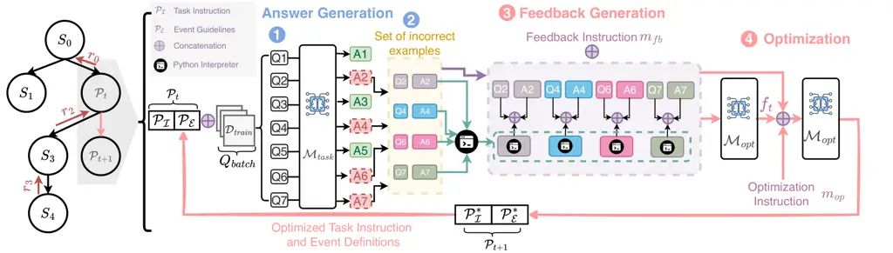

# Revisiting Prompt Optimization with Large Reasoning Models—A Case Study on Event Extraction

Saurabh Srivastava & Ziyu Yao Affiliation: George Mason University
Affiliation: Fairfax, VA 22030, USA
Email: [{ssrivas6,ziyuyao}@gmu.edu](mailto:)

###### Abstract

Large Reasoning Models (LRMs) such as DeepSeek-R1 and OpenAI o1 have
demonstrated remarkable capabilities in various reasoning tasks. Their
strong capability to generate and reason over intermediate thoughts has
also led to arguments that they may no longer require extensive prompt
engineering or optimization to interpret human instructions and produce
accurate outputs. In this work, we aim to systematically study this open
question, using the structured task of event extraction for a case
study. We experimented with two LRMs (DeepSeek-R1 and o1) and two
general-purpose Large Language Models (LLMs) (GPT-4o and GPT-4.5), when
they were used as task models or prompt optimizers. Our results show
that on tasks as complicated as event extraction, LRMs as task models
still benefit from prompt optimization, and that using LRMs as prompt
optimizers yields more effective prompts. Our finding also generalizes
to tasks beyond event extraction. Finally, we provide an error analysis
of common errors made by LRMs and highlight the stability and
consistency of LRMs in refining task instructions and event guidelines.

|     |
| --- |
|     |

## 1 Introduction

Figure 1: Summary of our main results, where LRMs and LLMs are used as
either the task model ($`\mathcal{M}_{task}`$) or the optimizer
($`\mathcal{M}_{opt}`$) in prompt optimization, and we observed a strong
advantage of LRMs over LLMs.

In recent years, Large Language Models (LLMs) have demonstrated
remarkable capabilities across various natural language processing
tasks. However, their proficiency in complex reasoning tasks has often
been limited (Zhou et al., 2022). To address this, a new class of
models, known as Large Reasoning Models (LRMs), has emerged, focusing on
enhancing reasoning abilities through advanced training methodologies.
Two prominent examples are DeepSeek-R1 (Guo et al., 2025) and OpenAI’s
o1 (Zhong et al., 2024), both setting new standards in various reasoning
tasks.

The advent of these advanced reasoning models has sparked discussions
(Wang et al., 2024a; OpenAI, 2025; Mantaras, 2025; Together AI, 2025;
Menendez et al., 2025) about the necessity of prompt optimization—the
process of refining input prompts to guide model outputs effectively
(Zhou et al., 2022; Yang et al., 2024; Srivastava et al., 2024; Agarwal
et al., 2024; Guo et al., 2024; Fernando et al., 2024; Li et al., 2025).
Traditionally, prompt optimization has been crucial for enhancing LLM
performance, with frameworks like PromptAgent (Wang et al., 2024b) and
OPRO (Yang et al., 2024) automating the creation and refinement of
prompts through iterative feedback and strategic planning. However, the
inherent reasoning capabilities of LRMs raise questions about whether
such prompt optimization techniques are equally beneficial for these
models. While previous studies have demonstrated the effectiveness of
prompt optimization in improving LLM performance, there is a notable gap
in research focusing on its impact on LRMs. Moreover, many existing
prompt optimization studies focus on tasks where zero-shot baselines
already perform well, whereas recent work, such as Gao et al. (2024),
demonstrates that even powerful models like GPT-4 struggle with
Information Extraction tasks, underscoring the need for more targeted
and optimized prompting strategies.

To fill this gap, we conduct the first systematic study of prompt
optimization with LRMs and compare their performance with LLMs. In
particular, we experimented with these models on a challenging task,
i.e., end-to-end event extraction (EE), a structured prediction task of
information extraction that requires identifying and classifying event
triggers and arguments within text. EE poses unique challenges: models
must follow schema constraints, handle coreference, and balance
precision with recall, all of which demand nuanced reasoning. We
evaluated four models, two LRMs (DeepSeek-R1, o1) and two LLMs (GPT-4.5,
GPT-4o) as both task models and prompt optimizers within a Monte Carlo
Tree Search (MCTS) framework (Wang et al., 2024b). This setup allows us
to examine both task performance and prompt optimization quality under a
consistent setting.

Our experimental results (Fig. 1) show that LRMs benefit substantially
from prompt optimization, even when the training set for optimization is
small, and they outperform LLMs in both task performance (as a task
model) and optimization effectiveness (as a prompt optimizer). When used
as optimizers, LRMs produce more precise prompts that align with human
annotation heuristics, leading to faster convergence and lower variance
in MCTS. Our error analysis further shows that these optimized prompts
reduce common mistakes such as implicit trigger overgeneration or
argument span drift. While DeepSeek-R1 as a prompt optimizer yields the
most effective and concise prompts, prompt length alone is not
predictive, i.e., different task models prefer different prompt styles.
To test generality, we apply the same optimization framework to two
tasks beyond EE, i.e., Geometric Shapes (Suzgun et al., 2022) and NCBI
Disease NER (Doğan et al., 2014). In both, LRMs again show the largest
gains, confirming that our findings extend beyond schema-based tasks.

## 2 Related Works

Prompt optimization has become an essential direction in adapting LLMs
for downstream tasks without modifying their weights. For models with
accessible internal states, such as open-source LLMs, prior work has
explored soft prompt tuning (Li & Liang, 2021; Lester et al., 2021; Wang
et al., 2023b; Hu et al., 2022) and gradient-based search methods that
directly adjust prompt embeddings (Shin et al., 2020; Wen et al., 2023).
Reinforcement learning has also been applied to optimize prompts through
interaction-based feedback (Deng et al., 2022; Zhang et al., 2023).

However, these approaches are not applicable to closed-source LLMs
accessed via APIs, where gradients and internal representations are
unavailable. As such, research has focused on black-box, gradient-free
techniques that rely on prompt perturbation and scoring. Many of these
methods operate in an iterative loop: starting from an initial prompt,
they generate variants, evaluate them on held-out examples, and retain
the best one for the next round. Variants can be created through
phrase-level edits (Prasad et al., 2023), back-translation (Xu et al.,
2022), evolutionary operations (Guo et al., 2024; Fernando et al.,
2024), or by prompting another LLM to rewrite the prompt based on model
errors (Zhou et al., 2022; Pryzant et al., 2023; Srivastava et al.,
2024; Wang et al., 2024b). Structured strategies such as Monte Carlo
search (Zhou et al., 2022), Gibbs sampling (Xu et al., 2024), and beam
search (Pryzant et al., 2023) have been explored to improve the
efficiency of exploration.

More recent efforts have proposed structured prompt optimization.
APE (Zhou et al., 2022) uses Monte Carlo Tree Search (MCTS) to explore
the prompt space, while PromptBreeder (Fernando et al., 2024) and
EvoPrompt (Guo et al., 2024) evolve prompts using feedback-driven
mutation strategies. OPRO (Yang et al., 2024) employs mutation-based
search guided by model performance. Other systems, such as PromptWizard
(Agarwal et al., 2024) and Gödel Machine (Yin et al., 2025), incorporate
self-evolving mechanisms in which the LLM iteratively generates,
critiques, and refines its own prompts and examples.

While these approaches are promising, they have so far been applied
exclusively to large, general-purpose LLMs. To the best of our
knowledge, our work is the first to investigate prompt optimization for
LRMs. Furthermore, we introduce and study this framework in the context
of a structured prediction task, event extraction, which poses distinct
challenges compared to typical mathematical or reasoning tasks explored
in prior work (Zhou et al., 2022; Srivastava et al., 2024).

Figure 2: An example prompt for end-to-end Event Extraction (EE) used in
our experiments, consisting of a task instruction and an event schema.
The event schema contains information about the labels that are
represented as Python classes and event guidelines defining both the
event classes and the arguments. In prompt optimization, we refine both
the task instruction and event guidelines (shown for two events; others
omitted due to space limits) to generate more effective prompts for the
task model.

## 3 Methodology

### 3.1 Problem Setup

Discrete prompt optimization aims to refine task-specific prompts for a
task LLM $`\mathcal{M}_{task}`$ to improve its performance without
modifying the model weights. In this study, we analyze whether LRMs
benefit from prompt optimization in the context of end-to-end EE. The
task consists of trigger extraction, which involves identifying event
trigger spans and classifying their event types, and argument
extraction, which requires identifying argument spans within the
extracted event instance with a pre-defined role. To prompt a task
model, $`\mathcal{M}_{task}`$, we adopted a Python code-based
representation for both the input and the output of the model, which was
shown to be effective by prior work (Wang et al., 2023a; Sainz et al.,
2024; Li et al., 2023; Li et al., 2024; Srivastava et al., 2025). As
shown in Fig. 2, the initial prompt, $`\mathcal{P}_{0}`$ consists of two
main parts: the task instruction and the event schema annotated by
guidelines. Task instruction $`\mathcal{P}_{\mathcal{I}}`$ forms the
initial segment of input to introduce the task and specify instructions
such as the desired output format. The event schema contains information
about the labels, such as event names and argument roles, that are
represented as Python classes. The argument roles (e.g., time and place)
are defined as attributes of event classes. All the events and arguments
in a schema are annotated using human-written event guidelines
$`\mathcal{P}_{\mathcal{E}}`$. The output is represented as a list of
instances of the classes defined in the event schema. In this paper, we
refine both $`\mathcal{P}_{\mathcal{I}}`$ and
$`\mathcal{P}_{\mathcal{E}}`$ which is represented as the concatenation
$`\mathcal{P}_{0}=[\mathcal{P}_{\mathcal{I}}||\mathcal{P}_{\mathcal{E}}]`$,
where $`||`$ represents the concatenation.

Given a training set
$`\mathcal{D}_{train}=\{(Q_{i},A_{i})\}_{i=1}^{N}`$, where each
$`Q_{i}`$ denotes an input text and $`A_{i}`$ its corresponding event
instance, the objective of prompt optimization is to discover an optimal
prompt $`\mathcal{P}^{*}`$ that maximizes a task-specific evaluation
function $`\mathcal{R}`$, such as the F-score for EE. Event guidelines
typically contain a combination of explicit schema constraints and
implicit domain-specific rules that annotators follow during data
labeling. However, not all of these rules are fully documented or easily
translatable into a single static prompt. As a result, the initial
prompt $`\mathcal{P}_{0}`$ may lack critical structural or interpretive
cues required for high-quality extraction. We employ an optimizer LLM
$`\mathcal{M}_{opt}`$ to refine $`\mathcal{P}_{0}`$ to discover such
rules and constraints through strategic planning for superior,
expert-level prompt optimization. Note that we do not modify the event
schema defined by the original EE task, but only the human-written task
instruction and the guidelines.

Figure 3: Overview of our prompt optimization framework. At each
iteration, a zero-shot task LLM generates outputs, while a separate
optimizer LLM analyzes the errors and updates the prompt, including task
instructions and event guidelines, accordingly. This process continues
over batches of training samples $`\mathcal{D}_{train}`$, and the final
optimized prompt is evaluated on the development set to determine the
node reward $`r_{t}`$.

### 3.2 Prompt Optimization Framework

We frame prompt optimization as a discrete search over a large
natural-language prompt space $`\mathcal{S}`$. Since $`\mathcal{S}`$ is
too large for exhaustive search, we adopt Monte Carlo Tree Search (MCTS)
to explore it efficiently, balancing exploration of new prompts with
exploitation of promising ones, as in Wang et al. (2024b). We model the
process as a Markov Decision Process (MDP) where each state $`s_{t}`$ is
a prompt $`\mathcal{P}_{t}`$ and each action is formulated to make edits
to the current prompt (e.g., adding constraints or clarifying rules).

Prompt optimization assumes a training set $`\mathcal{D}_{train}`$. As
illustrated in Fig. 3, each MCTS node holds a prompt $`\mathcal{P}_{t}`$
and a batch of queries $`Q_{batch}`$ from the training set. In Step 1,
the task model $`\mathcal{M}_{task}`$ is first employed to generate
answers for queries in $`Q_{batch}`$. The incorrect outputs generated by
the task model are then extracted and passed through a Python
interpreter to identify issues such as parsing errors, missing event
types, and invalid spans (Step 2). Following it, in Step 3, we prompt a
prompt optimizer LLM $`\mathcal{M}_{opt}`$ with an instruction
$`m_{fb}`$ to analyze the model errors and generate structured feedback
$`f_{t}`$, including pinpointing unclear role definitions, proposing
fixes, and summarizing recurring issues. In doing so, the generated
feedback can be leveraged to produce targeted, actionable edits to
improve clarity, coverage, and consistency of the task instruction and
event guidelines. Next, in Step 4, $`\mathcal{M}_{opt}`$ is instructed
by another instruction $`m_{opt}`$ to generate the updated prompt
$`\mathcal{P}_{t+1}`$ in a single pass, based on the distribution
$`p_{\mathcal{M}_{opt}}(s_{t+1}\mid s_{t},f_{t},m_{opt})`$. We also pass
the history of previous prompts to discourage redundant edits. Only
event types involved in the error batch are updated; others are
inherited unchanged.

To evaluate each new prompt, we compute a reward
$`r_{t}=\mathcal{R}(s_{t},f_{t})`$ based on averaged F1 scores across EE
subtasks (TI, TC, AI, AC, described in Section 4.1) on a held-out
development (dev) set after editing $`\mathcal{P}_{t}`$ with feedback
$`f_{t}`$. The best prompt is selected based on dev-set performance. We
provide additional details, the full algorithm, and the settings in
Appendix A.

## 4 Experiments

### 4.1 Experimental Setup

#### Dataset.

To evaluate the impact of prompt optimization on LRMs, we conduct
experiments on the widely used ACE05 dataset (Doddington et al., 2004),
a standard benchmark for EE that provides fine-grained event
distinctions. We used the “split 1” preprocessed by Huang et al. (2024)
and further processed it into the Python code format. The original ACE05
dataset includes 33 event types. However, our preliminary exploration
found that including all 33 event types for prompt optimization could
lead to overly long prompts, which both LLMs and LRMs cannot properly
handle. To eliminate the impact of this confounding factor while
assessing whether LRMs require and facilitate prompt optimization, we
downsampled a subset of 10 event types in our experiments and left the
issue of long-context processing as future work.

We utilize two smaller versions of ACE05 training set in our experiments
as $`\mathcal{D}_{train}`$. To simulate low-resource conditions, we
construct ACE*(low) of 15 samples, where we select one instance per
event type, prioritizing those with higher densities of event and
argument annotations (i.e., training examples annotated with multiple
event instances); the remaining samples are non-event instances. To
examine the effect of scaling up the training size, we also construct a
medium-scale dataset, ACE*(med), comprising 120 examples—ten per event
type—with the remaining being non-event instances. For both settings, we
use a consistent development set of 100 examples randomly sampled from
the ACE05 development set and focus our discussions about various task
and optimizer models’ performance on this set. For the full MCTS, we
additionally report the model performance on a test set consisting of
250 examples randomly sampled from the ACE05 test set. Dataset
statistics for ACE*(low) and ACE*(med) are summarized in Table 4
(Appendix A).

To test generalization beyond EE, we additionally include two tasks:
Geometric Shapes (Suzgun et al., 2022), a symbolic reasoning benchmark,
and NCBI Disease NER (Doğan et al., 2014), a biomedical named entity
recognition task.

#### Evaluation.

Following Huang et al. (2024), on EE, we evaluate models using four
F1-based metrics: (1) Trigger Identification (TI), which measures the
correct extraction of trigger spans; (2) Trigger Classification (TC),
which additionally requires predicting the correct event type; (3)
Argument Identification (AI), which assesses the correct extraction of
arguments and their association with the predicted trigger; and (4)
Argument Classification (AC), which further requires correct role
labeling and serves as the most comprehensive measure of overall
end-to-end EE performance. For analysis, we primarily report AC scores,
which are widely regarded as a precise metric for evaluating both
argument and trigger quality (Huang et al., 2024). Full results for all
EE metrics are provided in Appendix B. For Geometric Shapes, we report
test accuracy; for NCBI Disease NER, we report micro-F1 on strict
disease spans.

#### Experimental Settings and Baselines.

Our experiments involve two LRMs, DeepSeek-R1 and OpenAI-o1, and two
general-purpose LLMs, GPT-4.5 and GPT-4o, used both as
$`\mathcal{M}_{{opt}}`$ and $`\mathcal{M}_{{task}}`$. We conduct two
sets of experiments. First, we evaluate all models trained on ACE*(low)
and ACE*(med) using shallow MCTS (depth 1) to examine whether LRMs
benefit from prompt optimization. We started with this design choice
owing to its reduced complexity and computational costs. Next, we then
perform full MCTS (depth 5) optimization on ACE*(med) to investigate the
deeper dynamics of optimization; ACE*(low) is excluded from full-scale
search due to its limited size. In each depth of rollout, we expand the
parent node by three child expansions. For all our experiments, we
report results only from the best-performing prompt nodes in each
model’s search trajectory. To reduce the inference cost, we followed
Cheng et al. (2023) to employ “batch prompting” when querying
$`\mathcal{M}_{task}`$ for answer generation (Step 1 in Fig. 3).
Interestingly, we observed a performance gain than querying the task
model for one question at a time. Due to policy restrictions, we were
not allowed to access DeepSeek-R1 through API calls and thus deployed it
locally on our own server. Because of our compute limit, we quantize
DeepSeek-R1 to 2.5 bits using the UnSloth framework, which has shown
minimal degradation in reasoning tasks even at lower precisions when
rigorously benchmarked to 1.58 bits (Daniel Han & team, 2023).
Additional details on batch prompting and hyperparameter configurations
are provided in Appendix A.

### 4.2 Experimental Results

Our main results are presented in Table 1. We discuss the following
research questions (RQs).

#### RQ1: Do LRMs benefit from prompt optimization in EE?

We first study whether the models can gain from prompt optimization by
performing MCTS at depth 1. We observe consistent gains from prompt
optimization across all models, with LRMs showing especially strong
improvements over their non-optimized counterparts (around $`+8\%`$ on
ACE*(low) and $`+23\%`$ on ACE*(med)). LLMs also benefit from
optimization, though to a lesser extent: GPT-4o and GPT-4.5 improve by
around $`+7\%`$ and $`+5\%`$ on ACE*(low), and by $`+14\%`$ and
$`+20\%`$ on ACE*(med), respectively. Overall, the performance gains
from prompt optimization are more pronounced in LRMs than in LLMs.

Similarly, in cross-model comparisons using optimized prompts, LRMs
remain highly competitive. On ACE*(low), GPT-4.5 slightly outperforms o1
by about $`+1\%`$ AC but trails behind DeepSeek-R1 by roughly $`+2\%`$.
On ACE*(med), both LRMs outperform LLMs: o1 surpasses GPT-4.5 by
$`+0.5\%`$ AC, and DeepSeek-R1 gains over approximately $`+3.5\%`$.
These findings suggest that LRMs are not only more responsive to prompt
optimization but also more capable in zero-shot EE settings. As we show
in RQ2, this gap widens further when using the full-depth MCTS-based
optimization strategy.

Optimizer LLMs/LRMs $`(\mathcal{M}_{opt})`$ \#Output
$`\mathcal{M}_{task}`$ No Opt. GPT-4o GPT-4.5 o1 DS-R1 Tokens MCTS at
depth 1 trained on $`\mathbf{ACE_{low}}`$ (Development Set) GPT-4o 12.68
18.18 +5.50 16.67 +3.99 18.83 +6.15 20.15 +7.47 15.31 GPT-4.5 16.47
19.33 +2.86 16.47 00.00 19.32 +2.85 22.31 +5.84 24.57 o1 13.94 18.96
+5.02 18.57 +4.63 20.29 +6.35 21.92 +7.98 489.67 DS-R1 16.45 18.67 +2.22
18.57 +2.12 21.83 +5.38 24.66 +8.21 217.71 MCTS at depth 1 trained on
$`\mathbf{ACE_{med}}`$ (Development Set) GPT-4o 12.68 22.32 +9.64 27.54
+14.86 26.30 +13.62 25.10 +12.42 17.31 GPT-4.5 16.47 29.63 +13.16 35.94
+19.47 36.51 +20.04 35.42 +18.95 28.75 o1 13.94 30.19 +16.25 36.67
+22.73 36.98 +23.04 36.96 +23.02 543.45 DS-R1 16.45 32.20 +15.75 37.14
+20.69 38.77 +22.32 40.00 +23.55 277.11 MCTS at depth 5 trained on
$`\mathbf{ACE_{med}}`$ (Development Set) GPT-4o 12.68 28.04 +15.36 27.03
+14.35 28.57 +15.89 27.31 +14.63 17.55 GPT-4.5 16.47 32.35 +15.88 37.58
+21.11 36.22 +19.75 37.74 +21.27 32.65 o1 13.94 33.52 +19.58 37.78
+23.84 38.71 +24.77 39.81 +25.87 575.36 DS-R1 16.45 37.97 +21.52 38.40
+21.95 40.58 +24.13 44.26 +27.81 301.45 MCTS at depth 5 trained on
$`\mathbf{ACE_{med}}`$ (Test Set) GPT-4o 13.33 26.94 +13.61 34.75 +21.42
30.59 +17.26 35.79+22.46 27.00 GPT-4.5 14.29 27.31 +13.02 35.29 +21.00
36.59 +22.30 36.69 +22.40 35.56 o1 15.38 28.57 +13.19 36.73 +21.35 38.71
+23.33 37.86 +22.48 526.43 DS-R1 16.00 31.93 +15.93 41.98 +25.98 42.06
+26.06 43.75 +27.75 211.43

Table 1: AC (F1) scores using different $`\mathcal{M}_{task}`$ and
$`\mathcal{M}_{opt}`$. \#Output Tokens delineates the average number of
output tokens from the task model, including reasoning and non-reasoning
contents. The background shades indicate the choice of prompt
optimizers, i.e., LRMs, LLMs, or no optimization. The best optimization
result is in bold for each task model, while the highest relative
improvement over the no-optimization baseline is underlined. We observe
that LRMs not only benefit significantly from prompt optimization but
also serve as strong prompt optimizers for other models.

#### RQ2: How do LRMs perform under full-scale MCTS prompt optimization?

To assess whether the advantages of LRMs persist at scale, we perform
MCTS with a search depth of 5 across all models on ACE*(med). While
performance improves overall, we observe that the gains from full-scale
optimization are incremental rather than dramatic when compared to the
improvements observed with a single roll-out (i.e., depth 1) of MCTS.
LRMs, however, still exhibit relatively stronger improvements.
DeepSeek-R1, for instance, gains an additional $`+4.26\%`$ AC over its
previous best ($`40.00\mapsto 44.26`$). Similarly, o1 improves by
$`+2.83\%`$ ($`36.98\mapsto 39.81`$) when selecting the best optimizer
across depths. In contrast, LLMs GPT-4.5 and GPT-4o show modest gains of
only $`+1.23\%`$ ($`36.51\mapsto 37.74`$) and $`+1.03\%`$
($`27.54\mapsto 28.57`$), respectively. Finally, we report each task
model’s performance on the test set, using the same best prompt searched
on ACE*(med). Consistently, we observed that LRMs benefit more from full
MSTC prompt optimization than LLMs.

#### RQ3: Do LRMs make better prompt optimizers?

We evaluate each task model’s performance when optimized using various
LRMs and LLMs to investigate the quality of optimized prompts. In the
low-resource setting (ACE\_(low), Depth 1), DeepSeek-R1 consistently
outperforms all other optimizers across all task models. Compared to the
best-performing LLM optimizer (GPT-4o), DeepSeek-R1 yields substantial
gains: about $`+2\%`$ AC for optimizing GPT-4o (18.18$`\mapsto`$20.15),
$`+3\%`$ for GPT-4.5 (19.33$`\mapsto 22.31`$) and o1
(18.96$`\mapsto 21.92`$), and $`+6\%`$ when optimizing itself
(18.67$`\mapsto 24.66`$). Notably, among LLMs, GPT-4o performs better
than GPT-4.5 as an optimizer in all task model settings, despite being
weaker as a task model.

On the other hand, when a larger training set is available (ACE\_(med),
Depth 1), we observe a shift. While LRM optimizers remain
strong—achieving over +23% AC gain while optimizing themselves—GPT-4.5
shows a significant boost in effectiveness. It consistently outperforms
GPT-4o as an optimizer and in some cases narrows the gap with LRMs,
reaching $`35.94`$ when optimizing itself and $`36.67`$ when optimizing
o1.

[TABLE]

Table 2: Example task instructions optimized by different optimizers
when $`\mathcal{M}_{{task}}`$ = DeepSeek-R1, which yielded the best
performance for each optimizer. LRMs tend to emphasize actionable
extraction rules and exception handling, while paying minimal attention
to the task instruction and output format. Additionally, they often
include illustrative examples (in bold) to facilitate span extraction.

Qualitatively, as shown in Table 2, DeepSeek-R1 enhances the optimized
prompt $`\mathcal{P}^{*}`$ by adding precise extraction rules, such as
removing articles (“a/an/the”) and possessive pronouns (highlighted in
blue), as well as critical exception cases for handling specific
triggers (highlighted in pink). In contrast, o1 tends to generate a
larger number of extraction rules, resulting in longer prompts. Both
LRMs also include specific examples to guide extraction. LLMs, by
comparison, focus more on task instructions and output formatting,
typically generating shorter prompts with fewer examples. Among them,
GPT-4.5 occasionally adds exception handling, though this behavior is
less consistent than in LRMs. We provide additional examples of
optimized task instruction and event guidelines in Appendix C, and
include an additional analysis of the prompt quality in Section 5.

#### RQ4: Can LRMs act as efficient and stable optimizers in prompt optimization?

((a)) $`\mathcal{M}_{opt}=`$DeepSeek-R1

((b)) $`\mathcal{M}_{opt}=`$GPT-4.5

Figure 4: Convergence analysis of prompt optimization across different
task models with two optimizers—DeepSeek-R1 (left) and GPT-4.5 (right).
Task models converge faster with minimal variance when their prompts are
optimized by LRMs.

In Fig. 4(a), we observe that with DeepSeek-R1 as an optimizer,
DeepSeek-R1 and GPT-4o demonstrate faster convergence compared to when
GPT-4.5 is used as an optimizer (Fig. 4(b)), suggesting that it
generates a higher quality of prompts. For DeepSeek-R1 and GPT-4.5 as
task models, it also exhibits a smaller performance variance, which
shows that R1 not only generates high-quality prompts but also does so
reliably. In contrast, with GPT-4.5 as an optimizer, convergence tends
to be slower. Under this setup, both LRMs reach their peak at depth 3,
while GPT-4.5 and GPT-4o converge at depths 4 and 5, respectively. For
GPT-4.5, the optimization process is visibly less stable than optimizing
with DeepSeek-R1. Finally, we notice that most models begin to plateau,
or slightly decline, beyond their optimal depth (marked using
half-filled markers), reinforcing the presence of diminishing returns,
where additional optimization yields increasingly smaller or no
performance gains.

#### RQ5: Do the optimization gains with LRMs generalize beyond schema-based tasks?

Model No Opt. (Test) Depth 1 (Dev) Depth 5 (Dev) Depth 5 (Test) (a)
Symbolic Reasoning — Geometric Shapes (Accuracy) GPT-4o 53.40 61.20
+7.80 68.67 +15.27 67.50 +14.10 GPT-4.5 69.96 72.90 +2.94 75.33 +5.37
74.20 +4.24 o1 70.07 73.50 +3.43 78.00 +7.93 77.80 +7.73 DS-R1 69.67
73.80 +4.13 78.67 +9.00 78.40 +8.73 (b) Biomedical IE — NCBI Disease NER
(Micro-F1) GPT-4o 43.75 49.50 +5.75 54.37 +10.62 52.63 +8.88 GPT-4.5
56.25 58.67 +2.42 65.56 +9.31 64.56 +8.31 o1 53.13 66.46 +13.33 71.46
+18.33 70.15 +17.02 DS-R1 54.20 66.00 +11.80 71.40 +17.20 69.96 +15.76

Table 3: Results on symbolic reasoning and biomedical NER tasks.
Overall, LRMs benefit most from prompt optimization.

We further experimented on two tasks: Geometric Shapes and NCBI, and
reported each task model’s performance when we use the same model as an
optimizer. As shown in Table 3, on both tasks, we observe that prompt
optimization consistently improves all models. On Geometric Shapes, o1
and DeepSeek-R1 reach test accuracies of 77.80 and 78.40, outperforming
GPT-4.5 (74.20) and GPT-4o (67.50). While GPT-4o achieves a larger
relative gain (+14.1), LRMs still achieve higher absolute performance.
In NCBI, LRMs show strong gains and high final performance: o1 and
DeepSeek-R1 improve by +17.0% and +15.8% F1, respectively, reaching
70.15 and 69.96, well above the LLM performance. These results mirror
our findings on EE, reinforcing that LRMs not only serve as strong task
models post-optimization but also generalize effectively as optimizers
beyond schema-based tasks.

## 5 Further Analysis

#### Prompt Quality Across Optimizers

In addition to our qualitative analysis about Table 2 in RQ3, we also
analyze the distribution of prompt effectiveness using a survival plot
with DeepSeek-R1 as $`\mathcal{M}_{task}`$. The x-axis represents
increasing AC thresholds, while the y-axis indicates the percentage of
prompts that achieve at least that threshold. A higher survival curve
indicates that an optimizer more consistently produces high-performing
prompts. As shown in Fig. 5(a), prompts optimized via DeepSeek-R1
exhibit the strongest survival curve, maintaining high-performance
density even at stricter AC cutoffs ($`\geq 35\%`$ AC). In contrast,
GPT-4o’s curve decays rapidly, showing that while it occasionally
generates effective prompts, its output quality is inconsistent.
Interestingly, o1 and GPT-4.5 fall in between, with o1 slightly
outperforming GPT-4.5 in the mid-range thresholds but trailing
DeepSeek-R1 significantly at higher cutoffs. These trends reinforce our
earlier findings: reasoning models are not only capable of producing
better peak performance but also generate a greater density of usable
prompts.

((a))

((b))

((c))

Figure 5: (a) A survival plot showing the % of prompts (y-axis) that
achieve at least a given AC score (x-axis) for DeepSeek-R1 across
different optimizers. (b) Prompt length vs. AC score across the
best-performing full MCTS configuration for each task model on dev set.
(c) Error categorization for DeepSeek-R1 as the task model with various
optimizers.

#### Prompt Length vs. Task Model Performance

To better understand how much instruction is needed for different task
models to reach their peak performance, we analyze the relationship
between prompt length and model accuracy across full MCTS search trees.
For each model, we select its best-performing search trajectory (i.e.,
o1 as optimizer for GPT-4o and DeepSeek-R1 as optimizer for the other
task models) and plot the corresponding full prompt lengths (including
inherited definitions) against their AC scores in Fig. 5(b). DeepSeek-R1
achieves its highest performance utilizing the shortest prompt
($`\sim 1750`$ tokens) in the search space, suggesting a preference for
more concise task instructions. In contrast, both LLMs (GPT-4o and
GPT-4.5) and the reasoning model o1 tend to rely on significantly longer
prompts to achieve comparable accuracy.

#### Error Analysis

To better understand the types of errors introduced by different
optimizers, we conduct a fine-grained analysis of all development
examples where DeepSeek-R1 fails on prompts generated by different
optimizers. As shown in Fig. 5(c), LRMs notably reduce event-related
errors, particularly those involving multiple or implicit events.
Argument-related issues, such as coreference errors and span
overprediction, are also slightly reduced. In some cases, all models
produce non-parsable outputs or hallucinated argument spans. The
remaining errors are primarily attributed to label noise in the dataset.
We provide an example for each error category in Appendix B.

## 6 Conclusion

We present the first systematic study of prompt optimization for LRMs,
evaluating their roles as both task models and optimizers in a unified
MCTS framework. On the structured task of event extraction, we find that
LRMs benefit more from prompt optimization than LLMs and serve as
stronger optimizers. They produce higher-quality prompts, converge
faster, and generalize more reliably across models, highlighting their
effectiveness in both prompt consumption and generation. Our error
analysis further reveals that prompts optimized by LRMs reduce
overprediction, hallucination, and parsing errors, contributing to more
faithful and structured outputs. These trends generalize beyond event
extraction: on Geometric Shapes and NCBI Disease NER, optimization
improves all models, with LRMs outperforming LLMs when serving as their
own optimizers. This strengthens our claim that LRMs both profit from
and serve as strong agents for prompt optimization across diverse tasks.

## References

- Agarwal et al. (2024) Eshaan Agarwal, Joykirat Singh, Vivek Dani,
  Raghav Magazine, Tanuja Ganu, and Akshay Nambi. Promptwizard:
  Task-aware prompt optimization framework, 2024. URL
  [https://arxiv.org/abs/2405.18369](https://arxiv.org/abs/2405.18369).
- Cheng et al. (2023) Zhoujun Cheng, Jungo Kasai, and Tao Yu. Batch
  prompting: Efficient inference with large language model APIs. In
  Mingxuan Wang and Imed Zitouni (eds.), _Proceedings of the 2023
  Conference on Empirical Methods in Natural Language Processing:
  Industry Track_, pp. 792–810, Singapore, December 2023. Association
  for Computational Linguistics. doi:
  10.18653/v1/2023.emnlp-industry.74. URL
  [https://aclanthology.org/2023.emnlp-industry.74/](https://aclanthology.org/2023.emnlp-industry.74/).
- Daniel Han & team (2023) Michael Han Daniel Han and Unsloth team.
  Unsloth, 2023. URL
  [http://github.com/unslothai/unsloth](http://github.com/unslothai/unsloth).
- Deng et al. (2022) Mingkai Deng, Jianyu Wang, Cheng-Ping Hsieh, Yihan
  Wang, Han Guo, Tianmin Shu, Meng Song, Eric Xing, and Zhiting Hu.
  RLPrompt: Optimizing discrete text prompts with reinforcement
  learning. In Yoav Goldberg, Zornitsa Kozareva, and Yue Zhang (eds.),
  _Proceedings of the 2022 Conference on Empirical Methods in Natural
  Language Processing_, pp. 3369–3391, Abu Dhabi, United Arab Emirates,
  December 2022. Association for Computational Linguistics. doi:
  10.18653/v1/2022.emnlp-main.222. URL
  [https://aclanthology.org/2022.emnlp-main.222/](https://aclanthology.org/2022.emnlp-main.222/).
- Doddington et al. (2004) George Doddington, Alexis Mitchell, Mark
  Przybocki, Lance Ramshaw, Stephanie Strassel, and Ralph Weischedel.
  The automatic content extraction (ACE) program – tasks, data, and
  evaluation. In Maria Teresa Lino, Maria Francisca Xavier, Fátima
  Ferreira, Rute Costa, and Raquel Silva (eds.), _Proceedings of the
  Fourth International Conference on Language Resources and Evaluation
  (LREC‘04)_, Lisbon, Portugal, May 2004. European Language Resources
  Association (ELRA). URL
  [https://aclanthology.org/L04-1011/](https://aclanthology.org/L04-1011/).
- Doğan et al. (2014) Rezarta Islamaj Doğan, Robert Leaman, and Zhiyong
  Lu. Ncbi disease corpus: a resource for disease name recognition and
  concept normalization. _Journal of biomedical informatics_,
  47:1–10, 2014.
- Fernando et al. (2024) Chrisantha Fernando, Dylan Sunil Banarse,
  Henryk Michalewski, Simon Osindero, and Tim Rocktäschel.
  Promptbreeder: Self-referential self-improvement via prompt
  evolution, 2024. URL
  [https://openreview.net/forum?id=HKkiX32Zw1](https://openreview.net/forum?id=HKkiX32Zw1).
- Gao et al. (2024) Jun Gao, Huan Zhao, Wei Wang, Changlong Yu, and
  Ruifeng Xu. Eventrl: Enhancing event extraction with outcome
  supervision for large language models. 2024.
- Guo et al. (2025) Daya Guo, Dejian Yang, Haowei Zhang, Junxiao Song,
  Ruoyu Zhang, Runxin Xu, Qihao Zhu, Shirong Ma, Peiyi Wang, Xiao Bi,
  et al. Deepseek-r1: Incentivizing reasoning capability in llms via
  reinforcement learning. 2025.
- Guo et al. (2024) Qingyan Guo, Rui Wang, Junliang Guo, Bei Li, Kaitao
  Song, Xu Tan, Guoqing Liu, Jiang Bian, and Yujiu Yang. Connecting
  large language models with evolutionary algorithms yields powerful
  prompt optimizers. In _The Twelfth International Conference on
  Learning Representations_, 2024. URL
  [https://openreview.net/forum?id=ZG3RaNIsO8](https://openreview.net/forum?id=ZG3RaNIsO8).
- Hu et al. (2022) Edward J Hu, yelong shen, Phillip Wallis, Zeyuan
  Allen-Zhu, Yuanzhi Li, Shean Wang, Lu Wang, and Weizhu Chen. LoRA:
  Low-rank adaptation of large language models. In _International
  Conference on Learning Representations_, 2022. URL
  [https://openreview.net/forum?id=nZeVKeeFYf9](https://openreview.net/forum?id=nZeVKeeFYf9).
- Huang et al. (2024) Kuan-Hao Huang, I-Hung Hsu, Tanmay Parekh, Zhiyu
  Xie, Zixuan Zhang, Prem Natarajan, Kai-Wei Chang, Nanyun Peng, and
  Heng Ji. Textee: Benchmark, reevaluation, reflections, and future
  challenges in event extraction. In _Findings of the Association for
  Computational Linguistics ACL 2024_, pp. 12804–12825, 2024.
- Lester et al. (2021) Brian Lester, Rami Al-Rfou, and Noah Constant.
  The power of scale for parameter-efficient prompt tuning. In
  Marie-Francine Moens, Xuanjing Huang, Lucia Specia, and Scott Wen-tau
  Yih (eds.), _Proceedings of the 2021 Conference on Empirical Methods
  in Natural Language Processing_, pp. 3045–3059, Online and Punta Cana,
  Dominican Republic, November 2021. Association for Computational
  Linguistics. doi: 10.18653/v1/2021.emnlp-main.243. URL
  [https://aclanthology.org/2021.emnlp-main.243/](https://aclanthology.org/2021.emnlp-main.243/).
- Li et al. (2023) Peng Li, Tianxiang Sun, Qiong Tang, Hang Yan, Yuanbin
  Wu, Xuanjing Huang, and Xipeng Qiu. CodeIE: Large code generation
  models are better few-shot information extractors. In Anna Rogers,
  Jordan Boyd-Graber, and Naoaki Okazaki (eds.), _Proceedings of the
  61st Annual Meeting of the Association for Computational Linguistics
  (Volume 1: Long Papers)_, pp. 15339–15353, Toronto, Canada, July 2023.
  Association for Computational Linguistics. doi:
  10.18653/v1/2023.acl-long.855. URL
  [https://aclanthology.org/2023.acl-long.855/](https://aclanthology.org/2023.acl-long.855/).
- Li et al. (2025) Wenwu Li, Xiangfeng Wang, Wenhao Li, and Bo Jin. A
  survey of automatic prompt engineering: An optimization
  perspective, 2025. URL
  [https://arxiv.org/abs/2502.11560](https://arxiv.org/abs/2502.11560).
- Li & Liang (2021) Xiang Lisa Li and Percy Liang. Prefix-tuning:
  Optimizing continuous prompts for generation. In Chengqing Zong, Fei
  Xia, Wenjie Li, and Roberto Navigli (eds.), _Proceedings of the 59th
  Annual Meeting of the Association for Computational Linguistics and
  the 11th International Joint Conference on Natural Language Processing
  (Volume 1: Long Papers)_, pp. 4582–4597, Online, August 2021.
  Association for Computational Linguistics. doi:
  10.18653/v1/2021.acl-long.353. URL
  [https://aclanthology.org/2021.acl-long.353/](https://aclanthology.org/2021.acl-long.353/).
- Li et al. (2024) Zixuan Li, Yutao Zeng, Yuxin Zuo, Weicheng Ren,
  Wenxuan Liu, Miao Su, Yucan Guo, Yantao Liu, Lixiang Lixiang, Zhilei
  Hu, Long Bai, Wei Li, Yidan Liu, Pan Yang, Xiaolong Jin, Jiafeng Guo,
  and Xueqi Cheng. KnowCoder: Coding structured knowledge into LLMs for
  universal information extraction. In Lun-Wei Ku, Andre Martins, and
  Vivek Srikumar (eds.), _Proceedings of the 62nd Annual Meeting of the
  Association for Computational Linguistics (Volume 1: Long Papers)_,
  pp. 8758–8779, Bangkok, Thailand, August 2024. Association for
  Computational Linguistics. doi: 10.18653/v1/2024.acl-long.475. URL
  [https://aclanthology.org/2024.acl-long.475/](https://aclanthology.org/2024.acl-long.475/).
- Mantaras (2025) Agustin Mantaras. Prompt engineering for openai’s o1
  and o3-mini reasoning models. Microsoft Tech Community Blog,
  February 2025. URL
  [https://techcommunity.microsoft.com/blog/azure-ai-services-blog/prompt-engineering-for-openai%E2%80%99s-o1-and-o3-mini-reasoning-models/4374010](https://techcommunity.microsoft.com/blog/azure-ai-services-blog/prompt-engineering-for-openai%E2%80%99s-o1-and-o3-mini-reasoning-models/4374010).
- Menendez et al. (2025) Hector D. Menendez, Gema Bello-Orgaz, and
  Cristian Ramírez Atencia. Deepstableyolo: Deepseek-driven prompt
  engineering and search-based optimization for AI image generation. In
  _XVI Congreso Español de Metaheurísticas, Algoritmos Evolutivos y
  Bioinspirados_, 2025. URL
  [https://openreview.net/forum?id=hZucDPawRu](https://openreview.net/forum?id=hZucDPawRu).
- OpenAI (2025) OpenAI. Reasoning best practices. OpenAI Platform
  Documentation, April 2025. URL
  [https://platform.openai.com/docs/guides/reasoning-best-practices#how-to-prompt-reasoning-models-effectively](https://platform.openai.com/docs/guides/reasoning-best-practices#how-to-prompt-reasoning-models-effectively).
- Prasad et al. (2023) Archiki Prasad, Peter Hase, Xiang Zhou, and Mohit
  Bansal. GrIPS: Gradient-free, edit-based instruction search for
  prompting large language models. In Andreas Vlachos and Isabelle
  Augenstein (eds.), _Proceedings of the 17th Conference of the European
  Chapter of the Association for Computational Linguistics_, pp.
  3845–3864, Dubrovnik, Croatia, May 2023. Association for Computational
  Linguistics. doi: 10.18653/v1/2023.eacl-main.277. URL
  [https://aclanthology.org/2023.eacl-main.277/](https://aclanthology.org/2023.eacl-main.277/).
- Pryzant et al. (2023) Reid Pryzant, Dan Iter, Jerry Li, Yin Lee,
  Chenguang Zhu, and Michael Zeng. Automatic prompt optimization with
  “gradient descent” and beam search. In Houda Bouamor, Juan Pino, and
  Kalika Bali (eds.), _Proceedings of the 2023 Conference on Empirical
  Methods in Natural Language Processing_, pp. 7957–7968, Singapore,
  December 2023. Association for Computational Linguistics. doi:
  10.18653/v1/2023.emnlp-main.494. URL
  [https://aclanthology.org/2023.emnlp-main.494/](https://aclanthology.org/2023.emnlp-main.494/).
- Sainz et al. (2024) Oscar Sainz, Iker García-Ferrero, Rodrigo Agerri,
  Oier Lopez de Lacalle, German Rigau, and Eneko Agirre. GoLLIE:
  Annotation guidelines improve zero-shot information-extraction. In
  _The Twelfth International Conference on Learning
  Representations_, 2024. URL
  [https://openreview.net/forum?id=Y3wpuxd7u9](https://openreview.net/forum?id=Y3wpuxd7u9).
- Shin et al. (2020) Taylor Shin, Yasaman Razeghi, Robert L. Logan IV,
  Eric Wallace, and Sameer Singh. AutoPrompt: Eliciting Knowledge from
  Language Models with Automatically Generated Prompts. In Bonnie
  Webber, Trevor Cohn, Yulan He, and Yang Liu (eds.), _Proceedings of
  the 2020 Conference on Empirical Methods in Natural Language
  Processing (EMNLP)_, pp. 4222–4235, Online, November 2020. Association
  for Computational Linguistics. doi: 10.18653/v1/2020.emnlp-main.346.
  URL
  [https://aclanthology.org/2020.emnlp-main.346/](https://aclanthology.org/2020.emnlp-main.346/).
- Srivastava et al. (2024) Saurabh Srivastava, Chengyue Huang, Weiguo
  Fan, and Ziyu Yao. Instances need more care: Rewriting prompts for
  instances with LLMs in the loop yields better zero-shot performance.
  In Lun-Wei Ku, Andre Martins, and Vivek Srikumar (eds.), _Findings of
  the Association for Computational Linguistics: ACL 2024_, pp.
  6211–6232, Bangkok, Thailand, August 2024. Association for
  Computational Linguistics. doi: 10.18653/v1/2024.findings-acl.371. URL
  [https://aclanthology.org/2024.findings-acl.371/](https://aclanthology.org/2024.findings-acl.371/).
- Srivastava et al. (2025) Saurabh Srivastava, Sweta Pati, and Ziyu Yao.
  Instruction-tuning llms for event extraction with annotation
  guidelines, 2025. URL
  [https://arxiv.org/abs/2502.16377](https://arxiv.org/abs/2502.16377).
- Suzgun et al. (2022) Mirac Suzgun, Nathan Scales, Nathanael Schärli,
  Sebastian Gehrmann, Yi Tay, Hyung Won Chung, Aakanksha Chowdhery,
  Quoc V Le, Ed H Chi, Denny Zhou, et al. Challenging big-bench tasks
  and whether chain-of-thought can solve them. _arXiv preprint
  arXiv:2210.09261_, 2022.
- Together AI (2025) Together AI. Prompting deepseek-r1. Together AI
  Documentation, February 2025. URL
  [https://docs.together.ai/docs/prompting-deepseek-r1](https://docs.together.ai/docs/prompting-deepseek-r1).
- Wang et al. (2024a) Guoqing Wang, Zeyu Sun, Zhihao Gong, Sixiang Ye,
  Yizhou Chen, Yifan Zhao, Qingyuan Liang, and Dan Hao. Do advanced
  language models eliminate the need for prompt engineering in software
  engineering? 2024a.
- Wang et al. (2023a) Xingyao Wang, Sha Li, and Heng Ji. Code4struct:
  Code generation for few-shot event structure prediction. In
  _Proceedings of the 61st Annual Meeting of the Association for
  Computational Linguistics (Volume 1: Long Papers)_, pp. 3640–3663,
  2023a.
- Wang et al. (2024b) Xinyuan Wang, Chenxi Li, Zhen Wang, Fan Bai,
  Haotian Luo, Jiayou Zhang, Nebojsa Jojic, Eric Xing, and Zhiting Hu.
  Promptagent: Strategic planning with language models enables
  expert-level prompt optimization. In _The Twelfth International
  Conference on Learning Representations_, 2024b. URL
  [https://openreview.net/forum?id=22pyNMuIoa](https://openreview.net/forum?id=22pyNMuIoa).
- Wang et al. (2023b) Zhen Wang, Rameswar Panda, Leonid Karlinsky,
  Rogerio Feris, Huan Sun, and Yoon Kim. Multitask prompt tuning enables
  parameter-efficient transfer learning. In _The Eleventh International
  Conference on Learning Representations_, 2023b. URL
  [https://openreview.net/forum?id=Nk2pDtuhTq](https://openreview.net/forum?id=Nk2pDtuhTq).
- Wen et al. (2023) Yuxin Wen, Neel Jain, John Kirchenbauer, Micah
  Goldblum, Jonas Geiping, and Tom Goldstein. Hard prompts made easy:
  Gradient-based discrete optimization for prompt tuning and discovery.
  In _Thirty-seventh Conference on Neural Information Processing
  Systems_, 2023. URL
  [https://openreview.net/forum?id=VOstHxDdsN](https://openreview.net/forum?id=VOstHxDdsN).
- Xu et al. (2022) Hanwei Xu, Yujun Chen, Yulun Du, Nan Shao, Wang
  Yanggang, Haiyu Li, and Zhilin Yang. GPS: Genetic prompt search for
  efficient few-shot learning. In Yoav Goldberg, Zornitsa Kozareva, and
  Yue Zhang (eds.), _Proceedings of the 2022 Conference on Empirical
  Methods in Natural Language Processing_, pp. 8162–8171, Abu Dhabi,
  United Arab Emirates, December 2022. Association for Computational
  Linguistics. doi: 10.18653/v1/2022.emnlp-main.559. URL
  [https://aclanthology.org/2022.emnlp-main.559/](https://aclanthology.org/2022.emnlp-main.559/).
- Xu et al. (2024) Weijia Xu, Andrzej Banburski-Fahey, and Nebojsa
  Jojic. Reprompting: Automated chain-of-thought prompt inference
  through gibbs sampling, 2024. URL
  [https://arxiv.org/abs/2305.09993](https://arxiv.org/abs/2305.09993).
- Yang et al. (2024) Chengrun Yang, Xuezhi Wang, Yifeng Lu, Hanxiao Liu,
  Quoc V Le, Denny Zhou, and Xinyun Chen. Large language models as
  optimizers. In _The Twelfth International Conference on Learning
  Representations_, 2024. URL
  [https://openreview.net/forum?id=Bb4VGOWELI](https://openreview.net/forum?id=Bb4VGOWELI).
- Yin et al. (2025) Xunjian Yin, Xinyi Wang, Liangming Pan, Xiaojun Wan,
  and William Yang Wang. Gödel agent: A self-referential agent framework
  for recursive self-improvement, 2025. URL
  [https://arxiv.org/abs/2410.04444](https://arxiv.org/abs/2410.04444).
- Zhang et al. (2023) Tianjun Zhang, Xuezhi Wang, Denny Zhou, Dale
  Schuurmans, and Joseph E. Gonzalez. TEMPERA: Test-time prompt editing
  via reinforcement learning. In _The Eleventh International Conference
  on Learning Representations_, 2023. URL
  [https://openreview.net/forum?id=gSHyqBijPFO](https://openreview.net/forum?id=gSHyqBijPFO).
- Zhong et al. (2024) Tianyang Zhong, Zhengliang Liu, Yi Pan, Yutong
  Zhang, Yifan Zhou, Shizhe Liang, Zihao Wu, Yanjun Lyu, Peng Shu,
  Xiaowei Yu, et al. Evaluation of openai o1: Opportunities and
  challenges of agi. 2024.
- Zhou et al. (2022) Yongchao Zhou, Andrei Ioan Muresanu, Ziwen Han,
  Keiran Paster, Silviu Pitis, Harris Chan, and Jimmy Ba. Large language
  models are human-level prompt engineers. In _The Eleventh
  International Conference on Learning Representations_, 2022.

## Appendix A Additional Details

### A.1 More Implementation Details

To effectively optimize prompts for task-specific performance, we adopt
a Monte Carlo Tree Search (MCTS) framework that iteratively explores and
refines prompts based on model feedback and reward signals. The proposed
algorithm, outlined in Algorithm 1, combines structured exploration with
guided optimization by leveraging a task model, a feedback-generating
optimizer, and a reward function. At each iteration, the algorithm
performs selection, expansion, simulation, and back-propagation steps,
progressively improving the prompt to maximize task performance across
sampled batches.

Inputs:

   Initial prompt $`s_{0}=\mathcal{P}_{0}`$, task model
$`\mathcal{M}_{task}`$, optimizer $`\mathcal{M}_{opt}`$, reward function
$`\mathcal{R}`$, batch size $`k`$, depth limit $`L`$, iterations
$`\tau`$, exploration weight $`c`$

Initialize:

   State-action mapping $`A:\mathcal{S}\mapsto\mathcal{F}`$, children
mapping $`\text{ch}:\mathcal{S}\times\mathcal{F}\mapsto\mathcal{S}`$,
rewards $`r:\mathcal{S}\times\mathcal{F}\mapsto\mathbb{R}`$, Q-values
$`Q:\mathcal{S}\times\mathcal{F}\mapsto\mathbb{R}`$, visit count
$`\mathcal{N}:\mathcal{S}\mapsto\mathbb{N}`$

for $`n\leftarrow 0,\dots,\tau-1`$ do

  Sample batch $`(Q_{batch},A_{batch})`$ from training data

  for $`t\leftarrow 0,\dots,L-1`$ do

   if $`A(s_{t})`$ is not empty then $`\triangleright`$ selection

     $`f_{t}\leftarrow\arg\max_{f\in A(s_{t})}\left(Q(s_{t},f)+c\cdot\sqrt{\frac{\ln\mathcal{N}(s_{t})}{\mathcal{N}(\text{ch}(s_{t},f))}}\right)`$

     $`s_{t+1}\leftarrow\text{ch}(s_{t},f_{t})`$,
$`r_{t}\leftarrow r(s_{t},f_{t})`$,
$`\mathcal{N}(s_{t})\leftarrow\mathcal{N}(s_{t})+1`$

   else$`\triangleright`$ expansion and simulation

     (Step 1) Answer Gen:
$`\hat{Q}_{batch}\sim\mathcal{M}_{task}(Q_{batch},s_{t})`$

   (Step 2) Error Extract: Identify errors using interpreter on
$`\hat{A}_{batch}`$

   (Step 3) Feedback Gen:
$`f_{t}\sim\mathcal{M}_{opt}(\text{feedback}|s_{t},\text{errors})`$

   (Step 4) Prompt Update:
$`s_{t+1}\sim\mathcal{M}_{opt}(s|s_{t},f_{t})`$

   Update $`A(s_{t})\leftarrow\{f_{t}\}`$,
$`\text{ch}(s_{t},f_{t})\leftarrow s_{t+1}`$,
$`r(s_{t},f_{t})\leftarrow\mathcal{R}(\hat{A}_{batch},A_{batch})`$

   $`r_{t}\leftarrow r(s_{t},f_{t})`$,
$`\mathcal{N}(s_{t})\leftarrow\mathcal{N}(s_{t})+1`$

  end if

  if $`s_{t+1}`$ is an early-stopping state then

   break

  end if

end for

$`T\leftarrow`$ number of steps

for $`t\leftarrow T-1,\dots,0`$ do $`\triangleright`$ back-propagation

  Update $`Q(s_{t},f_{t})`$ with rollout rewards
$`\{r_{t},\dots,r_{L}\}`$

end for

end for

Algorithm 1 Algorithm for MCTS-based Prompt Optimization

### A.2 Batch Prompting

Since querying LLMs individually for each input incurs substantial
computational costs, a naïve approach that treats each input separately
is inefficient. To mitigate this, we employ batch prompting (Cheng
et al., 2023), which enables the combination of multiple queries into a
single structured prompt. Given a batch of inputs
$`\{Q_{1},Q_{2},...,Q_{n}\}`$ that share the same task instruction
$`\mathcal{P}_{\mathcal{I}}`$, batch prompting constructs a concatenated
input string in the form
$`[\mathcal{P}_{0}||Q_{1}||Q_{2}||\dots||Q_{n}]`$. Each query is
uniquely labeled (e.g., ”text1”) to maintain order and structure. The
model processes this batch and generates a structured response in the
form $`[A_{1}||A_{2}||...||A_{n}]`$, where each $`A_{i}`$ corresponds to
the output for $`Q_{i}`$. These responses are parsed to extract
individual predictions while preserving alignment. By reducing the
number of API calls while maintaining high task accuracy, batch
prompting improves efficiency, making large-scale prompt optimization
feasible.

### A.3 Prompt Optimization as a Search Problem

While batch prompting enhances efficiency, it does not inherently
improve task performance. To address this, we formulate prompt
optimization as a search problem over an expansive, intractable space of
possible natural language prompts, denoted as $`\mathcal{S}`$. The
objective is to discover an optimal prompt $`\mathcal{P}^{*}`$ that
maximizes a task-specific evaluation function $`\mathcal{R}`$, such as
the F-score for event extraction, formally defined as:
$`\mathcal{P}^{*}=\arg\max_{\mathcal{P}\in\mathcal{S}}\ \mathcal{R}(p_{\mathcal{M}_{task}}(A_{batch}|Q_{batch},\mathcal{P}))`$
where $`Q_{batch}`$ and $`A_{batch}`$ denote the batched queries and
responses, respectively. Since this space is too large to exhaustively
explore, we introduce a secondary LLM, $`\mathcal{M}_{opt}`$, which
iteratively refines $`\mathcal{P}_{0}`$ based on errors observed in the
output of $`\mathcal{M}_{task}`$. As shown in Fig. 3, this iterative
refinement continues until a predefined stopping criterion is met, such
as performance convergence or a fixed number of optimization steps. Once
optimization concludes, the final optimized prompt $`\mathcal{P}^{*}`$
is used for inference on unseen test data.

### A.4 Data Split

We utilized two shorter versions of ACE05, ACE*(low) and ACE*(med).
Their detailed descriptions are provided in Section 4.1. Table 4
presents the distribution of selected event types (ETs) across
ACE*(low), ACE*(med), and the development (Dev) set. These subsets were
curated to simulate both low-resource and medium-resource scenarios.
Frequent ETs such as SentenceAct and Die contrast with rarer ones like
PhoneWrite and DeclareBankruptcy, allowing for a diverse evaluation
spectrum. The None class includes instances without any annotated
events, preserving a realistic class distribution.

[TABLE]

Table 4: Data distribution for selected ETs.

### A.5 Meta-Prompts for Feedback ($`m_{fb}`$) and Optimization ($`m_{opt}`$)

#### Feedback Collection Prompt.

Below we present the prompt $`m_{fb}`$ to collect structured feedback
from $`\mathcal{M}_{opt}`$.

I am writing event guidelines and prompt (or task instructions) for a
language model designed for an event extraction task.

My current prompt is:

\<START\>

{cur_prompt}

\<END\>

The event guideline in Python format is as following:

\<START\>

{event_definitions}

\<END\>

The task involves:

1. Extracting structured events (triggers, event type, arguments, and
   their roles) from the text.

2. Adhering to strict Python syntax for output (a Python list of event
   instances).

3. Handling all event definitions accurately, including mandatory roles
   and edge cases.

But this prompt gets the following examples wrong:

\<START\>

{example_string}

\<END\>

For each example, perform the following step-by-step analysis:

1. Error Type Classification: Identify the specific type(s) of error for
   each example (e.g., incorrect span extraction, missing roles, spurious
   arguments, format violations, etc.).

2. Root Cause Analysis:

a. Did the current guideline fail to explain key extraction rules
clearly?

b. Are the instructions after ‘\#‘ in the event definitions (guidelines)
ambiguous, inconsistent, or insufficient?

c. Were there ambiguities or overlaps in roles (e.g., ‘agent‘ vs.
‘person‘) that caused confusion?

3. Example-Specific Recommendations:

- Suggest precise changes to the guidelines (comments after ‘\#‘ in
  event guidelines) to fix the errors for the given example.

- Include explicit "what␣to␣do" and "what␣not␣to␣do" instructions for
  ambiguous roles or edge cases.

- Provide a simple example and counterexample to illustrate each
  guideline.

4. General Trends: Identify recurring issues in guidelines across all
   examples.

Expected Output:

1. For all the examples, summarize and list all actionable changes to
   improve the event definitions for all the classes, including:

- Improved clarity for event/role definitions.

- Enhanced handling of ambiguous or overlapping roles.

- Guidelines for precise span extraction.

2. Provide an output pointing out the mistakes in the current guidelines
   and propose refinements for all the classes. Each refinement should
   include:

- For an event, updated guidelines for "what␣to␣do" and
  "what␣not␣to␣do."

- Examples and counterexamples for each role.

#### Task Instruction and Guidelines Optimization Prompt.

Below we present the prompt $`m_{opt}`$ to optimize task instruction and
event guidelines.

I am optimizing prompts for a language model designed for an event
extraction task.

My current prompt (or task instructions) is:

\<START\>

{cur_prompt}

\<END\>

The event guideline in Python format is as following:

\<START\>

{event_definitions}

\<END\>

But this prompt gets the following examples wrong:

\<START\>

{example_string}

\<END\>

Based on these errors, the problems with the event guideline and the
reasons are:

\<START\>

{feedback}

\<END\>

There are a list of former event guidelines including the current one,
and each guideline is modified from its former prompts:

\<START\>

{trajectory_prompts}

\<END\>

Guidelines given to me for optimization of event classes:

1. Refine the prompt (or the task instructions) to address the issues
   mentioned previously. Focus on:

- Clearer instructions for span extraction and role definitions along
  with any exceptions.

- Handling ambiguous or overlapping roles effectively.

- Strict adherence to Python-parsable output format.

2. Refine the guidelines for event definitions (the instructions after
   ‘\#‘) based on the identified mistakes. Ensure the refined guidelines
   addresses the concerns mentioned in the above.

3. Maintain backward compatibility: Ensure previously correct examples
   remain valid.

4. DO NOT change the ontology (Python classes). Instead, provide the
   refined guidelines in the format given at the end.

5. Ensure outputs follow these formats:

- Optimized prompt (or the task instructions) wrapped with \<START\>
  and \<END\>.

- Refined guidelines wrapped with \<CLASS_START\> and \<CLASS_END\>.

Output Requirements:

1. I have to provide the optimized prompt (or the task instructions)
   that evolves incrementally from the current one.

2. I also have to provide an output containing the fully optimized
   guidelines for each event definitions following the structure below:

class Event_Name(Parent_Event):

\\"\\\\

␣␣␣␣\#␣Updated␣guidelines␣here␣consulting␣the␣problems␣given␣to␣me

␣␣␣␣\\\\\\

␣␣␣␣mention:␣str␣\#␣refined␣comments␣or␣extraction␣rules␣for␣event␣triggers.␣Include␣what/who␣can␣play␣the␣role␣with␣examples.

␣␣␣␣{{role1}}:␣List␣\#␣do␣the␣same␣for␣all␣roles␣including␣"mention",␣refining␣the␣comments␣after␣"\#".
Include what/who can play the role with examples and span extraction
rule.

My response is:

### A.6 Additional Hyperparameter and MCTS Configuration

Similar to Wang et al. (2024b), we provide the details of
hyperparameters and Monte Carlo Tree Search (MCTS) configurations used
in our experiments. For all runs, we fix the depth limit $`L`$ of the
search tree to 5 and the number of MCTS iterations $`\tau`$ to 12,
unless stated otherwise. The exploration-exploitation trade-off is
controlled by the exploration weight $`c`$, which we set to 2.5
following prior work. The batch size $`k`$ for each rollout is set to 15.

We use greedy decoding for the task model $`\mathcal{M}_{task}`$ to
simulate deterministic predictions, and temperature sampling with
$`T=0.7`$ for the optimizer model $`\mathcal{M}_{opt}`$ to promote
diverse feedback generation. Early stopping in MCTS is triggered if a
prompt leads to zero errors across two consecutive rollouts.

### A.7 Preliminary Experiments and Model Selection

Figure 6: Batch-wise performance.

Growing a full MCTS tree for prompt optimization can be computationally
expensive, as noted in prior work Wang et al. (2024b). To establish a
foundation before scaling up, we conducted initial experiments to
analyze the impact of batch size on performance and computational
efficiency. Since batch prompting reduces the number of API calls, we
experimented with different batch sizes for constructing $`{Q}_{batch}`$
by varying the number of queries $`Q_{i}`$ and corresponding outputs
$`A_{i}`$. However, we found that determining an optimal batch size for
any LLM is highly model-dependent and lacks a universal heuristic (Fig.
6). Given this ambiguity, we set the batch size to 15, as it provides a
straightforward 15-fold reduction in API calls while maintaining
response quality. This choice ensured computational feasibility while
allowing prompt optimization to operate effectively within our budget
constraints. To further refine our experimental setup before scaling to
a full MCTS search, we conducted an initial trial using a single
iteration of MCTS. In this controlled setup, we instantiated a root node
corresponding to the initial task prompt and generated three child nodes
representing different prompt refinements. This limited exploration
allowed us to assess the effect of prompt optimization for event
extraction under different model settings.

## Appendix B Additional Results and Analysis

### B.1 How Do Optimizers Follow (or Ignore) Feedback?

As mentioned in Section 5, optimizers exhibit different behaviors in how
they apply feedback. For instance, we observed that in the majority of
cases, DeepSeek-R1 refines only the event definitions that are
explicitly mentioned in the feedback generated for the refinement of the
task instruction and guidelines, leaving the remaining event definitions
untouched. An example is shown in Figure 8, where DeepSeek-R1 reasons
that the incorrect argument extraction for the Attack event likely stems
from limitations of $`\mathcal{M}_{task}`$ rather than the guideline
itself, and consequently refuses to modify it. In such cases, the
unchanged definitions are inherited from the parent node.

Figure 7: Example reasoning when DeepSeek-R1 refuses to edit the Attack
event.

Figure 8: Average number of guidelines edited by each model and the
average number of tokens in the edited guidelines for different
optimizers when $`\mathcal{M}_{task}`$=DeepSeek-R1.

To quantify this behavior, we measure the average number of edited
guidelines and their average token length across all optimizers, under
each model’s best-performing configuration (based on AC score), in
Figure 8. Notably, the token counts in this analysis differ from those
in Figure 5(b) because we consider only the edited guidelines
here—unedited ones are inherited from prior states—whereas the earlier
analysis includes the full prompt content at each node. As shown in the
figure, DeepSeek-R1 edits the fewest event types’ guidelines (6.7 on
average) and produces the shortest guidelines (approximately 1.5k tokens
for guidelines edited in one optimization step), reflecting a more
feedback-sensitive and token-efficient strategy. In contrast, GPT-o1 and
GPT-4.5 modify nearly all ten guidelines (9.8 and 8.5 on average),
regardless of feedback specificity, resulting in much longer outputs
(2.9k and 2k tokens, respectively). While GPT-4o also appears restrained
(7.6 edits on average), qualitative analysis suggests this is due to
feedback overflow: when many suggestions are provided, GPT-4o often
fails to address them all. These findings highlight DeepSeek-R1’s more
specific and efficient editing behavior, further reinforcing its
strength as a prompt optimizer.

In this section, we present a comprehensive evaluation of various task
models optimized through Monte Carlo Tree Search (MCTS) guided by
different optimizer models. We analyze performance across multiple
configurations, including varying dataset sizes (ACE*(low), ACE*(med),
and ACE test set) and MCTS depths. Our analysis highlights how the
interplay between task and optimizer models, as well as the depth of the
optimization process, affects performance on trigger and argument
prediction metrics.

### B.2 Full Results

Table 5 compares the performance of four task models—DeepSeek-R1, o1,
GPT-4.5, and GPT-4o—when optimized by different optimizer models across
four key metrics: Trigger Identification (TI), Trigger Classification
(TC), Argument Identification (AI), and Argument Classification (AC).
Each row corresponds to a task model, and each column group corresponds
to a specific optimizer guiding the prompt updates during MCTS. This
layout allows us to analyze both the robustness of task models and the
relative effectiveness of various optimizers under a shallow MCTS setup.

| Models      | DeepSeek-R1 (Optimizer) |       |       |       | o1 (Optimizer) |       |       |       | GPT-4.5 (Optimizer) |       |       |       | GPT-4o (Optimizer) |       |       |       |
| ----------- | ----------------------- | ----- | ----- | ----- | -------------- | ----- | ----- | ----- | ------------------- | ----- | ----- | ----- | ------------------ | ----- | ----- | ----- |
|             | TI                      | TC    | AI    | AC    | TI             | TC    | AI    | AC    | TI                  | TC    | AI    | AC    | TI                 | TC    | AI    | AC    |
| DeepSeek-R1 | 37.5                    | 33.93 | 25.57 | 24.66 | 27.72          | 25.74 | 18.67 | 18.67 | 36.89               | 34.95 | 22.91 | 22.91 | 32.78              | 32.78 | 21.83 | 21.83 |
| o1          | 31.54                   | 31.54 | 21.92 | 21.92 | 29.33          | 29.33 | 18.96 | 18.96 | 31.91               | 31.91 | 18.57 | 18.57 | 29.24              | 29.24 | 21.74 | 20.29 |
| GPT-4.5     | 36.04                   | 34.23 | 23.14 | 22.31 | 34.78          | 33.04 | 20.07 | 19.33 | 31.37               | 31.37 | 19.32 | 19.32 | 30.29              | 30.29 | 20.97 | 20.19 |
| GPT-4o      | 35.29                   | 35.29 | 22.07 | 20.15 | 28.28          | 28.28 | 18.18 | 18.18 | 30.61               | 30.61 | 16.67 | 16.67 | 31.67              | 31.67 | 19.57 | 18.83 |

Table 5: Complete results of training on ACE\_(low) with MCTS depth 1 and
tested on the dev set.

We further evaluate our method on the ACE*(med) dataset using the same
MCTS configuration with depth 1. Table 6 reports the performance of four
task models under different optimizer models across the four standard
evaluation metrics. Compared to ACE*(low), this medium-resource setup
enables deeper insights into the generalizability and adaptability of
both task and optimizer models. The results reveal notable variance in
model-optimizer synergy, with certain combinations (e.g., o1 optimized
by itself) yielding significantly stronger trigger performance, while
others show more balanced gains across argument-level metrics.

| Models      | DeepSeek-R1 (Optimizer) |       |       |       | o1 (Optimizer) |       |       |       | GPT-4.5 (Optimizer) |       |       |       | GPT-4o (Optimizer) |       |       |       |
| ----------- | ----------------------- | ----- | ----- | ----- | -------------- | ----- | ----- | ----- | ------------------- | ----- | ----- | ----- | ------------------ | ----- | ----- | ----- |
|             | TI                      | TC    | AI    | AC    | TI             | TC    | AI    | AC    | TI                  | TC    | AI    | AC    | TI                 | TC    | AI    | AC    |
| DeepSeek-R1 | 63.16                   | 63.16 | 40.00 | 40.00 | 65.45          | 65.45 | 32.2  | 32.2  | 56.25               | 56.25 | 37.14 | 37.14 | 62.7               | 62.7  | 40.06 | 38.77 |
| o1          | 78.95                   | 78.95 | 39.13 | 36.96 | 54.78          | 54.78 | 33.96 | 30.19 | 59.26               | 59.26 | 36.67 | 36.67 | 57.14              | 57.14 | 36.98 | 36.98 |
| GPT-4.5     | 64.71                   | 64.71 | 35.42 | 35.42 | 46.15          | 46.15 | 29.63 | 29.63 | 63.57               | 63.57 | 35.94 | 35.94 | 59.21              | 59.21 | 38.1  | 36.51 |
| GPT-4o      | 30.00                   | 30.00 | 25.88 | 25.1  | 28.57          | 28.57 | 22.32 | 22.32 | 34.55               | 34.55 | 27.54 | 27.54 | 29.38              | 29.38 | 26.99 | 26.3  |

Table 6: Complete results of training on ACE\_(med) with MCTS depth 1 and
tested on the dev set.

We now report results on the ACE\_(med) dataset using a deeper MCTS
configuration with depth 5. Table 7 summarizes the performance of each
task model under four different optimizers. Compared to the shallower
setup, this deeper search allows for more extensive prompt refinement,
which can lead to either improved generalization or potential
overfitting, depending on the optimizer-task model combination. Notably,
certain models like o1 exhibit strong trigger-level performance when
paired with GPT-4.5 as an optimizer, while others demonstrate more
balanced gains across argument metrics. These results highlight the
sensitivity of the optimization process to both the depth of MCTS and
the choice of optimizer.

| Models      | DeepSeek-R1 (Optimizer) |       |       |       | o1 (Optimizer) |       |       |       | GPT-4.5 (Optimizer) |       |       |       | GPT-4o (Optimizer) |       |       |       |
| ----------- | ----------------------- | ----- | ----- | ----- | -------------- | ----- | ----- | ----- | ------------------- | ----- | ----- | ----- | ------------------ | ----- | ----- | ----- |
|             | TI                      | TC    | AI    | AC    | TI             | TC    | AI    | AC    | TI                  | TC    | AI    | AC    | TI                 | TC    | AI    | AC    |
| DeepSeek-R1 | 56.6                    | 56.6  | 44.26 | 44.26 | 66.67          | 66.67 | 44.93 | 40.58 | 46.15               | 46.15 | 40.8  | 38.4  | 48.28              | 48.28 | 40.51 | 37.97 |
| o1          | 48.08                   | 48.08 | 40.74 | 39.81 | 42.86          | 42.86 | 38.71 | 38.71 | 84.68               | 84.68 | 41.48 | 37.78 | 48.28              | 48.28 | 34.64 | 33.52 |
| GPT-4.5     | 45.68                   | 45.68 | 38.36 | 37.74 | 51.24          | 51.24 | 36.22 | 36.22 | 59.26               | 59.26 | 36.24 | 37.58 | 41.18              | 41.18 | 32.35 | 32.35 |
| GPT-4o      | 49.09                   | 49.09 | 28.11 | 27.31 | 61.11          | 61.11 | 28.57 | 28.57 | 52.00               | 52.00 | 27.03 | 27.03 | 61.54              | 61.54 | 29.91 | 28.04 |

Table 7: Complete results of training on ACE\_(med) with MCTS depth 5 and
tested on the dev set.

To assess the generalization capability of the optimized prompts, we
evaluate all model-optimizer pairs on the ACE test set using an MCTS
depth of 5. Table 8 presents the performance. This setup represents the
final evaluation phase, where models are tested on unseen examples after
undergoing deeper exploration-driven prompt optimization. Overall, the
results show that performance trends remain consistent with those
observed on the development set, though certain combinations—such as
DeepSeek-R1 with itself as optimizer—demonstrate stronger stability,
while others exhibit slight performance drops, especially in
argument-level metrics. These observations reinforce the impact of both
optimizer choice and MCTS depth on downstream generalization.

| Models      | DeepSeek-R1 (Optimizer) |       |       |       | o1 (Optimizer) |       |       |       | GPT-4.5 (Optimizer) |       |       |       | GPT-4o (Optimizer) |       |       |       |
| ----------- | ----------------------- | ----- | ----- | ----- | -------------- | ----- | ----- | ----- | ------------------- | ----- | ----- | ----- | ------------------ | ----- | ----- | ----- |
|             | TI                      | TC    | AI    | AC    | TI             | TC    | AI    | AC    | TI                  | TC    | AI    | AC    | TI                 | TC    | AI    | AC    |
| DeepSeek-R1 | 69.23                   | 67.69 | 44.33 | 43.75 | 54.12          | 54.12 | 42.06 | 42.06 | 52.8                | 52.8  | 41.98 | 41.98 | 47.27              | 47.27 | 33.61 | 31.93 |
| o1          | 68.28                   | 67.76 | 38.44 | 37.86 | 67.86          | 67.86 | 38.71 | 38.71 | 58.29               | 58.29 | 36.73 | 36.73 | 41.11              | 41.11 | 28.57 | 28.57 |
| GPT-4.5     | 68.31                   | 68.31 | 38.44 | 36.69 | 64.71          | 64.71 | 39.02 | 36.59 | 56.45               | 56.45 | 35.29 | 35.29 | 49.09              | 49.09 | 28.11 | 27.31 |
| GPT-4o      | 59.44                   | 59.44 | 36.99 | 35.71 | 64.52          | 64.52 | 30.59 | 30.59 | 56.57               | 56.57 | 34.75 | 34.75 | 48.19              | 48.19 | 26.94 | 26.94 |

Table 8: Complete results of training on ACE\_(med) with MCTS depth 5 and
tested on the test set.

### B.3 Error Categories and Examples

To better understand the limitations of our approach and the nature of
model failures during prompt optimization, we conduct a qualitative
error analysis by categorizing common mistakes observed in model
outputs. Table 9 summarizes the key error categories encountered across
multiple evaluation runs, along with representative examples and
detailed descriptions. These categories—ranging from parsing issues and
hallucinations to deeper linguistic challenges such as coreference and
implicit event detection—highlight areas where models tend to struggle,
particularly under batch prompting and complex event structures.

|                     |                                                                                                                                                                                                                                                       |
| ------------------- | ----------------------------------------------------------------------------------------------------------------------------------------------------------------------------------------------------------------------------------------------------- |
| Error Category      |                                                                                                                                                                                                                                                       |
|                     | Description: Parsing errors occur when the model’s output is not in the expected format (e.g., JSON or structured list), often due to extra reasoning or verbose responses in batch prompts. These make the output unusable for evaluation pipelines. |
| Parsing Errors      | Example: Prompts that return extra text or commentary instead of a valid Python structure, causing non-parsable output.                                                                                                                               |
|                     | Description: Hallucinations occur when the model generates arguments or events that are not supported by the input. This usually happens due to biases learned during training or lexical overlaps with known labels.                                 |
| Hallucinations      | Example: Text: “Different parts of the strip saw conflicts today.” → Model incorrectly predicts a ‘Conflict‘ event based solely on the word “conflict”.                                                                                               |
|                     | Description: Multiple event errors happen when the model detects only a single event in a sentence that contains multiple, usually defaulting to the most salient or final event.                                                                     |
| Multiple Events     | Example: Text: “…went home and his father-in-law killed him.” → Model only predicts the ‘Die‘ event, ignoring the ‘Transport‘ event.                                                                                                                  |
|                     | Description: Label noise refers to inconsistencies or ambiguities in the dataset annotations, such as differing treatment of coreferences or unclear event boundaries, which confuse both training and evaluation.                                    |
| Label Noise         | Example: Text: “Our president has repeatedly… relied on a man… Hussein Kamel… leader of the Iraq arms program who defected…” → Label uses ‘person=\[”leader”\]‘; model uses ‘person=\[”Hussein Kamel”\]‘.                                             |
|                     | Description: Coreference errors arise when the model fails to resolve references like pronouns or role-based descriptors to their actual entities, leading to incorrect or incomplete argument spans.                                                 |
| Coreferences        | Example: Text: “…Hussein Kamel, leader of the Iraq arms program who defected…” → Label uses “leader”; model uses “Hussein Kamel”, highlighting coreference resolution challenges.                                                                     |
|                     | Description: Span overprediction occurs when the model predicts more detailed argument spans than necessary, often including modifiers or descriptors not required by the task’s minimal span rules.                                                  |
| Span Overprediction | Example: Text: “Orders went out today to deploy 17,000 U.S. Army soldiers in the Persian Gulf region.” → Label: “soldiers”; Prediction: “17,000 U.S. Army soldiers” – includes extra modifiers.                                                       |
|                     | Description: Implicit events are those not directly triggered by verbs but inferred through adjectives, nouns, or other context (e.g., “former”). These are often missed by models unless explicitly instructed.                                      |
| Implicit Events     | Example: Text: “…with former Congressman Tom Andrews…” → Trigger “former” implies ‘EndPosition‘, but is often missed by models lacking rules for implicit event detection.                                                                            |

Table 9: Description of error categories with examples.

## Appendix C Optimized Task Instruction and Guidelines

In this section, we present fully optimized task instruction and event
guidelines generated by DeepSeek-R1, o1, GPT-4.5, and GPT-4o.

### C.1 Example of optimal task instruction and event guidelines generated by DeepSeek-R1

\# Event Extraction Task: Extract structured events from text using
Python class definitions. Follow these rules:

1. \*\*Span Extraction\*\*:

- \*\*Triggers\*\*: Minimal contiguous spans (verbs/nouns) directly
  expressing the event. Include both verbal and nominal forms ("death" =
  Die, "killings" = Die). Add new triggers like "converge" for Meet and
  "is␣no␣more" for EndOrg

- \*\*Arguments\*\*:

- Remove articles ("a/an/the") and possessive pronouns EXCEPT when part
  of official names or temporal phrases ("The␣Hague", "the␣past␣year")

- Resolve pronouns AND POSSESSIVE NOUNS to named entities
  \*\*immediately\*\* using same-sentence antecedents ("airline’s␣plan"
  $`\rightarrow`$ \["airline"\])

- Strip role/location/age descriptors from arguments
  ("Philadelphia␣lawyers" $`\rightarrow`$ "lawyers") unless part of
  multi-word crime

- Keep FULL spans for crimes/money including sources/amounts
  ("stereo␣worth␣\$1,750␣from␣family") unless legal terms

- Detect beneficiaries via ownership markers ("for␣X’s␣project"),
  direct "to␣X" transfers go to recipient

2. \*\*Special Handling\*\*:

- \*\*Bankruptcy Triggers\*\*: "went␣bust" $`\rightarrow`$ EndOrg
  unless explicit bankruptcy context

- \*\*Meet Entities\*\*: Include ALL resolvable participants (subject +
  object)

- \*\*Crime Spans\*\*: Retain full contextual clauses
  ("If␣convicted␣of␣killings...") without truncation

- \*\*Temporal Phrases\*\*: Keep original spans with articles when part
  of phrase ("the␣early␣90’s")

3. \*\*Output Rules\*\*:

- Always output in Python-format as \[EventName("mention" = "trigger",
  "arg1_key" = "arg1_span", ...), EventName("mention" = "trigger",
  "arg1_key" = "arg1_span", ...)\]

- Include ALL role fields with empty lists where applicable

- Output separate events for each trigger (no merging) even for
  identical event types

- Strict pydantic syntax: \[EventName(mention="span", role=\["span"\],
  ...)\]

- Preserve original casing for locations unless explicitly proper nouns

4. \*\*Critical Exceptions\*\*:

- \*\*EndOrg Triggers\*\*: Add "collapse", "drive␣out", "went␣bust"
  with explicit org mentions

- \*\*Appeal Roles\*\*: defendant = opposing party (state), prosecutor
  = appellant

- \*\*TransferMoney\*\*: "for␣X" $`\rightarrow`$ recipient unless
  ownership marker ("for␣X’s␣Y" $`\rightarrow`$ beneficiary)

- \*\*PhoneWrite Entities\*\*: Strip ALL role descriptors
  ("Secretary␣Powell" $`\rightarrow`$ \["Powell"\])

\# Here are the event definitions:

class Convict(JusticeEvent):

"""Extract␣convictions␣where␣entity␣is␣found␣guilty␣of␣crime.

␣␣␣␣Key␣Updates:

␣␣␣␣-␣crime:␣Retain␣FULL␣spans␣including␣amounts/sources␣("received
stereo worth \$1,750 from family")

␣␣␣␣Example:␣"convicted of taking bribes worth
\$1M"␣$`\rightarrow`$␣crime=\["taking bribes worth \$1M"\]

␣␣␣␣Counterexample:␣Truncating␣to␣\["taking
bribes"\]␣$`\rightarrow`$␣error

␣␣␣␣"""

mention: str \# Triggers: "convicted", "conviction"

defendant: List\[str\] \# \["Vang"\] (resolved pronouns, strip
descriptors)

adjudicator: List\[str\] \# \["court"\] (official names only)

crime: List\[str\] \# Full offense span without legal terms

time: List\[str\] \# \["last Wednesday"\] (exact temporal phrases)

place: List\[str\] \# \["Minnesota"\] (geopolitical entities from
context)

class TransferMoney(TransactionEvent):

"""Money␣transfers␣without␣goods␣exchange.

␣␣␣␣Key␣Updates:

␣␣␣␣-␣recipient:␣Direct␣receiver␣("to X"␣OR␣"for X"␣if␣X␣is␣endpoint)

␣␣␣␣-␣beneficiary:␣Only␣for␣ownership␣("for
X’s␣project")␣or␣indirect␣benefit

␣␣␣␣Example:␣"donated␣\$5␣for␣Tim␣Kaine"␣$`\rightarrow`$␣recipient=\["Tim␣Kaine"\]

␣␣␣␣Example:␣"funds␣for␣Kaine’s
campaign"␣$`\rightarrow`$␣beneficiary=\["Kaine"\]

␣␣␣␣"""

mention: str \# Triggers: "provided money", "donation"

giver: List\[str\] \# \["foundation"\] (strip descriptors)

recipient: List\[str\] \# \["charity"\] (direct receiver from "to/for
X")

beneficiary: List\[str\] \# \["Suha"\] (from ownership markers)

money: List\[str\] \# \["\$15M"\] (keep symbols/approximations)

time: List\[str\] \# \["two years"\] (full temporal span)

place: List\[str\] \# \["Swiss"\] (origin locations, strip prepositions)

class Meet(ContactEvent):

"""Face-to-face␣interactions.

␣␣␣␣Key␣Updates:

␣␣␣␣-␣entity:␣Include␣ALL␣resolvable␣participants␣(subject␣+␣object)

␣␣␣␣Example:␣"Annan met
Al-Douri"␣$`\rightarrow`$␣entity=\["Annan",␣"Al-Douri"\]

␣␣␣␣Counterexample:␣Omitting␣subject␣$`\rightarrow`$␣error

␣␣␣␣"""

mention: str \# Triggers: "meet", "summit", "talks"

entity: List\[str\] \# \["delegates"\] (all participants)

time: List\[str\] \# \["today"\] (exact temporal span)

place: List\[str\] \# \["Dallas"\] (resolved location noun)

class PhoneWrite(ContactEvent):

"""Non␣face-to-face␣communication.

␣␣␣␣Key␣Updates:

␣␣␣␣-␣entity:␣Strip␣ALL␣role␣descriptors␣unless␣part␣of␣compound␣name

␣␣␣␣Example:␣"e-mail from Secretary
Powell"␣$`\rightarrow`$␣entity=\["Powell"\]

␣␣␣␣Counterexample:␣Retaining␣"Secretary"␣$`\rightarrow`$␣error

␣␣␣␣"""

mention: str \# Triggers: "called", "e-mail" with transmission context

entity: List\[str\] \# \["we", "them"\] (bare names, resolved pronouns)

time: List\[str\] \# \["during meeting"\] (exact time phrase)

place: List\[str\] \# \["office"\] (specific location if present)

class DeclareBankruptcy(BusinessEvent):

"""Formal␣bankruptcy␣declarations.

␣␣␣␣Key␣Rules:

␣␣␣␣-␣entity:␣Resolve␣org␣pronouns␣AND␣possessive␣nouns␣("airline’s␣bankruptcy"␣$`\rightarrow`$␣\["airline"\])

␣␣␣␣-␣Triggers:␣"bankruptcy",␣"Chapter␣11"␣(exclude␣"collapse"/"went␣bust"␣without␣explicit␣bankruptcy␣context)

␣␣␣␣Example:␣"airline’s bankruptcy
filing"␣$`\rightarrow`$␣mention="bankruptcy",␣org=\["airline"\]

␣␣␣␣Counterexample:␣"near-collapse"␣$`\rightarrow`$␣EndOrg

␣␣␣␣"""

mention: str \# Triggers indicating financial collapse: "bankruptcy",
"Chapter 11"

entity: List\[str\] \# \["Enron Corp"\] (resolved orgs from
pronouns/possessives in same sentence)

time: List\[str\] \# \["2003"\] (declaration time phrase)

place: List\[str\] \# \["Texas"\] (jurisdiction noun if specified)

class EndOrg(BusinessEvent):

"""Organization␣termination␣events.

␣␣␣␣Key␣Rules:

␣␣␣␣-␣Triggers:␣"ceased",␣"is no more",␣"collapse",␣"drive out",␣"went
bust"

␣␣␣␣-␣org:␣Require␣explicit␣organizational␣mention␣("casinos"␣in␣"casinos
faced collapse")

␣␣␣␣Example:␣"company went bust"␣$`\rightarrow`$␣mention="went
bust",␣org=\["company"\]

␣␣␣␣Counterexample:␣"facing
collapse"␣(no␣explicit␣org)␣$`\rightarrow`$␣ignore

␣␣␣␣"""

mention: str \# Triggers must indicate actual termination

org: List\[str\] \# \["plant"\] (direct object or possessive noun)

time: List\[str\] \# \["the past year"\] (with articles when part of
phrase)

place: List\[str\] \# \["Eugene"\] (specific location noun)

class Die(LifeEvent):

"""Death␣events.

␣␣␣␣Key␣Updates:

␣␣␣␣-␣mention:␣Include␣nominal␣forms␣("killings",␣"casualties")␣as␣valid␣triggers

␣␣␣␣Example:␣"massacre casualties"␣$`\rightarrow`$␣mention="casualties"

␣␣␣␣Counterexample:␣"death penalty"␣$`\rightarrow`$␣ignore

␣␣␣␣"""

mention: str \# Triggers: "died", "killings", "casualties"

agent: List\[str\] \# \["shooter"\] (intentional actors only)

victim: List\[str\] \# \["patient"\] (without quantifiers/possessives)

instrument: List\[str\] \# \["knife"\] (specific tools/weapons)

time: List\[str\] \# \["last night"\] (exact span)

place: List\[str\] \# \["hospital"\] (death location noun)

class SentenceAct(JusticeEvent):

"""Punishment␣issuance␣events.

␣␣␣␣Key␣Updates:

␣␣␣␣-␣crime:␣Retain␣original␣crime␣from␣conditional␣clauses␣("If
convicted of killings..."␣$`\rightarrow`$␣\["killings"\])

␣␣␣␣Example:␣"faces life for fraud"␣$`\rightarrow`$␣crime=\["fraud"\]

␣␣␣␣Counterexample:␣"could face penalty"␣$`\rightarrow`$␣ignore

␣␣␣␣"""

mention: str \# Triggers: "sentenced", "faces". Must reference actual
punishment

defendant: List\[str\] \# \["activist"\] (strip role descriptors)

adjudicator: List\[str\] \# \["jury"\] (bare roles unless official
title)

crime: List\[str\] \# \["illegally attending meeting"\] (full contextual
span)

sentence: List\[str\] \# \["life in prison"\] (exact punishment phrase)

time: List\[str\] \# \["Thursday"\] (exact temporal expression)

place: List\[str\] \# \["district court"\] (decision location noun)

class Sue(JusticeEvent):

"""Legal␣action␣initiations.

␣␣␣␣Key␣Updates:

␣␣␣␣-␣adjudicator:␣Include␣"judge"␣if␣overseeing␣case␣approval␣("approved
by judge"␣$`\rightarrow`$␣\["judge"\])

␣␣␣␣Example:␣"suit against Gateway approved by
judge"␣$`\rightarrow`$␣adjudicator=\["judge"\]

␣␣␣␣Counterexample:␣"lawsuit documents"␣$`\rightarrow`$␣adjudicator=\[\]

␣␣␣␣"""

mention: str \# Triggers: "suit", "lawsuit". Must reference legal filing

plaintiff: List\[str\] \# \["patients"\] (strip locations/roles unless
critical)

defendant: List\[str\] \# \["Gateway"\] (explicitly sued entities)

adjudicator: List\[str\] \# \["judge"\] (if directly involved)

crime: List\[str\] \# \["malpractice"\] (explicit offense without legal
terms)

time: List\[str\] \# \["last month"\] (keep articles in temporal
phrases)

place: List\[str\] \# \["South Florida"\] (specific noun phrases)

class Appeal(JusticeEvent):

"""Court␣decision␣appeals.

␣␣␣␣Key␣Updates:

␣␣␣␣-␣defendant:␣Opposing␣party␣(state/prosecution),␣NOT␣appellant

␣␣␣␣-␣prosecutor:␣Entity␣filing␣appeal␣(resolved␣from␣subject/pronouns)

␣␣␣␣Example:␣"appeal by Anwar against
conviction"␣$`\rightarrow`$␣prosecutor=\["Anwar"\],␣defendant=\[\]

␣␣␣␣Counterexample:␣Assigning␣appellant␣as␣defendant␣$`\rightarrow`$␣error

␣␣␣␣"""

mention: str \# Triggers: "appeal", "appeals"

defendant: List\[str\] \# \["state"\] (opposing party in original case)

prosecutor: List\[str\] \# \["Pasko"\] (appellant, bare name without
roles)

adjudicator: List\[str\] \# \["court"\] (original court name)

crime: List\[str\] \# \["espionage"\] (original charge)

time: List\[str\] \# \["last week"\] (exact temporal phrase)

place: List\[str\] \# \["Malaysia"\] (country from court description)

### C.2 Example of optimal task instruction and event guidelines generated by o1

\# This is an event extraction task where the goal is to extract
structured events from the text following structured event definitions
in Python.

\# A structured event contains:

\# (1) an event trigger word (mention) -- always use the minimal lexical
span (e.g., "appeal" rather than "filed an appeal"),

\# (2) an event type, and

\# (3) the arguments participating in the event (with their roles).

\# Keep argument references minimal by removing articles, possessives,
or descriptive words unless they are crucial identifiers (e.g., "the
retailer" -\> "retailer", "my uncle" -\> "uncle").

\# Important guidelines to address prior errors:

\# 1. For each event trigger, use the single most relevant word (e.g.,
"bankruptcy" rather than "file for bankruptcy").

\# 2. For argument roles, also use minimal spans (e.g., "soldier"
instead of "a soldier," "woman" instead of "a woman").

\# 3. Output a separate event for each distinct trigger or implied event
(e.g., a conviction and a subsequent sentencing should be two events).

\# 4. For justice events (Sue, Appeal, Convict, SentenceAct, etc.):

\# - "defendant" is the party or entity accused or found guilty.

\# - "plaintiff" or "prosecutor" is the party initiating legal action or
bringing an appeal. If the text does not specify who is accused, leave
"defendant" empty.

\# - If the text refers to a punishment or sentencing (e.g., "faces the
death penalty"), include a separate SentenceAct event referencing the
same "defendant."

\# 5. For transfers of money, watch for direct or indirect references to
donations, funding, or contributions and label them as TransferMoney
events.

\# 6. Do not skip events implied by synonyms or indirect wording (e.g.,
"shutting down" $`\rightarrow`$ EndOrg, "emerged from bankruptcy"
$`\rightarrow`$ DeclareBankruptcy).

\# 7. If there is more than one event in a single text, output each in a
separate entry.

\# 8. Always produce valid Python list format exactly as:

\# result = \[

\# EventName("mention" = "trigger", "role1" = \[...\], "role2" =
\[...\], ...),

\# EventName("mention" = "trigger", "role1" = \[...\], "role2" =
\[...\], ...),

\# \]

\# 9. Do not output anything else except this parsable Python structured
format (no extra text or explanation).

\# The event class definitions remain the same, but refer to the
following refined docstrings for usage examples, minimal spans, and role
clarifications.

\# Here are the event definitions:

class Convict(JusticeEvent):

"""

␣␣␣␣A␣Convict␣Event␣occurs␣whenever␣a␣Try␣Event␣ends␣with␣a␣successful␣prosecution␣of␣the␣Defendant.

␣␣␣␣In␣other␣words,␣a␣Person,␣Organization␣or␣GPE␣Entity␣is␣convicted␣whenever␣that␣Entity␣has␣been

␣␣␣␣found␣guilty␣of␣a␣Crime.

␣␣␣␣Refined␣Guidelines:

␣␣␣␣␣␣$`\bullet`$␣mention:␣Use␣the␣minimal␣trigger␣word␣referring␣to␣the␣conviction␣(e.g.,␣"guilty",␣"convicted").

␣␣␣␣␣␣$`\bullet`$␣defendant:␣The␣entity/ies␣found␣guilty.␣Remove␣articles␣or␣possessives␣("the
man"␣$`\rightarrow`$␣"man").

␣␣␣␣␣␣$`\bullet`$␣adjudicator:␣The␣court␣or␣judge␣that␣issued␣the␣guilty␣verdict,␣if␣explicitly␣given.

␣␣␣␣␣␣$`\bullet`$␣crime:␣The␣wrongdoing␣for␣which␣the␣defendant␣was␣found␣guilty␣(e.g.,␣"murdering
X").

␣␣␣␣␣␣$`\bullet`$␣time:␣Any␣explicit␣time␣references␣(e.g.,␣"last
week").

␣␣␣␣␣␣$`\bullet`$␣place:␣Any␣explicit␣location␣references␣(e.g.,␣"in
Boston").

␣␣␣␣What␣to␣do:

␣␣␣␣␣␣-␣Include␣"crime"␣if␣stated:␣e.g.,␣"convicted of murdering his
wife"␣$`\rightarrow`$␣crime=\["murdering his wife"\].

␣␣␣␣␣␣-␣Keep␣the␣defendant␣arg␣minimal:␣"Scott
Peterson"␣$`\rightarrow`$␣\["Scott Peterson"\],␣not␣\["Mr. Scott
Peterson"\].

␣␣␣␣What␣not␣to␣do:

␣␣␣␣␣␣-␣Do␣not␣guess␣or␣infer␣the␣crime␣if␣not␣stated.

␣␣␣␣␣␣-␣Do␣not␣prepend␣articles␣or␣descriptive␣words␣(e.g.,␣"the
defendant"␣$`\rightarrow`$␣"defendant"␣if␣used␣generically).

␣␣␣␣Example:

␣␣␣␣␣␣Text:␣"John was found guilty of fraud."

␣␣␣␣␣␣$`\rightarrow`$␣Convict(mention=’guilty’,␣defendant=\[’John’\],␣crime=\[’fraud’\],␣time=\[\],␣place=\[\])

␣␣␣␣"""

mention: str \# minimal word expressing the conviction event

defendant: List\[str\] \# who is found guilty

adjudicator: List\[str\] \# the judge or court, if stated

crime: List\[str\] \# the wrongdoing for which the defendant is
convicted

time: List\[str\] \# when the conviction takes place

place: List\[str\] \# where the conviction takes place

class TransferMoney(TransactionEvent):

"""

␣␣␣␣TransferMoney␣Events␣refer␣to␣giving,␣receiving,␣borrowing,␣or␣lending␣money

␣␣␣␣when␣not␣purchasing␣goods␣or␣services␣in␣return.

␣␣␣␣Refined␣Guidelines:

␣␣␣␣␣␣$`\bullet`$␣mention:␣Single␣word␣that␣triggers␣the␣transfer␣event␣(e.g.,␣"donated",␣"loaned").

␣␣␣␣␣␣$`\bullet`$␣giver:␣The␣agent␣who␣provides␣funds.␣Remove␣determiners␣("the",␣"a")␣unless␣part␣of␣a␣name.

␣␣␣␣␣␣$`\bullet`$␣recipient:␣The␣agent␣who␣receives␣the␣funds.

␣␣␣␣␣␣$`\bullet`$␣beneficiary:␣Any␣additional␣agent␣that␣benefits,␣if␣separate␣from␣recipient.

␣␣␣␣␣␣$`\bullet`$␣money:␣The␣amount␣of␣funds␣(if␣any␣mention␣like␣"\$3,000",␣"large
sum").

␣␣␣␣␣␣$`\bullet`$␣time:␣When␣the␣event␣takes␣place␣(e.g.,␣"today",␣"last
year").

␣␣␣␣␣␣$`\bullet`$␣place:␣Where␣the␣transaction␣or␣transfer␣occurs.

␣␣␣␣What␣to␣do:

␣␣␣␣␣␣-␣Label␣intangible␣references␣(e.g.,␣"contributed",␣"had
contributors")␣as␣TransferMoney␣if␣it␣implies␣funds.

␣␣␣␣␣␣-␣Use␣minimal␣references␣for␣all␣money␣roles.

␣␣␣␣What␣not␣to␣do:

␣␣␣␣␣␣-␣Do␣not␣label␣intangible␣help␣(e.g.,␣"emotional
support")␣as␣TransferMoney.

␣␣␣␣␣␣-␣Avoid␣listing␣indefinite␣articles␣or␣extraneous␣descriptors␣in␣the␣agent␣spans.

␣␣␣␣Example:

␣␣␣␣␣␣Text:␣"He donated \$5,000 to Red Cross last week."

␣␣␣␣␣␣$`\rightarrow`$␣TransferMoney(mention=’donated’,␣giver=\[’He’\],␣recipient=\[’Red␣Cross’\],␣money=\[’\$5,000’\],␣time=\[’last␣week’\],␣place=\[\])

␣␣␣␣"""

mention: str \# minimal word triggering the money transfer

giver: List\[str\] \# who provides the money

recipient: List\[str\] \# who receives the money

beneficiary: List\[str\] \# who additionally benefits, if any

money: List\[str\] \# the sum or amount

time: List\[str\] \# when the transfer happens

place: List\[str\] \# where the transfer event occurs

class Meet(ContactEvent):

"""

␣␣␣␣A␣Meet␣Event␣occurs␣when␣two␣or␣more␣Entities␣come␣together␣face-to-face

␣␣␣␣at␣a␣single␣location␣and␣interact␣with␣one␣another.

␣␣␣␣Refined␣Guidelines:

␣␣␣␣␣␣$`\bullet`$␣mention:␣The␣single␣best␣word␣for␣the␣meeting␣(e.g.,␣"met",␣"summit",␣"conference").

␣␣␣␣␣␣$`\bullet`$␣entity:␣All␣participants,␣stripped␣of␣articles␣or␣descriptors.␣If␣multiple,␣list␣them␣all.

␣␣␣␣␣␣$`\bullet`$␣time:␣Any␣temporal␣phrase␣referencing␣when␣the␣event␣took␣place.

␣␣␣␣␣␣$`\bullet`$␣place:␣The␣location␣of␣the␣meeting.

␣␣␣␣What␣to␣do:

␣␣␣␣␣␣-␣Use␣triggers␣for␣in-person␣gatherings␣(e.g.,␣"met",␣"conference",␣"summit").

␣␣␣␣␣␣-␣Keep␣participant␣references␣minimal:␣"President",␣"Vice-President"␣instead␣of␣"the
US President".

␣␣␣␣What␣not␣to␣do:

␣␣␣␣␣␣-␣Do␣not␣treat␣phone␣calls␣or␣written␣communication␣as␣Meet␣(use␣PhoneWrite).

␣␣␣␣Example:

␣␣␣␣␣␣Text:␣"The leaders met in Paris yesterday."

␣␣␣␣␣␣$`\rightarrow`$␣Meet(mention=’met’,␣entity=\[’leaders’\],␣time=\[’yesterday’\],␣place=\[’Paris’\])

␣␣␣␣"""

mention: str \# minimal word or short phrase for the meeting

entity: List\[str\] \# who met face-to-face

time: List\[str\] \# when the meeting happened

place: List\[str\] \# where the meeting occurred

class PhoneWrite(ContactEvent):

"""

␣␣␣␣A␣PhoneWrite␣Event␣occurs␣when␣two␣or␣more␣people␣communicate

␣␣␣␣without␣meeting␣face-to-face.␣This␣includes␣phone␣calls,␣email,␣texting,␣etc.

␣␣␣␣Refined␣Guidelines:

␣␣␣␣␣␣$`\bullet`$␣mention:␣The␣minimal␣expression␣of␣communication␣(e.g.,␣"called",␣"emailed",␣"texted").

␣␣␣␣␣␣$`\bullet`$␣entity:␣The␣agents␣communicating.␣Strip␣out␣articles,␣determiners,␣or␣extra␣descriptors.

␣␣␣␣␣␣$`\bullet`$␣time:␣When␣the␣communication␣took␣place␣(e.g.,␣"this
morning",␣"yesterday").

␣␣␣␣What␣to␣do:

␣␣␣␣␣␣-␣Common␣triggers:␣"phoned",␣"emailed",␣"talked by
phone",␣"texted",␣"messaged".

␣␣␣␣␣␣-␣Keep␣roles␣minimal␣(e.g.,␣entity=\[’John’,␣’Mary’\]).

␣␣␣␣What␣not␣to␣do:

␣␣␣␣␣␣-␣Do␣not␣mark␣in-person␣discussions␣as␣PhoneWrite␣(use␣Meet).

␣␣␣␣Example:

␣␣␣␣␣␣Text:␣"They emailed each other last night."

␣␣␣␣␣␣$`\rightarrow`$␣PhoneWrite(mention=’emailed’,␣entity=\[’They’\],␣time=\[’last␣night’\])

␣␣␣␣"""

mention: str \# minimal communication trigger

entity: List\[str\] \# communicating parties

time: List\[str\] \# when the communication happened

class DeclareBankruptcy(BusinessEvent):

"""

␣␣␣␣A␣DeclareBankruptcy␣Event␣occurs␣whenever␣an␣Entity␣officially␣seeks␣legal␣protection

␣␣␣␣from␣debt␣collection␣due␣to␣severe␣financial␣distress.

␣␣␣␣Refined␣Guidelines:

␣␣␣␣␣␣$`\bullet`$␣mention:␣Short␣trigger␣related␣to␣bankruptcy␣(e.g.,␣"bankruptcy",␣"filed",␣"declared").

␣␣␣␣␣␣$`\bullet`$␣org:␣The␣organization␣or␣person␣who␣declares␣bankruptcy.␣Remove␣"the",␣"my",␣etc.

␣␣␣␣␣␣$`\bullet`$␣time:␣When␣the␣bankruptcy␣is␣declared␣(e.g.,␣"in
2003",␣"today").

␣␣␣␣␣␣$`\bullet`$␣place:␣Where␣the␣declaration␣is␣made,␣if␣mentioned␣(e.g.,␣"in
court",␣"in New York").

␣␣␣␣What␣to␣do:

␣␣␣␣␣␣-␣Recognize␣synonyms␣or␣indirect␣references␣like␣"emerged from
bankruptcy"␣or␣"bankruptcy protection"␣as␣triggers.

␣␣␣␣What␣not␣to␣do:

␣␣␣␣␣␣-␣Do␣not␣guess␣an␣org␣if␣not␣specified.

␣␣␣␣Example:

␣␣␣␣␣␣Text:␣"My uncle declared bankruptcy in 2003."

␣␣␣␣␣␣$`\rightarrow`$␣DeclareBankruptcy(mention=’bankruptcy’,␣org=\[’uncle’\],␣time=\[’2003’\],␣place=\[\])

␣␣␣␣"""

mention: str \# minimal expression for bankruptcy

org: List\[str\] \# the party declaring bankruptcy

time: List\[str\] \# when the declaration takes place

place: List\[str\] \# where it is declared

class EndOrg(BusinessEvent):

"""

␣␣␣␣An␣EndOrg␣Event␣occurs␣when␣an␣Organization␣ceases␣to␣exist␣or

␣␣␣␣"goes out of business."

␣␣␣␣Refined␣Guidelines:

␣␣␣␣␣␣$`\bullet`$␣mention:␣Minimal␣trigger␣(e.g.,␣"shutting
down",␣"closing").

␣␣␣␣␣␣$`\bullet`$␣org:␣The␣organization␣or␣sub-unit␣that␣ends.␣E.g.,␣"plant",␣"branch".

␣␣␣␣␣␣$`\bullet`$␣time:␣When␣this␣closure␣or␣end␣is␣stated␣to␣happen.

␣␣␣␣␣␣$`\bullet`$␣place:␣Where␣the␣organization␣is␣located␣or␣ended.

␣␣␣␣What␣to␣do:

␣␣␣␣␣␣-␣Consider␣references␣such␣as␣"closing its
plant"␣$`\rightarrow`$␣"plant"␣in␣org.

␣␣␣␣␣␣-␣Identify␣synonyms␣like␣"shutting down,"␣"ceasing operations."

␣␣␣␣What␣not␣to␣do:

␣␣␣␣␣␣-␣Do␣not␣skip␣it␣if␣the␣text␣explicitly␣says␣the␣org␣ended.

␣␣␣␣Example:

␣␣␣␣␣␣Text:␣"Hewlett Packard is shutting down its plant in Eugene."

␣␣␣␣␣␣$`\rightarrow`$␣EndOrg(mention=’shutting␣down’,␣org=\[’plant’\],␣time=\[\],␣place=\[’Eugene’\])

␣␣␣␣"""

mention: str \# minimal expression for the organizational end

org: List\[str\] \# the ended organization

time: List\[str\] \# when the end occurs

place: List\[str\] \# where this event happens

class Die(LifeEvent):

"""

␣␣␣␣A␣Die␣Event␣occurs␣whenever␣a␣Person␣loses␣their␣life,␣whether␣accidental,

␣␣␣␣intentional,␣or␣self-inflicted.

␣␣␣␣Refined␣Guidelines:

␣␣␣␣␣␣$`\bullet`$␣mention:␣The␣short␣trigger␣referencing␣the␣death␣(e.g.,␣"killed",␣"died",␣"murdered").

␣␣␣␣␣␣$`\bullet`$␣agent:␣The␣killer␣or␣cause␣if␣identified␣(e.g.,␣"gunman",␣"regime")---remove␣articles.

␣␣␣␣␣␣$`\bullet`$␣victim:␣Who␣died,␣again␣with␣minimal␣references␣(e.g.,␣"soldier"␣instead␣of␣"a
soldier").

␣␣␣␣␣␣$`\bullet`$␣instrument:␣The␣device␣or␣method␣used,␣if␣any␣(e.g.,␣"gun",␣"bomb").

␣␣␣␣␣␣$`\bullet`$␣time:␣When␣the␣death␣occurred.

␣␣␣␣␣␣$`\bullet`$␣place:␣Where␣it␣took␣place.

␣␣␣␣What␣to␣do:

␣␣␣␣␣␣-␣Create␣separate␣Die␣events␣for␣each␣death␣trigger␣in␣the␣text.

␣␣␣␣␣␣-␣If␣the␣text␣references␣homicide:␣agent␣is␣the␣killer,␣victim␣is␣the␣deceased.

␣␣␣␣What␣not␣to␣do:

␣␣␣␣␣␣-␣Do␣not␣combine␣multiple␣victims␣into␣one␣string␣if␣they␣appear␣as␣separate␣triggers.

␣␣␣␣Example:

␣␣␣␣␣␣Text:␣"He killed the soldier in Iraq."

␣␣␣␣␣␣$`\rightarrow`$␣Die(mention=’killed’,␣agent=\[’He’\],␣victim=\[’soldier’\],␣instrument=\[\],␣time=\[\],␣place=\[’Iraq’\])

␣␣␣␣"""

mention: str \# minimal word referencing the death

agent: List\[str\] \# optional killer or cause

victim: List\[str\] \# who died

instrument: List\[str\] \# how they were killed (weapon, etc.)

time: List\[str\] \# when the death happened

place: List\[str\] \# where the death happened

class SentenceAct(JusticeEvent):

"""

␣␣␣␣A␣SentenceAct␣Event␣occurs␣whenever␣a␣punishment␣for␣the␣Defendant␣is␣issued,

␣␣␣␣e.g.,␣a␣prison␣term␣or␣another␣legal␣penalty.

␣␣␣␣Refined␣Guidelines:

␣␣␣␣␣␣$`\bullet`$␣mention:␣A␣trigger␣referencing␣sentencing␣or␣punishment␣(e.g.,␣"sentenced",␣"faces
\[penalty\]").

␣␣␣␣␣␣$`\bullet`$␣defendant:␣The␣same␣party␣convicted␣or␣found␣guilty,␣if␣known.

␣␣␣␣␣␣$`\bullet`$␣adjudicator:␣The␣entity␣delivering␣the␣sentence,␣if␣stated␣(e.g.,␣"judge",␣"court").

␣␣␣␣␣␣$`\bullet`$␣crime:␣The␣wrongdoing␣for␣which␣the␣defendant␣is␣sentenced␣(e.g.,␣"murder",␣"embezzlement").

␣␣␣␣␣␣$`\bullet`$␣sentence:␣The␣specific␣punishment␣(e.g.,␣"death
penalty",␣"life in prison").

␣␣␣␣␣␣$`\bullet`$␣time:␣When␣the␣sentencing␣occurs.

␣␣␣␣␣␣$`\bullet`$␣place:␣Where␣the␣sentencing␣occurs.

␣␣␣␣What␣to␣do:

␣␣␣␣␣␣-␣Look␣for␣words␣like␣"faces the death penalty,"␣"was sentenced to
ten years."

␣␣␣␣What␣not␣to␣do:

␣␣␣␣␣␣-␣Do␣not␣omit␣a␣SentenceAct␣if␣there’s␣explicit␣mention␣of␣punishment.

␣␣␣␣Example:

␣␣␣␣␣␣Text:␣"He now faces the death penalty for murdering his wife."

␣␣␣␣␣␣$`\rightarrow`$␣SentenceAct(mention=’faces’,␣defendant=\[’He’\],␣crime=\[’murdering␣his␣wife’\],␣sentence=\[’death␣penalty’\],␣time=\[\],␣place=\[\])

␣␣␣␣"""

mention: str \# minimal expression for the sentencing event

defendant: List\[str\] \# who is sentenced

adjudicator: List\[str\] \# judge or court

crime: List\[str\] \# the wrongdoing or offense

sentence: List\[str\] \# the punishment

time: List\[str\] \# when the sentencing happens

place: List\[str\] \# where it happens

class Sue(JusticeEvent):

"""

␣␣␣␣A␣Sue␣Event␣occurs␣whenever␣a␣court␣proceeding␣is␣initiated␣to␣determine

␣␣␣␣the␣liability␣of␣a␣Person,␣Organization,␣or␣GPE.

␣␣␣␣Refined␣Guidelines:

␣␣␣␣␣␣$`\bullet`$␣mention:␣The␣minimal␣trigger␣(e.g.,␣"sued",␣"suing",␣"filed
a lawsuit",␣"suit").

␣␣␣␣␣␣$`\bullet`$␣plaintiff:␣The␣party␣bringing␣the␣suit.␣Strip␣out␣any␣articles␣or␣adjectives.

␣␣␣␣␣␣$`\bullet`$␣defendant:␣The␣party␣being␣sued.␣Again,␣keep␣references␣minimal.

␣␣␣␣␣␣$`\bullet`$␣adjudicator:␣The␣judge␣or␣court␣if␣one␣is␣explicitly␣named.

␣␣␣␣␣␣$`\bullet`$␣crime:␣If␣a␣wrongdoing␣is␣stated␣(e.g.,␣"for
fraud",␣"for breach of contract").

␣␣␣␣␣␣$`\bullet`$␣time:␣When␣the␣suit␣is␣filed␣or␣mentioned.

␣␣␣␣␣␣$`\bullet`$␣place:␣Where␣the␣suit␣is␣taking␣place.

␣␣␣␣What␣to␣do:

␣␣␣␣␣␣-␣Label␣the␣party␣initiating␣the␣lawsuit␣as␣"plaintiff."

␣␣␣␣What␣not␣to␣do:

␣␣␣␣␣␣-␣Do␣not␣confuse␣"plaintiff"␣with␣"defendant"␣if␣the␣text␣clearly␣states␣who␣is␣suing␣whom.

␣␣␣␣Example:

␣␣␣␣␣␣Text:␣"A nurse sued Dell for bait and switch."

␣␣␣␣␣␣$`\rightarrow`$␣Sue(mention=’sued’,␣plaintiff=\[’nurse’\],␣defendant=\[’Dell’\],␣crime=\[’bait␣and␣switch’\],␣time=\[\],␣place=\[\])

␣␣␣␣"""

mention: str \# minimal expression for the lawsuit event

plaintiff: List\[str\] \# who brings the suit

defendant: List\[str\] \# who is being sued

adjudicator: List\[str\] \# the judge or court, if stated

crime: List\[str\] \# the wrongdoing for which the suit is filed

time: List\[str\] \# when the suit took place

place: List\[str\] \# where the suit took place

class Appeal(JusticeEvent):

"""

␣␣␣␣An␣Appeal␣Event␣occurs␣whenever␣a␣court␣decision␣is␣taken␣to␣a␣higher␣court

␣␣␣␣for␣review.

␣␣␣␣Refined␣Guidelines:

␣␣␣␣␣␣$`\bullet`$␣mention:␣The␣short␣trigger␣for␣the␣appeal␣(e.g.,␣"appeal",␣"appealed").

␣␣␣␣␣␣$`\bullet`$␣defendant:␣The␣party␣accused␣or␣found␣guilty,␣if␣the␣text␣states␣so.

␣␣␣␣␣␣$`\bullet`$␣prosecutor:␣The␣party␣bringing␣the␣appeal␣(i.e.,␣the␣appellant).␣This␣might␣be␣the␣same␣individual␣who␣was␣a␣defendant␣in␣a␣prior␣trial␣but␣is␣now␣appealing.

␣␣␣␣␣␣$`\bullet`$␣adjudicator:␣The␣higher␣court␣or␣judge␣handling␣the␣appeal,␣if␣given.

␣␣␣␣␣␣$`\bullet`$␣crime:␣The␣wrongdoing␣for␣which␣the␣appeal␣is␣made␣(if␣stated).

␣␣␣␣␣␣$`\bullet`$␣time:␣When␣the␣appeal␣is␣filed␣or␣heard.

␣␣␣␣␣␣$`\bullet`$␣place:␣Where␣the␣appeal␣is␣taking␣place.

␣␣␣␣What␣to␣do:

␣␣␣␣␣␣-␣If␣text␣says␣someone␣"filed an
appeal,"␣that␣entity␣is␣the␣"prosecutor"␣if␣no␣other␣roles␣are␣specified.

␣␣␣␣␣␣-␣If␣the␣text␣does␣not␣identify␣an␣accused,␣keep␣defendant=\[\].

␣␣␣␣What␣not␣to␣do:

␣␣␣␣␣␣-␣Do␣not␣automatically␣fill␣"defendant"␣if␣it’s␣unclear␣who␣was␣accused.

␣␣␣␣Example:

␣␣␣␣␣␣Text:␣"He appealed the verdict last week."

␣␣␣␣␣␣$`\rightarrow`$␣Appeal(mention=’appealed’,␣defendant=\[\],␣prosecutor=\[’He’\],␣crime=\[\],␣time=\[’last␣week’\],␣place=\[\])

␣␣␣␣"""

mention: str \# minimal word for the appeal event

defendant: List\[str\] \# the accused, if stated

prosecutor: List\[str\] \# who is bringing the appeal

adjudicator: List\[str\] \# the judge or court for the appeal

crime: List\[str\] \# the crime or issue being appealed

time: List\[str\] \# when the appeal occurs

place: List\[str\] \# where the appeal is heard

### C.3 Example of task instruction and optimal event guidelines generated by GPT-4.5

\# This is an event extraction task for identifying and structuring
events from text using Python-defined event classes. Each structured
event consists of an event trigger word, an event type, participant
arguments, and their roles. Your objective is to output this information
in a Python list of events, ensuring it is Python-parsable and strictly
follows the event definitions provided below.

\## Instructions:

1. \*\*Span Extraction\*\*:

- Extract precise and concise spans for mentions and participant
  arguments, conveying the event or argument role clearly without
  unnecessary context.

- For extracts involving titles or specifics, use general terms unless
  details are crucial to the events integrity.

- When identifying entity roles in events, prioritize the core
  identifiers over accompanying descriptors.

2. \*\*Role Identification\*\*:

- Accurately identify roles using contextual cues, effectively
  resolving ambiguities while prioritizing explicit spans. If roles are
  unmentioned, leave them empty.

- Maintain consistency, particularly with distinctions like plaintiff
  vs. defendant, based on contextual evidence.

- Clarify roles in complex transactions, such as distinguishing between
  beneficiaries and direct recipients.

3. \*\*Output Format\*\*:

- Please follow the Python-format EventName("mention" = "trigger",
  "role1" = \[...\], "role2" = \[...\], ...) strictly.

- Ensure consistent output in the specified format for Python
  compatibility, adhering strictly to event definitions.

- Represent unmentioned participants with an empty list rather than
  assumptions or placeholders.

4. \*\*Clarifications and Exceptions\*\*:

- Note explicitly when roles have exceptions based on role definitions.

- Manage overlapping roles by following specific guidelines for span
  clarity and precision, ensuring no crucial details are overlooked.

5. \*\*Consistency\*\*:

- Ensure consistency in role identification and event extraction across
  similar scenarios.

- Address ambiguity and overlap by defining roles explicitly and
  setting clear precedence for extraction guidelines.

Below are the structured event definitions:

\# Here are the event definitions:

class Convict(JusticeEvent):

"""

␣␣␣␣A␣Convict␣Event␣signifies␣the␣successful␣prosecution␣of␣a␣defendant.␣This␣involves␣a␣person,␣organization,␣or␣geographical␣political␣entity␣(GPE)␣being␣convicted␣for␣a␣crime.

␣␣␣␣"""

mention: str \# Focus on concise triggers like "convicted" or
"conviction", avoiding embellishments.

defendant: List\[str\] \# Name the convicted individuals or entities.
Use direct identifiers, example: "John Doe".

adjudicator: List\[str\] \# Reference the judicial entity, example:
"court" or "judge", unless specifics are critical.

crime: List\[str\] \# Provide short, precise descriptions of crimes,
e.g., "fraud".

time: List\[str\] \# Specify exact times if mentioned, e.g., "Monday".

place: List\[str\] \# Note locations if explicitly mentioned, avoid
assumptions.

class TransferMoney(TransactionEvent):

"""

␣␣␣␣Non-purchasing␣money␣transfers␣involving␣giver␣and␣recipient␣roles,␣where␣transactions␣are␣more␣indirect␣or␣complex.

␣␣␣␣"""

mention: str \# Use explicit terms like "donated", staying concise.

giver: List\[str\] \# Identify the money source, example: "Sheila C.
Johnson".

recipient: List\[str\] \# Clearly name receiving entities.

beneficiary: List\[str\] \# Note additional beneficiaries unambiguously.

money: List\[str\] \# Use exact figures, avoiding vague amounts.

time: List\[str\] \# Define occurrence times if clearly specified.

place: List\[str\] \# Mention the transaction location if detailed.

class Meet(ContactEvent):

"""

␣␣␣␣Events␣where␣entities␣gather␣face-to-face,␣e.g.,␣meetings,␣summits,␣or␣conferences.

␣␣␣␣"""

mention: str \# Central meeting references like "summit", without extra
detail.

entity: List\[str\] \# List participants clearly, omitting superfluous
descriptions.

time: List\[str\] \# Specify times if explicitly provided.

place: List\[str\] \# Mention locations if available, avoiding
unsupported assumptions.

class PhoneWrite(ContactEvent):

"""

␣␣␣␣Non-face-to-face␣communications,␣covering␣written␣and␣phone-based␣interactions.

␣␣␣␣"""

mention: str \# Terms indicating communication, e.g., "called",
succinctly.

entity: List\[str\] \# Capture the participants in the communication.

time: List\[str\] \# Specify times if mentioned, ensuring clarity.

class DeclareBankruptcy(BusinessEvent):

"""

␣␣␣␣Occurs␣when␣an␣organization␣requests␣legal␣protection␣from␣debt␣collection.

␣␣␣␣"""

mention: str \# Use declarations like "bankruptcy", clearly.

org: List\[str\] \# Focus on the organizational name in question.

time: List\[str\] \# Mention when the declaration occurs if explicitly
stated.

place: List\[str\] \# Note the declaration’s location if outlined.

class EndOrg(BusinessEvent):

"""

␣␣␣␣An␣organization␣ceases␣operations,␣going␣out␣of␣business␣completely.

␣␣␣␣"""

mention: str \# Use terms like "shut down" to capture essence
effectively.

org: List\[str\] \# Succinctly list the organizations ending operations.

time: List\[str\] \# Clearly mention when specifics are supplied.

place: List\[str\] \# Mention location details if clearly stated.

class Die(LifeEvent):

"""

␣␣␣␣Event␣marking␣the␣end␣of␣life,␣covering␣direct,␣accidental,␣and␣self-inflicted␣cases.

␣␣␣␣"""

mention: str \# Specific terms like "died", excluding excess context.

agent: List\[str\] \# Cite any responsible party if indicated.

victim: List\[str\] \# Precisely identify the deceased without titles.

instrument: List\[str\] \# Specify instruments used if described.

time: List\[str\] \# Use accurate timing where provided.

place: List\[str\] \# Mention locations where explicitly noted.

class SentenceAct(JusticeEvent):

"""

␣␣␣␣Legal␣sentence␣issuance,␣often␣involving␣incarceration.

␣␣␣␣"""

mention: str \# Direct words like "sentenced", retaining clarity.

defendant: List\[str\] \# Identify the sentenced party succinctly.

adjudicator: List\[str\] \# State the authority issuing the sentence.

crime: List\[str\] \# Precisely include mentioned crimes.

sentence: List\[str\] \# Clearly outline the penalties involved.

time: List\[str\] \# Specific timing if explicitly declared.

place: List\[str\] \# Cite location details when supplied.

class Sue(JusticeEvent):

"""

␣␣␣␣The␣initiation␣of␣legal␣proceedings␣against␣an␣entity␣to␣determine␣liability.

␣␣␣␣"""

mention: str \# Specific terms like "sued".

plaintiff: List\[str\] \# Clearly identify the suing parties.

defendant: List\[str\] \# Identify the sued entities unambiguously.

adjudicator: List\[str\] \# Specify judicial role if expressed.

crime: List\[str\] \# Highlight alleged crimes if specified.

time: List\[str\] \# Reference explicit timing if detailed.

place: List\[str\] \# Extract the location details if outlined.

class Appeal(JusticeEvent):

"""

␣␣␣␣Represents␣decisions␣moved␣to␣higher␣courts␣for␣further␣review.

␣␣␣␣"""

mention: str \# Use terms like "appealed" directly.

defendant: List\[str\] \# Name the entity under review.

prosecutor: List\[str\] \# Name the initiating party of the appeal.

adjudicator: List\[str\] \# Reference the reviewing court.

crime: List\[str\] \# Clearly detail crimes if mentioned.

time: List\[str\] \# Capture filing times if explicit.

place: List\[str\] \# Mentioned locale of appeal if detailed.

### C.4 Example of optimal task instruction and event guidelines generated by GPT-4o

\# This is an event extraction task where the goal is to extract
structured events from the text following structured event definitions
in Python. A structured event contains an event trigger word, an event
type, the arguments participating in the event, and their roles in the
event.

\# Task Instructions:

1. For each different event type, output the extracted information from
   the text into a Python list format where:

- The first key ’mention’ holds the value of the event trigger.

- Subsequent keys/values follow the class definitions below.

2. Structure the output in a valid Pydantic format: ‘result =
   \[EventName("mention" = "trigger", "arg1_key" = "arg1_span", ...)\]‘.

3. Adhere strictly to the described event descriptions and role
   definitions, considering implicit contexts and indirect attributions.

4. Address special cases:

- Appeals: Consider involved parties from prior related events as
  ‘‘prosecutor’’.

- Multiple roles may apply contextually; ensure complete information
  extraction.

- Implicit indications: If mentions like "filed", "concluded", etc.,
  suggest indirect roles, use context to clarify them.

5. Maintain backward compatibility where applicable. Do not output
   anything else except parsable structured event format in Python.

\# Here are the event definitions:

class Convict(JusticeEvent):

"""

␣␣␣␣A␣Convict␣Event␣occurs␣whenever␣a␣Try␣Event␣ends␣with␣a␣successful␣prosecution␣of␣the␣Defendant.

␣␣␣␣There␣may␣not␣always␣be␣explicit␣mentions␣of␣crimes␣in␣the␣text;␣use␣contextual␣clues.

␣␣␣␣"""

mention: str \# The text span that expresses the conviction (e.g.,
"convicted").

defendant: List\[str\] \# The entity found guilty, search for adjacent
terms like "defendant".

adjudicator: List\[str\] \# The judge or court, often implicitly
understood from context.

crime: List\[str\] \# Crime references, even implied (e.g., "guilty of
...").

time: List\[str\] \# When conviction happens, contextual or explicit
dates.

place: List\[str\] \# Where the conviction occurs, often a court or city
name nearby.

class TransferMoney(TransactionEvent):

"""

␣␣␣␣Refers␣to␣money␣transfer␣actions␣outside␣purchasing␣contexts.␣Recognize␣givers␣and␣recipients␣even␣in␣indirect␣mentions.

␣␣␣␣"""

mention: str \# Turn of phrase indicating transfer (e.g., "transferred",
"donated").

giver: List\[str\] \# Entity initiating transfer (may be implied; use
context).

recipient: List\[str\] \# Direct receiver of money, often clearly
stated.

beneficiary: List\[str\] \# Can be implied; beneficiaries are often
indirect.

money: List\[str\] \# Described amounts; look for currency signs (\$, €,
etc.).

time: List\[str\] \# Dates or relative times (e.g., "two years ago").

place: List\[str\] \# Locations of transaction, if specified.

class Meet(ContactEvent):

"""

␣␣␣␣Occurs␣when␣entities␣meet␣face-to-face;␣discern␣collective␣entity␣mentions␣from␣individual␣roles.

␣␣␣␣"""

mention: str \# Trigger phrases (e.g., "meet", "conference").

entity: List\[str\] \# Entities, clarified through context or explicit
mentions.

time: List\[str\] \# When entities meet, even if future planned.

place: List\[str\] \# Meeting location, from nearby phrases.

class PhoneWrite(ContactEvent):

"""

␣␣␣␣Encompasses␣non-face-to-face␣communications;␣cover␣implied␣interactors.

␣␣␣␣"""

mention: str \# Non-direct communication identified triggers (e.g.,
"called", "emailed").

entity: List\[str\] \# Communicating entities, occasionally understood
indirectly.

time: List\[str\] \# Times derived from text, even if not very specific.

class DeclareBankruptcy(BusinessEvent):

"""

␣␣␣␣An␣event␣signifying␣financial␣distress␣declarations;␣distinguish␣from␣emergence␣narratives.

␣␣␣␣"""

mention: str \# Indicators like "declared bankruptcy".

org: List\[str\] \# Company/entity that declared, directly mentioned.

time: List\[str\] \# Declaration date, often provided.

place: List\[str\] \# Geographical context of declaration.

class EndOrg(BusinessEvent):

"""

␣␣␣␣Concludes␣an␣organization’s␣operations;␣ensure␣specificity␣of␣organization␣ceases.

␣␣␣␣"""

mention: str \# Marks of closure (e.g., "dissolved", "shutdown").

org: List\[str\] \# Organization ending, referenced in texts.

time: List\[str\] \# Date context around organization ending.

place: List\[str\] \# Location tied to organizational operations.

class Die(LifeEvent):

"""

␣␣␣␣Recognizes␣cessation␣of␣life␣events;␣determine␣involvements␣from␣surrounding␣text.

␣␣␣␣"""

mention: str \# Triggering term showing death (e.g., "died", "passed
away").

agent: List\[str\] \# Agents causing death if deliberate; contextual
deductions.

victim: List\[str\] \# Deceased, named or implied victims.

instrument: List\[str\] \# Weapons or causes if mentioned.

time: List\[str\] \# Death-related timing, even metaphorical.

place: List\[str\] \# Place the death occurred, discerned from text.

class SentenceAct(JusticeEvent):

"""

␣␣␣␣Legal␣actions␣culminating␣in␣punishment;␣include␣implied␣authority␣adjudication␣references.

␣␣␣␣"""

mention: str \# Verbs indicating sentencing (e.g., "sentenced").

defendant: List\[str\] \# Persons sentenced, more direct mentions.

adjudicator: List\[str\] \# State actor issuing punishment.

crime: List\[str\] \# Crimes specified can be explicit or by context
related.

sentence: List\[str\] \# Detailed punishments, commonly listed.

time: List\[str\] \# Contextual timing of legal processes.

place: List\[str\] \# Legal venues, stated or implicit.

class Sue(JusticeEvent):

"""

␣␣␣␣Legal␣actions␣initiation␣detections;␣interpreting␣mentions␣to␣detect␣implicated␣parties.

␣␣␣␣"""

mention: str \# Lawsuit trigger terms (e.g., "sued").

plaintiff: List\[str\] \# Agents initiating, even implicit from context.

defendant: List\[str\] \# Specific subjects of the lawsuit.

adjudicator: List\[str\] \# Legal bodies, typically explicit.

crime: List\[str\] \# Charges or offenses underpinning the suit.

time: List\[str\] \# Suit filing and related timings.

place: List\[str\] \# Locations cited, often courts.

class Appeal(JusticeEvent):

"""

␣␣␣␣Reviewal␣legal␣challenges;␣correctly␣attribute␣events␣around␣appellate␣actions.

␣␣␣␣"""

mention: str \# Terms denoting appeals like "appealed".

defendant: List\[str\] \# Party whose case goes under review.

prosecutor: List\[str\] \# Original case actors initiating the appeal,
inferred.

adjudicator: List\[str\] \# Higher court taking the over evaluation.

crime: List\[str\] \# Reviews’ subject offenses.

time: List\[str\] \# Appeal reference times, may not be given.

place: List\[str\] \# Court location details or broader judicial zones.
