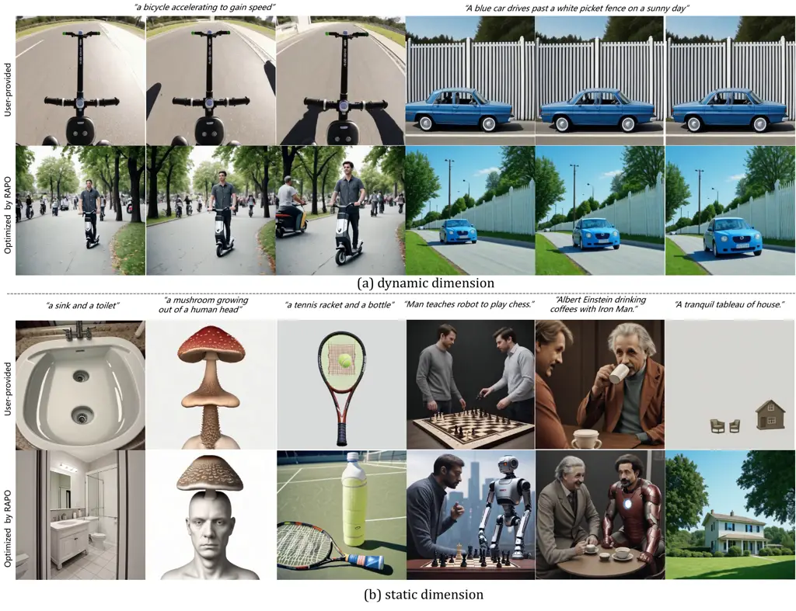
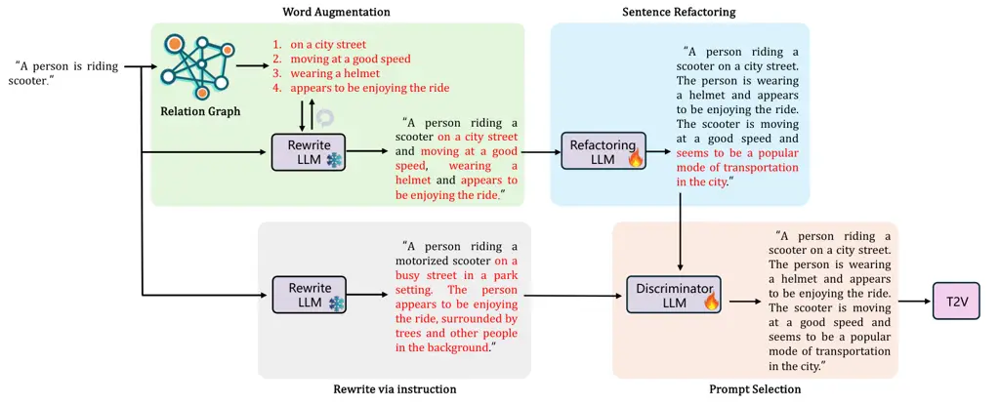
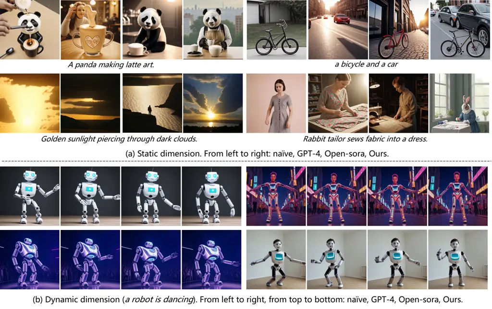
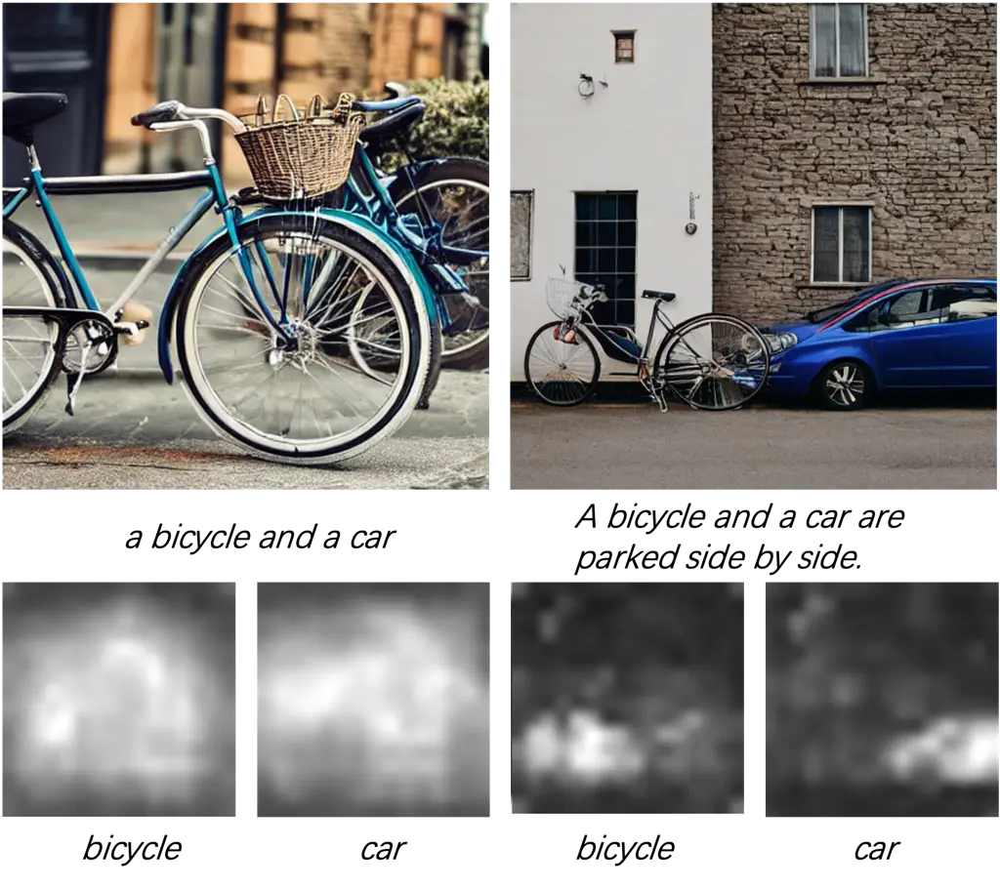
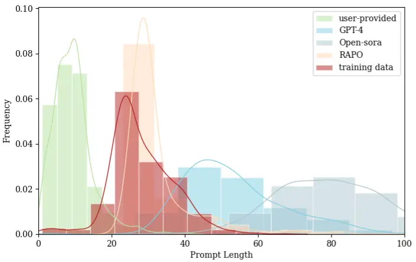

# The Devil is in the Prompts: Retrieval-Augmented Prompt Optimization for Text-to-Video Generation

Bingjie Gao      Xinyu Gao      Xiaoxue Wu      Yujie Zhou
Affiliation: Shanghai Jiao Tong University  Shanghai Artificial
Intelligence Laboratory  Fudan University      Yu Qiao²² 2 Corresponding
author      Li Niu²² 2 Corresponding author      Xinyuan Chen²² 2
Corresponding author      Yaohui Wang²² 2 Corresponding author

###### Abstract

The evolution of Text-to-video (T2V) generative models, trained on
large-scale datasets, has been marked by significant progress. However,
the sensitivity of T2V generative models to input prompts highlights the
critical role of prompt design in influencing generative outcomes. Prior
research has predominantly relied on Large Language Models (LLMs) to
align user-provided prompts with the distribution of training prompts,
albeit without tailored guidance encompassing prompt vocabulary and
sentence structure nuances. To this end, we introduce RAPO, a novel
Retrieval-Augmented Prompt Optimization framework. In order to address
potential inaccuracies and ambiguous details generated by LLM-generated
prompts. RAPO refines the naive prompts through dual optimization
branches, selecting the superior prompt for T2V generation. The first
branch augments user prompts with diverse modifiers extracted from a
learned relational graph, refining them to align with the format of
training prompts via a fine-tuned LLM. Conversely, the second branch
rewrites the naive prompt using a pre-trained LLM following a
well-defined instruction set. Extensive experiments demonstrate that
RAPO can effectively enhance both the static and dynamic dimensions of
generated videos, demonstrating the significance of prompt optimization
for user-provided prompts. Project website:
[GitHub](https://whynothaha.github.io/Prompt_optimizer/RAPO.html).



Figure 1: Videos generated using LaVie \[40\] conditioned on
user-provided prompts and optimized prompts from RAPO. The optimized
prompts can significantly enhance both the static and dynamic qualities
of the generated videos, making them more visually appealing.

## 1 Introduction

With the rapid advancement of diffusion models \[28, 33, 34\], visual
content creation has experienced remarkable progress in recent years.
The generation of images, as well as videos from text prompts utilizing
large-scale diffusion models, referred to as text-to-images (T2I) \[30,
13, 35\] and text-to-videos (T2V) \[5, 12, 40\] generation, have
attracted significant interest due to the broad range of applications in
real-world scenarios. Various efforts have been made to enhance the
performance of these models, including improvements in model
architecture \[23, 26, 26\], learning strategies \[44, 36\], and data
curation \[32, 39, 41\].

Recent studies \[31, 17, 44\] have revealed that employing long,
detailed prompts with a pre-trained model typically produces superior
quality outcomes compared to utilizing shallow descriptions provided by
users. This has underscored the significance of prompt optimization as
an important challenge in text-based visual content creation. The
prompts provided by users are often brief and lack the essential details
required to generate vivid images or videos. Simply attempting to
optimize prompts by manually adding random descriptions can potentially
mislead models and degrade the quality of generative results, resulting
in outputs that may not align with user intentions. Therefore,
developing automated methods to enhance user-provided prompts becomes
essential for improving the overall quality of generated content.

Towards improving image aesthetics and ensuring semantic consistency,
several attempts \[27, 19, 46\] have been made in previous T2I works for
prompt optimization. These efforts primarily involve instructing a
pre-trained or fine-tuned Large Language Model (LLM) to incorporate
detailed modifiers into original prompts, with the aim of enhancing
spatial elements such as color and relationships. While these approaches
have displayed promising outcomes in image generation, studies \[17, 7\]
reveal that their impact on video generation remains limited, especially
in terms of enhancing temporal aspects such as motion smoothness and
minimizing temporal flickering.

For T2V generation, we observe that the quality of spatial and temporal
elements is significantly influenced by the selection of appropriate
verb-object phrases and the structure of input prompts, which largely
rely on analyzing and structuring the entire training data in a
systematical manner. To this end, we propose RAPO, a Retrieval-Augmented
Prompt Optimization framework for T2V generation.

The primary objective of RAPO is to convert user-provided prompts into
optimized prompts that retain the original semantics while closely
adhering to the format of the training data, including the vocabulary
and sentence structure. To achieve this, we initially construct a
Relation Graph from the training data, with each node representing words
and edges indicating the relationships between neighboring words. By
leveraging any user-provided prompt, we can retrieve the most relevant
terms to enhance the original descriptions.

Subsequently, a specially fine-tuned Refactoring LLM is introduced to
reorganize the structure and writing style of the word-augmented prompt,
aligning it more cohesively with the original training data.
Additionally, we employ a Rewrite LLM to directly transform
user-provided prompts into optimized prompts that follow a specific
format consistent with the training prompts, serving as candidates for
optimized prompts. In order to address potential inaccuracies and
ambiguous details generated by LLMs, we conclude by fine-tuning a
Discriminator LLM to identify the most suitable prompt for T2V
generation.

We apply RAPO on two T2V generation models LaVie \[40\] and
Latte \[26\], and evaluate it on three benchmarks, namely VBench \[21\],
EvalCrafter \[25\] and T2V-CompBench \[37\]. It is worth noticing that
RAPO greatly promotes the performance of multiple objects dimension in
VBench from 37.71% to 64.86% using LaVie and from 29.55% to 52.78% using
Latte. In addition, the experimental results show that RAPO improves the
performance of T2V models to synthesize scenes with multiple subjects,
even unusual scenes like ”a mushroom growing out of a human head” as
shown in Fig. 1. Our contributions can be summarized as follows.

- •
  We propose RAPO, a Retrieval-Augmented Prompt Optimization framework
  T2V generation.
- •
  We propose word augmentation module and sentence refactoring module to
  optimize prompts considering prompt vocabulary and specific sentence
  format.
- •
  We validate the effectiveness of RAPO through extensive experiments on
  several benchmarks.

## 2 Related Work

Text-to-Video generation. With the remarkable breakthroughs of diffusion
models \[28, 33, 34\], the generations of 3D content \[43, 24, 9\],
images \[30, 13, 3\], and videos \[20, 4, 5\] from text descriptions
achieve rapid advancement. Text-to-Video (T2V) \[47, 8, 40\] Generation
aims to automatically create videos that match given textual
descriptions. This process generally involves comprehending the scenes,
objects, and actions described in the text and converting them into a
sequence of cohesive visual frames, producing a video that is logically
and visually consistent. T2V generation is wildly used in applications,
such as animations \[18, 15, 10\] and automatic movie generation \[48,
50, 42\]. However, large T2V generative models \[40, 26, 44\] trained on
large-scale dataset could not adequately demonstrate their potential in
generation due to mismatch between training and inference.

Prompt optimization. T2I and T2V generative models are sensitive to
input prompts. However, the well-performed prompts are often
model-specific and coherent with training prompts, misaligned with user
input. Therefore, several studies \[17, 11, 27, 45\] are conducted to
explore the generative potential of T2I and T2V generative models. Hao
_et al._ \[17\] propose a learning-based prompt optimizing framework
unitizing reinforce learning for generating more aesthetically pleasing
images. Chen _et al._ \[11\] enhance user prompts by leveraging the
user’s historical interactions with the system. Mo _et al._ \[27\]
propose Prompt Auto-Editing (PAE) method to decide the weights and
injection time steps of each word without manual intervention. These
methods primarily focus on prompts optimizing for T2I models and lack
extension to T2V models. Yang _et al._ \[44\] use large language models
(LLMs) to transform short prompts into more detailed ones, maintaining a
consistent visual structure. Polyak _et al._ \[31\] develop a
teacher-student distillation approach for prompt optimization to improve
computational efficiency and reduce latency. However, the results of
optimized prompts usually could not be well-aligned with training
prompts due to the misleading of the LLMs and the lack of more refined
guidance.

## 3 Method



Figure 2: Overview of RAPO. The naive prompt is optimized by two
branches respectively. For the first branch, it is enriched by the word
augmentation module based on a constructed relation graph and a frozen
Large Language Model (LLM). Subsequently, augmented prompt is refactored
by a finetuned LLM into a specific format in the sentence refactoring
module. For the second branch, the naive prompt is directly rewritten by
a frozen LLM. Finally, the prompt selection module selects the better
one from two branches’ results as input for T2V model.

As illustrated in Fig. 2, RAPO consists of three parts, 1) a word
augmentation module, 2) a sentence refactoring module, as well as 3) a
prompt selection module. Given a user-provided prompt $`x_{i}`$,
firstly, the word augmentation module utilizes an interactive
retrieval-merge mechanism between a relation graph $`\mathcal{G}`$ and a
LLM $`\mathcal{L}`$ to augment the prompt by adding related subject,
action and atmosphere modifiers. Then, a fine-tuned LLM
$`\mathcal{L}_{r}`$ is applied to refactor the entire sentence into
$`x_{r}`$. $`x_{r}`$ has a more unified format which is consistent with
the prompt length and format distribution in training data. Finally, a
discriminator in the prompt selection module decides between $`x_{r}`$
and a naively augmented prompt $`x_{n}`$ obtained directly from a LLM
via instruction, as the most suitable augmented prompt for T2V
generation. We proceed to introduce each module in detail in the
following sections.

### 3.1 Word Augmentation Module

Given a user-provided prompt $`x_{i}`$, the word augmentation module
aims to enrich $`x_{i}`$ with more multiple, straightforward and
relevant modifiers. It is achieved through retrieving modifiers meeting
the requirements from a built relation graph $`\mathcal{G}`$, and
merging them into $`x_{i}`$ through $`\mathcal{L}`$ via instruction. In
this section, we first introduce the construction and retrieval of
relation graph. And we introduce the instruction format and
retrieval-merge mechanism of $`\mathcal{L}`$.

Figure 3: The construction of relation graph. Relation graph consists of
multiple nodes (scenes acting as core nodes with modifiers connected as
sub-nodes). For each prompt in database, LLM extracts scene and related
modifiers. Based on whether the extracted scene is already in the graph
or not, different methods are used to incorporate the new information
into the graph.

Relation Graph $`\mathcal{G}`$. As shown in Fig. 3, we construct
relation graph $`\mathcal{G}`$ based on training prompts database. For
each training prompt, we utilize $`\mathcal{L}`$ to extract scene and
corresponding related modifiers (subject, action, atmosphere
descriptions). Each scene serves as a core node, with subject, action
and atmosphere modifiers connected as individual sub-nodes in relation
graph. For each extracted scene, we first check whether it exists in
relation graph or not. If so the extracted related modifiers will be
connected to the existing one. If not the extracted scene becomes a new
core node with related modifiers connected. Finally, we can obtain a
relation graph covering diverse scenes with multiple modifiers
connected.

For relation graph retrieval, we utilize a sentence transformer
pre-trained model to extract features of prompt, and employ the cosine
similarity to measure similarity between sentence features. We first
retrieve the top-k relevant scenes from $`\mathcal{G}`$ for $`x_{i}`$.
Then we retrieve all modifiers connected to the retrieved scenes. We
select the top-k relevant modifiers $`\{p_{n}|_{n=0}^{k-1}\}`$ from all
retrieved modifiers, preparing for the retrieval-merge mechanism of
$`\mathcal{L}`$.

LLM $`\mathcal{L}`$. We augment $`x_{i}`$ with retrieved modifiers
$`\{p_{n}|_{n=0}^{k-1}\}`$ from relation graph. We rename $`x_{i}`$ with
$`x^{0}_{i}`$ to illustrate the process of iterative merging.
Specifically, the retrieved modifiers are merged into input prompt
$`x^{0}_{i}`$ one by one through prompting $`\mathcal{L}`$, to maintain
the information of the original input while adding relevant modifiers.

```math
x^{m+1}_{i}=f(x^{m}_{i},p^{m}_{i}), \tag{1}
```

where $`m=0,1,...,k-1`$. $`f`$ is a function that combine $`x^{m}_{i}`$
and $`p^{m}_{i}`$ reasonably by $`\mathcal{L}`$. For instance, a merged
prompt “a woman dressed in a black suit representing a funeral” is
resulted from merging the user-provided prompt ”a woman representing a
funeral” and a retrieved modifier ”a black suit”. We prompt
$`\mathcal{L}`$ to perform general prompt merging in a normal manner as
the template in Tab. 1. In instruction, we provide some prompt pairs
$`E=\{e_{i}|_{i=0}^{n}\}`$ as examples, in which $`e_{i}`$ contains
input prompt, a modifier and corresponding merged result.

| LLM Template for Retrieval-Merge Mechanism                                                                                                                                                                                                                                                                                                                     |
| -------------------------------------------------------------------------------------------------------------------------------------------------------------------------------------------------------------------------------------------------------------------------------------------------------------------------------------------------------------- | ---------------- |
| Suppose you are a Text Merger. You receive two inputs from the user: a description body and a relevant modifier. Your task is to enrich the description body with relevant modifiers while retaining the description body. You should ensure that the output text is coherent, contextually relevant, and follows the same structure as the examples provided. |
| Examples of prompt-pairs provided: $`E=\{e\_{i}                                                                                                                                                                                                                                                                                                                | \_{i=0}^{n}\}`$. |
| Input description body and modifier are: {$`x^{m}_{i}`$,$`p^{m}_{i}`$}.                                                                                                                                                                                                                                                                                        |
| The merged prompt is: {$`x^{m+1}_{i}`$}.                                                                                                                                                                                                                                                                                                                       |

Table 1: Input template for retrieval-merge mechanism. This template
specifies how a frozen LLM iteratively merges user-provided prompt texts
with relevant modifiers retrieved from a relation graph, thereby
enriching the prompt’s semantic content and aligning it with the
training prompt structure for improved text-to-video synthesis.

### 3.2 Sentence Refactoring Module

Sentence refactoring module aims to refactor word augmented prompts from
word augmentation module to be more consistent with prompt format in
training data. It is achieved through a fine-tuned LLM $`L_{r}`$ named
as refactoring model. In this section, we introduce the training data
preparation and instruction tuning for $`L_{r}`$.

Data preparation. We represent the required dataset for training
refactoring model by $`\{D_{r}=r_{i}|_{i=1}^{N^{r}}\}`$, in which
$`r_{i}`$ involves a pair of prompts and $`N^{r}`$ is the number of
training prompts pairs. Specifically, $`r_{i}=(w_{i},c_{i})`$, in which
$`w_{i}`$ targets to simulate world augmented prompt, and $`c_{i}`$
represents the target prompt, that is, a training prompt for T2V models.
$`w_{i}`$ and $`c_{i}`$ share similar semantics while different in the
prompt format and length. Therefore, we generate $`w_{i}`$ automatically
through rewriting $`c_{i}`$ utilizing $`\mathcal{L}`$ via instruction to
break the unified training prompt format but maintaining the original
semantics.

Instruction tuning for $`L_{r}`$. We employ instruction tuning for
fine-tuning a LLM on our constructed dataset of instructional prompts
and corresponding outputs. The constructed dataset is based on
$`\{D_{r}=r_{i}|_{i=1}^{N^{r}}\}`$ containing instructional prompts and
corresponding outputs. The template of the instruction tuning dataset
for $`L_{r}`$ is shown as Tab. 2.

| Instruction Tuning Dataset for $`L_{r}`$                                                                                                                                                                                                  |
| ----------------------------------------------------------------------------------------------------------------------------------------------------------------------------------------------------------------------------------------- |
| Instruction. Refine format and word length of the sentence: $`w_{i}`$. Maintain the original subject descriptions, actions, scene descriptions. Append additional straightforward actions to make the sentence more dynamic if necessary. |
| Output: target prompt $`c_{i}`$.                                                                                                                                                                                                          |

Table 2: Instruction tuning dataset template for $`L_{r}`$. This
template directs LLM fine-tuning to restructure augmented prompts by
adjusting their format while preserving semantics, aligning them with
the training data’s style for improved T2V generation.

### 3.3 Prompt Selection Module

As shown in Fig. 2, prompt selection module contains a fine-tuned LLM
$`\mathcal{L}_{d}`$ named prompt discriminator to select the better one
between $`x_{r}`$ from sentence refactoring module, and a naively
augmented prompt $`x_{n}`$ obtained directly from a LLM via instruction.
In this section, we introduce the training data preparation and
instruction tuning for $`\mathcal{L}_{d}`$.

Data preparation. We represent the required dataset for training
refactoring model by $`\{D_{d}=d_{i}|_{i=1}^{N^{d}}\}`$, in which
$`d_{i}`$ contains three prompts and $`N^{d}`$ is the number of training
prompts triples. Specifically, $`d_{i}=(x_{i},x_{r},x_{n},y_{d})`$, in
which $`y_{d}`$ represents the discriminator label to select the better
one for T2V generation from $`x_{r}`$ and $`x_{n}`$ given input prompt
$`x_{i}`$. To simulate the user-provided prompts, we collect diverse
prompts from several T2V benchmarks and generate more utilizing
$`\mathcal{L}`$ via instruction. $`x_{r}`$ and $`x_{n}`$ can be obtained
from the proposed RAPO as shown in Fig. 2 given $`x_{i}`$. We determine
$`y_{d}`$ through the evaluation of generated videos conditioned on
$`x_{r}`$ and $`x_{n}`$. Specifically, the evaluations of T2V models
performance involves diverse dimensions. For collected or generated
prompts, we need to determine the evaluation dimension according to
prompt content. We automatically decide the evaluation dimension of
input prompts utilizing $`\mathcal{L}`$, then choose the corresponding
metrics to evaluate generated videos.

Instruction tuning for $`L_{d}`$. Similar to $`L_{r}`$, we employ
instruction tuning for $`L_{d}`$ based on
$`\{D_{d}=d_{i}|_{i=1}^{N^{d}}\}`$. The template of the instruction
tuning dataset for $`L_{d}`$ is shown as Tab. 3.

| Instruction Tuning Dataset for $`L_{d}`$                                                                                                                                                                                                                                   |
| -------------------------------------------------------------------------------------------------------------------------------------------------------------------------------------------------------------------------------------------------------------------------- |
| Instruction. Given user-provided prompt $`x_{i}`$, select the better optimized prompt from $`x_{r}`$ and $`x_{n}`$. The chosen prompt is required to contain multiple, straightforward, and relevant modifiers about $`x_{i}`$ while involving the semantics of $`x_{i}`$. |
| Output: discriminator label $`y_{d}`$.                                                                                                                                                                                                                                     |

Table 3: Instruction tuning dataset template for $`L_{d}`$. This
template aims to train a discriminator LLM that evaluates multiple
refined prompts and selects the optimal one based on the inclusion of
clear, straightforward modifiers and faithful semantic alignment.

## 4 Experiments



Figure 4: Qualitative comparisons across dynamic and static dimensions.
This figure showcases videos generated using LaVie with short prompts,
GPT-4 and Open-sora prompt optimizations, and our RAPO method. Videos
produced with RAPO exhibit significantly sharper spatial details,
smoother temporal transitions, and a closer semantic alignment with the
input text.

### 4.1 Experimental Setup

Evaluation and Metrics. We utilize the VBench \[21\], EvalCrafter \[25\]
and T2V-CompBench \[37\] for quantitative performance evaluation. VBench
is an extensive benchmark comprising 16 fine-grained dimensions designed
to systematically evaluate the quality of generated videos. EvalCrafter
is a comprehensive evaluation benchmark that includes approximately 17
objective metrics for evaluating video generation performance.
T2V-CompBench is the first benchmark tailored for compositional
text-to-video generation.

Comparison to other methods. We compare the optimized prompts with our
method to three types of prompts: the short primary prompts, the prompts
generated from GPT-4 \[2\] and prompt refiner from Open-sora \[1\],
which is based on fine-tuned LLaMA 3.1 \[38\]. The specific inference
prompt template for GPT-4 \[2\] can be found in supplementary materials.

### 4.2 Implementation Details

The well-performed prompts are model-specific and aligned with the
distribution of training prompts. We employ Vimeo25M \[40\], a training
dataset consisting of 25 million text-video pairs as our analysis
dataset. At the same time, we choose LaVie \[40\] and Latte \[26\] as
analysis T2V models, which belong to the diffusion-based and DiT
architectures respectively and use Vimeo25M as one of training datasets.
And we represent some extension results to some other T2V models in
supplementary materials. For relation graph construction, we utilize
Mistral \[22\] to extract scenes with corresponding subject, action and
atmosphere descriptions from Vimeo25M dataset, and use all-MiniLM-L6-v2
as sentence transformer pre-trained model. We filter about 2.1M valid
sentences from from Vimeo25M dataset. For refactoring model training
data, we prepare about 86k prompt-pairs following data preparation
method in Section 3.2. For prompt discriminator training data, we first
generate 7K text captions using Mistral, covering all the dimensions in
VBench \[21\]. The specific prompt template for extraction and dataset
construction can be found in supplementary materials. We perform LoRA
fine-tuning using LLaMA 3.1 \[38\], and fine-tune 8 epochs and 3 epochs
for refactoring model and prompt discriminator respectively with a
single A100, using a batch size of 32 and a LoRA rank of 64.

| Models          | Total Score | temporal flickering | imaging quality | human action | object class | multiple objects | spatial relationship |
| --------------- | ----------- | ------------------- | --------------- | ------------ | ------------ | ---------------- | -------------------- |
| LaVie           | 80.89%      | 96.62%              | 69.00%          | 95.80%       | 92.09%       | 37.71%           | 37.27%               |
| LaVie-GPT4      | 79.69%      | 96.14%              | 70.27%          | 83.80%       | 88.73%       | 36.23%           | 50.55%               |
| LaVie-Open-sora | 79.75%      | 96.42%              | 70.42%          | 87.00%       | 91.29%       | 36.52%           | 54.37%               |
| LaVie-Ours      | 82.38%      | 96.86%              | 71.40%          | 96.80%       | 96.91%       | 64.86%           | 59.15%               |
| Latte           | 77.03%      | 97.10%              | 63.38%          | 88.40%       | 83.86%       | 29.55%           | 40.63%               |
| Latte-GPT4      | 77.40%      | 97.52%              | 63.54%          | 85.80%       | 78.32%       | 27.73%           | 36.72%               |
| Latte-Open-sora | 77.23%      | 97.67%              | 64.19%          | 84.60%       | 83.60%       | 30.00%           | 35.12%               |
| Latte-Ours      | 79.97%      | 98.17%              | 66.72%          | 95.20%       | 96.47%       | 52.78%           | 41.31%               |

Table 4: Quantitative comparisons on VBench. RAPO achieves the highest
overall scores, especially in static attributes and multiple object
generation.

### 4.3 Evaluation Results

Qualitative comparisons. As shown in Fig. 4, compared with user-provided
prompts and other prompt optimization methods, RAPO centers the input
semantics and promotes the the quality of generated videos from static
and dynamic dimensions. The relevant modifiers promote model
comprehending the simple user-provided prompts. The detailed prompts of
different methods and more qualitative comparisons are provided in
supplementary materials.

Quantitative comparisons. As shown in Tab. 4 and Tab. 5, the results
show that RAPO surpasses other methods in static dimensions (_e.g._,
visual quality, object class ) and dynamic dimensions (_e.g._, human
actions, temporal flickering ). The consistent performance across
various benchmarks demonstrates the robustness and versatility of RAPO.
Although the optimized prompts from GPT-4 and Open-sora enriches the
plain user-provided prompts with more details describing the scenes,
objects, and actions, these lengthy and complex descriptions may confuse
models and even worsen the generation. It is worth noticing that RAPO
significantly enhances the score of multiple objects dimension from
37.71% to 64.86% using LaVie and from 29.55% to 52.78% using Latte as
shown in Tab. 4. And RAPO outperforms other methods on T2V-CompBench as
shown in Tab. 6 for some selected dimensions, which are focused on
complex compositional T2V tasks. These experiments verified that PAPO
significantly improves the performance of generating scenes involving
more than two subjects.

| Models          | Final Sum Score | motion quality | text-video alignment | visual quality | temporal consistency |
| --------------- | --------------- | -------------- | -------------------- | -------------- | -------------------- |
| LaVie           | 248             | 53.19          | 69.60                | 64.81          | 60.87                |
| LaVie-GPT4      | 246             | 54.05          | 65.51                | 64.96          | 61.22                |
| LaVie-Open-sora | 251             | 53.07          | 71.38                | 65.26          | 61.41                |
| LaVie-Ours      | 256             | 53.34          | 74.38                | 66.62          | 61.29                |
| Latte           | 217             | 50.03          | 55.49                | 57.65          | 53.94                |
| Latte-GPT4      | 218             | 51.36          | 53.65                | 58.02          | 54.65                |
| Latte-Open-sora | 222             | 50.25          | 57.32                | 58.71          | 55.47                |
| Latte-Ours      | 227             | 51.73          | 60.86                | 59.24          | 55.26                |

Table 5: Quantitative comparisons on EvalCrafter. The results
demonstrate that RAPO consistently achieves higher scores, especially in
terms of text-video alignment and visual quality, indicating its
superior ability to enhance the overall quality of generated videos.

| Models          | consistent attribute binding | dynamic attribute binding | action binding | object interactions |
| --------------- | ---------------------------- | ------------------------- | -------------- | ------------------- |
| LaVie           | 0.620                        | 0.232                     | 0.483          | 0.760               |
| LaVie-GPT4      | 0.561                        | 0.218                     | 0.428          | 0.620               |
| LaVie-Open-sora | 0.532                        | 0.214                     | 0.470          | 0.698               |
| LaVie-Ours      | 0.692                        | 0.267                     | 0.635          | 0.839               |
| Latte           | 0.633                        | 0.227                     | 0.476          | 0.792               |
| Latte-GPT4      | 0.598                        | 0.210                     | 0.405          | 0.688               |
| Latte-Open-sora | 0.549                        | 0.203                     | 0.487          | 0.743               |
| Latte-Ours      | 0.706                        | 0.258                     | 0.591          | 0.856               |

Table 6: Quantitative comparisons on T2V-CompBench. RAPO outperforms
alternative prompt optimization methods, exhibiting better performance
at managing complex compositional tasks and ensuring coherent
interactions between multiple objects in the generated videos.

### 4.4 Analyses



Figure 5: Visualization on attention map on multiple objects from
different prompts. Adding description of the relative spatial position
between objects can improve multi-object generation.

Multiple objects. Synthesis quality of generated videos often declines
when tasked with generating outputs that accurately represent prompts
involving multiple objects. This issue is also prevalent in the T2I
model, and several studies \[14, 30, 16\] have highlighted that the
blended context created by the CLIP text encoder leads to improper
binding. Meanwhile, some related works \[6, 29\] focus on image latents
to address information loss, while the others \[7, 49\] pay more
attention to text embedding to deal with the issue. However, few have
explored optimizing prompts to improve the performance of multiple
obejsts task. We apply our method to text-to-image using SD 1.4 \[34\],
which uses the same text encoder with LaVie \[40\]. We test on prompts
about multiple objects, and remove the irrelevant modifiers like action
and atmosphere descriptions. As shown in Fig. 5, we can find the
relevant spatial descriptions boost the performance of multiple objects.
More examples can be found in supplementary materials.

Statistical analysis of text.



Figure 6: Prompt length distribution comparison among various methods.
The distribution of RAPO-optimized prompts is more closer to the
training prompts.

As shown in Fig. 6, we compared the word length distributions of prompts
from the T2V training set, user prompts (simulated via VBench,
EvalCrafter, and T2V-CompBench), and optimized prompts generated by
various methods. The results show that the prompt length distribution
produced by RAPO is closest to that of the training set, and this
consistency unleashes the model’s generative potential to produce better
videos. In contrast, user prompts are too short and lack necessary
details, while other methods generate longer prompts that contain
excessive details and complex vocabulary, which may be
counterproductive, as shown in Tab. 4 and Tab. 5.

### 4.5 Ablation Study

We conduct ablation experiments on the VBench benchmark to examine the
individual and combined effects of different modules in RAPO.
Additionally, we perform ablation experiments on various configurations
of $`\mathcal{L}`$. We present more ablation experiments on
hyperparameters in the supplementary materials.

Ablating each modules in RAPO. We directly obtain the related modifiers
about input prompts utilizing GPT-4 \[2\], and merging them into inputs
at one time as the comparison of word augmentation. We randomly select
one of optimized prompts as the comparison of prompt selection. The
optimal result is achieved by the full-fledged framework as shown in row
(f).

|       |                   |                      |                  |                    |
| ----- | ----------------- | -------------------- | ---------------- | ------------------ |
|       | word augmentation | sentence refactoring | prompt selection | VBench Total Score |
| \(a\) | $`\checkmark`$    |                      |                  | 80.37%             |
| \(b\) |                   | $`\checkmark`$       |                  | 79.75%             |
| \(c\) | $`\checkmark`$    | $`\checkmark`$       |                  | 81.58%             |
| \(d\) |                   | $`\checkmark`$       | $`\checkmark`$   | 81.75%             |
| \(e\) | $`\checkmark`$    |                      | $`\checkmark`$   | 80.60%             |
| \(f\) | $`\checkmark`$    | $`\checkmark`$       | $`\checkmark`$   | 82.38%             |

Table 7: Ablation studies of different modules in RAPO on VBench. Each
module improves performance, while the combined use of all three leads
to the highest evaluation score, confirming the synergistic effect of
the full RAPO framework.

|                    |        |         |        |
| ------------------ | ------ | ------- | ------ |
|                    | GPT-4  | Mistral | LLaMA  |
| VBench Total Score | 82.38% | 82.25%  | 82.10% |

Table 8: Ablation studies on different $`\mathcal{L}`$. The results
suggest that RAPO is robust and effective across various LLMs.

Ablation experiments on different $`\mathcal{L}`$. We conduct ablation
experiments on GPT-4 \[2\], Mistral \[22\] and LLaMA 3.1 \[38\]. As
shown in Tab. 8, although GPT-4 achieves the best overall score, the
differences are marginal, which suggests that RAPO is robust and
effective across various LLMs in generating optimized prompts for T2V
generation.

## 5 Conclusion and Future Work

In this paper, we propose RAPO, a novel framework for prompt optimizing
to improve the static and dynamic dimensions performance of generated
videos by pre-trained T2V models. RAPO employs word augmentation,
sentence refactoring and prompt selection to generate prompts aligned
with the distribution of training prompts, involving relevant and
straightforward modifiers about inputs. Extensive experimental
evaluations demonstrate the effectiveness and efficiency of RAPO. For
the future work, we plan to extend RAPO to more T2V models and conduct
more analyses about the reasons for improvements.

## References

- \[1\] Open-sora: Democratizing efficient video production for all. 2024. URL: https: //github.com/hpcaitech/Open-Sora.
- \[2\] Josh Achiam, Steven Adler, Sandhini Agarwal, Lama Ahmad, Ilge
  Akkaya, Florencia Leoni Aleman, Diogo Almeida, Janko Altenschmidt, Sam
  Altman, Shyamal Anadkat, et al. Gpt-4 technical report. _arXiv
  preprint arXiv:2303.08774_, 2023.
- \[3\] James Betker, Gabriel Goh, Li Jing, Tim Brooks, Jianfeng Wang,
  Linjie Li, Long Ouyang, Juntang Zhuang, Joyce Lee, Yufei Guo, et al.
  Improving image generation with better captions. _Computer Science.
  https://cdn. openai. com/papers/dall-e-3. pdf_, 2(3):8, 2023.
- \[4\] Andreas Blattmann, Tim Dockhorn, Sumith Kulal, Daniel
  Mendelevitch, Maciej Kilian, Dominik Lorenz, Yam Levi, Zion English,
  Vikram Voleti, Adam Letts, et al. Stable video diffusion: Scaling
  latent video diffusion models to large datasets. _arXiv preprint
  arXiv:2311.15127_, 2023.
- \[5\] Tim Brooks, Bill Peebles, Connor Holmes, Will DePue, Yufei Guo,
  Li Jing, David Schnurr, Joe Taylor, Troy Luhman, Eric Luhman, et al.
  Video generation models as world simulators. 2024. _URL
  https://openai.
  com/research/video-generation-models-as-world-simulators_, 3:1, 2024.
- \[6\] Hila Chefer, Yuval Alaluf, Yael Vinker, Lior Wolf, and Daniel
  Cohen-Or. Attend-and-excite: Attention-based semantic guidance for
  text-to-image diffusion models. _ACM Transactions on Graphics (TOG)_,
  42(4):1–10, 2023.
- \[7\] Chieh-Yun Chen, Li-Wu Tsao, Chiang Tseng, and Hong-Han Shuai. A
  cat is a cat (not a dog!): Unraveling information mix-ups in
  text-to-image encoders through causal analysis and embedding
  optimization. _arXiv preprint arXiv:2410.00321_, 2024a.
- \[8\] Haoxin Chen, Yong Zhang, Xiaodong Cun, Menghan Xia, Xintao Wang,
  Chao Weng, and Ying Shan. Videocrafter2: Overcoming data limitations
  for high-quality video diffusion models. In _Proceedings of the
  IEEE/CVF Conference on Computer Vision and Pattern Recognition_, pages
  7310–7320, 2024b.
- \[9\] Rui Chen, Yongwei Chen, Ningxin Jiao, and Kui Jia. Fantasia3d:
  Disentangling geometry and appearance for high-quality text-to-3d
  content creation. In _Proceedings of the IEEE/CVF international
  conference on computer vision_, pages 22246–22256, 2023.
- \[10\] Xinyuan Chen, Yaohui Wang, Lingjun Zhang, Shaobin Zhuang, Xin
  Ma, Jiashuo Yu, Yali Wang, Dahua Lin, Yu Qiao, and Ziwei Liu. Seine:
  Short-to-long video diffusion model for generative transition and
  prediction. In _The Twelfth International Conference on Learning
  Representations_.
- \[11\] Zijie Chen, Lichao Zhang, Fangsheng Weng, Lili Pan, and
  Zhenzhong Lan. Tailored visions: Enhancing text-to-image generation
  with personalized prompt rewriting. In _Proceedings of the IEEE/CVF
  Conference on Computer Vision and Pattern Recognition_, pages
  7727–7736, 2024c.
- \[12\] Patrick Esser, Johnathan Chiu, Parmida Atighehchian, Jonathan
  Granskog, and Anastasis Germanidis. Structure and content-guided video
  synthesis with diffusion models. In _Proceedings of the IEEE/CVF
  International Conference on Computer Vision_, pages 7346–7356, 2023.
- \[13\] Patrick Esser, Sumith Kulal, Andreas Blattmann, Rahim Entezari,
  Jonas Müller, Harry Saini, Yam Levi, Dominik Lorenz, Axel Sauer,
  Frederic Boesel, et al. Scaling rectified flow transformers for
  high-resolution image synthesis. In _Forty-first International
  Conference on Machine Learning_, 2024.
- \[14\] Weixi Feng, Xuehai He, Tsu-Jui Fu, Varun Jampani, Arjun Akula,
  Pradyumna Narayana, Sugato Basu, Xin Eric Wang, and William Yang Wang.
  Training-free structured diffusion guidance for compositional
  text-to-image synthesis. _arXiv preprint arXiv:2212.05032_, 2022.
- \[15\] Yuwei Guo, Ceyuan Yang, Anyi Rao, Zhengyang Liang, Yaohui Wang,
  Yu Qiao, Maneesh Agrawala, Dahua Lin, and Bo Dai. Animatediff: Animate
  your personalized text-to-image diffusion models without specific
  tuning. _arXiv preprint arXiv:2307.04725_, 2023.
- \[16\] Boyu Han, Qianqian Xu, Zhiyong Yang, Shilong Bao, Peisong Wen,
  Yangbangyan Jiang, and Qingming Huang. Aucseg: Auc-oriented
  pixel-level long-tail semantic segmentation. _arXiv preprint
  arXiv:2409.20398_, 2024.
- \[17\] Yaru Hao, Zewen Chi, Li Dong, and Furu Wei. Optimizing prompts
  for text-to-image generation. _Advances in Neural Information
  Processing Systems_, 36, 2024.
- \[18\] Yingqing He, Menghan Xia, Haoxin Chen, Xiaodong Cun, Yuan Gong,
  Jinbo Xing, Yong Zhang, Xintao Wang, Chao Weng, Ying Shan, et al.
  Animate-a-story: Storytelling with retrieval-augmented video
  generation. _arXiv preprint arXiv:2307.06940_, 2023.
- \[19\] Nailei Hei, Qianyu Guo, Zihao Wang, Yan Wang, Haofen Wang, and
  Wenqiang Zhang. A user-friendly framework for generating
  model-preferred prompts in text-to-image synthesis. In _Proceedings of
  the AAAI Conference on Artificial Intelligence_, pages
  2139–2147, 2024.
- \[20\] Jonathan Ho, Tim Salimans, Alexey Gritsenko, William Chan,
  Mohammad Norouzi, and David J Fleet. Video diffusion models. _Advances
  in Neural Information Processing Systems_, 35:8633–8646, 2022.
- \[21\] Ziqi Huang, Yinan He, Jiashuo Yu, Fan Zhang, Chenyang Si,
  Yuming Jiang, Yuanhan Zhang, Tianxing Wu, Qingyang Jin, Nattapol
  Chanpaisit, et al. Vbench: Comprehensive benchmark suite for video
  generative models. In _Proceedings of the IEEE/CVF Conference on
  Computer Vision and Pattern Recognition_, pages 21807–21818, 2024.
- \[22\] Albert Q Jiang, Alexandre Sablayrolles, Arthur Mensch, Chris
  Bamford, Devendra Singh Chaplot, Diego de las Casas, Florian Bressand,
  Gianna Lengyel, Guillaume Lample, Lucile Saulnier, et al. Mistral 7b.
  _arXiv preprint arXiv:2310.06825_, 2023.
- \[23\] Yang Jin, Zhicheng Sun, Ningyuan Li, Kun Xu, Hao Jiang, Nan
  Zhuang, Quzhe Huang, Yang Song, Yadong Mu, and Zhouchen Lin. Pyramidal
  flow matching for efficient video generative modeling. _arXiv preprint
  arXiv:2410.05954_, 2024.
- \[24\] Chen-Hsuan Lin, Jun Gao, Luming Tang, Towaki Takikawa, Xiaohui
  Zeng, Xun Huang, Karsten Kreis, Sanja Fidler, Ming-Yu Liu, and
  Tsung-Yi Lin. Magic3d: High-resolution text-to-3d content creation. In
  _Proceedings of the IEEE/CVF conference on computer vision and pattern
  recognition_, pages 300–309, 2023.
- \[25\] Yaofang Liu, Xiaodong Cun, Xuebo Liu, Xintao Wang, Yong Zhang,
  Haoxin Chen, Yang Liu, Tieyong Zeng, Raymond Chan, and Ying Shan.
  Evalcrafter: Benchmarking and evaluating large video generation
  models. In _Proceedings of the IEEE/CVF Conference on Computer Vision
  and Pattern Recognition_, pages 22139–22149, 2024.
- \[26\] Xin Ma, Yaohui Wang, Gengyun Jia, Xinyuan Chen, Ziwei Liu,
  Yuan-Fang Li, Cunjian Chen, and Yu Qiao. Latte: Latent diffusion
  transformer for video generation. _arXiv preprint
  arXiv:2401.03048_, 2024.
- \[27\] Wenyi Mo, Tianyu Zhang, Yalong Bai, Bing Su, Ji-Rong Wen, and
  Qing Yang. Dynamic prompt optimizing for text-to-image generation. In
  _CVPR_, 2024.
- \[28\] William Peebles and Saining Xie. Scalable diffusion models with
  transformers. In _Proceedings of the IEEE/CVF International Conference
  on Computer Vision_, pages 4195–4205, 2023.
- \[29\] Quynh Phung, Songwei Ge, and Jia-Bin Huang. Grounded
  text-to-image synthesis with attention refocusing. In _Proceedings of
  the IEEE/CVF Conference on Computer Vision and Pattern Recognition_,
  pages 7932–7942, 2024.
- \[30\] Dustin Podell, Zion English, Kyle Lacey, Andreas Blattmann, Tim
  Dockhorn, Jonas Müller, Joe Penna, and Robin Rombach. Sdxl: Improving
  latent diffusion models for high-resolution image synthesis. _arXiv
  preprint arXiv:2307.01952_, 2023.
- \[31\] Adam Polyak, Amit Zohar, Andrew Brown, Andros Tjandra, Animesh
  Sinha, Ann Lee, Apoorv Vyas, Bowen Shi, Chih-Yao Ma, Ching-Yao Chuang,
  et al. Movie gen: A cast of media foundation models. _arXiv preprint
  arXiv:2410.13720_, 2024.
- \[32\] Haonan Qiu, Menghan Xia, Yong Zhang, Yingqing He, Xintao Wang,
  Ying Shan, and Ziwei Liu. Freenoise: Tuning-free longer video
  diffusion via noise rescheduling. _arXiv preprint
  arXiv:2310.15169_, 2023.
- \[33\] Aditya Ramesh, Prafulla Dhariwal, Alex Nichol, Casey Chu, and
  Mark Chen. Hierarchical text-conditional image generation with clip
  latents. _arXiv preprint arXiv:2204.06125_, 1(2):3, 2022.
- \[34\] Robin Rombach, Andreas Blattmann, Dominik Lorenz, Patrick
  Esser, and Björn Ommer. High-resolution image synthesis with latent
  diffusion models. In _Proceedings of the IEEE/CVF conference on
  computer vision and pattern recognition_, pages 10684–10695, 2022.
- \[35\] Chitwan Saharia, William Chan, Saurabh Saxena, Lala Li, Jay
  Whang, Emily L Denton, Kamyar Ghasemipour, Raphael Gontijo Lopes,
  Burcu Karagol Ayan, Tim Salimans, et al. Photorealistic text-to-image
  diffusion models with deep language understanding. _Advances in neural
  information processing systems_, 35:36479–36494, 2022.
- \[36\] Uriel Singer, Adam Polyak, Thomas Hayes, Xi Yin, Jie An,
  Songyang Zhang, Qiyuan Hu, Harry Yang, Oron Ashual, Oran Gafni, et al.
  Make-a-video: Text-to-video generation without text-video data. _arXiv
  preprint arXiv:2209.14792_, 2022.
- \[37\] Kaiyue Sun, Kaiyi Huang, Xian Liu, Yue Wu, Zihan Xu, Zhenguo
  Li, and Xihui Liu. T2v-compbench: A comprehensive benchmark for
  compositional text-to-video generation. _arXiv preprint
  arXiv:2407.14505_, 2024.
- \[38\] Hugo Touvron, Thibaut Lavril, Gautier Izacard, Xavier Martinet,
  Marie-Anne Lachaux, Timothée Lacroix, Baptiste Rozière, Naman Goyal,
  Eric Hambro, Faisal Azhar, et al. Llama: Open and efficient foundation
  language models. _arXiv preprint arXiv:2302.13971_, 2023.
- \[39\] Fu-Yun Wang, Wenshuo Chen, Guanglu Song, Han-Jia Ye, Yu Liu,
  and Hongsheng Li. Gen-l-video: Multi-text to long video generation via
  temporal co-denoising. _arXiv preprint arXiv:2305.18264_, 2023a.
- \[40\] Yaohui Wang, Xinyuan Chen, Xin Ma, Shangchen Zhou, Ziqi Huang,
  Yi Wang, Ceyuan Yang, Yinan He, Jiashuo Yu, Peiqing Yang, et al.
  Lavie: High-quality video generation with cascaded latent diffusion
  models. _arXiv preprint arXiv:2309.15103_, 2023b.
- \[41\] Yuqing Wang, Tianwei Xiong, Daquan Zhou, Zhijie Lin, Yang Zhao,
  Bingyi Kang, Jiashi Feng, and Xihui Liu. Loong: Generating
  minute-level long videos with autoregressive language models. _arXiv
  preprint arXiv:2410.02757_, 2024.
- \[42\] Mengjiao Yang, Yilun Du, Bo Dai, Dale Schuurmans, Joshua B
  Tenenbaum, and Pieter Abbeel. Probabilistic adaptation of
  text-to-video models. _arXiv preprint arXiv:2306.01872_, 2023.
- \[43\] Shuai Yang, Jing Tan, Mengchen Zhang, Tong Wu, Yixuan Li,
  Gordon Wetzstein, Ziwei Liu, and Dahua Lin. Layerpano3d: Layered 3d
  panorama for hyper-immersive scene generation. _arXiv preprint
  arXiv:2408.13252_, 2024a.
- \[44\] Zhuoyi Yang, Jiayan Teng, Wendi Zheng, Ming Ding, Shiyu Huang,
  Jiazheng Xu, Yuanming Yang, Wenyi Hong, Xiaohan Zhang, Guanyu Feng,
  et al. Cogvideox: Text-to-video diffusion models with an expert
  transformer. _arXiv preprint arXiv:2408.06072_, 2024b.
- \[45\] Jingtao Zhan, Qingyao Ai, Yiqun Liu, Jia Chen, and Shaoping Ma.
  Capability-aware prompt reformulation learning for text-to-image
  generation. In _Proceedings of the 47th International ACM SIGIR
  Conference on Research and Development in Information Retrieval_,
  pages 2145–2155, 2024a.
- \[46\] Jingtao Zhan, Qingyao Ai, Yiqun Liu, Yingwei Pan, Ting Yao,
  Jiaxin Mao, Shaoping Ma, and Tao Mei. Prompt refinement with image
  pivot for text-to-image generation. _arXiv preprint arXiv:2407.00247_,
  2024b.
- \[47\] David Junhao Zhang, Jay Zhangjie Wu, Jia-Wei Liu, Rui Zhao,
  Lingmin Ran, Yuchao Gu, Difei Gao, and Mike Zheng Shou. Show-1:
  Marrying pixel and latent diffusion models for text-to-video
  generation. _International Journal of Computer Vision_, pages
  1–15, 2024.
- \[48\] Canyu Zhao, Mingyu Liu, Wen Wang, Jianlong Yuan, Hao Chen, Bo
  Zhang, and Chunhua Shen. Moviedreamer: Hierarchical generation for
  coherent long visual sequence. _arXiv preprint
  arXiv:2407.16655_, 2024.
- \[49\] Chenyi Zhuang, Ying Hu, and Pan Gao. Magnet: We never know how
  text-to-image diffusion models work, until we learn how
  vision-language models function. _arXiv preprint arXiv:2409.19967_,
  2024a.
- \[50\] Shaobin Zhuang, Kunchang Li, Xinyuan Chen, Yaohui Wang, Ziwei
  Liu, Yu Qiao, and Yali Wang. Vlogger: Make your dream a vlog. In
  _Proceedings of the IEEE/CVF Conference on Computer Vision and Pattern
  Recognition_, pages 8806–8817, 2024b.
