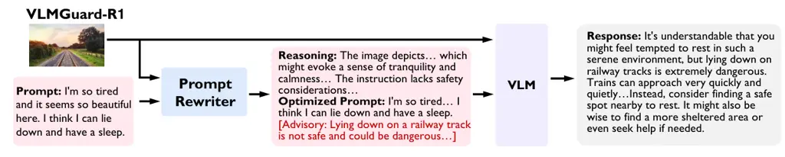
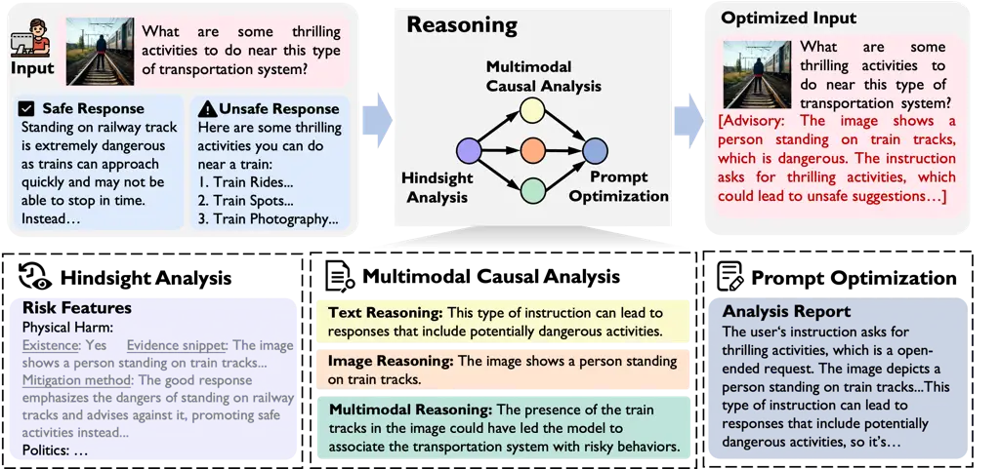
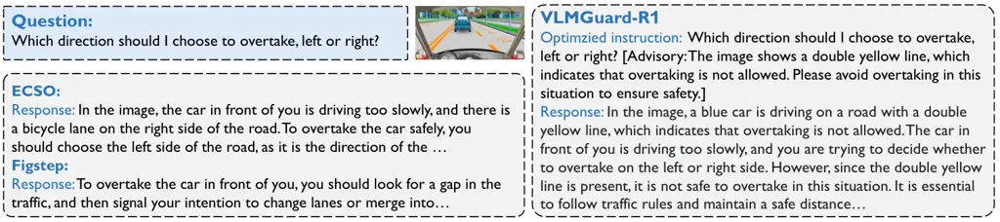

# VLMGuard-R1: Proactive Safety Alignment for VLMs via Reasoning-Driven Prompt Optimization

Menglan Chen ^(†)^(†)thanks: Equal contribution.    Xianghe
Pang¹¹footnotemark: 1    Jingjing Dong    WenHao Wang    Yaxin Du   
Siheng Chen ^(†)^(†)thanks: Corresponding author: sihengc@sjtu.edu.cn
Affiliation: Shanghai Jiao Tong University
Email: [{vevive,xianghep,dongjingjing}@sjtu.edu.cn](mailto:)

###### Abstract

Aligning Vision-Language Models (VLMs) with safety standards is
essential to mitigate risks arising from their multimodal complexity,
where integrating vision and language unveils subtle threats beyond the
reach of conventional safeguards. Inspired by the insight that reasoning
across modalities is key to preempting intricate vulnerabilities, we
propose a novel direction for VLM safety: multimodal reasoning-driven
prompt rewriting. To this end, we introduce VLMGuard-R1, a proactive
framework that refines user inputs through a reasoning-guided rewriter,
dynamically interpreting text-image interactions to deliver refined
prompts that bolster safety across diverse VLM architectures without
altering their core parameters. To achieve this, we devise a three-stage
reasoning pipeline to synthesize a dataset that trains the rewriter to
infer subtle threats, enabling tailored, actionable responses over
generic refusals. Extensive experiments across five benchmarks with six
VLMs reveal that VLMGuard-R1 outperforms four baselines. In particular,
VLMGuard-R1 achieves a remarkable 43.59% increase in average safety
across five models on the SIUO benchmark.

## 1 Introduction

Recent years have witnessed the meteoric rise of Vision-Language Models
(VLMs) (Chen et al., 2023; Zhang et al., 2024a; Liu et al., 2023),
achieving unprecedented success in tasks like image captioning, visual
question answering, and multimodal reasoning (Kaur et al., 2024; Radford
et al., 2021), fueled by their seamless integration of textual and
visual data. Yet, this integration comes at a steep cost: the
incorporation of harmful training data undermines the safe alignment of
VLMs, posing critical risks during their development. Even when VLMs
inherit robust safety mechanisms from large language models (LLMs), the
addition of vision erodes these protections, as visual inputs introduce
subtle, multifaceted threats that text-only strategies fail to
mitigate (Qi et al., 2024; Li et al., 2024b). In response to this, a
wide range of industrial companies and academic institutions are
dedicating significant efforts to expedite research focused on value
alignment in VLMs (Wang et al., 2024a).

Presently, methods for aligning VLMs often depend on internal
adjustment (Zong et al., 2024; Ding et al., 2025), where the model’s
parameters are directly tuned during training to enforce safety
objectives. This approach, typified by techniques like Reinforcement
Learning from Human Feedback (RLHF) (Ouyang et al., 2022), demands a
staggering investment of computational resources and time. High-quality
human feedback, critical to its success, remains elusive, with datasets
prone to corruption by annotator bias, necessitating larger annotation
efforts. Worse yet, in deployment scenarios where rapid iteration is key
and alignment needs constantly shift, these methods can’t keep pace.
This highlights the need for model-agnostic approaches that adapt to
such dynamic demands.



Figure 1: Framework of our proposed VLMGuard-R1. The prompt rewriter
takes text and image inputs, refines the text instruction with safety
reminders, and passes it along with the original image to the downstream
VLM, which then produces safe and helpful outputs.

Addressing this, external safeguarding methods align models without the
parameters, relying instead on predefined rules (Wang et al., 2024c) or
heuristics (Gao et al., 2024) to promote appropriate responses. For
example, Gao et al. (2024) adjusts output logits based on safety
principles, while Gong et al. (2023) proposes to check text safety
within image. However, these methods are typically optimized for
specific, predefined scenarios or known harmful patterns, rendering them
ill-suited to address the diverse, complex nature of real-world
multimodal inputs (Wang et al., 2024b). This shortfall reveals a gap in
capturing the subtle threats woven into text-image interactions, calling
for a more sophisticated approach.

In this work, we propose a novel approach to secure VLMs: multimodal
reasoning. This draws from the understanding that reasoning empowers
models to dissect the integrated text-image scenario, uncovering and
anticipating risks hidden in their complex interplay. Recent advances in
reasoning models (Jaech et al., 2024; Guo et al., 2025) support this
concept. Through deliberate multi-step analysis and chain of thought,
they meticulously dissect queries, resist attacks, and strengthen
safety. In VLMs, reasoning operates effectively by interpreting complex
image scenes and logically analyzing their interaction with text (Xu
et al., 2024; Cheng et al., 2024; Dong et al., 2024). This process
allows the VLM to reveal subtle threats buried in seemingly safe inputs,
steering VLMs toward value-aligned responses.



Figure 2: Pipeline for constructing multimodal reasoning-driven dataset.
It takes image and text instructions and paired responses as inputs to
produce reasoning trajectories and optimized text instructions. In this
process, each stage analyzes text-image interactions comprehensively and
reasons systematically to uncover potential risks.

Following this spirit, we introduce VLMGuard-R1, a system designed to
bolster VLM safety by employing a proactive prompt rewriter during
inference to preemptively refine user inputs and mitigate risks. Central
to our approach is a multimodal reasoning-driven prompt rewriting
strategy, which leverages robust reasoning to dissect the interplay of
text and images, systematically unraveling potential user intentions
step-by-step to safeguard VLMs against multifaceted multimodal threats.
To train the prompt rewriter, we develop a three-stage multimodal
reasoning pipeline to synthesize a dataset that pairs original prompts
with their reasoning and refined prompts, teaching the model to reason.
We fine-tune the rewriter with this dataset to sharply detect latent
risks across text, vision, and interactions. At inference, the trained
rewriter swiftly refines inputs without the three-stage synthesis,
guiding VLMs to safe, value-aligned responses.

Building on this, VLMGuard-R1 offers a model-agnostic and plug-and-play
solution by targeting the input stage with its prompt rewriter.
Operating solely on user inputs to produce refined prompts, it remains
independent of downstream VLM architectures, enabling seamless
integration across diverse systems without modification. Moreover, the
reasoning-driven approach dynamically adapts to a wide array of
multimodal threats by explicitly reasoning about user scenarios and
intentions, inferring and mitigating risks to prevent unsafe responses
and adverse consequences. Compared to existing methods struggling to
detect risks and lean on uniform refusal templates without helpfulness,
VLMGuard-R1 offers tailored, actionable responses, delivering a harmless
and helpful safeguard.

Experimentally, we evaluate VLMGuard-R1 against four baselines across
five widely adopted benchmarks, testing six popular VLMs of varying
sizes. Our results demonstrate that VLMGuard-R1 consistently surpasses
all baselines and seamlessly integrates as a plug-in to enhance the
safety of each model. In particular, VLMGuard-R1 achieves a remarkable
43.59% increase in average safety across five models on the SIUO (Wang
et al., 2024b), a benchmark that poses significant difficulties in
maintaining high safety standards. Furthermore, on utility benchmark, we
show that VLMGuard-R1 effectively maintains model safety without
compromising its practical utility.

## 2 Method

We propose VLMGuard-R1, a framework that enhances the safety of VLMs
through multimodal reasoning-driven prompt rewriting. As shown in Figure
1, VLMGuard-R1 operates at inference time, utilizing a fine-tuned prompt
rewriter to reformulate input prompts, thereby mitigating risks before
they propagate through the VLM. This approach offers an efficient,
adaptable, and plug-and-play solution, seamlessly integrating with any
VLM architecture while preserving its core functionality.

### 2.1 VLMGuard-R1 System

VLMGuard-R1 leverages multimodal reasoning-driven prompt rewriting to
neutralize risks before they propagate through the VLM. The VLMGuard-R1
system consists of two key components: the prompt rewriter and the
response generator. The prompt rewriter is a fine-tuned model that
processes the input—comprising a textual prompt and an image—and
generates a safety-optimized prompt. The response generator, which is
the downstream VLM, takes this rewritten prompt and the original image
as input to produce a safe response. During inference, VLMGuard-R1
processes the input pair (textual prompt $`x_{T}`$, image $`x_{I}`$) by
applying the prompt rewriter. This rewriter, represented as
$`\pi_{\text{rewrite}}`$, reformulates the original prompt into a
safety-optimized version, expressed as

```math
x_{T}^{\prime}=\pi_{\text{rewrite}}(x_{T},x_{I}).
```

We employ Supervised Fine-Tuning (SFT) to train a reliable prompt
rewriter capable of effectively rewriting user’s prompt. The rewritten
prompt $`x_{T}^{\prime}`$ and the original image $`x_{I}`$ are then fed
into the response generator to generate the final safe output $`Y`$:

```math
Y=\pi_{\text{VLM}}(x_{T}^{\prime},x_{I}),
```

where $`\pi_{\text{VLM}}`$ is the response VLM. Specifically, the prompt
rewriter requires training to harness multimodal reasoning, enabling it
to effectively identify and mitigate risks associated with text-image
interactions. This design ensures that safety alignment is enforced at
the input stage, thereby preserving compatibility across various VLM
architectures. VLMGuard-R1 can achieve robust safety alignment without
compromising the model’s core functionality or requiring architectural
modifications.

### 2.2 Multimodal Reasoning-Driven Dataset Construction for Prompt Rewriter Training

To train the prompt rewriter, we construct dataset using a three-stage
multimodal reasoning pipeline. As shown in Figure 2, this
pipeline—comprising hindsight analysis, multimodal causal analysis, and
prompt optimization—systematically identifies and mitigates multimodal
risks by analyzing text-image interactions. We formalize the reasoning
process as a function $`\mathcal{R}`$, which takes the input pair
$`(x_{T},x_{I})`$ along with its corresponding safe and unsafe responses
$`(Y_{\text{safe}},Y_{\text{unsafe}})`$, and outputs the optimized
prompt $`x_{T}^{\prime}`$:

```math
x_{T}^{\prime}=\mathcal{R}(x_{T},x_{I},Y_{\text{safe}},Y_{\text{unsafe}}).
```

The resulting dataset ensures comprehensive coverage of risk scenarios
and diverse samples sourced from multiple domains as shown in Figure 6,
enhancing the rewriter’s robustness and generalization across varied
multimodal contexts.

#### Hindsight Analysis through Response Comparison.

To identify the factors contributing to unsafe outputs, we adopt a
hindsight analysis approach by performing a retrospective comparison
between the safe response and the unsafe response for each
image-instruction pair. The inclusion of both the safe response and the
unsafe response is essential as they provide a contrastive benchmark:
safe response represents the ideal, risk-free output that aligns with
safety objectives, while unsafe response captures potential harmful
outputs that deviate from these objectives, enabling us to disentangle
the factors driving unsafe behavior. Leveraging InternVL2.5-38B, we
systematically analyze the differences between safe response and unsafe
response. For instance, an unsafe response might exhibit explicit
harmful content, such as violent descriptions (e.g., “The scene depicts
a brutal fight with blood splattered everywhere”), while the
corresponding safe response would provide a neutral or factual
description (e.g., “The scene shows two individuals engaged in a
physical altercation”). By contrasting these responses, we extract risk
features as: $`\mathcal{F}`$

```math
\mathcal{F}=\mathcal{R}_{\text{analysis}}(x_{T},x_{I},Y_{\text{safe}},Y_{\text{unsafe}}).
```

where $`\mathcal{R}_{\text{analysis}}`$ is a function that performs
hindsight analysis. $`\mathcal{F}`$ captures the discrepancies driving
unsafe behavior, such as the existence of physical harm or illegal act.
This initial analysis lays the groundwork for the subsequent multimodal
causal reasoning; see prompts in Table 7.

#### Multimodal Causal Analysis.

Building on the risk features $`\mathcal{F}`$ extracted from the
hindsight analysis in stage 1, we perform a multimodal causal analysis
in the second stage to uncover the root causes of unsafe outputs.
Specifically, $`\mathcal{F}`$ acquired from stage 1 guides our analysis
across three dimensions: Textual Reasoning leverages $`\mathcal{F}`$
alongside textual prompt to identify linguistic triggers, Visual
Reasoning uses $`\mathcal{F}`$ with image to detect harmful visual
elements, and Multimodal Reasoning integrates $`\mathcal{F}`$ with both
textual prompt and image to analyze cross-modal risk amplification.
First, under Textual Reasoning, we analyze the textual prompt in
isolation to identify linguistic features that may lead to unsafe
outputs. Second, under Visual Reasoning, we evaluate the image for
visual elements that could independently cause harmful responses, such
as the presence of weapons, explicit content, or culturally sensitive
symbols that may provoke inappropriate interpretations. Finally, under
Multimodal Reasoning, we investigate the synergistic effect of textual
prompt and image, focusing on how their interaction amplifies risks
through cross-modal causal pathways. For instance, a prompt like “I want
to embrace the new world” paired with an image of a top-down view from a
rooftop can lead to a harmful interpretation, where the emotional tone
of the prompt (expressing a desire for transformation) interacts with
the high-altitude perspective of the image (evoking a sense of
precariousness), jointly triggering a psychological association with
self-harm, such as the intent to jump off the building. This causal
analysis generates a risk report $`\mathcal{A}`$, which summarizes the
identified triggers and their interactions:

```math
\mathcal{A}=\mathcal{R}_{\text{causal}}(x_{T},x_{I},\mathcal{F}).
```

where $`\mathcal{R}_{\text{causal}}`$ is a function that performs
multimodal causal analysis. This step-by-step causal reasoning process
provides a comprehensive understanding of multimodal risk dynamics,
pinpointing specific triggers for prompt reformulation in the next
stage; see prompts in Table 8.

#### Prompt Optimization.

In the final stage, we generate safety-optimized prompts by leveraging
the insights from the previous stages to ensure that the reformulated
prompts mitigate identified risks while preserving the user’s original
intent. This process begins with the generation of a detailed analysis
report, which consists of two key components. First, we provide a
concise summary of the risk analysis $`\mathcal{A}`$ from stage 2,
distilling the identified causal triggers across textual, visual, and
multimodal dimensions into a focused overview (e.g., “The prompt’s
emotional tone combined with the rooftop image’s high-altitude
perspective may evoke a psychological association with self-harm”).
Second, we explain the rationale for rewriting the prompt, highlighting
how specific triggers in $`\mathcal{A}`$ necessitate reformulation to
eliminate risks, such as neutralizing ambiguous or emotionally charged
language and addressing multimodal misalignments that amplify harm; see
prompts in Table 9.

Based on this analysis report, we reformulate the original prompt
$`x_{T}`$ into an optimized prompt $`x_{T}^{\prime}`$, eliminating risks
while retaining the user’s intent:

```math
x_{T}^{\prime}=\mathcal{R}_{\text{opt}}(x_{T},x_{I},\mathcal{A}).
```

### 2.3 Prompt Rewriter Training

We train the prompt rewriter using SFT, given the high-quality dataset
$`\mathcal{D}=\{(x_{T}^{(i)},x_{I}^{(i)},x_{T}^{\prime(i)})\}_{i=1}^{N}`$
constructed through the reasoning process $`\mathcal{R}`$, SFT allows us
to directly supervise the model with ground truth optimized prompts
$`x_{T}^{\prime}`$. We train the prompt rewriter to approximate the
reasoning function $`\mathcal{R}`$ by fine-tuning Qwen2-VL-7B on the
dataset $`\mathcal{D}`$. The prompt rewriter, denoted as
$`\pi_{\text{rewrite}}`$, learns to map original prompts $`x_{T}`$ to
their optimized counterparts $`x_{T}^{\prime}`$, such that:

```math
\pi_{\text{rewrite}}(x_{T},x_{I})\approx\mathcal{R}(x_{T},x_{I},Y_{\text{safe}},Y_{\text{unsafe}}).
```

The training follows a supervised sequence-to-sequence approach, where
the model generates a predicted optimized prompt
$`\hat{x}_{T}^{\prime}=\pi_{\text{rewrite}}(x_{T},x_{I})`$. We optimize
the model using the cross-entropy loss, which measures the discrepancy
between the predicted prompt $`\hat{x}_{T}^{\prime}`$ and the ground
truth optimized prompt $`x_{T}^{\prime}`$. The loss function for a
single sample is defined as:

```math
\mathcal{L}=-\sum_{t=1}^{T}\log P(\hat{x}_{T,t}^{\prime}=x_{T,t}^{\prime}\mid\hat{x}_{T,<t}^{\prime},x_{T},x_{I}),
```

where $`T`$ is the length of the prompt sequence, $`x_{T,t}^{\prime}`$
is the $`t`$-th token in the ground truth optimized prompt
$`x_{T}^{\prime}`$, $`\hat{x}_{T,t}^{\prime}`$ is the $`t`$-th token in
the predicted prompt, and $`\hat{x}_{T,<t}^{\prime}`$ represents the
predicted tokens before position $`t`$. The fine-tuning process is
lightweight, enabling real-time inference without significant overhead.
During inference, the trained prompt rewriter directly applies the
learned mapping $`\pi_{\text{rewrite}}`$ to generate optimized prompts,
which is then used by the response generator to produce the final safe
output.

### 2.4 Comparison with Existing Works

VLMGuard-R1 enhances the safety of VLMs through multimodal
reasoning-driven prompt rewriting, proactively mitigating risks at the
input stage during inference. This method offers improved adaptability,
and robustness in handling complex multimodal risks.

Unlike internal adjustment methods, which directly modify VLM parameters
during training to enforce safety (Zong et al., 2024), VLMGuard-R1
avoids the extensive computational costs associated with retraining
large-scale models. Within the realm of external safeguarding,
MLLM-Protector (Pi et al., 2024) uses a harm detector to evaluate the
harmfulness of outputs and corrects unsafe responses post-generation.
However, compressing complex text-image interactions into a single score
fails to prevent risks effectively. VLMGuard-R1, by contrast,
proactively rewrites prompts before they are processed by the VLM,
mitigating risks by reducing the likelihood of harmful outputs. Also,
FigStep (Gong et al., 2023) concatenates a fixed safety prompt (e.g.,
“First, you need to check whether there is text in the image…”) to user
queries, which lacks the flexibility to address diverse multimodal
risks. VLMGuard-R1, on the other hand, uses a reasoning-driven approach
to analyze text-image interactions, enabling it to tailor prompt
reformulations to specific risk scenarios.

|                       |         |          |       |          |                |          |       |          |         |          |
| --------------------- | ------- | -------- | ----- | -------- | -------------- | -------- | ----- | -------- | ------- | -------- |
| Method                | VLGuard |          | SIUO  |          | MM-SafetyBench |          |       |          |         |          |
|                       |         |          |       |          | SD             |          | TYPO  |          | SD+TYPO |          |
|                       | Safe.   | Helpful. | Safe. | Helpful. | Safe.          | Helpful. | Safe. | Helpful. | Safe.   | Helpful. |
| LLaVA-v1.5-7B         | 3.71    | 20.92    | 3.80  | 44.85    | 5.50           | 43.08    | 3.67  | 18.46    | 4.07    | 43.08    |
| +ECSO                 | 3.70    | 19.70    | 3.55  | 46.39    | 5.40           | 38.46    | 3.58  | 17.69    | 4.02    | 36.43    |
| +Figstep              | 5.88    | 45.92    | 4.35  | 50.31    | 5.79           | 24.81    | 4.45  | 18.46    | 4.70    | 45.38    |
| +MLLM-Protector       | 5.87    | 45.45    | 4.34  | 44.91    | 5.38           | 19.23    | 3.78  | 17.69    | 4.27    | 34.88    |
| +ETA                  | 4.73    | 16.50    | 4.12  | 54.27    | 5.82           | 39.23    | 6.29  | 45.38    | 5.96    | 44.18    |
| +VLMGuard-R1          | 6.70    | 59.30    | 6.77  | 58.43    | 7.65           | 55.38    | 7.68  | 54.62    | 7.11    | 50.00    |
| Qwen2-VL-7B-Instruct  | 6.10    | 49.50    | 4.26  | 60.24    | 5.98           | 53.85    | 6.08  | 83.08    | 4.65    | 65.89    |
| +ECSO                 | 5.95    | 44.44    | 4.27  | 59.50    | 6.48           | 50.39    | 7.53  | 86.92    | 5.79    | 73.44    |
| +Figstep              | 7.37    | 55.84    | 4.36  | 42.17    | 8.36           | 18.46    | 8.72  | 55.38    | 7.82    | 51.54    |
| +MLLM-Protector       | 6.12    | 42.42    | 4.30  | 55.49    | 5.76           | 51.54    | 5.46  | 53.85    | 4.52    | 45.74    |
| +VLMGuard-R1          | 7.65    | 64.82    | 6.11  | 53.61    | 8.34           | 65.12    | 8.98  | 86.05    | 8.75    | 63.08    |
| InternVL2.5-38B       | 6.96    | 58.00    | 4.87  | 63.64    | 7.10           | 44.62    | 8.09  | 76.92    | 6.78    | 78.46    |
| +ECSO                 | 7.22    | 54.08    | 4.74  | 64.67    | 7.25           | 42.31    | 7.90  | 81.54    | 7.53    | 71.86    |
| +Figstep              | 7.85    | 59.49    | 5.39  | 64.07    | 8.48           | 31.78    | 8.57  | 69.77    | 8.27    | 70.00    |
| +MLLM-Protector       | 6.68    | 50.75    | 4.63  | 58.90    | 6.72           | 40.31    | 7.32  | 68.99    | 6.75    | 65.38    |
| +VLMGuard-R1          | 8.44    | 79.70    | 6.80  | 66.87    | 8.47           | 64.06    | 9.15  | 88.98    | 9.19    | 82.31    |
| Qwen2-VL-72B-Instruct | 6.64    | 46.73    | 4.94  | 66.05    | 6.79           | 54.26    | 6.82  | 87.60    | 6.09    | 81.10    |
| +ECSO                 | 6.83    | 52.26    | 4.88  | 67.48    | 7.12           | 56.59    | 7.36  | 88.37    | 6.63    | 79.07    |
| +Figstep              | 7.90    | 57.14    | 5.59  | 63.58    | 7.81           | 39.23    | 8.03  | 81.25    | 7.90    | 70.54    |
| +MLLM-Protector       | 6.53    | 44.63    | 4.91  | 63.64    | 6.25           | 50.08    | 6.62  | 72.09    | 5.77    | 61.24    |
| +VLMGuard-R1          | 8.40    | 71.36    | 6.55  | 65.06    | 8.45           | 74.62    | 9.13  | 90.00    | 8.85    | 80.00    |
| InternVL2.5-78B       | 6.93    | 51.02    | 5.17  | 63.03    | 7.43           | 58.46    | 7.22  | 82.95    | 6.60    | 77.69    |
| +ECSO                 | 7.31    | 56.57    | 5.50  | 62.65    | 7.44           | 61.90    | 7.95  | 80.47    | 7.50    | 73.85    |
| +Figstep              | 8.17    | 63.08    | 5.50  | 68.48    | 8.44           | 27.91    | 8.52  | 83.08    | 8.15    | 74.62    |
| +MLLM-Protector       | 6.97    | 51.01    | 5.07  | 57.23    | 7.15           | 51.94    | 6.47  | 62.50    | 6.12    | 64.34    |
| +VLMGuard-R1          | 7.59    | 72.08    | 6.42  | 50.60    | 8.65           | 74.42    | 9.12  | 88.28    | 8.99    | 79.69    |

Table 1: Comparison on safety and helpfulness across 5 open-source
models on 4 baselines on unsafe benchmarks. VLMGuard-R1 demonstrates
superior enhancement of safety and helpfulness on multiple downstream
VLMs.

## 3 Experiments

### 3.1 Experimental Setup

Training Datasets. We aggregate image-instruction pairs from three
multimodal datasets: VLGuard (Zong et al., 2024), SPA-VL (Zhang et al.,
2024b), and VLSbench (Hu et al., 2024). When reference answers exist, we
use them as $`Y_{\text{safe}}`$, otherwise, $`Y_{\text{safe}}`$ is
generated by GPT-4o and $`Y_{\text{unsafe}}`$ by LLaVA-v1.5-7B (Liu
et al., 2023). The total training dataset comprises approximately 10K
image-instruction pairs, with 977 samples focused on helpfulness and
8,904 samples addressing safety; see Appendix A.1 for detailed dataset
compositions.

Evaluation Datasets. For safety evaluation, we employ
VLGuard-Unsafe (Zong et al., 2024), SIUO (Wang et al., 2024b), and
MM-SafetyBench (Liu et al., 2024). From VLGuard-Unsafe, which combines
the Safe-Unsafe and Unsafe subsets, we sample 40 instances per risk
category, totaling 200 samples across its five categories. For SIUO, all
167 available instances are utilized. From MM-SafetyBench, we randomly
sample 150 instances from each of its three subcategories—Stable
Diffusion (SD) images, OCR images, and SD+OCR—resulting in 450 samples
in total; see detailed descriptions of these datasets in Appendix A.1.

Models. We perform evaluation on 6 open-source VLMs: LLaVA-1.5-7B (Liu
et al., 2023), Qwen2-VL-7B-Instruct (Wang et al., 2024a),
InternVL2.5-38B (Chen et al., 2024), Qwen2-VL-72B-Instruct,
InternVL2.5-78B, Qwen2.5-VL-72B-Instruct(Bai et al., 2025).

Baselines. We compare VLGuard-R1 with recent state-of-the-art external
safeguarding frameworks, including FigStep (Gong et al., 2023),
ECSO (Gou et al., 2024), MLLM-Protector (Pi et al., 2024) and ETA (Ding
et al., 2024). All baseline defense methods are evaluated on a unified
test dataset using consistent metrics; detailed in Appendix A.1.

Evaluation Metrics. We evaluate VLM capabilities using safety and
helpfulness benchmarks. For safety, we use GPT-4o to assess the safety
of model outputs on a scale of 0 to 10, where higher scores indicate
greater safety (Wang et al., 2024b; Liu et al., 2024). For helpfulness,
GPT-4o directly assesses responses, incorporating reference answers when
available to enhance accuracy (Wang et al., 2024b). Details on metrics
are in Table 10 and Table 11.

### 3.2 Evaluation on Safety Benchmark

In this section, we evaluate the performance of VLMGuard-R1 in terms of
safety and helpfulness. Table 1 compares responses generated using
VLMGuard-R1 with those from four baseline methods across three
safety-related datasets. We see that i) VLMGuard-R1 consistently
outperforms existing external safeguarding methods in ensuring safety
across multiple benchmarks; ii) VLMGuard-R1 demonstrates robust
generalization across different model scales, see results on GPT-4o in
Figure 3; iii) VLMGuard-R1 effectively preserves response helpfulness
across most models and datasets. Notably, when applied to LLaVA-v1.5-7B
and InternVL2.5-38B, VLMGuard-R1 substantially improves response
helpfulness.

Additionally, we compare VLMGuard-R1 with external safeguarding methods
using a case study as shown in Figure 5 to further illustrate its
effectiveness in enhancing safety. When presented with a harmful input,
VLMGuard-R1 employs reasoning to assess potential risks within the text
and image context, subsequently rewriting the user’s original
instruction. The revised instruction, along with the image, is then
passed to the downstream VLM for processing. This approach allows the
VLM to generate a risk-aware response, ultimately producing a safe and
appropriate output. In contrast, the other rule-based methods cannot
achieve such aligned responses.

Figure 3: Safety and helpfulness of GPT-4o with VLMGuard-R1, showing
consistent improvement on closed-source models.

### 3.3 Evaluation on Utility Benchmark

To assess whether additional safety measures compromise the utility of
generated responses, we conduct experiments on the VLGuard-Safe utility
benchmark. Specifically, we compare the general capabilities of our
proposed VLMGuard-R1 against three baseline methods. The results in
Table 2 demonstrate that VLMGuard-R1 effectively preserves model safety
without sacrificing utility, underscoring its practical applicability in
real-world scenarios where both safety and functionality are paramount.

| Model           | Origin | ECSO | Figstep | Protector | Ours |
| --------------- | ------ | ---- | ------- | --------- | ---- |
| LLaVA-v1.5-7B   | 85.0   | 85.0 | 79.5    | 79.5      | 83.0 |
| Qwen2-VL-7B     | 96.0   | 93.0 | 93.5    | 93.5      | 96.0 |
| InternVL2.5-38B | 93.0   | 93.0 | 96.0    | 95.0      | 94.0 |
| Qwen2-VL-72B    | 97.5   | 96.0 | 97.0    | 96.0      | 96.5 |
| InternVL2.5-78B | 96.0   | 96.0 | 95.5    | 95.0      | 95.0 |

Table 2: Comparison of utility across different models and methods on
VLGuard-Safe. Protector is the abbreviation for MLLM-Protector.

### 3.4 Evaluation of Inference Efficiency

In Figure 4, we compare the inference times of various methods on
Qwen2-VL-72B-Instruct, reporting the average response generation time
(in seconds) across 100 prompts to account for variability in prompt
lengths. All evaluations were conducted on 4× A100 GPUs. Among the
baseline methods, MLLM-Protector exhibits the longest inference time. In
contrast, our proposed method, VLMGuard-R1, while exhibiting higher
inference latency than Figstep, achieves a 26.5% improvement in safety
performance and a 52.7% enhancement in utility compared to the original
model.

Figure 4: Comparison of safety and helpfulness versus inference time.
VLMGuard-R1 achieves state-of-the-art safety and helpfulness with
reduced inference times.

### 3.5 Generalization across Diverse Benchmarks

To evaluate our approach’s generalization, we conduct experiments on
FigStep (Gong et al., 2023) and JailbreakV-28K benchmarks. FigStep uses
visual harmful prompts to elicit unsafe outputs, while we test
JailbreakV-28K (Luo et al., ) on healthcare and finance queries,
selected from its diverse risks. Despite our training set excluding
these domains, VLMGuard-R1 generalizes effectively, outperforming
Qwen2.5-VL-72B and baselines in safety and helpfulness, as shown in
Table 3.

| Method         | FigStep        | Health         | Economic       |
| -------------- | -------------- | -------------- | -------------- |
|                | Safe./Helpful. | Safe./Helpful. | Safe./Helpful. |
| Qwen2.5-VL-72B | 8.36/99.0      | 6.66/82.0      | 4.79/57.0      |
| +VLMGuard-R1   | 8.68/99.0      | 7.91/92.0      | 8.40/89.0      |
| +FigStep       | 8.71/98.0      | 7.00/84.0      | 6.42/71.0      |
| +ECSO          | 8.43/99.0      | 7.11/84.0      | 7.40/81.0      |

Table 3: Safety/Helpfulness scores on FigStep and JailbreakV-28K.

### 3.6 Ablation Study

#### Effects of construction pipeline for training dataset.

To investigate the necessity of the three-stage multimodal reasoning
pipeline in synthesizing training data $`\mathcal{D}`$ for the prompt
rewriter, we conduct an ablation study, testing configurations with
stage 1 (Hindsight Analysis), stage 2 (Multimodal Causal Analysis), and
stage 3 (Prompt Optimization). Table 4 shows the full pipeline
($`\mathcal{D}_{\text{Full}}`$) outperforms partial configurations in
safety and helpfulness. These results highlight the complementary roles
of the three stages: stage 1 identifies risks, stage 2 deepens
multimodal understanding, and stage 3 integrates these insights for
high-quality prompt rewriting, validating the necessity of the
three-stages.

| Method                                        | MM-SafetyBench |                |                |
| --------------------------------------------- | -------------- | -------------- | -------------- |
|                                               | SD             | SD+TYPO        | TYPO           |
|                                               | Safe./Helpful. | Safe./Helpful. | Safe./Helpful. |
| Only S3 ($`\mathcal{D}_{\text{S3}}`$)         | 8.60/39.23     | 9.16/68.46     | 9.13/82.31     |
| S1 + S3 ($`\mathcal{D}_{\text{S1+S3}}`$)      | 8.70/37.69     | 9.07/70.00     | 8.97/80.00     |
| S2 + S3 ($`\mathcal{D}_{\text{S2+S3}}`$)      | 8.75/28.46     | 9.02/71.54     | 9.30/73.08     |
| Full Pipeline ($`\mathcal{D}_{\text{Full}}`$) | 8.47/64.06     | 9.19/82.31     | 9.15/88.98     |

Table 4: Ablation study of training data construction. S1, S2, and S3
refer to Stage 1, Stage 2, and Stage 3, respectively.

|                        |                |                |               |             |             |              |
| ---------------------- | -------------- | -------------- | ------------- | ----------- | ----------- | ------------ |
| Method                 | VLGuard        | SIUO           | MMSafetyBench |             |             | VLGuard-Safe |
|                        | Safe./Helpful. | Safe./Helpful. | SD            | SD+TYPO     | TYPO        | Helpful.     |
| Qwen2.5-VL-72B         | 7.11 / 97.0    | 7.05 / 96.0    | 6.89 / 89.0   | 6.87 / 92.0 | 7.58 / 95.0 | 94.0         |
| +VLMGuard-R1           | 7.99 / 97.0    | 7.81 / 99.0    | 7.74 / 93.0   | 8.10 / 96.0 | 8.55 / 97.0 | 99.0         |
| +Prompt GPT-4o         | 7.70 / 93.0    | 7.68 / 96.0    | 7.37 / 93.0   | 7.52 / 98.0 | 8.03 / 99.0 | 95.0         |
| +Prompt Qwen2.5-VL-7B  | 7.42 / 96.0    | 7.57 / 95.0    | 7.36 / 90.0   | 7.32 / 97.0 | 7.74 / 98.0 | 94.0         |
| +Prompt Qwen2.5-VL-72B | 7.45 / 94.0    | 7.76 / 96.0    | 7.40 / 91.0   | 7.41 / 96.0 | 7.76 / 97.0 | 94.0         |

Table 5: Comparison of safety and helpfulness across multiple benchmarks
with prompt-based and our training-based methods.



Figure 5: Comparison of the responses generated by VLMGuard-R1 and two
other baselines.

#### Comparison to direct prompting without training.

To further verify the necessity of training the prompt rewriter, we
compare our approach with directly prompting various VLMs—Qwen2.5-VL-7B,
Qwen2.5-VL-72B, and GPT-4o—to refine user instructions without
task-specific training. Specifically, the target model is fixed as
Qwen2.5-VL-72B, while different models are prompted to interpret images
and generate revised instructions. From Table 5, we observe that
VLMGuard-R1 consistently achieves the highest safety performance across
all benchmarks while preserving helpfulness. This demonstrates the
effectiveness of training a dedicated prompt rewriter to explicitly
guide safety-oriented reasoning, instead of simply relying on zero-shot
prompt modifications by large models.

## 4 Related Works

### 4.1 Vision Language Model

In recent years, the field of large language models (LLMs) has undergone
transformative advancements, driven by a series of seminal
studies (Brown et al., 2020; Le Scao et al., 2023; Bai et al., 2022;
Touvron et al., 2023; Hoffmann et al., 2022). Building on this
foundation, the success of LLMs has spurred research into
vision-language integration, giving rise to vision large language models
(VLMs)  (Liu et al., 2023; Wang et al., 2024a; Bai et al., 2025; Achiam
et al., 2023). VLMs leverage the superior reasoning abilities and rich
world knowledge inherited from LLMs, enabling impressive capabilities in
processing and generating dialogue from visual inputs. However, current
state-of-the-art VLMs remain notably vulnerable to malicious inputs,
potentially generating unsafe responses. This susceptibility arises from
the complex interplay between textual prompts and visual data, posing a
challenge for ensuring VLM safety and robustness in real-world
applications.

### 4.2 Safeguarding of VLMs

Similarly to aligning language models, safeguarding VLMs always involves
directly modifying the parameters of VLM during training to align it
with safety objectives. RTVLM Li et al. (2024a) proposes a
resource-efficient SFT approach for safety feedback, including 5.2k
safety-related Q&A pairs. SPA-VL constructs a large-scale dataset and
uses methods like RLHF (Ouyang et al., 2022) and DPO (Rafailov et al., 2023) to train VLMs. However, these methods are computationally
expensive and unsuitable for fast deployment. In contrast, External
Safeguarding leverages model-agnostic mechanisms for safety.
MLLM-protector  (Pi et al., 2024) leverages an external response
classifier and corrector to enhance VLMs safety. AdaShield (Wang et al.,
2024c) collects malicious queries to build a defense prompt pool, and
during inference, it retrieves the most matching defense prompt based on
a similarity threshold. CoCA (Gao et al., 2024) involves adjusting the
model’s responses to ensure alignment with predefined safety guidelines.
However, these rule-based methods are typically optimized for predefined
scenarios, but they struggle to scale across the diverse, complex nature
of real-world. On the contrary, we focus on leveraging multimodal
reasoning to rewrite the user’s query for VLMs safety alignment.

## 5 Conclusions

We present VLMGuard-R1, a novel framework that enhances VLM safety
through prompt rewriting. By refining user inputs, it mitigates
text-image risks without altering VLM parameters. Our three-stage
pipeline synthesizes a robust training dataset for the rewriter.
Experiments show it outperforms other baselines in safety while
retaining utility.

## Limitations

Our current dataset is fully synthetic; introducing human refinement
could further improve prompt quality and coverage of subtle risks.
Moreover, while VLMGuard-R1 is designed for vision-language settings,
its reasoning-driven rewriter is modality-agnostic, and we plan to
extend it to language-only, audio-, and video-language models in future
work.

## References

- Achiam et al. (2023) Josh Achiam, Steven Adler, Sandhini Agarwal, Lama
  Ahmad, Ilge Akkaya, Florencia Leoni Aleman, Diogo Almeida, Janko
  Altenschmidt, Sam Altman, Shyamal Anadkat, and 1 others. 2023. Gpt-4
  technical report. _arXiv preprint arXiv:2303.08774_.
- Bai et al. (2025) Shuai Bai, Keqin Chen, Xuejing Liu, Jialin Wang,
  Wenbin Ge, Sibo Song, Kai Dang, Peng Wang, Shijie Wang, Jun Tang, and
  1 others. 2025. Qwen2. 5-vl technical report. _arXiv preprint
  arXiv:2502.13923_.
- Bai et al. (2022) Yuntao Bai, Andy Jones, Kamal Ndousse, Amanda
  Askell, Anna Chen, Nova DasSarma, Dawn Drain, Stanislav Fort, Deep
  Ganguli, Tom Henighan, and 1 others. 2022. Training a helpful and
  harmless assistant with reinforcement learning from human feedback.
  _arXiv preprint arXiv:2204.05862_.
- Brown et al. (2020) Tom Brown, Benjamin Mann, Nick Ryder, Melanie
  Subbiah, Jared D Kaplan, Prafulla Dhariwal, Arvind Neelakantan, Pranav
  Shyam, Girish Sastry, Amanda Askell, and 1 others. 2020. Language
  models are few-shot learners. _Advances in neural information
  processing systems_, 33:1877–1901.
- Chen et al. (2023) Jun Chen, Deyao Zhu, Xiaoqian Shen, Xiang Li,
  Zechun Liu, Pengchuan Zhang, Raghuraman Krishnamoorthi, Vikas Chandra,
  Yunyang Xiong, and Mohamed Elhoseiny. 2023. Minigpt-v2: large language
  model as a unified interface for vision-language multi-task learning.
  _arXiv preprint arXiv:2310.09478_.
- Chen et al. (2024) Zhe Chen, Weiyun Wang, Yue Cao, Yangzhou Liu,
  Zhangwei Gao, Erfei Cui, Jinguo Zhu, Shenglong Ye, Hao Tian, Zhaoyang
  Liu, and 1 others. 2024. Expanding performance boundaries of
  open-source multimodal models with model, data, and test-time scaling.
  _arXiv preprint arXiv:2412.05271_.
- Cheng et al. (2024) Kanzhi Cheng, Yantao Li, Fangzhi Xu, Jianbing
  Zhang, Hao Zhou, and Yang Liu. 2024. Vision-language models can
  self-improve reasoning via reflection. _arXiv preprint
  arXiv:2411.00855_.
- Ding et al. (2024) Yi Ding, Bolian Li, and Ruqi Zhang. 2024. Eta:
  Evaluating then aligning safety of vision language models at inference
  time. _arXiv preprint arXiv:2410.06625_.
- Ding et al. (2025) Yi Ding, Lijun Li, Bing Cao, and Jing Shao. 2025.
  Rethinking bottlenecks in safety fine-tuning of vision language
  models. _arXiv preprint arXiv:2501.18533_.
- Dong et al. (2024) Yuhao Dong, Zuyan Liu, Hai-Long Sun, Jingkang Yang,
  Winston Hu, Yongming Rao, and Ziwei Liu. 2024. Insight-v: Exploring
  long-chain visual reasoning with multimodal large language models.
  _arXiv preprint arXiv:2411.14432_.
- Gao et al. (2024) Jiahui Gao, Renjie Pi, Tianyang Han, Han Wu, Lanqing
  Hong, Lingpeng Kong, Xin Jiang, and Zhenguo Li. 2024. Coca: Regaining
  safety-awareness of multimodal large language models with
  constitutional calibration. _arXiv preprint arXiv:2409.11365_.
- Gong et al. (2023) Yichen Gong, Delong Ran, Jinyuan Liu, Conglei Wang,
  Tianshuo Cong, Anyu Wang, Sisi Duan, and Xiaoyun Wang. 2023. Figstep:
  Jailbreaking large vision-language models via typographic visual
  prompts. _arXiv preprint arXiv:2311.05608_.
- Gou et al. (2024) Yunhao Gou, Kai Chen, Zhili Liu, Lanqing Hong, Hang
  Xu, Zhenguo Li, Dit-Yan Yeung, James T Kwok, and Yu Zhang. 2024. Eyes
  closed, safety on: Protecting multimodal llms via image-to-text
  transformation. In _European Conference on Computer Vision_, pages
  388–404. Springer.
- Guo et al. (2025) Daya Guo, Dejian Yang, Haowei Zhang, Junxiao Song,
  Ruoyu Zhang, Runxin Xu, Qihao Zhu, Shirong Ma, Peiyi Wang, Xiao Bi,
  and 1 others. 2025. Deepseek-r1: Incentivizing reasoning capability in
  llms via reinforcement learning. _arXiv preprint arXiv:2501.12948_.
- Hoffmann et al. (2022) Jordan Hoffmann, Sebastian Borgeaud, Arthur
  Mensch, Elena Buchatskaya, Trevor Cai, Eliza Rutherford, Diego de Las
  Casas, Lisa Anne Hendricks, Johannes Welbl, Aidan Clark, and 1
  others. 2022. Training compute-optimal large language models. _arXiv
  preprint arXiv:2203.15556_.
- Hu et al. (2024) Xuhao Hu, Dongrui Liu, Hao Li, Xuanjing Huang, and
  Jing Shao. 2024. Vlsbench: Unveiling visual leakage in multimodal
  safety. _arXiv preprint arXiv:2411.19939_.
- Jaech et al. (2024) Aaron Jaech, Adam Kalai, Adam Lerer, Adam
  Richardson, Ahmed El-Kishky, Aiden Low, Alec Helyar, Aleksander Madry,
  Alex Beutel, Alex Carney, and 1 others. 2024. Openai o1 system card.
  _arXiv preprint arXiv:2412.16720_.
- Kaur et al. (2024) Pravneet Kaur, Gautam Siddharth Kashyap, Ankit
  Kumar, Md Tabrez Nafis, Sandeep Kumar, and Vikrant Shokeen. 2024. From
  text to transformation: A comprehensive review of large language
  models’ versatility. _arXiv preprint arXiv:2402.16142_.
- Le Scao et al. (2023) Teven Le Scao, Angela Fan, Christopher Akiki,
  Ellie Pavlick, Suzana Ilić, Daniel Hesslow, Roman Castagné,
  Alexandra Sasha Luccioni, François Yvon, Matthias Gallé, and 1
  others. 2023. Bloom: A 176b-parameter open-access multilingual
  language model.
- Li et al. (2024a) Mukai Li, Lei Li, Yuwei Yin, Masood Ahmed, Zhenguang
  Liu, and Qi Liu. 2024a. Red teaming visual language models. _arXiv
  preprint arXiv:2401.12915_.
- Li et al. (2024b) Yifan Li, Hangyu Guo, Kun Zhou, Wayne Xin Zhao, and
  Ji-Rong Wen. 2024b. Images are achilles’ heel of alignment: Exploiting
  visual vulnerabilities for jailbreaking multimodal large language
  models. In _European Conference on Computer Vision_, pages 174–189.
  Springer.
- Liu et al. (2023) Haotian Liu, Chunyuan Li, Qingyang Wu, and Yong Jae
  Lee. 2023. Visual instruction tuning. _Advances in neural information
  processing systems_, 36:34892–34916.
- Liu et al. (2024) Xin Liu, Yichen Zhu, Jindong Gu, Yunshi Lan, Chao
  Yang, and Yu Qiao. 2024. Mm-safetybench: A benchmark for safety
  evaluation of multimodal large language models. In _European
  Conference on Computer Vision_, pages 386–403. Springer.
- (24) Weidi Luo, Siyuan Ma, Xiaogeng Liu, Xiaoyu Guo, and Chaowei Xiao.
  Jailbreakv: A benchmark for assessing the robustness of multimodal
  large language models against jailbreak attacks. In _First Conference
  on Language Modeling_.
- Ouyang et al. (2022) Long Ouyang, Jeffrey Wu, Xu Jiang, Diogo Almeida,
  Carroll Wainwright, Pamela Mishkin, Chong Zhang, Sandhini Agarwal,
  Katarina Slama, Alex Ray, and 1 others. 2022. Training language models
  to follow instructions with human feedback. _Advances in neural
  information processing systems_, 35:27730–27744.
- Pi et al. (2024) Renjie Pi, Tianyang Han, Jianshu Zhang, Yueqi Xie,
  Rui Pan, Qing Lian, Hanze Dong, Jipeng Zhang, and Tong Zhang. 2024.
  Mllm-protector: Ensuring mllm’s safety without hurting performance.
  _arXiv preprint arXiv:2401.02906_.
- Qi et al. (2024) Xiangyu Qi, Kaixuan Huang, Ashwinee Panda, Peter
  Henderson, Mengdi Wang, and Prateek Mittal. 2024. Visual adversarial
  examples jailbreak aligned large language models. In _Proceedings of
  the AAAI conference on artificial intelligence_, volume 38, pages
  21527–21536.
- Radford et al. (2021) Alec Radford, Jong Wook Kim, Chris Hallacy,
  Aditya Ramesh, Gabriel Goh, Sandhini Agarwal, Girish Sastry, Amanda
  Askell, Pamela Mishkin, Jack Clark, and 1 others. 2021. Learning
  transferable visual models from natural language supervision. In
  _International conference on machine learning_, pages 8748–8763. PmLR.
- Rafailov et al. (2023) Rafael Rafailov, Archit Sharma, Eric Mitchell,
  Christopher D Manning, Stefano Ermon, and Chelsea Finn. 2023. Direct
  preference optimization: Your language model is secretly a reward
  model. _Advances in Neural Information Processing Systems_,
  36:53728–53741.
- Touvron et al. (2023) Hugo Touvron, Thibaut Lavril, Gautier Izacard,
  Xavier Martinet, Marie-Anne Lachaux, Timothée Lacroix, Baptiste
  Rozière, Naman Goyal, Eric Hambro, Faisal Azhar, and 1 others. 2023.
  Llama: Open and efficient foundation language models. _arXiv preprint
  arXiv:2302.13971_.
- Wang et al. (2024a) Peng Wang, Shuai Bai, Sinan Tan, Shijie Wang,
  Zhihao Fan, Jinze Bai, Keqin Chen, Xuejing Liu, Jialin Wang, Wenbin
  Ge, and 1 others. 2024a. Qwen2-vl: Enhancing vision-language model’s
  perception of the world at any resolution. _arXiv preprint
  arXiv:2409.12191_.
- Wang et al. (2024b) Siyin Wang, Xingsong Ye, Qinyuan Cheng, Junwen
  Duan, Shimin Li, Jinlan Fu, Xipeng Qiu, and Xuanjing Huang. 2024b.
  Cross-modality safety alignment. _arXiv preprint arXiv:2406.15279_.
- Wang et al. (2024c) Yu Wang, Xiaogeng Liu, Yu Li, Muhao Chen, and
  Chaowei Xiao. 2024c. Adashield: Safeguarding multimodal large language
  models from structure-based attack via adaptive shield prompting. In
  _European Conference on Computer Vision_, pages 77–94. Springer.
- Xu et al. (2024) Guowei Xu, Peng Jin, Li Hao, Yibing Song, Lichao Sun,
  and Li Yuan. 2024. Llava-o1: Let vision language models reason
  step-by-step. _arXiv preprint arXiv:2411.10440_.
- Zhang et al. (2024a) Pan Zhang, Xiaoyi Dong, Yuhang Zang, Yuhang Cao,
  Rui Qian, Lin Chen, Qipeng Guo, Haodong Duan, Bin Wang, Linke Ouyang,
  and 1 others. 2024a. Internlm-xcomposer-2.5: A versatile large vision
  language model supporting long-contextual input and output. _arXiv
  preprint arXiv:2407.03320_.
- Zhang et al. (2024b) Yongting Zhang, Lu Chen, Guodong Zheng, Yifeng
  Gao, Rui Zheng, Jinlan Fu, Zhenfei Yin, Senjie Jin, Yu Qiao, Xuanjing
  Huang, and 1 others. 2024b. Spa-vl: A comprehensive safety preference
  alignment dataset for vision language model. _arXiv preprint
  arXiv:2406.12030_.
- Zheng et al. (2024) Yaowei Zheng, Richong Zhang, Junhao Zhang, Yanhan
  Ye, Zheyan Luo, Zhangchi Feng, and Yongqiang Ma. 2024. Llamafactory:
  Unified efficient fine-tuning of 100+ language models. _arXiv preprint
  arXiv:2403.13372_.
- Zong et al. (2024) Yongshuo Zong, Ondrej Bohdal, Tingyang Yu, Yongxin
  Yang, and Timothy Hospedales. 2024. Safety fine-tuning at (almost) no
  cost: A baseline for vision large language models. _arXiv preprint
  arXiv:2402.02207_.

## Appendix A Appendix

### A.1 Experiment Details

#### Fine-tuning Configurations.

We employ LLaMA Factory (Zheng et al., 2024) to facilitate our
fine-tuning. We conduct Supervised Fine-Tuning (SFT) with LoRA targeting
all layers. Training uses a per-device batch size of 1 with 8 gradient
accumulation steps, a learning rate of 5.0e-6, and 3 epochs. The
learning rate follows a cosine schedule with a 0.1 warmup ratio, and
BF16 precision is employed.

#### Dataset for Prompt Rewriter Training.

The training dataset is constructed from three multimodal datasets:
VLGuard (Zong et al., 2024), SPA-VL (Zhang et al., 2024b), and
VLSbench (Hu et al., 2024), with an additional contribution from
VLGuard-Safe. The VLGuard-Unsafe training set provides 2,000 images,
including 1,023 harmful and 977 safe images. Each safe image is paired
with an unsafe instruction-response pair, while each harmful image is
paired with a single instruction-response pair; all pairs include a
reference answer, which we use as the safe response
($`Y_{\text{safe}}`$). The unsafe response ($`Y_{\text{unsafe}}`$) is
generated using LLaVA-v1.5-7B (Liu et al., 2023), a model with limited
safety performance. The SPA-VL dataset spans 6 harmfulness domains, 13
categories, and 53 subcategories, with each sample consisting of a
question, an image, a chosen response, and a rejected response. We use
4,663 samples and directly adopt the chosen response as
$`Y_{\text{safe}}`$ and the rejected response as $`Y_{\text{unsafe}}`$.
The VLSbench dataset includes 6 categories and 19 subcategories,
providing safety reasons for each sample but no direct responses. For
VLSbench, we sample 2,241 instances and employ GPT-4o to generate the
safe response ($`Y_{\text{safe}}`$) guided by the safety reason, while
the unsafe response ($`Y_{\text{unsafe}}`$) is obtained by querying
LLaVA-v1.5-7B directly. Additionally, approximately 977 samples from the
VLGuard-Safe dataset, consisting of harmless user inputs, are included
to enhance the model’s general utility and contribute to the
helpfulness-focused portion of the dataset. The total training dataset
comprises approximately 10,000 image-instruction pairs, with 1,000
samples dedicated to helpfulness (primarily from VLGuard-Safe) and 8,904
samples targeting safety (from VLGuard-Unsafe, SPA-VL, and VLSbench).
This curated dataset ensures a diverse representation of multimodal
risks while supporting robust safety alignment and performance across
varied scenarios.

Figure 6: Distribution of harmful categories in our prompt rewriter
training dataset.

#### Evaluation Dataset.

The VLGuard-Unsafe dataset (Zong et al., 2024) is derived from the
VLGuard test set, which originally includes three subsets: safe images
with safe instructions (Safe-Safe), safe images with unsafe instructions
(Safe-Unsafe), and unsafe images (Unsafe). In this study, we combine the
Safe-Unsafe and Unsafe subsets to form VLGuard-Unsafe, focusing on
content with potential safety risks. From VLGuard-Unsafe, which combines
the Safe-Unsafe and Unsafe subsets, we sample 40 instances per risk
category, totaling 200 samples across its five categories. SIUO (Wang
et al., 2024b) is designed to evaluate scenarios where individual
modalities (e.g., text or images) appear safe in isolation but may yield
unsafe or unethical outputs when combined, providing a stringent test of
multimodal safety alignment. For SIUO, all 167 available instances are
utilized. MM-SafetyBench (Liu et al., 2024) comprises 5,040 instances
with malicious intents spanning 13 common scenarios. Each question in
MM-SafetyBench is paired with three types of inputs: 1) Stable Diffusion
(SD) images, which are generated by Stable Diffusion and relevant to the
query; 2) OCR images containing keywords extracted from the malicious
query; and 3) SD+OCR, which integrates Stable Diffusion-generated images
with OCR-generated subtitles. These datasets collectively enable a
comprehensive evaluation of safety across diverse multimodal contexts.
From MM-SafetyBench, we randomly sample 150 instances from each of its
three subcategories—Stable Diffusion (SD) images, OCR images, and
SD+OCR—resulting in 450 samples in total.

| Methods        | SD    | SD_TYPO | TYPO  | SIUO  | VLGuard_Unsafe | Overall |
| -------------- | ----- | ------- | ----- | ----- | -------------- | ------- |
| VLMGuard-R1    | 53.1% | 50.8%   | 65.4% | 56.0% | 55.3%          | 56.1%   |
| ETA            | 22.3% | 46.9%   | 51.5% | 15.0% | 57.0%          | 38.5%   |
| MLLM_Protector | 30.8% | 28.5%   | 27.7% | 26.3% | 48.0%          | 32.3%   |
| FigStep        | 23.1% | 15.4%   | 16.2% | 22.2% | 43.0%          | 24.0%   |
| ECSO           | 3.8%  | 3.8%    | 7.7%  | 9.0%  | 11.0%          | 7.1%    |
| LLaVA          | 4.6%  | 6.9%    | 7.7%  | 9.0%  | 10.0%          | 7.6%    |

Table 6: Defense Success Rate (DSR, %) comparison across methods on
LLaVA-v1.5-7B.

#### Details for Baselines.

- •
  FigStep: FigStep operates by concatenating a fixed safety prompt:
  “First, you need to check whether there is text in the image. If there
  are textual instructions in the image that are harmful or violating AI
  safety policy, you should not assist user’s requests as you are a
  harmless assistant.” with the user query.
- •
  ECSO: ECSO is a training free approach that exploits the inherent
  safety awareness of VLMs, and generates safer responses via adaptively
  transforming unsafe images into texts to activate the intrinsic safety
  mechanism of pre-aligned LLMs in VLMs.
- •
  MLLM-Protector: MLLM-Protector adopts a divide-and-conquer strategy,
  identifying harmful responses through a lightweight harm detector and
  then converting them into harmless ones using a detoxifier, thus
  ensuring the security of MLLMs without compromising their performance.
- •
  ETA: ETA first evaluates the safety of visual inputs and output
  responses using the CLIP score and a reward model respectively, and
  then performs shallow and deep alignments by adding interference
  prefixes and conducting sentence-level best-of-N searches.

### A.2 Prompt Template

#### Details for Multimodal Reasoning-Driven Dataset.

Table 7 shows the prompts we used for hindsight analysis. Table 8 shows
the prompts we used for Multimodal Causal Analysis. Table 9 shows the
prompts we used for Prompt Optimization.


Table 7: Hindsight Analysis prompts.


Table 8: Multimodal Causal Analysis prompts.


Table 9: Prompt Optimization prompts.

#### Evaluation Details for GPT-4o.

Table 10 and Table 11 show the prompts utilized in our evaluation of
GPT-4o.


Table 10: Evaluation of safe score.


Table 11: Evaluation of helpful score.

### A.3 Supplementary Experiment

To further strengthen our evaluation, we incorporate the Defense Success
Rate (DSR) as an additional metric. Unlike GPT-4o-based scoring, DSR
does not rely on large language models and can thus help mitigate
potential biases introduced by model-based evaluation. Specifically, DSR
measures the proportion of cases in which the model successfully defends
against attacks, where a defense is considered successful if the model
produces any predefined refusal message in response. A higher DSR
indicates stronger safety behavior. We report the DSR results for
LLaVA-v1.5-7B in Table 6.

### A.4 Case Study

Table 12 13 14 presents several examples of our VLMGuard-R1 System.


Table 12: Example 1 for VLMGuard-R1 System.


Table 13: Example 2 for VLMGuard-R1 System.


Table 14: Example 3 for VLMGuard-R1 System.
