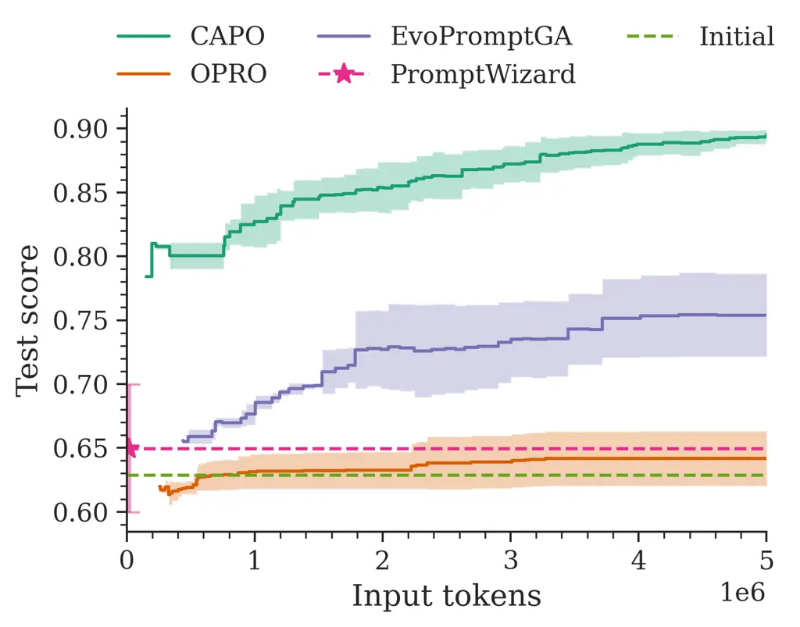
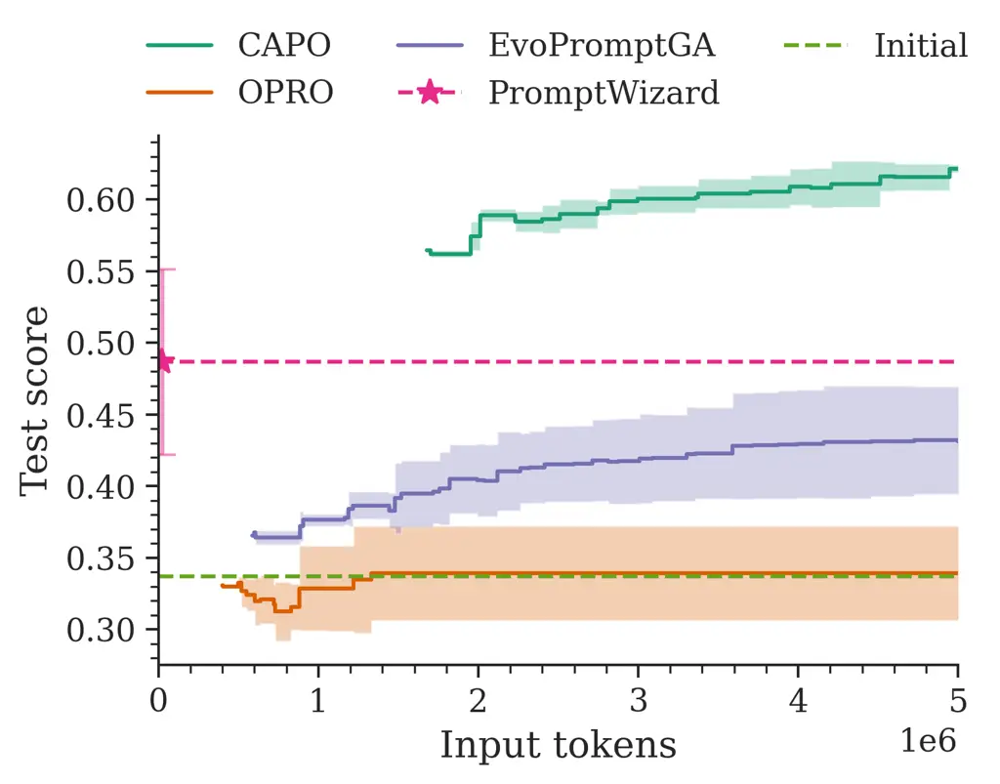
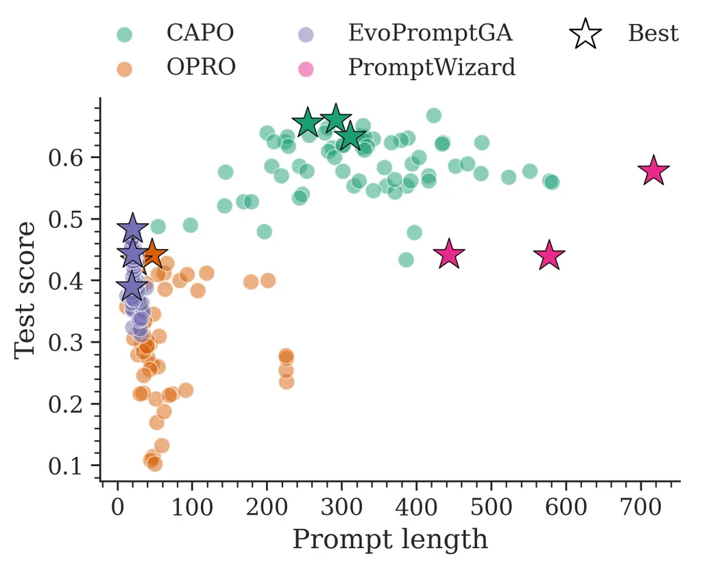
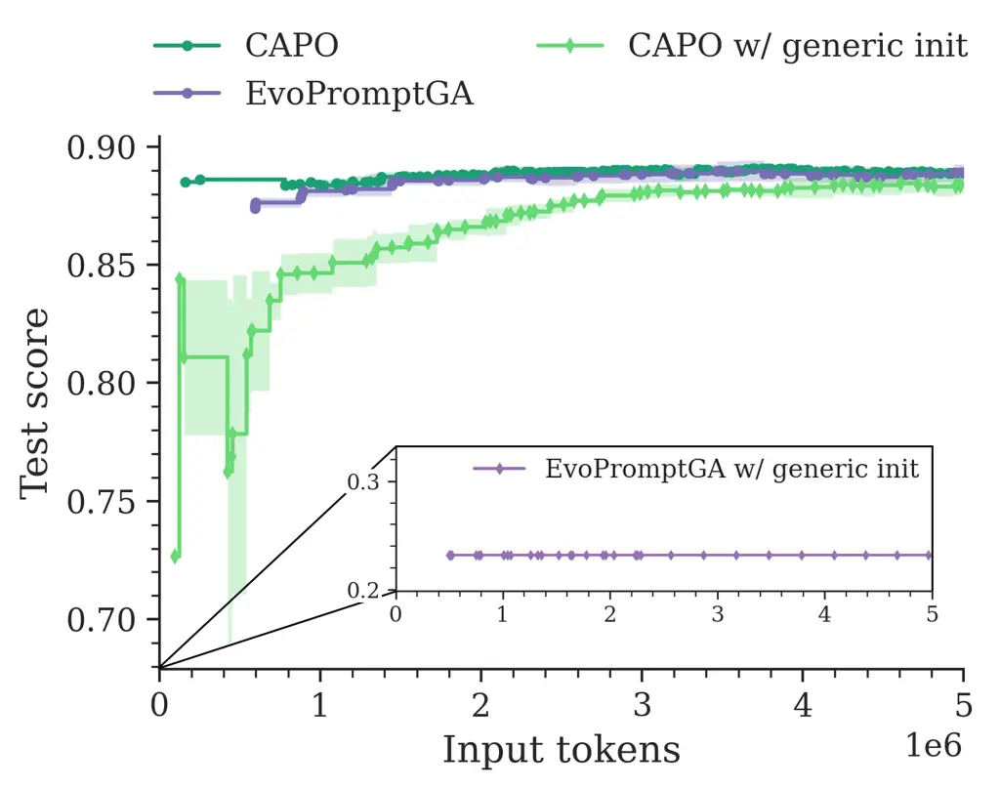

# CAPO: Cost-Aware Prompt Optimization

[Tom Zehle](mailto:t.zehle@campus.lmu.de) Affiliation: Department of
Statistics, LMU Munich, Munich, Germany    [Moritz
Schlager](mailto:schlager.mo@campus.lmu.de) Affiliation: Department of
Statistics, LMU Munich, Munich, Germany    [Timo
Heiß](mailto:t.heiss@campus.lmu.de) Affiliation: Department of
Statistics, LMU Munich, Munich, Germany    [Matthias
Feurer](mailto:matthias.feurer@stat.uni-muenchen.de)
Affiliation: Department of Statistics, LMU Munich, Munich, Germany
Affiliation: Munich Center for Machine Learning (MCML)
Affiliation: Equal contribution.

###### Abstract

Large language models (LLMs) have revolutionized natural language
processing by solving a wide range of tasks simply guided by a prompt.
Yet their performance is highly sensitive to prompt formulation. While
automatic prompt optimization addresses this challenge by finding
optimal prompts, current methods require a substantial number of LLM
calls and input tokens, making prompt optimization expensive. We
introduce CAPO (Cost-Aware Prompt Optimization), an algorithm that
enhances prompt optimization efficiency by integrating AutoML
techniques. CAPO is an evolutionary approach with LLMs as operators,
incorporating racing to save evaluations and multi-objective
optimization to balance performance with prompt length. It jointly
optimizes instructions and few-shot examples while leveraging task
descriptions for improved robustness. Our extensive experiments across
diverse datasets and LLMs demonstrate that CAPO outperforms
state-of-the-art discrete prompt optimization methods in 11/15 cases
with improvements up to 21%p in accuracy. Our algorithm achieves better
performances already with smaller budgets, saves evaluations through
racing, and decreases average prompt length via a length penalty, making
it both cost-efficient and cost-aware. Even without few-shot examples,
CAPO outperforms its competitors and generally remains robust to initial
prompts. CAPO represents an important step toward making prompt
optimization more powerful and accessible by improving cost-efficiency.

 

ApAp

 

-

## 1 Introduction



Figure 1: CAPO yields superior mean population test scores on Subj with
Qwen2.5-32B.

The increasing capabilities of transformer-based large language models
(LLMs) (Vaswani et al.,, 2017; Brown et al.,, 2020) have led to a
paradigm shift in Natural Language Processing (NLP): instead of
pre-training and expensively fine-tuning models for each individual
downstream task, a single LLM, pre-trained in an entirely unsupervised
manner, can now solve a diverse range of tasks, simply steered by a
textual prompt without requiring any additional training (Liu et al.,,
2023). These models demonstrate strong performance on many NLP tasks,
often nearly reaching performances of state-of-the-art fine-tuned
models (Brown et al.,, 2020). In this context, a prompt refers to
instructions provided to the LLM as input to guide its output toward
solving a specific task (Karmaker Santu and Feng,, 2023; White et al.,,
2025). It may additionally include in-context examples (“shots”) of the
task, acting as demonstrations (Brown et al.,, 2020). However, LLM
performance is highly sensitive to prompt quality, format, as well as
choice and order of few-shot examples (Zhao et al.,, 2021; Lu et al.,,
2022; Zhou et al.,, 2023). It has been demonstrated that semantically
similar prompts can perform quite differently (Yang et al.,, 2024),
which we illustrate in Table 1 with two semantically similar prompts
differing by 10%p in accuracy after optimization.

This phenomenon introduces the need for prompt engineering or
optimization, i.e., designing prompts to enable an LLM to optimally
solve a task (Liu et al.,, 2023; Meskó,, 2023). Manual prompt
engineering requires time and expertise (Liu et al.,, 2023). Therefore,
automatic prompt optimization has gained increasing attention, including
both continuous approaches optimizing learnable “soft prompts” (Lester
et al.,, 2021; Li and Liang,, 2021; Qin and Eisner,, 2021) and discrete
methods acting directly on textual prompts (Zhou et al.,, 2023; Agarwal
et al.,, 2024; Yang et al.,, 2024).

| Before optimization (43.8%): Please analyze this elementary school math problem that requires multiple logical steps. After explaining your reasoning, provide the ultimate solution between `<final_answer>` `</final_answer>` tags.                                                                                            |
| -------------------------------------------------------------------------------------------------------------------------------------------------------------------------------------------------------------------------------------------------------------------------------------------------------------------------------- |
| After optimization with EvoPromptGA (53.8%): Assist with solving the elementary or grade school level math problem that requires multiple steps and provide the solution within `<final_answer>` `</final_answer>` tags for easy identification.                                                                                 |
| After optimization with CAPO (ours, 79.2%): To tackle this math word problem, which demands a series of logical steps, dissect it methodically. Outline your thought process and ensure you clearly signify your solution, enclosing it within `<final_answer>` `</final_answer>` markers for easy identification. + 2 few shots |

Table 1: Best performing prompts from our benchmark experiments on GSM8K
with Llama-3.3-70B.

The discrete prompt optimization framework EvoPrompt (Guo et al.,,
2024), which leverages LLMs as operators in an evolutionary algorithm,
achieves strong performance across various tasks. However, EvoPrompt
relies on good, task-specific initial prompts. Other approaches
incorporate human-designed task descriptions to mitigate this
reliance (Yang et al.,, 2024). Moreover, recent advances in prompt
optimization also integrate few-shot example selection (Agarwal et al.,,
2024; Wu et al.,, 2024).

Nonetheless, many prompt optimization methods remain relatively
expensive in terms of the number of LLM calls (Agarwal et al.,, 2024).
For instance, optimizing with EvoPrompt in its original parametrization
requires 4-6 million input tokens per task until convergence (Guo
et al.,, 2024). Given the API costs for commercial LLMs, this can
quickly become expensive: at current commercial API rates, this
translates to approximately \$34 for GPT-4.1 and \$300 for Claude
Opus 4¹¹ 1 Depending on the task, 2-3 million output tokens are
additionally required. Considering input token costs of \$2 / 1M tokens
for GPT-4.1 (\$15 / 1M tokens for Claude Opus 4) and output token costs
of \$8 / 1M tokens (\$75 / 1M tokens), we arrive at a total of roughly
\$34 (\$300). For API prices, see
[https://openai.com/api/pricing/](https://openai.com/api/pricing/) and
[https://www.anthropic.com/pricing](https://www.anthropic.com/pricing)
(accessed: 2025-03-22). for optimization, not even accounting for costs
of productively using the optimized prompt.

In this paper, we address the cost problem in prompt optimization by
introducing CAPO (Cost-Aware Prompt Optimization), a novel discrete
prompt optimization algorithm that integrates AutoML techniques for
enhanced cost-efficiency. CAPO draws its underlying mechanism on
EvoPrompt (Guo et al.,, 2024) and combines it with racing (Birattari
et al.,, 2002) to reduce the number of evaluations and improve
cost-efficiency. It employs multi-objective optimization by
incorporating prompt length as an additional objective through a
penalty. In addition, our algorithm integrates recent advances in prompt
optimization by combining instruction and few-shot example optimization
as well as leveraging task descriptions for improved robustness. Our
main contributions are:

1.  1.  We introduce CAPO, a cost-efficient and -aware prompt optimization
        algorithm that integrates racing and multi-objective optimization,
        leveraging few-shot examples and task descriptions.
2.  2.  We conduct extensive benchmark experiments comparing CAPO against
        three state-of-the-art prompt optimization algorithms across diverse
        datasets and LLMs, demonstrating its superior performance in most
        scenarios, even with substantially fewer input tokens (see, e.g.,
        Figure 1).
3.  3.  We provide comprehensive ablation studies indicating that few-shot
        example selection greatly enhances performance, racing improves
        cost-efficiency, the prompt length objective reduces average prompt
        length, and task descriptions make the algorithm robust to initial
        prompt quality.

We make our complete implementation publicly available under the Apache
2.0 license at
[https://github.com/finitearth/capo/](https://github.com/finitearth/capo/)
to facilitate reproducibility and adoption.

## 2 Notation & Problem Statement

Let $`\mathcal{I}`$ denote the space of all possible instructions $`i`$
and $`\mathcal{E}`$ the space of all possible examples $`e`$, also
referred to as “shots”. A tuple of few-shot examples consisting of $`k`$
shots is denoted by $`\boldsymbol{e}=(e_{1},\dots,e_{k})`$, the space of
all possible $`k`$-shot examples is represented by $`\mathcal{E}^{k}`$.
We define the space of possible prompts with up to $`k_{\max}`$ shots as
$`\mathcal{P}=\mathcal{I}\times\bigcup_{k=0}^{k_{\max}}\mathcal{E}^{k}`$,
where each prompt $`p=(i,\boldsymbol{e})`$ consists of an instruction
and between $`0`$ and $`k_{\max}`$ shots. Let an LLM be a function
$`\Phi`$ that takes a prompt $`p`$ and some input, and produces an
output. In the classical case, the input refers to an instance
$`x\in\mathcal{X}`$ from a dataset
$`\mathcal{D}=\{(x^{(i)},y^{(i)})\}_{i=1}^{n}\sim\mathbb{P}_{xy}`$ and
the output to a corresponding predicted label $`\hat{y}\in\mathcal{Y}`$.
We also use LLMs for generating variations of instructions, where input
and output both refer to instructions $`i`$. We refer to this as
meta-LLM in contrast to the evaluation-LLM for which we optimize the
prompt. LLMs are treated as black boxes without access to gradients or
token probabilities, a common scenario for API LLMs from closed-source
vendors.

We evaluate a prompt $`p`$ by comparing the true label $`y`$ to the
predicted label $`\hat{y}=\Phi(p,x)`$ for a given instance $`x`$ with a
point-wise scoring function
$`\sigma:\mathcal{Y}\times\mathcal{Y}\to\mathbb{R}`$. While any scoring
function is generally possible, we always test for direct match using

```math
\sigma(y,\hat{y})=\begin{cases}1&\text{if }y=\hat{y}\\
0&\text{otherwise}\end{cases} \tag{1}
```

as scoring function. Our goal is to find a prompt $`p`$ that maximizes
this score in expectation:

```math
\underset{p\in\mathcal{P}}{\arg\max}\ \mathbb{E}_{(x,y)\sim\mathbb{P}_{xy}}[\sigma(y,\Phi(p,x))]. \tag{2}
```

Estimating this quantity based on a finite dataset
$`\mathcal{D}=\{(x^{(i)},y^{(i)})\}_{i=1}^{n}`$ yields our objective
$`f`$:
$`f(p;\mathcal{D})=\frac{1}{n}\sum_{i=1}^{n}\sigma(y_{i},\Phi(p,x_{i})).`$
Our goal is to find a prompt $`p`$ that maximizes $`f`$ within a limited
budget of input tokens to an LLM. Since we want to generalize well to
unseen data, we measure $`f`$ on a separate, finite test dataset
$`\mathcal{D}_{test}=\{(x^{(i)},y^{(i)})\}_{i=n+1}^{n+m}`$ drawn from
the same distribution.

## 3 Related Work

#### Automatic Prompt Optimization

Recently, interest in automating prompt optimization has grown as manual
prompt engineering requires time and expertise without guaranteeing
optimality (Jiang et al.,, 2020; Liu et al.,, 2023). A related area is
prompt selection, which aims to find optimal prompts from a pre-defined
pool of candidates (Sorensen et al.,, 2022; Do et al.,, 2024; Schneider
et al.,, 2024; Shi et al.,, 2024). Prompt optimization includes both the
optimization of instructions and the selection of relevant few-shot
examples (“exemplar optimization”) (Wan et al.,, 2024; Wu et al.,,
2024).

Continuous prompt optimization improves prompts in continuous space to
obtain learnable “soft prompts” (Li and Liang,, 2021; Lester et al.,,
2021; Qin and Eisner,, 2021). While this requires access to LLM
parameters and makes prompts not interpretable (Lester et al.,, 2021),
recent approaches like InstructZero (Chen et al.,, 2024) and its
extension INSTINCT (Lin et al.,, 2024) address this by performing
Bayesian optimization on soft prompts used to generate human-readable
instructions.

Discrete methods directly optimize textual prompts (Agarwal et al.,,
2024). Unlike earlier approaches that require access to gradients or
token probabilities (Shin et al.,, 2020; Deng et al.,, 2022; Shi
et al.,, 2023), recent discrete methods also work with black box LLMs.
They typically use a “meta-LLM” instructed by a “meta-prompt” to
alternate prompt candidates: APE (Zhou et al.,, 2023) uses a meta-LLM to
generate instructions from demonstrations and iteratively proposes
semantically similar variants, ProTeGi (Pryzant et al.,, 2023) leverages
mispredicted instances as “pseudo-gradients”, and
PromptBreeder (Fernando et al.,, 2024) uses an evolutionary strategy
with a meta-LLM guided by self-improving mutation-prompts.
EvoPrompt (Guo et al.,, 2024), which serves as foundation of our work,
is also based on evolutionary algorithms and has two instantiations: a
genetic algorithm (GA) and differential evolution (DE). Both implement
evolutionary operations by a meta-LLM. Despite outperforming previous
discrete methods, EvoPrompt has two major drawbacks: it requires many
LLM calls (Agarwal et al.,, 2024) and its performance depends on a good,
task-specific initial prompt population (Yang et al.,, 2024). OPRO (Yang
et al.,, 2024) directly employs LLMs as optimizers by leveraging task
descriptions, task examples, and previous candidates with scores in the
meta-prompt, maintaining good performance even with task-unspecific
initial prompts. These methods optimize instructions without
incorporating few-shot examples in prompt candidates. However, even
simple random example selection can outperform sophisticated instruction
optimizers. Combining instruction and example optimization is found to
create synergies (Wan et al.,, 2024). PromptWizard (Agarwal et al.,, 2024) optimizes instructions and examples simultaneously using a
critique-synthesis mechanism, reportedly outperforming previously
described methods while greatly reducing LLM calls. However, approaches
like PromptWizard, ProTeGi, or OPRO require a notion of what constitutes
a “good” prompt, asking a meta-LLM to identify problems or improve
prompts. Since prompt performance does not necessarily follow
predictable patterns (Yang et al.,, 2024), this potentially limits these
methods’ ability to capture such subtleties.

While the methods described above focus on refining single prompts,
there are frameworks that treat black-box prompt optimization as a
component of larger dynamic systems. TextGrad (Yuksekgonul et al.,, 2025) introduces a pipeline-based optimization approach that uses
LLM-generated feedback as textual gradients to improve prompts.
DSPy (Khattab et al.,, 2024) offers a modular programming framework for
building LLM pipelines with an embedded optimization component.
Aviary (Narayanan et al.,, 2024) reframes prompt optimization within the
broader context of language agents solving complex tasks through a
partially observable multi-step decision process.

#### AutoML for Efficiency

The field of AutoML offers several techniques to enhance optimization
efficiency and methods like multi-fidelity optimization (Jamieson and
Talwalkar,, 2016; Li et al.,, 2018; Falkner et al.,, 2018; Awad et al.,, 2021) have also been successfully adopted outside AutoML, e.g., for
prompt selection, where efficiency is similarly important (Schneider
et al.,, 2024; Shi et al.,, 2024). Racing algorithms are applicable when
objectives are decomposable into cheaper sub-objectives that can be
evaluated individually. They sequentially evaluate candidates and
eliminate poor ones once sufficient statistical evidence accumulates,
preserving budget for promising candidates (Birattari et al.,, 2002;
Birattari et al.,, 2010). Important works include Hoeffding Races (Maron
and Moore,, 1994) using Hoeffding’s bound for elimination, BRACE (Moore
and Lee,, 1994) employing Bayesian statistics, F-Race (Birattari
et al.,, 2002) using Friedman’s test (Conover,, 1999), and
I/F-Race (Balaprakash et al.,, 2007) iteratively applying F-Race while
biasing a probabilistic model of the candidates to promising areas. The
irace package (López-Ibáñez et al.,, 2016) provides a general iterated
racing implementation, including a paired t-test as alternative. Related
methods that save evaluations by adaptively increasing evaluations
include FocusedILS (Hutter et al.,, 2009), as well as ROAR and
SMAC (Hutter et al.,, 2011), employing an “intensification” mechanism
without statistical testing.

Multi-objective optimization (MOO) addresses scenarios with multiple
competing objectives such as performance versus efficiency (Karl
et al.,, 2023). A priori methods transform multiple objectives into a
single one, e.g., via scalarization, yielding only a single solution
candidate (Karl et al.,, 2023). While greatly simplifying
optimization (Miettinen,, 1998), choosing scalarization weights a-priori
is often non-trivial (Jin and Sendhoff,, 2008). A posteriori methods
produce a set of Pareto-optimal solutions (Karl et al.,, 2023). Notable
approaches include evolutionary methods like NSGA-II (Deb et al.,, 2002)
and SMS-EMOA (Beume et al.,, 2007) based on non-dominated sorting rank,
and Bayesian optimization approaches such as ParEGO (Knowles,, 2006),
approximating the Pareto-front using a set of randomly generated
scalarization weights. Combinations of MOO and racing include irace with
Hypervolume (López-Ibáñez et al.,, 2016), S-Race and its
extensions (Zhang et al.,, 2013; Zhang et al., 2015a, ; Miranda et al.,,
2015), MO-ParamILS (Blot et al.,, 2016), and MO-SMAC (Rook et al.,,
2025).

For additional background on the discussed approaches, we refer to
Appendix A.

## 4 CAPO: Cost-Aware Prompt Optimization

We introduce CAPO (Cost-Aware Prompt Optimization), a discrete prompt
optimization algorithm that addresses the cost problem in automatic
prompt optimization and integrates recent prompt optimization advances.
Conceptually, CAPO builds on EvoPromptGA (Guo et al.,, 2024), following
a standard genetic algorithm (Goldberg,, 1989) with a meta-LLM for
cross-over and mutation operations. As the number of evaluations is a
major cost factor in prompt optimization, CAPO employs racing to
eliminate underperforming candidates early. In addition, CAPO draws
inspiration from multi-objective optimization, incorporating efficiency
as additional objective by penalizing prompt length. Keeping the length
of the resulting prompt minimal reduces evaluation cost during
optimization and deployment cost of the final prompt. Similar to
PromptWizard (Agarwal et al.,, 2024), CAPO optimizes both instructions
and few-shot examples simultaneously. Furthermore, CAPO leverages task
descriptions in the meta-prompt to reduce reliance on task-specific
initial prompts (Yang et al.,, 2024). We additionally simplify the
meta-prompt templates by substantially shortening them and avoiding
formulations like “better prompt” that require a notion of what
constitutes a good prompt. We now describe the CAPO algorithm as
outlined in Algorithm 1.

1: datasets $`\mathcal{D}_{\text{dev}}`$ and
$`\mathcal{D}_{\text{shots}}`$, meta-LLM $`\Phi_{\text{meta}}`$,
evaluation-LLM $`\Phi_{\text{eval}}`$, initial instructions
$`\mathcal{I}_{0}=\{i_{1},\dots,i_{\mu}\}`$, population size $`\mu`$,
block size $`b`$, number of iterations $`T`$, number of crossovers per
iteration $`c`$, max. number of few-shot examples $`k_{\max}`$, max.
number of evaluated blocks $`z_{\max}`$, confidence level $`\alpha`$,
token length penalty control parameter $`\gamma`$,
cross-over-meta-prompt $`p_{C}`$, mutation-meta-prompt $`p_{M}`$

2: Divide dataset $`\mathcal{D}_{\text{dev}}`$ into blocks
$`\mathcal{B}=\{B_{1},...,B_{z}\}`$ where $`|B_{i}|=b`$

3: $`\mathcal{P}_{\mu}\leftarrow[]`$

4: for $`i\in\mathcal{I}_{0}`$ do $`\triangleright`$ Initialize prompt
population

5:   $`k\sim\text{Unif}(\{0,\dots,k_{\max}\})`$ $`\triangleright`$
Sample number of few-shots

6:
  $`\boldsymbol{e}\leftarrow\textsc{create\_shots}(\mathcal{D}_{\text{shots}},k,i,\Phi_{\text{eval}})`$
$`\triangleright`$ Create few-shots

7:   $`p\leftarrow(i,\boldsymbol{e})`$

8:   $`\mathcal{P}_{\mu}\leftarrow\textsc{append}(p,\mathcal{P}_{\mu})`$

9: end for

10: for $`t=1`$ to $`T`$ do

11:
  $`\mathcal{P}_{\text{off}}\leftarrow\hyperlink{func:cross_over}{\textsc{cross\_over}(\mathcal{P}_{\mu},\Phi_{\text{meta}},p_{C},c)}`$
$`\triangleright`$ Perform cross-over operation

12:
  $`\mathcal{P}_{\text{off}}\leftarrow\hyperlink{func:mutate}{\textsc{mutate}(\mathcal{P}_{\text{off}},\Phi_{\text{meta}},\Phi_{\text{eval}},p_{M},\mathcal{D}_{\text{shots}},k_{\max})}`$
$`\triangleright`$ Mutation operation on offspring

13:
  $`\mathcal{P}_{\mu}\leftarrow\hyperlink{func:do_racing}{\textsc{do\_racing}(\mathcal{P}_{\mu}\cup\mathcal{P}_{\text{off}},\mathcal{B},\Phi_{\text{eval}},\alpha,\gamma,\mu,z_{\max})}`$
$`\triangleright`$ Survival selection via racing

14: end for

15: return $`\mathcal{P}_{\mu}`$

Algorithm 1 CAPO: Cost-Aware Prompt Optimization

Population Initialization: A set of initial instructions
$`\mathcal{I}_{0}`$ of population size $`\mu`$ is provided as input,
either manually engineered or automatically generated with approaches
like APE (Zhou et al.,, 2023). We first augment each instruction with a
random number of few-shot examples between $`0`$ and $`k_{\max}`$. For
each example, we generate reasoning to provide richer information
compared to solely a label as example output. We prompt the
evaluation-LLM with the initial instruction to solve the example input,
which typically yields a response with both reasoning and prediction. If
the LLM fails to generate a correct prediction, we use the true label as
example output.²² 2 For illustration purposes, we provide exemplary
few-shot examples with and without reasoning in Appendix . This
resembles PromptWizard (Agarwal et al.,, 2024), which leverages
reasoning chains. This initialization procedure yields a diverse
population with varying number and lengths of shots.

Cross-over & Mutation: For cross-over, CAPO randomly selects parents,
unlike EvoPromptGA (Guo et al.,, 2024), which uses score-based roulette
wheel selection. While less exploitative, our choice eliminates
expensive evaluations during parent selection. The cross*over operation
(cf. Appendix B) leverages a meta-LLM $`\Phi*{\text{meta}}`$ to create
an offspring instruction $`i*{\text{off}}`$ from the two selected
parents’ instructions. The meta-LLM is steered by a meta-cross-over
prompt $`p*{C}`$, which is simplified compared to the EvoPromptGA
meta-prompt (Guo et al.,, 2024) and incorporates a task description.³³ 3
Prompt templates are provided in Appendix D.3. We illustrate instruction
variation with examples in Appendix E.1. For the offspring’s few-shot
examples $`\boldsymbol{e*{\text{off}}}`$, we sample from the union of
the parents’ examples, with the number of examples corresponding to the
average of the number of few-shot examples of the two parents. This
process is repeated $`c`$ times per iteration to generate $`c`$
offspring. To each offspring, we then apply the mutate operation (cf.
Appendix B). Similar to cross-over, a meta-LLM $`\Phi*{\text{meta}}`$ is
instructed via a simplified meta-mutation-prompt $`p*{M}`$ with task
description to create a mutated version of the offspring
instruction.^(†)^(†)footnotemark: To mutate few-shot examples, we apply
one of three operations with equal probability: adding a new shot if not
exceeding $`k*{\max}`$, removing a random shot if there are any, or
keeping them unchanged. Following this step, we randomly shuffle the
order of all examples. This approach of modifying only single examples
and their order is designed to foster local exploration of the few-shot
example choice and their quantity.

Survival Selection: To select survivors, we eliminate prompts through
racing (do*racing, cf. Appendix B), discarding underperforming prompts
early when statistical evidence indicates they perform significantly
worse. Our racing procedure operates on blocks of samples
$`\mathcal{B}=\{B*{1},...,B*{z}\}`$ of fixed size $`b`$, similar to
F-Race (Birattari et al.,, 2002). We optionally shuffle block order in
each iteration to avoid potential elimination biases. We sequentially
process blocks, evaluate all prompts on the selected block (caching
block scores to save evaluations later), and eliminate inferior prompts
when more than $`\mu`$ other prompts are significantly better according
to a statistical test. We do not correct for multiple testing as this
can negatively affect racing behavior by making the test more
conservative, leading to fewer early eliminations of
candidates (Birattari,, 2009). This corresponds to a population-based
racing approach since we compare across the entire population rather
than against a single incumbent.⁴⁴ 4 This makes the erroneous
elimination of the best candidate very unlikely, as not only one but
several type I errors would have to occur. Racing continues with
additional blocks until we either reach $`\mu`$ survivors or the maximum
block evaluation limit $`z*{\max}`$. If more than $`\mu`$ prompts
survive after $`z\_{\max}`$ evaluated blocks, we select the $`\mu`$
best-performing prompts based on their average scores.

As statistical test, we employ a paired t-test with $`\alpha=0.2`$,
which is favorable for our case compared to the commonly used F-test as
scores across instances are commensurable (López-Ibáñez et al.,, 2016)
while less conservative than non-parametric bounds like
Hoeffding’s (Maron and Moore,, 1994). Since the paired t-test requires
normality or sufficiently large sample sizes ($`\geq 30`$) (Hsu and
Lachenbruch,, 2014), block size $`b`$ must be chosen such that
assumptions hold even for a single block.

Since we aim to maximize performance while keeping prompt length
minimal, i.e., shorter instructions, fewer examples, and reasoning only
when necessary, we implement a form of multi-objective optimization.
This is particularly important given our inclusion of few-shot examples,
which can considerably increase the prompt length. To keep the racing
procedure simple, we scalarize our objective using a length penalty
parameter $`\gamma`$ that controls the trade-off between prompt
performance and any measure of relative token length. This parameter
must be selected a-priori, yielding the objective
$`f_{\gamma}(p;B)=f(p;B)-\gamma\cdot\textsc{rel\_token\_length}(p)`$. In
our implementation, rel_token_length represents token count⁵⁵ 5 We give
details on how we count tokens in this paper in Appendix C.4. normalized
by the longest initial prompt.

## 5 Experimental Setup

For our experiments, we use three different LLMs:
Llama-3.3-70B-Instruct-GPTQ (Meta,, 2024),
Qwen2.5-32B-Instruct-GPTQ (Qwen: Yang et al.,, 2025) and
Mistral-Small-24B-GPTQ (Mistral AI Team,, 2025). These cover different
model sizes from different companies and regions. We opt for model sizes
that still fit on a single GPU while exhibiting strong performances. To
meet hardware constraints, we employ GPTQ-quantized models (Frantar
et al.,, 2023), which show negligible performance loss compared to
uncompressed models. For each setup, we use the same model as meta- and
evaluation-LLM. For further technical details, we refer to Appendix C.

We employ five datasets spanning a diverse range of typical NLP tasks
with different subject areas, targets, and complexity levels:
SST-5 (Socher et al.,, 2013, sentiment classification;), AG News (Zhang
et al., 2015b, , topic classification;), Subj (Pang and Lee,, 2004,
subjectivity classification;), GSM8K (Cobbe et al.,, 2021, grade school
math word problems;) and (Balanced) COPA (Kavumba et al.,, 2019,
commonsense causal reasoning;). The first three datasets are used in the
EvoPrompt paper (Guo et al.,, 2024), GSM8K in OPRO (Yang et al.,, 2024)
and PromptWizard (Agarwal et al.,, 2024), and COPA is added as, to the
best of our knowledge, a novel application for discrete prompt
optimization. For each dataset, we use 200 samples as few-shot dataset,
300 as development set for optimization (larger than EvoPrompt (Guo
et al.,, 2024), where 200 samples are used for these tasks), and 500
holdout samples as test set (equivalent to the size of the smallest test
set from our five datasets; details in Appendix C.2). We automatically
create a diverse pool of 15 initial instructions per dataset with
Anthropic’s Claude Sonnet 3.7 (cf. Appendix D.2), and sample the initial
instructions from this pool for all optimizers and models. CAPO and
OPRO (Yang et al.,, 2024) additionally use task descriptions, which we
manually craft (cf. Appendix D.1).

We benchmark CAPO against three state-of-the-art discrete prompt
optimizers: EvoPromptGA (Guo et al.,, 2024), OPRO (Yang et al.,, 2024),
and PromptWizard (Agarwal et al.,, 2024). We use the GA instantiation of
EvoPrompt as it performs similar to the DE variant while being
conceptually simpler and closer to CAPO. For EvoPromptGA and OPRO, we
use reimplementations of a public library while using PromptWizard’s
original implementation with small adaptions. For implementation and
parametrization details of the optimizers, we refer to Appendix C.4.

For all experiments with CAPO, EvoPromptGA, and OPRO, we do not restrict
maximum iterations but instead use a budget of 5M input tokens after
which the run terminates.⁶⁶ 6 PromptWizard has no clear way to increase
compute time, we report its performance on reduced budget (for details,
see Appendix C.4). We choose this budget such that EvoPromptGA, which is
most expensive in terms of LLM calls, has likely converged (Guo et al.,,
2024, cf.). We evaluate each optimizer with each LLM and dataset,
performing three repetitions with different random seeds per setup to
quantify variance.

|                   |              |              |              |            |              |              |       |
| ----------------- | ------------ | ------------ | ------------ | ---------- | ------------ | ------------ | ----- |
| Model             | Optimizer    | SST-5        | AG News      | Subj       | GSM8K        | COPA         | Avg.  |
| Llama-3.3-70B     | Initial      | 58.47±  1.53 | 87.06±  0.65 | 62.00±5.22 | 44.28±  4.91 | 97.65±  1.31 | 69.89 |
|                   | OPRO         | 60.87±  1.09 | 88.20±  0.49 | 71.33±2.80 | 51.87±  2.04 | 98.07±  0.57 | 74.07 |
|                   | PromptWizard | 32.80±  1.73 | 23.33±  0.19 | 51.93±0.25 | 39.33±15.09  | 50.33±  0.34 | 39.55 |
|                   | EvoPromptGA  | 60.53±  1.73 | 88.67±  0.41 | 75.53±1.39 | 50.87±  0.74 | 97.60±  1.13 | 74.64 |
|                   | CAPO (ours)  | 62.27±  0.34 | 88.80±  0.75 | 91.60±2.16 | 73.73±  3.73 | 98.27±  0.52 | 82.93 |
| Qwen2.5-32B       | Initial      | 56.68±  1.94 | 79.57±  0.84 | 62.85±4.53 | 33.08±  7.78 | 98.27±  0.43 | 66.09 |
|                   | OPRO         | 57.00±  0.43 | 79.87±  0.19 | 70.67±2.36 | 46.33±  3.07 | 98.67±  0.34 | 70.51 |
|                   | PromptWizard | 39.73±12.31  | 63.47±28.49  | 64.93±5.01 | 15.27±20.19  | 98.13±  0.19 | 56.31 |
|                   | EvoPromptGA  | 58.60±  1.73 | 81.73±  1.68 | 75.87±3.58 | 61.27±  8.39 | 97.87±  0.66 | 75.07 |
|                   | CAPO (ours)  | 59.07±  0.50 | 87.07±  0.81 | 91.00±0.65 | 60.20±  4.82 | 98.47±  0.19 | 79.16 |
| Mistral-Small-24B | Initial      | 48.69±  2.94 | 72.21±  7.45 | 61.65±6.04 | 33.71±  5.89 | 94.56±  0.94 | 62.17 |
|                   | OPRO         | 53.20±  2.83 | 84.20±  0.16 | 77.07±0.09 | 43.53±  0.47 | 96.33±  0.34 | 70.87 |
|                   | PromptWizard | 31.07±  3.80 | 44.40±25.76  | 59.00±5.09 | 48.67±  6.46 | 57.47±10.28  | 48.12 |
|                   | EvoPromptGA  | 54.93±  0.94 | 84.40±  0.28 | 74.93±2.04 | 43.93±  3.85 | 96.13±  0.34 | 70.87 |
|                   | CAPO (ours)  | 60.20±  0.33 | 84.33±  2.13 | 81.67±1.64 | 65.07±  1.20 | 95.13±  1.20 | 77.28 |

Table 2: Performance comparison of different prompt optimizers (last
step before exceeding 5M input tokens). We report the mean accuracy (in
%) on test set with standard deviation across three seeds of the best
prompts. The best prompt per seed is selected from the last population
based on development set scores. Bold values indicate best, underlined
values second to best performance for each LLM and dataset.

## 6 Results & Analysis

### 6.1 Benchmark Results

We report the test scores of our benchmark experiments in Table 2. The
results demonstrate that CAPO outperforms the other prompt optimization
methods on most datasets and models (11/15). Notably, for Llama-3.3-70B,
CAPO leads to the best results on every single dataset. For scenarios in
which another optimizer is better, CAPO is still competitive and within
one standard deviation. While performance gains of CAPO compared to the
rest are small on SST-5 or AG News, we observe substantial performance
improvements on Subj and GSM8K, with up to 21%p improvement over the
rest (Llama-3.3-70B on GSM8K). Initial instructions are consistently
improved by CAPO.

To assess the performance at intermediate token budgets, we depict the
mean population performance over input tokens for two representative
examples of optimizer-dataset pairs in Figures 1 & 3 (see Appendix  for
the remaining optimization curves). For both examples, as soon as CAPO
yields the first prompt, it consistently dominates the other optimizers
over the entire token range. Early performances of CAPO already exceed
the other optimizers’ final performances after the full budget,
underscoring its cost-efficiency. However, we observe that CAPO often
yields its first prompt later in terms of used input tokens than its
competitors. This is due to the fact that CAPO includes few-shot
examples, making evaluations more costly. It follows that CAPO requires
many tokens in the first step while being very cost-efficient later (see
Appendix  for details).

We also find that CAPO yields longer prompts than EvoPromptGA and OPRO
due to few-shot examples but still shorter than PromptWizard (cf.
Figure 3). Thus, though PromptWizard requires fewer tokens during
optimization (on average only 25k input tokens), CAPO reduces the
deployment cost of the optimized prompts. A more detailed analysis of
CAPO’s prompt length reveals that, on average, 66% of the tokens can be
attributed to few-shot examples compared to the instruction, with up to
92% in the prompts of Llama-3.3-70B on GSM8K (cf. Appendix ).

Further, we identify the evaluation of prompts as the main driver behind
the token usage: on average, 97% of the input tokens are consumed by the
evaluation-LLM and only 3% by the meta-LLM (cf. Appendix ), justifying
our approach of reducing evaluation costs through racing.



Figure 2: Population mean test scores over input tokens on GSM8K with
Mistral-Small-24B with mean $`\pm`$ std across seeds. PromptWizard
yields only a single prompt early, marked with a star and error bars.



Figure 3: Test scores vs. prompt length (system + user prompt) for every
prompt on GSM8K with Mistral-Small-24B. Stars mark the best performing
on dev-set from the last population.

### 6.2 Ablation Studies

|                                  |            |            |               |        |
| -------------------------------- | ---------- | ---------- | ------------- | ------ |
| Ablation                         | Accuracy   |            | Prompt length |        |
|                                  | AG News    | GSM8K      | AG News       | GSM8K  |
| CAPO                             | 88.80±0.75 | 73.73±3.73 | 481±113       | 110±46 |
| $`\hookrightarrow`$ zero-shot    | 89.00±0.16 | 59.20±5.03 | 94±  17       | 74±24  |
| $`\hookrightarrow`$ $`\gamma=0`$ | 89.27±0.41 | 74.93±1.04 | 297±  27      | 128±27 |
| $`\hookrightarrow`$ w/o racing   | 89.20±0.43 | 75.00±3.12 | 469±130       | 146±52 |
| $`\hookrightarrow`$ all above    | 88.53±0.09 | 50.93±5.25 | 78±  11       | 37±13  |
| $`\hookrightarrow`$ generic init | 89.33±0.19 | 82.93±2.36 | 206±113       | 182±22 |
| EvoPromptGA                      | 88.67±0.41 | 50.87±0.74 | 28±    2      | 30±  1 |
| $`\hookrightarrow`$ generic init | 23.20±0.00 | 53.47±0.38 | 17±    8      | 20±  2 |

Table 3: Ablation study results using Llama-3.3-70B. Mean accuracy (in
%) on test set of best prompt per seed selected on the development set
scores (format as in Table 2). “all above” is the combination of
zero-shot, $`\gamma=0`$, and w/o racing.

To better understand design choices in CAPO, we ablate several
components on AG News and GSM8K with Llama-3.3-70B, a budget of 5M input
tokens, three seeds, and optimizer parameters as before. We provide
results in Table 3 and give further insights in Appendix  while
describing the key findings here.

I. Zero-shot performance: Without few-shot examples, the performances of
the best prompts remain unchanged for AG News while being substantially
worse for the more complex GSM8K task (cf. Table 3). This highlights the
importance of few-shot examples for complex tasks. Notably, zero-shot
CAPO still considerably outperforms EvoPromptGA on GSM8K. Due to the
lack of few-shot examples, the resulting prompts are much shorter than
default CAPO prompts but interestingly longer than for EvoPromptGA. We
find that this is due to our meta-prompt template sometimes causing
repetitions inside optimized prompts after cross-over.⁷⁷ 7 The
cross-over step prompts the meta-LLM to ”\[…\] merge the two prompts
\[…\]” (cf. Appendix D.3), which leads to occasional concatenation of
prompts.

II. No length penalty: Removing the length penalty ($`\gamma=0`$)
improves performance of the final prompts compared to default CAPO while
the prompt length stays in a similar range (cf. Table 3). Such a
performance improvement is expected as disabling the length penalty
results in directly optimizing accuracy. Nonetheless, we find that with
length penalty, average prompt length decreases as optimization
progresses, enabling more steps. We discuss this effect of different
length penalties in Appendix .

III. No racing: After 5M input tokens, CAPO without racing performs
slightly better while differences lie within one standard deviation (cf.
Table 3). Still, comparing performance over input tokens reveals that
with racing, substantially fewer input tokens are needed to yield first
prompts with relatively good performance (cf. Figure ). We further find
that racing, on average, saves 44% of evaluations, enabling considerably
more steps with the same budget (cf. Appendix ).



Figure 4: Population mean test scores over input tokens on AG News with
Llama-3.3-70B with mean $`\pm`$ std across seeds. CAPO and EvoPromptGA
start from task-specific initial instructions, their respective
counterparts from generic initial instructions.

IV. No shots, length penalty & racing: To identify the joint influence
of our core innovations, we combine the three ablations above by
removing few-shot examples, racing, and the length penalty. The
resulting CAPO configuration shows a considerable performance drop
compared to the default CAPO on GSM8K while only slightly losing
performance on AG News. Generally, we observe that, as expected, this
CAPO configuration yields performances very similar to EvoPromptGA.
Thus, the performance gains of default CAPO over EvoPromptGA must stem
from our core innovations and their interplay.

V. Generic initial instructions: We use automatically generated
task-unspecific initial instructions (cf. Appendix D.2) and analyze if
task descriptions in CAPO counteract degrading performances observed
by Yang et al., (2024). Our results confirm the degrading performance of
EvoPromptGA, especially for AG News (cf. Figure 4). The optimization
curves reveal that EvoPromptGA’s performance stays constant as no valid
labels are predicted while CAPO starts lower than with task-specific
instructions but quickly improves as task descriptions introduce
task-specific information, eventually reaching similar performances.
Surprisingly, for GSM8K, generic initial instructions even lead to
improved CAPO performance (cf. Table 3), likely because (1) instances of
GSM8K contain instructions themselves and (2) CAPO can explore more
freely. This demonstrates CAPO’s robustness and suggests even generic
instruction repositories could serve as initial populations.

## 7 Conclusion & Future Work

In this paper, we propose the discrete prompt optimization method CAPO,
an evolutionary algorithm that integrates racing and multi-objective
optimization, leveraging few-shot examples and task descriptions. Our
experiments demonstrate that CAPO outperforms other discrete prompt
optimizers in 11 out of 15 cases, with differences up to 21%p on GSM8K
with Llama-3.3-70B, while being competitive in the remaining 4 cases.
CAPO yields better performance already at earlier stages than other
algorithms after the full budget, showing its cost-efficiency, and
remains dominant over the entire budget. Nonetheless, it yields longer
prompts due to few-shot examples. Our ablation studies reveal several
important insights: (I.) few-shot examples substantially contribute to
the performance, especially for complex tasks, while CAPO maintains
strong performance even without examples; (II.) the length-penalty
effectively reduces average prompt length throughout optimization;
(III.) racing leads to considerable savings in terms of evaluations,
enabling more iterations; (IV.) CAPO’s performance gains must be due to
few-shot examples, length penalty, and racing, as well as their
interplay; and (V.) task descriptions make CAPO robust, yielding strong
performance with generic initial instructions.

Despite the great advances, our work also has limitations. First, while
racing reduces evaluations, it does not necessarily contribute to better
performance after the full budget. Moreover, our study focuses on
smaller models and could thus be extended to larger LLMs. Similarly, our
analysis is limited to classification and math tasks while the main
usage of LLMs is text generation. Additionally, all datasets are older
than the LLMs, leading to potential test set contamination. Nonetheless,
this limitation holds for all optimizers equally, not affecting our
conclusions. Finally, output token length is another major cost factor
influenced by the prompt, which is not considered in our work and should
be addressed by future work.

In the future, we plan to make CAPO an a posteriori multi-objective
method, allowing the user to choose from a final population that
features different trade-offs in prompt performance and length. In
addition, we plan to study the use of other strategies for budget
allocation, such as successive halving (Karnin et al.,, 2013; Parmentier
et al.,, 2019) or hyperband (Li et al.,, 2018; Awad et al.,, 2021).

## 8 Broader Impact Statement

Making CAPO openly available enables positive impacts across industrial
and research applications, though also creating potential for misuse by
malicious actors. As our work builds upon LLMs, it inherits their
associated impacts, including potential biases, hallucination, and
energy consumption. Prompt optimization specifically requires numerous
LLM calls, resulting in significant energy expenditure and negative
environmental impact. Nonetheless, CAPO aims to reduce these costs.
Through racing, CAPO saves evaluations while producing effective prompts
earlier. A length penalty encourages shorter prompts for reduced
production costs. Our algorithm often achieves better performance at a
substantially smaller input token budget than other optimizers on the
full budget, greatly improving cost-efficiency. These efficiency
improvements directly translate to reduced energy requirements for more
environmentally sustainable prompt optimization.

#### Acknowledgements

We would like to thank Lennart Schneider for his invaluable suggestions
and impulses through multiple discussions. We also gratefully
acknowledge the computational and data resources provided by the Leibniz
Supercomputing Centre.

## References

- Agarwal et al., (2024) Agarwal, E., Singh, J., Dani, V., Magazine, R.,
  Ganu, T., and Nambi, A. (2024). PromptWizard: Task-aware prompt
  optimization framework. arXiv:2405.18369 \[cs.CL\].
- Awad et al., (2021) Awad, N., Mallik, N., and Hutter, F. (2021). DEHB:
  Evolutionary hyperband for scalable, robust and efficient
  Hyperparameter Optimization. In Zhou, Z., editor, Proceedings of the
  30th International Joint Conference on Artificial Intelligence
  (IJCAI’21), pages 2147–2153.
- Balaprakash et al., (2007) Balaprakash, P., Birattari, M., and
  Stützle, T. (2007). Improvement strategies for the f-race algorithm:
  Sampling design and iterative refinement. In Bartz-Beielstein, T.,
  Aguilera, M. B., Blum, C., Naujoks, B., Roli, A., Rudolph, G., and
  Sampels, M., editors, Proceedings of the International Workshop on
  Hybrid Metaheuristics (HM’07), volume 4771 of Lecture Notes in
  Computer Science, pages 108–122. Springer.
- Beume et al., (2007) Beume, N., Naujoks, B., and Emmerich, M. (2007).
  SMS-EMOA: Multiobjective selection based on dominated hypervolume.
  European Journal of Operational Research, 181(3):1653–1669.
- Birattari, (2009) Birattari, M. (2009). Tuning Metaheuristics, volume
  197 of Studies in Computational Intelligence. Springer, Berlin,
  Heidelberg.
- Birattari et al., (2002) Birattari, M., Stützle, T., Paquete, L., and
  Varrentrapp, K. (2002). A racing algorithm for configuring
  metaheuristics. In Langdon, W., Cantu-Paz, E., Mathias, K., Roy, R.,
  Davis, D., Poli, R., Balakrishnan, K., Honavar, V., Rudolph, G.,
  Wegener, J., Bull, L., Potter, M., Schultz, A., Miller, J., Burke, E.,
  and Jonoska, N., editors, Proceedings of the Genetic and Evolutionary
  Computation Conference (GECCO’02), pages 11–18. Morgan Kaufmann
  Publishers.
- Birattari et al., (2010) Birattari, M., Yuan, Z., Balaprakash, P., and
  Stützle, T. (2010). F-Race and Iterated F-Race: An overview. In
  Bartz-Beielstein, T., Chiarandini, M., Paquete, L., and Preuss, M.,
  editors, Experimental Methods for the Analysis of Optimization
  Algorithms, pages 311–336. Springer, Berlin, Heidelberg.
- Blot et al., (2016) Blot, A., Hoos, H., Jourdan, L., Kessaci-Marmion,
  M., and Trautmann, H. (2016). MO-ParamILS: A multi-objective automatic
  algorithm configuration framework. In Festa, P., Sellmann, M., and
  Vanschoren, J., editors, Proceedings of the Tenth International
  Conference on Learning and Intelligent Optimization (LION’16), Lecture
  Notes in Computer Science, pages 32–47. Springer.
- Brown et al., (2020) Brown, T., Mann, B., Ryder, N., Subbiah, M.,
  Kaplan, J., Dhariwal, P., Neelakantan, A., Shyam, P., Sastry, G.,
  Askell, A., Agarwal, S., Herbert-Voss, A., Krueger, G., Henighan, T.,
  Child, R., Ramesh, A., Ziegler, D., Wu, J., Winter, C., Hesse, C.,
  Chen, M., Sigler, E., Litwin, M., Gray, S., Chess, B., Clark, J.,
  Berner, C., McCandlish, S., Radford, A., Sutskever, I., and Amodei, D.
  (2020). Language models are few-shot learners. In Larochelle, H.,
  Ranzato, M., Hadsell, R., Balcan, M.-F., and Lin, H., editors,
  Proceedings of the 33rd International Conference on Advances in Neural
  Information Processing Systems (NeurIPS’20), pages 1877–1901. Curran
  Associates.
- Chen et al., (2024) Chen, L., Chen, J., Goldstein, T., Huang, H., and
  Zhou, T. (2024). InstructZero: Efficient instruction optimization for
  black-box large language models. In Salakhutdinov, R., Kolter, Z.,
  Heller, K., Weller, A., Oliver, N., Scarlett, J., and Berkenkamp, F.,
  editors, Proceedings of the 41st International Conference on Machine
  Learning (ICML’24), volume 235 of Proceedings of Machine Learning
  Research, pages 6503–6518. PMLR.
- Cobbe et al., (2021) Cobbe, K., Kosaraju, V., Bavarian, M., Chen, M.,
  Jun, H., Kaiser, L., Plappert, M., Tworek, J., Hilton, J., Nakano, R.,
  Hesse, C., and Schulman, J. (2021). Training verifiers to solve math
  word problems. arXiv:2110.14168 \[cs.LG\].
- Conover, (1999) Conover, W. (1999). Practical Nonparametric
  Statistics. John Wiley & Sons.
- Deb et al., (2002) Deb, K., Pratap, A., Agarwal, S., and Meyarivan, T.
  (2002). A fast and elitist multiobjective genetic algorithm: NSGA-II.
  IEEE Transactions on Evolutionary Computation, 6(2):182–197.
- Deng et al., (2022) Deng, M., Wang, J., Hsieh, C., Wang, Y., Guo, H.,
  Shu, T., Song, M., Xing, E., and Hu, Z. (2022). RLPrompt: Optimizing
  discrete text prompts with reinforcement learning. In Goldberg, Y.,
  Kozareva, Z., and Zhang, Y., editors, Proceedings of the 2022
  Conference on Empirical Methods in Natural Language Processing
  (EMNLP), pages 3369–3391. Association for Computational Linguistics.
- Do et al., (2024) Do, V.-T., Hoang, V., Nguyen, D., Sabahi, S., Yang,
  J., Hotta, H., Nguyen, M., and Le, H. (2024). Automatic prompt
  selection for large language models. arXiv:2404.02717 \[cs.CL\].
- Dolan and Moré, (2002) Dolan, E. and Moré, J. (2002). Benchmarking
  optimization software with performance profiles. Mathematical
  Programming, 91(2):201–213.
- Falkner et al., (2018) Falkner, S., Klein, A., and Hutter, F. (2018).
  BOHB: Robust and efficient Hyperparameter Optimization at scale. In
  Dy, J. and Krause, A., editors, Proceedings of the 35th International
  Conference on Machine Learning (ICML’18), volume 80, pages 1437–1446.
  Proceedings of Machine Learning Research.
- Fernando et al., (2024) Fernando, C., Banarse, D., Michalewski, H.,
  Osindero, S., and Rocktäschel, T. (2024). Promptbreeder:
  self-referential self-improvement via prompt evolution. In
  Salakhutdinov, R., Kolter, Z., Heller, K., Weller, A., Oliver, N.,
  Scarlett, J., and Berkenkamp, F., editors, Proceedings of the 41st
  International Conference on Machine Learning (ICML’24), volume 235 of
  Proceedings of Machine Learning Research, pages 13481–13544. PMLR.
- Frantar et al., (2023) Frantar, E., Ashkboos, S., Hoefler, T., and
  Alistarh, D. (2023). GPTQ: Accurate post-training quantization for
  generative pre-trained transformers. arXiv:2210.17323 \[cs.LG\].
- Goldberg, (1989) Goldberg, D. (1989). Genetic Algorithms in Search,
  Optimization and Machine Learning. Addison-Wesley Longman Publishing
  Co., Inc., USA, 1st edition.
- Guo et al., (2024) Guo, Q., Wang, R., Guo, J., Li, B., Song, K., Tan,
  X., Liu, G., Bian, J., and Yang, Y. (2024). Connecting large language
  models with evolutionary algorithms yields powerful prompt optimizers.
  In The Twelfth International Conference on Learning Representations
  (ICLR’24). ICLR. Published online: [iclr.cc](https://iclr.cc).
- Hsu and Lachenbruch, (2014) Hsu, H. and Lachenbruch, P. (2014). Paired
  test. In Wiley StatsRef: Statistics Reference Online. John Wiley &
  Sons, Ltd.
- Hutter et al., (2011) Hutter, F., Hoos, H., and Leyton-Brown, K.
  (2011). Sequential model-based optimization for general algorithm
  configuration. In Coello, C., editor, Proceedings of the Fifth
  International Conference on Learning and Intelligent Optimization
  (LION’11), volume 6683 of Lecture Notes in Computer Science, pages
  507–523. Springer.
- Hutter et al., (2009) Hutter, F., Hoos, H., Leyton-Brown, K., and
  Stützle, T. (2009). ParamILS: An automatic algorithm configuration
  framework. Journal of Artificial Intelligence Research, 36:267–306.
- Jamieson and Talwalkar, (2016) Jamieson, K. and Talwalkar, A. (2016).
  Non-stochastic best arm identification and Hyperparameter
  Optimization. In Gretton, A. and Robert, C., editors, Proceedings of
  the Seventeenth International Conference on Artificial Intelligence
  and Statistics (AISTATS’16), volume 51. Proceedings of Machine
  Learning Research.
- Jiang et al., (2020) Jiang, Z., Xu, F., Araki, J., and Neubig, G.
  (2020). How can we know what language models know? Transactions of the
  Association for Computational Linguistics, 8:423–438.
- Jin and Sendhoff, (2008) Jin, Y. and Sendhoff, B. (2008). Pareto-based
  multiobjective machine learning: an overview and case studies. IEEE
  Transactions on Systems, Man, and Cybernetics, Part C (Applications
  and Reviews), 38(3):397–415.
- Karl et al., (2023) Karl, F., Pielok, T., Moosbauer, J., Pfisterer,
  F., Coors, S., Binder, M., Schneider, L., Thomas, J., Richter, J.,
  Lang, M., Garrido-Merchán, E., Branke, J., and Bischl, B. (2023).
  Multi-objective hyperparameter optimization – an overview.
  Transactions of Evolutionary Learning and Optimization, 3(4):1––50.
- Karmaker Santu and Feng, (2023) Karmaker Santu, S. and Feng, D.
  (2023). TELeR: A general taxonomy of LLM prompts for benchmarking
  complex tasks. In Bouamor, H., Pino, J., and Bali, K., editors,
  Findings of the Association for Computational Linguistics: EMNLP 2023,
  pages 14197–14203. Association for Computational Linguistics.
- Karnin et al., (2013) Karnin, Z., Koren, T., and Somekh, O. (2013).
  Almost optimal exploration in multi-armed bandits. In Dasgupta, S. and
  McAllester, D., editors, Proceedings of the 30th International
  Conference on Machine Learning (ICML’13), pages 1238–1246. Omnipress.
- Kavumba et al., (2019) Kavumba, P., Inoue, N., Heinzerling, B., Singh,
  K., Reisert, P., and Inui, K. (2019). When choosing plausible
  alternatives, clever hans can be clever. In Ostermann, S., Zhang, S.,
  Roth, M., and Clark, P., editors, Proceedings of the First Workshop on
  Commonsense Inference in Natural Language Processing, pages 33–42.
  Association for Computational Linguistics.
- Khattab et al., (2024) Khattab, O., Singhvi, A., Maheshwari, P.,
  Zhang, Z., Santhanam, K., Vardhamanan, S., Haq, S., Sharma, A., Joshi,
  T., Moazam, H., Miller, H., Zaharia, M., and Potts, C. (2024). DSPy:
  Compiling declarative language model calls into state-of-the-art
  pipelines. In The Twelfth International Conference on Learning
  Representations (ICLR’24). ICLR. Published online:
  [iclr.cc](https://iclr.cc).
- Knowles, (2006) Knowles, J. (2006). ParEGO: a hybrid algorithm with
  on-line landscape approximation for expensive multiobjective
  optimization problems. IEEE Transactions on Evolutionary Computation,
  10(1):50–66.
- Kwon et al., (2023) Kwon, W., Li, Z., Zhuang, S., Sheng, Y., Zheng,
  L., Yu, C., Gonzalez, J., Zhang, H., and Stoica, I. (2023). Efficient
  memory management for large language model serving with
  pagedattention. In Proceedings of the 29th Symposium on Operating
  Systems Principles (SOSP ’23), pages 611–626. Association for
  Computing Machinery.
- Lester et al., (2021) Lester, B., Al-Rfou, R., and Constant, N.
  (2021). The power of scale for parameter-efficient prompt tuning. In
  Moens, M.-F., Huang, X., Specia, L., and Yih, S. W.-t., editors,
  Proceedings of the 2021 Conference on Empirical Methods in Natural
  Language Processing (EMNLP), pages 3045–3059. Association for
  Computational Linguistics.
- Li et al., (2018) Li, L., Jamieson, K., DeSalvo, G., Rostamizadeh, A.,
  and Talwalkar, A. (2018). Hyperband: A novel bandit-based approach to
  Hyperparameter Optimization. Journal of Machine Learning Research,
  18(185):1–52.
- Li and Liang, (2021) Li, X. and Liang, P. (2021). Prefix-tuning:
  Optimizing continuous prompts for generation. In Zong, C., Xia, F.,
  Li, W., and Navigli, R., editors, Proceedings of the 59th Annua
  Meeting of the Association for Computational Linguistics and the 11th
  International Joint Conference on Natural Language Processing (Volume
  1: Long Papers), pages 4582–4597. Association for Computational
  Linguistics.
- Lin et al., (2024) Lin, X., Wu, Z., Dai, Z., Hu, W., Shu, Y., Ng, S.,
  Jaillet, P., and Low, B. (2024). Use your INSTINCT: INSTruction
  optimization for LLMs usIng Neural bandits Coupled with Transformers.
  In Salakhutdinov, R., Kolter, Z., Heller, K., Weller, A., Oliver, N.,
  Scarlett, J., and Berkenkamp, F., editors, Proceedings of the 41st
  International Conference on Machine Learning (ICML’24), volume 235 of
  Proceedings of Machine Learning Research, pages 30317–30345. PMLR.
- Liu et al., (2023) Liu, P., Yuan, W., Fu, J., Jiang, Z., Hayashi, H.,
  and Neubig, G. (2023). Pre-train, prompt, and predict: A systematic
  survey of prompting methods in natural language processing. ACM
  Computing Surveys, 55(9):195:1–195:35.
- López-Ibáñez et al., (2016) López-Ibáñez, M., Dubois-Lacoste, J.,
  Caceres, L., Birattari, M., and Stützle, T. (2016). The irace package:
  Iterated racing for automatic algorithm configuration. Operations
  Research Perspectives, 3:43–58.
- Lu et al., (2022) Lu, Y., Bartolo, M., Moore, A., Riedel, S., and
  Stenetorp, P. (2022). Fantastically ordered prompts and where to find
  them: Overcoming few-shot prompt order sensitivity. In Muresan, S.,
  Nakov, P., and Villavicencio, A., editors, Proceedings of the 60th
  Annual Meeting of the Association for Computational Linguistics
  (Volume 1: Long Papers), pages 8086–8098. Association for
  Computational Linguistics.
- Maron and Moore, (1994) Maron, O. and Moore, A. (1994). Hoeffding
  races: accelerating model selection search for classification and
  function approximation. In Cowan, J. D., Tesauro, G., and Alspector,
  J., editors, Proceedings of the 8th International Conference on
  Advances in Neural Information Processing Systems (NeurIPS’94), pages
  59–66. Morgan Kaufmann Publishers.
- Meskó, (2023) Meskó, B. (2023). Prompt engineering as an important
  emerging skill for medical professionals: Tutorial. Journal of Medical
  Internet Research, 25(1):e50638.
- Meta, (2024) Meta (2024). Llama 3.3: Model cards and prompt formats.
  [https://www.llama.com/docs/model-cards-and-prompt-formats/llama3_3/](https://www.llama.com/docs/model-cards-and-prompt-formats/llama3_3/).
  Accessed: 2025-03-31.
- Miettinen, (1998) Miettinen, K. (1998). Nonlinear Multiobjective
  Optimization, volume 12 of International Series in Operations Research
  & Management Science. Springer US, Boston, MA.
- Miranda et al., (2015) Miranda, P., Silva, R., and Prudêncio, R.
  (2015). I/S-Race: An iterative multi-objective racing algorithm for
  the SVM parameter selection problem. In 22st European Symposium on
  Artificial Neural Networks, Computational Intelligence And Machine
  Learning, Bruges, April, pages 23–24.
- Mistral AI Team, (2025) Mistral AI Team (2025). Mistral Small 3:
  Mistral AI.
  [https://mistral.ai/news/mistral-small-3](https://mistral.ai/news/mistral-small-3).
  Accessed: 2025-03-31.
- Moore and Lee, (1994) Moore, A. and Lee, M. (1994). Efficient
  algorithms for minimizing cross validation error. In Cohen, W. and
  Hirsh, H., editors, Machine Learning Proceedings 1994, pages 190–198.
  Morgan Kaufmann.
- Narayanan et al., (2024) Narayanan, S., Braza, J., Griffiths, R.,
  Ponnapati, M., Bou, A., Laurent, J., Kabeli, O., Wellawatte, G., Cox,
  S., Rodriques, S., and White, A. (2024). Aviary: training language
  agents on challenging scientific tasks. arXiv:2412.21154 \[cs.AI\].
- Pang and Lee, (2004) Pang, B. and Lee, L. (2004). A sentimental
  education: Sentiment analysis using subjectivity summarization based
  on minimum cuts. In Proceedings of the 42nd Annual Meeting of the
  Association for Computational Linguistics (ACL-04), pages 271–278.
- Parmentier et al., (2019) Parmentier, L., Nicol, O., Jourdan, L., and
  Kessaci, M. (2019). TPOT-SH: A faster optimization algorithm to solve
  the AutoML problem on large datasets. In Proceedings of the 31st IEEE
  International Conference on Tools with Artificial Intelligence
  (ICTAI’19), pages 471–478. IEEE Computer Society, IEEE.
- Pryzant et al., (2023) Pryzant, R., Iter, D., Li, J., Lee, Y., Zhu,
  C., and Zeng, M. (2023). Automatic prompt optimization with “gradient
  descent” and beam search. In Bouamor, H., Pino, J., and Bali, K.,
  editors, Proceedings of the 2023 Conference on Empirical Methods in
  Natural Language Processing (EMNLP), pages 7957–7968. Association for
  Computational Linguistics.
- Qin and Eisner, (2021) Qin, G. and Eisner, J. (2021). Learning how to
  ask: Querying LMs with mixtures of soft prompts. In Toutanova, K.,
  Rumshisky, A., Zettlemoyer, L., Hakkani-Tur, D., Beltagy, I., Bethard,
  S., Cotterell, R., Chakraborty, T., and Zhou, Y., editors, Proceedings
  of the 2021 Conference of the North American Chapter of the
  Association for Computational Linguistics: Human Language
  Technologies, pages 5203–5212. Association for Computational
  Linguistics.
- Qwen: Yang et al., (2025) Qwen: Yang, A., Yang, B., Zhang, B., Hui,
  B., Zheng, B., Yu, B., Li, C., Liu, D., Huang, F., Wei, H., Lin, H.,
  Yang, J., Tu, J., Zhang, J., Yang, J., Yang, J., Zhou, J., Lin, J.,
  Dang, K., Lu, K., Bao, K., Yang, K., Yu, L., Li, M., Xue, M., Zhang,
  P., Zhu, Q., Men, R., Lin, R., Li, T., Tang, T., Xia, T., Ren, X.,
  Ren, X., Fan, Y., Su, Y., Zhang, Y., Wan, Y., Liu, Y., Cui, Z., Zhang,
  Z., and Qiu, Z. (2025). Qwen2.5 technical report. arXiv:2412.15115
  \[cs.CL\].
- Rook et al., (2025) Rook, J., Benjamins, C., Bossek, J., Trautmann,
  H., Hoos, H., and Lindauer, M. (2025). MO-SMAC: Multiobjective
  sequential model-based algorithm configuration. Evolutionary
  Computation, pages 1–24.
- Schneider et al., (2024) Schneider, L., Wistuba, M., Klein, A.,
  Golebiowski, J., Zappella, G., and Merra, F. A. (2024).
  Hyperband-based Bayesian Optimization for black-box prompt selection.
  arXiv:2412.07820 \[cs.LG\].
- Shi et al., (2024) Shi, C., Yang, K., Yang, J., and Shen, C. (2024).
  Best arm identification for prompt learning under a limited budget. In
  ICLR 2024 Workshop on Mathematical and Empirical Understanding of
  Foundation Models.
- Shi et al., (2023) Shi, W., Han, X., Gonen, H., Holtzman, A.,
  Tsvetkov, Y., and Zettlemoyer, L. (2023). Toward human readable prompt
  tuning: Kubrick‘s the shining is a good movie, and a good prompt too?
  In Bouamor, H., Pino, J., and Bali, K., editors, Findings of the
  Association for Computational Linguistics: EMNLP 2023, pages
  10994–11005. Association for Computational Linguistics.
- Shin et al., (2020) Shin, T., Razeghi, Y., Logan IV, R., Wallace, E.,
  and Singh, S. (2020). Autoprompt: Eliciting knowledge from language
  models with automatically generated prompts. In Webber, B., Cohn, T.,
  He, Y., and Liu, Y., editors, Proceedings of the 2020 Conference on
  Empirical Methods in Natural Language Processing (EMNLP), pages
  4222–4235. Association for Computational Linguistics.
- Socher et al., (2013) Socher, R., Perelygin, A., Wu, J., Chuang, J.,
  Manning, C., Ng, A., and Potts, C. (2013). Recursive deep models for
  semantic compositionality over a sentiment treebank. In Yarowsky, D.,
  Baldwin, T., Korhonen, A., Livescu, K., and Bethard, S., editors,
  Proceedings of the 2013 Conference on Empirical Methods in Natural
  Language Processing, pages 1631–1642. Association for Computational
  Linguistics.
- Sorensen et al., (2022) Sorensen, T., Robinson, J., Rytting, C., Shaw,
  A., Rogers, K., Delorey, A., Khalil, M., Fulda, N., and Wingate, D.
  (2022). An information-theoretic approach to prompt engineering
  without ground truth labels. In Muresan, S., Nakov, P., and
  Villavicencio, A., editors, Proceedings of the 60th Annual Meeting of
  the Association for Computational Linguistics (Volume 1: Long Papers),
  pages 819–862. Association for Computational Linguistics.
- Vaswani et al., (2017) Vaswani, A., Shazeer, N., Parmar, N.,
  Uszkoreit, J., Jones, L., Gomez, A., Kaiser, L., and Polosukhin, I.
  (2017). Attention is all you need. In Guyon, I., von Luxburg, U.,
  Bengio, S., Wallach, H., Fergus, R., Vishwanathan, S., and Garnett,
  R., editors, Proceedings of the 31st International Conference on
  Advances in Neural Information Processing Systems (NeurIPS’17). Curran
  Associates, Inc.
- Wan et al., (2024) Wan, X., Sun, R., Nakhost, H., and Arik, S. (2024).
  Teach better or show smarter? on instructions and exemplars in
  automatic prompt optimization. In Globerson, A., Mackey, L., Belgrave,
  D., Fan, A., Paquet, U., Tomczak, J., and Zhang, C., editors,
  Proceedings of the 37th International Conference on Advances in Neural
  Information Processing Systems (NeurIPS’24), pages 58174–58244. Curran
  Associates.
- White et al., (2025) White, J., Fu, Q., Hays, S., Sandborn, M., Olea,
  C., Gilbert, H., Elnashar, A., Spencer-Smith, J., and Schmidt, D.
  (2025). A prompt pattern catalog to enhance prompt engineering with
  ChatGPT. In Proceedings of the 30th Conference on Pattern Languages of
  Programs, PLoP ’23, pages 1–31, USA. The Hillside Group.
- Wu et al., (2024) Wu, Z., Lin, X., Dai, Z., Hu, W., Shu, Y., Ng,
  S.-K., Jaillet, P., and Low, B. (2024). Prompt optimization with EASE?
  efficient ordering-aware automated selection of exemplars. In
  Globerson, A., Mackey, L., Belgrave, D., Fan, A., Paquet, U., Tomczak,
  J., and Zhang, C., editors, Proceedings of the 37th International
  Conference on Advances in Neural Information Processing Systems
  (NeurIPS’24), pages 122706–122740. Curran Associates.
- Yang et al., (2024) Yang, C., Wang, X., Lu, Y., Liu, H., Le, Q., Zhou,
  D., and Chen, X. (2024). Large language models as optimizers. In The
  Twelfth International Conference on Learning Representations
  (ICLR’24). ICLR. Published online: [iclr.cc](https://iclr.cc).
- Yuksekgonul et al., (2025) Yuksekgonul, M., Bianchi, F., Boen, J.,
  Liu, S., Lu, P., Huang, Z., Guestrin, C., and Zou, J. (2025).
  Optimizing generative AI by backpropagating language model feedback.
  Nature, 639(8055):609––616.
- Zhang et al., (2013) Zhang, T., Georgiopoulos, M., and
  Anagnostopoulos, G. (2013). S-Race: a multi-objective racing
  algorithm. In Blum, C. and Alba, E., editors, Proceedings of the
  Genetic and Evolutionary Computation Conference (GECCO’13), pages
  1565–1572. ACM Press.
- (69) Zhang, T., Georgiopoulos, M., and Anagnostopoulos, G. (2015a).
  SPRINT multi-objective model racing. In Proceedings of the 2015 Annual
  Conference on Genetic and Evolutionary Computation, pages 1383–1390.
  Association for Computing Machinery.
- (70) Zhang, X., Zhao, J., and LeCun, Y. (2015b). Character-level
  convolutional networks for text classification. In Cortes, C.,
  Lawrence, N., Lee, D., Sugiyama, M., and Garnett, R., editors,
  Proceedings of the 28th International Conference on Advances in Neural
  Information Processing Systems (NeurIPS’15). Curran Associates.
- Zhao et al., (2021) Zhao, Z., Wallace, E., Feng, S., Klein, D., and
  Singh, S. (2021). Calibrate before use: Improving few-shot performance
  of language models. In Meila, M. and Zhang, T., editors, Proceedings
  of the 38th International Conference on Machine Learning (ICML’21),
  volume 139 of Proceedings of Machine Learning Research, pages
  12697–12706. PMLR.
- Zhou et al., (2023) Zhou, Y., Muresanu, A. I., Han, Z., Paster, K.,
  Pitis, S., Chan, H., and Ba, J. (2023). Large language models are
  human-level prompt engineers. In The Eleventh International Conference
  on Learning Representations (ICLR’23). ICLR. Published online:
  [iclr.cc](https://iclr.cc).

## Appendix

## Appendix A Background

This section provides additional background on concepts and algorithms
employed in this paper.

### A.1 Prompt Optimization Algorithms

In the following, we present the three prompt optimization algorithms we
benchmark against: EvoPrompt (Guo et al.,, 2024), OPRO (Yang et al.,,
2024), and PromptWizard (Agarwal et al.,, 2024). All three are of
discrete prompt optimization methods. They optimize textual prompts
directly by generating multiple prompt variations and selecting the best
candidates. Thus, they do not require access to gradients or token
probabilities but are also applicable to black box LLMs.

#### EvoPrompt

EvoPrompt (Guo et al.,, 2024) is a discrete prompt optimization
framework based on evolutionary algorithms. It uses a meta-LLM to
alternate prompts via cross-over and mutation operations, enabling
direct optimization of discrete prompts while maintaining coherence and
human readability. EvoPrompt starts from an initial prompt population,
iteratively generates new prompts, evaluates generated candidates on a
development set, selects the best performing ones as survivors, and
terminates after a predefined number of iterations.

Guo et al., (2024) present two instantiations of EvoPrompt: as a Genetic
Algorithm (GA) and as a Differential Evolution (DE) method. We focus on
EvoPromptGA, which serves as basis for our algorithm and is therefore
also used in our benchmark experiments. In each iteration, EvoPromptGA
selects two parent prompts via roulette wheel selection and generates
new candidate prompts in two steps: first, the cross-over operation
combines properties from both parents into an offspring; second, each
offspring is mutated through small random modifications. Both
evolutionary operations are implemented through a single meta-prompt
instructing the meta-LLM (for the template, see Appendix D.3). Each
iteration produces $`\mu`$ new prompts that compete with the existing
$`\mu`$ ones, from which the top $`\mu`$ survive.

Experiments by Guo et al., (2024) across language understanding,
generation, and BIG-Bench Hard (BBH) tasks demonstrate that both
EvoPrompt instantiations outperform human-written instructions and
previous prompt optimizers such as APE (Zhou et al.,, 2023) and
APO/ProTeGi (Pryzant et al.,, 2023). This makes EvoPrompt a suitable
reference for our benchmark experiments.

However, EvoPrompt has two major drawbacks: First, as pointed out in the
main paper, it is cost-intensive: it requires a total of
$`\mu\cdot T\cdot(1+|\mathcal{D}_{\text{dev}}|)`$ LLM calls (Guo
et al.,, 2024) with population size $`\mu`$, number of iterations $`T`$,
and development set size $`|\mathcal{D}_{\text{dev}}|`$. This number is
mainly driven by the size of $`\mathcal{D}_{\text{dev}}`$, which is
usually much larger than $`\mu`$ and $`T`$. Second, as identified
by Yang et al., (2024), EvoPrompt’s performance can degrade with poor or
task-unspecific prompts due to its reliance on task specification via
prompt population, a phenomenon we also demonstrate in the main paper.
Both shortcomings of EvoPrompt are addressed by CAPO.

#### OPRO

OPRO (Optimization by PROmpting) (Yang et al.,, 2024) directly employs
LLMs as optimizers by specifying optimization tasks in natural language.
When used for prompt optimization, a meta-LLM generates new prompt
candidates at each iteration, guided by a meta-prompt that contains the
task description, task examples, and previously generated candidates
with their scores. New candidates are evaluated and appended to the
meta-prompt for the subsequent iteration. This approach substantially
outperforms human-designed prompts on GSM8K and BBH tasks. Unlike
EvoPrompt, OPRO maintains good performance even with task-unspecific
initial instructions by leveraging explicit task descriptions and
examples within the meta-prompt.

However, OPRO, similar to EvoPrompt, focuses solely on instruction
optimization without incorporating few-shot examples (those are only
used in the meta-prompt), despite evidence that such examples can
significantly improve LLM performance (Brown et al.,, 2020).

#### PromptWizard

A recent approach that jointly optimizes instructions and examples is
PromptWizard (Agarwal et al.,, 2024). This is an important advancement
as automatic prompt optimization also covers optimization of the
few-shot examples (“exemplar optimization”), i.e., improving the
selection of relevant examples. Recent research by Wan et al., (2024)
indicates that (1) even simple random example selection can yield
performance improvements compared to sophisticated instruction
optimization methods, and (2) combining instruction and example
optimization creates synergistic effects enhancing overall performance.

The PromptWizard algorithm iteratively improves prompts through multiple
steps: generating instruction variants via different thinking styles
(mutation), evaluating them (scoring), providing feedback on top
performers (critique), and implementing refinements (synthesis). It
simultaneously optimizes in-context examples and uses critique and
synthesis to produce synthetic examples addressing the prompt’s
weaknesses. Moreover, PromptWizard incorporates automatically generated
chain-of-thought reasoning for few-shot examples and leverages task
intent and an expert persona in prompts. It reportedly outperforms
INSTINCT (Lin et al.,, 2024), InstructZero (Chen et al.,, 2024),
APE (Zhou et al.,, 2023), PromptBreeder (Fernando et al.,, 2024), and
EvoPrompt (Guo et al.,, 2024) on BIG-Bench Instruction Induction (BBII)
while substantially reducing LLM calls and token usage.

### A.2 AutoML Techniques: Racing and Multi-Objective Optimization

As pointed out in the main paper, the field of AutoML offers many
techniques that aim to make optimization more efficient. This includes
racing algorithms (Maron and Moore,, 1994; Birattari et al.,, 2002;
López-Ibáñez et al.,, 2016), multi-fidelity optimization (Jamieson and
Talwalkar,, 2016; Li et al.,, 2018; Falkner et al.,, 2018; Awad et al.,,
2021), and multi-objective optimization with efficiency as an additional
goal (Karl et al.,, 2023), to name just a few. These methods have also
been successfully adopted beyond AutoML, for example, in the field of
prompt selection, where efficiency is similarly important (Schneider
et al.,, 2024; Shi et al.,, 2024). In the following, we provide more
details on racing and multi-objective optimization, two AutoML
techniques which we transfer to the field of prompt optimization with
CAPO.

#### Racing

Racing refers to class of algorithms initially proposed for model
selection in Machine Learning (Maron and Moore,, 1994) and later adopted
for algorithm configuration (Birattari et al.,, 2002). These algorithms
sequentially evaluate candidates and eliminate poor one as soon as
enough statistical evidence is collected against them, continuing the
race only with surviving candidates. This approach accelerates
optimization by spending fewer evaluations on poor candidates, allowing
more resources to be concentrated on promising candidates (Birattari
et al.,, 2002; Birattari et al.,, 2010).

Hoeffding Races (Maron and Moore,, 1994), one of the earliest racing
methods, sequentially evaluate candidates on problem instances and use
the Hoeffding’s bound to eliminate statistically inferior options early.
While this non-parametric approach imposes no distributional
assumptions, it tends to be relatively conservative (Moore and Lee,,
1994). BRACE (Moore and Lee,, 1994) therefore uses Bayesian statistics
instead of loose non-parametric bounds like Hoeffding’s, enabling much
earlier elimination of poor candidates.

F-Race (Birattari et al.,, 2002), forming the basis for many
contemporary racing algorithms, employs the Friedman two-way analysis of
variance by ranks (Conover,, 1999), an omnibus test to compare multiple
candidates across multiple problem instances. It ranks the candidates’
performances within each instance to build cumulative evidence of which
configurations are superior. It tests against the null hypothesis that
all possible candidate rankings are equally likely. If this hypothesis
is rejected, pairwise post-hoc tests between individual candidates are
performed with significantly worse candidates being eliminated.
Otherwise, all candidates advance to the next step. Since F-Race is
suitable only for moderate numbers of candidates, Iterative F-Race
(I/F-Race) (Balaprakash et al.,, 2007) extends it by iteratively
applying F-Race while updating a probabilistic model of the candidate
space to assign more probability mass to promising regions, from which
subsequent candidates are sampled.

The irace package (López-Ibáñez et al.,, 2016) provides a general
iterated racing implementation, of which I/F-Race is a special case, and
offers several extensions and improvements. It implements the paired
t-test as an alternative to the Friedman test. The latter is preferable
when score ranges across different instances are not commensurable or
the objective is an order statistic, while the t-test is more suitable
when the objective corresponds to the mean of the score function. For
multi-class tasks, irace recommends structuring instances in blocks
rather than adding single instances per iteration. At the end of a race,
the surviving candidates with highest overall rank across all
instances/blocks are selected. They also present elitist racing as
extension, which protects high-performing candidates (“elites”) from
elimination unless a new candidate demonstrates superior performance
across at least the same number of evaluation instances.

Lastly, we also present some approaches related to racing. FocusedILS,
an instantiation of ParamILS (Hutter et al.,, 2009), employs an approach
similar to racing to save evaluation costs by adaptively increasing the
number of evaluations and comparing configurations based on domination:
one configuration dominates another when it performs at least as well on
the same number of instances. A “bonus run” mechanism allocates more
evaluation resources to promising configurations. Similarly, Random
Online Adaptive Racing (ROAR) and Sequential Model-based Algorithm
Configuration (SMAC) (Hutter et al.,, 2011) implement an
“intensification” mechanism. Although labeled as racing, these
algorithms do not use statistical testing. If a new candidate performs
worse than the incumbent on the set of common instances, evaluating the
new candidate immediately stops. Otherwise, the mechanism adds further
evaluations exponentially.

#### Multi-Objective Optimization

Multi-objective optimization addresses scenarios with multiple competing
objectives. Typical applications involve balancing different prediction
performance metrics or trading off predictive performance against
computational efficiency, interpretability, or sparseness.
Multi-objective approaches are commonly categorized into a priori and a
posteriori methods (Karl et al.,, 2023).

A priori methods transform multiple objectives into a single one, for
example, using a weighted sum of the objectives (scalarization),
yielding only a single solution candidate (Karl et al.,, 2023). Although
a single objective simplifies the optimization problem (Miettinen,,
1998), this approach requires the weights to be chosen a priori, which
can be non-trivial, and trade-offs between competing objectives cannot
be fully captured by a single solution (Jin and Sendhoff,, 2008).

Conversely, a posteriori methods produce a set of Pareto-optimal
solutions that domain experts can analyze after the optimization
process (Karl et al.,, 2023). Evolutionary algorithms are particularly
well-suited due to their population-based nature. Notable
multi-objective evolutionary optimizers include NSGA-II (Deb et al.,,
2002), which uses non-dominated sorting rank and crowding distance for
selection, and SMS-EMOA (Beume et al.,, 2007), which employs marginal
hypervolume contribution as secondary criterion. Bayesian Optimization
approaches have also been extended to multi-objective scenarios, with
ParEGO (Knowles,, 2006) being a prominent example. ParEGO approximates
the Pareto-front by utilizing a set of randomly generated scalarization
weights throughout its iterations.

Finally, combinations of multi-objective optimization and racing methods
have been developed. irace can be used to configure multi-objective
optimization algorithms by converting multi-objective problems into
single-objective evaluations using hypervolume or the
$`\varepsilon`$-measure (López-Ibáñez et al.,, 2016). S-Race (Zhang
et al.,, 2013), specifically designed for multiple objectives, discards
candidates once there is sufficient statistical evidence against them
with respect to all objectives, later extended by SPRINT-Race (Zhang
et al., 2015a, ) and I/S-Race (Miranda et al.,, 2015). A multi-objective
variant of ParamILS, MO-ParamILS (Blot et al.,, 2016), also exists,
which works on a set of non-dominated configurations in the Pareto-sense
(“archive”) instead of a single configuration. MO-SMAC (Rook et al.,, 2025) extends the SMAC framework to multi-objective scenarios via a
hypervolume-based acquisition function and a procedure for managing
non-dominated configuration sets.

## Appendix B Algorithm Details

1: population $`\mathcal{P}_{\mu}`$, meta-LLM $`\Phi_{\text{meta}}`$,
evaluation-LLM $`\Phi_{\text{eval}}`$, cross-over-meta-prompt $`p_{C}`$,
mutation-meta-prompt $`p_{M}`$, number of crossovers $`c`$, offspring
prompts $`\mathcal{P}_{\text{off}}`$, few-shot dataset
$`\mathcal{D}_{\text{shots}}`$, maximum number of few-shot examples
$`k_{\max}`$, blocks $`\mathcal{B}`$, confidence level $`\alpha`$, token
length penalty control parameter $`\gamma`$, number of survivors
$`n_{\text{survive}}`$, max. number of evaluated blocks $`z_{\max}`$

2: function cross*over($`\mathcal{P}*{\mu}`$, $`\Phi*{\text{meta}}`$,
$`p*{C}`$, $`c`$)

3:   $`\mathcal{P}_{\text{off}}\leftarrow[]`$

4:   for $`j=1`$ to $`c`$ do

5:    $`p_{a},p_{b}\leftarrow\textsc{sample}(\mathcal{P}_{\mu},2)`$
$`\triangleright`$ Sample without replacement;
$`p_{a}=(i_{a},\boldsymbol{e_{a}})`$,
$`p_{b}=(i_{b},\boldsymbol{e_{b}})`$

6:
   $`i_{\text{off}}\leftarrow\Phi_{\text{meta}}(p_{C}||i_{a}||i_{b})`$
$`\triangleright`$ Let meta-LLM cross the parent prompts

7:
   $`\boldsymbol{e_{\text{off}}}\leftarrow\textsc{sample}(\boldsymbol{e_{a}}\cup\boldsymbol{e_{b}},\left\lfloor\frac{|\boldsymbol{e_{a}}|+|\boldsymbol{e_{b}}|}{2}\right\rfloor)`$
$`\triangleright`$ Sample from parent shots without replacement

8:
   $`p_{\text{off}}\leftarrow(i_{\text{off}},\boldsymbol{e_{\text{off}}})`$

9:
   $`\mathcal{P}_{\text{off}}\leftarrow\textsc{append}(p_{\text{off}},\mathcal{P}_{\text{off}})`$

10:   end for

11:   return $`\mathcal{P}_{\text{off}}`$

12: end function

13: function mutate($`\mathcal{P}_{\text{off}}`$,
$`\Phi_{\text{meta}}`$, $`\Phi_{\text{eval}}`$, $`p_{M}`$,
$`\mathcal{D}_{\text{shots}}`$, $`k_{\max}`$)

14:   $`\mathcal{P}_{\text{mut}}\leftarrow[]`$

15:   for $`p_{\text{off}}\in\mathcal{P}_{\text{off}}`$ do

16:
   $`i_{\text{mut}}\leftarrow\Phi_{\text{meta}}(p_{M}\,\|\,i_{\text{off}})`$
$`\triangleright`$ Let meta-LLM mutate the instruction

17:    $`r\sim\text{Unif}(\{0,1,2\})`$

18:    if $`r=0\ \text{and}\ |\boldsymbol{e_{\text{off}}}|<k_{\max}`$
then $`\triangleright`$ Case 1: Create a new few-shot example

19:
     $`\boldsymbol{e_{\text{new}}}\leftarrow\boldsymbol{e_{\text{off}}}\cup\textsc{create\_shots}(\mathcal{D}_{\text{shots}},1,i_{\text{mut}},\Phi_{\text{eval}})`$

20:    else if $`r=1\ \text{and}\ |\boldsymbol{e_{\text{off}}}|>0`$ then
$`\triangleright`$ Case 2: Remove a few-shot example

21:
     $`\boldsymbol{e_{\text{new}}}\leftarrow\textsc{sample}(\boldsymbol{e_{\text{off}}},|\boldsymbol{e_{\text{off}}}|-1)`$

22:    end if$`\triangleright`$ Case 3: Keep number of few-shot examples

23:
   $`p_{\text{mut}}\leftarrow\bigl(\,i_{\text{mut}},\;\textsc{shuffle}(\boldsymbol{e_{\text{new}}})\bigr)`$

24:
   $`\mathcal{P}_{\text{mut}}\leftarrow\textsc{append}(p_{\text{mut}},\mathcal{P}_{\text{mut}})`$

25:   end for

26:   return $`\mathcal{P}_{\text{mut}}`$

27: end function

28: function do*racing($`\mathcal{P}*{\mu}`$, $`\mathcal{B}`$,
$`\Phi*{\text{eval}}`$, $`\alpha`$, $`\gamma`$, $`n*{\text{survive}}`$,
$`z\_{\max}`$)

29:   $`j\leftarrow 0`$

30:   $`\textsc{shuffle}(\mathcal{B})`$ $`\triangleright`$ Optional
(hyperparameter)

31:   while
$`|\mathcal{P}_{\mu}|>n_{\text{survive}}\ \text{and}\ j<z_{\max}`$ do

32:    $`j\leftarrow j+1`$

33:
   $`\boldsymbol{S}\leftarrow\textsc{evaluate}(\mathcal{P}_{\mu},B_{:j},\text{length\_penalty}=\gamma)`$
$`\triangleright`$ Note: cache already evaluated blocks

34:
   $`\mathcal{P}_{\mu}\leftarrow\textsc{racing\_elimination}(\mathcal{P}_{\mu},\boldsymbol{S},\alpha,n_{\text{survive}})`$

35:   end while

36:
  $`\mathcal{P}_{\mu}\leftarrow\textsc{sort}(\mathcal{P}_{\mu})[:n_{\text{survive}}]`$
$`\triangleright`$ Make sure to return only $`n_{\text{survive}}`$
prompts

37:   return $`\mathcal{P}_{\mu}`$

38: end function

39: function racing*elimination($`\mathcal{P}*{\mu}`$,
$`\boldsymbol{S}`$, $`\alpha`$, $`n\_{\text{survive}}`$)

40:   $`\mathcal{P}_{\text{survivors}}\leftarrow\mathcal{P}_{\mu}`$

41:   $`c_{\alpha}\leftarrow\textsc{get\_critical\_value}(\alpha)`$

42:   for $`p_{i}\in\mathcal{P}_{\text{survivors}}`$ do

43:
   $`n_{\text{sig\_better}}\leftarrow\sum_{j\neq i}\mathbb{I}\{\textsc{get\_test\_statistic}(\boldsymbol{s_{j}},\boldsymbol{s_{i}})>_{\alpha}\}`$
$`\triangleright`$ Perform significance tests

44:    if $`n_{\text{sig\_better}}\geq n_{\text{survive}}`$ then

45:      $`\mathcal{P}_{\text{survivors}}`$ $`\leftarrow`$
$`\mathcal{P}_{\text{survivors}}`$ $`\setminus\{p_{i}\}`$
$`\triangleright`$ Eliminate $`p_{i}`$

46:    end if

47:   end for

48:   return $`\mathcal{P}_{\text{survivors}}`$

49: end function

Algorithm 2 CAPO Functions

## Appendix C Technical Details

### C.1 Model Details

We report detailed IDs and revisions of the utilized LLMs from
HuggingFace in Table 4. To locally host the LLMs, we use vLLM
0.7.3 (Kwon et al.,, 2023) as fast and easy-to-use library for LLM
inference and serving since it efficiently manages the required memory
and allows the usage of quantized models. Note that we restrict maximum
output length to 2048, which is long enough for almost all generations
while still allowing for reasonable large batch sizes. The optimal batch
size is chosen by vLLM depending on available memory.

| Model             | Huggingface ID                                                       | Revision                                 |
| ----------------- | -------------------------------------------------------------------- | ---------------------------------------- |
| Llama-3.3-70B     | shuyuej/Llama-3.3-70B-Instruct-GPTQ                                  | 3a7f7f7d46e362291821aaefb0a38b632f1190a8 |
| Qwen2.5-32B       | Qwen/Qwen2.5-32B-Instruct-GPTQ-Int4                                  | c83e67dfb2664f5039fd4cd99e206799e27dd800 |
| Mistral-Small-24B | ConfidentialMind/Mistral-Small-24B-Instruct-2501_GPTQ_G128_W4A16_MSE | 803393813b8fc4046fb663af2e3c56339a5b520b |

Table 4: Overview of the utilized LLMs.

### C.2 Dataset Details

In our experiments we utilize five datasets, all retrieved from
HuggingFace:

1.  (1)
    SST-5 (Socher et al.,, 2013): sentiment classification dataset from
    the Stanford Sentiment Treebank (SST) with five different sentiment
    classes. The input $`x`$ is taken from the column “text”, the labels
    $`y`$ from the column “label_text”.
2.  (2)
    AG News (Zhang et al., 2015b, ): topic classification dataset with
    titles and descriptions of news articles that are to be assigned to
    either World, Sports, Business or Sci/Tech. The input $`x`$ is taken
    from the column “text”, the labels $`y`$ from the column
    “label_text”.
3.  (3)
    Subj (Pang and Lee,, 2004): subjectivity classification dataset with
    movie reviews that are to be classified as either subjective or
    objective. The input $`x`$ is taken from the column “text”, the
    labels $`y`$ from the column “label_text”.
4.  (4)
    GSM8K (Cobbe et al.,, 2021): grade school math word problems
    requiring multi-step reasoning. We utilize the train and test split
    of the “main” subset, from which the column “question” is used as
    input $`x`$, the label $`y`$ is extracted from the “answer” after
    \####.
5.  (5)
    (Balanced) COPA (Kavumba et al.,, 2019): commonsense causal
    reasoning dataset with premises for which the plausible cause or
    effect is to be chosen from two alternatives. We create the input
    $`x`$ by concatenating the columns “premise”, “question”, “choice1”,
    and “choice2” as follows: “\<premise\>\n \<question\> A: \n
    \<choice1\> \n \<question\> B: \n \<choice2\>”. The labels $`y`$ are
    mapped from 0 and 1 in column “label” to “A” and “B”.

We provide detailed IDs and revisions of the utilized datasets in
Table 5. For $`\mathcal{D}_{\text{shots}}`$ and
$`\mathcal{D}_{\text{dev}}`$, 500 instances are sampled from the train
split without replacement with the random seed of the corresponding
experiment. The first 300 points are used for
$`\mathcal{D}_{\text{dev}}`$, the remaining 200 for
$`\mathcal{D}_{\text{shots}}`$. To obtain $`\mathcal{D}_{\text{test}}`$,
500 instances are sampled from the test split and used throughout all
experiments.

| Dataset | Huggingface ID         | Revision                                  | $`\mathbf{n_{\text{train}}}`$ | $`\mathbf{n_{\text{test}}}`$ | \#classes |
| ------- | ---------------------- | ----------------------------------------- | ----------------------------- | ---------------------------- | --------- |
| SST-5   | SetFit/sst5            | e51bdcd8cd3a30da231-967c1a249ba59361279a3 | 8.5k                          | 2.2k                         | 5         |
| AG News | SetFit/ag_news         | ca5ba619eb034211db5-f70932b6702efd21e7c73 | 120k                          | 7.6k                         | 4         |
| Subj    | SetFit/subj            | f3c1162e678417f664d-76b21864fdb87b0615fcf | 8k                            | 2k                           | 2         |
| GSM8K   | openai/gsm8k           | e53f048856ff4f594e95-9d75785d2c2d37b678ee | 7.5k                          | 1.3k                         | -         |
| COPA    | pkavumba/balanced-copa | 813bd03cd6e07d9bd8d7333896ad5d40abb95ea9  | 1k                            | 500                          | 2         |

Table 5: Overview of the utilized HuggingFace datasets.

### C.3 Hardware Details

All computations are performed on a GPU cluster. For each experiment
configuration, only a single GPU with at least 80GB of RAM (NVIDIA A100
(80GB) or NVIDIA H100 (94GB)) is used to host the corresponding LLM.
Experiments are distributed across multiple instances for parallel
execution. We report a total computation time of 13 GPU days for our
experiments, not including the compute time for evaluation on hold-out
test data.

### C.4 Implementation Details

#### Answer Extraction

To reliably extract information from LLM output in our experiments, we
utilize marker-based extraction. Concretely, we parse the information in
html-style tags: offspring/mutated prompts are extracted between
\<prompt\>\</prompt\> markers and predictions between
\<final_answer\>\</final_answer\> markers in the LLM output. This
information is also included in the initial instructions and task
descriptions. Details and examples are provided in the subsequent
sections of this appendix.

#### Optimizer Parametrization

For our experiments, we use the following default hyperparameters: We
parametrize our CAPO algorithm with $`\alpha=0.2`$, $`b=30`$ and
$`z_{\max}=10`$ (i.e., $`b\cdot z_{\max}=|\mathcal{D}_{\text{dev}}|`$),
$`k_{\max}=5`$, $`\mu=10`$, $`c=4`$, $`\gamma=0.05`$ (a prompt with same
length as the longest initial prompt (instruction + examples) is
penalized by 5%p). Further, we use our simplified meta-prompts $`p_{C}`$
and $`p_{M}`$ (cf. Appendix D.3), a paired t-test for racing, and no
block shuffling for cost-efficiency.

For EvoPromptGA (Guo et al.,, 2024), we also use a population size 10
following the recommendations of the original paper. For OPRO (Yang
et al.,, 2024), also following the publication, we limit the number of
previous prompts in the meta-prompt to 20, generate 8 new prompts per
iteration, and use 3 few-shot examples in the meta-prompt. For
PromptWizard (Agarwal et al.,, 2024), we use the original
parametrization, and provide one randomly sampled instruction from our
pool, our task description, and answer format. It is important to note
that we cannot trivially extend PromptWizard to make use of the full
budget in our experiments. In its original multi-step implementation,
each algorithmic step (cf. Appendix A.1) is performed a specified number
of iterations before continuing to the next one. Having a predefined
maximum budget, it is unclear how to distribute it between the steps in
advance.

#### Optimizer Implementation

For EvoPromptGA and OPRO, we use reimplementations that are available as
part of a public library.⁸⁸ 8
[https://github.com/finitearth/promptolution](https://github.com/finitearth/promptolution)
(accessed: 2025-03-22) We note that this library is developed and
maintained by the authors, allowing to directly ensure the correctness
of the implementations. For PromptWizard, we utilize the original
implementation⁹⁹ 9
[https://github.com/microsoft/PromptWizard](https://github.com/microsoft/PromptWizard)
(accessed: 2025-03-22) with small adaptions for our LLMs.

#### Seeding

For statistical robustness, we conduct three independent runs of each
optimizer-LLM-dataset configuration with varying random seeds to
quantify variance. Seeds influence stochastic elements of the
optimizers, initial instruction selection, dev set sampling and LLM
decoding.

#### Budget and Prompt Length Computation

We compute input token budget usage by applying each LLM’s respective
tokenizer and count the resulting number of tokens. Similarly, the
prompt length penalty is also computed based on the number of tokens
produced by the respective tokenizer. In contrast, to compute the prompt
lengths reported in our results (Section 6 and Appendix  to ), we count
the number of words in a prompt separated by whitespace to ensure
comparability between LLMs.

## Appendix D Input Specifications and Templates

### D.1 Task Descriptions

|                                                                                                                                                                                                                                                                                                                           |
| ------------------------------------------------------------------------------------------------------------------------------------------------------------------------------------------------------------------------------------------------------------------------------------------------------------------------- |
| SST-5:                                                                                                                                                                                                                                                                                                                    |
| The dataset consists of movie reviews with five levels of sentiment labels: very negative, negative, neutral, positive, and very positive. The task is to classify each movie review into one of these five sentiment categories. The class will be extracted between the markers `<final_answer>`answer`/final_answer>`. |
| AG News:                                                                                                                                                                                                                                                                                                                  |
| The dataset contains news articles categorized into four classes: World, Sports, Business, and Sci/Tech. The task is to classify each news article into one of the four categories. The class will be extracted between the markers `<final_answer>`answer`</final_answer>`.                                              |
| Subj:                                                                                                                                                                                                                                                                                                                     |
| The dataset contains sentences labeled as either subjective or objective. The task is to classify each sentence as either subjective or objective. The class will be extracted between the markers `<final_answer>`answer`</final_answer>`.                                                                               |
| GSM8K:                                                                                                                                                                                                                                                                                                                    |
| The dataset consists of grade school math word problems that require multi-step reasoning to solve. The task is to solve each word problem and provide the final answer. The final solution will be extracted between the markers `<final_answer>`answer`</final_answer>`.                                                |
| (Balanced) COPA:                                                                                                                                                                                                                                                                                                          |
| The dataset consists of premises and two possible choices for the effect or cause of the premise. The task is to determine which of the two choices (A or B) is the correct effect of the premise. The class will be extracted between the markers `<final_answer>`answer`</final_answer>`.                               |

Table 6: Manually created task descriptions used for CAPO, OPRO, and
PromptWizard.

### D.2 Initial Instructions

Since both CAPO and EvoPrompt require initial instructions to start
from, we create a set of 15 initial instructions for each task. To
demonstrate that this requirement of initial instructions is not a major
limiting factor of the algorithms, we produce them in an automated
manner, prompting Anthropic’s Claude Sonnet 3.7
([https://claude.ai/](https://claude.ai/)) to create a diverse set of
initial instructions, making use of our task descriptions in
Appendix D.1. The full prompt template is provided in Table .
Alternatively, approaches like APE (Zhou et al.,, 2023) could be
employed to generate initial instructions, or they could be manually
engineered, e.g., by domain experts, to incorporate specific prior
knowledge. Examples of our initial instructions with corresponding test
scores are given in Appendix .

|                                                                                                                                                                                                                                                                                                                |
| -------------------------------------------------------------------------------------------------------------------------------------------------------------------------------------------------------------------------------------------------------------------------------------------------------------- | -------------------------------------------------------------------------------------------------------------------------------------------------------------------------------------------------------------------------------------------------------------------------------------------------------------------------------------------------------------------------------------------------------------------------------------------------------------------------------------------------------------------------------------------------------------------------------------------------------------------------------------------------------------------------------------------------------------------------------------------------------------------------- |
| Please create diverse prompts for the following task. They should be linguistically diverse (but always in English) and have varying lengths and complexities. This means some consist only of a short sentence with a rather high-level description while others elaborate on the task in little more detail. |
| Task: `<task_description>                                                                                                                                                                                                                                                                                      | ` \\ Explicitly state this expected format as part of the prompts. Create overall 15 prompts within quotes as an array: \\ \bottomrule \end{tabularx} \label{tab:init-instr-creation} \end{table}  \noindent To generate generic, task-unspecific instructions for ablation study V. in Section~\ref{sec:ablation-studies}, we use the \`\`task description'' in Table~\ref{tab:task-desc-generic}. \begin{table}\[H\] \centering \caption{Task Description for generation of \`\`generic'' initial instructions.} \footnotesize \begin{tabularx}{\textwidth}{@{}p{\textwidth}@{}} \toprule Create prompts that are so generic, they could work for almost any task. The answers provided by the LLM should be contained within \verb\<final_answer\> \</final_answer\>\|. |

Table 7: Prompt used to generate initial instructions with Anthropic’s
Claude Sonnet 3.7. The \<task_description\> placeholder is replaced with
our task description.

### D.3 Meta-Prompt Templates

|                                                                                                                |
| -------------------------------------------------------------------------------------------------------------- | ----------------------------------------------------------------------------------------------------------------------------------------------------------------------------------------------------------------------------------------- |
| CAPO cross-over meta-prompt template:                                                                          |
| You receive two prompts for the following task: `<task_description>                                            | ` \\ Please merge the two prompts into a single coherent prompt. Maintain the key linguistic features from both original prompts: \\ Prompt 1: \textcolor{EvoPurple}{\verb\<mother\>\|                                                    |
| Prompt 2: `<father>                                                                                            | ` \\ \\ Return the new prompt in the following format: \\ {\verb\<prompt\>\| new prompt`</prompt>`.                                                                                                                                       |
| CAPO mutation meta-prompt template:                                                                            |
| You receive a prompt for the following task: `<task_description>                                               | ` \\ Please rephrase the prompt, preserving its core meaning while substantially varying the linguistic style. \\ Prompt: \textcolor{EvoPurple}{\verb\<instruction\>\|                                                                    |
|                                                                                                                |
| Return the new prompt in the following format:                                                                 |
| `<prompt>`new prompt `</prompt>`                                                                               |
| Original EvoPromptGA meta-prompt template from Guo et al., (2024):                                             |
| Please follow the instruction step-by-step to generate a better prompt.                                        |
| 1. Crossover the following prompts and generate a new prompt:                                                  |
| Prompt 1: Rewrite the input text into simpler text.                                                            |
| Prompt 2: Rewrite my complex sentence in simpler terms, but keep the meaning.                                  |
| 2. Mutate the prompt generated in Step 1 and generate a final prompt bracketed with `<prompt>` and `<prompt>`. |
|                                                                                                                |
| 1. Crossover Prompt: Rewrite the complex text into simpler text while keeping its meaning.                     |
| 2. `<prompt>`Transform the provided text into simpler language, maintaining its essence.`<prompt>`             |
|                                                                                                                |
| Please follow the instruction step-by-step to generate a better prompt.                                        |
| 1. Crossover the following prompts and generate a new prompt:                                                  |
| Prompt 1: `<prompt1>                                                                                           | ` \\ Prompt 2: \textcolor{EvoPurple}{\verb\<prompt2\>\|                                                                                                                                                                                   |
| 2. Mutate the prompt generated in Step 1 and generate a final prompt bracketed with `<prompt>` and `<prompt>`. |
|                                                                                                                |
| 1.                                                                                                             |
| EvoPromptGA simplified meta-prompt template used in the ablation study in Appendix :                           |
| You receive two prompts for the following task: `<task_description>                                            | ` \\ 1. Please merge the two prompts into a single coherent prompt. Maintain the key linguistic features from both original prompts: \\ Prompt 1: \textcolor{EvoPurple}{\verb\<prompt1\>\|                                                |
| Prompt 2: `<prompt2>                                                                                           | ` \\ \\ 2. Please rephrase the prompt generated in step 1, preserving its core meaning while substantially varying the linguistic style. \\ Return the final prompt in the following format: \\ {\verb\<prompt\>\| final prompt`<prompt>` |

Table 8: List of all meta-prompt templates used in CAPO and EvoPromptGA.
The purple text indicates placeholders where the according elements are
inserted.

CAPO performs cross-over and mutation separately, each with its own
template, while EvoPromptGA (Guo et al.,, 2024) executes both operations
with a single meta-prompt. We emphasize that the CAPO prompts are
simplified and substantially shorter, i.e., need fewer input tokens, and
they do not require any notion of what is a “good” prompt by avoiding
terms like “better”. In an additional experiment described in Appendix ,
we use our simplified CAPO templates within EvoPromptGA. For this
purpose, we combine them into a single meta-prompt also shown in
Table 8.

## Appendix E Examples of CAPO Algorithm Operations

### E.1 Cross-over and Mutation Examples

|                                                                                                                                                                                                                                                                                                                    |
| ------------------------------------------------------------------------------------------------------------------------------------------------------------------------------------------------------------------------------------------------------------------------------------------------------------------ | ------------------------------------------------------------------------------------------------------------------------------------------------------------------------------------------------------ | ----------------------------------------------------------------------------------------------------------------------------------------------------------------------------------------------------------------------------------------------------------------------------------------------------------------------------------------------------------------------------------------------------------------------------------------------------------------------------------------------------------------------------------------------------------------------------------------------------------------------------------------- | ----------------- | ----------------------------------------------------------------------------------------------------- | ------------------------------------------------------------------------------------------------- | ---------------------------------------------------------------------------------------------------------------------------------------------------------------------------------------------------------------------------------------------------------------------------------------------------------------------------------------------------------------------------------------------------------------------------------------------------------------------------------------------------------------------------------------------------------------------------------------------------------------------------------------------------------------------------------------------------------------------------------------------------------------------------------------------------------------------------------------------------------------------------------------------------------------------------------------------------------------------------------------------------------------------------------------------------------------------------------------------------------------------------------------------------------------------------------------------------------------------------- | --------------------------------------------------------------------------------------------------------------------------------------------------------------------------------------------------------------------------------------------------------------------------------------------------------------------------------------------------------------------------------------------------------- |
| Crossover:                                                                                                                                                                                                                                                                                                         |
| You receive two prompts for the following task: The dataset consists of premises and two possible choices for the effect or cause of the premise. The task is to determine which of the two choices (A or B) is the correct effect of the premise. The class will be extracted between the markers `<final_answer> | answer</final_answer>                                                                                                                                                                                  | .` \\ \\ Please merge the two prompts into a single coherent prompt. Maintain the key linguistic features from both original prompts:\\ Prompt 1: \textcolor{EvoPurple}{Select the statement that represents the most reasonable causal relationship to the given context. Respond with \verb\<final_answer\>\|A`</final_answer>`or`<final_answer>`B`</final_answer>` only.                                                                                                                                                                                                                                                               |
| Prompt 2: Based on causal reasoning, which is more plausible: A or B? Enclose your answer with `<final_answer>                                                                                                                                                                                                     | tags like this: <final_answer>                                                                                                                                                                         | A</final_answer>                                                                                                                                                                                                                                                                                                                                                                                                                                                                                                                                                                                                                          | or <final_answer> | B</final_answer>                                                                                      | .` \\ \\ Return the new prompt in the following format: \\ \verb\<prompt\>\|new prompt`</prompt>` |
|                                                                                                                                                                                                                                                                                                                    |
| `<prompt>                                                                                                                                                                                                                                                                                                          | Based on causal reasoning, select the statement that represents the most reasonable causal relationship to the given context. Which is more plausible: A or B? Enclose your answer with <final_answer> | tags like this: <final_answer>                                                                                                                                                                                                                                                                                                                                                                                                                                                                                                                                                                                                            | A</final_answer>  | or <final_answer>                                                                                     | B</final_answer>                                                                                  | .</prompt>                                                                                                                                                                                                                                                                                                                                                                                                                                                                                                                                                                                                                                                                                                                                                                                                                                                                                                                                                                                                                                                                                                                                                                                                                   | ` \\ \midrule \textbf{Mutation:} \\ You receive a prompt for the following task: \textcolor{EvoPurple}{The dataset consists of premises and two possible choices for the effect or cause of the premise. The task is to determine which of the two choices (A or B) is the correct effect of the premise. The class will be extracted between the markers \verb\<final_answer\>\|answer`</final_answer>`. |
| Please rephrase the prompt, preserving its core meaning while substantially varying the linguistic style.                                                                                                                                                                                                          |
| Prompt: Select the statement that represents the most reasonable causal relationship to the given context. Respond with `<final_answer>                                                                                                                                                                            | A</final_answer>                                                                                                                                                                                       | or <final_answer>                                                                                                                                                                                                                                                                                                                                                                                                                                                                                                                                                                                                                         | B</final_answer>  | only.` \\ \\ Return the new prompt in the following format: \\ \verb\<prompt\>\|new prompt`</prompt>` |
|                                                                                                                                                                                                                                                                                                                    |
| `<prompt>                                                                                                                                                                                                                                                                                                          | Identify the statement that best aligns with the cause of the given context. Provide your response as <final_answer>                                                                                   | A</final_answer>                                                                                                                                                                                                                                                                                                                                                                                                                                                                                                                                                                                                                          | or <final_answer> | B</final_answer>                                                                                      | only.</prompt>                                                                                    | `\\ \bottomrule \end{tabularx} \label{tab:crossover-mutation-examples} \end{table} \clearpage  \subsection{Exemplary Few-Shot Examples With and Without Reasoning}\label{app:reasoning-examples}  \begin{table}\[H\] \centering \caption{Concrete examples for few-shot examples in CAPO with and without reasoning using Llama-3.3-70B on GSM8K and Subj.} \footnotesize \begin{tabularx}{\textwidth}{@{}p{\textwidth}@{}} \toprule \textbf{GSM8K - Few-shot example with reasoning:} \\ Input: In 10 years, Terry will be 4 times the age that Nora is currently. If Nora is currently 10 years old, how old is Terry now?\\ Output: To solve this problem, let's break it down step by step. \\1. We know that Nora is currently 10 years old. \\2. In 10 years, Terry will be 4 times the age that Nora is currently. Since Nora is currently 10 years old, 4 times her current age is 4 \* 10 = 40. \\3. This means that in 10 years, Terry will be 40 years old. \\4. To find Terry's current age, we need to subtract 10 years from the age Terry will be in 10 years. So, Terry's current age is 40 - 10 = 30.\\ Therefore, \textcolor{EvoPurple}{\verb\<final_answer\>\|30`</final_answer>` is Terry’s current age. |
| GSM8K - Few-shot example without reasoning:                                                                                                                                                                                                                                                                        |
| Input: Kendra has 4 packs of pens. Tony has 2 packs of pens. There are 3 pens in each pack. If Kendra and Tony decide to keep two pens each and give the remaining pens to their friends one pen per friend, how many friends will they give pens to?                                                              |
| Output: `<final_answer>                                                                                                                                                                                                                                                                                            | 14</final_answer>                                                                                                                                                                                      | `\\ \midrule \textbf{Subj - Few-shot example with reasoning:}\\ Input: gangs , despite the gravity of its subject matter , is often as fun to watch as a good spaghetti western . \\Output: The given sentence is subjective because it expresses a personal opinion by comparing the experience of watching "gangs" to a "good spaghetti western" and describing it as "fun to watch." This comparison and the use of the word "fun" introduce a personal judgment about the entertainment value of the subject matter, which may vary from person to person.\\\textcolor{EvoPurple}{\verb\<final_answer\>\| Subjective`</final_answer>` |
| Subj - Few-shot example without reasoning:                                                                                                                                                                                                                                                                         |
| Input: this holds particularly true for blacky , a white teen who is more interested in books than sport , and his best friend , dumby , the aboriginal star of the team .                                                                                                                                         |

Table 9: Concrete examples for cross-over and mutation with
Mistral-Small-24B on COPA using CAPO. The purple text indicates the
filled placeholders from the templates, green text marks the resulting
response of the LLM.
