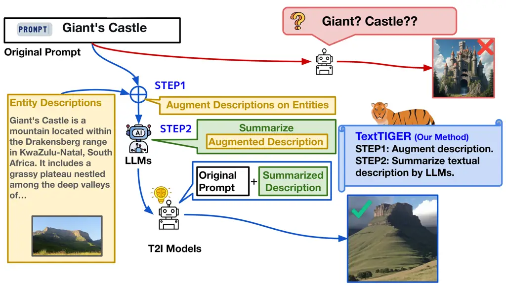

\CJKencfamily

UTF8mc

# TextTIGER: Text-based Intelligent Generation with Entity Prompt Refinement for Text-to-Image Generation

Shintaro Ozaki    Tomoyuki Jinnno    Kazuki Hayashi    Yusuke Sakai   
Jingun Kwon Affiliation:  Chungnam National University, Korea    \[5pt\]
Hidetaka Kamigaito    Katsuhiko Hayashi Affiliation:  The University of
Tokyo, Japan    Manabu Okumura Affiliation:  Institute of Science Tokyo,
Japan\[5pt\] {ozaki.shintaro.ou6, kamigaito.h,
taro.watanabe}@naist.ac.jp\[3pt\]    Taro Watanabe    \[5pt\] Nara
Institute of Science    Technology (NAIST)    Japan

###### Abstract

When generating images from prompts that include specific entities, the
model must retain as much entity-specific knowledge as possible.
However, the number of entities is almost countless, and new entities
emerge; memorizing all of them completely is not realistic. To bridge
this gap, our work proposes Text-based Intelligent Generation with
Entity Prompt Refinement (TextTIGER). TextTIGER strengthens knowledge
about entities that appear in the prompt by augmenting external
information and then summarizes the expanded descriptions with large
language models, preventing performance degradation that arises from
excessively long inputs. To evaluate our method, we construct a new
dataset consisting of captions, images, detailed descriptions, and lists
of entities. Experiments with multiple image generation models show that
TextTIGER improves image generation performance on widely used
evaluation metrics compared with prompts that use captions alone. In
addition, using Multimodal LLM (MLLM)-as-a-judge, which shows a strong
correlation with human evaluation, we demonstrate that our method
consistently achieves higher scores, which underscores its
effectiveness. These results show that strengthening entity-related
descriptions, summarizing them, and refining prompts to an appropriate
length leads to substantial improvements in image generation
performance. We will release the created dataset and code upon
acceptance.

Figure 1: Overview of the proposed method. Our work (1) expands
knowledge about entities and (2) summarizes the expanded descriptions to
an appropriate length with LLMs, thereby improving the ability of image
generation models to handle entities.

## 1 Introduction

Text-to-Image generation is a task that generates images from a given
text (Zhang et al., 2023b; Croitoru et al., 2023) with a wide range of
applications, including concept image creation and diagram
generation (Zhang et al., 2023a). To generate images from textual
information, image generation models such as Stable Diffusion (Rombach
et al., 2022) adopt an architecture that combines a text encoder with a
diffusion model (Ho et al., 2020). These models require carefully
designed prompts to reflect the intended image content  (Jeon et al.,
2025; Lyu et al., 2024; Zhan et al., 2024; Zhang et al., 2023b).

In this process, the model should retain as much entity-specific
knowledge as possible to generate images that meet user expectations.
Such entities include proper nouns in the prompt, such as names of
rivers, castles, and mountains  (Seyler et al., 2018; Yamada et al.,
2020; Yamada et al., 2018; Yamada et al., 2017; Gabrilovich et al.,
2007).¹¹ 1 In our study, we define an entity as a named entity at the
proper expression level, referring to a specific instance such as
“Golden Gate Bridge” rather than an abstract concept such as
“bridge” (Seyler et al., 2018; Huang et al., 2026).

However, even large-scale image generation models cannot fully retain
such knowledge or continuously acquire the latest information, as it
demands substantial costs, i.e., the need to keep crawling for
up-to-date information and to continuously train billion-scale models.
Understanding entities correctly plays a crucial role in aligning with
user intent in tasks such as an advertisement image generation task (Du
et al., 2024; Mita et al., 2024). For example, as shown in Figure 1,
when the prompt ‘‘Giant’s Castle’’ is given, an image generation model
may fail to interpret the entity correctly. Here, ‘‘Giant’s Castle’’
refers to a mountain located in South Africa.²² 2
[https://en.wikipedia.org/wiki/Giant%27s_Castle](https://en.wikipedia.org/wiki/Giant%27s_Castle)
Moreover, simply appending externally retrieved information as a long
context to the prompt does not enable effective and accurate processing,
due to token length constraints such as a 512-token limit of text
encoders (Tan et al., 2024; Zhang et al., 2024).

To address the limitation in entity understanding, we construct a new
dataset consisting of image-caption pairs with annotated entity mentions
that includes detailed descriptions for each entity, enabling systematic
evaluation of how adding external knowledge about entities influences
image generation quality. Based on this dataset, we propose a new method
called Text-based Intelligent Generation with Entity Prompt Refinement
(TextTIGER). Our method first retrieves entity-specific knowledge from
external sources and expands the original prompt. For example, as shown
in Figure 1, for the prompt “Giant’s Castle,” we retrieve additional
context such as “Giant’s Castle is a mountain located within the …,”
which compensates for missing knowledge inside the model. Second, we
leverage large language models (LLMs) (OpenAI et al., 2024; Singh et
al., 2025; Yang et al., 2025; Grattafiori et al., 2024; Qwen et al., 2025) to summarize the retrieved descriptions concisely. This step
preserves essential information while keeping the prompt within an
appropriate token length. Finally, we generate images from these refined
prompts, which mitigates both the model’s knowledge limitations and the
difficulty of processing long contexts.

Experiments with multiple image generation models together with LLMs on
the constructed dataset show that our method substantially outperforms
baseline approaches on widely used automatic evaluation metrics. While
performance drops when we simply append descriptions, the performance
improves when we summarize them, which supports the importance of
concise descriptions of entities. Furthermore, evaluation results by
Multimodal LLM (MLLM)-as-a-judge (Chen et al., 2024), which strongly
correlate with human evaluation, indicate that images generated from
prompts with entity description summary contain more entity-related
content and exhibit greater faithfulness.

## 2 Related Work

#### Vision and Entity Knowledge

In the Vision and Language (V&L) field, challenges in understanding
visual and textual information often reveal the limited generalization
ability of V&L models in generating text from images for applications
such as newspapers (Lu et al., 2018; Liu et al., 2021), e-commerce (Ma
et al., 2022), fashion (Rostamzadeh et al., 2018), and artworks (Bai et
al., 2021; Hayashi et al., 2024; Ozaki et al., 2025). Similarly,
Kamigaito et al. (2023) show that the V&L model OFA (Wang et al., 2022)
lacks sufficient entity knowledge in image generation tasks.

Several benchmarks also evaluate how well image generation models
understand world knowledge (Chen et al., 2022; Zhao et al., 2025; Wu et
al., 2025b; Niu et al., 2025). An extensive study by Chen et al. (2022)
introduced “EntityDrawBench,” a dataset covering 250 entities, and
pointed out that image generation models lack knowledge about long-tail
entities. Huang et al. (2026) introduced the “KITTEN” benchmark to
evaluate knowledge-intensive generation and found that even the most
advanced models often fail to generate entities with accurate visual
details. In experiments across domains such as landmarks, plants, and
animals, models including Stable Diffusion (Esser et al., 2024) and
DALL-E 3 (Betker et al., 2023) produced images with substantial
inaccuracies or missing critical features when asked to depict many
real-world entities. These findings indicate that current diffusion
models rely heavily on what they learn during training and lack robust
factual grounding for many specific entities.

#### Refinement of Image Generation Prompts

Researchers have shown that prompt engineering effectively improves
image generation (Jeon et al., 2025; Lyu et al., 2024; Zhan et al.,
2024). Zhan et al. (2024) refine prompts by training a dedicated text
encoder with image representations to generate desired images. Other
work proposes generating images by training models with reinforcement
learning (Ghasemi et al., 2025; Schulman et al., 2017; Rafailov et al., 2023) so that they produce optimized prompts (Hao et al., 2023). Methods
that refine prompts with external knowledge also exist. Jeong et al.
(2025) point out that models lack cultural understanding and refine
prompts with models equipped with external knowledge to produce more
appropriate output images. Image generation approaches based on
Retrieval-Augmented Generation (Chen et al., 2022) also attempt prompt
refinement with retrievers, e.g., for abstract prompts (Lyu et al., 2024) and for multiple objects (Yuan et al., 2025).

However, although these approaches leverage external knowledge or
iterative refinement to improve prompt quality, they do not explicitly
focus on supplementing entity-level knowledge. In particular, prior
methods do not retrieve and inject structured, entity-specific factual
descriptions to compensate for missing world knowledge in text-to-image
models, overlooking the limitation of input length by the text encoder
as well. Instead, they often use external information, such as cultural
alignment or safety refinement, without explicitly addressing whether
the model has sufficient factual grounding about individual named
entities.

## 3 Dataset Construction for Entity-Aware Image Generation

To evaluate whether providing rich descriptive information for named
entities improves image generation quality, we construct a new dataset.
The existing dataset PopVQA (Haklay et al., 2025) provides large-scale
image-caption pairs but does not include explicit entity-level
information. As a result, its usefulness is limited in settings where
models must understand specific named entities and correctly align them
with visual content. In real-world applications, prompts often include
proper nouns and named entities that presuppose background knowledge.
Without access to such knowledge, even advanced image generation models
may hallucinate incorrect visual content, miss distinctive attributes,
or confuse entities.

To address this issue, we extend the original PopVQA by adding
background descriptions for all named entities that appear in each
caption. We extend these descriptions through the Wikipedia API.³³ 3
[https://www.mediawiki.org/wiki/API:Main_page](https://www.mediawiki.org/wiki/API:Main_page)
Specifically, the metadata of PopVQA contains hyperlinks to Wikipedia
pages corresponding to entities mentioned in the captions. We
systematically follow these URLs and extract the introductory abstract
of each page. These introductory paragraphs typically provide concise
and informative summaries, including the definition, classification,
origin, and notable characteristics of the entity. Such abstracts serve
as natural and reliable sources of contextual knowledge, especially for
uncommon, ambiguous, or culturally specific entities. For example, when
given the caption “Liberty at sunset,” the Wikipedia abstract provides
supplementary information such as its location, height, appearance, and
symbolic meaning. This knowledge often plays an important role in
faithful image generation.

To ensure consistency and quality, we focus on the landmarks and
paintings categories and retain only instances for which both the image
and the linked Wikipedia page remain accessible at the time of dataset
construction. Under these criteria, we extract 2,764 instances from the
landmarks category and 2,245 instances from the paintings category,
resulting in 5,009 valid instances in total. Each instance in our
dataset consists of four elements: (1) the original image, (2) the
corresponding caption, (3) the retrieved entity descriptions, and (4)
the list of entities contained in those descriptions. The resulting new
dataset enables controlled experimental analysis of how access to
entity-specific background knowledge influences the behavior of
text-to-image generation models. Details appear in Appendix C.5.

## 4 Proposed Method: TextTIGER

We propose a method that strengthens entity-specific knowledge by
augmenting accurate descriptions of entities that appear in the prompt
and then summarizing them to an appropriate length by LLMs, as shown in
Figure 1. Our method effectively mitigates two major weaknesses of image
generation models, i.e., (1) limited internal knowledge on entities, and
(2) difficulty in handling long contexts. The proposed approach consists
of the following 2 steps: STEP 1. augment entities with informative
descriptions (§ 4.1), and STEP 2. summarize the descriptions with an LLM
to the appropriate length (§ 4.2).

### 4.1 STEP 1: Augment Entities with Informative Descriptions

To enable image generation models to understand entities, we augment
externally retrieved, information-rich descriptions to the entities that
appear in the prompt. Specifically, we extract entities contained in the
prompt and obtain corresponding descriptions to compensate for the
model’s limited internal knowledge.

### 4.2 STEP 2: Summarize the descriptions using LLMs

For the augmented entity-specific descriptions obtained in STEP 1, we
use an LLM to generate summaries that preserve detailed entity
information while keeping the length appropriate. Prior work (Juseon-Do
et al., 2024) shows that explicitly specifying the input length and the
desired number of output tokens helps LLMs manage length constraints
effectively. From their motivation, we tokenize the augmented
descriptions from STEP 1 using the tokenizer of the text encoder in the
image generation model and explicitly provide the token count to the
LLM, providing the detailed prompts in Appendix D.1. After this process,
we concatenate the summarized entity-specific descriptions to the end of
the original caption, forming a new prompt in the format “(caption +
summarized description)” for image generation.

We refer to this as Text-based Intelligent Generation with Entity Prompt
Refinement (TextTIGER).

## 5 Experimental Settings

### 5.1 Prompt Formats

To verify whether our proposed method, TextTIGER, properly improves
entity-level image generation capability, we additionally compared 4
methods, as introduced in Table 1.

1.  1.  Cap-Only: This setting simply provides the caption that exists in
        the created dataset to image generation models, validating the
        baseline performance of image generation models.
2.  2.  Aug-Only: In this setting, we simply concatenate the entity
        descriptions to the caption, i.e., applying only the STEP 1 of our
        approach in § 4.1. We define this method to examine whether
        summarization is necessary.
3.  3.  RAG: STEP 1 of our proposed method, i.e., § 4.1, supplements missing
        knowledge about entities by retrieving external information, which
        closely relates to the Retrieval-Augmented Generation (RAG) (Lewis
        et al., 2020) method. However, prior work shows that entities are
        more challenging to handle than general knowledge (Shachar et al.,
        2025). To evaluate performance under a RAG-based framework, we
        compare a method that uses BM25 (Lù, 2024) as the retriever, since
        preliminary experiments show that BM25 achieves the best retrieval
        performance as demonstrated in Appendix C.2. As the datastore, we
        use PopVQA data and additionally collect 109,598 Wikipedia articles
        related to landmarks and 132,573 articles related to paintings. Our
        method takes the caption as input and concatenates the description
        retrieved from the datastore to evaluate whether RAG improves
        performance in this setting.
4.  4.  TextTIGER w/o Len: STEP 2 of our proposed method (§ 4.2) explicitly
        specifies the token length during summarization to generate prompts
        that suit image generation. To examine whether explicit token
        control improves prompt quality, we define a variant that performs
        summarization without specifying the token length. This comparison
        allows us to validate the effectiveness of STEP 2 and to examine
        whether we can apply prior findings (Juseon-Do et al., 2024) to
        prompt construction.

| Method                          | Prompt for Image Generation                                                            |
| ------------------------------- | -------------------------------------------------------------------------------------- |
| Cap-Only                        | The caption in the dataset.                                                            |
| Aug-Only                        | The caption + Augmented knowledge from Wikipedia.                                      |
| RAG                             | The caption + Augmented knowledge retrieved from the datastore.                        |
| TextTIGER w/o Len               | The caption + Summarized description generated by LLMs.                                |
| TextTIGER (Our proposed method) | The caption + Summarized description generated by LLMs with the explicit token length. |

Table 1: List of experimental settings and comparison methods in our
study.

### 5.2 Summarization Models

To summarize to an appropriate length, we exploit LLMs with strong
summarization capabilities, including Qwen2.5 (72B) (Qwen et al., 2025),
Qwen3 (30B) (Yang et al., 2025), and Llama 3.3 (70B) (Grattafiori et
al., 2024) for open models. As for proprietary models, we use
GPT-4o (OpenAI et al., 2024) and GPT-5 (Singh et al., 2025) through API.
Appendix C.1 provides detailed experimental settings.

### 5.3 Image Generation Models

To account for differences in text encoders, we use five image
generation models. Specifically, we use Dreamlike 2.0 (defined as
Dreamlike) (Art, 2023), which employs CLIP (Radford et al., 2021) as its
text encoder, PixArt (Chen et al., 2023), which adopts T5 (Raffel et
al., 2020), FLUX (Labs, 2024) and Stable Diffusion 3.5 (SD3.5) (Esser et
al., 2024), both of which incorporate CLIP and T5, and Qwen-Image
(defined as Qwen-Img) (Wu et al., 2025a), which uses Qwen (Bai et al., 2025) as its encoder. The maximum token lengths of the text encoders are
77 tokens for CLIP, 512 tokens for T5, and 4,096 tokens for Qwen-Image.

### 5.4 Evaluation Metrics

To measure how much entity-aware image generation improves, we adopt (1)
automatic evaluation metrics, i.e., CLIPScore (Hessel et al., 2021),
DINOScore (Oquab et al., 2024), and PickScore (Kirstain et al., 2023),
and (2) Multimodal Large Language Models (MLLM)-as-a-judge (Chen et al., 2024) evaluated by Vision-Language Models (VLMs) (Qwen et al., 2025;
Microsoft et al., 2025; Team et al., 2025).

CLIPScore-T:  We utilize CLIPScore (Hessel et al., 2021), which computes
the cosine similarity between the hidden states produced by the text
encoder and the image encoder of CLIP (Radford et al., 2021) trained
with contrastive learning on image-text pairs, to measure how faithfully
an image reflects a given sentence. We define this metric as CLIPScore-T
and use it to measure the similarity between the generated image and the
entity used for generation.

CLIPScore-I:  Likewise, we compute the similarity between two different
images using the hidden states produced by the image encoder of
CLIP (Radford et al., 2021). Our work defines this metric as CLIPScore-I
and uses it to measure the similarity between the reference image and
the generated image.

DINOScore:  We also compute image-image similarity using the DINO image
encoder (Oquab et al., 2024), which they claim to outperform CLIP. As in
CLIPScore-I, we measure the similarity between the reference image and
the generated image. We define this similarity metric based on DINO as
DINOScore.

PickScore:  We adopt PickScore (Kirstain et al., 2023), which trains on
human preference data and estimates the probability that an image aligns
with a given textual instruction in a way humans prefer. PickScore
builds on CLIP and, like CLIPScore-T, evaluates the similarity between
text and image.

In our work, we use these four automatic metrics to evaluate whether
image generation models improve their ability to generate entities
accurately.

| T2I Model   | Cap-Only | RAG      |        | TextTIGER w/o Len |         |          |        |        | TextTIGER (Proposed Method) |         |          |        |        |
| ----------- | -------- | -------- | ------ | ----------------- | ------- | -------- | ------ | ------ | --------------------------- | ------- | -------- | ------ | ------ |
|             |          | Aug-Only | BM25   | Qwen3             | Qwen2.5 | Llama3.3 | GPT-4o | GPT-5  | Qwen3                       | Qwen2.5 | Llama3.3 | GPT-4o | GPT-5  |
| CLIPScore-T |          |          |        |                   |         |          |        |        |                             |         |          |        |        |
| Dreamlike   | 23.978   | 20.939   | 20.743 | 20.351            | 20.237  | 20.604   | 20.216 | 20.288 | 24.672                      | 24.870  | 25.296   | 24.846 | 24.829 |
| PixArt      | 19.106   | 20.293   | 19.630 | 18.955            | 18.962  | 18.986   | 18.960 | 18.953 | 23.106                      | 23.108  | 23.244   | 23.184 | 23.144 |
| FLUX        | 21.454   | 20.572   | 20.292 | 19.945            | 19.407  | 19.457   | 19.290 | 19.289 | 23.675                      | 23.793  | 23.990   | 23.686 | 23.669 |
| SD3.5       | 23.882   | 21.432   | 21.258 | 20.571            | 20.753  | 20.840   | 20.799 | 20.746 | 25.032                      | 25.397  | 25.475   | 25.371 | 25.329 |
| Qwen-Img    | 22.417   | 17.472   | 17.706 | 20.094            | 19.922  | 19.886   | 19.953 | 19.913 | 24.338                      | 24.340  | 24.235   | 24.445 | 24.414 |
| CLIPScore-I |          |          |        |                   |         |          |        |        |                             |         |          |        |        |
| Dreamlike   | 68.371   | 66.478   | 65.094 | 64.365            | 64.556  | 64.347   | 64.360 | 64.394 | 78.666                      | 79.073  | 78.853   | 78.980 | 78.892 |
| PixArt      | 59.679   | 68.515   | 66.432 | 62.484            | 62.729  | 62.338   | 62.590 | 62.593 | 75.864                      | 76.252  | 75.435   | 76.704 | 76.639 |
| FLUX        | 66.518   | 69.140   | 67.458 | 64.358            | 64.115  | 63.844   | 63.741 | 63.766 | 77.925                      | 78.433  | 77.988   | 78.356 | 78.250 |
| SD3.5       | 68.990   | 67.450   | 66.043 | 64.762            | 65.414  | 65.424   | 65.304 | 65.336 | 79.334                      | 79.939  | 79.424   | 79.842 | 79.794 |
| Qwen-Img    | 69.946   | 47.835   | 47.906 | 64.638            | 64.626  | 64.677   | 64.551 | 64.542 | 79.290                      | 79.286  | 78.570   | 79.672 | 79.563 |
| DINOScore   |          |          |        |                   |         |          |        |        |                             |         |          |        |        |
| Dreamlike   | 29.943   | 27.047   | 23.895 | 33.248            | 33.425  | 34.034   | 33.550 | 33.498 | 45.239                      | 45.557  | 44.202   | 45.245 | 45.105 |
| PixArt      | 19.033   | 34.843   | 29.151 | 34.862            | 35.119  | 34.682   | 35.100 | 35.036 | 45.938                      | 46.305  | 43.949   | 45.927 | 45.869 |
| FLUX        | 30.015   | 37.438   | 32.629 | 39.924            | 37.743  | 37.568   | 37.704 | 37.645 | 48.972                      | 50.335  | 48.375   | 49.373 | 49.314 |
| SD3.5       | 36.485   | 35.249   | 30.677 | 39.472            | 40.463  | 40.584   | 40.320 | 40.447 | 52.591                      | 53.636  | 51.944   | 53.286 | 53.182 |
| Qwen-Img    | 40.417   | 20.242   | 18.198 | 41.460            | 40.935  | 41.365   | 41.416 | 41.439 | 54.716                      | 54.029  | 52.200   | 54.739 | 54.429 |
| PickScore   |          |          |        |                   |         |          |        |        |                             |         |          |        |        |
| Dreamlike   | 20.556   | 19.092   | 19.934 | 18.517            | 18.556  | 18.517   | 18.584 | 18.586 | 24.756                      | 24.784  | 24.743   | 24.821 | 24.822 |
| PixArt      | 20.491   | 19.731   | 20.427 | 18.762            | 18.775  | 18.750   | 18.762 | 18.767 | 25.003                      | 25.018  | 25.016   | 24.947 | 24.939 |
| FLUX        | 20.837   | 19.838   | 20.604 | 19.014            | 18.914  | 18.939   | 18.942 | 18.934 | 25.183                      | 25.165  | 25.132   | 25.166 | 25.169 |
| SD3.5       | 20.532   | 19.137   | 19.962 | 18.550            | 18.588  | 18.593   | 18.602 | 18.602 | 24.703                      | 24.747  | 24.658   | 24.731 | 24.729 |
| Qwen-Img    | 20.614   | 17.891   | 18.792 | 18.801            | 18.485  | 18.676   | 18.505 | 18.506 | 24.927                      | 24.621  | 24.592   | 24.618 | 24.615 |

Table 2: Results of experiments on the Landmarks category. We report
CLIPScore-T and PickScore as evaluation metrics for text-to-image
(Txt-Img) generation, and CLIPScore-I and DINOScore as evaluation
metrics for image-to-image (Img-Img) generation.

MLLM-as-a-judge:  Huang et al. (2026) proposed “KITTEN,” an evaluation
framework based on Multimodal LLM (MLLM)-as-a-judge (Chen et al., 2024)
for evaluating entity-level fidelity in generated images, and reported a
high correlation with human evaluation, claiming that it serves as an
effective substitute for manual assessment. In our study, we also adopt
KITTEN to evaluate whether our proposed method, TextTIGER, improves
entity-aware image generation, and the detailed prompts are provided in
Appendix D.2. Specifically, following KITTEN, we conduct an
MLLM-as-a-judge evaluation from two perspectives: Entity Alignment and
Text Alignment. Entity Alignment measures how accurately the generated
image reflects the target entity, given a reference image that contains
the entity, and VLMs rate this aspect on a 1–5 scale. Text Alignment
measures how faithfully the generated image follows the input text
prompt, and VLMs also rate this aspect on a 1–5 scale. As VLMs that
serve as evaluators and support multiple image inputs, we use 3 models:
Qwen 2.5 (Qwen et al., 2025), Phi 4 (Microsoft et al., 2025), and Gemma
3 (Team et al., 2025). In our work, to address the issue that VLMs do
not sufficiently understand entities (Hayashi et al., 2024; Ozaki et
al., 2025; Alonso et al., 2025), we insert a brief description of each
entity into the evaluation prompt when applying MLLM-as-a-judge.
Appendix C.1 provides the details of each model, and Appendix D.2 shows
the specific prompts we use.

| T2I Model   | Cap-Only | RAG      |        | TextTIGER w/o Len |         |          |        |        | TextTIGER (Proposed Method) |         |          |        |        |
| ----------- | -------- | -------- | ------ | ----------------- | ------- | -------- | ------ | ------ | --------------------------- | ------- | -------- | ------ | ------ |
|             |          | Aug-Only | BM25   | Qwen3             | Qwen2.5 | Llama3.3 | GPT-4o | GPT-5  | Qwen3                       | Qwen2.5 | Llama3.3 | GPT-4o | GPT-5  |
| CLIPScore-T |          |          |        |                   |         |          |        |        |                             |         |          |        |        |
| Dreamlike   | 23.830   | 19.833   | 19.708 | 21.959            | 21.832  | 21.530   | 21.337 | 21.572 | 24.414                      | 24.610  | 24.712   | 24.488 | 24.439 |
| PixArt      | 21.459   | 20.557   | 19.931 | 21.379            | 21.205  | 21.107   | 20.753 | 20.757 | 23.810                      | 23.874  | 23.930   | 23.659 | 23.696 |
| FLUX        | 21.600   | 20.139   | 19.907 | 21.602            | 21.283  | 21.524   | 20.997 | 21.081 | 23.293                      | 23.563  | 23.547   | 23.205 | 23.204 |
| SD3.5       | 23.567   | 20.875   | 20.452 | 21.946            | 21.637  | 22.030   | 21.981 | 22.304 | 24.258                      | 24.438  | 24.599   | 24.128 | 24.135 |
| Qwen-Img    | 21.377   | 18.266   | 18.432 | 21.649            | 21.973  | 21.283   | 21.316 | 21.892 | 24.205                      | 23.588  | 23.637   | 23.321 | 23.312 |
| CLIPScore-I |          |          |        |                   |         |          |        |        |                             |         |          |        |        |
| Dreamlike   | 55.861   | 58.167   | 57.851 | 56.194            | 56.654  | 56.309   | 55.951 | 55.933 | 67.425                      | 66.476  | 66.972   | 65.772 | 65.737 |
| PixArt      | 56.312   | 59.752   | 58.446 | 57.231            | 56.298  | 56.576   | 56.110 | 55.571 | 66.714                      | 66.062  | 65.896   | 65.383 | 65.455 |
| FLUX        | 53.715   | 57.519   | 57.144 | 56.769            | 56.937  | 56.914   | 56.424 | 57.004 | 63.909                      | 62.955  | 62.841   | 62.008 | 61.950 |
| SD3.5       | 56.427   | 57.525   | 57.789 | 58.186            | 57.514  | 57.680   | 58.191 | 57.424 | 66.252                      | 65.555  | 65.769   | 64.524 | 64.471 |
| Qwen-Img    | 56.199   | 49.763   | 51.657 | 56.156            | 56.092  | 56.729   | 55.215 | 56.049 | 68.857                      | 67.618  | 66.910   | 67.120 | 67.151 |
| DINOScore   |          |          |        |                   |         |          |        |        |                             |         |          |        |        |
| Dreamlike   | 30.673   | 27.454   | 26.636 | 32.047            | 34.949  | 36.700   | 34.040 | 32.965 | 44.316                      | 42.476  | 43.615   | 41.010 | 40.732 |
| PixArt      | 30.622   | 39.980   | 37.742 | 35.487            | 34.764  | 37.385   | 34.540 | 35.312 | 44.037                      | 42.786  | 43.624   | 41.333 | 41.298 |
| FLUX        | 24.118   | 32.084   | 30.600 | 36.908            | 38.218  | 36.275   | 36.390 | 36.412 | 33.839                      | 33.459  | 34.046   | 31.523 | 31.335 |
| SD3.5       | 30.465   | 32.520   | 32.224 | 38.880            | 39.296  | 39.074   | 37.479 | 38.324 | 39.366                      | 38.307  | 40.362   | 35.848 | 35.845 |
| Qwen-Img    | 33.026   | 24.967   | 26.042 | 39.765            | 39.409  | 40.556   | 38.342 | 39.335 | 46.228                      | 46.167  | 45.632   | 45.072 | 45.345 |
| PickScore   |          |          |        |                   |         |          |        |        |                             |         |          |        |        |
| Dreamlike   | 20.198   | 18.542   | 19.331 | 18.953            | 19.035  | 19.027   | 19.029 | 19.038 | 24.340                      | 24.326  | 24.281   | 24.367 | 24.361 |
| PixArt      | 20.678   | 19.278   | 19.906 | 19.351            | 19.326  | 19.375   | 19.283 | 19.249 | 24.733                      | 24.831  | 24.767   | 24.812 | 24.811 |
| FLUX        | 20.863   | 19.541   | 20.167 | 19.512            | 19.656  | 19.595   | 19.550 | 19.556 | 24.850                      | 24.913  | 24.890   | 24.921 | 24.919 |
| SD3.5       | 20.362   | 18.863   | 19.647 | 19.199            | 19.207  | 19.033   | 19.119 | 19.164 | 24.484                      | 24.508  | 24.452   | 24.505 | 24.485 |
| Qwen-Img    | 20.278   | 18.105   | 18.967 | 19.401            | 19.249  | 19.381   | 18.740 | 19.091 | 24.582                      | 23.951  | 24.001   | 23.893 | 23.898 |

Table 3: Experimental results on the Paintings category. The
interpretation is the same as in Table 2.

## 6 Results and Discussions

Tables 2 and 3 present the results of the automatic evaluation metrics
as described in § 5.4. In general, focusing on the Landmarks category in
Table 2, TextTIGER achieves the best performance across the metrics, as
indicated by the bold scores in the table, showing that augmenting
entity-specific content and summarizing it to an appropriate length
effectively improves entity-aware image generation.

In contrast, the Aug-Only setting shows little improvement over
Cap-Only, indicating that simply appending additional knowledge does not
lead to better performance. Moreover, when we compare TextTIGER w/o Len
with the TextTIGER, TextTIGER consistently performs better, supporting
the importance of explicitly controlling the summary length to construct
prompts that better suit image generation models. We observe the same
trend in the Paintings category shown in Table 3, and these consistent
improvements across both domains demonstrate the generalization ability
of our method.

### 6.1 Does TextTIGER Perform Effectively?

We showed that TextTIGER shows clear improvements when we compare the
baseline. Taking a closer look at the result, for CLIPScore-T, PixArt
improves from 21.459 to 23.930 with summaries generated by Llama 3.3,
and Qwen-Img improves from 21.377 to 24.205 with summaries generated by
Qwen 3. For DINOScore, Qwen-Img improves from 30.465 under Cap-Only to
46.228 when we use the optimized prompt summarized by Qwen 3.

Next, we examine whether simply expanding entity knowledge enables image
generation models to understand entities. When we compare RAG setting
with TextTIGER, TextTIGER consistently achieves better overall
performance. For example, in CLIPScore-I, FLUX achieves 57.525 under the
RAG-style expansion, whereas LLM-based summarization raises the score up
to 68.857, yielding an improvement of more than 10 points. Across other
automatic evaluation metrics, TextTIGER also outperforms Cap-Only, which
demonstrates that TextTIGER effectively enhances entity-aware image
generation.

We also analyze whether explicit length control during summarization is
necessary. When we compare TextTIGER w/o Len with TextTIGER, the
TextTIGER consistently achieves better performance. Moreover, TextTIGER
w/o Len performs at a level comparable to Cap-Only, which highlights
that instructing LLMs to summarize without explicit token-length control
can even degrade performance. In contrast, TextTIGER improves
performance, proving that image generation models remain highly
sensitive to token length, yet can substantially benefit when the
refined prompt fits within an appropriate input length.

Table 4 reports the measured prompt token lengths for three knowledge
expansion methods: Aug-Only, TextTIGER w/o Len, and TextTIGER. We
compute the token counts using the tokenizer of each summarization
model. For the proprietary GPT-4o/5 models, we use the tiktoken library
([https://github.com/openai/tiktoken](https://github.com/openai/tiktoken)).
The results in the table further confirm that explicitly controlling the
token length during summarization, as proposed by Juseon-Do et al.
(2024), improves the performance.

| Model     | Landmarks             |                      |                              | Paintings             |                      |                              |
| --------- | --------------------- | -------------------- | ---------------------------- | --------------------- | -------------------- | ---------------------------- |
|           | Aug-Only              | w/o Len              | TextTIGER                    | Aug-Only              | w/o Len              | TextTIGER                    |
| Qwen3     | $`733.2_{\pm 408.1}`$ | $`190.2_{\pm 18.1}`$ | $`\textbf{75.4}_{\pm 15.1}`$ | $`467.5_{\pm 384.0}`$ | $`186.3_{\pm 24.2}`$ | $`\textbf{74.8}_{\pm 20.1}`$ |
| Llama 3.3 | $`707.5_{\pm 393.9}`$ | $`96.9_{\pm 22.8}`$  | $`\textbf{33.9}_{\pm 9.0}`$  | $`454.9_{\pm 373.7}`$ | $`88.8_{\pm 27.9}`$  | $`\textbf{31.1}_{\pm 9.1}`$  |
| Qwen 2.5  | $`733.2_{\pm 408.1}`$ | $`103.9_{\pm 20.4}`$ | $`\textbf{40.1}_{\pm 7.5}`$  | $`467.5_{\pm 384.0}`$ | $`100.5_{\pm 23.4}`$ | $`\textbf{39.2}_{\pm 8.9}`$  |
| GPT-4o/5  | $`693.6_{\pm 387.3}`$ | $`105.2_{\pm 14.1}`$ | $`\textbf{45.9}_{\pm 5.5}`$  | $`446.0_{\pm 368.3}`$ | $`112.4_{\pm 20.2}`$ | $`\textbf{45.4}_{\pm 5.7}`$  |

Table 4: Token length statistics ($`\text{mean}_{\pm\text{std}}`$). Bold
indicates the results of TextTIGER.

Figure 2: Visualization of how well the text encoders of image
generation models understand entities. We examine whether each model can
retrieve the correct description when given an entity as input.

### 6.2 Do Encoders Understand Entities?

Our work showed that supplementing entity information with external
knowledge improves image generation performance. We now ask how well the
text encoders of image generation models internally represent entities
themselves. To answer this question, we adopt a knowledge probing
framework (Kalo and Fichtel, 2022; Wiland et al., 2024; Petroni et al.,
2019; Youssef et al., 2023; Jinno et al., 2026). Our work constructs an
entity retrieval task using the hidden states produced by each text
encoder and evaluates performance with Hits@$`k`$ ($`k`$ $`\in`$ {1, 5,
10, 100} in our work). Specifically, we input a description of each
entity and use its embedding representation to retrieve the
corresponding gold entity from a datastore. For the datastore, we take
the 5,009 descriptions constructed in § 3 and rewrite them into
ambiguous expressions using GPT-5 so that they do not directly contain
the gold entity names, guaranteeing semantic entity understanding
evaluation.

Figure 2 presents the results. For the Landmarks category (top row), the
default encoders of Dreamlike, PixArt, FLUX, and Qwen-Img achieve almost
zero Hits@1 and Hits@5, and even Hits@100 remains extremely low. When we
use CLIP-G and CLIP-L text encoders in SD3.5, performance improves to
some extent. However, even then, Hits@100 stays around 0.7, and accuracy
at smaller $`k`$ remains low. This observation is the same trend in the
Paintings category (bottom row). The text encoders of image generation
models fail to reliably identify the correct entity from ambiguous
descriptions. In contrast, the sentence embedding models introduced for
comparison, SimCSE (Gao et al., 2021) and RoBERTa (Liu et al., 2019),
achieve much higher performance. In Landmarks, SimCSE exceeds 0.8 in
Hits@100 and clearly outperforms image generation encoders in Hits@10
and Hits@5 as well. We observe the same pattern in Paintings, where
SimCSE consistently shows strong retrieval performance, highlighting the
difference between text encoders trained for NLP tasks and those used in
image generation models. These findings suggest that although text
encoders in image generation models suffice for image conditioning, they
struggle with knowledge-intensive reasoning that requires uniquely
identifying entities from ambiguous descriptions. In other words, their
internal entity knowledge remains limited, supporting our motivation
that supplementing entity knowledge with external information
effectively addresses this limitation.

Figure 3: Visualization of whether our proposed method, TextTIGER,
effectively handles unseen entities. The $`y`$-axis shows the difference
in DINOScore between Cap-Only and TextTIGER. The blue bins represent the
subset of previously unseen entities, and the orange bins represent the
subset of seen entities.

### 6.3 Do Descriptions Support Unseen Entities?

To verify whether our augmented approach, as introduced in § 4.1, truly
benefits “unseen” entities, we split entities into two groups based on
the retrieval results in § 6.2 under the Cap-Only setting, i.e., “seen”
(Hits=1) and “unseen” (Hits=0). We then computed the difference in
DINOScore as introduced in § 5.4 between Cap-Only and TextTIGER as
$`\Delta`$DINO and analyzed how the effect varies depending on whether
the entity was known or unknown. Figure 3 presents the results. ⁴⁴ 4
Among the automatic evaluation metrics, we base our analysis on
DINOScore in our study.We choose DINOScore because it shows the widest
score range in Tables 2 and 3, which facilitates clearer analysis. The
most notable observation is that for Hits=0, namely cases where the text
encoder failed to correctly identify the entity (blue bars),
$`\Delta`$DINO consistently shows positive values across many models. In
particular, PixArt and FLUX exhibit large positive improvements for
Hits@1, Hits@5, and Hits@10, indicating that adding external
descriptions markedly improves visual alignment when the model lacks
sufficient internal entity knowledge. This finding demonstrates that
even when the model does not internally encode adequate entity
knowledge, structured external information can improve generation
quality.

In contrast, for Hits=1, where the encoder already retrieved the correct
entity (orange bars), $`\Delta`$DINO does not consistently remain
positive. Depending on the model and the value of $`k`$, the improvement
becomes small or slightly negative. For example, FLUX shows negative
differences in some Hits=1 cases, suggesting that when the model already
encodes the entity to some extent, additional descriptions do not
necessarily provide further benefits and may even introduce redundancy.
We observe similar patterns in SD3.5 and Qwen-Img. While unknown
entities consistently benefit from augmentation, the effect on known
entities depends on the model, indicating that external descriptions
mainly compensate for missing internal representations rather than
further strengthening already encoded knowledge.

| T2I Model | Evaluator |      |      |      |      |      |            |      |      |      |      |      |      |      |      |      |      |      |
| --------- | --------- | ---- | ---- | ---- | ---- | ---- | ---------- | ---- | ---- | ---- | ---- | ---- | ---- | ---- | ---- | ---- | ---- | ---- |
|           | Gemma3    |      |      |      |      |      | Qwen2.5 VL |      |      |      |      |      | Phi4 |      |      |      |      |      |
|           | C         | Q3   | Q25  | L3   | G4   | G5   | C          | Q3   | Q25  | L3   | G4   | G5   | C    | Q3   | Q25  | L3   | G4   | G5   |
| Dreamlike | 3.38      | 4.40 | 4.39 | 4.42 | 4.38 | 4.39 | 2.62       | 3.63 | 3.64 | 3.64 | 3.65 | 3.64 | 2.59 | 3.55 | 3.57 | 3.57 | 3.59 | 3.58 |
| PixArt    | 3.11      | 4.48 | 4.49 | 4.50 | 4.46 | 4.48 | 2.51       | 3.72 | 3.73 | 3.74 | 3.72 | 3.72 | 2.52 | 3.70 | 3.75 | 3.78 | 3.74 | 3.75 |
| FLUX      | 3.24      | 4.38 | 4.40 | 4.39 | 4.35 | 4.36 | 2.37       | 3.61 | 3.62 | 3.61 | 3.60 | 3.59 | 2.58 | 3.63 | 3.67 | 3.65 | 3.63 | 3.64 |
| SD 3.5    | 3.44      | 4.44 | 4.46 | 4.45 | 4.43 | 4.42 | 2.57       | 3.71 | 3.72 | 3.69 | 3.71 | 3.71 | 2.54 | 3.66 | 3.69 | 3.69 | 3.67 | 3.66 |
| Qwen-Img  | 3.43      | 4.47 | 4.33 | 4.30 | 4.28 | 4.28 | 2.53       | 3.70 | 3.59 | 3.52 | 3.57 | 3.57 | 2.65 | 3.56 | 3.25 | 3.24 | 3.24 | 3.23 |

Table 5: Results of the MLLM-as-a-judge-based KITTEN text alignment
evaluation (Txt-Img). C denotes the Cap-Only (Baseline) method. Q3, Q25,
L3, G4, and G5 represent image generation results using summaries
produced by Qwen3, Qwen2.5, Llama3.3, GPT-4o, and GPT-5, respectively.

| T2I Model | Evaluator |      |      |      |      |      |            |      |      |      |      |      |      |      |      |      |      |      |
| --------- | --------- | ---- | ---- | ---- | ---- | ---- | ---------- | ---- | ---- | ---- | ---- | ---- | ---- | ---- | ---- | ---- | ---- | ---- |
|           | Gemma3    |      |      |      |      |      | Qwen2.5 VL |      |      |      |      |      | Phi4 |      |      |      |      |      |
|           | C         | Q3   | Q25  | L3   | G4   | G5   | C          | Q3   | Q25  | L3   | G4   | G5   | C    | Q3   | Q25  | L3   | G4   | G5   |
| Dreamlike | 2.44      | 3.47 | 3.50 | 3.47 | 3.47 | 3.47 | 1.43       | 2.47 | 2.48 | 2.45 | 2.43 | 2.45 | 2.03 | 3.09 | 3.11 | 3.07 | 3.07 | 3.06 |
| PixArt    | 2.22      | 3.62 | 3.64 | 3.60 | 3.61 | 3.61 | 1.18       | 2.64 | 2.69 | 2.64 | 2.63 | 2.62 | 1.73 | 3.22 | 3.27 | 3.27 | 3.21 | 3.23 |
| FLUX      | 2.35      | 3.54 | 3.58 | 3.53 | 3.55 | 3.56 | 1.28       | 2.53 | 2.60 | 2.50 | 2.51 | 2.53 | 2.05 | 3.15 | 3.23 | 3.17 | 3.14 | 3.13 |
| SD3.5     | 2.59      | 3.64 | 3.68 | 3.64 | 3.66 | 3.65 | 1.67       | 2.76 | 2.85 | 2.79 | 2.81 | 2.81 | 2.28 | 3.30 | 3.35 | 3.33 | 3.28 | 3.29 |
| Qwen-Img  | 2.60      | 3.71 | 3.62 | 3.54 | 3.63 | 3.63 | 1.62       | 2.78 | 2.71 | 2.59 | 2.70 | 2.70 | 2.34 | 3.27 | 3.14 | 3.07 | 3.11 | 3.10 |

Table 6: Results of the KITTEN entity alignment evaluation (Img-Img).
See Table 5 for details.

|                             |                                                                                 |                                                                                 |                                                                                 |                                                                                 |
| --------------------------- | ------------------------------------------------------------------------------- | ------------------------------------------------------------------------------- | ------------------------------------------------------------------------------- | ------------------------------------------------------------------------------- |
| Pattern                     | Landmarks                                                                       |                                                                                 | Paintings                                                                       |                                                                                 |
|                             | Białowieża Forest                                                               | Po-i-Kalyan                                                                     | Sacred conversation                                                             | Solly Madonna                                                                   |
| Ref. Img                    | ![[Uncaptioned image]](arxiv-2504-18269v2--938a7b19a6ca.figures/figure-2.webp)  | ![[Uncaptioned image]](arxiv-2504-18269v2--938a7b19a6ca.figures/figure-3.webp)  | ![[Uncaptioned image]](arxiv-2504-18269v2--938a7b19a6ca.figures/figure-4.webp)  | ![[Uncaptioned image]](arxiv-2504-18269v2--938a7b19a6ca.figures/figure-5.webp)  |
| Cap-Only                    | ![[Uncaptioned image]](arxiv-2504-18269v2--938a7b19a6ca.figures/figure-6.webp)  | ![[Uncaptioned image]](arxiv-2504-18269v2--938a7b19a6ca.figures/figure-7.webp)  | ![[Uncaptioned image]](arxiv-2504-18269v2--938a7b19a6ca.figures/figure-8.webp)  | ![[Uncaptioned image]](arxiv-2504-18269v2--938a7b19a6ca.figures/figure-9.webp)  |
|                             | 3.12 / 2 / 2/ 1                                                                 | 2.07 / 1 / 1 / 1                                                                | 3.25 / 1 / 1 / 1                                                                | 3.18 / 2 / 1 / 1                                                                |
| Proposed Method (TextTIGER) |                                                                                 |                                                                                 |                                                                                 |                                                                                 |
| Qwen3                       | ![[Uncaptioned image]](arxiv-2504-18269v2--938a7b19a6ca.figures/figure-10.webp) | ![[Uncaptioned image]](arxiv-2504-18269v2--938a7b19a6ca.figures/figure-11.webp) | ![[Uncaptioned image]](arxiv-2504-18269v2--938a7b19a6ca.figures/figure-12.webp) | ![[Uncaptioned image]](arxiv-2504-18269v2--938a7b19a6ca.figures/figure-13.webp) |
|                             | 85.12 / 4 / 4 / 3                                                               | 80.25 / 4 / 5 / 3                                                               | 85.75 / 4 / 4 / 3                                                               | 84.50 / 4 / 4 / 4                                                               |
| Llama3.3                    | ![[Uncaptioned image]](arxiv-2504-18269v2--938a7b19a6ca.figures/figure-14.webp) | ![[Uncaptioned image]](arxiv-2504-18269v2--938a7b19a6ca.figures/figure-15.webp) | ![[Uncaptioned image]](arxiv-2504-18269v2--938a7b19a6ca.figures/figure-16.webp) | ![[Uncaptioned image]](arxiv-2504-18269v2--938a7b19a6ca.figures/figure-17.webp) |
|                             | 90.21 / 4 / 4 / 4                                                               | 82.23 / 4 / 5 / 3                                                               | 78.234 / 4 / 4 / 3                                                              | 52.12 / 1 / 2 / 2                                                               |

Table 7: Actual images generated by SD 3.5 alongside the reference
images and their evaluation scores. The scores are reported in the order
of {DINO / Gemma3 / Qwen2.5 / Phi4}.

### 6.4 Results of the MLLM-as-a-judge

The results of MLLM-as-a-judge shown in Tables 6 and 5 demonstrate that
introducing external knowledge clearly improves the entity-related
capabilities of image generation models in our study. When we look at
entity alignment (Img-Img), compared with Cap-Only, all settings that
incorporate external knowledge through summaries generated by Qwen3,
Qwen2.5, Llama3.3, GPT-4o, and GPT-5 consistently achieve higher scores
across all image generation models. For example, under the Gemma3
evaluator, Dreamlike improves from 2.44 in Cap-Only to approximately
3.47. PixArt increases from 2.22 to above 3.6, and SD3.5 rises from 2.59
to the high 3.6 range. We observe similar trends with Qwen2.5 VL and
Phi4 as evaluators. Models that remain in the low 1–2 range under
Cap-Only consistently improve to around 2.5–3.3 after adding external
knowledge, indicating that generated images reflect entity-specific
characteristics more accurately when compared with reference images. The
externally augmented entity descriptions contribute directly to improved
visual alignment.

We observe similar improvements in text alignment (Txt-Img). With the
Gemma3 evaluator, Dreamlike increases from 3.38 under Cap-Only to around
4.4, and PixArt improves from 3.11 to approximately 4.48. FLUX and SD3.5
also gain nearly one full point compared with Cap-Only. These gains
indicate that prompts enriched with external knowledge strengthen the
consistency between textual instructions and generated images. Under
Qwen2.5 VL and Phi4 evaluators, Cap-Only remains around 2.3–2.6, whereas
knowledge-augmented settings rise to approximately 3.6–3.7, showing that
models reflect entity information in the prompt more faithfully after
augmentation. Importantly, these improvements do not depend on a
specific image generation model or evaluator. Dreamlike, PixArt, FLUX,
SD3.5, and Qwen-Img all outperform Cap-Only in both entity alignment and
text alignment. These consistent gains suggest that augmenting entity
descriptions with external knowledge systematically compensates for
internal knowledge gaps.

|                             |                                                                                 |                                                                                 |                                                                                 |                                                                                 |
| --------------------------- | ------------------------------------------------------------------------------- | ------------------------------------------------------------------------------- | ------------------------------------------------------------------------------- | ------------------------------------------------------------------------------- |
| Pattern                     | Landmarks                                                                       |                                                                                 | Paintings                                                                       |                                                                                 |
|                             | Ca’ Vendramin Calergi                                                           | Palazzo Grassi                                                                  | Freedom from Want                                                               | Palazzo Dario                                                                   |
| Ref. Img                    | ![[Uncaptioned image]](arxiv-2504-18269v2--938a7b19a6ca.figures/figure-18.webp) | ![[Uncaptioned image]](arxiv-2504-18269v2--938a7b19a6ca.figures/figure-19.webp) | ![[Uncaptioned image]](arxiv-2504-18269v2--938a7b19a6ca.figures/figure-20.webp) | ![[Uncaptioned image]](arxiv-2504-18269v2--938a7b19a6ca.figures/figure-21.webp) |
| Cap-Only (by FLUX)          | ![[Uncaptioned image]](arxiv-2504-18269v2--938a7b19a6ca.figures/figure-22.webp) | ![[Uncaptioned image]](arxiv-2504-18269v2--938a7b19a6ca.figures/figure-23.webp) | ![[Uncaptioned image]](arxiv-2504-18269v2--938a7b19a6ca.figures/figure-24.webp) | ![[Uncaptioned image]](arxiv-2504-18269v2--938a7b19a6ca.figures/figure-25.webp) |
|                             | 1.03 / 1 / 1/ 1                                                                 | 57.23 / 4 / 3 / 4                                                               | 3.03 / 1 / 1 / 1                                                                | 40.23 / 2 / 2 / 3                                                               |
| Proposed Method (TextTIGER) |                                                                                 |                                                                                 |                                                                                 |                                                                                 |
| Dreamlike                   | ![[Uncaptioned image]](arxiv-2504-18269v2--938a7b19a6ca.figures/figure-26.webp) | ![[Uncaptioned image]](arxiv-2504-18269v2--938a7b19a6ca.figures/figure-27.webp) | ![[Uncaptioned image]](arxiv-2504-18269v2--938a7b19a6ca.figures/figure-28.webp) | ![[Uncaptioned image]](arxiv-2504-18269v2--938a7b19a6ca.figures/figure-29.webp) |
|                             | 56.23 / 4 / 4 / 4                                                               | 60.45 / 4 / 3 / 3                                                               | 75.93 / 3 / 3 / 3                                                               | 60.23 / 4 / 4 / 4                                                               |
| SD3.5                       | ![[Uncaptioned image]](arxiv-2504-18269v2--938a7b19a6ca.figures/figure-30.webp) | ![[Uncaptioned image]](arxiv-2504-18269v2--938a7b19a6ca.figures/figure-31.webp) | ![[Uncaptioned image]](arxiv-2504-18269v2--938a7b19a6ca.figures/figure-32.webp) | ![[Uncaptioned image]](arxiv-2504-18269v2--938a7b19a6ca.figures/figure-33.webp) |
|                             | 60.06 / 3 / 4 / 4                                                               | 75.75 / 3 / 3 / 4                                                               | 60.23 / 4 / 4 / 4                                                               | 60.22 / 4 / 3 / 5                                                               |

Table 8: Actual generated images produced using summaries by Qwen3,
along with the corresponding reference images and their evaluation
scores. See Table 7 for details.

### 6.5 Qualitative Analysis of Generated Images

Our work further verifies that the tendency aligns with the actual
visual outputs by examining the generated images shown in Tables 7 and
 8. Table 7 compares images generated by SD 3.5. For the Landmarks
examples “Białowieża Forest” and “Po-i-Kalyan,” and the Paintings
examples “Sacred conversation”and “Solly Madonna,” Cap-Only produces
images that clearly diverge from the reference images. For instance, in
“Białowieża Forest,” the model generates a generic forest scene, but it
fails to reflect distinctive contextual or symbolic elements. The DINO
score remains as low as 3.12. In contrast, TextTIGER with Qwen3
summarization raises the score to 85.12, and with Llama3.3 to 90.21. The
generated images visually exhibit a closer match to the atmosphere and
composition of the reference forest scene. A similar pattern appears in
“Po-i-Kalyan.” Cap-Only achieves only 2.07, whereas TextTIGER improves
the score to around 80. The generated image reproduces characteristic
architectural elements such as domes and minarets, and this visual
improvement corresponds directly to the large gains in automatic
evaluation. In the Paintings category, “Sacred conversation” and “Solly
Madonna” show abstract or distorted outputs under Cap-Only. After
applying TextTIGER, the images clearly depict structured religious
compositions with coherent figure arrangements. Both DINO and MLLM-based
scores (Gemma3, Qwen2.5, Phi4) rise to around 4, matching the visible
improvements. Table 8 presents additional examples using Qwen3
summarization. For “Ca\CJK@punctchar\CJK@uniPunct0"80"99 Vendramin
Calergi,” Cap-Only with FLUX yields a near failure case with a score of
1.03. After applying TextTIGER, the score increases to 56.23 with
Dreamlike, 60.06 with SD3.5, and 89.13 with Qwen-Img. Visually, Cap-Only
produces an incorrect portrait-like image, which indicates entity
misidentification. TextTIGER instead generates a Venetian palace façade
that matches the target entity. The increase in automatic metrics aligns
with improved entity recognition. “Freedom from Want” exhibits the same
pattern. Cap-Only scores 3.03 and fails to depict the intended scene.
TextTIGER raises the score to the 60–75 range and successfully
reconstructs the iconic family dining composition. DINO and MLLM-based
evaluations, many around 4 points, match the visual improvements.

## 7 Conclusion

We addressed the limitations of current text-to-image generation models
in handling entity-specific knowledge, which is essential for producing
user-intended outputs. To validate this problem, we introduced a novel
dataset that enriches image–caption pairs with entity annotations and
detailed descriptions. Leveraging this dataset, we proposed TextTIGER, a
method that augments prompts with external information and uses LLMs to
summarize the information, ensuring the inclusion of essential knowledge
while keeping the prompt within a length suitable for image generation
models. Our experiments demonstrated that TextTIGER consistently
outperforms baseline approaches across both automatic metrics
MLLM-as-a-judge. These results confirm that entity-aware prompt
refinement is a promising direction for improving reliability.

## References

- Alonso et al. (2025) I. Alonso, G. Azkune, A. Salaberria, J. Barnes,
  and O. L. D. Lacalle Vision-language models struggle to align entities
  across modalities. In Findings of the Association for Computational
  Linguistics: ACL 2025, W. Che, J. Nabende, E. Shutova, and M. T.
  Pilehvar (Eds.), Vienna, Austria, pp. 18846–18862. External Links:
  [Link](https://aclanthology.org/2025.findings-acl.965/),
  [Document](https://dx.doi.org/10.18653/v1/2025.findings-acl.965), ISBN
  979-8-89176-256-5 Cited by: §5.4.
- Art (2023) D. Art Dreamlike photoreal 2.0. Note: Available at
  [https://huggingface.co/dreamlike-art/dreamlike-photoreal-2.0](https://huggingface.co/dreamlike-art/dreamlike-photoreal-2.0)
  Cited by: Table 9, §5.3.
- Bai et al. (2025) S. Bai, K. Chen, X. Liu, J. Wang, W. Ge, S. Song, K.
  Dang, P. Wang, S. Wang, J. Tang, H. Zhong, Y. Zhu, M. Yang, Z. Li, J.
  Wan, P. Wang, W. Ding, Z. Fu, Y. Xu, J. Ye, X. Zhang, T. Xie, Z.
  Cheng, H. Zhang, Z. Yang, H. Xu, and J. Lin Qwen2.5-vl technical
  report. External Links: 2502.13923,
  [Link](https://arxiv.org/abs/2502.13923) Cited by: Table 9, §5.3.
- Bai et al. (2021) Z. Bai, Y. Nakashima, and N. Garcia Explain me the
  painting: multi-topic knowledgeable art description generation. In
  Proceedings of the IEEE/CVF International Conference on Computer
  Vision (ICCV), pp. 5422–5432. Cited by: §2.
- Betker et al. (2023) J. Betker, G. Goh, L. Jing, †. TimBrooks, J.
  Wang, L. Li, †. LongOuyang, †. JuntangZhuang, †. JoyceLee, †.
  YufeiGuo, †. WesamManassra, †. PrafullaDhariwal, †. CaseyChu, †.
  YunxinJiao, and A. Ramesh Improving image generation with better
  captions. In OpenAI, External Links:
  [Link](https://api.semanticscholar.org/CorpusID:264403242) Cited by:
  §2.
- Chen et al. (2024) D. Chen, R. Chen, S. Zhang, Y. Wang, Y. Liu, H.
  Zhou, Q. Zhang, Y. Wan, P. Zhou, and L. Sun Mllm-as-a-judge: assessing
  multimodal llm-as-a-judge with vision-language benchmark. In
  Forty-first International Conference on Machine Learning, Cited by:
  §1, §5.4, §5.4.
- Chen et al. (2023) J. Chen, J. Yu, C. Ge, L. Yao, E. Xie, Y. Wu, Z.
  Wang, J. Kwok, P. Luo, H. Lu, and Z. Li PixArt-$`\alpha`$: fast
  training of diffusion transformer for photorealistic text-to-image
  synthesis. External Links: 2310.00426,
  [Link](https://arxiv.org/abs/2310.00426) Cited by: Table 9, §5.3.
- Chen et al. (2022) W. Chen, H. Hu, C. Saharia, and W. W. Cohen
  Re-imagen: retrieval-augmented text-to-image generator. External
  Links: 2209.14491, [Link](https://arxiv.org/abs/2209.14491) Cited by:
  §2, §2.
- Croitoru et al. (2023) F. Croitoru, V. Hondru, R. T. Ionescu, and M.
  Shah Diffusion models in vision: a survey. IEEE transactions on
  pattern analysis and machine intelligence 45 (9), pp. 10850–10869.
  Cited by: §1.
- Dettmers et al. (2022) T. Dettmers, M. Lewis, Y. Belkada, and L.
  Zettlemoyer Gpt3. int8 (): 8-bit matrix multiplication for
  transformers at scale. Advances in neural information processing
  systems 35, pp. 30318–30332. Cited by: §C.1.
- Du et al. (2024) Z. Du, W. Feng, H. Wang, Y. Li, J. Wang, J. Li, Z.
  Zhang, J. Lv, X. Zhu, J. Jin, et al. Towards reliable advertising
  image generation using human feedback. In European Conference on
  Computer Vision, pp. 399–415. Cited by: §1.
- Esser et al. (2024) P. Esser, S. Kulal, A. Blattmann, R. Entezari, J.
  Müller, H. Saini, Y. Levi, D. Lorenz, A. Sauer, F. Boesel, D.
  Podell, T. Dockhorn, Z. English, K. Lacey, A. Goodwin, Y. Marek,
  and R. Rombach Scaling rectified flow transformers for high-resolution
  image synthesis. External Links: 2403.03206,
  [Link](https://arxiv.org/abs/2403.03206) Cited by: Table 9, §2, §5.3.
- Gabrilovich et al. (2007) E. Gabrilovich S. Markovitch et al.
  Computing semantic relatedness using wikipedia-based explicit semantic
  analysis.. In IJcAI, Vol. 7, pp. 1606–1611. Cited by: §1.
- Gao et al. (2021) T. Gao, X. Yao, and D. Chen SimCSE: simple
  contrastive learning of sentence embeddings. In Proceedings of the
  2021 Conference on Empirical Methods in Natural Language
  Processing, M. Moens, X. Huang, L. Specia, and S. W. Yih (Eds.),
  Online and Punta Cana, Dominican Republic, pp. 6894–6910. External
  Links: [Link](https://aclanthology.org/2021.emnlp-main.552/),
  [Document](https://dx.doi.org/10.18653/v1/2021.emnlp-main.552) Cited
  by: Table 9, §6.2.
- Ghasemi et al. (2025) M. Ghasemi, A. H. Moosavi, and D. Ebrahimi A
  comprehensive survey of reinforcement learning: from algorithms to
  practical challenges. External Links: 2411.18892,
  [Link](https://arxiv.org/abs/2411.18892) Cited by: §2.
- Grattafiori et al. (2024) A. Grattafiori, A. Dubey, A. Jauhri, A.
  Pandey, A. Kadian, A. Al-Dahle, A. Letman, A. Mathur, A. Schelten, A.
  Vaughan, A. Yang, A. Fan, A. Goyal, A. Hartshorn, A. Yang, A.
  Mitra, A. Sravankumar, A. Korenev, A. Hinsvark, A. Rao, A. Zhang, A.
  Rodriguez, A. Gregerson, A. Spataru, B. Roziere, B. Biron, B. Tang, B.
  Chern, C. Caucheteux, C. Nayak, C. Bi, C. Marra, C. McConnell, C.
  Keller, C. Touret, C. Wu, C. Wong, C. C. Ferrer, C. Nikolaidis, D.
  Allonsius, D. Song, D. Pintz, D. Livshits, D. Wyatt, D. Esiobu, D.
  Choudhary, D. Mahajan, D. Garcia-Olano, D. Perino, D. Hupkes, E.
  Lakomkin, E. AlBadawy, E. Lobanova, E. Dinan, E. M. Smith, F.
  Radenovic, F. Guzmán, F. Zhang, G. Synnaeve, G. Lee, G. L.
  Anderson, G. Thattai, G. Nail, G. Mialon, G. Pang, G. Cucurell, H.
  Nguyen, H. Korevaar, H. Xu, H. Touvron, I. Zarov, I. A. Ibarra, I.
  Kloumann, I. Misra, I. Evtimov, J. Zhang, J. Copet, J. Lee, J.
  Geffert, J. Vranes, J. Park, J. Mahadeokar, J. Shah, J. van der
  Linde, J. Billock, J. Hong, J. Lee, J. Fu, J. Chi, J. Huang, J.
  Liu, J. Wang, J. Yu, J. Bitton, J. Spisak, J. Park, J. Rocca, J.
  Johnstun, J. Saxe, J. Jia, K. V. Alwala, K. Prasad, K. Upasani, K.
  Plawiak, K. Li, K. Heafield, K. Stone, K. El-Arini, K. Iyer, K.
  Malik, K. Chiu, K. Bhalla, K. Lakhotia, L. Rantala-Yeary, L. van der
  Maaten, L. Chen, L. Tan, L. Jenkins, L. Martin, L. Madaan, L. Malo, L.
  Blecher, L. Landzaat, L. de Oliveira, M. Muzzi, M. Pasupuleti, M.
  Singh, M. Paluri, M. Kardas, M. Tsimpoukelli, M. Oldham, M. Rita, M.
  Pavlova, M. Kambadur, M. Lewis, M. Si, M. K. Singh, M. Hassan, N.
  Goyal, N. Torabi, N. Bashlykov, N. Bogoychev, N. Chatterji, N.
  Zhang, O. Duchenne, O. Çelebi, P. Alrassy, P. Zhang, P. Li, P.
  Vasic, P. Weng, P. Bhargava, P. Dubal, P. Krishnan, P. S. Koura, P.
  Xu, Q. He, Q. Dong, R. Srinivasan, R. Ganapathy, R. Calderer, R. S.
  Cabral, R. Stojnic, R. Raileanu, R. Maheswari, R. Girdhar, R.
  Patel, R. Sauvestre, R. Polidoro, R. Sumbaly, R. Taylor, R. Silva, R.
  Hou, R. Wang, S. Hosseini, S. Chennabasappa, S. Singh, S. Bell, S. S.
  Kim, S. Edunov, S. Nie, S. Narang, S. Raparthy, S. Shen, S. Wan, S.
  Bhosale, S. Zhang, S. Vandenhende, S. Batra, S. Whitman, S. Sootla, S.
  Collot, S. Gururangan, S. Borodinsky, T. Herman, T. Fowler, T.
  Sheasha, T. Georgiou, T. Scialom, T. Speckbacher, T. Mihaylov, T.
  Xiao, U. Karn, V. Goswami, V. Gupta, V. Ramanathan, V. Kerkez, V.
  Gonguet, V. Do, V. Vogeti, V. Albiero, V. Petrovic, W. Chu, W.
  Xiong, W. Fu, W. Meers, X. Martinet, X. Wang, X. Wang, X. E. Tan, X.
  Xia, X. Xie, X. Jia, X. Wang, Y. Goldschlag, Y. Gaur, Y. Babaei, Y.
  Wen, Y. Song, Y. Zhang, Y. Li, Y. Mao, Z. D. Coudert, Z. Yan, Z.
  Chen, Z. Papakipos, A. Singh, A. Srivastava, A. Jain, A. Kelsey, A.
  Shajnfeld, A. Gangidi, A. Victoria, A. Goldstand, A. Menon, A.
  Sharma, A. Boesenberg, A. Baevski, A. Feinstein, A. Kallet, A.
  Sangani, A. Teo, A. Yunus, A. Lupu, A. Alvarado, A. Caples, A. Gu, A.
  Ho, A. Poulton, A. Ryan, A. Ramchandani, A. Dong, A. Franco, A.
  Goyal, A. Saraf, A. Chowdhury, A. Gabriel, A. Bharambe, A.
  Eisenman, A. Yazdan, B. James, B. Maurer, B. Leonhardi, B. Huang, B.
  Loyd, B. D. Paola, B. Paranjape, B. Liu, B. Wu, B. Ni, B. Hancock, B.
  Wasti, B. Spence, B. Stojkovic, B. Gamido, B. Montalvo, C. Parker, C.
  Burton, C. Mejia, C. Liu, C. Wang, C. Kim, C. Zhou, C. Hu, C. Chu, C.
  Cai, C. Tindal, C. Feichtenhofer, C. Gao, D. Civin, D. Beaty, D.
  Kreymer, D. Li, D. Adkins, D. Xu, D. Testuggine, D. David, D.
  Parikh, D. Liskovich, D. Foss, D. Wang, D. Le, D. Holland, E.
  Dowling, E. Jamil, E. Montgomery, E. Presani, E. Hahn, E. Wood, E.
  Le, E. Brinkman, E. Arcaute, E. Dunbar, E. Smothers, F. Sun, F.
  Kreuk, F. Tian, F. Kokkinos, F. Ozgenel, F. Caggioni, F. Kanayet, F.
  Seide, G. M. Florez, G. Schwarz, G. Badeer, G. Swee, G. Halpern, G.
  Herman, G. Sizov, Guangyi, Zhang, G. Lakshminarayanan, H. Inan, H.
  Shojanazeri, H. Zou, H. Wang, H. Zha, H. Habeeb, H. Rudolph, H.
  Suk, H. Aspegren, H. Goldman, H. Zhan, I. Damlaj, I. Molybog, I.
  Tufanov, I. Leontiadis, I. Veliche, I. Gat, J. Weissman, J.
  Geboski, J. Kohli, J. Lam, J. Asher, J. Gaya, J. Marcus, J. Tang, J.
  Chan, J. Zhen, J. Reizenstein, J. Teboul, J. Zhong, J. Jin, J.
  Yang, J. Cummings, J. Carvill, J. Shepard, J. McPhie, J. Torres, J.
  Ginsburg, J. Wang, K. Wu, K. H. U, K. Saxena, K. Khandelwal, K.
  Zand, K. Matosich, K. Veeraraghavan, K. Michelena, K. Li, K.
  Jagadeesh, K. Huang, K. Chawla, K. Huang, L. Chen, L. Garg, L. A, L.
  Silva, L. Bell, L. Zhang, L. Guo, L. Yu, L. Moshkovich, L.
  Wehrstedt, M. Khabsa, M. Avalani, M. Bhatt, M. Mankus, M. Hasson, M.
  Lennie, M. Reso, M. Groshev, M. Naumov, M. Lathi, M. Keneally, M.
  Liu, M. L. Seltzer, M. Valko, M. Restrepo, M. Patel, M. Vyatskov, M.
  Samvelyan, M. Clark, M. Macey, M. Wang, M. J. Hermoso, M. Metanat, M.
  Rastegari, M. Bansal, N. Santhanam, N. Parks, N. White, N. Bawa, N.
  Singhal, N. Egebo, N. Usunier, N. Mehta, N. P. Laptev, N. Dong, N.
  Cheng, O. Chernoguz, O. Hart, O. Salpekar, O. Kalinli, P. Kent, P.
  Parekh, P. Saab, P. Balaji, P. Rittner, P. Bontrager, P. Roux, P.
  Dollar, P. Zvyagina, P. Ratanchandani, P. Yuvraj, Q. Liang, R.
  Alao, R. Rodriguez, R. Ayub, R. Murthy, R. Nayani, R. Mitra, R.
  Parthasarathy, R. Li, R. Hogan, R. Battey, R. Wang, R. Howes, R.
  Rinott, S. Mehta, S. Siby, S. J. Bondu, S. Datta, S. Chugh, S.
  Hunt, S. Dhillon, S. Sidorov, S. Pan, S. Mahajan, S. Verma, S.
  Yamamoto, S. Ramaswamy, S. Lindsay, S. Lindsay, S. Feng, S. Lin, S. C.
  Zha, S. Patil, S. Shankar, S. Zhang, S. Zhang, S. Wang, S. Agarwal, S.
  Sajuyigbe, S. Chintala, S. Max, S. Chen, S. Kehoe, S. Satterfield, S.
  Govindaprasad, S. Gupta, S. Deng, S. Cho, S. Virk, S. Subramanian, S.
  Choudhury, S. Goldman, T. Remez, T. Glaser, T. Best, T. Koehler, T.
  Robinson, T. Li, T. Zhang, T. Matthews, T. Chou, T. Shaked, V.
  Vontimitta, V. Ajayi, V. Montanez, V. Mohan, V. S. Kumar, V.
  Mangla, V. Ionescu, V. Poenaru, V. T. Mihailescu, V. Ivanov, W. Li, W.
  Wang, W. Jiang, W. Bouaziz, W. Constable, X. Tang, X. Wu, X. Wang, X.
  Wu, X. Gao, Y. Kleinman, Y. Chen, Y. Hu, Y. Jia, Y. Qi, Y. Li, Y.
  Zhang, Y. Zhang, Y. Adi, Y. Nam, Yu, Wang, Y. Zhao, Y. Hao, Y.
  Qian, Y. Li, Y. He, Z. Rait, Z. DeVito, Z. Rosnbrick, Z. Wen, Z.
  Yang, Z. Zhao, and Z. Ma The llama 3 herd of models. External Links:
  2407.21783, [Link](https://arxiv.org/abs/2407.21783) Cited by: Table
  9, §1, §5.2.
- Haklay et al. (2025) T. Haklay, H. Orgad, D. Bau, A. Mueller, and Y.
  Belinkov Position-aware automatic circuit discovery. In Proceedings of
  the 63rd Annual Meeting of the Association for Computational
  Linguistics (Volume 1: Long Papers), W. Che, J. Nabende, E. Shutova,
  and M. T. Pilehvar (Eds.), Vienna, Austria, pp. 2792–2817. External
  Links: [Link](https://aclanthology.org/2025.acl-long.141/),
  [Document](https://dx.doi.org/10.18653/v1/2025.acl-long.141), ISBN
  979-8-89176-251-0 Cited by: §3.
- Hao et al. (2023) Y. Hao, Z. Chi, L. Dong, and F. Wei Optimizing
  prompts for text-to-image generation. In Thirty-seventh Conference on
  Neural Information Processing Systems, External Links:
  [Link](https://openreview.net/forum?id=BsZNWXD3a1) Cited by: §2.
- Hayashi et al. (2024) K. Hayashi, Y. Sakai, H. Kamigaito, K. Hayashi,
  and T. Watanabe Towards artwork explanation in large-scale vision
  language models. In Proceedings of the 62nd Annual Meeting of the
  Association for Computational Linguistics (Volume 2: Short Papers), L.
  Ku, A. Martins, and V. Srikumar (Eds.), Bangkok, Thailand,
  pp. 705–729. External Links:
  [Link](https://aclanthology.org/2024.acl-short.65/),
  [Document](https://dx.doi.org/10.18653/v1/2024.acl-short.65) Cited by:
  §2, §5.4.
- Hessel et al. (2021) J. Hessel, A. Holtzman, M. Forbes, R. Le Bras,
  and Y. Choi Clipscore: a reference-free evaluation metric for image
  captioning. In Proceedings of the 2021 conference on empirical methods
  in natural language processing, pp. 7514–7528. Cited by: §5.4, §5.4.
- Ho et al. (2020) J. Ho, A. Jain, and P. Abbeel Denoising diffusion
  probabilistic models. Advances in neural information processing
  systems 33, pp. 6840–6851. Cited by: §1.
- Huang et al. (2026) H. Huang, X. Wang, Y. Bitton, H. Taitelbaum, G. S.
  Tomar, M. Chang, X. Jia, K. C.K. Chan, H. Hu, Y. Su, and M. Yang
  KITTEN: a knowledge-integrated evaluation of image generation on
  visual entities. Transactions on Machine Learning Research. Note:
  External Links: ISSN 2835-8856,
  [Link](https://openreview.net/forum?id=wejaKS9Ps0) Cited by: §2, §5.4,
  footnote 1.
- Jeon et al. (2025) J. Jeon, J. Oh, H. Lee, and B. Lee Iterative prompt
  refinement for safer text-to-image generation. In Proceedings of the
  2025 Conference on Empirical Methods in Natural Language
  Processing, C. Christodoulopoulos, T. Chakraborty, C. Rose, and V.
  Peng (Eds.), Suzhou, China, pp. 18080–18096. External Links:
  [Link](https://aclanthology.org/2025.emnlp-main.913/),
  [Document](https://dx.doi.org/10.18653/v1/2025.emnlp-main.913), ISBN
  979-8-89176-332-6 Cited by: §1, §2.
- Jeong et al. (2025) S. Jeong, I. Choi, Y. Yun, and J. Kim
  Culture-TRIP: culturally-aware text-to-image generation with iterative
  prompt refinement. In Proceedings of the 2025 Conference of the
  Nations of the Americas Chapter of the Association for Computational
  Linguistics: Human Language Technologies (Volume 1: Long Papers), L.
  Chiruzzo, A. Ritter, and L. Wang (Eds.), Albuquerque, New Mexico,
  pp. 9543–9573. External Links:
  [Link](https://aclanthology.org/2025.naacl-long.483/),
  [Document](https://dx.doi.org/10.18653/v1/2025.naacl-long.483), ISBN
  979-8-89176-189-6 Cited by: §2.
- Jinno et al. (2026) T. Jinno, K. Hayashi, Y. Sakai, H. Kamigaito,
  and T. Watanabe Cosine similarity as logits?: a scalable knowledge
  probe using embedding vectors from generative language models. In
  Proceedings of the 19th Conference of the European Chapter of the
  Association for Computational Linguistics (Volume 1: Long Papers), V.
  Demberg, K. Inui, and L. Marquez (Eds.), Rabat, Morocco,
  pp. 8188–8200. External Links:
  [Link](https://aclanthology.org/2026.eacl-long.382/), ISBN
  979-8-89176-380-7 Cited by: §6.2.
- Juseon-Do et al. (2024) Juseon-Do, J. Kwon, H. Kamigaito, and M.
  Okumura InstructCMP: length control in sentence compression through
  instruction-based large language models. In Findings of the
  Association for Computational Linguistics: ACL 2024, L. Ku, A.
  Martins, and V. Srikumar (Eds.), Bangkok, Thailand, pp. 8980–8996.
  External Links:
  [Link](https://aclanthology.org/2024.findings-acl.532/),
  [Document](https://dx.doi.org/10.18653/v1/2024.findings-acl.532) Cited
  by: §4.2, item 4, §6.1.
- Kalo and Fichtel (2022) J. Kalo and L. Fichtel KAMEL: knowledge
  analysis with multitoken entities in language models.. In AKBC, Cited
  by: §6.2.
- Kamigaito et al. (2023) H. Kamigaito, K. Hayashi, and T. Watanabe
  Table and image generation for investigating knowledge of entities in
  pre-trained vision and language models. In Proceedings of the 61st
  Annual Meeting of the Association for Computational Linguistics
  (Volume 2: Short Papers), A. Rogers, J. Boyd-Graber, and N. Okazaki
  (Eds.), Toronto, Canada, pp. 1904–1917. External Links:
  [Link](https://aclanthology.org/2023.acl-short.162/),
  [Document](https://dx.doi.org/10.18653/v1/2023.acl-short.162) Cited
  by: §2.
- Kirstain et al. (2023) Y. Kirstain, A. Polyak, U. Singer, S.
  Matiana, J. Penna, and O. Levy Pick-a-pic: an open dataset of user
  preferences for text-to-image generation. Advances in neural
  information processing systems 36, pp. 36652–36663. Cited by: §5.4,
  §5.4.
- Labs (2024) B. F. Labs FLUX. Note:
  [https://github.com/black-forest-labs/flux](https://github.com/black-forest-labs/flux)
  Cited by: Table 9, §5.3.
- Lei et al. (2023) Y. Lei, L. Ding, Y. Cao, C. Zan, A. Yates, and D.
  Tao Unsupervised dense retrieval with relevance-aware contrastive
  pre-training. In Findings of the Association for Computational
  Linguistics: ACL 2023, A. Rogers, J. Boyd-Graber, and N. Okazaki
  (Eds.), Toronto, Canada, pp. 10932–10940. External Links:
  [Link](https://aclanthology.org/2023.findings-acl.695/),
  [Document](https://dx.doi.org/10.18653/v1/2023.findings-acl.695) Cited
  by: Table 9.
- Lewis et al. (2020) P. Lewis, E. Perez, A. Piktus, F. Petroni, V.
  Karpukhin, N. Goyal, H. Küttler, M. Lewis, W. Yih, T. Rocktäschel, et
  al. Retrieval-augmented generation for knowledge-intensive nlp tasks.
  Advances in neural information processing systems 33, pp. 9459–9474.
  Cited by: item 3.
- Lin (2004) C. Lin ROUGE: a package for automatic evaluation of
  summaries. In Text Summarization Branches Out, Barcelona, Spain,
  pp. 74–81. External Links: [Link](https://aclanthology.org/W04-1013/)
  Cited by: Appendix A.
- Liu et al. (2021) F. Liu, E. Bugliarello, E. M. Ponti, S. Reddy, N.
  Collier, and D. Elliott Visually grounded reasoning across languages
  and cultures. In Proceedings of the 2021 Conference on Empirical
  Methods in Natural Language Processing, M. Moens, X. Huang, L. Specia,
  and S. W. Yih (Eds.), Online and Punta Cana, Dominican Republic,
  pp. 10467–10485. External Links:
  [Link](https://aclanthology.org/2021.emnlp-main.818/),
  [Document](https://dx.doi.org/10.18653/v1/2021.emnlp-main.818) Cited
  by: §2.
- Liu et al. (2019) Y. Liu, M. Ott, N. Goyal, J. Du, M. Joshi, D.
  Chen, O. Levy, M. Lewis, L. Zettlemoyer, and V. Stoyanov RoBERTa: a
  robustly optimized bert pretraining approach. External Links:
  1907.11692, [Link](https://arxiv.org/abs/1907.11692) Cited by: Table
  9, §6.2.
- Lu et al. (2018) D. Lu, S. Whitehead, L. Huang, H. Ji, and S. Chang
  Entity-aware image caption generation. In Proceedings of the 2018
  Conference on Empirical Methods in Natural Language Processing, E.
  Riloff, D. Chiang, J. Hockenmaier, and J. Tsujii (Eds.), Brussels,
  Belgium, pp. 4013–4023. External Links:
  [Link](https://aclanthology.org/D18-1435/),
  [Document](https://dx.doi.org/10.18653/v1/D18-1435) Cited by: §2.
- Lù (2024) X. H. Lù BM25S: orders of magnitude faster lexical search
  via eager sparse scoring. External Links: 2407.03618,
  [Link](https://arxiv.org/abs/2407.03618) Cited by: item 3.
- Lyu et al. (2024) Y. Lyu, X. Zheng, and L. Wang Image anything:
  towards reasoning-coherent and training-free multi-modal image
  generation. External Links: 2401.17664,
  [Link](https://arxiv.org/abs/2401.17664) Cited by: §1, §2.
- Ma et al. (2022) H. Ma, H. Zhao, Z. Lin, A. Kale, Z. Wang, T. Yu, J.
  Gu, S. Choudhary, and X. Xie EI-clip: entity-aware interventional
  contrastive learning for e-commerce cross-modal retrieval. In
  Proceedings of the IEEE/CVF Conference on Computer Vision and Pattern
  Recognition (CVPR), pp. 18051–18061. Cited by: §2.
- Microsoft et al. (2025) Microsoft, :, A. Abouelenin, A. Ashfaq, A.
  Atkinson, H. Awadalla, N. Bach, J. Bao, A. Benhaim, M. Cai, V.
  Chaudhary, C. Chen, D. Chen, D. Chen, J. Chen, W. Chen, Y. Chen, Y.
  Chen, Q. Dai, X. Dai, R. Fan, M. Gao, M. Gao, A. Garg, A. Goswami, J.
  Hao, A. Hendy, Y. Hu, X. Jin, M. Khademi, D. Kim, Y. J. Kim, G.
  Lee, J. Li, Y. Li, C. Liang, X. Lin, Z. Lin, M. Liu, Y. Liu, G.
  Lopez, C. Luo, P. Madan, V. Mazalov, A. Mitra, A. Mousavi, A.
  Nguyen, J. Pan, D. Perez-Becker, J. Platin, T. Portet, K. Qiu, B.
  Ren, L. Ren, S. Roy, N. Shang, Y. Shen, S. Singhal, S. Som, X.
  Song, T. Sych, P. Vaddamanu, S. Wang, Y. Wang, Z. Wang, H. Wu, H.
  Xu, W. Xu, Y. Yang, Z. Yang, D. Yu, I. Zabir, J. Zhang, L. L.
  Zhang, Y. Zhang, and X. Zhou Phi-4-mini technical report: compact yet
  powerful multimodal language models via mixture-of-loras. External
  Links: 2503.01743, [Link](https://arxiv.org/abs/2503.01743) Cited by:
  Table 9, §5.4, §5.4.
- Mita et al. (2024) M. Mita, S. Murakami, A. Kato, and P. Zhang
  Striking gold in advertising: standardization and exploration of ad
  text generation. In Proceedings of the 62nd Annual Meeting of the
  Association for Computational Linguistics (Volume 1: Long Papers), L.
  Ku, A. Martins, and V. Srikumar (Eds.), Bangkok, Thailand,
  pp. 955–972. External Links:
  [Link](https://aclanthology.org/2024.acl-long.54/),
  [Document](https://dx.doi.org/10.18653/v1/2024.acl-long.54) Cited by:
  §1.
- Niu et al. (2025) Y. Niu, M. Ning, M. Zheng, W. Jin, B. Lin, P.
  Jin, J. Liao, K. Ning, C. Feng, B. Zhu, and L. Yuan WISE: a world
  knowledge-informed semantic evaluation for text-to-image generation.
  arXiv preprint arXiv:2503.07265. Cited by: §2.
- OpenAI et al. (2024) OpenAI, :, A. Hurst, A. Lerer, A. P. Goucher, A.
  Perelman, A. Ramesh, A. Clark, A. Ostrow, A. Welihinda, A. Hayes, A.
  Radford, A. Mądry, A. Baker-Whitcomb, A. Beutel, A. Borzunov, A.
  Carney, A. Chow, A. Kirillov, A. Nichol, A. Paino, A. Renzin, A. T.
  Passos, A. Kirillov, A. Christakis, A. Conneau, A. Kamali, A.
  Jabri, A. Moyer, A. Tam, A. Crookes, A. Tootoochian, A.
  Tootoonchian, A. Kumar, A. Vallone, A. Karpathy, A. Braunstein, A.
  Cann, A. Codispoti, A. Galu, A. Kondrich, A. Tulloch, A.
  Mishchenko, A. Baek, A. Jiang, A. Pelisse, A. Woodford, A. Gosalia, A.
  Dhar, A. Pantuliano, A. Nayak, A. Oliver, B. Zoph, B. Ghorbani, B.
  Leimberger, B. Rossen, B. Sokolowsky, B. Wang, B. Zweig, B. Hoover, B.
  Samic, B. McGrew, B. Spero, B. Giertler, B. Cheng, B. Lightcap, B.
  Walkin, B. Quinn, B. Guarraci, B. Hsu, B. Kellogg, B. Eastman, C.
  Lugaresi, C. Wainwright, C. Bassin, C. Hudson, C. Chu, C. Nelson, C.
  Li, C. J. Shern, C. Conger, C. Barette, C. Voss, C. Ding, C. Lu, C.
  Zhang, C. Beaumont, C. Hallacy, C. Koch, C. Gibson, C. Kim, C.
  Choi, C. McLeavey, C. Hesse, C. Fischer, C. Winter, C. Czarnecki, C.
  Jarvis, C. Wei, C. Koumouzelis, D. Sherburn, D. Kappler, D. Levin, D.
  Levy, D. Carr, D. Farhi, D. Mely, D. Robinson, D. Sasaki, D. Jin, D.
  Valladares, D. Tsipras, D. Li, D. P. Nguyen, D. Findlay, E. Oiwoh, E.
  Wong, E. Asdar, E. Proehl, E. Yang, E. Antonow, E. Kramer, E.
  Peterson, E. Sigler, E. Wallace, E. Brevdo, E. Mays, F.
  Khorasani, F. P. Such, F. Raso, F. Zhang, F. von Lohmann, F. Sulit, G.
  Goh, G. Oden, G. Salmon, G. Starace, G. Brockman, H. Salman, H.
  Bao, H. Hu, H. Wong, H. Wang, H. Schmidt, H. Whitney, H. Jun, H.
  Kirchner, H. P. de Oliveira Pinto, H. Ren, H. Chang, H. W. Chung, I.
  Kivlichan, I. O’Connell, I. O’Connell, I. Osband, I. Silber, I.
  Sohl, I. Okuyucu, I. Lan, I. Kostrikov, I. Sutskever, I.
  Kanitscheider, I. Gulrajani, J. Coxon, J. Menick, J. Pachocki, J.
  Aung, J. Betker, J. Crooks, J. Lennon, J. Kiros, J. Leike, J. Park, J.
  Kwon, J. Phang, J. Teplitz, J. Wei, J. Wolfe, J. Chen, J. Harris, J.
  Varavva, J. G. Lee, J. Shieh, J. Lin, J. Yu, J. Weng, J. Tang, J.
  Yu, J. Jang, J. Q. Candela, J. Beutler, J. Landers, J. Parish, J.
  Heidecke, J. Schulman, J. Lachman, J. McKay, J. Uesato, J. Ward, J. W.
  Kim, J. Huizinga, J. Sitkin, J. Kraaijeveld, J. Gross, J. Kaplan, J.
  Snyder, J. Achiam, J. Jiao, J. Lee, J. Zhuang, J. Harriman, K.
  Fricke, K. Hayashi, K. Singhal, K. Shi, K. Karthik, K. Wood, K.
  Rimbach, K. Hsu, K. Nguyen, K. Gu-Lemberg, K. Button, K. Liu, K.
  Howe, K. Muthukumar, K. Luther, L. Ahmad, L. Kai, L. Itow, L.
  Workman, L. Pathak, L. Chen, L. Jing, L. Guy, L. Fedus, L. Zhou, L.
  Mamitsuka, L. Weng, L. McCallum, L. Held, L. Ouyang, L. Feuvrier, L.
  Zhang, L. Kondraciuk, L. Kaiser, L. Hewitt, L. Metz, L. Doshi, M.
  Aflak, M. Simens, M. Boyd, M. Thompson, M. Dukhan, M. Chen, M.
  Gray, M. Hudnall, M. Zhang, M. Aljubeh, M. Litwin, M. Zeng, M.
  Johnson, M. Shetty, M. Gupta, M. Shah, M. Yatbaz, M. J. Yang, M.
  Zhong, M. Glaese, M. Chen, M. Janner, M. Lampe, M. Petrov, M. Wu, M.
  Wang, M. Fradin, M. Pokrass, M. Castro, M. O. T. de Castro, M.
  Pavlov, M. Brundage, M. Wang, M. Khan, M. Murati, M. Bavarian, M.
  Lin, M. Yesildal, N. Soto, N. Gimelshein, N. Cone, N. Staudacher, N.
  Summers, N. LaFontaine, N. Chowdhury, N. Ryder, N. Stathas, N.
  Turley, N. Tezak, N. Felix, N. Kudige, N. Keskar, N. Deutsch, N.
  Bundick, N. Puckett, O. Nachum, O. Okelola, O. Boiko, O. Murk, O.
  Jaffe, O. Watkins, O. Godement, O. Campbell-Moore, P. Chao, P.
  McMillan, P. Belov, P. Su, P. Bak, P. Bakkum, P. Deng, P. Dolan, P.
  Hoeschele, P. Welinder, P. Tillet, P. Pronin, P. Tillet, P.
  Dhariwal, Q. Yuan, R. Dias, R. Lim, R. Arora, R. Troll, R. Lin, R. G.
  Lopes, R. Puri, R. Miyara, R. Leike, R. Gaubert, R. Zamani, R.
  Wang, R. Donnelly, R. Honsby, R. Smith, R. Sahai, R. Ramchandani, R.
  Huet, R. Carmichael, R. Zellers, R. Chen, R. Chen, R. Nigmatullin, R.
  Cheu, S. Jain, S. Altman, S. Schoenholz, S. Toizer, S. Miserendino, S.
  Agarwal, S. Culver, S. Ethersmith, S. Gray, S. Grove, S. Metzger, S.
  Hermani, S. Jain, S. Zhao, S. Wu, S. Jomoto, S. Wu, Shuaiqi, Xia, S.
  Phene, S. Papay, S. Narayanan, S. Coffey, S. Lee, S. Hall, S.
  Balaji, T. Broda, T. Stramer, T. Xu, T. Gogineni, T. Christianson, T.
  Sanders, T. Patwardhan, T. Cunninghman, T. Degry, T. Dimson, T.
  Raoux, T. Shadwell, T. Zheng, T. Underwood, T. Markov, T.
  Sherbakov, T. Rubin, T. Stasi, T. Kaftan, T. Heywood, T. Peterson, T.
  Walters, T. Eloundou, V. Qi, V. Moeller, V. Monaco, V. Kuo, V.
  Fomenko, W. Chang, W. Zheng, W. Zhou, W. Manassra, W. Sheu, W.
  Zaremba, Y. Patil, Y. Qian, Y. Kim, Y. Cheng, Y. Zhang, Y. He, Y.
  Zhang, Y. Jin, Y. Dai, and Y. Malkov GPT-4o system card. External
  Links: 2410.21276, [Link](https://arxiv.org/abs/2410.21276) Cited by:
  Table 9, §1, §5.2.
- Oquab et al. (2024) M. Oquab, T. Darcet, T. Moutakanni, H. Vo, M.
  Szafraniec, V. Khalidov, P. Fernandez, D. Haziza, F. Massa, A.
  El-Nouby, M. Assran, N. Ballas, W. Galuba, R. Howes, P. Huang, S.
  Li, I. Misra, M. Rabbat, V. Sharma, G. Synnaeve, H. Xu, H. Jegou, J.
  Mairal, P. Labatut, A. Joulin, and P. Bojanowski DINOv2: learning
  robust visual features without supervision. External Links:
  2304.07193, [Link](https://arxiv.org/abs/2304.07193) Cited by: §5.4,
  §5.4.
- Ozaki et al. (2025) S. Ozaki, K. Hayashi, Y. Sakai, H. Kamigaito, K.
  Hayashi, and T. Watanabe Towards cross-lingual explanation of artwork
  in large-scale vision language models. In Findings of the Association
  for Computational Linguistics: NAACL 2025, L. Chiruzzo, A. Ritter,
  and L. Wang (Eds.), Albuquerque, New Mexico, pp. 3773–3809. External
  Links: [Link](https://aclanthology.org/2025.findings-naacl.209/),
  [Document](https://dx.doi.org/10.18653/v1/2025.findings-naacl.209),
  ISBN 979-8-89176-195-7 Cited by: §2, §5.4.
- Petroni et al. (2019) F. Petroni, T. Rocktäschel, S. Riedel, P.
  Lewis, A. Bakhtin, Y. Wu, and A. Miller Language models as knowledge
  bases?. In Proceedings of the 2019 Conference on Empirical Methods in
  Natural Language Processing and the 9th International Joint Conference
  on Natural Language Processing (EMNLP-IJCNLP), K. Inui, J. Jiang, V.
  Ng, and X. Wan (Eds.), Hong Kong, China, pp. 2463–2473. External
  Links: [Link](https://aclanthology.org/D19-1250/),
  [Document](https://dx.doi.org/10.18653/v1/D19-1250) Cited by: §6.2.
- Qwen et al. (2025) Qwen, :, A. Yang, B. Yang, B. Zhang, B. Hui, B.
  Zheng, B. Yu, C. Li, D. Liu, F. Huang, H. Wei, H. Lin, J. Yang, J.
  Tu, J. Zhang, J. Yang, J. Yang, J. Zhou, J. Lin, K. Dang, K. Lu, K.
  Bao, K. Yang, L. Yu, M. Li, M. Xue, P. Zhang, Q. Zhu, R. Men, R.
  Lin, T. Li, T. Tang, T. Xia, X. Ren, X. Ren, Y. Fan, Y. Su, Y.
  Zhang, Y. Wan, Y. Liu, Z. Cui, Z. Zhang, and Z. Qiu Qwen2.5 technical
  report. External Links: 2412.15115,
  [Link](https://arxiv.org/abs/2412.15115) Cited by: Table 9, §1, §5.2,
  §5.4, §5.4.
- Radford et al. (2021) A. Radford, J. W. Kim, C. Hallacy, A. Ramesh, G.
  Goh, S. Agarwal, G. Sastry, A. Askell, P. Mishkin, J. Clark, et al.
  Learning transferable visual models from natural language supervision.
  In International conference on machine learning, pp. 8748–8763. Cited
  by: §5.3, §5.4, §5.4.
- Rafailov et al. (2023) R. Rafailov, A. Sharma, E. Mitchell, C. D.
  Manning, S. Ermon, and C. Finn Direct preference optimization: your
  language model is secretly a reward model. In Thirty-seventh
  Conference on Neural Information Processing Systems, External Links:
  [Link](https://openreview.net/forum?id=HPuSIXJaa9) Cited by: §2.
- Raffel et al. (2020) C. Raffel, N. Shazeer, A. Roberts, K. Lee, S.
  Narang, M. Matena, Y. Zhou, W. Li, and P. J. Liu Exploring the limits
  of transfer learning with a unified text-to-text transformer. Journal
  of machine learning research 21 (140), pp. 1–67. Cited by: §5.3.
- Rombach et al. (2022) R. Rombach, A. Blattmann, D. Lorenz, P. Esser,
  and B. Ommer High-resolution image synthesis with latent diffusion
  models. In Proceedings of the IEEE/CVF Conference on Computer Vision
  and Pattern Recognition (CVPR), pp. 10684–10695. Cited by: §1.
- Rostamzadeh et al. (2018) N. Rostamzadeh, S. Hosseini, T. Boquet, W.
  Stokowiec, Y. Zhang, C. Jauvin, and C. Pal Fashion-gen: the generative
  fashion dataset and challenge. External Links: 1806.08317,
  [Link](https://arxiv.org/abs/1806.08317) Cited by: §2.
- Schulman et al. (2017) J. Schulman, F. Wolski, P. Dhariwal, A.
  Radford, and O. Klimov Proximal policy optimization algorithms.
  External Links: 1707.06347, [Link](https://arxiv.org/abs/1707.06347)
  Cited by: §2.
- Seyler et al. (2018) D. Seyler, T. Dembelova, L. Del Corro, J.
  Hoffart, and G. Weikum A study of the importance of external knowledge
  in the named entity recognition task. In Proceedings of the 56th
  Annual Meeting of the Association for Computational Linguistics
  (Volume 2: Short Papers), I. Gurevych and Y. Miyao (Eds.), Melbourne,
  Australia, pp. 241–246. External Links:
  [Link](https://aclanthology.org/P18-2039/),
  [Document](https://dx.doi.org/10.18653/v1/P18-2039) Cited by: §1,
  footnote 1.
- Shachar et al. (2025) O. Shachar, U. Katz, Y. Goldberg, and O.
  Glickman NER retriever: zero-shot named entity retrieval with
  type-aware embeddings. In Findings of the Association for
  Computational Linguistics: EMNLP 2025, C. Christodoulopoulos, T.
  Chakraborty, C. Rose, and V. Peng (Eds.), Suzhou, China,
  pp. 11175–11186. External Links:
  [Link](https://aclanthology.org/2025.findings-emnlp.597/),
  [Document](https://dx.doi.org/10.18653/v1/2025.findings-emnlp.597),
  ISBN 979-8-89176-335-7 Cited by: item 3.
- Singh et al. (2025) A. Singh, A. Fry, A. Perelman, A. Tart, A.
  Ganesh, A. El-Kishky, A. McLaughlin, A. Low, A. Ostrow, A.
  Ananthram, A. Nathan, A. Luo, A. Helyar, A. Madry, A. Efremov, A.
  Spyra, A. Baker-Whitcomb, A. Beutel, A. Karpenko, A. Makelov, A.
  Neitz, A. Wei, A. Barr, A. Kirchmeyer, A. Ivanov, A. Christakis, A.
  Gillespie, A. Tam, A. Bennett, A. Wan, A. Huang, A. M. Sandjideh, A.
  Yang, A. Kumar, A. Saraiva, A. Vallone, A. Gheorghe, A. G. Garcia, A.
  Braunstein, A. Liu, A. Schmidt, A. Mereskin, A. Mishchenko, A.
  Applebaum, A. Rogerson, A. Rajan, A. Wei, A. Kotha, A. Srivastava, A.
  Agrawal, A. Vijayvergiya, A. Tyra, A. Nair, A. Nayak, B. Eggers, B.
  Ji, B. Hoover, B. Chen, B. Chen, B. Barak, B. Minaiev, B. Hao, B.
  Baker, B. Lightcap, B. McKinzie, B. Wang, B. Quinn, B. Fioca, B.
  Hsu, B. Yang, B. Yu, B. Zhang, B. Brenner, C. R. Zetino, C.
  Raymond, C. Lugaresi, C. Paz, C. Hudson, C. Whitney, C. Li, C.
  Chen, C. Cole, C. Voss, C. Ding, C. Shen, C. Huang, C. Colby, C.
  Hallacy, C. Koch, C. Lu, C. Kaplan, C. Kim, C. Minott-Henriques, C.
  Frey, C. Yu, C. Czarnecki, C. Reid, C. Wei, C. Decareaux, C.
  Scheau, C. Zhang, C. Forbes, D. Tang, D. Goldberg, D. Roberts, D.
  Palmie, D. Kappler, D. Levine, D. Wright, D. Leo, D. Lin, D.
  Robinson, D. Grabb, D. Chen, D. Lim, D. Salama, D. Bhattacharjee, D.
  Tsipras, D. Li, D. Yu, D. Strouse, D. Williams, D. Hunn, E. Bayes, E.
  Arbus, E. Akyurek, E. Y. Le, E. Widmann, E. Yani, E. Proehl, E.
  Sert, E. Cheung, E. Schwartz, E. Han, E. Jiang, E. Mitchell, E.
  Sigler, E. Wallace, E. Ritter, E. Kavanaugh, E. Mays, E. Nikishin, F.
  Li, F. P. Such, F. de Avila Belbute Peres, F. Raso, F. Bekerman, F.
  Tsimpourlas, F. Chantzis, F. Song, F. Zhang, G. Raila, G. McGrath, G.
  Briggs, G. Yang, G. Parascandolo, G. Chabot, G. Kim, G. Zhao, G.
  Valiant, G. Leclerc, H. Salman, H. Wang, H. Sheng, H. Jiang, H.
  Wang, H. Jin, H. Sikchi, H. Schmidt, H. Aspegren, H. Chen, H. Qiu, H.
  Lightman, I. Covert, I. Kivlichan, I. Silber, I. Sohl, I. Hammoud, I.
  Clavera, I. Lan, I. Akkaya, I. Kostrikov, I. Kofman, I. Etinger, I.
  Singal, J. Hehir, J. Huh, J. Pan, J. Wilczynski, J. Pachocki, J.
  Lee, J. Quinn, J. Kiros, J. Kalra, J. Samaroo, J. Wang, J. Wolfe, J.
  Chen, J. Wang, J. Harb, J. Han, J. Wang, J. Zhao, J. Chen, J. Yang, J.
  Tworek, J. Chand, J. Landon, J. Liang, J. Lin, J. Liu, J. Wang, J.
  Tang, J. Yin, J. Jang, J. Morris, J. Flynn, J. Ferstad, J.
  Heidecke, J. Fishbein, J. Hallman, J. Grant, J. Chien, J. Gordon, J.
  Park, J. Liss, J. Kraaijeveld, J. Guay, J. Mo, J. Lawson, J.
  McGrath, J. Vendrow, J. Jiao, J. Lee, J. Steele, J. Wang, J. Mao, K.
  Chen, K. Hayashi, K. Xiao, K. Salahi, K. Wu, K. Sekhri, K. Sharma, K.
  Singhal, K. Li, K. Nguyen, K. Gu-Lemberg, K. King, K. Liu, K.
  Stone, K. Yu, K. Ying, K. Georgiev, K. Lim, K. Tirumala, K. Miller, L.
  Ahmad, L. Lv, L. Clare, L. Fauconnet, L. Itow, L. Yang, L.
  Romaniuk, L. Anise, L. Byron, L. Pathak, L. Maksin, L. Lo, L. Ho, L.
  Jing, L. Wu, L. Xiong, L. Mamitsuka, L. Yang, L. McCallum, L. Held, L.
  Bourgeois, L. Engstrom, L. Kuhn, L. Feuvrier, L. Zhang, L. Switzer, L.
  Kondraciuk, L. Kaiser, M. Joglekar, M. Singh, M. Shah, M. Stratta, M.
  Williams, M. Chen, M. Sun, M. Cayton, M. Li, M. Zhang, M. Aljubeh, M.
  Nichols, M. Haines, M. Schwarzer, M. Gupta, M. Shah, M. Huang, M.
  Dong, M. Wang, M. Glaese, M. Carroll, M. Lampe, M. Malek, M.
  Sharman, M. Zhang, M. Wang, M. Pokrass, M. Florian, M. Pavlov, M.
  Wang, M. Chen, M. Wang, M. Feng, M. Bavarian, M. Lin, M. Abdool, M.
  Rohaninejad, N. Soto, N. Staudacher, N. LaFontaine, N. Marwell, N.
  Liu, N. Preston, N. Turley, N. Ansman, N. Blades, N. Pancha, N.
  Mikhaylin, N. Felix, N. Handa, N. Rai, N. Keskar, N. Brown, O.
  Nachum, O. Boiko, O. Murk, O. Watkins, O. Gleeson, P. Mishkin, P.
  Lesiewicz, P. Baltescu, P. Belov, P. Zhokhov, P. Pronin, P. Guo, P.
  Thacker, Q. Liu, Q. Yuan, Q. Liu, R. Dias, R. Puckett, R. Arora, R. T.
  Mullapudi, R. Gaon, R. Miyara, R. Song, R. Aggarwal, R. Marsan, R.
  Yemiru, R. Xiong, R. Kshirsagar, R. Nuttall, R. Tsiupa, R. Eldan, R.
  Wang, R. James, R. Ziv, R. Shu, R. Nigmatullin, S. Jain, S. Talaie, S.
  Altman, S. Arnesen, S. Toizer, S. Toyer, S. Miserendino, S.
  Agarwal, S. Yoo, S. Heon, S. Ethersmith, S. Grove, S. Taylor, S.
  Bubeck, S. Banesiu, S. Amdo, S. Zhao, S. Wu, S. Santurkar, S.
  Zhao, S. R. Chaudhuri, S. Krishnaswamy, Shuaiqi, Xia, S. Cheng, S.
  Anadkat, S. P. Fishman, S. Tobin, S. Fu, S. Jain, S. Mei, S.
  Egoian, S. Kim, S. Golden, S. Mah, S. Lin, S. Imm, S. Sharpe, S.
  Yadlowsky, S. Choudhry, S. Eum, S. Sanjeev, T. Khan, T. Stramer, T.
  Wang, T. Xin, T. Gogineni, T. Christianson, T. Sanders, T.
  Patwardhan, T. Degry, T. Shadwell, T. Fu, T. Gao, T. Garipov, T.
  Sriskandarajah, T. Sherbakov, T. Kaftan, T. Hiratsuka, T. Wang, T.
  Song, T. Zhao, T. Peterson, V. Kharitonov, V. Chernova, V.
  Kosaraju, V. Kuo, V. Pong, V. Verma, V. Petrov, W. Jiang, W. Zhang, W.
  Zhou, W. Xie, W. Zhan, W. McCabe, W. DePue, W. Ellsworth, W. Bain, W.
  Thompson, X. Chen, X. Qi, X. Xiang, X. Shi, Y. Dubois, Y. Yu, Y.
  Khakbaz, Y. Wu, Y. Qian, Y. T. Lee, Y. Chen, Y. Zhang, Y. Xiong, Y.
  Tian, Y. Cha, Y. Bai, Y. Yang, Y. Yuan, Y. Li, Y. Zhang, Y. Yang, Y.
  Jin, Y. Jiang, Y. Wang, Y. Wang, Y. Liu, Z. Stubenvoll, Z. Dou, Z. Wu,
  and Z. Wang OpenAI gpt-5 system card. External Links: 2601.03267,
  [Link](https://arxiv.org/abs/2601.03267) Cited by: Table 9, §1, §5.2.
- Tan et al. (2024) Z. Tan, M. Yang, L. Qin, H. Yang, Y. Qian, Q.
  Zhou, C. Zhang, and H. Li An empirical study and analysis of
  text-to-image generation using large language model-powered textual
  representation. In European Conference on Computer Vision,
  pp. 472–489. Cited by: §1.
- Team et al. (2025) G. Team, A. Kamath, J. Ferret, S. Pathak, N.
  Vieillard, R. Merhej, S. Perrin, T. Matejovicova, A. Ramé, M.
  Rivière, L. Rouillard, T. Mesnard, G. Cideron, J. Grill, S. Ramos, E.
  Yvinec, M. Casbon, E. Pot, I. Penchev, G. Liu, F. Visin, K.
  Kenealy, L. Beyer, X. Zhai, A. Tsitsulin, R. Busa-Fekete, A. Feng, N.
  Sachdeva, B. Coleman, Y. Gao, B. Mustafa, I. Barr, E. Parisotto, D.
  Tian, M. Eyal, C. Cherry, J. Peter, D. Sinopalnikov, S.
  Bhupatiraju, R. Agarwal, M. Kazemi, D. Malkin, R. Kumar, D. Vilar, I.
  Brusilovsky, J. Luo, A. Steiner, A. Friesen, A. Sharma, A.
  Sharma, A. M. Gilady, A. Goedeckemeyer, A. Saade, A. Feng, A.
  Kolesnikov, A. Bendebury, A. Abdagic, A. Vadi, A. György, A. S.
  Pinto, A. Das, A. Bapna, A. Miech, A. Yang, A. Paterson, A. Shenoy, A.
  Chakrabarti, B. Piot, B. Wu, B. Shahriari, B. Petrini, C. Chen, C. L.
  Lan, C. A. Choquette-Choo, C. Carey, C. Brick, D. Deutsch, D.
  Eisenbud, D. Cattle, D. Cheng, D. Paparas, D. S. Sreepathihalli, D.
  Reid, D. Tran, D. Zelle, E. Noland, E. Huizenga, E. Kharitonov, F.
  Liu, G. Amirkhanyan, G. Cameron, H. Hashemi, H. Klimczak-Plucińska, H.
  Singh, H. Mehta, H. T. Lehri, H. Hazimeh, I. Ballantyne, I.
  Szpektor, I. Nardini, J. Pouget-Abadie, J. Chan, J. Stanton, J.
  Wieting, J. Lai, J. Orbay, J. Fernandez, J. Newlan, J. Ji, J.
  Singh, K. Black, K. Yu, K. Hui, K. Vodrahalli, K. Greff, L. Qiu, M.
  Valentine, M. Coelho, M. Ritter, M. Hoffman, M. Watson, M.
  Chaturvedi, M. Moynihan, M. Ma, N. Babar, N. Noy, N. Byrd, N. Roy, N.
  Momchev, N. Chauhan, N. Sachdeva, O. Bunyan, P. Botarda, P.
  Caron, P. K. Rubenstein, P. Culliton, P. Schmid, P. G. Sessa, P.
  Xu, P. Stanczyk, P. Tafti, R. Shivanna, R. Wu, R. Pan, R. Rokni, R.
  Willoughby, R. Vallu, R. Mullins, S. Jerome, S. Smoot, S. Girgin, S.
  Iqbal, S. Reddy, S. Sheth, S. Põder, S. Bhatnagar, S. R. Panyam, S.
  Eiger, S. Zhang, T. Liu, T. Yacovone, T. Liechty, U. Kalra, U.
  Evci, V. Misra, V. Roseberry, V. Feinberg, V. Kolesnikov, W. Han, W.
  Kwon, X. Chen, Y. Chow, Y. Zhu, Z. Wei, Z. Egyed, V. Cotruta, M.
  Giang, P. Kirk, A. Rao, K. Black, N. Babar, J. Lo, E. Moreira, L. G.
  Martins, O. Sanseviero, L. Gonzalez, Z. Gleicher, T. Warkentin, V.
  Mirrokni, E. Senter, E. Collins, J. Barral, Z. Ghahramani, R.
  Hadsell, Y. Matias, D. Sculley, S. Petrov, N. Fiedel, N. Shazeer, O.
  Vinyals, J. Dean, D. Hassabis, K. Kavukcuoglu, C. Farabet, E.
  Buchatskaya, J. Alayrac, R. Anil, Dmitry, Lepikhin, S. Borgeaud, O.
  Bachem, A. Joulin, A. Andreev, C. Hardin, R. Dadashi, and L. Hussenot
  Gemma 3 technical report. External Links: 2503.19786,
  [Link](https://arxiv.org/abs/2503.19786) Cited by: Table 9, §5.4,
  §5.4.
- von Platen et al. (2022) P. von Platen, S. Patil, A. Lozhkov, P.
  Cuenca, N. Lambert, K. Rasul, M. Davaadorj, D. Nair, S. Paul, W.
  Berman, Y. Xu, S. Liu, and T. Wolf Diffusers: state-of-the-art
  diffusion models. GitHub. Note:
  [https://github.com/huggingface/diffusers](https://github.com/huggingface/diffusers)
  Cited by: §C.1.
- Wang et al. (2024) L. Wang, N. Yang, X. Huang, B. Jiao, L. Yang, D.
  Jiang, R. Majumder, and F. Wei Text embeddings by weakly-supervised
  contrastive pre-training. External Links: 2212.03533,
  [Link](https://arxiv.org/abs/2212.03533) Cited by: Table 9.
- Wang et al. (2022) P. Wang, A. Yang, R. Men, J. Lin, S. Bai, Z. Li, J.
  Ma, C. Zhou, J. Zhou, and H. Yang Ofa: unifying architectures, tasks,
  and modalities through a simple sequence-to-sequence learning
  framework. In International conference on machine learning,
  pp. 23318–23340. Cited by: §2.
- Wiland et al. (2024) J. Wiland, M. Ploner, and A. Akbik BEAR: a
  unified framework for evaluating relational knowledge in causal and
  masked language models. In Findings of the Association for
  Computational Linguistics: NAACL 2024, K. Duh, H. Gomez, and S.
  Bethard (Eds.), Mexico City, Mexico, pp. 2393–2411. External Links:
  [Link](https://aclanthology.org/2024.findings-naacl.155/),
  [Document](https://dx.doi.org/10.18653/v1/2024.findings-naacl.155)
  Cited by: §6.2.
- Wolf et al. (2020) T. Wolf, L. Debut, V. Sanh, J. Chaumond, C.
  Delangue, A. Moi, P. Cistac, T. Rault, R. Louf, M. Funtowicz, J.
  Davison, S. Shleifer, P. von Platen, C. Ma, Y. Jernite, J. Plu, C.
  Xu, T. Le Scao, S. Gugger, M. Drame, Q. Lhoest, and A. Rush
  Transformers: state-of-the-art natural language processing. In
  Proceedings of the 2020 Conference on Empirical Methods in Natural
  Language Processing: System Demonstrations, Q. Liu and D. Schlangen
  (Eds.), Online, pp. 38–45. External Links:
  [Link](https://aclanthology.org/2020.emnlp-demos.6/),
  [Document](https://dx.doi.org/10.18653/v1/2020.emnlp-demos.6) Cited
  by: §C.1.
- Wu et al. (2025a) C. Wu, J. Li, J. Zhou, J. Lin, K. Gao, K. Yan, S.
  Yin, S. Bai, X. Xu, Y. Chen, Y. Chen, Z. Tang, Z. Zhang, Z. Wang, A.
  Yang, B. Yu, C. Cheng, D. Liu, D. Li, H. Zhang, H. Meng, H. Wei, J.
  Ni, K. Chen, K. Cao, L. Peng, L. Qu, M. Wu, P. Wang, S. Yu, T. Wen, W.
  Feng, X. Xu, Y. Wang, Y. Zhang, Y. Zhu, Y. Wu, Y. Cai, and Z. Liu
  Qwen-image technical report. External Links: 2508.02324,
  [Link](https://arxiv.org/abs/2508.02324) Cited by: Table 9, §5.3.
- Wu et al. (2025b) Y. Wu, Z. Li, X. Hu, X. Ye, X. Zeng, G. Yu, W.
  Zhu, B. Schiele, M. Yang, and X. Yang KRIS-bench: benchmarking
  next-level intelligent image editing models. arXiv preprint
  arXiv:2505.16707. Cited by: §2.
- Xiao et al. (2024) S. Xiao, Z. Liu, P. Zhang, N. Muennighoff, D. Lian,
  and J. Nie C-pack: packed resources for general chinese embeddings. In
  Proceedings of the 47th International ACM SIGIR Conference on Research
  and Development in Information Retrieval, SIGIR ’24, New York, NY,
  USA, pp. 641–649. External Links: ISBN 9798400704314,
  [Link](https://doi.org/10.1145/3626772.3657878),
  [Document](https://dx.doi.org/10.1145/3626772.3657878) Cited by: Table 9.
- Yamada et al. (2020) I. Yamada, A. Asai, H. Shindo, H. Takeda, and Y.
  Matsumoto LUKE: deep contextualized entity representations with
  entity-aware self-attention. In Proceedings of the 2020 Conference on
  Empirical Methods in Natural Language Processing (EMNLP), B.
  Webber, T. Cohn, Y. He, and Y. Liu (Eds.), Online, pp. 6442–6454.
  External Links: [Link](https://aclanthology.org/2020.emnlp-main.523/),
  [Document](https://dx.doi.org/10.18653/v1/2020.emnlp-main.523) Cited
  by: §1.
- Yamada et al. (2017) I. Yamada, H. Shindo, H. Takeda, and Y. Takefuji
  Learning distributed representations of texts and entities from
  knowledge base. Transactions of the Association for Computational
  Linguistics 5, pp. 397–411. External Links:
  [Link](https://aclanthology.org/Q17-1028/),
  [Document](https://dx.doi.org/10.1162/tacl%5Fa%5F00069) Cited by: §1.
- Yamada et al. (2018) I. Yamada, H. Shindo, and Y. Takefuji
  Representation learning of entities and documents from knowledge base
  descriptions. In Proceedings of the 27th International Conference on
  Computational Linguistics, E. M. Bender, L. Derczynski, and P.
  Isabelle (Eds.), Santa Fe, New Mexico, USA, pp. 190–201. External
  Links: [Link](https://aclanthology.org/C18-1016/) Cited by: §1.
- Yang et al. (2025) A. Yang, A. Li, B. Yang, B. Zhang, B. Hui, B.
  Zheng, B. Yu, C. Gao, C. Huang, C. Lv, C. Zheng, D. Liu, F. Zhou, F.
  Huang, F. Hu, H. Ge, H. Wei, H. Lin, J. Tang, J. Yang, J. Tu, J.
  Zhang, J. Yang, J. Yang, J. Zhou, J. Zhou, J. Lin, K. Dang, K. Bao, K.
  Yang, L. Yu, L. Deng, M. Li, M. Xue, M. Li, P. Zhang, P. Wang, Q.
  Zhu, R. Men, R. Gao, S. Liu, S. Luo, T. Li, T. Tang, W. Yin, X.
  Ren, X. Wang, X. Zhang, X. Ren, Y. Fan, Y. Su, Y. Zhang, Y. Zhang, Y.
  Wan, Y. Liu, Z. Wang, Z. Cui, Z. Zhang, Z. Zhou, and Z. Qiu Qwen3
  technical report. External Links: 2505.09388,
  [Link](https://arxiv.org/abs/2505.09388) Cited by: Table 9, §1, §5.2.
- Youssef et al. (2023) P. Youssef, O. Koraş, M. Li, J. Schlötterer,
  and C. Seifert Give me the facts! a survey on factual knowledge
  probing in pre-trained language models. In Findings of the Association
  for Computational Linguistics: EMNLP 2023, H. Bouamor, J. Pino, and K.
  Bali (Eds.), Singapore, pp. 15588–15605. External Links:
  [Link](https://aclanthology.org/2023.findings-emnlp.1043/),
  [Document](https://dx.doi.org/10.18653/v1/2023.findings-emnlp.1043)
  Cited by: §6.2.
- Yuan et al. (2025) H. Yuan, Z. Zhao, S. Wang, S. Xiao, M. Ni, Z. Liu,
  and Z. Dou FineRAG: fine-grained retrieval-augmented text-to-image
  generation. In Proceedings of the 31st International Conference on
  Computational Linguistics, O. Rambow, L. Wanner, M. Apidianaki, H.
  Al-Khalifa, B. D. Eugenio, and S. Schockaert (Eds.), Abu Dhabi, UAE,
  pp. 11196–11205. External Links:
  [Link](https://aclanthology.org/2025.coling-main.741/) Cited by: §2.
- Zhan et al. (2024) J. Zhan, Q. Ai, Y. Liu, Y. Pan, T. Yao, J. Mao, S.
  Ma, and T. Mei Prompt refinement with image pivot for text-to-image
  generation. In Proceedings of the 62nd Annual Meeting of the
  Association for Computational Linguistics (Volume 1: Long Papers), L.
  Ku, A. Martins, and V. Srikumar (Eds.), Bangkok, Thailand,
  pp. 941–954. External Links:
  [Link](https://aclanthology.org/2024.acl-long.53/),
  [Document](https://dx.doi.org/10.18653/v1/2024.acl-long.53) Cited by:
  §1, §2.
- Zhang et al. (2024) B. Zhang, P. Zhang, X. Dong, Y. Zang, and J. Wang
  Long-clip: unlocking the long-text capability of clip. In European
  conference on computer vision, pp. 310–325. Cited by: §1.
- Zhang et al. (2023a) C. Zhang, C. Zhang, M. Zhang, I. S. Kweon, and J.
  Kim Text-to-image diffusion models in generative ai: a survey. arXiv
  preprint arXiv:2303.07909. Cited by: §1.
- Zhang et al. (2023b) T. Zhang, Z. Wang, J. Huang, M. M. Tasnim, and W.
  Shi A survey of diffusion based image generation models: issues and
  their solutions. arXiv preprint arXiv:2308.13142. Cited by: §1.
- Zhao et al. (2025) X. Zhao, P. Zhang, K. Tang, X. Zhu, H. Li, W.
  Chai, Z. Zhang, R. Xia, G. Zhai, J. Yan, H. Yang, X. Yang, and H. Duan
  Envisioning beyond the pixels: benchmarking reasoning-informed visual
  editing. In The Thirty-ninth Annual Conference on Neural Information
  Processing Systems Datasets and Benchmarks Track, External Links:
  [Link](https://openreview.net/forum?id=T3UksaPK64) Cited by: §2.

## Appendix A Future Work

This study leaves several directions for future work.

First, we acknowledge the absence of human evaluation. In our work, we
demonstrated that our method improves image generation performance using
KITTEN, an entity-based evaluation framework shown to have a strong
correlation with human judgment in evaluating whether generated images
contain the intended entities. Through this framework, we verified that
our approach enhances entity-level controllability in image generation.
However, a direct human evaluation remains an important complementary
validation. Conducting large-scale human studies, particularly for image
generation tasks, incurs substantial financial and logistical costs. Due
to budget constraints beyond the scope of this project, we were unable
to perform such evaluations. Thus, we leave comprehensive human
evaluation as an important direction for future work.

Second, regarding the choice of image generation models, we evaluated
our method on 5 open models but did not include proprietary models such
as GPT-Image. ⁵⁵ 5
[https://developers.openai.com/api/docs/guides/image-generation/](https://developers.openai.com/api/docs/guides/image-generation/)
While we demonstrated that our approach is effective across different
text encoder settings, it is in principle applicable to API-based
commercial models as well. However, since such models require
per-generation API costs, conducting large-scale controlled experiments
would necessitate substantial additional costs. For this reason,
extending the evaluation to proprietary models is also left for future
work.

Finally, further investigation into summarization evaluation is
possible. Our results indicate that improved summarization quality leads
to better image generation performance. Although automatic summarization
metrics such as ROUGE (Lin, 2004) could be employed for additional
analysis, higher ROUGE scores do not necessarily correspond to prompts
that are optimal for image generation. Because our objective is to
improve generation performance rather than maximize textual overlap with
reference summaries, we did not include ROUGE-based evaluation in this
study. Exploring the relationship between conventional summarization
metrics and downstream image generation quality remains an interesting
direction for future research.

## Appendix B Ethical Considerations

The data used in our study were created using links that were valid as
of December 2025. However, because the images and articles referenced by
these links depend on Wikipedia, they may be subject to edits by other
users. Thus, the reproducibility of the data cannot be fully guaranteed.
The code and dataset used in our work will be made publicly available
upon acceptance.

## Appendix C Appendix

### C.1 Detailed Model Settings

Table 9 shows lists of detailed model names used in our experiment.

|                                       |         |                                        |                           |
| ------------------------------------- | ------- | -------------------------------------- | ------------------------- |
| Model                                 | Params. | HuggingFace / OpenAI API Name          | Citation                  |
| Summarization Models                  |         |                                        |                           |
| Qwen3                                 | 30B     | Qwen/Qwen3-30B-A3B-Instruct-2507       | Yang et al. (2025)        |
| Llama 3.3                             | 70B     | meta-llama/Llama-3.3-70B-Instruct      | Grattafiori et al. (2024) |
| Qwen2.5                               | 72B     | Qwen/Qwen2.5-72B-Instruct              | Qwen et al. (2025)        |
| GPT-4o                                | –       | gpt-4o-mini-2024-07-18                 | OpenAI et al. (2024)      |
| GPT-5                                 | –       | gpt-5-nano-2025-08-07                  | Singh et al. (2025)       |
| Image Generation Models               |         |                                        |                           |
| Dreamlike                             | –       | dreamlike-art/dreamlike-photoreal-2.0  | Art (2023)                |
| PixArt                                | –       | PixArt-alpha/PixArt-XL-2-1024-MS       | Chen et al. (2023)        |
| FLUX                                  | 12B     | black-forest-labs/FLUX.1-dev           | Labs (2024)               |
| SD3.5                                 | –       | stabilityai/stable-diffusion-3.5-large | Esser et al. (2024)       |
| Qwen-Img                              | –       | Qwen/Qwen-Image                        | Wu et al. (2025a)         |
| MLLM-as-a-judge Models                |         |                                        |                           |
| Gemma 3                               | 4B      | google/gemma-3-4b-it                   | Team et al. (2025)        |
| Phi 4                                 | 6B      | microsoft/Phi-4-multimodal-instruct    | Microsoft et al. (2025)   |
| Qwen 2.5-VL                           | 7B      | Qwen/Qwen2.5-VL-7B-Instruct            | Bai et al. (2025)         |
| Retriever Models and Embedding Models |         |                                        |                           |
| BGE                                   | 0.1B    | BAAI/bge-base-en-v1.5                  | Xiao et al. (2024)        |
| Contriever                            | 0.1B    | facebook/contriever                    | Lei et al. (2023)         |
| E5                                    | 0.1B    | intfloat/e5-base                       | Wang et al. (2024)        |
| RoBERTa                               | 0.1B    | FacebookAI/roberta-base                | Liu et al. (2019)         |
| SimCSE                                | 0.1B    | princeton-nlp/sup-simcse-roberta-large | Gao et al. (2021)         |

Table 9: Detailed models’ name and their citations.

#### Summarization Task

All experiments were conducted using the Transformers library (Wolf et
al., 2020) with the random seed fixed at 42 for reproducibility. Qwen2.5
/ 3, and Llama3.3 were quantized to 4-bit precision using the
bitsandbytes library (Dettmers et al., 2022).

#### Image Generation Task

All experiments were carried out using the diffusers library (von Platen
et al., 2022). The image resolution was fixed at 512 $`\times`$ 512
pixels. The guidance scale was set to 4.5, the number of inference steps
to 30, and the random seed to 42.

|                  |             |
| ---------------- | ----------- |
| Retriever        | Correct (%) |
| Sparse retriever |             |
| BM25             | 31.99       |
| Dense retriever  |             |
| BGE              | 31.58       |
| Contriever       | 31.36       |
| E5               | 31.65       |

Table 10: Comparison of retriever accuracy (%).

### C.2 Difference in Retriever Performance

Table 10 presents the difference in retriever performance. Preliminary
experiments compared both sparse and dense retrievers to determine the
most suitable retrieval method for our RAG-based setting. As shown in
Table 10, BM25 achieved the highest accuracy (31.99%), slightly
outperforming dense retrievers such as BGE, Contriever, and E5.

Although the performance differences are relatively small, BM25
consistently yielded the best results among the candidates. Based on
this observation, we selected BM25 as the retriever for the experiments
reported in the main paper.

### C.3 Can a RAG Approach Serve as a Substitute?

The results in Tables 2 and 3 show that a naive RAG approach (Aug-Only,
BM25) cannot sufficiently substitute our method.

For example, in the Landmarks category, CLIPScore-T for Dreamlike drops
from 23.978 under Cap-Only to 20.939 with Aug-Only and 20.743 with BM25.
Rather than improving performance, RAG degrades it. We observe similar
trends for PixArt, FLUX, and Qwen-Img, where RAG fails to consistently
outperform Cap-Only. In the Paintings category, RAG occasionally
produces small improvements for certain metrics. However, it does not
match the consistent and substantial gains achieved by TextTIGER,
suggesting that simply retrieving and appending external documents
increases noise and redundancy, which prevents the model from
effectively leveraging critical entity information. Image generation
models face constraints in input token length and attention allocation.
Thus, directly injecting unstructured retrieval outputs does not
necessarily work well.

Although RAG provides a general framework for leveraging external
knowledge, it does not replace our entity-focused summarization and
structured knowledge injection. Challenges such as retrieval accuracy,
summarization quality, and noise reduction remain unresolved, leaving
further performance improvements through RAG-style approaches for future
work.

### C.4 Does the Choice of Text Encoder Affect Performance?

The results in Tables 2 and  3 indicate that the choice of text encoder
influences baseline performance to some extent. However, the effect of
TextTIGER consistently appears across encoder types. First, we examine
Dreamlike and SD3.5, which use CLIP as the text encoder. When we move
from Cap-Only to TextTIGER, all evaluation metrics improve
substantially. For instance, in Landmarks, CLIPScore-T for Dreamlike
increases from 23.978 to a maximum of 25.296, and for SD3.5 from 23.882
to 25.475. We observe similar gains in CLIPScore-I, DINOScore, and
PickScore, indicating that external knowledge injection strongly
enhances entity understanding even for CLIP-based encoders.

Next, we analyze PixArt, which uses the T5 encoder. Under Cap-Only,
their scores remain comparable to or slightly lower than CLIP-based
models. However, applying TextTIGER consistently improves performance.
In Landmarks, CLIPScore-T for PixArt rises from 19.106 to 23.244, and
DINOScore and PickScore show similar improvements. Our result observes
the same pattern in Paintings, indicating that entity-specific knowledge
augmentation benefits T5-based encoders as well. Therefore, the primary
driver of performance gains lies in external knowledge injection rather
than in any specific encoder architecture.

|              |            |           |        |         |          |           |        |         |          |
| ------------ | ---------- | --------- | ------ | ------- | -------- | --------- | ------ | ------- | -------- |
| Model        | Encoder    | Landmarks |        |         |          | Paintings |        |         |          |
|              |            | Hits@1    | Hits@5 | Hits@10 | Hits@100 | Hits@1    | Hits@5 | Hits@10 | Hits@100 |
| Dreamlike2.0 | CLIP       | 0.000     | 0.002  | 0.004   | 0.036    | 0.000     | 0.002  | 0.004   | 0.045    |
| SD3.5        | CLIP-G     | 0.007     | 0.016  | 0.025   | 0.111    | 0.002     | 0.014  | 0.022   | 0.084    |
| SD3.5        | CLIP-L     | 0.190     | 0.367  | 0.451   | 0.765    | 0.060     | 0.131  | 0.175   | 0.369    |
| SD3.5        | T5         | 0.012     | 0.021  | 0.032   | 0.167    | 0.003     | 0.012  | 0.022   | 0.104    |
| PixArt       | T5         | 0.004     | 0.009  | 0.012   | 0.068    | 0.011     | 0.019  | 0.023   | 0.095    |
| FLUX         | CLIP       | 0.000     | 0.002  | 0.004   | 0.036    | 0.000     | 0.002  | 0.004   | 0.045    |
| FLUX         | T5         | 0.005     | 0.008  | 0.012   | 0.066    | 0.011     | 0.022  | 0.029   | 0.100    |
| Qwen-Img     | Qwen (LLM) | 0.009     | 0.024  | 0.034   | 0.130    | 0.004     | 0.009  | 0.017   | 0.103    |
| RoBERTa      | BERT       | 0.029     | 0.064  | 0.089   | 0.238    | 0.025     | 0.042  | 0.059   | 0.178    |
| SimCSE       | BERT       | 0.306     | 0.489  | 0.563   | 0.809    | 0.181     | 0.314  | 0.362   | 0.579    |

Table 11: Hits@K results across categories. Best results per column are
in bold.

### C.5 Examples of Our Created Dataset

Tables 12 and  13 show examples of our created dataset.

| Entity                                      | Description                                                                                                                                                                                                                                                                                                                                                                                                                                                                                                                                                                                                                                                                                                                                                                                                                                                                                                                                                                                      | Ref. Image                                                                      |
| ------------------------------------------- | ------------------------------------------------------------------------------------------------------------------------------------------------------------------------------------------------------------------------------------------------------------------------------------------------------------------------------------------------------------------------------------------------------------------------------------------------------------------------------------------------------------------------------------------------------------------------------------------------------------------------------------------------------------------------------------------------------------------------------------------------------------------------------------------------------------------------------------------------------------------------------------------------------------------------------------------------------------------------------------------------ | ------------------------------------------------------------------------------- |
| Queen Victoria                              | Victoria was Queen of the United Kingdom of Great Britain and Ireland from 20 June 1837 until her death in 1901. Her reign of 63 years and 216 days, which was longer than those of any of her predecessors, constituted the Victorian era, a period of industrial, political, scientific, and military change within the United Kingdom marked by a great expansion of the British Empire. In 1876, the British parliament voted to grant her the additional title of Empress of India.                                                                                                                                                                                                                                                                                                                                                                                                                                                                                                         | ![[Uncaptioned image]](arxiv-2504-18269v2--938a7b19a6ca.figures/figure-34.webp) |
| British Empire                              | The British Empire comprised the dominions, colonies, protectorates, mandates, and other territories ruled or administered by the United Kingdom and its predecessor states. It began with the overseas possessions and trading posts established by England in the late 16th and early 17th centuries, and colonisation attempts by Scotland during the 17th century. At its height in the 19th and early 20th centuries, it became the largest empire in history and, for a century, was the foremost global power. By 1913, the British Empire held sway over 412 million people, 23 percent of the world population at the time, and by 1920, it covered 35.5 million km2 (13.7 million sq mi), 24 per cent of the Earth’s total land area. As a result, its constitutional, legal, linguistic, and cultural legacy is widespread. At the peak of its power, it was described as "the empire on which the sun never sets", as the sun was always shining on at least one of its territories. |                                                                                 |
| Great Britain                               | Great Britain is an island in the North Atlantic Ocean off the north-west coast of continental Europe, consisting of the countries England, Scotland and Wales. With an area of 209,331 km2 (80,823 sq mi), it is the largest of the British Isles, the largest European island, and the ninth-largest island in the world. It is dominated by a maritime climate with narrow temperature differences between seasons. The island of Ireland, with an area 40 per cent that of Great Britain, is to the west – these islands, along with over 1,000 smaller surrounding islands and named substantial rocks, comprise the British Isles archipelago.                                                                                                                                                                                                                                                                                                                                             |                                                                                 |
| United Kingdom of Great Britain and Ireland | The United Kingdom of Great Britain and Ireland was established by the Acts of Union in 1801 that united the Kingdom of Great Britain and the Kingdom of Ireland into one sovereign state. It continued in this form until 1927, when it evolved into the United Kingdom of Great Britain and Northern Ireland, after the Irish Free State gained a degree of independence in 1922.                                                                                                                                                                                                                                                                                                                                                                                                                                                                                                                                                                                                              |                                                                                 |
| Victorian era                               | In the history of the United Kingdom and the British Empire, the Victorian era was the reign of Queen Victoria, from 20 June 1837 until her death on 22 January 1901, although slightly different definitions are sometimes used. The era followed the Georgian era and preceded the Edwardian era, and its later half overlaps with the first part of the Belle Époque era of continental Europe.                                                                                                                                                                                                                                                                                                                                                                                                                                                                                                                                                                                               |                                                                                 |

Table 12: An example of the created dataset in Paintings category.

|              |                                                                                                                                                                                                                                                                                                                                                                                                                                                                                                                                                                                                                                                    |                                                                                 |
| ------------ | -------------------------------------------------------------------------------------------------------------------------------------------------------------------------------------------------------------------------------------------------------------------------------------------------------------------------------------------------------------------------------------------------------------------------------------------------------------------------------------------------------------------------------------------------------------------------------------------------------------------------------------------------- | ------------------------------------------------------------------------------- |
| Entity       | Description                                                                                                                                                                                                                                                                                                                                                                                                                                                                                                                                                                                                                                        | Ref. Image                                                                      |
| Taj Mahal    | The Taj Mahal is an ivory-white marble mausoleum on the right bank of the river Yamuna in Agra, Uttar Pradesh, India. It was commissioned in 1631 by the fifth Mughal emperor, Shah Jahan, to house the tomb of his beloved wife, Mumtaz Mahal; it also houses the tomb of Shah Jahan himself. The tomb is the centrepiece of a 17-hectare (42-acre) complex, which includes a mosque and a guest house, and is set in formal gardens bounded on three sides by a crenellated wall.                                                                                                                                                                | ![[Uncaptioned image]](arxiv-2504-18269v2--938a7b19a6ca.figures/figure-35.webp) |
| Agra         | Agra is a city on the banks of the Yamuna river in the Indian state of Uttar Pradesh, about 230 kilometres (140 mi) south-east of the national capital Delhi and 330 km west of the state capital Lucknow. It is also the part of Braj region. With a population of roughly 1.6 million, Agra is the fourth-most populous city in Uttar Pradesh and twenty-third most populous city in India.                                                                                                                                                                                                                                                      |                                                                                 |
| India        | India, officially the Republic of India, is a country in South Asia. It is the seventh-largest country by area; the most populous country since 2023; and, since its independence in 1947, the world’s most populous democracy. Bounded by the Indian Ocean on the south, the Arabian Sea on the southwest, and the Bay of Bengal on the southeast, it shares land borders with Pakistan to the west; China, Nepal, and Bhutan to the north; and Bangladesh and Myanmar to the east. In the Indian Ocean, India is near Sri Lanka and the Maldives; its Andaman and Nicobar Islands share a maritime border with Myanmar, Thailand, and Indonesia. |                                                                                 |
| Marble       | Marble is a metamorphic rock consisting of carbonate minerals (most commonly calcite (CaCO3) or dolomite (CaMg(CO3)2) that have recrystallized under the influence of heat and pressure. It has a crystalline texture, and is typically not foliated (layered), although there are exceptions.                                                                                                                                                                                                                                                                                                                                                     |                                                                                 |
| Mausoleum    | A mausoleum is an external free-standing building or standalone structure constructed as a monument enclosing the burial chamber of a deceased person or people. A mausoleum without the person’s remains is called a cenotaph. A mausoleum may be considered a type of tomb, or the tomb may be considered to be within the mausoleum.                                                                                                                                                                                                                                                                                                            |                                                                                 |
| Mosque       | A mosque, also called a masjid, is a place of worship for Muslims. The term usually refers to a covered building, but can be any place where Islamic prayers are performed; such as an outdoor courtyard.                                                                                                                                                                                                                                                                                                                                                                                                                                          |                                                                                 |
| Mumtaz Mahal | Mumtaz Mahal was the empress consort of Mughal Empire from 1628 to 1631 as the chief consort of the fifth Mughal emperor, Shah Jahan. The Taj Mahal in Agra, often cited as one of the Wonders of the World, was commissioned by her husband to act as her tomb.                                                                                                                                                                                                                                                                                                                                                                                   |                                                                                 |

Table 13: An example of the created dataset in Landmarks category.

## Appendix D Prompts

We list the prompts used during experiments below.

### D.1 Prompts for Summarization Task

### D.2 Prompts for MLLM-as-a-judge (KITTEN)

