# From Prompts to Propositions: A Logic-Based Lens on Student-LLM Interactions

Ali Alfageeh Affiliation: University of Houston, Houston, Texas, USA
email: <aalfagee@cougarnet.uh.edu> , Sadegh AlMahdi Kazemi Zarkouei
Affiliation: University of Houston, Houston, Texas, USA email:
<skazemiz@cougarnet.uh.edu> , Daye Nam Affiliation: University of
California, Irvine, Irvine, California, USA email: <dnam1@uci.edu> ,
Daniel Prol Affiliation: Universidad Internacional de la Rioja, Logroño,
Spain email: <daniel.prol403@comunidadunir.net> , Matin Amoozadeh
Affiliation: University of Houston, Houston, Texas, USA email:
<mamoozad@cougarnet.uh.edu> , Souti Chattopadhyay
Affiliation: University of Southern California, Los Angeles, California,
USA email: <schattop@usc.edu> , James Prather Affiliation: Abilene
Christian University, Abilene, Texas, USA email: <james.prather@acu.edu>
, Paul Denny Affiliation: University of Auckland, Auckland, New Zealand
email: <paul@cs.auckland.ac.nz> , Juho Leinonen Affiliation: Aalto
University, Espoo, Finland email: <juho.2.leinonen@aalto.fi> , Michael
Hilton Affiliation: Carnegie Mellon University, Pittsburgh,
Pennsylvania, USA email: <mhilton@cmu.edu> , Sruti Srinivasa Ragavan
Affiliation: Indian Institute of Technology, Kanpur, Kanpur, India
email: <srutis@cse.iitk.ac.in> and Mohammad Amin Alipour
Affiliation: University of Houston, Houston, Texas, USA email:
<maalipou@central.uh.edu>

###### Abstract.

Background and Context. The increasing integration of large language
models (LLMs) in computing education presents an emerging challenge in
understanding how students use LLMs and craft prompts to solve
computational tasks. Prior research has used both qualitative and
quantitative methods to analyze prompting behavior, but these approaches
lack scalability or fail to effectively capture the semantic evolution
of prompts.

Objective. In this paper, we investigate whether students’ prompts can
be systematically analyzed using propositional logic constraints. We
examine whether this approach can identify patterns in prompt evolution,
detect struggling students, and provide insights into effective and
ineffective strategies.

Method. We introduce Prompt2Constraints, a novel method that translates
students’ prompts into logical constraints. The constraints are able to
represent the intent of the prompts in succinct and quantifiable ways.
We used this approach to analyze a dataset of 1,872 prompts from 203
students solving introductory programming tasks.

Findings. We find that while successful and unsuccessful attempts tend
to use a similar number of constraints overall, when students fail, they
often modify their prompts more significantly, shifting problem-solving
strategies midway. We also identify points where specific interventions
could be most helpful to students for refining their prompts.

Implications. This work offers a new and scalable way to detect students
who struggle in solving natural language programming tasks. This work
could be extended to investigate more complex tasks and integrated into
programming tools to provide real-time support.

###### Keywords: 

generative artificial intelligence, large language models, prompting,
prompt engineering, prompt analysis

## 1. Introduction

With the increasing accuracy and usability of large language models
(LLMs), there has been a remarkable surge in the popularity of LLMs
among students. Students have reported using LLMs in a wide variety of
applications relevant to their academic life (1), e.g., in writing and
editing essays, generating graphics, brainstorming, etc. Since
programming is an important part of the computer science (CS)
curriculum, CS students use LLMs to solve various programming
activities, such as debugging (19), code explanation (17), and helping
to solve programming assignments (8).

Users interact with LLMs in a sequence of textual queries known as
prompts. Prompts elaborate a user’s intention through words. The main
differentiating factor between traditional information gathering, e.g.,
Google search, and LLM systems is that the conversational interaction
modality affords an iterative process wherein users can refine and
revise prompts based on the response from LLM. Due to the opacity of
LLMs and their stochasticity, it is difficult to provide users with a
mental model to predict the behavior of the LLMs with certainty, which
makes general recommendations for good prompting a difficult task.

Understanding how students develop and use prompts in their academic
tasks is necessary for developing effective techniques and methodologies
to encourage positive LLM uses or identify and deter maladaptive
scenarios. There have been several studies to understand students’
prompting behavior in solving programming tasks, e.g., (2, 16, 20, 6).
They often include manual sensemaking of the prompts that would require
extracting the meaning of the prompt. Existing qualitative approaches
often rely on manual sensemaking, which is both time-consuming and hard
to scale to large datasets of student prompts. Quantitative techniques,
on the other hand, tend to reduce prompts to mere word counts or keyword
searches, overlooking the deeper semantic changes that occur during a
multi-turn interaction.

In this paper, we introduce Prompt2Constraints, a systematic framework
for translating each prompt into a set of logical constraints that
capture its core requirements, such as language choices, function
naming, parameter specifications, and output format. By viewing prompts
through the lens of propositional logic, researchers and educators can
directly compare how students evolve their problem-solving strategies:
which constraints they add or remove, how they respond to failures, and
the extent to which they backtrack or shift focus mid-session. In doing
so, Prompt2Constraints not only accelerates large-scale prompt analysis
but also offers meaningful insights into where students may need
targeted hints or interventions. Moreover, the framework’s ability to
distill prompts into interpretable constraints allows for more robust
benchmarking, facilitating comparisons of different tasks, cohorts, or
LLM models.

We apply Prompt2Constraints to a dataset of $`1872`$ prompts collected
from $`203`$ students working on three introductory Python problems. Our
findings reveal distinct patterns of prompt evolution among successful
and unsuccessful learners, illuminate how and when learners refine or
abandon constraints, and highlight potential opportunities for early
detection of cognitive struggles. These insights point to the
transformative potential of Prompt2Constraints in the development of
intelligent tutoring systems, the improvement of prompt-based pedagogy,
and the advance of our greater understanding of human-AI interactions in
computing education.

##### Contributions.

The main contributions of this paper is twofold.

- •
  It proposes an automated technique for mapping prompts to logical
  constraints.
- •
  It uses this technique to analyze student prompting behavior in
  solving three programming problems.

In this paper, we seek to answer the following research questions.

- •
  RQ1: How robust and accurate is Prompt2Constraints for automatically
  extracting constraints from prompts?
- •
  RQ2: How do students’ prompts evolve when solving programming tasks?
- •
  RQ3: How do successful and unsuccessful prompting strategies differ?

## 2. Motivating Example

Table 1 shows an example of the application of this approach on a
sequence of prompts in a student interaction to solve a programming task
in the  (5) dataset. It shows a high-level view of the student’s problem
solving steps that can be used in other analyses. Each row of Table 1
contains the prompt’s text, and Prompt2Constraints-generated
corresponding propositional logic constraints and justification for the
changes in the constraints compared to the previous prompt.
Prompt2Constraints also generates the details of constraints that we
removed for brevity. The first prompt “Write me a Python function that
returns how many elements in a given list is the integer 0 ” into three
constraints: $`C1`$ aims to constrain the LLM response to Python
functions, and $`C2`$ and $`C3`$ aim to constrain the behavior of the
function to producing the number of elements in the list ($`C2`$), that
are zero ($`C3`$). In the subsequent prompt, P2, the student adds a new
constraint about the signature of the function ($`C4`$). Next, in P3,
the student modifies the parameter name in the signature, where
Prompt2Constraints successfully captures it, modifying the constraint
$`C4`$ to $`C5`$.

| Prompt# | Prompt text                                                                                                                       | Translation to constraints     | Prompt2Constraints-generated justification for the changes                            |
| ------- | --------------------------------------------------------------------------------------------------------------------------------- | ------------------------------ | ------------------------------------------------------------------------------------- |
| P1      | Write me a Python function that returns how many elements in a given list is the integer 0                                        | $`C1\land C2\land C3`$         |                                                                                       |
| P2      | Write me a Python function called counter(test_input) that returns how many elements in a given list is the integer 0             | $`C1\land C4\land C2\land C3`$ | $`C4`$: The function must now be named counter and take a parameter named test_input. |
| P3      | Write me a Python function called counter(user_input) that returns the amount of times a element in a given list is the integer 0 | $`C1\land C5\land C2\land C3`$ | C5 evolves from having a parameter named test_input to user_input.                    |

Table 1. Motivating Example

## 3. Related Work

### 3.1. LLMs for code generation and programming tasks

Recent studies have explored how LLMs like GitHub Copilot and ChatGPT
support programming. Denny et al. (4) evaluated Copilot’s performance on
166 CodeCheck exercises, finding that while 79 (47.6%) of problems were
solved on the first attempt, 53 (31.9%) required modified prompts, and
34 (20.5%) remained unsolved. This highlights both the potential and
limitations of LLMs as programming assistants. Beyond code generation,
Nam et al.(18) investigated how LLMs aid code comprehension. Their IDE
plugin, GILT, allows users to query LLMs for explanations, API details,
and usage examples without explicit prompts. A user study showed
significant improvements in task completion rates compared to web
search, though benefits varied by experience level. Similarly, Etsenake
and Nagappan(10) analyzed human-LLM interactions and found that LLMs
boost productivity but with mixed results depending on task complexity
and user expertise. To enhance programming education, Denny et al.(7)
explored using LLMs to evaluate students’ natural language explanations
of code, reinforcing both comprehension and prompt engineering skills.
In another study, they introduced "Prompt Problems"(5), a novel exercise
type where students craft prompts to generate functional code, using a
web-based tool called Promptly. Evaluations showed that students found
this method engaging and valuable for developing computational thinking.
Taking a different approach, Lane and VanLehn (15) proposed coached
program planning, a dialogue-based tutoring method guiding novice
programmers through natural language pseudocode before coding. Their
study found that students using this approach wrote more comments, made
fewer structural mistakes, and programmed more systematically.

### 3.2. Students’ interaction patterns with LLMs

Amoozadeh et al. (2) studied how students interact with LLMs during
programming tasks, identifying three key interaction points (beginning,
middle, and after completion) and six problem-solving activities:
reading, thinking, writing code, modifying code, prompting, and
debugging. They also observed three task decomposition strategies:
copying full task descriptions, breaking tasks into subtasks, and a
hybrid approach where students solved parts independently while seeking
LLM assistance for others. The 60 prompts collected fell into four
categories: requesting full solutions, conceptual explanations, program
logic clarifications, and debugging help. Building on this, Smith et
al. (22) explored using student responses to Explain in Plain English
(EiPE) questions as prompts for code generation with LLMs. Using GPT-3.5
and unit tests, they evaluated how well student-written descriptions
translated into correct code, finding this approach effective for
teaching precise prompt-writing and improving code comprehension. To
assess LLM performance on student-generated prompts, Babe et al. (3)
developed StudentEval, a benchmark of 1,749 prompts written by novice
programmers. Unlike expert-crafted benchmarks, StudentEval captures
real-world student interactions, revealing significant variation in
prompting techniques and highlighting how LLM nondeterminism can
sometimes mislead students about their prompting effectiveness.

### 3.3. Developer-LLM conversation patterns

Hao et al. (11) manually investigated how developers structure their
prompts in multi-turn conversations with LLMs. They identified six
patterns in developer-ChatGPT interactions, with five patterns beginning
with disclosure of the initial task, followed by iterative follow-up,
prompt refinement, requests for clarification, negative feedback, or
introduction of a new task. This highlights the dynamic nature of
human-LLM interactions in programming contexts. Similarly, Ehsani et
al. (9) analysed 433 GitHub conversations between developers and
ChatGPT, focusing on how prompt knowledge gaps and conversational style
affect issue resolution. They found that unresolved issues tend to
require more prompts than resolved issues, suggesting that complex
issues require longer interactions. The most common conversation styles
were directive prompting, chain of thought, and responsive feedback.
Notably, prompts with knowledge gaps were more common in open issues
(334) than in closed issues (107), with “Missing Context” being the most
common gap type in both categories. Zamfirescu-Pereira et al. (23)
provided further insights by examining how non-AI experts approach
prompt design when using LLM-based tools. Using a design probe—a
prototype chatbot design tool that supports development and systematic
evaluation—they found that participants explored prompt design
opportunistically rather than systematically and faced challenges
similar to those in end-user programming systems. They identified two
key barriers to effective prompt design: expectations shaped by
human-to-human instructional experiences and a tendency to
overgeneralize from limited examples.

### 3.4. Prompt engineering strategies for LLM evaluation

In the area of prompt engineering effectiveness, Kim et al. (13)
examined how different prompting strategies impact LLM evaluation of
natural language generation. They compared Human Guideline (HG) prompts,
which mimic human annotation instructions, with Model Guideline (MG)
prompts, which provide explicit evaluation steps. Their findings showed
that HG prompts aligned more closely with human judgments, while MG
prompts, though systematic, were less intuitive. They also found that
demonstration examples often introduced bias rather than improving
performance and that direct score aggregation correlated best with human
evaluations. Expanding on user interactions with LLMs, Srinivasa Ragavan
and Alipour (21) explored how information foraging theory applies to
chatbot-based information seeking. They compared traditional web search
with chatbot interactions, proposing that users adopt different
cost-benefit strategies when engaging with LLMs. Their findings suggest
that trust is a key factor shaping how users seek and evaluate
information, offering insights for designing more effective LLM-based
systems.

## 4. Prompt2Constraints

In this section, we describe how Prompt2Constraints works. We first
present the general framework of Prompt2Constraints that can be applied
to any dataset, then we discuss the realization of Prompt2Constraints
for a dataset.

### 4.1. Prompt2Constraints framework

Prompting in LLM can be understood as a search through a large
multidimensional space of potential responses, where each prompt guides
the LLM’s traversal. Prompts essentially constrain the response state. A
successful prompting session will navigate the LLM towards correct
response, while a failing prompting fails to do so. Prompt2Constraints
takes prompts in a user prompting session and uses few-shot learning to
translate each prompt to its corresponding constraints.

Prompt2Constraints uses simple propositional logic formula to capture
the semantic representation of the prompts. Each formula consists of
propositions that denote a statement as well as logical connectives,
such as the connective described in and ($`\land`$), which serve to
construct more complex propositions from simpler components. Basic
first-order propositional formulas serve as flexible instruments for
expressing various constraints encountered in real-life scenarios.

In using LLM to solve programming problems, the prompts express
constraints that limit the space of responses that LLMs can generate.
For example, if a prompt contains “write a Python function”, it funnels
LLM to generate code in the Python programming language and not
Javascript or Haskell. The prompts express the requirements of the
problem that can further constrain the ways that LLM can generate the
code that solves the problem.

Figure 1 depicts the overall workflow in Prompt2Constraints.
Prompt2Constraints uses few-shot learning (12) to learn the structure of
prompts in a given dataset and how to translate them into logical
constraints. To this end, it requires few samples of sequences of
prompts in the dataset along with their corresponding constraints
(yellow boxes in Figure 1). In our experiments, only two consecutive
prompts from one user interaction sufficed to generate reliable
constraints for the entire dataset. Then, sequence of prompts that we
want to analyze (red box) is appended and send to an LLM (purple box) to
predict the constraints of each prompt in the sequence. We used OpenAI’s
GPT-4 in our results, which performed sufficiently well. Other LLMs can
be used as well.

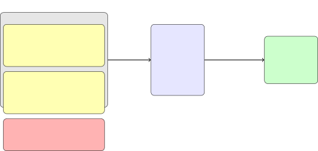

Figure 1. Workflow in Prompt2Constraints

### 4.2. Realization of Prompt2Constraints for programming tasks

Prompt 1 (P1) Write me a Python function that counts the number of ’0’s
in the list. Formalization of P1: $`C_{1}`$: A Python function is
written. $`C_{2}`$: The function counts the number of ’0’ (as a string)
in the list. $`C_{3}`$: The input to the function is a valid list. We
can formalize P1 as: $`P_{1}\rightarrow(C_{1}\land C_{2}\land C_{3})`$
Prompt 2 (P2) Write me a Python function that counts the number of 0 in
the list. Formalization of P2: $`C_{1}`$: A Python function is written.
$`C_{4}`$: The function counts the number of 0 (as an integer) in the
list. $`C_{3}`$: The input to the function is a valid list. We can
formalize P2 as: $`P_{2}\rightarrow(C_{1}\land C_{4}\land C_{3})`$
Logical Relationship Between P1 and P2  
– Semantic Refinement: $`C_{2}`$ evolves from counting ’0’ (string) to
$`C_{4}`$ counting 0 (integer). – Core Continuation:
$`C_{1}\land C_{3}`$: The existence of a Python function and the
assumption of a valid list remain unchanged.

Figure 2. Few-shot learning examples used in this paper for analysis of
the (5)’s dataset.

We realize the Prompt2Constraints framework for analyzing students’
prompts in programming tasks in a study by Denny et al. (5). We thank
the authors for sharing their data with us. This dataset includes
students’ prompt sequences for three CS1-level programming tasks in
Python programming language. Figure 2 shows the template that we used to
instruct LLM how to analyze the prompts. This template is structured by
the following grammar:

> Prompt 1 (P1) \<text of first prompt\> Formalization of P1
> \<description of individual constraints in P1\> We can formalize P1
> as: $`P_{1}\rightarrow`$ \<logical expression for P1\>  
> Prompt 2 (P2) \<text of second prompt\> Formalization of P2
> \<description of individual constraints in P2\> We can formalize P2
> as: $`P_{2}\rightarrow`$ \<logical expression for P2\>  
> Logical Relationship Between P1 and P2  
> – Semantic Refinement: \<differences in P1 and P2 constraints\>  
> – Core Continuation: \<similaities in P1 amd P2 constraints\>  
> prompts \<new prompts\> formalization:

In this template, we first provide the LLM, with an example of two
consecutive prompts P1 and P2 (picked from the dataset), their
corresponding constraints , descriptions of each constraint, and the
logical relationship between two prompts. Prompt2Constraints then
instructs the LLM, GPT-4 in this case, to generate constraints for a new
sequence of prompts. We use OpenAI’s API to automate the entire
workflow. GPT-4 returns, description of constraints in each prompt, the
propositional logic constraints that represents the prompts, and their
relationships.

#### 4.2.1. Dataset

We use Promptly dataset  (5) in this paper. This dataset contains 1872
prompts from 203 CS1 students where they attempted to solve three
programming tasks in the Python programming language. The students were
supposed to generate the solution merely by prompting–they were not
allowed to edit the LLM’s response.

Table 2 summarizes these tasks. The tasks were presented sequentially:
only participants who successfully completed counter were permitted to
attempt initials, and similarly only participants who completed initials
could proceed to repeat. Participants were also explicitly encouraged to
reduce the length of their prompt as much as possible after successfully
arriving at the correct prompt. The dataset offers insight into how
students develop and optimize their prompts.

| Name        | Description                                                                                                       | Example                             |
| ----------- | ----------------------------------------------------------------------------------------------------------------- | ----------------------------------- |
| 1. counter  | Given a list of integers, return how many times the value 0 appears.                                              | counter\[(10, 20, 30)\] =\> 0       |
| 2. initials | Given a string containing multiple words, return the concatenation of the uppercase first letters of each word.   | initials("abd def ghi") =\> "ADG"   |
| 3. repeat   | Given a list of integers, for each integer $`n`$ in the list, repeat that integer $`n`$ times in the output list. | repeat(\[5\]) =\> \[5, 5, 5, 5, 5\] |

Table 2. Prompt Problems used in the three studies

#### 4.2.2. Constraint Statistics

Table 3 shows the distribution of the number of constraints for each
task. Task 1 had the highest average of the number of constraints (5.77)
and task 3 had the lowest average number of constraints (4.6). Figure 3
shows the distribution of the number of constraints per users. It shows
that most students have an average constraint count in the range of
about 4 to 5 constraints per task, indicating a moderate level of
complexity in their responses. However, there is a noticeable tail of
students who use double more constraints (up to around 12), implying
that while most students converge on a relatively small to moderate
number of constraints, a very small number of students use more
complicated constraints in their prompting.

| Task | \#Users | Mean | Std  | Min | Q1  | Median | Q3  | Max |
| ---- | ------- | ---- | ---- | --- | --- | ------ | --- | --- |
| 1    | 203     | 5.77 | 2.28 | 1   | 4   | 5      | 7   | 19  |
| 2    | 159     | 5.16 | 1.64 | 1   | 4   | 5      | 6   | 11  |
| 3    | 146     | 4.60 | 1.32 | 0   | 4   | 4      | 5   | 13  |

Table 3. Summary statistics of the number of constraints in students
prompts for each task

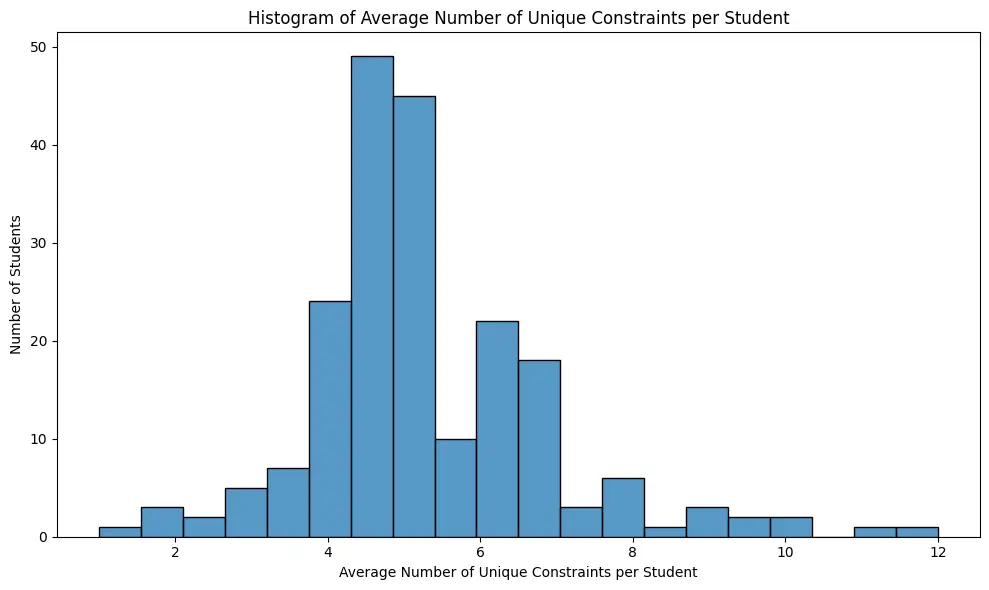

Figure 3. Distribution of Constraints per User

## 5. Evaluation Methodology

In this section, we describe the evaluation methodology. To answer the
research questions, we evaluate a realization of Prompt2Constraints as
described in Section 4.2 as a case study.

### 5.1. RQ1: Measure the accuracy of Prompt2Constraints

To answer RQ1 and measure the accuracy of Prompt2Constraints, we first
randomly sample a representative sample of prompts and manually inspect
the accuracy of constraints of each prompt. To obtain 95% confidence
interval with 6% margin of error, we manually randomly sample and
inspect 234 prompts.

### 5.2. RQ2: Prompt evolution analysis

To understand how students develop and optimize their prompts, we
compare the constraints in consecutive prompts for the changes.

Since all logical expressions in the prompts were in conjunctive normal
form, we could categorize the changes into the following four
categories.

- •
  Adding Constraints: A prompt refines the previous prompt if it adds
  additional constraints to the previous prompt. That is, its constraint
  is stricter than the previous one.
- •
  Modifying Constraints: A prompt revises the previous prompt if it does
  not contain all the prompts in the previous prompt. It can seem as
  backtracking in problem solving.
- •
  Rewording: If two consecutive prompts have identical constraints but
  differ in text, we categorize this as Rewording. It happens when
  students paraphrase the previous prompt.
- •
  Resubmission: The previous prompt without any textual changes is
  submitted.

| Prompt# | Prompt text                                                                                                                                                                | Translation to constraints     | Type of change                                                                                                                              |
| ------- | -------------------------------------------------------------------------------------------------------------------------------------------------------------------------- | ------------------------------ | ------------------------------------------------------------------------------------------------------------------------------------------- |
| P1      | Write me a Python function that counts how many zeros are in a list of X numbers                                                                                           | $`C1\land C2\land C3`$         |                                                                                                                                             |
| P2      | Write me a Python function that counts how many zeros are in a list of X numbers, using the .count() function                                                              | $`C1\land C4\land C2\land C3`$ | Adding a constraint to P1. (A requirement for using .count was added.)                                                                      |
| P3      | Write me a Python function that would respond with counter(\[0, 2, 3, 4, 5, 6, 0\]) =\> 2 when given a list of numbers. This should be counting the number of zeros given. | $`C1\land C5\land C2\land C3`$ | Constraints in P2 have been modified. (The requirement for using .count was removed, and the requirement for function signature was added.) |

Table 4. Evolution Example

Table 4 shows an example of changes in a sequence of prompts. Since P1
is the initial prompt, no modification type is assigned. P2 introduces a
new requirement that the .count() function must be used. Since this adds
a stricter condition to the previous prompt without altering other
aspects, it is categorized as a adding constraints. P3 introduces a
requirement for a new function name counter with specific output
behavior. Furthermore, the requirement to use .count() ($`C4`$) is
removed. Since this change modifies previous conditions rather than
simply adding constraints, it is categorized as a modifying constraints.

As an example of the rewording case, Prompt2Constraints generated
$`C1\land C2\land C3\land C4`$ constraints for the following prompt,

> “Write me a python function name counter which contain a list of
> numbers and return me how many number 0 in the list”

The user submitted the following prompt, replacing “return me how many
number 0 in the list” with “count(0)”

> “A python function counter with a list of numbers and return count(0)”

As a result, Prompt2Constraints generated the same constraints as in the
previous prompt, since they are semantically equivalent. It shows an
interesting case where a user attempts to reduce the length of a prompt
by replacing a part of natural language specification with a more
succinct equivalent in a formal language.

### 5.3. RQ3: Comparison of the difference between successful and unsuccessful prompt sessions

To understand the difference between successful and unsuccessful
prompts, we count the number of changes in constraints between
consecutive prompts. We then use a statistical test to compare the
number of changes in students’ successful and unsuccessful promptings.

## 6. Result

### 6.1. RQ1: Correctness and robustness of the generated constraints

To evaluate the accuracy of the translation of the prompts to correct
logical expressions, we calculated the z score for 95% confidence
interval with a 6% margin of error for this dataset (14). We randomly
sampled and manually inspected 234 prompts. Of 234 samples,
Prompt2Constraints translated 225 prompts correctly to propositional
logic constraints, and for 9 prompts, the number of constraints
generated by Prompt2Constraints was fewer than what an expert would
extract. For example, Prompt2Constraints found three constraints for the
following prompt: “Write a Python function that counts the number of
zeros in a list and prints it”, that is, $`C1`$ for a Python function,
$`C2`$ counts the number of zeros, $`C3`$ prints it. Although plausible,
$`C2`$ contains two equally important constraints for analysis (1)
counting and (2) zero values. Therefore, we expected Prompt2Constraints
to generate four constraints, not three.

During our manual inspection, we found that Prompt2Constraints and GPT-4
are remarkably robust to reordering the text in the prompts. For
example, it outputs $`C1\land C4\land C2\land C5\land C3`$ for “Write me
a Python function named counter. The counter function takes a list as
its input and returns the number of zeros in that list.” It also
generates an equivalent logical expression
$`C1\land C2\land C5\land C3\land C4`$, for a subsequent prompt that
preserves the correspondence of constraints with reordered text: “Write
me a Python function that counts the number of 0 in a list of integers
and returns the value as its output. The function is called counter.”

### 6.2. RQ2: Prompt evolution analysis

Figure  4 shows the types of changes in the successful prompt sequences
of the students. First, the student starts with an initial prompt.
Second, if the student does not get the right solution from the first
prompt, they will begin adding more requirements (adding constraints),
or modifying existing requirements in the prompt (modifying
constraints). Additionally, some students resubmit the same prompt
(resubmission) or rephrase it (rewording). The figure shows that the
students prompted more in the first task compared to the subsequent
tasks. We investigated a potential correlation between the type of
changes, and the length of prompting sessions.

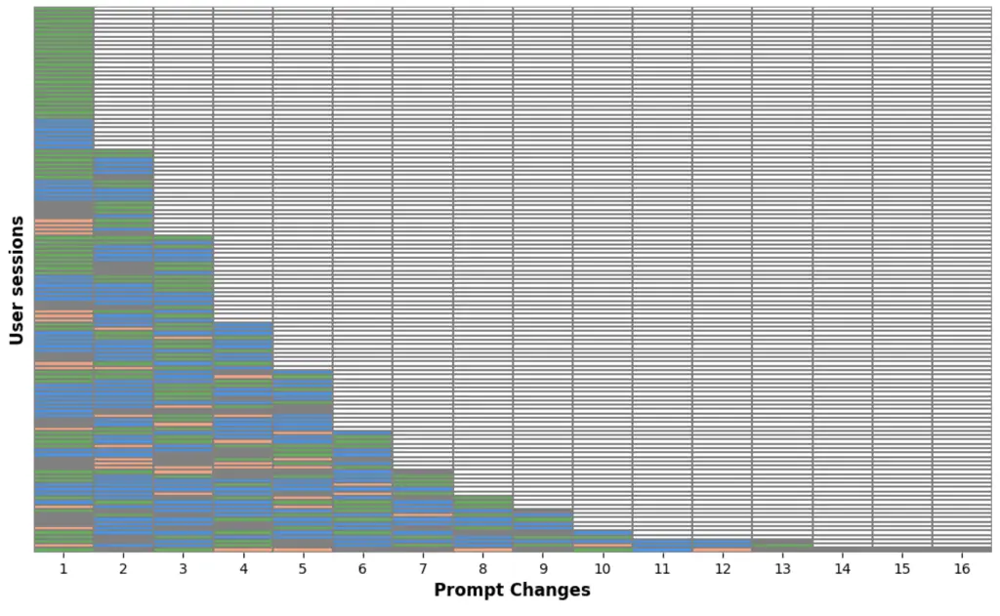

(a) Task 1

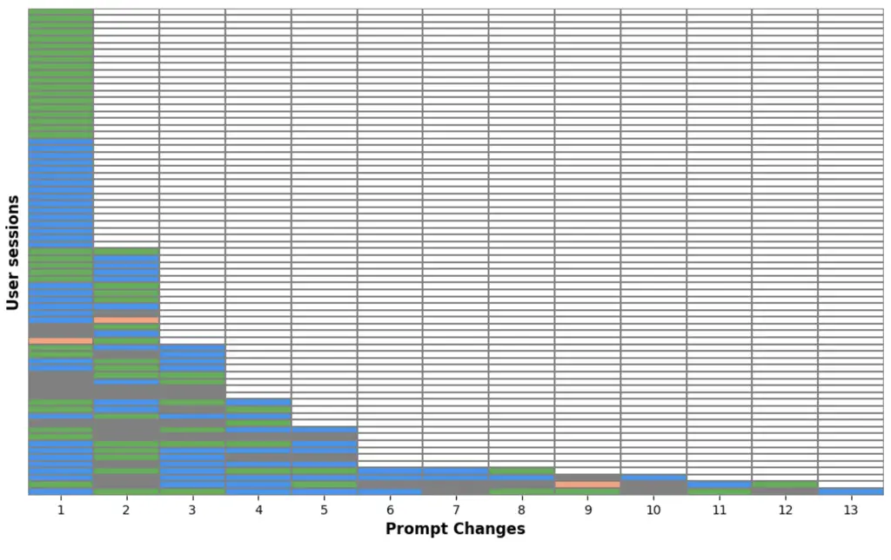

(b) Task 2

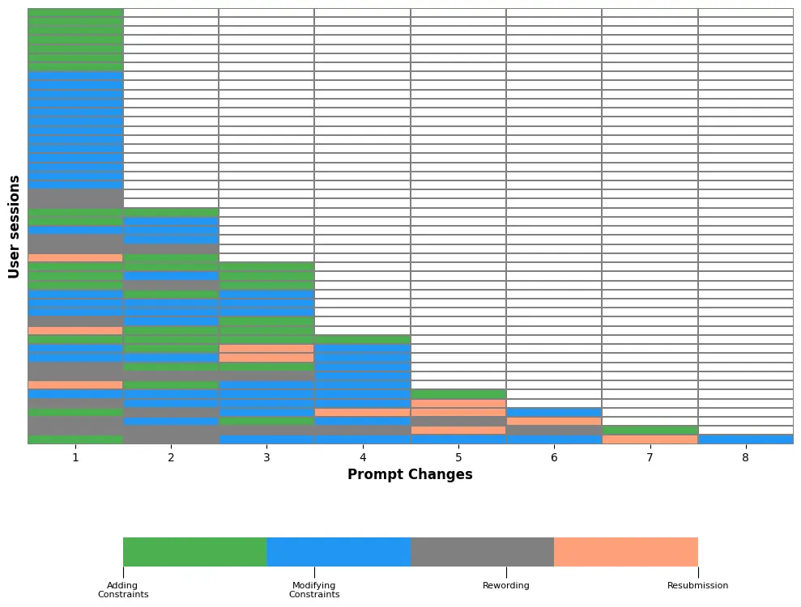

(c) Task 3

Figure 4. Changes in the constraints for each prompting task for
students who finished all three tasks

#### 6.2.1. Correlation of Constraint Changes and the Length of Prompting

Table 5 presents the results of the Pearson correlation analysis between
percentages of the number of constraint changes in each sequence of
prompts with the length of the sequences. It suggests a moderate
negative correlation between the percentage of adding constraints with
the length of prompting, which means that students who frequently add
constraints, their prompting sequence tends to be shorter. This may
suggest that adding constraints helps students converge on a solution
faster and can be due to their core refining of their prompts. On the
other hand, weak positive correlation between the length of prompting
and the other constraint changes: modifying constraints, rewording, and
resubmission, which may suggest that these constraints changes slightly
increase the prompting sequence. This can be an indication of trail and
error where students try to remove part of the prompt and introduce a
new part in modifying constraints, trying rewording the same prompt, or
just resubmit the same prompt.

| Activity              | Correlation | p-value  |
| --------------------- | ----------- | -------- |
| Adding Constraints    | -0.338464   | 0.000004 |
| Modifying Constraints | 0.177237    | 0.018612 |
| Rewording             | 0.181198    | 0.016098 |
| Resubmission          | 0.157528    | 0.036797 |
|                       |             |          |

Table 5. Results of Pearson correlation between changes in the
constraints and problem solving length

#### 6.2.2. Prompt2Constraints for Understanding Problem Solving Steps

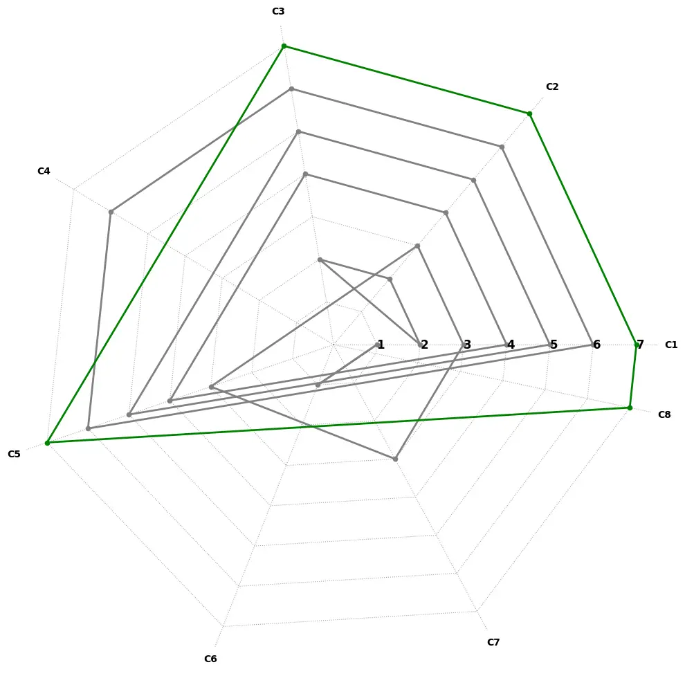

(a) Successful

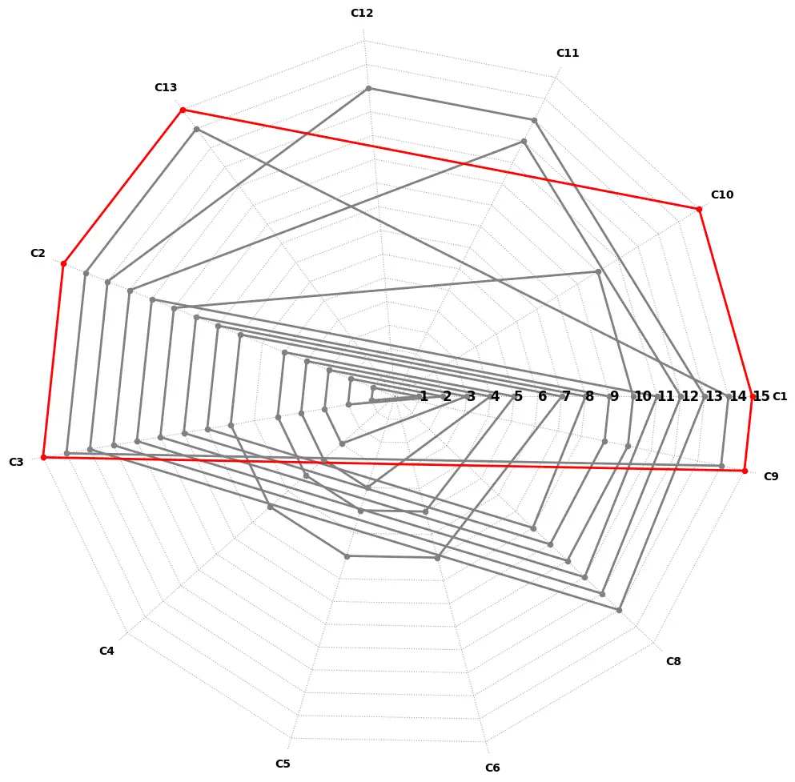

(b) Failed Prompting

Figure 5. Changes in constraints

Using Prompt2Constraints, the constraints in each prompt can provide
insight into how students try to guide the LLM to the solution. In this
section, we demonstrate how the constraints can be used to analyze
student prompting strategies at the level of constraints and how they
could potentially be used to find where an intervention to help students
can be helpful. We note that we will use two examples to motivate the
potential solution. In future work, a thorough evaluation of the
generalizability and usefulness of the proposed approach in pedagogy
will still be needed.

Figure 5 shows examples of changes in the constraints of two users in
problem 1, Figures 5(a) and 5(b) show a successful and a failed attempt
to solve the problem successfully, respectively. Each axis in the spider
graph represents a constraint, and scales represent prompt orders where
the innermost scale represents the first prompt and the outermost scale
represents the last prompt. Figure 5(a) shows that the student starts
with a couple of constraints initially. The constraints in the second
and third prompts suggest that the student evaluates different
approaches, by trying $`C3`$ in the second prompt, then replacing it in
the third prompt with $`C5\land C7`$. From the fourth prompt, the
student picks pieces from the last two prompts $`C3\land C5`$ and
incrementally adds more constraints in prompts 5 and 6. In the last
prompt, the last prompt is slightly modified (removing $`C4`$) and
adding $`C8`$. Overall, except for initial prompts, the changes in the
constraint are limited to a limited number of constraints.

In contrast, Figure  5(b) shows an example of a failed attempt to solve
problems. Unlike the previous problem solving approach, we see that
while the student incrementally adds more constraints to the initial
prompts until prompt 8, there is a sudden large change in the number of
prompts in prompt 6 that suggests that the student may have changed
their solution approach. Moreover, the rate of change in the subsequent
prompt increases substantially, with two or three constraints that may
suggest the student struggle in formulating a solution.

##### Opportunity

The sudden changes in the constraints in Figure  5(b) may suggest
students assumes that they’re exhausted the current approach and a
drastic change in the problem solving or prompting strategy. It may
suggest that such points can be good candidates for an intervention,
e.g., generating hints. For example, manual inspection of the prompts in
Figure  5(b) showed that the student was very close to the solution in
their third prompt, and only misplaced the name of the function. As the
frustration of the students grows, their sixth prompt becomes: “it is
stupid”, and afterward the user explores other parts of the solution
space. Therefore, Prompt2Constraints can suggest the appropriate times
for an intervention.

#### 6.2.3. Understanding Prompt Length Reduction with Constraints

In the prompt problem study (5), students were encouraged to minimize
their successful prompts. Applying Prompt2Constraints would allow us to
see if the students made substantial changes to the semantics of the
prompts or merely tried to reduce the length of the prompts by
rewording. These two approaches would entail two different approaches.
In the first one, the student would need to rethink the constraints in
the solution, while the second approach may mostly focus on
wordsmithing.

Table 6 shows the results. We identified the first successful prompt and
the subsequent smaller successful prompts and compared their
constraints. Out of 41 pairs, we found that 35 smaller prompts have the
same constraints as the original correct prompts, five reduced prompts
had fewer constraints than the original prompts, and only one had more
constraints than the original prompts. It suggests that most of the
students resorted to rewording and wordsmithing to reduce the length of
the prompts.

|          |                       |                  |                  |
| -------- | --------------------- | ---------------- | ---------------- |
| Relation | Identical constraints | Less constraints | More constraints |
| Number   | 35                    | 5                | 1                |

Table 6. Relation between constraints in the reduced prompts and
original prompts

During the analysis, we found an interesting case in which a significant
reduction in word count did not affect the number of identified
constraints. Specifically, some users used underscores to combine
multiple words into a single token, reducing the overall word count to
just one word without altering the prompt’s content, task requirements,
or constraints.

#### 6.2.4. Number of constraints

Figure 6 shows the average number of words (blue line), the number of
users (green line), and the average number of constraints (orange line)
in each prompt step. In the original prompt problem study only the first
two were reported, which would only provide a partial view of the
textual representation of the prompts and the solutions that they
expressed. Prompt2Constraints can enrich it by adding a sematic view of
the prompts using constraints. For example, while the figures show some
increases in the length of prompts in the long tail of the graphs, the
average number of prompts remain relatively steady.

Furthermore, we can see in Figure 6(c) that a student continues to
submit 38 prompts and the number of constraints and words is almost the
same in most submissions. When we look back at the sequence of
strategies in Figure 4, we found that most of the time this student was
submitting the same prompt without any changes in the language and
constraints.

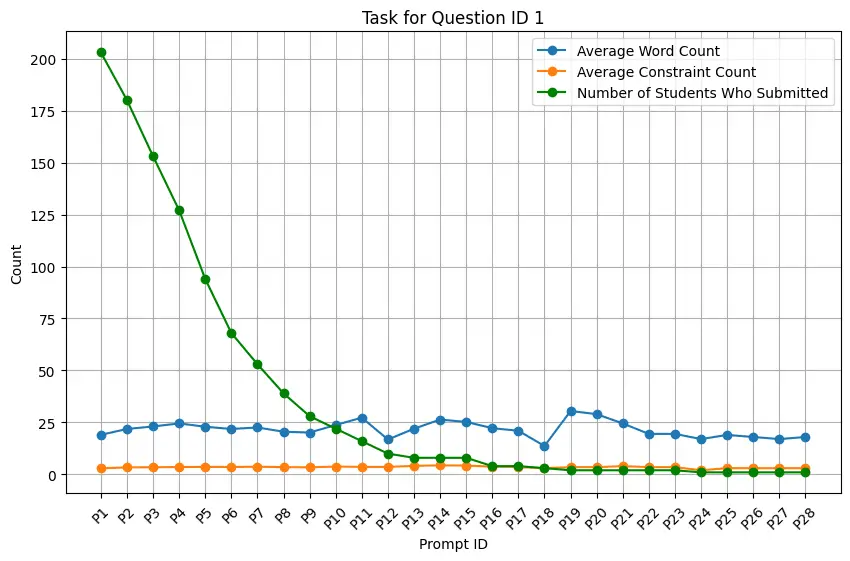

(a) Task 1

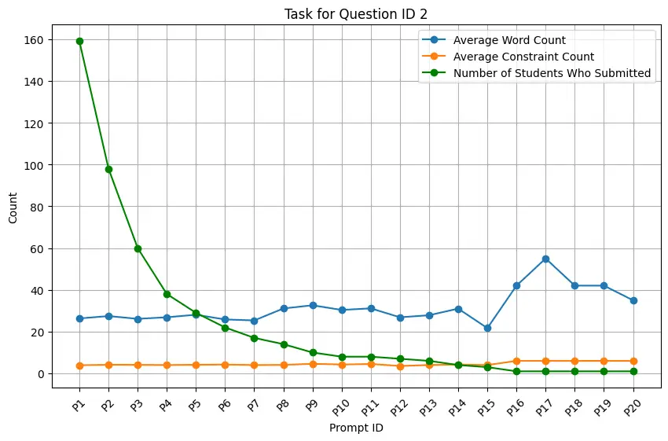

(b) Task 2

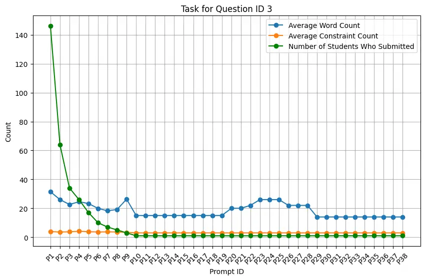

(c) Task 3

Figure 6. The average number of words in each subsequent submission
compared to the average number of constraints and the number of
participants that submitted

### 6.3. RQ3: Comparing size of constraint changes in successful and unsuccessful prompt sequences

Figure 7 shows the size of the changes between constraints in
consecutive prompts, the green line represents the average size of the
differences in successful prompt sequences (0.83), while the red line
represents the average size of the differences in unsuccessful prompt
sequences (0.71). The black line denotes the average size of differences
in all prompt sequences (0.81). Mann-Whitney U-test failed to find a
statistically significant difference between the size of changes in
consecutive prompts in in the successful and unsuccessful prompt
sequences (p-value = 0.416).

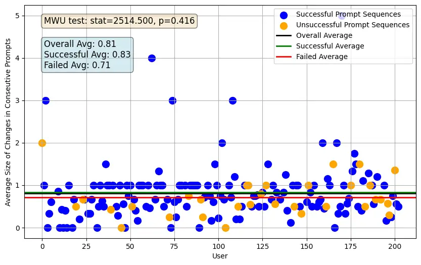

Figure 7. Size of changes in consecutive prompts

## 7. Prompt2Constraints for Measuring the Progress

In this section, we describe a potential application of
Prompt2Constraints in the support of intelligent tutoring systems in the
era of generative AI and LLMs. In particular, we show that the
constraints can be applied to measure how far or close students are from
the correct answer. We outline an algorithm and motivate it in a working
example.

### 7.1. Algorithm

Suppose $`S`$ is a successful prompt and a sequence $`P`$ of prompts
written by students/users. The algorithm 1 outlines an algorithm for
measuring the progress of the students toward a solution. The measure
can potentially be used to direct an intelligent tutor system or hint
generator.

First, we create a new set $`T`$ that contains $`S`$ the prompts in
$`P`$. Then, we use Prompt2Constraints as previously described to
extract the constraints of the prompts $`C`$. In the next step, the
difference ($`diff`$) between the constraints of $`S`$ ($`C[S]`$) and
the constraints of the user prompts are calculated. The result of
$`diff`$ function can be used to measure how far is the students’
prompts to the solutions. We note that many different prompts can be a
solution to a programming task, in such cases, all representative
solution prompts can be collected in a set $`S`$, and the algorithm will
need to compute the difference between the prompts and each of the
representative solutions.

$`T\leftarrow P\cup S`$

$`C\leftarrow\textsc{Prompt2Constraints}(T)`$

for $`p\in(C\setminus S)`$ do

  $`D[p]\leftarrow\mathrm{diff}(C[S],C[p])`$

end for

Algorithm 1 An algorithm for measuring the success

##### A Case Study

Here we demonstrate the application of  1 to failed prompting. We use
the failed prompts in Figure  5(b) along with the last prompt in
Figure 5(a) which is a successful prompt. Figure 8 depicts the resulting
constraints for the failed prompts (prompts 1 to 15) along with
constraints in the successful prompt (prompt 16–green lines). Note that
the constraints’ names changed because we added prompt 16.

This student was very close to the solution in the third prompt (P3) as
it is only one constraint different from the proposed solution in P16.
The text for P3 is “Write me a Python function that uses the counter
function and counts the number of elements in the list which have the
value ’0’.” After P3 the distance between the student’s solution and the
proposed solution increases, which leads to changing the direction in
problem solution approach from P7. The text for P15 is “you are given a
list in python. use the for in range loop to traverse this list. within
that list, if there is a 0, add 1 to a variable named counter. once you
are done traversing the list, print the variable which is storing the
number of 0s found” and the corresponding constraints that
Prompt2Constraints suggests are
$`1\land C2\land C3\land C9\land C10\land C13`$. P16 is “Write me a
Python function that defines the function ’counter’ so the output finds
and print the number of times an object in the list equals 0” with the
corresponding constraints $`C1\land C4\land C2\land C3\land C13`$. Using
the built-in explanation for the logical differences of two prompts,
Prompt2Constraints explains “The functionality remains consistent with
P15, without the specific loop and variable requirements.” A future hint
generator can either encourage the student to continue refining P3.

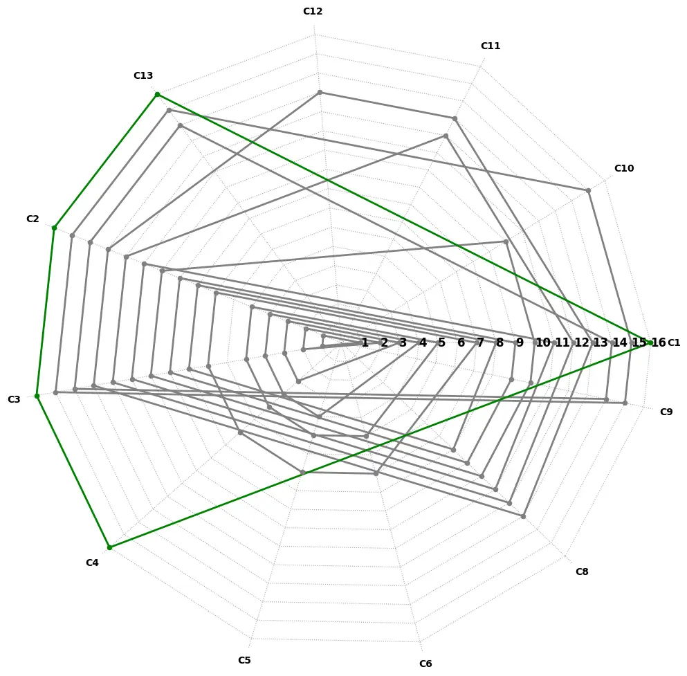

Figure 8. Using constraints to guide failing prompting

## 8. Threats to Validity

An important limitation of our work is the extent to which findings
generalize across different tasks, domains, and learner populations.
Because we evaluated Prompt2Constraints using prompts from introductory
Python problems, its performance may vary when applied to more advanced
programming tasks or to subjects outside computing. Second, the approach
relies heavily on LLMs—particularly GPT-4 –for its constraint
extraction, which introduces potential bias or instability due to the
proprietary and continually evolving nature of these models. Changes in
LLM behavior or differences between models could lead to inconsistent
results over time. Third, any errors in the few-shot learning examples
or prompts used to train Prompt2Constraints can propagate through the
system, impacting accuracy in ways that are difficult to detect without
additional human review. Finally, like most automated methods,
Prompt2Constraints may fail to capture nuanced or context-specific
information not readily translatable into propositional constraints.
These factors could limit the technique’s ability to fully capture the
diverse ways learners conceptualize and express problem requirements.
Careful consideration of these threats, and additional validation
efforts, such as manual annotation or triangulation with other data
sources, are critical for ensuring robust and trustworthy results.

## 9. Discussion

In this section, we discuss the results and potential applications
presented in the paper.

##### Accelerating research

In our experiments, the GPT-4 few-shot learning performed very well in
identifying the constraints with only two examples from the dataset. A
major benefit of Prompt2Constraints lies in its potential to rapidly
scale analyses that would otherwise require exhaustive manual
annotation. By automatically extracting logical constraints from student
prompts, researchers can efficiently sift through large datasets,
pinpointing trends or anomalies with minimal human intervention. This
automation not only saves considerable time, but also reduces potential
human errors or inconsistencies in classification. Moreover, because it
employs few-shot learning, Prompt2Constraints can quickly adapt to new
tasks or domains, further broadening its applicability. As a result,
researchers can explore hypotheses more easily, conduct comparative
studies, and refine their experiments in an iterative manner, ultimately
accelerating progress and innovation in both computing education and
broader LLM-based investigations.

##### Finding when students struggle

Prompt2Constraints provides a way to systematically track a student’s
evolving prompt constraints over time, revealing moments where
significant or erratic shifts occur. These abrupt changes in
constraints—such as suddenly discarding previously used requirements or
drastically revising the approach—often signal confusion or frustration,
suggesting the student has reached an impasse. By mapping each prompt to
propositional logic, educators or automated tutoring systems can
quantify the “distance” between a student’s current prompt and a known
solution or optimal set of constraints. In practice, this enables
real-time detection of where students stray too far from an effective
strategy or repeatedly circle back without making meaningful progress.
Consequently, instructors can provide targeted interventions, such as
clarifying conceptual misunderstandings or offering smaller, more
manageable sub-goals. This proactive assistance reduces students’
trial-and-error cycles, leading to a more efficient and supportive
learning process.

##### Potential use in hint generation

Another advantage of the Prompt2Constraints framework is that it can be
integrated into real-time hint generation. By mapping student prompts to
logical constraints, the system can measure how closely these
constraints align with, or diverge from, a known correct solution’s
constraints. This difference can directly inform targeted hints: for
instance, identifying when a necessary condition–such as checking list
bounds or returning the right data type–is missing, or when two
constraints conflict. Moreover, by tracking how a student’s constraints
change between prompts, Prompt2Constraints helps pinpoint exactly where
they might need support, allowing the system to offer context-aware
nudges that guide them back on course. These timely, tailored hints can
ultimately help learners refine their problem-solving strategies, reduce
trial-and-error cycles, and deepen conceptual understanding.

## 10. Conclusion

In this work, we introduced the Prompt2Constraints approach to
systematically analyze students’ prompting behavior in programming
tasks. The approach is based on the few-shot prompting LLMs to extract
constrains that users have specified in the prompt. Our results show
that the approach is robust, and provides a multitude of different
options for analyzing prompting behavior. Moreover, struggling students
tend to modify their prompts more suggesting shifts in the
problem-solving strategies.

This work contributes to scalable prompts analysis which we used to
analyze more than 1500 prompts of students interaction with LLM to
generate codes for programming tasks. The Prompt2Constraints has
potential in real-time LLM educational tools to guide students
throughout the prompting journey, and trigger the need for assistance
for struggling students when they shift to explore another area than the
solution space. In future research, we could extend the
Prompt2Constraints to more complex programming tasks.

## References

- (1) Amoozadeh, M., Daniels, D., Nam, D., Kumar, A., Chen, S., Hilton,
  M., Srinivasa Ragavan, S., and Alipour, M. A. Trust in generative ai
  among students: An exploratory study. In Proceedings of the 55th ACM
  Technical Symposium on Computer Science Education V. 1 (2024),
  pp. 67–73.
- (2) Amoozadeh, M., Nam, D., Prol, D., Alfageeh, A., Prather, J.,
  Hilton, M., Srinivasa Ragavan, S., and Alipour, M. A. Student-ai
  interaction: A case study of CS1 students. In Proceedings of the 24th
  Koli Calling International Conference on Computing Education Research
  (New York, NY, USA, 2024), Koli Calling ’24, Association for Computing
  Machinery.
- (3) Babe, H. M., Nguyen, S., Zi, Y., Guha, A., Feldman, M. Q., and
  Anderson, C. J. Studenteval: a benchmark of student-written prompts
  for large language models of code. arXiv preprint arXiv:2306.04556
  (2023).
- (4) Denny, P., Kumar, V., and Giacaman, N. Conversing with copilot:
  Exploring prompt engineering for solving cs1 problems using natural
  language. In Proceedings of the 54th ACM Technical Symposium on
  Computer Science Education V. 1 (2023), pp. 1136–1142.
- (5) Denny, P., Leinonen, J., Prather, J., Luxton-Reilly, A.,
  Amarouche, T., Becker, B. A., and Reeves, B. N. Prompt problems: A new
  programming exercise for the generative ai era. In Proceedings of the
  55th ACM Technical Symposium on Computer Science Education V. 1
  (2024), pp. 296–302.
- (6) Denny, P., Prather, J., Becker, B. A., Finnie-Ansley, J., Hellas,
  A., Leinonen, J., Luxton-Reilly, A., Reeves, B. N., Santos, E. A., and
  Sarsa, S. Computing education in the era of generative ai.
  Communications of the ACM 67, 2 (2024), 56–67.
- (7) Denny, P., Smith IV, D. H., Fowler, M., Prather, J., Becker,
  B. A., and Leinonen, J. Explaining code with a purpose: An integrated
  approach for developing code comprehension and prompting skills. In
  Proceedings of the 2024 on Innovation and Technology in Computer
  Science Education V. 1. 2024, pp. 283–289.
- (8) Denny, P., Whalley, J., and Leinonen, J. Promoting early
  engagement with programming assignments using scheduled automated
  feedback. In Proceedings of the 23rd Australasian Computing Education
  Conference (2021), pp. 88–95.
- (9) Ehsani, R., Pathak, S., and Chatterjee, P. Towards detecting
  prompt knowledge gaps for improved llm-guided issue resolution. arXiv
  preprint arXiv:2501.11709 (2025).
- (10) Etsenake, D., and Nagappan, M. Understanding the human-llm
  dynamic: A literature survey of llm use in programming tasks. arXiv
  preprint arXiv:2410.01026 (2024).
- (11) Hao, H., Hasan, K. A., Qin, H., Macedo, M., Tian, Y., Ding,
  S. H., and Hassan, A. E. An empirical study on developers’ shared
  conversations with chatgpt in github pull requests and issues.
  Empirical Software Engineering 29, 6 (2024), 150.
- (12) Kalluri, K. Exploring zero-shot and few-shot learning
  capabilities in llms for complex query handling, 2022.
- (13) Kim, J., Lee, S., Han, S. H., Park, S., Lee, J., Jeong, K., and
  Kang, P. Which is better? exploring prompting strategy for llm-based
  metrics. In Proceedings of the 4th Workshop on Evaluation and
  Comparison of NLP Systems (2023), pp. 164–183.
- (14) Kotrlik, J., and Higgins, C. Organizational research: Determining
  appropriate sample size in survey research appropriate sample size in
  survey research. Information technology, learning, and performance
  journal 19, 1 (2001), 43.
- (15) Lane, H. C., and VanLehn, K. Coached program planning:
  Dialogue-based support for novice program design. In Proceedings of
  the 34th SIGCSE technical symposium on Computer science education
  (2003), pp. 148–152.
- (16) Lau, S., and Guo, P. From" ban it till we understand it" to"
  resistance is futile": How university programming instructors plan to
  adapt as more students use ai code generation and explanation tools
  such as chatgpt and github copilot. In Proceedings of the 2023 ACM
  Conference on International Computing Education Research-Volume 1
  (2023), pp. 106–121.
- (17) Leinonen, J., Denny, P., MacNeil, S., Sarsa, S., Bernstein, S.,
  Kim, J., Tran, A., and Hellas, A. Comparing code explanations created
  by students and large language models. In Proceedings of the 2023
  Conference on Innovation and Technology in Computer Science
  Education V. 1 (2023), pp. 124–130.
- (18) Nam, D., Macvean, A., Hellendoorn, V., Vasilescu, B., and
  Myers, B. Using an llm to help with code understanding. In Proceedings
  of the IEEE/ACM 46th International Conference on Software Engineering
  (2024), pp. 1–13.
- (19) P?durean, V.-A., Denny, P., and Singla, A. Bugspotter: Automated
  generation of code debugging exercises. In Proceedings of the 56th ACM
  Technical Symposium on Computer Science Education V. 1 (New York, NY,
  USA, 2025), SIGCSETS 2025, Association for Computing Machinery,
  p. 896–902.
- (20) Prather, J., Reeves, B. N., Denny, P., Becker, B. A., Leinonen,
  J., Luxton-Reilly, A., Powell, G., Finnie-Ansley, J., and Santos,
  E. A. “it’s weird that it knows what i want”: Usability and
  interactions with copilot for novice programmers. ACM transactions on
  computer-human interaction 31, 1 (2023), 1–31.
- (21) Ragavan, S. S., and Alipour, M. A. Revisiting human information
  foraging: Adaptations for llm-based chatbots. arXiv preprint
  arXiv:2406.04452 (2024).
- (22) Smith IV, D. H., Denny, P., and Fowler, M. Prompting for
  comprehension: Exploring the intersection of explain in plain english
  questions and prompt writing. In Proceedings of the Eleventh ACM
  Conference on Learning@ Scale (2024), pp. 39–50.
- (23) Zamfirescu-Pereira, J., Wong, R. Y., Hartmann, B., and Yang, Q.
  Why johnny can’t prompt: how non-ai experts try (and fail) to design
  llm prompts. In Proceedings of the 2023 CHI Conference on Human
  Factors in Computing Systems (2023), pp. 1–21.
