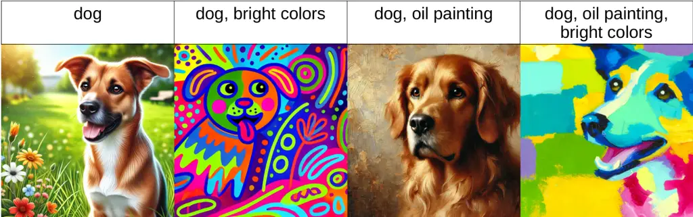
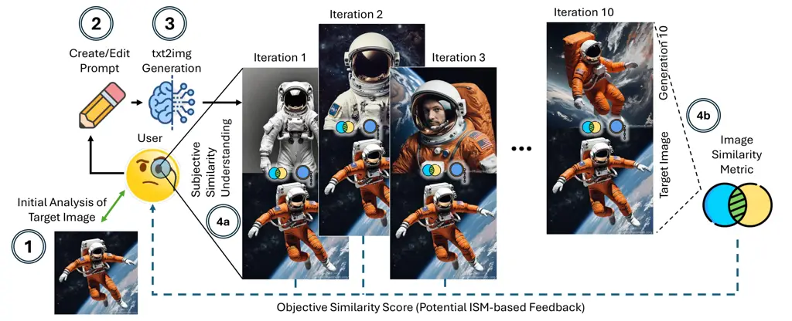
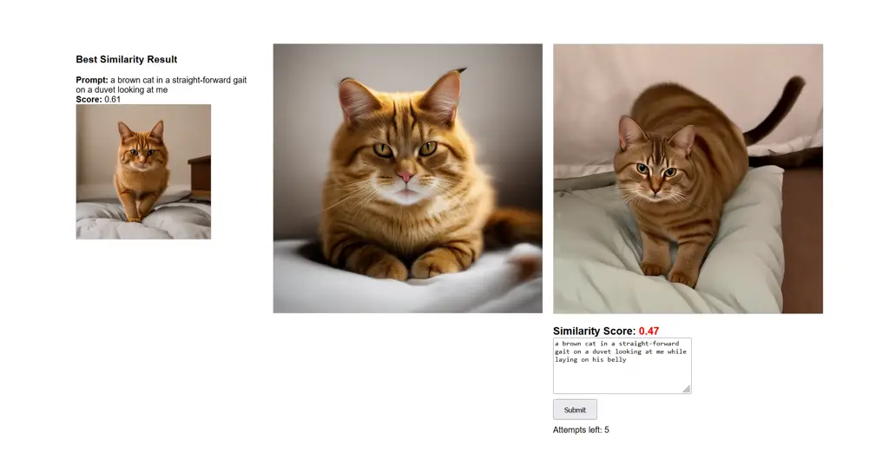
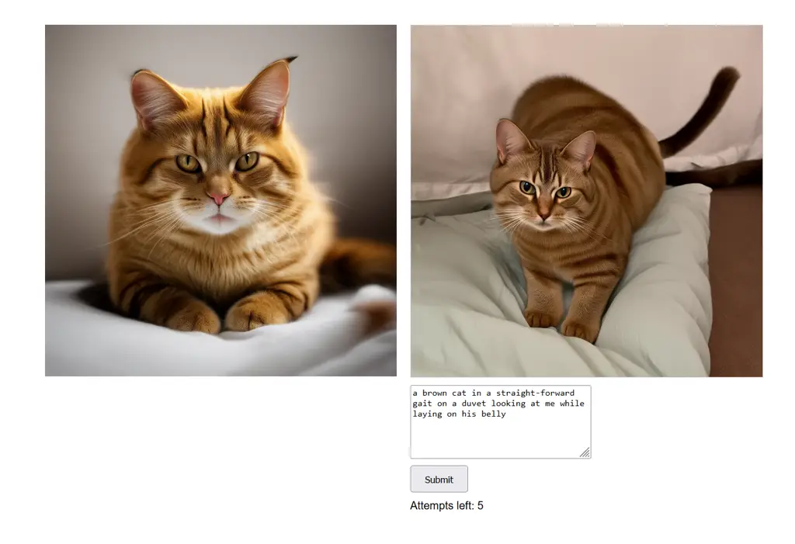
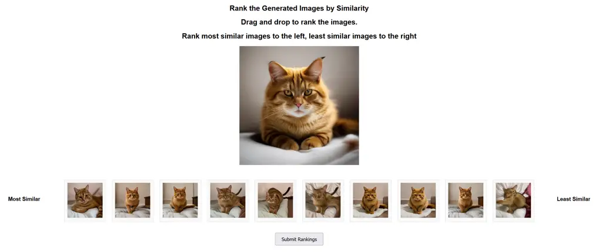

# A Picture is Worth a Thousand Prompts? Efficacy of Iterative Human-Driven Prompt Refinement in Image Regeneration Tasks

Khoi Trinh Affiliation:  University of Oklahoma
Email: <khoitrinh@ou.edu>    Scott Seidenberger Affiliation:  University
of Oklahoma Email: <seidenberger@ou.edu>    Raveen Wijewickrama
Affiliation:  University of Texas at San Antonio
Email: <raveen.wijewickrama@utsa.edu>    Murtuza Jadliwala Affiliation: 
University of Texas at San Antonio Email: <murtuza.jadliwala@utsa.edu>
   Anindya Maiti Affiliation:  University of Oklahoma Email: <am@ou.edu>

###### Abstract

With AI-generated content becoming ubiquitous across the web, social
media, and other digital platforms, it is vital to examine how such
content are inspired and generated. The creation of AI-generated images
often involves refining the input prompt iteratively to achieve desired
visual outcomes. This study focuses on the relatively underexplored
concept of image _regeneration_ using AI, in which a human operator
attempts to closely recreate a specific target image by iteratively
refining their prompt. Image regeneration is distinct from normal image
generation, which lacks any predefined visual reference. A separate
challenge lies in determining whether existing image similarity metrics
(ISMs) can provide reliable, objective feedback in iterative workflows,
given that we do not fully understand if subjective human judgments of
similarity align with these metrics. Consequently, we must first
validate their alignment with human perception before assessing their
potential as a feedback mechanism in the iterative prompt refinement
process. To address these research gaps, we present a structured user
study evaluating how iterative prompt refinement affects the similarity
of regenerated images relative to their targets, while also examining
whether ISMs capture the same improvements perceived by human observers.
Our findings suggest that incremental prompt adjustments substantially
improve alignment, verified through both subjective evaluations and
quantitative measures—underscoring the broader potential of iterative
workflows to enhance generative AI content creation across various
application domains.

## 1 Introduction

The rise of AI-generated content on online platforms has made it crucial
to investigate how this type of content is created, specifically through
the iterative processes of image generation and regeneration. While
prior work has explored AI-led iterative refinement, this paper
highlights the human’s leading role in refining prompts and improving
outcomes through their own judgment and control. The field of generative
artificial intelligence (GenAI) has recently seen significant
advancements, particularly in the development of text-to-image (txt2img)
models. These models provide an easy and fast process for creating
high-quality artwork. Among the notable txt2img models contributing to
this trend are Midjourney MidJourney (2024), DALL-E 3 Betker et al.
(2023), and Stable Diffusion 3 Esser and others (2024). While these
models enable a more accessible way to generate high-quality and
visually appealing images, creating artwork with this method
(specifically, image generation) is usually iterative. A user starts
with a concept, formulates a prompt for the txt2img model, and uses the
prompt as input to the model to obtain the desirable image. If the
obtained image is unsatisfactory, the user repeatedly refines the prompt
until the desired result is achieved or the user abandons the task.

Image regeneration through prompt refinement refers to a task where a
user iteratively edits their prompt with the goal of recreating a visual
based on some target image or visual style. This iterative process
illustrates human-AI interaction techniques, where the user and AI
collaborate to achieve optimal outputs. By iteratively refining prompts,
users actively guide the creative process, demonstrating the potential
of human-AI collaboration to bridge gaps between technical capabilities
and artistic intent. This concept of image regeneration through
iterative prompt refinement has numerous practical applications, such as
bypassing prompt marketplaces, educating novice users, restoration of
lost or damaged art pieces Trinh et al. (2024); Tang et al. (2024);
Oppenlaender et al. (2024); Kulkarni et al. (2023); Liang et al. (2023).
Despite the potential applications, limited research exists on how
humans can improve image quality through iterative prompt refinement.

Iterative refinement processes have been utilized by humans in a wide
domain of tasks such as writing, programming, and design. Flower Flower
(1981) provides a model on how writers plan, create, and revise their
work iteratively. Madaan Madaan et al. (2024) show that iterative
refinement is effective in significantly improving outputs in text and
code generation tasks through self-feedback mechanisms. Møller and
Aiello Møller and Aiello (2024) show that stepwise prompt refinement can
show improvement in text summarization tasks. Du Du et al. (2022)
provides the R3 framework that has demonstrated the effectiveness of
iterative revision in producing high-quality textual outputs by
incorporating user feedback at each stage of the revision. For txt2img
generation, automatic prompt optimization systems have demonstrated
substantial improvements in image quality by refining prompts
systematically Mañas et al. (2024). Building on these findings, this
paper explores how iterative refinement impacts human-guided prompt
optimization in image regeneration tasks, particularly in aligning
generated visuals with target images.

In image regeneration and comparison, image similarity metrics (ISMs)
such as Perceptual Similarity Zhang et al. (2018), CLIP scores OpenAI
(2021); Wang et al. (2023), and ImageHash Buchner (2024) can provide
objective feedback on the likeness between two images Saharia et al.
(2022); Zhang et al. (2018). However, these ISMs’ alignment with humans’
subjective judgment remains untested. Since humans are the ultimate
decision-makers in creative workflows, it is critical to ensure that
ISMs align with subjective human evaluations. Humans make the final call
on whether AI-generated outputs meet their intended purpose, making
human agreement essential to validate the reliability and practical
applicability of ISMs. To address this, we first seek to understand the
alignment of ISMs with human perception by comparing the objective
rankings provided by these metrics to users’ subjective rankings of the
similarity between generated images and target images. This evaluation
is vital for determining the feasibility of using ISMs as reliable
feedback tools in iterative prompt refinement workflows.

Previous work by Trinh Trinh et al. (2024) has studied how humans’
inference may compare to machine inference (i.e CLIP interrogator), and
shows that while humans are able to infer prompts and generate similar
images, their efforts were not as effective as using the original target
prompt. However, this previous research was limited to single-shot
inference, where participants had only one attempt to generate a prompt.
Furthermore, image similarity metrics (ISMs) were employed to define a
threshold for successful inference, considering the task complete if the
generated image achieved an ISM score above the threshold. In contrast
to this prior work, our study seeks to examine how participants improve
image regeneration performance when allowed multiple iterations to
refine prompts. Instead of using ISMs solely to determine task
completion, we leverage these metrics to quantify the iterative
improvements in image regeneration. This allows us to investigate the
effectiveness of iterative refinement as an approach to improving
human-guided AI image generation.

From these research gaps and motivations, we conducted an experiment
with human subject participants to assess their improvement in an image
regeneration task This study also serves to provide additional insights
on the alignment of different ISMs with subjective human assessment. We
seek to address the following specific research questions (RQ):

- •
  RQ1: Do humans agree that ISMs are reliable for image similarity
  evaluation?
- •
  RQ2: Does iterative prompt refinement improve both subjective and
  objective measures of humans in image regeneration tasks?

Our contributions in this paper are as follows:

1.  1.  Survey Deployment: We conducted an in-person experiment with 20
        human subject participants from our host institution.
2.  2.  Survey Data: Each participant conducted iterative prompt refinements
        for 10 target images over 10 iterations each, generating a total of
        2000 prompts.
3.  3.  Data Evaluation: We utilized a comprehensive set of metrics in our
        evaluation, including Intraclass Correlation Coefficient to gauge
        the alignment of ISMs to human assessment. A mixed-effects model was
        used to analyze ISMs in quantifying the performance improvement of
        the iterative prompt refinement task. Additionally, we assess the
        iteration at which the highest user-ranked images were generated, as
        an additional metric to quantify improvement in iterative prompt
        refinement.

## 2 Background & Related Work



Figure 1: Image generations using DALL-E 3 with prompts containing the
same subject (dog) and different combinations of two modifiers (oil
painting and bright colors).



Figure 2: Summary of the iterative prompt refinement process for image
regeneration task.

### 2.1 AI Image Generation

Modern txt2img systems often pair a language encoder (e.g., a
Transformer-based or large language model) with a generative model, such
as a diffusion model, a Generative Adversarial Network (GAN), or a
Variational Autoencoder (VAE) Jia et al. (2024). In diffusion-based
approaches (e.g., Stable Diffusion Rombach et al. (2022)), the model
iteratively denoises a latent representation conditioned on the text
embedding, ultimately decoding it into pixel space. GAN-based
frameworks, by contrast, feature a generator trained adversarially
against a discriminator Goodfellow et al. (2020), driving the production
of increasingly realistic images. VAEs encode input data into a latent
space and then decode the latent vectors back into images, facilitating
synthesis from sampled noise Jia et al. (2024).

Despite these technical advances, small prompt modifications can produce
markedly different outputs Trinh et al. (2024). Figure 1 demonstrates
how substituting or reordering modifiers (e.g., bright colors, oil
painting) in a prompt describing a dog can lead to substantial stylistic
variations. This sensitivity underscores the need for systematic
techniques, such as iterative prompt refinement, to achieve precise user
objectives.

### 2.2 Iterative Prompt Refinement

While image generation often involves exploratory creativity, image
regeneration introduces a more structured approach: recreating a
specific target visual through iterative prompt refinement. This task
requires users to refine their prompt iteratively, guided by feedback,
either in the form of subjective assessment by the user or objective
values such as ISMs, to achieve closer alignment with the target visual.

As illustrated in Figure 2, the process begins with the user analyzing
the target image (Step 1) to identify key visual elements and features
that need to be replicated. Based on this analysis, the user creates a
text prompt (Step 2) and submits it to the txt2img generation model
(Step 3), which produces an initial image. Following each generation,
the process involves a subjective similarity assessment (Step 4a), where
the user evaluates how closely the generated image matches the target
image and refines the prompt accordingly. Additionally, a potential
objective similarity assessment (Step 4b) uses image ISMs to provide a
quantified feedback score. Steps 2, 3, 4a, and 4b are repeated
iteratively, while the user edits the prompt in each iteration, and by
the 10th iteration, the goal is to generate an image that closely aligns
with the target image, reflecting improvements guided by human judgment
and additional ISM feedback.

Image regeneration through prompt creation by humans can have several
use cases. Trinh Trinh et al. (2024) presented human prompt inference as
a way to bypass prompt marketplaces, in turn questioning the validity of
these marketplaces as business models. Image regeneration through
iterative prompt refinement is an alternative for users to recreate
target images without relying on purchased prompt. Additionally,
iterative prompt refinement can also enable non-expert users, such as
hobbyists or novice designers, to engage and supplement their creative
ability, knowledge, and prompt creation skills through experimenting
with prompts and image regeneration Tang et al. (2024); Oppenlaender et
al. (2024); Kulkarni et al. (2023). Beyond these applications, other use
cases for image regeneration include digital archiving and art
restoration. For example, lost or incomplete visual assets can be
recreated from a low-resolution or degraded version of the original
image Liang et al. (2023). This technique could be utilized in
preserving cultural heritage, or recreating historical imagery where
traditional techniques proved difficult.

Our study builds on these motivations, emphasizing the role of the human
in prompt refinement. Prior work on AI-led refinement has explored how
automated systems can optimize prompts. For instance, Mañas et al.
presents OPT2I, a framework that leverages large language models to
automatically refine prompts in txt2img models, improving alignment
between prompts and generated images Mañas et al. (2024). OPT2I
iteratively revises user-provided prompts, optimizing a consistency
score that evaluates how well the generated image matches the prompt,
all without model fine-tuning. Similarly, a recent study by Zhan et al.
on capability-aware prompt reformulation, demonstrate how refining
prompt language can significantly enhance image generation quality Zhan
et al. (2024). By tailoring prompt adjustments to match user
proficiency, their system helps users create more coherent and relevant
images, regardless of their familiarity with prompt engineering.

In contrast, our study emphasizes the leading role of the human in
iterative refinement, investigating how individuals improve their
prompts and outputs to achieve desired results. This approach aligns
with prior research on human-centric systems, such as GenAssist by Huh
et al. which provides blind and low-vision users with prompt-guided
descriptions and visual verification features to assess generated
images’ content and style alignment with initial prompts Huh et al.
(2023); but we shift the focus entirely to user-driven adjustments and
improvements.

### 2.3 Image Similarity Metrics

Evaluating image similarity is a fundamental task in computer vision,
with applications ranging from image retrieval to quality assessment.
Traditional metrics (L2 Euclidean Distance and SSIM) tend to assume
pixel-wise independence, and can fall short in capturing the perceptual
nuances that come from human judgment. One notable approach that
addressed this limitation involves the use of deep features from
convolutional neural networks (CNNs). These features are then used to
assess image similarity. The Learned Perceptual Image Patch Similarity
(LPIPS) metric, or simply Perceptual Similarity (PS), utilized this
approach. Specifically, it computes feature embeddings from multiple
convolutional layers of pre-trained networks (e.g., AlexNet, VGG, or
SqueezeNet), normalizes these activations channel-wise, and then
calculates the weighted L2 distance between the feature maps. The final
similarity score averages these distances across spatial dimensions and
layers. This approach exploits the hierarchical nature of CNNs, allowing
the metric to account for higher-order image structures,
context-dependent visual patterns, and other nuances that impact how
humans perceive image similarity. As a result, this metric tends to
align well with human judgment Zhang et al. (2018).

Another recent approach is the Contrastive Language-Image Pre-training
(CLIP) model, which learns to associate textual and visual information.
CLIP is pre-trained on large-scale datasets consisting of image-text
pairs, allowing it to generalize well across various domains without
needing task-specific fine-tuning. The scores produced measure the
similarity between two images based on their embeddings generated by the
CLIP model, without directly referencing the original text prompts
OpenAI (2021); Wang et al. (2023).

In this study, we employ two different variants of CLIP: B32 and L14.
The B32 variant refers to a specific version with a smaller image
representation size. This score is used to measure how similar two
images are based on the model’s understanding of their features.
Similarly, CLIP L14 is another variant of the same model, but with a
larger representation, capturing more detailed image features. The score
indicates the degree of similarity between two images, with L14
providing a more precise detection of nuanced differences.

Finally, hashing algorithms offer an alternative approach by condensing
images into compact binary representations Buchner (2024). This means
that the Hamming distance (the number of differing bits) between these
hashes is used to indicate similarity. A smaller distance suggests
greater similarity between the images, whereas a larger distance
indicates more significant differences Krawetz (2011).

## 3 Research Questions & Hypotheses

This study investigates the alignment of computational image similarity
metrics (ISMs) with human judgment, and subsequently how iterative
prompt refinement affects image regeneration tasks. We aim to understand
the relationship between iterative prompt refinement and the tools used
to measure its effectiveness. The following research questions guide our
investigation:

RQ1 - Human Perception of ISMs: Do humans generally agree that the
selected ISMs are reliable numerical heuristics for evaluating whether
two images are perceived as similar or different?

While Zhang Zhang et al. (2018) shows that their proposed metric,
Perceptual Similarity, outperforms previous traditional metrics (SSIM,
FSIM, L1 or L2 norm) in aligning with human judgments, Sinha and Russell
Sinha and Russell (2011) demonstrate the limitations of ISMs, cautioning
users when interpreting their reliability. This raises the question of
whether humans consistently perceive these metrics as reliable
indicators of similarity. Addressing RQ1 supports our study by assessing
how humans perceive ISMs as tools to help facilitate iterative
refinement in image regeneration tasks. The hypotheses for RQ1 are then
as follows:

- •
  Hypothesis 1.1: Human raters exhibit moderate to good agreement with
  the ISMs as evaluative tools for image similarity.
- •
  Hypothesis 1.2: There are no significant differences across the ISMs
  in terms of agreement with subjective human assessment.

RQ2 - Impact of Iterative Prompt Inference on Image Regeneration: Given
the task of prompt inference to regenerate a target image, does
iterative prompt inference improve the ISM score of a user-generated
image, meaning it is more similar to the target image?

Building on prior work demonstrating the potential of iterative prompt
learning to enhance image alignment with target outputs Liang et al.
(2023); Mañas et al. (2024); Zhan et al. (2024), we investigate RQ2 in
order to determine whether iterative refinement of user-generated
prompts results in generated images that more closely match target
images as measured by ISMs. The following are hypotheses tied to this
research question:

- •
  Hypothesis 2.1: Iterative prompt refinement improves the similarity of
  user-generated images with target images.
- •
  Hypothesis 2.2: Improvement in ISM scores diminishes over successive
  iterations.
- •
  Hypothesis 2.3: Users perceive images generated from later iterations
  as more similar with target images compared to earlier iterations.

The tests conducted to evaluate these hypotheses are further explained
in Section 5.

## 4 Survey Design

### 4.1 Task: Image Regeneration through Iterative Prompt Refinement

Each participant was assigned a set of 10 target images, chosen from the
image dataset, and tasked with refining prompts over 10 iterations per
image, in order to reproduce the target image. For half of the target
images, ISM feedback was displayed to participants (Figure 5 in
Section F.3), while the remaining half omitted this feedback (Figure 6
in Section F.3) to assess its influence on performance. To ensure the
chosen ISMs are tested equally, our participant pool of 20 was divided
into 4 subsets of 5, each subset testing a different image similarity
metric.

### 4.2 Task: Subjective Similarity Ranking

Following the iterative refinement task, participants ranked the 10
images generated across iterations for each target image. Rankings were
performed using a drag-and-drop interface, with the most similar images
placed on the left and the least similar on the right. Figure 7 in
Section F.3 shows an example of a ranking page.

## 5 Experimental Setup & Evaluation

### 5.1 RQ1: Evaluating Alignment

Although our primary focus is ultimately on the human assessment of
image quality, we begin by examining whether the ISMs can approximate
human perceptions of similarity to aid in quantitative analysis. In our
dataset, each target prompt was rated by a human and by a given ISM. By
comparing these sets of ranks, we investigate whether an ISM’s ordering
of images correlates meaningfully with how humans order them. If an ISM
score aligns with human judgments, it may serve as a useful heuristic in
identifying which images are more (or less) similar to the target.
However, it is important to approach these results with caution, as no
automated metric can fully capture the nuanced ways in which humans
evaluate images.

Intraclass Correlation Coefficient: To evaluate alignment of the chosen
ISMs with subjective human ratings, we employed the Intraclass
Correlation Coefficient (ICC). This metric is specifically designed to
assess the degree of agreement or consistency among raters who evaluate
the same set of items. Unlike the Pearson correlation, the ICC takes
into account not only the linear relationship but also the consistency
in how items are scored. In our study, we used a two-way mixed-effects
model with a consistency definition, treating the ISM ranking as a fixed
effect (since it is a specific algorithm whose performance we want to
evaluate) and the images as random effects. This model is suitable
because we are interested in whether an ISM’s relative ordering of items
parallels that of human raters, rather than whether the machine matches
human scores exactly.

We interpret the ICC using conventional guidelines for reliability Koo
and Li (2016): values below 0.5 are poor, values between 0.5 and 0.75
are moderate, values between 0.75 and 0.90 are good, and values greater
than 0.90 are excellent. An unacceptably low ICC value would suggest
that an ISM has little resemblance to the human rankings (i.e., the
metric is not a good heuristic), whereas a moderately high or better ICC
suggests that the ISM reflects a useful, though still imperfect,
approximation of human perceptions.

For our analysis, we computed ICC values for different metric types to
determine which ones align most closely with human judgments. Table 1
summarizes the ICC results for the four ISMs we evaluated. All metrics
exhibit statistically significant ICC values at $`p<.001`$, indicating
that each metric aligns with human ratings at levels significantly above
zero agreement; however, their degree of alignment significantly varies.

| ISM       | ICC   | 95% CI         | df  | $`p`$-value |
| --------- | ----- | -------------- | --- | ----------- |
| PS        | 0.686 | (0.625, 0.737) | 489 | $`<.001`$   |
| B32       | 0.620 | (0.547, 0.681) | 499 | $`<.001`$   |
| L14       | 0.527 | (0.437, 0.603) | 499 | $`<.001`$   |
| ImageHash | 0.250 | (0.104, 0.372) | 489 | $`<.001`$   |

Table 1: ICC for each ISM. A two-way mixed-effects model with a
consistency definition was used, treating items (images) as random
effects and each ISM as a fixed effect.

We found that B32, L14, and Perceptual Similarity (PS) attained moderate
agreement with human raters. Their respective ICC values exceed 0.50,
suggesting that while they may not perfectly replicate human judgments,
they sufficiently capture a meaningful portion of how humans perceive
image similarity for the purpose of this study. Consequently, these
metrics can reasonably serve as proxies for human preferences in
subsequent analyses.

In contrast, ImageHash yielded a notably lower ICC of 0.250, signifying
poor alignment with human evaluations. Because our aim is to ensure that
each ISM used in the study reflects human judgments to an acceptable
degree, we have decided to exclude ImageHash from the next stage of
analysis. By removing ImageHash, we focus our analyses on those metrics
that offer more credible approximations of human-driven perceptions of
image similarity.

The ICC values in Table 1 demonstrate that B32, L14, and PS achieve
moderate alignment with human judgments, which supports Hypothesis 1.1.
However, the notably lower ICC for ImageHash (0.250) suggests that _not
all_ metrics yield equivalent alignment. Thus, Hypothesis 1.2,
predicting no significant differences among the ISMs, holds only for
B32, L14, and PS, but not for ImageHash. This is why ImageHash was
excluded from further modeling, ensuring we focus subsequent analyses on
the ISMs that fulfill Hypothesis 1.1’s criterion of moderately capturing
human judgments.

### 5.2 RQ2: Evaluating Refinement

Mixed-Effects Model Results: After excluding the ImageHash metric, we
fit a linear mixed‐effects model, defined in Appendix C to examine how
our fixed factors and random intercepts contribute to the adjusted ISM.
Table 2 presents the Type III Tests of Fixed Effects. We observe that:

| Effect                                  | Num df | Den df | F      | Sig.        |
| --------------------------------------- | ------ | ------ | ------ | ----------- |
| Intercept                               | 0      | –      | –      | –           |
| iteration                               | 9      | 1451   | 11.486 | $`<.001`$\* |
| gender                                  | 1      | 1451   | 0.001  | .999        |
| education                               | 2      | 1451   | 0.001  | .999        |
| native language                         | 1      | 1451   | 0.253  | .615        |
| txt2img familiarity                     | 1      | 1451   | 0.253  | .615        |
| subject                                 | 4      | 1451   | 5.758  | $`<.001`$\* |
| visibility of metric                    | 1      | 1451   | 2.061  | .151        |
| iteration$`\times`$visibility of metric | 9      | 1451   | 0.515  | .865        |
| type of metric                          | 2      | 1451   | 0.446  | .504        |

Table 2: Type III Tests of Fixed Effects for the mixed-effects model
predicting adjusted scores.

- •
  Iteration is significant. We observe $`(F(9,1451)=11.486,p<.001)`$,
  suggesting that the adjusted score changes systematically across
  successive iterations. Post-hoc comparisons of the iteration estimates
  (Table 2) indicate an overall trend toward improved adjusted scores
  over the first several iterations, with diminishing effects after
  iteration 6. From Table 3, we see that iterations 1 through 6 each
  exhibit significantly lower (improved) adjusted scores compared to the
  reference level (iteration 10). Specifically, iteration 1 has the
  largest negative estimate (-0.053), and although the magnitude of
  improvement tapers with increasing iteration number, all estimates
  remain significantly different from zero through iteration 6. By
  iteration 7 and beyond, the effect is no longer statistically
  significant, implying that user performance begins to plateau around
  the seventh iteration.
- •
  Subject, the content of the prompt, (e.g., “cat,” “astronaut,” etc.)
  also shows a significant main effect $`(F(4,1451)=5.758,p<.001)`$.
  This indicates that some subjects inherently tend to yield higher or
  lower adjusted scores, irrespective of other predictors.
- •
  Visibility of ISM is not significant $`(F(1,1451)=2.061,p=.151)`$, nor
  is the interaction between iteration and visibility of metric
  $`(F(9,1451)=0.515,p=.865)`$. Thus, showing the metric during the task
  does not reliably alter the rate of improvement across iterations in
  this dataset.
- •
  The specific type of ISM (PS, CLIP L14, or CLIP B32) shown to a user
  does not exhibit a statistically significant main effect under this
  model $`(F(2,1451)=0.446,p=.504)`$. Given that we already established
  all three to have acceptable alignment with human rankings via the
  ICC, this result suggests that once the model controls for other
  factors, the three ISMs produce broadly similar adjusted scores on
  average.

Table 4 shows the estimates of the random effects and the AR(1)
correlation in the residuals. We included random intercepts for
session_id and target_prompt to account for unexplained variability at
both the participant and prompt level. Both variance components are
small but highly significant ($`p<.001`$), indicating that individual
differences between sessions and systematic differences between prompts
do exist. Additionally, the AR(1) correlation $`\rho=-0.230`$ is
statistically significant ($`p<.001`$). Although negative serial
correlation may seem counterintuitive, it indicates that if a
participant’s adjusted score is above the model’s prediction at one
iteration, it tends to be slightly below the model’s prediction at the
next iteration (and vice versa).

Overall, these results suggest that iteration and subject have robust
influences on adjusted scores, whereas the visibility of metric and the
type of metric do not produce strong differential effects. The
random‐effects estimates affirm that allowing each participant and each
target prompt to vary with its own intercept meaningfully improves model
fit. These findings inform our subsequent interpretations of user
performance. Because iteration consistently emerges as a key predictor,
our data suggest that participants’ scores improve over time. Meanwhile,
the negative AR(1) coefficient indicates small but significant
oscillations from iteration to iteration in how users respond.

| Effect                    | Estimate   | Std. Error | t         | p-value     |
| ------------------------- | ---------- | ---------- | --------- | ----------- |
| Fixed Effects (Iteration) |            |            |           |             |
| Intercept                 | 0.620      | 0.080      | 7.75      | $`<.001`$\* |
| iteration = 1             | $`-0.053`$ | 0.010      | $`-5.28`$ | $`<.001`$\* |
| iteration = 2             | $`-0.046`$ | 0.010      | $`-4.45`$ | $`<.001`$\* |
| iteration = 3             | $`-0.032`$ | 0.010      | $`-3.18`$ | .001\*      |
| iteration = 4             | $`-0.025`$ | 0.010      | $`-2.51`$ | .012\*      |
| iteration = 5             | $`-0.025`$ | 0.010      | $`-2.46`$ | .014\*      |
| iteration = 6             | $`-0.023`$ | 0.010      | $`-2.28`$ | .023\*      |
| iteration = 7             | $`-0.018`$ | 0.010      | $`-1.80`$ | .071        |
| iteration = 8             | $`-0.007`$ | 0.010      | $`-0.73`$ | .466        |
| iteration = 9             | $`-0.001`$ | 0.010      | $`-0.09`$ | .928        |
| iteration = 10 (ref)      | 0          | –          | –         | –           |

Table 3: Selected parameter estimates for significant fixed effects in
the mixed-effects model. The reference category for iteration is
iteration = 10.

| Parameter                | Estimate | Std. Error | Sig.        |
| ------------------------ | -------- | ---------- | ----------- |
| AR1 Diagonal             | 0.004    | 0.000      | –           |
| AR1 $`\rho`$             | -0.230   | 0.022      | $`<.001`$\* |
| Intercept (Variance)     | 0.002    | 0.000      | –           |
| session_id (Variance)    | 0.002    | 4.886E-7   | $`<.001`$\* |
| target_prompt (Variance) | 0.005    | 0.000      | –           |

Table 4: Estimates of covariance parameters for the random effects and
AR(1) residual structure.

The mixed-effects model results highlight that Iteration emerged as a
significant predictor of the adjusted ISM score, with iterations 1
through 6 each showing improved scores relative to iteration 10. This
directly supports Hypothesis 2.1: successive iterations lead to
meaningful gains in similarity with the target image. Moreover, these
improvements diminish beyond iteration 6, suggesting a plateau effect
consistent with Hypothesis 2.2. Taken together, these patterns indicate
that most of the iterative benefit is realized in the earlier cycles of
prompt refinement, after which further iterations yield less significant
enhancements.

Top User-Ranked Images: While the mixed-effects model in the Appendix C
relies on ISM-based scores, we also examined a purely human-centric
measure of iterative improvement. Specifically, from the ranking
procedure explained in the Section 4.2, we evaluated from which
iteration came a user’s top-ranked image. If iterative prompting has no
effect on the user’s perception of which generated image is closest to
the target image, we would expect that a user’s top-ranked image is
equally likely to come from any of the 10 iterations.

To test this, we aggregated the iteration at which each user selected
their top-ranked image into one distribution and performed a chi-square
goodness-of-fit test against the null hypothesis of a uniform
distribution. Table 5 shows the observed and expected frequencies per
iteration. The result was highly significant,
$`\chi^{2}(9)=71.200,p<.001`$, indicating that users most frequently
selected images generated in later iterations (particularly 9 and 10),
rather than early ones. In other words, the best image rarely appeared
in the initial iterations, providing additional evidence that users
iteratively refine their prompts over time to achieve better results.

| Iteration   | Observed N | Expected N | Residual    |
| ----------- | ---------- | ---------- | ----------- |
| 1           | 12         | 15         | -3          |
| 2           | 9          | 15         | -6          |
| 3           | 9          | 15         | -6          |
| 4           | 7          | 15         | -8          |
| 5           | 10         | 15         | -5          |
| 6           | 11         | 15         | -4          |
| 7           | 13         | 15         | -2          |
| 8           | 14         | 15         | -1          |
| 9\*         | 21         | 15         | 6\*         |
| 10\*        | 44         | 15         | 29\*        |
| Total       | 150        | 150        | –           |
| Asymp. Sig. |            |            | $`p<0.001`$ |

Table 5: Chi-square test of the iteration chosen as a user’s top-ranked
image. Under the null hypothesis of a uniform choice across 10
iterations (Expected N = 15 each), the last two iterations (9 and 10)
were chosen far more often than expected.

This human-only perspective, independent of ISM scores, provides
evidence and support for Hypothesis 2.3, that iterative prompting
contributes to users’ subjective sense of improvement in the image
regeneration task. Users predominantly favored images from their final
two iterations.

## 6 Discussion

Implications from Results: Generative AI has rapidly expanded, making
prompt engineering an increasingly critical skill Oppenlaender et al.
(2024). Our findings confirm that single-shot prompting often falls
short when aiming for a precise target visual; in contrast, iterative
prompt refinement offers a more positive path to alignment. From the
results of our analysis in Section 5; the following insights stand out:

- •
  Alignment between subjective human assessment and objective ISM
  scores: Moderate agreement between human assessment and ISMs, as
  demonstrated by the ICC values in Section 5.1, demonstrates that ISMs
  like Perceptual Similarity (PS) and CLIP variants can reasonably
  approximate human perception. This is further supported by research
  such as Ghildyal and Liu, which demonstrated a new metric based on PS
  that is robust to small misalignments in aligning with human
  perception Ghildyal and Liu (2022). Zhang and Krawetz have shown that
  that pixel-wise image comparison tend to not align well with human
  perception, which correlates to ImageHash’s ICC being the lowest in
  our results Zhang et al. (2018); Krawetz (2011). Overall, this has
  potentials for the development of educational tools, where these
  metrics could guide novice users in refining prompts to achieve a
  desired AI-generated images.
- •
  Effectiveness of iterative prompt refinement: The results from the
  mixed-effects model in Section 5.2 serves as an objective
  demonstration that iterative refinement meaningfully improves the
  alignment of user-generated images with target images, as evidenced by
  the improvement in ISM over the first six iterations, followed by a
  plateau in score until the last iteration. This plateau could suggest
  that participants show the most improvement in the earlier iterations,
  with a potential for a diminishing return in the later iterations.
  Moreover, users predominantly favor images from their final two
  iterations, meaning there is a subjective sense of improvement in
  their image regeneration task. Overall, the results confirms the
  utility of iterative approaches of human when performing generative
  AI-related tasks; but also highlight a potential for further research
  on enhanced guidance or feedback support for users to overcome the
  improvement plateau. Since previous research has shown effectiveness
  in AI-led prompt refinement Mañas et al. (2024); Zhan et al. (2024);
  Liang et al. (2023); our results can potentially open up avenues in
  research for human-AI collaboration in iterative prompt refinement.

Limitations and Future Work: Despite promising initial evidence, our
study faces several constraints. First, the participant pool of 20
university students was small and homogeneous; future research could
address this by recruiting larger and more diverse samples to uncover
population-specific insights. Second, participants were only given a
fixed number of iterations per target image, which may not reflect the
broader potential of iterative refinement and may have have introduced
potential biases in the later iterations, as suggested by by trends in
the top user-ranked images (Section 5.2). Subsequent work could adopt
flexible iteration counts or investigate the optimal point at which
performance gains taper off. Third, while we controlled for the
influence of different target_prompt conditions, assigning the same set
of prompts to all participants could help clarify whether certain topics
inherently yield lower or higher ISM scores (Section 5.2).We also
observed that simply providing ISM feedback had little effect on
outcomes, indicating a need for more intuitive and user-friendly
feedback mechanisms that better guide users toward improved results.

Beyond these considerations, our focus on txt2img models leaves open the
question of whether the benefits of iterative prompt refinement extend
to other generative domains such as large language models, code
generation, and audio synthesis. Research in these areas would help
verify the broader applicability of our findings. Finally, although
improving a user’s ability to regenerate visuals through iterative
refinement carries many creative opportunities, it also raises ethical
and societal concerns related to misinformation, deepfakes, and
intellectual property rights OECD.AI (2025); Marcus and Southen (2024).
Future investigations should examine how best to moderate these
risks—whether through training and policy interventions or through
human-AI collaboration tools—so that enhanced generative capabilities
remain both innovative and responsible.

## Conclusion

Our study demonstrated that iterative prompt refinement substantially
enhances alignment between AI-generated images and target visuals,
particularly in the early stages of refinement. Moderate agreement
between select ISMs and human evaluations indicated that such metrics
hold promise as objective feedback tools for user workflows.
Nevertheless, limitations related to participant diversity, iteration
count, and feedback mechanisms point to the need for further research.
Given the increasing prevalence of AI-generated content on social media
platforms as well as the web as a whole, this work provides a solid
understanding for optimizing human-centric workflows in generative AI
tasks, noting the importance of iterative refinement for achieving
desired results.

## References

- Betker et al. \[2023\] James Betker, Gabriel Goh, Li Jing, Tim Brooks,
  Jianfeng Wang, Linjie Li, Long Ouyang, Juntang Zhuang, Joyce Lee,
  Yufei Guo, et al. Improving image generation with better captions.
  Computer Science. https://cdn. openai. com/papers/dall-e-3. pdf,
  2(3):8, 2023.
- Buchner \[2024\] Johannes Buchner. Imagehash.
  [https://pypi.org/project/ImageHash/](https://pypi.org/project/ImageHash/), 2024.
  Accessed: 2024-10-13.
- Chan and Murphy \[2020\] Cherice Chan and Dillon Murphy. Priming in
  action: How we are influenced without even knowing. 2020.
- Du et al. \[2022\] Wanyu Du, Zae Myung Kim, Vipul Raheja, Dhruv Kumar,
  and Dongyeop Kang. Read, revise, repeat: A system demonstration for
  human-in-the-loop iterative text revision. In Proceedings of the First
  Workshop on Intelligent and Interactive Writing Assistants (In2Writing
  2022), pages 96–108, 2022.
- Esser and others \[2024\] P Esser et al. Stable diffusion 3: research
  paper–stability ai. Stability AI, 2024.
- Flower \[1981\] L Flower. A cognitive process theory of writing.
  Composition and communication, 1981.
- Ghildyal and Liu \[2022\] Abhijay Ghildyal and Feng Liu.
  Shift-tolerant perceptual similarity metric. In European Conference on
  Computer Vision, pages 91–107. Springer, 2022.
- Goodfellow et al. \[2020\] Ian Goodfellow, Jean Pouget-Abadie, Mehdi
  Mirza, Bing Xu, David Warde-Farley, Sherjil Ozair, Aaron Courville,
  and Yoshua Bengio. Generative adversarial networks. Communications of
  the ACM, 63(11):139–144, 2020.
- Huh et al. \[2023\] Mina Huh, Yi-Hao Peng, and Amy Pavel. Genassist:
  Making image generation accessible. In Proceedings of the 36th Annual
  ACM Symposium on User Interface Software and Technology, pages
  1–17, 2023.
- Jia et al. \[2024\] Zhen Jia, Zhang Zhang, Liang Wang, and Tieniu Tan.
  Human image generation: A comprehensive survey. ACM Computing Surveys,
  56(11):1–39, 2024.
- Koo and Li \[2016\] Terry K Koo and Mae Y Li. A guideline of selecting
  and reporting intraclass correlation coefficients for reliability
  research. Journal of chiropractic medicine, 15(2):155–163, 2016.
- Krawetz \[2011\] Neal Krawetz. Looks like it.
  [https://www.hackerfactor.com/blog/index.php?/archives/432-Looks-Like-It.html](https://www.hackerfactor.com/blog/index.php?/archives/432-Looks-Like-It.html),
  May 2011. Accessed: 2024-10-15.
- Kulkarni et al. \[2023\] Chinmay Kulkarni, Stefania Druga, Minsuk
  Chang, Alex Fiannaca, Carrie Cai, and Michael Terry. A word is worth a
  thousand pictures: Prompts as ai design material. arXiv preprint
  arXiv:2303.12647, 2023.
- Liang et al. \[2023\] Zhexin Liang, Chongyi Li, Shangchen Zhou,
  Ruicheng Feng, and Chen Change Loy. Iterative prompt learning for
  unsupervised backlit image enhancement. In Proceedings of the IEEE/CVF
  International Conference on Computer Vision, pages 8094–8103, 2023.
- Madaan et al. \[2024\] Aman Madaan, Niket Tandon, Prakhar Gupta,
  Skyler Hallinan, Luyu Gao, Sarah Wiegreffe, Uri Alon, Nouha Dziri,
  Shrimai Prabhumoye, Yiming Yang, et al. Self-refine: Iterative
  refinement with self-feedback. Advances in Neural Information
  Processing Systems, 36, 2024.
- Mañas et al. \[2024\] Oscar Mañas, Pietro Astolfi, Melissa Hall,
  Candace Ross, Jack Urbanek, Adina Williams, Aishwarya Agrawal, Adriana
  Romero-Soriano, and Michal Drozdzal. Improving text-to-image
  consistency via automatic prompt optimization. arXiv preprint
  arXiv:2403.17804, 2024.
- Marcus and Southen \[2024\] Gary Marcus and Reid Southen. Generative
  ai has a visual plagiarism problem, May 2024.
- MidJourney \[2024\] MidJourney. Midjourney Model Versions.
  [https://docs.midjourney.com/docs/model-versions](https://docs.midjourney.com/docs/model-versions), 2024.
- Moerbeek \[2004\] Mirjam Moerbeek. The consequence of ignoring a level
  of nesting in multilevel analysis. Multivariate behavioral research,
  39(1):129–149, 2004.
- Møller and Aiello \[2024\] Anders Giovanni Møller and Luca Maria
  Aiello. Prompt refinement or fine-tuning? best practices for using
  llms in computational social science tasks. arXiv preprint
  arXiv:2408.01346, 2024.
- OECD.AI \[2025\] OECD.AI. Generative AI: the risks and the unknowns —
  oecd.ai.
  [https://oecd.ai/en/genai/issues/risks-and-unknowns](https://oecd.ai/en/genai/issues/risks-and-unknowns), 2025.
- OpenAI \[2021\] CLIP: Connecting text and images.
  [https://openai.com/research/clip](https://openai.com/research/clip), 2021.
- Oppenlaender et al. \[2024\] Jonas Oppenlaender, Rhema Linder, and
  Johanna Silvennoinen. Prompting ai art: An investigation into the
  creative skill of prompt engineering. International Journal of
  Human–Computer Interaction, pages 1–23, 2024.
- Rombach et al. \[2022\] Robin Rombach, Andreas Blattmann, Dominik
  Lorenz, Patrick Esser, and Bjorn Ommer. High-resolution image
  synthesis with latent diffusion models. In IEEE/CVF CVPR, 2022.
- Saharia et al. \[2022\] Chitwan Saharia, Jonathan Ho, William Chan,
  Tim Salimans, David J Fleet, and Mohammad Norouzi. Image
  super-resolution via iterative refinement. IEEE transactions on
  pattern analysis and machine intelligence, 45(4):4713–4726, 2022.
- Sinha and Russell \[2011\] Pawan Sinha and Richard Russell. A
  perceptually based comparison of image similarity metrics. Perception,
  40(11):1269–1281, 2011.
- Tang et al. \[2024\] Yuying Tang, Ningning Zhang, Mariana Ciancia, and
  Zhigang Wang. Exploring the impact of ai-generated image tools on
  professional and non-professional users in the art and design fields.
  In Companion Publication of the 2024 Conference on Computer-Supported
  Cooperative Work and Social Computing, pages 451–458, 2024.
- Trinh et al. \[2024\] Khoi Trinh, Joseph Spracklen, Raveen
  Wijewickrama, Bimal Viswanath, Murtuza Jadliwala, and Anindya Maiti.
  Promptly yours? a human subject study on prompt inference in
  ai-generated art. arXiv preprint arXiv:2410.08406, 2024.
- Wang et al. \[2023\] Jianyi Wang, Kelvin CK Chan, and Chen Change Loy.
  Exploring clip for assessing the look and feel of images. In AAAI
  Conference on Artificial Intelligence, volume 37, 2023.
- Zhan et al. \[2024\] Jingtao Zhan, Qingyao Ai, Yiqun Liu, Jia Chen,
  and Shaoping Ma. Capability-aware prompt reformulation learning for
  text-to-image generation. In Proceedings of the 47th International ACM
  SIGIR Conference on Research and Development in Information Retrieval,
  pages 2145–2155, 2024.
- Zhang et al. \[2018\] Richard Zhang, Phillip Isola, Alexei A Efros,
  Eli Shechtman, and Oliver Wang. The unreasonable effectiveness of deep
  features as a perceptual metric. In IEEE/CVF CVPR, 2018.

## Appendix A Chosen AI-Image Generation Model

Both the target and user images are generated using the Stable Diffusion
3.0 model¹¹ 1
[https://huggingface.co/stabilityai/stable-diffusion-3-medium](https://huggingface.co/stabilityai/stable-diffusion-3-medium)
from Stability AI. We chose this model it was the most current model
when we began experimental design and setup, and has demonstrated
improved performance in areas of visual aesthetics, prompt following,
and typography Esser and others \[2024\]. Additionally, this model
offers easier control over the generation parameters compared to other
models like DALL-E or Midjourney. Moreover, the model has a Community
License²² 2 [https://stability.ai/license](https://stability.ai/license)
which is appropriate for our research usage. Table 6 lists the
parameters that were used in the generation of both target and user
images, any parameters not listed were kept at the default value. These
chosen parameters offered a balance in image quality and inference time
for usage on an Nvidia RTX 4060 Ti.

| Parameter          | Value   |
| ------------------ | ------- |
| Seed               | 1029    |
| Batch Size         | 1       |
| Steps              | 10      |
| Sampler Index      | Euler   |
| CFG Scale          | 5       |
| Width              | 1024 px |
| Height             | 1024 px |
| Denoising Strength | 0.4     |

Table 6: Parameters used for generating images with Stable Diffusion
3.0.

## Appendix B Prompt and Image Dataset

The images presented to the participants were generated using a set of
prompts constructed based on the method employed by Trinh Trinh et al.
\[2024\] to create their “Controlled” dataset. Using this method allowed
for consistency in variations across prompts, minimizing any potential
biases that target prompts may introduce in our participants’
performance. In total, there are 100 prompts, evenly divided across 5
fixed subjects (astronaut, cat, man, robot, and woman). These prompts
were then used to generate 100 target images for the iterative prompt
refinement task of our survey.

## Appendix C Mixed-Effects Model Specification

To adequately capture both the repeated measurements over time and the
hierarchical, nested nature of our data, we specified a mixed-effects
model that incorporates fixed effects of interest (e.g., iteration,
demographics, familiarity with txt2img models, etc.) and random
intercepts for each participant, represented by their unique session id
(session_id) and the original target prompt (target_prompt) Moerbeek
\[2004\]. For clarity, each human participant was identified via a
unique session_id, and each participant was given multiple
target_prompts over the course of the study. For each target_prompt, 10
repeated iterations were collected, thereby yielding multiple
observations within each session_id. This design inherently involves
both repeated measures (multiple iterations within a subject) and
hierarchical structure (observations nested within target prompts, which
are in turn nested within participants).

To account for variability at the subject level, we included a random
intercept for session_id, thereby acknowledging that some subjects may
systematically differ in their responses regardless of other predictors.
Similarly, a random intercept for target_prompt controls for potential
variation attributable to the unique characteristics of each prompt.
Together, these random effects allow us to partition out unexplained
variability that arises from both human-level and prompt-level
differences, improving the model’s accuracy and interpretability of the
fixed effects.

Given that each human subject encountered multiple target_prompts
sequentially, we anticipated temporal autocorrelation in the residuals
(e.g., consecutive iterations may be more similar to each other than to
those taken far apart in time). To address this, we imposed an
autoregressive, AR(1) covariance structure on the residuals. The AR(1)
specification assumes that errors from measurements that are close
together in time are more strongly correlated than errors from
measurements that are further apart, which more accurately reflects the
within-subject temporal dynamics of our repeated-measures design. Taken
together, these choices (mixed-effects specification, nested and
repeated factors, and AR(1) covariance) yield a model that properly
accounts for both fixed and random sources of variation in the data,
ensuring that inferences drawn from the fixed-effect parameters remain
unbiased. The equation below represents how the model measured the
adjusted ISM score, based on various coefficients that account for fixed
effects, random effects, and autoregressive correlations between
iterations.

```math
\displaystyle y_{ijkm} \displaystyle=\beta_{0}+\sum_{r=0}^{9}\beta_{r}\,\text{Iter}_{r}+\sum_{d=0}^{D}\beta_{1d}\,\text{Demo}_{id}
```

```math
\displaystyle\quad+\sum_{u=0}^{3}\beta_{2u}\,\text{Fam}_{u}+\sum_{v=0}^{4}\beta_{3v}\,\text{Sub}_{v}+\beta_{4}\,\text{Met}_{i}
```

```math
\displaystyle\quad+\sum_{r=0}^{9}\beta_{5r}\,(\text{Iter}_{r}\times\text{Met}_{i})+\beta_{6}\,\text{Typ}_{i}+b_{j}+b_{k}
```

```math
\displaystyle\quad+\varepsilon_{ijkm}
```

Definitions of Coefficients:

- •
  $`y_{ijkm}`$: Adjusted³³ 3 to a range of 0 to 1, with higher score
  meaning better similarity ISM score measured for the $`i`$-th
  participant, in the $`j`$-th session, for the $`k`$-th target prompt,
  at the $`m`$-th iteration
- •
  $`\beta_{0}`$: Global Intercept
- •
  $`\beta_{r}`$: Fixed effect of Iteration ($`r=0,\dots,9`$)
- •
  $`\beta_{1d}`$: Fixed effects for Demographics ($`d=0,\dots,D`$, where
  $`D`$ includes variables like Gender, College Major, and if English is
  native language)
- •
  $`\beta_{2u}`$: Fixed effect for txt2img Familiarity ($`u=0,\dots,3`$)
- •
  $`\beta_{3v}`$: Fixed effect of Subject ($`v=0,\dots,4`$)
- •
  $`\beta_{4}`$: Fixed effect of Visibility of Metric (binary)
- •
  $`\beta_{5r}`$: Interaction effect of Iteration $`\times`$ Visibility
  of Metric ($`r=0,\dots,9`$)
- •
  $`\beta_{6}`$: Fixed effect of Metric Type (categorical)

Random Effects:

- •
  $`b_{j}`$: Random intercept for session*id, capturing variability
  across sessions, with $`b*{j}\sim N(0,\sigma^{2}\_{b,j})`$
- •
  $`b_{k}`$: Random intercept for target*prompt, capturing variability
  across prompts, with $`b*{k}\sim N(0,\sigma^{2}\_{b,k})`$

Repeated Measures:

- •
  Repeated measurements are made at each combination of Iteration and
  target_prompt within each session_id.
- •
  Residuals $`\varepsilon_{ijkm}`$ follow an AR(1) covariance structure
  to account for the temporal correlation between repeated measures:

  ```math
  \text{Cov}(\varepsilon_{ijkm},\varepsilon_{ijk^{\prime}m^{\prime}})=\begin{cases}\sigma^{2}_{e},&\text{if }(m=m^{\prime}),\\
  \sigma^{2}_{e}\,\rho^{|m-m^{\prime}|},&\text{if }(m\neq m^{\prime}),\end{cases}
  ```

  where $`\rho`$ is the AR(1) correlation parameter, which governs how
  strongly correlated residuals are across time. The exponent
  $`{|m-m^{\prime}|}`$ is how many iterations apart two observations
  are. If the measurements are two steps apart, the correlation becomes
  $`\rho^{2}`$, and so on. This exponential decay captures the intuition
  that as measurements get further apart, their correlation decreases.
  $`\sigma^{2}_{e}`$ is the residual variance, or the variance of the
  model error term $`\varepsilon`$.

Estimation: Restricted maximum likelihood (REML).

## Appendix D Demographic and Familiarity with Generative AI

Participants were all affiliated with our host institution. The majority
were aged between 18 - 24 years (65%), while the remaining 35% fell in
the 25 - 34 age range. Gender distribution was relatively balanced, with
slightly over half of our participants identifying as male (55%), while
the remaining identified as female (45%). Figure 3 shows this
distribution.

Most (85%) participants reported having English as their native
language. Regarding academic background, the majority of our
participants (40%) were from “_Computer Science_”, while the rest are
participants in fields like “_Data Science_”, “_Electrical
Engineering_”, “_Art_”, etc.

Figure 4 shows the familiarity levels of the participants across media
types, with text generative tools being the most familiar to
participants, as 50% reported that they are “_Very Familiar_”. Image
generation tools follow with a more balanced distribution, where most
participants are “_Slightly_” (30%) or “_Somewhat Familiar_” (25%). In
contrast, familiarity with audio and video generative tools is
significantly lower, with over half of the participant pool being “_Not
at All Familiar_” with these mediums, while only 10% reported being
“_Very Familiar_”. These results suggest that text and image generative
models are more accessible or commonly encountered, while audio and
video generative models may require additional exposure or expertise.
Overall, collecting participants’ familiarity with generative AI tools
may reveal potential variability in performance of their iterative
prompt refinement.

(a) Age distribution.

(b) Gender distribution.

Figure 3: Demographic distribution of survey participants.

Figure 4: Participants’ familiarity levels with different generative AI
tools.

## Appendix E Priming

Before partaking in the main iterative prompt refinement task of the
survey, participants were primed on which ISM they would encounter as
participants were randomly assigned one of the four ISMs as part of the
experimental design. This priming included explanations of how the
metrics work, their value ranges, and whether higher or lower values
indicate a closer similarity. This understanding is tested by a short
quiz of multiple choice questions on the value of the metric between two
images. The participant must pass the quiz in order to be eligible to
continue the survey. Priming aligns with prior research suggesting that
targeted instruction improves cognitive alignment with task goals Chan
and Murphy \[2020\], thereby enabling participants to potentially use
ISMs more effectively during refinement.

## Appendix F Data Collection

### F.1 Participant Recruitment and Data Handling

The study received an Exempt status from our host institution’s IRB, as
it posed minimal risks to participants. All participants were required
to sign a consent form confirming they were over 18 years old and aware
of any potential risks associated with the survey.

Survey responses, including demographic data, were collected
anonymously. Unique session IDs were used to correlate deidentified
survey answers with demographic information. The only personally
identifiable information collected — participant names and email
addresses — was used solely for distributing gift cards and was not tied
to participants’ responses.

All collected data was securely stored on our lab’s server. Access to
this data was restricted to researchers directly involved in the project
to maintain confidentiality and security.

### F.2 Survey Responses Statistics

The survey was conducted from late October to mid-December 2024, with 20
participants completing the tasks. Overall, the study recorded 2000
prompts and their associated similarity metric scores, alongside
subjective rankings for all participant-generated images. Data were
securely stored and de-identified, and participants received \$20 gift
cards as compensation for, on average, an hour of their time.

### F.3 Survey Instructions and Screenshots

Figures 5, 6 and 7 in this section showcase the main parts of the survey
interface for image regeneration, featuring examples of the iterative
prompt refinement task both with and without ISM feedback, along with
the image ranking task.



Figure 5: An example of the iterative prompt refinement task with the
ISM score feedback. The participant submits their prompt in the box,
they will then see the generated image and the associated similarity
score above. A green similarity score means the current iteration is
better than the last, while a red similarity score means the opposite.
To the left of the target image is an area to keep track of their best
effort, including their best prompt and best similarity score.



Figure 6: An example of the iterative prompt refinement task without the
ISM score feedback. The participant submits their prompt in the box,
they will then see the generated image above.



Figure 7: An example of the ranking task. The participant must drag and
drop the 10 generated images in order of Most Similar to the left, and
Least Similar to the right. The target image is above the set of
generated images.
