# GraphPrompter: Multi-stage Adaptive Prompt Optimization for Graph In-Context Learning

Rui Lv¹, Zaixi Zhang¹, Kai Zhang¹, Qi Liu¹\*, Weibo Gao¹,  
Jiawei Liu¹, Jiaxia Yan¹, Linan Yue¹, Fangzhou Yao¹ ^(†)^(†)thanks:
\*Corresponding author Affiliation: ¹State Key Laboratory of Cognitive
Intelligence, University of Science and Technology of China  
{lvrui2018, zaixi}@mail.ustc.edu.cn, kkzhang08@ustc.edu.cn,
qiliuql@ustc.edu.cn,  
{weibogao, ljw1222, jiaxianyan, lnyue, fangzhouyao}@mail.ustc.edu.cn

###### Abstract

Graph In-Context Learning, with the ability to adapt pre-trained graph
models to novel and diverse downstream graphs without updating any
parameters, has gained much attention in the community. The key to graph
in-context learning is to perform downstream graphs conditioned on
chosen prompt examples. Existing methods randomly select subgraphs or
edges as prompts, leading to noisy graph prompts and inferior model
performance. Additionally, due to the gap between pre-training and
testing graphs, when the number of classes in the testing graphs is much
greater than that in the training, the in-context learning ability will
also significantly deteriorate. To tackle the aforementioned challenges,
we develop a multi-stage adaptive prompt optimization method
GraphPrompter, which optimizes the entire process of generating,
selecting, and using graph prompts for better in-context learning
capabilities. Firstly, Prompt Generator introduces a reconstruction
layer to highlight the most informative edges and reduce irrelevant
noise for graph prompt construction. Furthermore, in the selection
stage, Prompt Selector employs the $`k`$-nearest neighbors algorithm and
pre-trained selection layers to dynamically choose appropriate samples
and minimize the influence of irrelevant prompts. Finally, we leverage a
Prompt Augmenter with a cache replacement strategy to enhance the
generalization capability of the pre-trained model on new datasets.
Extensive experiments show that GraphPrompter effectively enhances the
in-context learning ability of graph models. On average across all the
settings, our approach surpasses the state-of-the-art baselines by over
8%. Our code is released at
[https://github.com/karin0018/GraphPrompter](https://github.com/karin0018/GraphPrompter).

###### Index Terms: 

Data Mining, Graphs, Networks.

## I Introduction

One of the most fascinating properties of Large Language Models (LLMs)
is its In-Context Learning capability \[1, 2\]. It refers to the ability
of a pre-trained LLM to achieve competitive results on downstream tasks
given only a few prompt examples during the prediction phase, without
updating the model weights through fine-tuning approaches. Recently,
there have been efforts to transfer this In-Context learning capability
from large language models to graph models \[3, 4, 5\]. Out of these
methods, Prodigy \[3\] and One For All (OFA) \[5\] stand out as the most
effective frameworks that unify diverse levels of graph-related tasks
and achieve competitive in-context learning performance.

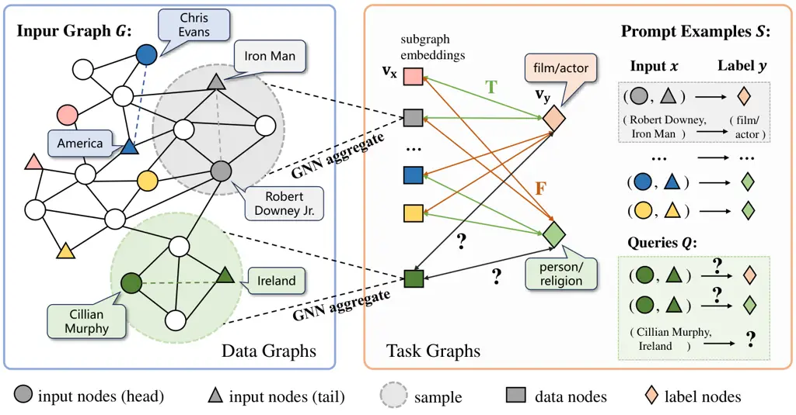

Fig. 1: Graph In-Context Learning (edge classification as an example)
with random prompts selection. The graph prompts are sampled $`l`$-hop
subgraphs (left) and the downstream tasks are reformulated as the edge
label predictions between the query data graph and label nodes (right).

Generally, the graph in-context learning architecture can be divided
into two main parts including data/prompt graph construction and task
graph prediction (see Figure 1 as an example for edge classification).
For the given source graph $`G`$, randomly selected head/tail nodes
consist of the input prompt examples $`S`$ and Queries $`Q`$. After
constructing context subgraph embeddings for each pair of nodes by _Data
Graph_, these data nodes $`v_{x}`$ will be connected with their label
nodes $`v_{y}`$ in the _Task Graph_. The downstream tasks (e.g.,
node/graph classifications and link predictions) are unified as
predicting the edge labels connecting the label nodes and the query data
graph or comparing the prediction values of the label nodes. For
example, sample ”(Robert Downdey Jr., Iron Man) $`\rightarrow`$
film/actor” and ”(Chris Evans, America) $`\rightarrow`$ person/religion”
as prompts, the query is to get the relationship (edge label) between
”Cillian Murphy” and ”Ireland”.

However, the limitations of prompt generation and selection strategies
of existing graph in-context learning works severely restrict their
generalization ability. For instance, in the prompt generation stage,
Prodigy \[3\] uses the random walk algorithm to construct the prompt
subgraph, which does not consider to optimal subgraph structure.
However, there is task-irrelevant information mixed into nodes’
neighborhoods, making learned models suffer from sub-optimal
generalization performance \[6, 7, 8, 9, 10\]. In the prompt selection
stage, as shown in Figure 1, when selecting prompts from the candidate
set for each query, existing methods also randomly select $`k`$
examples. Such a method does not adapt to the query’s unique
characteristics, which further limits the graph in-context learning
ability. Furthermore, in the context of few-shot scenarios, due to the
limited number of labeled samples and the gap between pre-training and
testing graphs, when the number of classes in the testing graphs is much
greater than that in the training, the in-context learning ability of
the pre-trained model will also significantly decrease.

The prompt optimization strategy has been extensively studied in LLMs
and proved to be effective in improving the generalization ability of
the language models. However, there is a lack of prompt optimization
strategies on graph models. In the task of domain generalization of
graphs, the pre-trained and tested graph data structures are completely
different, and it is difficult for a graph model to be able to map both
upstream and downstream data samples into the same hidden space as LLMs.
This limits the ability of graph models to in-context learning. To
tackle the above challenges, we develop a novel multi-stage prompt
optimization method GraphPrompter, to adaptively construct the most
appropriate in-context prompt graphs for each query.

Specifically, we have designed corresponding modules to improve the
model during the generation, selection, and use stages of the prompt,
named Prompt Generator, Prompt Selector, and Prompt Augmenter. First, in
the prompt generation stage, the Prompt Generator utilizes the
pre-trained graph reconstruction layers to learn the weights of the
edges of the subgraphs obtained by sampling, reconstructing the weights
of the neighboring nodes to the target nodes, thereby filtering some
task-irrelevant nodes and edges, enhancing the quality of the generated
prompt.

The main challenge for the Prompt Selector is how to judge the suitable
examples for queries (nodes/edges) in graph models. We first design the
selection layers to learn the importance of each prompt for the category
center during pre-training. However, since the downstream graphs is
quite different with the pre-training graph, the pre-trained selection
layers limit the models generalization on these test graphs. Inspired by
retrieval augmentation works in LLMs \[11, 12, 13, 14, 15\], which using
semantic similarity of sentences as a criterion to evaluate the quality
of prompts and making pre-trained models adapt to different downstream
domain effectively, we use $`k`$-Nearest Neighbor ($`k`$NN) algorithm to
calculate the similarity of each prompt for the query and choose the
top-$`k`$ similar prompt graph. This method can be used effectively and
doesn’t need to update any parameters in inference. Finally, we combine
the selection layers output and $`k`$NN algorithm to adaptive filter the
appropriate prompts, making the prompt selection process more accurate
and efficient.

When dealing with a large number of categories in the test dataset,
using fixed candidate prompts can limit the model’s adaptive ability.
So, we aim to obtain a dynamic candidate prompts set to enhance the
generalization ability of the pre-trained model on new datasets. To
achieve that, we propose an online prompts augmentation method in Prompt
Augmenter. Specifically, we incorporate test samples with predicted
labels (pseudo-labels) into the prompt set. To control the quantity of
task graph inputs, we used a cache to store these online samples and
designed the least frequently used (LFU) replacement strategy to update
it. Despite its simplicity, this method can leverage knowledge about the
target domain by using off-the-shelf test-time data and improve
performance. Our method has been shown to effectively enhance the
in-context learning ability of graph models through empirical evidence.
On average across all setups, our approach surpasses the baseline
in-context learning accuracy by 8%.

Overall, our contributions are summarized below:

- •
  To the best of our knowledge, we are the first research to explore the
  concept of prompt optimization on graph models and propose a novel
  framework in this area that combines offline and online strategies,
  which optimizes the entire process of generating, selecting, and using
  graph prompts for better graph in-context learning capabilities.
- •
  Our experimental results demonstrate that we are able to improve
  performance by an average of 8% on all datasets compared to baseline.
- •
  We provide technical and performance insights on the use of prompt
  optimization in the graph domain, which is instructive for research
  and practice in related areas.

## II Related Work

### II-A Graph Pretraining

Most existing Graph Neural Networks (GNNs) \[16, 17, 18, 19, 20, 21\]
adopt the message-passing framework and use permutation-invariant local
aggregation schemes to update node representations. For example, Graph
Convolutional Networks (GCNs) \[18\] average features from neighboring
nodes, while Graph Attention Networks (GATs) \[17\] use an attention
mechanism to assign different weights to neighbors. GraphSAGE \[22\]
samples a fixed-size set of neighbors and aggregates their features,
allowing for faster and more scalable GNN training. \[19, 21\] focuses
on improving the inference speed of GNNs, while \[20\] introduces a
novel approach that applies reinforcement learning to denoise graph
structures. However, these models often experience a significant
performance drop in domain adaptation settings. Recent work in graph
pretraining has aimed at improving this issue by learning better
encoders that can perform specific pretraining tasks. Most of these
methods \[23, 24, 25, 26, 27\] focus on tasks such as masked feature
prediction \[23\] and paired graph classification \[24\]. To adapt these
pre-trained models to different downstream graphs, a large amount of
task-specific data is typically required to fine-tune a classification
head on top of the encoder. In contrast, Prodigy \[3\] has been
introduced as a pretraining approach that aims to equip the model with
general in-context learning capabilities. This allows the pre-trained
model to be used directly for various downstream graphs without the need
for gradient-based updates. However, the generalization ability of
Prodigy is limited by its prompt selection strategy, leaving room for
further improvement.

### II-B Graph prompt learning

Graph In-Context Learning is a kind of graph prompt learning. Inspired
by prompt learning in natural language processing (NLP), which
effectively utilizes prior knowledge for various NLP tasks, researchers
in the graph domain have recently explored graph prompt learning \[28,
29, 30, 31, 32, 3, 33, 34, 35, 36, 37, 38\]. It reformulates downstream
graph tasks into those solved during the pre-training phase using graph
prompts and bridges the gap between pre-trained models and different
graph tasks. Existing graph prompt learning approaches can be divided
into two types based on prompt design \[31\]: Prompt Token methods and
Prompt Graph methods. The former method treats the graph prompt as
additional features added to the original graph features, like
GraphPrompt \[34\] and All-in-One (ProG) \[32\]. These methods focus on
cross-task research and achieve effective adaptation to downstream tasks
through prompt fine-tuning. However, they can hardly work in challenging
cross-domain tasks, where the downstream task dataset and the
pre-training dataset differ completely. It becomes particularly evident
in scenarios with limited labeled samples.

Compared to Prompt Token methods that treat prompts as learnable
vectors, the Prompt Graph methods employ subgraphs surrounding the
target nodes as prompts, which allows for preserving the structural
information of the graph within the prompt (e.g., Prodigy \[3\] and
One-For-All (OFA) \[5\]). It also facilitates the efficient transfer of
the in-context learning paradigm from LLMs to the graph domain.
Particularly in low-resource scenarios, these approaches can achieve
impressive results without the need for fine-tuning any
parameters \[3\]. This is something that Prompt Token methods cannot
achieve \[33, 34, 32\]. However, existing methods commonly employ simple
approaches for subgraph selection and construction, such as random
sampling and prompt selection. In this paper, we propose a novel method
called GraphPrompter to enhance the construction, selection, and online
augmentation of the prompt graph, which aims to improve the overall
performance of graph models in in-context learning.

### II-C In-context Example Selection of Large Language Models.

In-context learning with large language models has recently received an
increasing amount of interest, partly due to its flexibility and sample
efficiency \[39, 11\]. Several recent works proposed methods to improve
in-context learning in many aspects: e.g., meta-training \[40, 41\] or
task formulation \[42\]. In this paradigm, the choice of in-context
(i.e., demonstration) examples has been shown crucial \[43, 13, 39, 14,
15, 44\]. Inspired by these research, we propose an adaptive method
based on graph topology (GraphPrompter) to construct appropriate prompts
for every query.

### II-D Test-time adaptation.

Test-time adaptive methods are recently proposed to utilize target
samples, which adjust model parameters based on unsupervised objectives
such as entropy minimization \[45, 46\] or update a prototype for each
class \[47\]. These methods are easily integrated with classification
algorithms and can utilize information from the target dataset by
incorporating off-the-shelf test-time data, resulting in performance
improvement. Building upon these inspiring studies, we have introduced
an online prompts augmentation approach that leverages a cache
replacement strategy to augment the prompt sets and enhance the
generalization capacity of pre-training graph models.

## III Preliminaries

Fig. 2: An overview of the GraphPrompter method. Overall the method can
be divided into three components: (a) Prompt Generator. We select
candidate prompt subgraphs $`\mathcal{S}`$ and query subgraphs
$`\mathcal{Q}`$ and filter their edges by the pre-training edge
weights(represented by varying shades). (b) In Prompt Selector stage,
after obtaining embeddings for subgraphs through GNN layers, we computed
the probability (Score) of each prompt being selected as the combination
of the $`k`$NN similarity and the importance value obtained from the
pre-trained selection layer to adaptively select the top-$`k`$ suitable
prompts. These prompts form the new prompt set $`\mathcal{\hat{S}}`$.
(c) In Prompt Augmenter, we utilize a cache $`\mathcal{C}`$ to store
online test samples and their pseudo labels, which helps enhance the
prompt set dynamically. We predict the query using adaptive prompt
selection and optionally consider prompts from the cache. All the model
parameters are learned in the pretraining phase.

| Notation                                                                  | Description                                                                       |
| ------------------------------------------------------------------------- | --------------------------------------------------------------------------------- |
| $`\mathcal{V,E,R}`$                                                       | The set of nodes, edges, and relations                                            |
| $`e=(u,r,v)\in{E}`$                                                       | An edge consists of $`u\in\mathcal{V}`$, $`r\in\mathcal{R}`$, $`v\in\mathcal{V}`$ |
| $`\mathcal{G=(V,E,R)}`$                                                   | The input graph                                                                   |
| $`\mathcal{X}`$                                                           | The input subgraph set                                                            |
| $`x_{i}=(\mathcal{V}_{i},\mathcal{E}_{i},\mathcal{R}_{i})\in\mathcal{X}`$ | An input node/edge                                                                |
| $`{G}_{i}^{D}`$                                                           | Data graph: $`l`$-hop neighborhood of input $`x_{i}`$                             |
| $`{G}^{T}`$                                                               | Task graph                                                                        |
| $`\mathcal{Y}`$                                                           | A set of classes                                                                  |
| $`\mathcal{S}`$                                                           | Prompt set                                                                        |
| $`\mathcal{C}`$                                                           | Cache                                                                             |
| $`\mathcal{Q}`$                                                           | Query set                                                                         |
| $`N`$                                                                     | The size of candidate prompt set                                                  |
| $`k`$                                                                     | The number of used prompts ($`k`$-shot)                                           |
| $`n`$                                                                     | Query number                                                                      |
| $`l`$                                                                     | The distance of neighbors, i.e., $`l`$-hop                                        |
| $`m`$                                                                     | Classes number                                                                    |
| $`p`$                                                                     | One of graph prompt in $`\mathcal{S}`$                                            |
| $`q`$                                                                     | One of query in $`\mathcal{Q}`$                                                   |

TABLE I: Frequently-used notations.

In this study, our primary emphasis is on leveraging graph in-context
learning (GICL) to tackle node and edge classification problems,
employing the proposed adaptive prompting techniques (GraphPrompter). In
this section, we first introduce the concrete definition of graph and
GICL. Then, we further describe the formulations of data graphs and task
graphs.

### III-A Task Definition

The tasks of the GICL framework are defined as follows:  
Definition 1: Graph. A graph can be defined as $`\mathcal{G=(V,E,R)}`$,
where $`\mathcal{V,E,R}`$ represents the set of nodes, edges, and
relations. An edge $`e=(u,r,v)\in\mathcal{E}`$ consist of a subject
$`u\in\mathcal{V}`$, a relation $`r\in\mathcal{R}`$, and an object
$`v\in\mathcal{V}`$.  
Definition 2: Graph In-Context Learning. Given a set of classes
$`\mathcal{Y}`$, a normal classification task is to predict the label
$`y\in\mathcal{Y}`$ of each input $`x_{i}\in{X}`$, where
$`x_{i}=(\mathcal{V}_{i},\mathcal{E}_{i},\mathcal{R}_{i})`$. For
example, for the node classification task, $`{x}_{i}`$ only consists of
the input node that we aim to make predictions on, i.e.,
$`|\mathcal{V}_{i}|=1`$, $`|\mathcal{E}_{i}|=0`$ and
$`|\mathcal{R}_{i}|=0`$; for edge classification, it consists of node
pair (head, tail), i.e., $`|\mathcal{V}_{i}|=2`$,
$`|\mathcal{E}_{i}|=1`$ and $`|\mathcal{R}_{i}|=1`$. For the GICL
framework, the classification tasks over graphs are defined with
few-shot prompting. Such as a $`k`$-shot prompt with a downstream
$`m`$-way classification, $`|\mathcal{Y}|=m`$, we use a small number of
input-label pairs $`\mathcal{S}=\{(x_{i},y_{i})\}^{m\cdot k}_{i=1}`$ as
the prompt examples, and the queries is a set of nodes
$`\mathcal{Q}=\{x_{i}\}_{i=1}^{n}`$ that we want to predict labels for.
Both the prompts $`\mathcal{S}`$ and queries $`\mathcal{Q}`$ are the
inputs given to the graph model.

### III-B Prompting graph representation

As we introduced in Section I, a $`k`$-shot prompt over graphs for a
$`m`$-way classification task is composed of data graphs and task
graphs. The two graphs are defined as follows:  
Data Graphs. We defined the data graphs are the contextualization of
each datapoint
$`x_{i}=(\mathcal{V}_{i},\mathcal{E}_{i},\mathcal{R}_{i})`$ in inputs by
sampling $`l`$-hop neighborhood of $`\mathcal{V}`$ in the source graph
$`\mathcal{G}`$, which can be represented as
$`{G}_{i}^{D}=(\mathcal{V}_{i}^{D},\mathcal{E}_{i}^{D},\mathcal{R}_{i}^{D})\sim\oplus_{i=0}^{l}\text{Neighbor}(\mathcal{V}_{i},\mathcal{G},i)`$,
where
$`\mathcal{V}_{i}\subseteq\mathcal{V}_{i}^{D}\subseteq\mathcal{V},\mathcal{E}_{i}\subseteq\mathcal{E}_{i}^{D}\subseteq\mathcal{E},\mathcal{R}_{i}\subseteq\mathcal{R}_{i}^{D}\subseteq\mathcal{R}`$,
and Neighbor is a function that returns the exact $`i`$-hop neighbors of
each node in $`\mathcal{V}_{i}`$. Then, we use reconstruction layers to
learn the edge weight
$`\mathcal{W}_{i}^{D}={w_{uv},\forall e_{uv}\in\mathcal{E}_{i}^{D}}`$,
the final data graphs is represented as
$`G{{}^{\prime}}_{i}^{D}=(\mathcal{V}_{i}^{D},\mathcal{E}_{i}^{D},\mathcal{R}_{i}^{D})`$.  
Task Graphs. After achieving contextual data graphs for each input
$`x_{i}`$, we construct task graph $`{G}^{T}`$ to capture the connection
among the inputs and the labels. For each data graph
$`{G}{{}^{\prime}}_{i}^{D}`$, we use $`G_{i}`$ to represent the
embedding after aggregating by GNNs. Overall, a task graph contains
$`m\cdot k+n`$ data nodes ($`m\cdot k`$ prompts and $`n`$ queries) and
$`m`$ label nodes, as shown in Figure 1. Specifically, task graph is a
bipartite graph composed of data nodes and label nodes. Each edge has
two attributes: one distinguishes query from prompts, the other
indicates the class. For example, each prompt node connects to all label
nodes, with edge attributes set to ”T” for the true label and ”F”
otherwise.

## IV Methodology

In this section, we present our proposed GraphPrompter, the multi-stage
adaptive graph prompt optimization strategy to enhance the in-context
learning ability over graph models. Our method can be divided into three
stages, including Prompt Generator (Section IV-A), Prompt Selector
(Section IV-B), and Prompt Augmenter (Section IV-C). In the first stage,
we random sample a set of candidate prompts, denoted as $`\mathcal{S}`$,
from the source graph $`\mathcal{G}`$. To generate subgraph embeddings
with higher equality, we employ reconstruction layers to learn new edge
weights. Then, we leverage GNN layers to obtain the embeddings of the
reconstructed subgraph. In the second stage, we aim to construct an
improved prompt set, denoted as $`\hat{S}`$. Specifically, we design the
pre-trained selection layers for learning the importance of each prompt
node, and we introduce an adaptive $`k`$-nearest neighbor approach to
retrieve the most appropriate $`k`$ prompts to enhance the
generalization ability in unseen downstream graphs. In the last stage,
we proposed an online strategy to further dynamically enhance the prompt
set in the task graph. Specifically, we make use of a cache, represented
as $`\mathcal{C}`$, to store online test samples along with their pseudo
labels and use the least frequently used (LFU) replacement algorithm to
update it. This multi-stage graph prompt optimization strategy allows us
to effectively utilize relevant prompts and leverage the cache to
augment the prompt set, resulting in more accurate and contextually
appropriate predictions. Figure 2 illustrates the overall process of our
proposed method.

### IV-A Prompt Generator

#### IV-A1 Prompt graph generation.

We first randomly select $`N`$ data points as the candidate prompts
nodes and $`n`$ data points as the queries. The data graphs are
contextualization by using the random walk algorithm to sample $`l`$-hop
neighborhood in source graph $`\mathcal{G}`$. The random walk algorithm
starts from the selected node, adds its neighboring nodes to the
subgraph. Then, randomly chooses a direction to move to the next node.
The neighbors of this node are added to the subgraph, with duplicates
removed. This process is repeated $`l`$ times, and the algorithm
terminates if the number of nodes in the subgraph reaches the preset
limit. For each datapoint $`x_{i}`$, the sampled subgraph
$`{G}_{i}^{D}`$ can be represented as:

```math
{G}_{i}^{D}=(\mathcal{V}_{i}^{D},\mathcal{E}_{i}^{D},\mathcal{R}_{i}^{D})\sim\oplus_{i=0}^{l}\text{Neighbor}(\mathcal{V}_{i},\mathcal{G},i). \tag{1}
```

#### IV-A2 Prompt graph reconstruction.

Instead of directly using the sampled $`l`$-hop subgraphs, like previous
works (e.g., Prodigy \[3\] and OFA \[5\]), we reconstruct the weights of
the edges in each subgraph to adaptively extract the most useful
topological information and filter the noise. The edge weights are
assigned based on the node/edge embedding and we jointly train the
reweighting modules along with the graph model. Specifically, the
reconstruction method can be split into the following 3 steps:  
(1) Let $`\mathcal{V}_{i}(u),u\in\mathcal{V}_{i}^{D}`$ be the node $`u`$
embedding of the subgraph $`G_{i}^{D}`$,
$`\mathcal{E}_{i}(u,v),v\in\text{Neighbor}(u)`$ is the edge $`(u,v)`$
embedding,

```math
z_{uv}=\text{MLP}_{\phi}(\mathcal{V}_{i}(u),\mathcal{V}_{i}(v),\mathcal{E}_{i}(u,v)), \tag{2}
```

where MLP is a multi-layer neural network with parameters $`\phi`$.
Specifically, for the node classification task, we use the concat of
$`\mathcal{V}_{i}(u)`$ and $`\mathcal{V}_{i}(v)`$ as the input of MLP,
for the edge classification task, each edge have its specific initial
embedding, so we use the $`\mathcal{E}_{i}(u,v)`$ as the input.  
(2) $`\forall v\in\text{Neighbor}(u)`$, we use a sigmoid function to
compute the weights of the edge $`w_{uv}`$:

```math
w_{uv}=\frac{1}{1+e^{-z_{uv}}}. \tag{3}
```

(3) Finally, we achieve a single subgraph embedding $`G_{i}`$ by using a
GNN to aggregate the data graph with edge weights
$`G{{}^{\prime}}_{i}^{D}=(\mathcal{V}_{i}^{D},\mathcal{E}_{i}^{D},\mathcal{R}_{i}^{D},\mathcal{W}_{i}^{D})`$,
where
$`\mathcal{W}_{i}^{D}={w_{uv},\forall e_{uv}\in\mathcal{E}_{i}^{D}}`$:

```math
G_{i}=\text{GNN}_{D}(G{{}^{\prime}}_{i}^{D}), \tag{4}
```

where $`\text{GNN}_{D}`$ denote a message passing GNN module.  
$`G_{i}`$ used in the subgraph embeddings in the subsequent module, and
the parameters in $`\text{GNN}_{D}`$ are trained by the total
optimization object.

### IV-B Prompt Selector

#### IV-B1 Pre-training selection layers.

In the generation paradigm of in-context learning, the quality of
prompts has a significant impact on the final prediction results. This
has been validated in related research on large language models \[43,
14, 15\]. This intuition also holds in the network structure of Prodigy,
because the label embeddings in the task graph are aggregated from
prompts, and the final prediction of the query is determined by
computing the similarity with label embeddings. Therefore, in the graph
model, the selection of prompts also affects the performance of the
pre-trained model on downstream graphs. However, Prodigy’s approach of
randomly selecting prompts ignores the contextual information of the
query, thereby limiting the model’s performance. Instead of randomly
selecting prompts from the candidate prompt set, we decided to use
learnable layers to choose the most relevant prompt graph. Specifically,
for each candidate subgraph embedding $`G_{p}\in G_{S}`$, where
$`G_{S}`$ noted the all candidate subgraph embeddings,
$`1\leq p\leq N`$. We get their importance from the selection layers:

```math
I_{p}=\sigma(\text{MLP}_{\theta}(G_{p})), \tag{5}
```

where $`\sigma`$ is a sigmoid function and MLP is a multi-layer neural
network with parameters $`\theta`$. Then, we use the importance value to
get the weighted data node embeddings as the input of the task graph,
note as
$`G_{S_{I}}=\{G_{p}^{\prime}|G_{p}^{\prime}=G_{p}*I_{p},\forall G_{p}\in G_{S}\}`$.
However, the selection layers are not updated in the test phase,
limiting its generalization performance on unseen downstream graphs, so
we need an offline algorithm in the inference phase to improve it.

#### IV-B2 $`k`$-nearest neighbor retrieval.

In order to enhance the generalization performance of large-scale
pre-training models on test graphs, we leverage retrieval-enhanced
techniques to dynamically determine the most appropriate in-context
prompt examples for each query during the inference stage. As we
introduced in Section IV-A, we can achieve subgraph embeddings for both
prompts and queries after data graph neural network $`{GNN}_{D}`$. At
this step, we proposed to utilize the $`k`$-nearest neighbors algorithm
to compute the similarity of embeddings between the query and prompt,
using it as one of the criteria for selecting prompts. Specifically, as
illustrated in Figure 2, for each query $`q\in Q`$, we compute the
similarity between each prompt $`G_{p}\in G_{S_{I}}`$:

```math
\text{sim}(p,q)=\text{Cos}(G_{p},G_{q}), \tag{6}
```

where $`G_{p}`$ is the subgraph embedding of the $`p`$th candidate
prompts, $`G_{q}`$ is the subgraph embedding of $`q`$th query. Note that
we use cosine similarity to calculate the similarities, which can be
substituted by other distance metrics, like Euclidean distance or
Manhattan distance.

Then, we combine the pre-trained selection layers output and $`k`$NN
retrieval results to filter the most appropriate prompts. Specifically,
for each query $`q`$, the probabilities of the candidate prompts $`p`$
is:

```math
\text{score}(p,q)=\text{sim}(p,q)+I_{p}*I_{q}, \tag{7}
```

Furthermore, we take a voting mechanism to consider the overall
preferred prompts for all the queries from the set $`\mathcal{Q}`$,
where $`|\mathcal{Q}|=n`$. Specifically, each query casts votes for the
$`k`$ importance prompts to it, with the number of votes determined by
the corresponding $`\text{score}(p,q)`$ value:

```math
\text{Votes}(p)=\sum\limits_{q\in\mathcal{Q}}\mathbf{1}_{[p\in\mathcal{T}(q)]}\text{score}(p,q), \tag{8}
```

where
$`\mathcal{T}(q)=\text{top-}k\text{-prompts}\{\text{score}(p_{i},q),\forall p_{i}\in\mathcal{S}\}`$.
Finally, we select the top $`k`$ prompts with the highest number of
votes to form the set $`\mathcal{\hat{S}}`$, which along with the
embeddings of all queries, serves as the input to the next component.

### IV-C Prompt Augmenter

As mentioned in Section I, the model’s in-context learning ability
greatly depends on the quality and diversity of the graph dataset used
for pre-training. To ensure robust performance, the pre-training dataset
should be extensive and encompass a wide range of graph structures.
Nevertheless, due to limitations in available datasets and models, the
model may not encounter all possible graph structures during
pre-training. Consequently, the model’s heavy reliance on the
pre-training data results in weaker generalization when applied to new
graph datasets. For instance, Prodigy achieved over 88% accuracy on
prediction tasks with 5 labels in new datasets (such as FB15K-237 \[48\]
and NELL \[48\]) when it was pre-trained on a dataset with only 15
labeled categories for edge classification. However, when the prediction
task involved more than 15 categories i.e.,40, the accuracy dropped to
just 60%.

Inspired by research of test-time adaptation \[47, 45, 49, 50\], we
propose a novel online prompting sample augmentation based on cache
replacement strategy \[51\] to mitigate this issue. Specifically, as
shown in Figure 2, we aim to incorporate test samples with predicted
labels (pseudo-labels) $`\hat{\mathcal{Y}}`$ into the prompts set
$`\hat{\mathcal{S}}`$. To manage the quantity of task graph inputs, we
have devised a cache $`{C}`$ of size $`c`$ to store the online test
sample embeddings $`\hat{\mathcal{Q}}`$ along with their pseudo-labels
$`\hat{\mathcal{Y}}`$, where $`\hat{\mathcal{Q}}`$ consists of the query
sample in $`\mathcal{Q}`$ which have the most confidence probability in
its predicted labels, we can achieve $`|\hat{{Q}}|\leq m`$ ($`m`$ is the
number of labels). Thus, the set of prompts used online prompts
augmentation can be represented by:

```math
\hat{\mathcal{S}^{\prime}}=\hat{\mathcal{S}}\cup\mathcal{C}, \tag{9}
```

where $`|\hat{\mathcal{S}^{\prime}}|=k+c`$, and the details of cache
size setting will be discussed in Sec V-D.

In addition, by leveraging the spatial locality of graph data sampling,
we employ the LFU (Least Frequently Used) replacement algorithm \[51\]
to dynamically update these online samples. Specifically, we calculate
the similarity between $`q_{j}\in\mathcal{Q}`$ and the embeddings of
prompts in the cache $`q_{c}\in{C}`$, and entries with the top-$`k`$
highest similarity scores are considered hits. We use this information
to update the usage frequency of entries in the cache. Although
straightforward in its approach, the online prompts augmentation
technique possesses the capacity to harness valuable knowledge about the
target domain by incorporating readily available test-time data, leading
to performance enhancement. By implementing this procedure, the adapted
decision boundary steers clear of the densely populated regions within
the target domain, consequently diminishing ambiguity (or entropy) in
predictions, which is closely linked to reducing classification
errors \[45\].

Finally, we input the obtained prompt set $`S_{I}`$(in pertaining) or
$`\hat{\mathcal{S}^{\prime}}`$ (in testing) and query set
$`\mathcal{Q}`$ together into the task graph $`{G}^{T}`$ to obtain the
prediction, where $`{G}^{T}`$ enabling the fusion of prompts associated
with each class, thereby yielding the corresponding label embedding:

```math
\mathbf{H}=\text{GNN}_{T}({G}^{T}(S_{I}|\hat{\mathcal{S}^{\prime}},\mathcal{Q})), \tag{10}
```

where $`\mathbf{H}`$ is the embedding matrix for each node in the task
graph. Subsequently, a nearest neighbor algorithm is employed to discern
the class affiliation of a given query. This entails computing the
cosine similarity ($`\text{Cos}(\cdot,\cdot)`$) between the query node
embedding within the task graph and the label embeddings. Ultimately,
the label exhibiting the highest value of similarity to the query
$`\mathbf{h}_{q}`$ is selected as the prediction $`y_{q}`$:

```math
y_{q}=\underset{y\in\mathcal{Y}}{\arg\text{max}}~\text{Cos}(\mathbf{h}_{q},\mathbf{h}_{y}), \tag{11}
```

### IV-D Pretrain task

Input: Source Graph $`\mathcal{G}`$, all training steps  
Output: Pre-trained parameters

1:  Initialize all parameters;

2:  for step $`=1,2,\dots,\text{Steps}`$ do

3:   Sample the subgraphs from source graph $`\mathcal{G}`$ via Eq 1;

4:   Calculating the edge weights of subgraphs via Eq 2,3;

5:   Calculating their embeddings via GNN in Eq 4;

6:   Using selection layers to obtain the importance of prompts via
Eq 5;

7:   Construct Task graph;

8:   Joint optimization of GraphPrompter to minimize task loss via
Eq 14;

9:  end for

10:  return All parameters;

Algorithm 1 GraphPrompter: Training Stage

Following \[3\], we use two pretraining tasks, namely Neighbor Matching
and Multi-Task are leveraged in our method. The primary objective of the
Neighbor Matching task is to classify the local neighborhood to which a
given node belongs. Each local neighborhood is defined by the set of
example nodes that are associated with that particular neighbor. The
query set is defined as $`\mathcal{Q}_{NM}`$ and the loss function
employed for the Neighbor Matching task is:

```math
{L}^{NM}=\underset{q\in\mathcal{Q}_{NM}}{\mathbb{E}}\text{CrossEntropy}(P_{NM_{q}},y_{NM_{q}}), \tag{12}
```

where $`P_{NM_{q}}`$ is the probability of predicted by the prompt
graph, $`y_{NM_{q}}`$ is the corresponding label of query $`q`$.

Multi-Task focuses on constructing supervised tasks in the form of
few-shot prompts along with their corresponding labels. The objective is
to enable the model to learn from limited examples and generalize to new
instances. The query set is defined as $`Q_{MT}`$ and the loss function
utilized for the Multi-Task is as follows:

```math
\mathcal{L}^{MT}=\underset{q\in\mathcal{Q}_{MT}}{\mathbb{E}}\text{CrossEntropy}(P_{MT_{q}},y_{MT_{q}}), \tag{13}
```

where $`P_{MT_{q}}`$ is the probability of predicted by the prompt
graph, $`y_{MT_{q}}`$ is the corresponding label of query $`q`$.
Overall, the final loss function is as follows:

```math
\mathcal{L}=\mathcal{L}^{NM}+\mathcal{L}^{MT}. \tag{14}
```

Alg 1 provides the process of the training stage of GraphPrompter, and
the Alg 2 shows the inference processing.

Input: All pre-trained parameters, test Graph $`\mathcal{G}`$, cache
$`C`$, $`k`$ (number of selected prompts), $`c`$ (cache size), the
number of test samples $`n`$  
Output: Predicted labels for queries

1:  Initialize all parameters;

2:  $`\mathcal{Y}_{\text{pre}}=\emptyset`$

3:  for step $`=1,2,\dots,n`$ do

4:   Obtain subgraphs using Prompt Generator, including candidate
prompts $`\mathcal{S}`$ and queries $`\mathcal{Q}`$;

5:   Get their embeddings via pre-trained GNN in Eq 4;

6:   Compute prompt importance scores using pre-trained selection layers
via Eq 5;

7:   Calculate cosine similarity scores between candidates prompts and
queries via Eq 6;

8:   Select the top-$`k`$ prompts based on the combined similarity and
importance scores;

9:   if cache is not empty then

10:    Augment the selected prompts by retrieving additional prompts
from cache $`\mathcal{C}`$;

11:   end if

12:   Update cache $`\mathcal{C}`$ using the LFU strategy to maintain
relevant prompts;

13:   Predict the label $`y`$

14:   $`\mathcal{Y}_{\text{pre}}=y\cup\mathcal{Y}_{\text{pre}}`$

15:  end for

16:  return Predicted labels for queries $`\mathcal{Y}_{\text{pre}}`$;

Algorithm 2 GraphPrompter: Inference Stage

## V Experiments

Within this section, we perform comprehensive experiments that encompass
node classification and link classification tasks as both pre-training
and downstream evaluations. These assessments are carried out on 4
large-scale benchmark datasets with up to 240 million nodes to evaluate
the effectiveness of the proposed methods.

### V-A Experimental Setup

#### V-A1 Datasets

In our study, we adopt two datasets for pre-training, following the
approach outlined in Prodigy \[3\]. The first dataset is MAG240M \[52\],
which consists of a vast citation network, including over 200 million
vertices and more than 100 million edges, making it the largest dataset
used in related works \[19, 20, 21\]. For such large-scale graph data,
we use a batch sampling method to randomly select target nodes and then
construct subgraphs using random walks based on the adjacency matrix.
The second dataset is Wiki \[48\], a knowledge graph derived from
Wikipedia. Then, we assess the model’s in-context learning capabilities
using four benchmark graph datasets: arXiv \[53\], ConcepNet \[54\],
FB15K-237 \[48\], and NELL \[48\]. Detailed statistics are presented in
Table II where the last column refers to the number of node or edge
classes. We utilize subsets from the knowledge graph datasets, as
previously employed in \[48\].

In the case of arXiv, the downstream task entails an $`m`$-way node
classification, predicting the category of the given paper. Conversely,
for knowledge graph datasets such as ConceptNet, FB15K-237, and NELL,
the downstream task involves an $`m`$-way relation type classification,
projecting the relationship between the two input nodes.

| Dataset   | Nodes       | Edges         | Classes |
| --------- | ----------- | ------------- | ------- |
| MAG240M   | 244,160,499 | 1,728,364,232 | 153     |
| Wiki      | 4,838,244   | 5,859,240     | 639     |
| arXiv     | 169,343     | 1,166,243     | 40      |
| ConcepNet | 791k        | 2.5M          | 14      |
| FB15K-237 | 14,541      | 310,116       | 200     |
| NELL      | 68,545      | 181,109       | 291     |

TABLE II: Statistics of datasets.

| Classes | NoPretrain        | Contrastive       | Finetune          | Prodigy           | ProG              | OFA               | GraphPrompter      |
| ------- | ----------------- | ----------------- | ----------------- | ----------------- | ----------------- | ----------------- | ------------------ |
| 3       | 33.16 $`\pm`$0.30 | 65.08 $`\pm`$0.34 | 65.42 $`\pm`$5.53 | 73.09 $`\pm`$0.36 | 50.0 $`\pm`$0.0   | 72.24 $`\pm`$3.81 | 78.57 $`\pm`$15.21 |
| 5       | 18.33 $`\pm`$0.21 | 51.63 $`\pm`$0.29 | 53.49 $`\pm`$4.61 | 61.52 $`\pm`$0.28 | 58.33 $`\pm`$8.33 | 59.78$`\pm`$2.51  | 68.85 $`\pm`$13.05 |
| 10      | 9.19 $`\pm`$0.11  | 36.78 $`\pm`$0.19 | 30.22 $`\pm`$3.77 | 46.74 $`\pm`$0.20 | 53.33 $`\pm`$6.67 | \-                | 54.53 $`\pm`$10.12 |
| 20      | 4.72 $`\pm`$0.06  | 25.18 $`\pm`$0.11 | 17.68 $`\pm`$1.15 | 34.41 $`\pm`$0.12 | 35.0 $`\pm`$22.91 | \-                | 40.74 $`\pm`$6.68  |
| 40      | 2.62 $`\pm`$0.02  | 17.02 $`\pm`$0.07 | 8.04 $`\pm`$3.00  | 25.13 $`\pm`$0.07 | 47.50 $`\pm`$6.67 | \-                | 29.47 $`\pm`$3.82  |

TABLE III: The in-context learning accuracy (%) for arXiv paper category
classification is evaluated on 500 sampled test data using 3-shot
prompts. Bold indicates the best approach. GraphPrompter was pre-trained
on MAG240M and is then applied in-context to arXiv, which has a
completely different structure and a different set of paper categories.

| Classes | NoPretrain        | Contrastive       | Finetune           | Prodigy           | ProG               | OFA               | GraphPrompter     |
| ------- | ----------------- | ----------------- | ------------------ | ----------------- | ------------------ | ----------------- | ----------------- |
| 4       | 30.40 $`\pm`$0.63 | 44.01 $`\pm`$0.61 | 53.85 $`\pm`$9.29  | 53.97 $`\pm`$0.63 | \-                 | \-                | 58.46 $`\pm`$15.2 |
| 5       | 33.54 $`\pm`$0.61 | 81.35 $`\pm`$0.58 | 82.01 $`\pm`$12.83 | 88.02 $`\pm`$0.48 | 41.67 $`\pm`$8.33  | \-                | 99.65 $`\pm`$1.31 |
| 10      | 20.00 $`\pm`$0.35 | 70.88 $`\pm`$0.48 | 71.97 $`\pm`$6.16  | 81.10 $`\pm`$0.39 | 43.33 $`\pm`$13.33 | 89.68 $`\pm`$1.38 | 89.52 $`\pm`$4.07 |
| 20      | 9.20 $`\pm`$0.18  | 59.80 $`\pm`$0.35 | 64.01 $`\pm`$4.66  | 72.04 $`\pm`$0.33 | 50.00 $`\pm`$12.90 | 81.33 $`\pm`$2.54 | 83.78 $`\pm`$3.51 |
| 40      | 2.5 $`\pm`$0.08   | 49.39 $`\pm`$0.23 | 57.27 $`\pm`$3.33  | 59.58 $`\pm`$0.22 | 34.17 $`\pm`$20.05 | \-                | 66.94 $`\pm`$3.12 |
| 5       | 33.44 $`\pm`$0.57 | 84.08 $`\pm`$0.54 | 87.22 $`\pm`$12.75 | 87.02 $`\pm`$0.44 | 75.00 $`\pm`$25.00 | \-                | 93.34 $`\pm`$5.37 |
| 10      | 18.82 $`\pm`$0.31 | 76.54 $`\pm`$0.45 | 71.90 $`\pm`$5.90  | 81.06 $`\pm`$0.41 | 44.00 $`\pm`$12.00 | \-                | 87.47 $`\pm`$4.83 |
| 20      | 7.42 $`\pm`$0.16  | 66.56 $`\pm`$0.35 | 66.19 $`\pm`$8.46  | 72.66 $`\pm`$0.32 | 47.67 $`\pm`$31.69 | \-                | 81.46 $`\pm`$4.09 |
| 40      | 3.04 $`\pm`$0.07  | 57.44 $`\pm`$0.24 | 55.06 $`\pm`$4.19  | 60.02 $`\pm`$0.22 | 47.16 $`\pm`$22.37 | \-                | 75.74 $`\pm`$2.86 |

TABLE IV: On 500 sampled test data, the in-context learning accuracy (%)
evaluations are conducted on ConceptNet, FB15K-237, and NELL datasets
(ordered from top to bottom) using 3-shot prompts. Bold indicates the
best approach. GraphPrompter was pre-trained on Wiki, which has
completely different node and relation types from graphs it is then
applied on in-context.

#### V-A2 Evaluation

We evaluate the in-context learning performance on various downstream
datasets within the same domain as the pre-training dataset. For
instance, we pre-train on Wiki and evaluate on ConceptNet, FB15K-237,
and NELL. Each downstream classification dataset is accompanied by its
original train, validation, and test partitions.

To simulate the scenarios where labeled data is limited in the
downstream task, we select $`N`$ ($`=10`$) nodes or edges from the
training partition per category as candidate prompt examples with known
labels. Subsequently, we construct a $`k`$-shot $`l`$ ($`=1`$) prompt
for test nodes or edges from the test partition, by selecting $`k`$
($`=3`$) examples per category from these available instances. Unlike
Prodigy, which chooses both candidate prompt examples and prompts
randomly, we employ our proposed multi-stage adaptive approach for their
selection. All our pre-training and testing settings are consistent with
Prodigy. Therefore, we extract some results from Prodigy for comparison.

|               | FB15K-237          |                    |                    |                    |
| ------------- | ------------------ | ------------------ | ------------------ | ------------------ |
| Classes       | 50                 | 60                 | 80                 | 100                |
| Prodigy       | 55.34 $`\pm`$4.01  | 49.54 $`\pm`$3.81  | 37.06 $`\pm`$2.95  | 27.39$`\pm`$2.34   |
| ProG          | 34.66 $`\pm`$21.40 | 48.33 $`\pm`$21.23 | 30.65 $`\pm`$24.9  | 25.23 $`\pm`$18.42 |
| GraphPrompter | 62.735 $`\pm`$2.98 | 53.95 $`\pm`$2.83  | 42.96 $`\pm`$2.62  | 28.03$`\pm`$2.17   |
|               | NELL               |                    |                    |                    |
| Classes       | 50                 | 60                 | 80                 | 100                |
| Prodigy       | 56.72 $`\pm`$4.08  | 50.25 $`\pm`$3.86  | 40.64 $`\pm`$4.94  | 28.47 $`\pm`$3.64  |
| ProG          | 22.0 $`\pm`$20.39  | 22.78 $`\pm`$24.14 | 26.54 $`\pm`$19.26 | 24.13 $`\pm`$20.05 |
| GraphPrompter | 66.36 $`\pm`$2.91  | 61.16 $`\pm`$2.78  | 53.73 $`\pm`$5.13  | 35.95 $`\pm`$4.42  |

TABLE V: The in-context learning accuracy (%) on FB15K-237 and NELL
datasets with 3-shots, which consit of 50,60,80 and 100 classes
respectively. Bold indicates the best approach.

|               | arXiv              |                    |                    |                    |
| ------------- | ------------------ | ------------------ | ------------------ | ------------------ |
| Classes       | 3                  | 5                  | 10                 | 20                 |
| OFA           | 46.16 $`\pm`$14.84 | 32.73 $`\pm`$15.15 | 19.8 $`\pm`$11.69  | 12.03 $`\pm`$8.32  |
| GraphPrompter | 78.57 $`\pm`$15.21 | 68.85 $`\pm`$13.05 | 54.53 $`\pm`$10.12 | 40.74 $`\pm`$6.68  |
|               | FB15K-237          |                    |                    |                    |
| Classes       | 5                  | 10                 | 20                 | 40                 |
| OFA           | 75.43 $`\pm`$27.38 | 65.67 $`\pm`$33.11 | 55.56 $`\pm`$35.42 | 45.17 $`\pm`$33.17 |
| GraphPrompter | 99.65 $`\pm`$1.31  | 89.52 $`\pm`$4.07  | 83.78 $`\pm`$3.51  | 66.94 $`\pm`$3.12  |

TABLE VI: The in-context learning accuracy (%) on arXiv and FB15K-237
datasets with 3-shots.

#### V-A3 Baselines

We consider four baseline models for comparative analysis:

- •
  NoPretrain: This baseline employs a model with the same architecture
  as the pre-trained models, but with randomly initialized weights.
- •
  Contrastive \[24\]: Utilizing a standard contrastive learning approach
  with self-supervised augmentation, this baseline adapts to the
  in-context learning setting by implementing a hard-coded nearest
  neighbor algorithm. More specifically, we classify the query by
  comparing its pre-trained embedding against the average embedding of
  the example inputs for each class.
- •
  Finetune \[23\]: This baseline extends upon the graph encoder
  pre-trained with contrastive learning by training an additional linear
  classification head, following common practice.
- •
  Prodigy \[3\]: This baseline randomly selects both candidate prompt
  examples and prompts, without employing any augmentation strategy
  during the testing stage.
- •
  All-in-One (ProG) \[32\]: The baseline introduces an additional
  learnable subgraph as a prompt, which uses meta-learning to tune the
  prompt in testing.
- •
  One-For-All (OFA) \[5\]: This baseline describes nodes and edges with
  natural language uses LLMs to encode the diverse and possibly
  cross-domain text attributes, and uses text feature nodes to construct
  prompt graph. Following our few shots and cross-domain tasks, we use
  the OFA low resource version (OFA-joint-lr), which is in the
  cross-domain settings. As the OFA’s prediction results are unstable
  due to dataset partitioning in the few-shot scenario¹¹ 1
  [https://github.com/LechengKong/OneForAll/issues/11](https://github.com/LechengKong/OneForAll/issues/11),
  we extract the results from OFA claimed for comparison, and we present
  our test results in VI.

#### V-A4 Models configurations

We follow the Prodigy\[3\] settings to pre-trained the graph models.

- •
  Training, MAG240M: The pretraining task we used consisted of 30 ways,
  3 shots, and 4 queries per task. This specific task configuration was
  carefully selected to strike a balance between complexity and
  diversity in the training data, without overwhelming the GPU memory.
  We checkpoint the model every 500 steps.
- •
  Training, Wiki: Our pretraining setup included a model with an input
  dimension of 768 and an embedding dimension of 256, the AdamW
  optimizer with a learning rate of $`1\times 10^{-3}`$ and weight decay
  of $`1\times 10^{-3}`$, the pretraining task settings are similar with
  MAG240M.
- •
  GNN architecture: We use GraphSAGE\[22\] to generate the embeddings
  for data graph prompts in Eq 4, which has been proven to have good
  scalability on large-scale graphs. For the Task Graph, we use the
  attention-based graph model following Prodigy \[3\].

### V-B Main Results

Following the Prodigy approach, we commence our evaluation by assessing
the in-context learning efficacy in node classification and link
prediction tasks, considering different numbers of ways (referring to
the number of classes to be classified among). In the edge
classification task, we employed the online prompts augmentation
strategy to enhance the generalization capability of the pre-trained
model on the test dataset.

#### V-B1 Enhanced In-Context Learning Performance

As illustrated in Table III and Table IV, the best score is Bolded, our
approach consistently surpasses all other baselines in this particular
scenario, showcasing stronger in-context learning performance. On the
arXiv dataset, it achieves the highest average accuracy across most
ways, improving by 48% on average and up to 54.43% over the
best-performing Prodigy baseline. On KG datasets, GraphPrompter raises
Prodigy’s score from 68.4% to 81.82%. Furthermore, our method excels in
comparison to Finetune, which necessitates additional training on
downstream tasks. On the arXiv dataset, we observe an average
improvement of 19.6% across all ways. Similarly, on KG datasets, we
achieve over 15% improvements across all ways, surpassing the
performance of all classes, even in settings where Prodigy does not
perform well (e.g., NELL-20-way). This can be attributed to Prodigy’s
incorporation of a diverse range of pretraining tasks, enabling the
model to avoid overfitting on specific tasks and acquire contextual
knowledge. We also compare with Contrastive \[24\], which adapts a
standard contrastive learning method using a hard-coded nearest-neighbor
classifier. Our method outperforms it by over 14% on KGs, indicating
that while simple nearest-neighbor approaches are not optimal for
in-context learning, they still retain some effectiveness.

In fact, we can prove that, hard-code nearest neighbor may not perform
well to learning in-context information, but it is not just useless, it
can be adaptively integrated into Graph models and enhance the graph
in-context learning ability. In the same few-shot scenario, the
performance of the ProG \[32\] in cross-domain tasks is average 48.24%.
This can be understood as the learnable prompt-based methods requiring
more samples for fine-tuning the prompt tokens. Although ProG shows a
brief improvement on 10 to 20 classes, but performance drops as the
number of classes increases (see Table V). We attribute this to ProG’s
fine-tuning, which slightly improves with larger data volumes. However,
its performance still lags behind ours and demonstrates instability in
predictions. For OFA \[5\], which has a similar prompt structure to
Prodigy, we also achieved better performance on the arXiv and FB15K-237
datasets. This suggests that the prompt optimization strategy we
proposed has great application potential in methods related to prompt
graphs. Table VI presents the comparison of experimental results between
our GraphPrompter and OFA \[5\] under the same settings. For OFA, we use
the same random category selection method as our experiment and employ
the OFA-joint-lr approach (which trains and evaluates a single model
using all datasets simultaneously) to align with our cross-domain task.
The experimental results show that our method performs more stably and
better when randomly selecting categories. Furthermore, we analyze the
inference time, shown in the Table VIII. The experimental results
indicate that our method can achieve favorable outcomes without
introducing a significant burden.

Fig. 3: Ablation study on FB15K-237 and NELL with 3-shots wrt. the
number of ways from 5 to 40.

Fig. 4: The comparison of different GNN architectures on FB15K-237 and
NELL datasets.

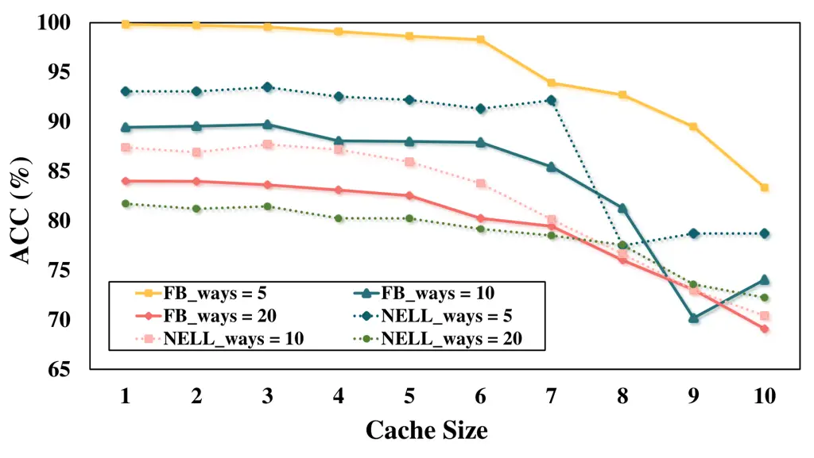

Fig. 5: Analysis of cache size from 1 to 10. FB noted FB15K-237 dataset
and NELL means NELL dataset.

| random-seed | 10    | 30    | 50    | 70    | 90    | Avg. $`\pm`$ std.  |
| ----------- | ----- | ----- | ----- | ----- | ----- | ------------------ |
| FB15K-237   | 79.98 | 82.05 | 82.01 | 78.93 | 80.34 | 80.66 $`\pm`$ 1.21 |
| NELL        | 80.95 | 80.47 | 76.68 | 78.67 | 79.89 | 79.33 $`\pm`$ 1.53 |

TABLE VII: Random select sample as a pseudo-label using different random
seeds on FB15K-237-20ways and NELL-20ways dataset.

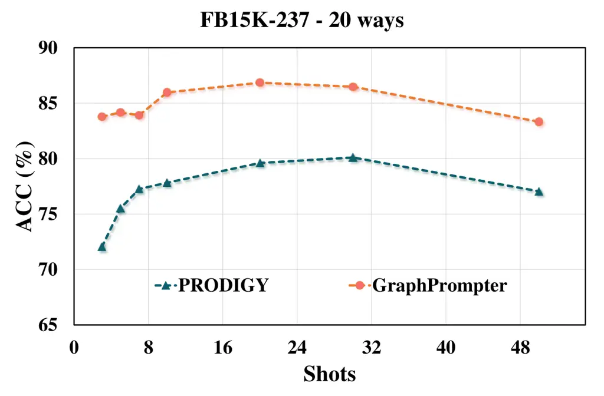

(a)

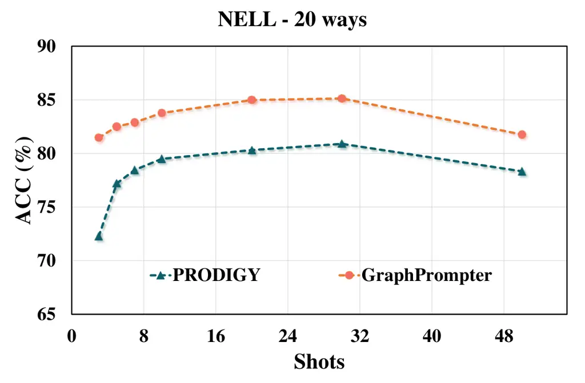

(b)

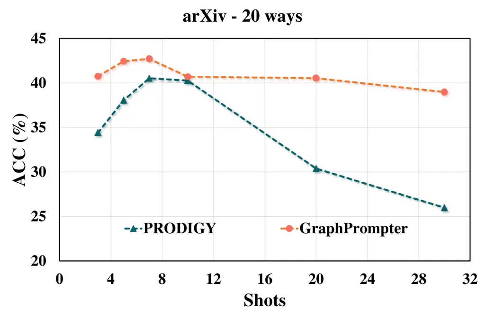

(c)

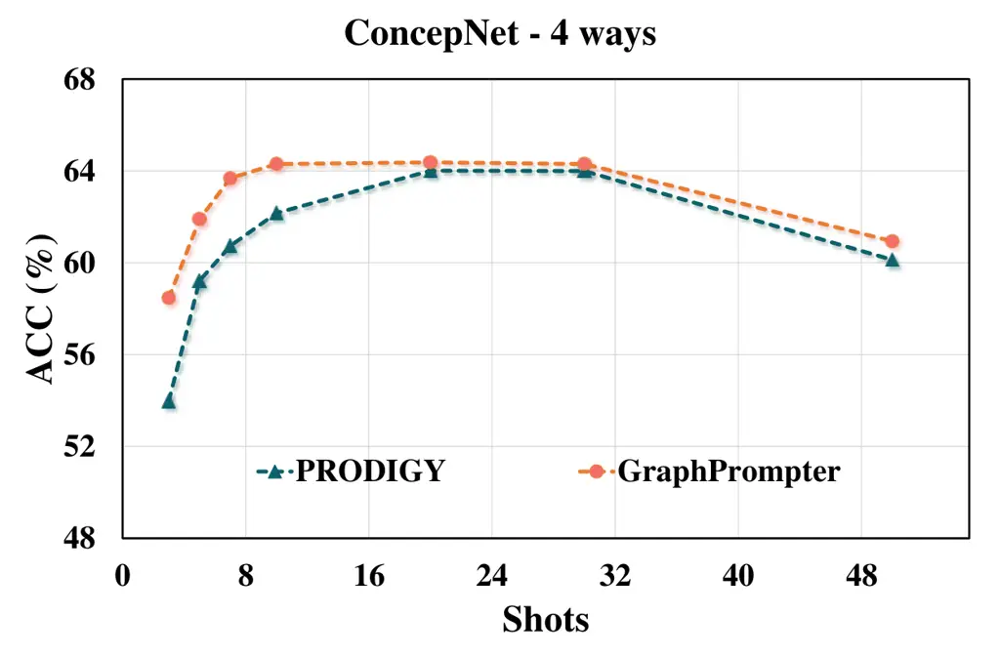

(d)

Fig. 6: In-context learning accuracy on FB15K-237, NELL, arXiv, and
ConcepNet datasets wrt. the number of prompt examples(shots),
respectively.

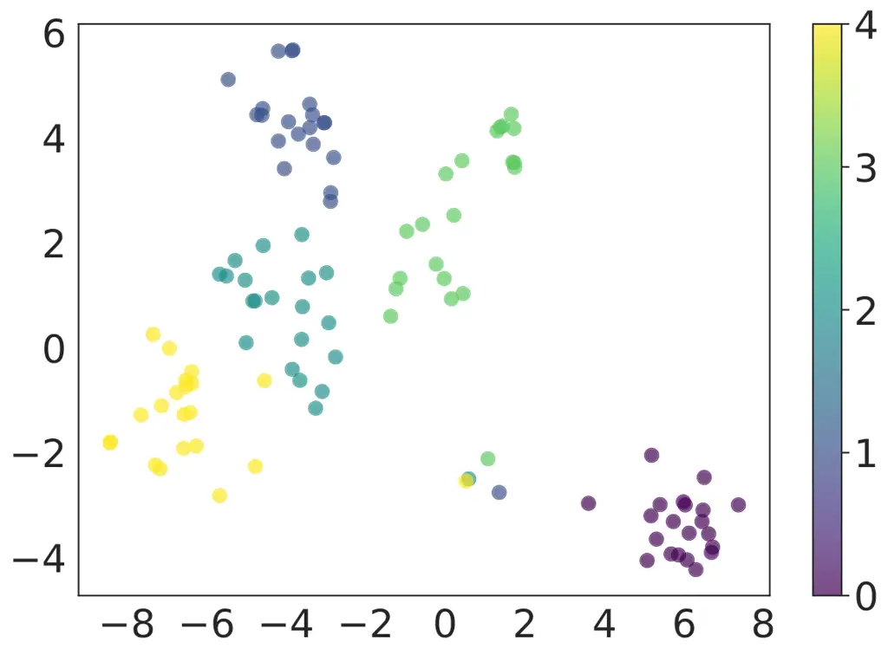

(a) Prodigy - 20 shots on NELL

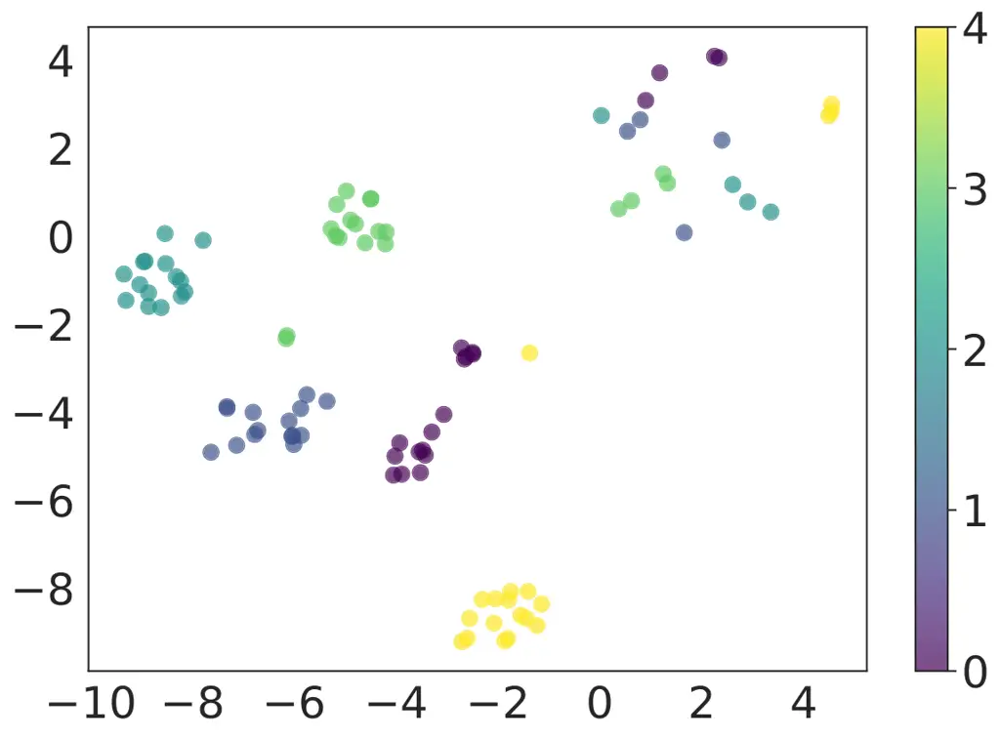

(b) GraphPrompter - 20 shots on NELL

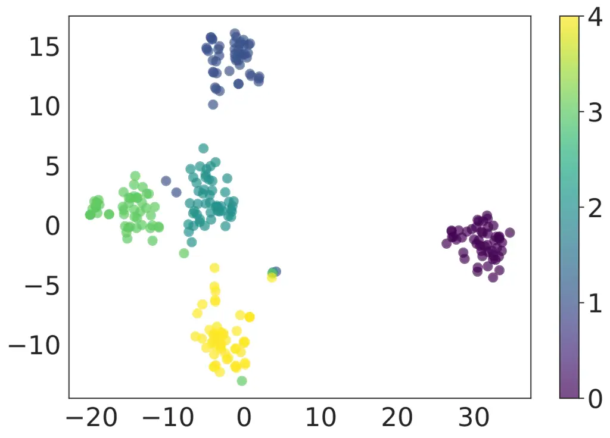

(c) Prodigy - 50 shots on NELL

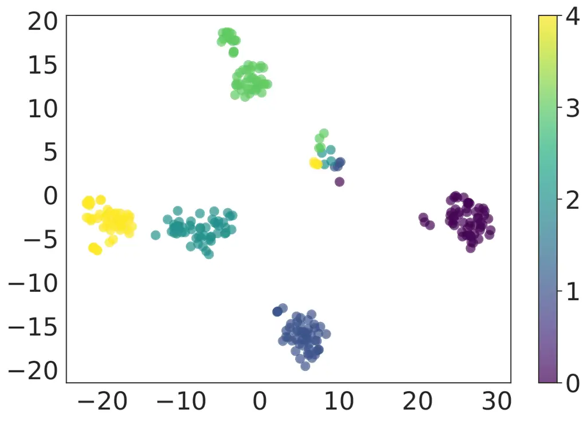

(d) GraphPrompter - 50 shots on NELL

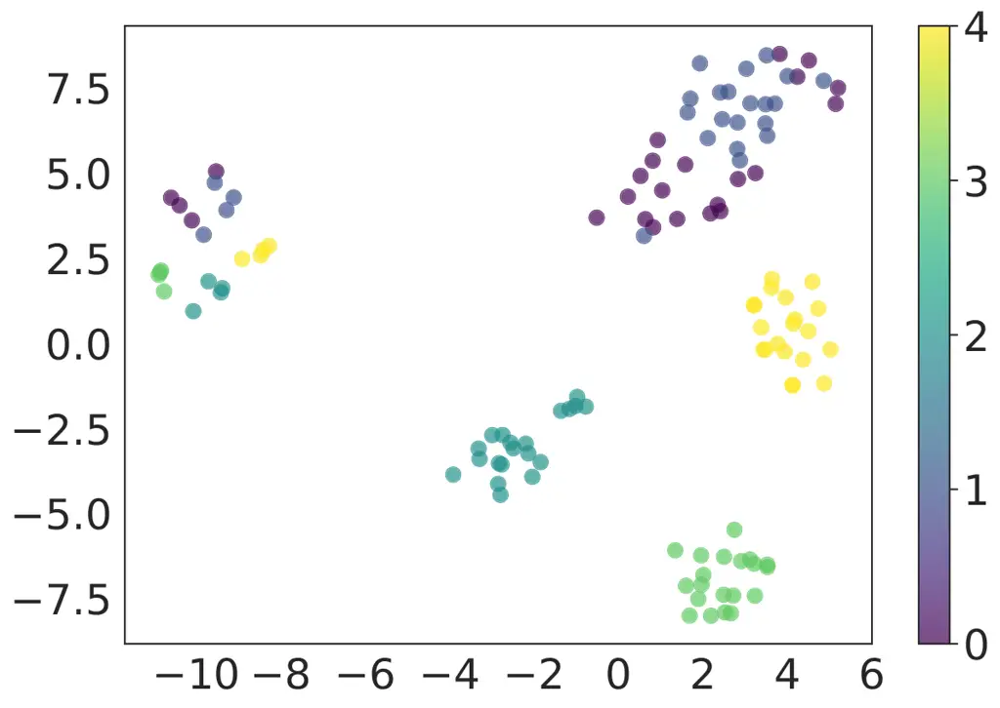

(e) Prodigy - 20 shots on FB

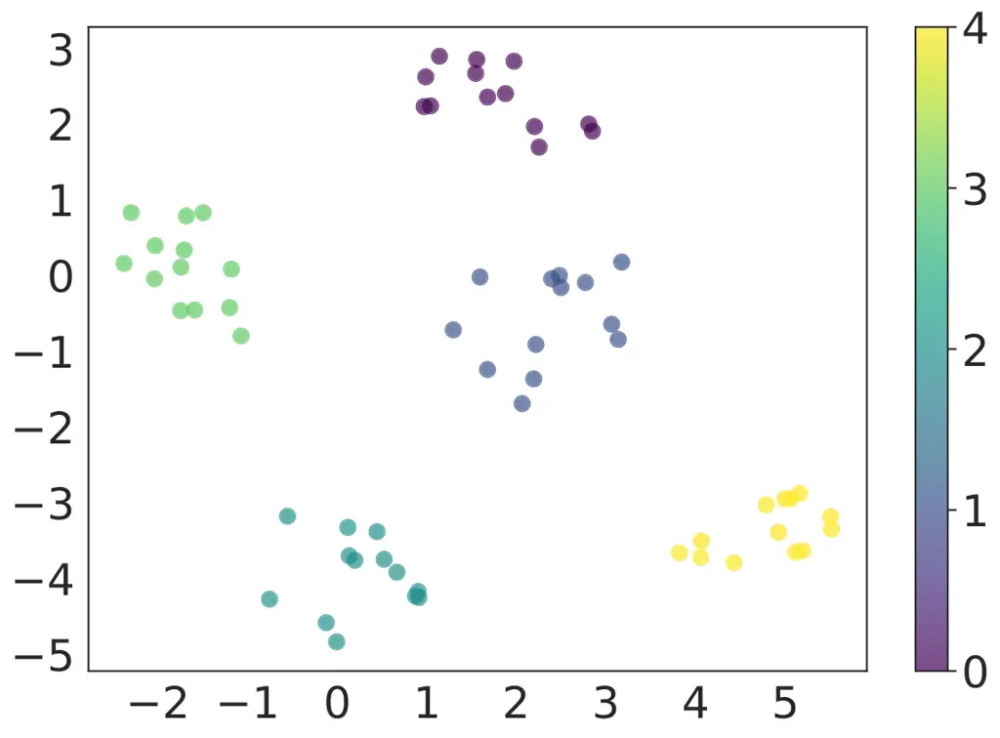

(f) GraphPrompter - 20 shots on FB

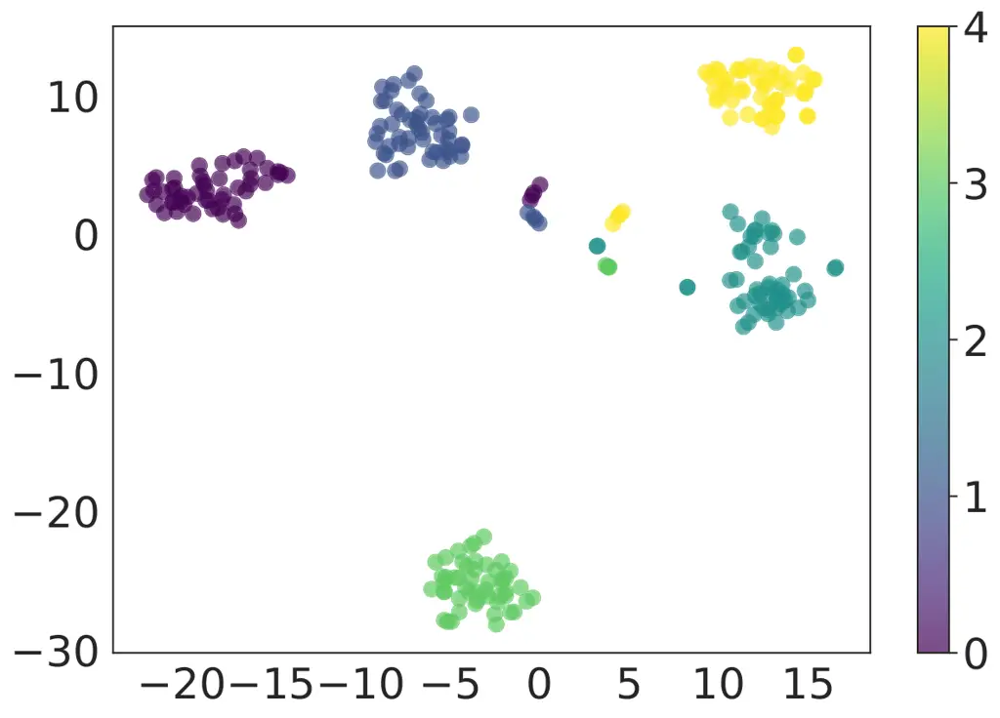

(g) Prodigy - 50 shots on FB

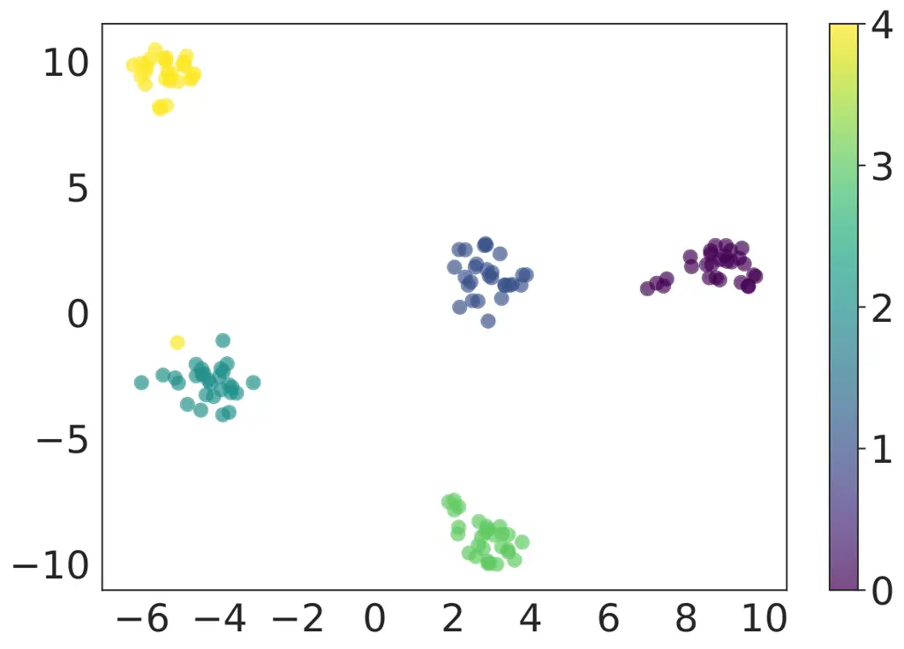

(h) GraphPrompter - 50 shots on FB

Fig. 7: Distribution of data node embeddings, including prompts and
query, with different numbers of shots by using Prodigy and our
GraphPrompter, on NELL and FB15K-237 (notes ”FB”) datasets with 5 ways
setting. The data node embeddings denote the subgraph embeddings of
sampled subgraphs, which are the output of ”Data graphs” in Figure 1 and
the input of ”Task graphs”. The different colors noted different labels
about each data node.

#### V-B2 Enhanced Generalization Ability in Multi-Class Tasks

In Sections I and IV-C, we discussed how the in-context learning
capability of the model is influenced by both the quality and diversity
of the graph dataset used during pretraining. Due to limitations in the
availability of comprehensive datasets and the inherent constraints of
the models, it is likely that the model has not been exposed to the full
range of possible graph structures during pretraining. This limitation
can result in challenges when predicting labels for test datasets that
involve a large number of diverse classes. To assess the robustness of
both the Prompt Token and Prompt Graph methods, we evaluate three
models—ProG \[32\], Prodigy \[3\], and our proposed method—across a
broader spectrum of class categories. The results, presented in Table V,
focus on the FB15K-237 and NELL datasets, which contain 50, 60, 80 and
100 classes, respectively. As the number of categories increases, we
observe a noticeable decline in the model’s predictive performance,
indicating insufficient generalization by the graph pretraining model
when handling multiple classes. However, when applying our multistage
prompt optimization method, the model’s learning ability in context
improves approximately 8%, underscoring the simplicity and effectiveness
of our approach in improving the generalization capacity of the model in
complex multiclass tasks.

### V-C Ablation study

To verify the effectiveness of our methods, we conducted ablation
studies on the FB15k-237 and NELL datasets. The “w/o $`\cdot`$” note
that our method without a specific component, which is introduced in
Section IV. The results of these studies are presented in Figure 3. The
experimental findings demonstrate the efficacy of our approach in the
reconstruction of prompt graphs in the Prompt Generator stage.
Additionally, we evaluate the effects of removing $`k`$NN retrieval and
the selection layer separately. The experimental results indicate that,
as we discussed in Section I, the methods of selecting prompts using
either $`k`$NN alone or the pre-trained selection layer alone are not
perfect. When both are used simultaneously, they can have a
complementary effect. Furthermore, the Prompt Augmentor not only
improves predictive performance when there are many categories(e.g., 40
ways) in the downstream data, but it is also effective when there are
few categories(e.g., 5 ways). This demonstrates the effectiveness of the
method we proposed. Overall, by combining these methods, we achieve
state-of-the-art results. It’s worth noting that the ”w/o kNN” model
only performs 1% better than the baseline. While kNN does add some time
cost, the performance boost it brings is quite valuable. We can manage
the time impact of kNN by adjusting the candidate set size to find a
balance between speed and performance.

### V-D Hyperparameter analysis

#### V-D1 Analysis of cache size and quality

In the Prompt Augmentor stage, we tested different cache sizes, as shown
in Figure 5. The results reveal that when the cache size exceeds 3,
model performance declines to varying extents, indicating that the noise
introduced by additional pseudo-label samples outweighs their benefits.
Therefore, we chose a cache size of 3 for our experiments. Additionally,
we explored the impact of pseudo-label quality on GraphPrompter
performance. In the main experiment, we used the highest-confidence
samples as pseudo-labels in the cache. In this section, we randomly
selected pseudo-labels to test the robustness of our method. Table VII
shows the results of random pseudo-label selection, with experiments
conducted on the FB15K-237 and NELL datasets using different random
seeds and a setting of 20 ways. The results indicate a $`2\%`$
performance drop when using random pseudo-labels compared to the
highest-confidence ones, but the performance still exceeds the baseline.
This demonstrates that our pseudo-label selection method is effective
and robust to variations in the pseudo-labels.

#### V-D2 Comparison with different GNN architectures

We use the GraphSAGE\[22\] as the $`\text{GNN}_{D}`$ in Eq 4. The
reconstruction process is a kind of graph structures learning, as is
GAT\[17\], which emphasizes the importance of edges by learning their
weights. We complement our experiments using GAT as a prompt generator,
shown in Figure 4. As a result, our generator performance is better than
GAT, we suppose that the GraphSAGE can scale better in large
pre-training graphs.

#### V-D3 Evaluation using different numbers of in-context examples

To evaluate the contextual learning capability of our method, we
conducted performance analyses across varying numbers of prompt
examples. The results are presented in Figure 6, which observed that as
the number of prompts increases, both Prodigy and our proposed method
initially improve and then diminish performance. Especially for the
arXiv dataset, when the number of prompts exceeds 10, the performance of
Prodigy significantly declines. This can be understood as more prompt
graphs introducing more noise, thereby affecting the predictive
performance of the model. We consider the reason is that the
distribution of the pre-training dataset and test dataset are very
different when the number of prompts is too large, it is difficult for
the pre-trained task graph to aggregate them, and thus the
classification performance of the model deteriorates.

Nonetheless, our method consistently outperforms Prodigy, even with an
equivalent number of prompts, thus substantiating the effectiveness of
our proposed approach. In Figure 7, we display the distribution of data
node embeddings by using the t-SNE \[55\] algorithm with the different
number of prompts. We can see that with the same number of prompts,
e.g.shots=50, our GraphPrompter get tighter classification results than
the baseline Prodigy, which makes it easier to aggregate the task graphs
to get better prediction.

### V-E Multi-hop Analyis

To evaluate the performance of our method on multi-hop problems, we
conducted experiments on 1, 2, and 3-hop subgraphs, shown as Figure 8,
comparing our approach with the baseline. The results show that as the
subgraph size increases (i.e., as the logical chain becomes longer),
model performance declines. This may be due to the limitations of GNNs,
where larger graphs make it more challenging to capture relationships
between nodes. Nevertheless, our method still outperforms the baseline,
demonstrating its effectiveness on multi-hop subgraphs.

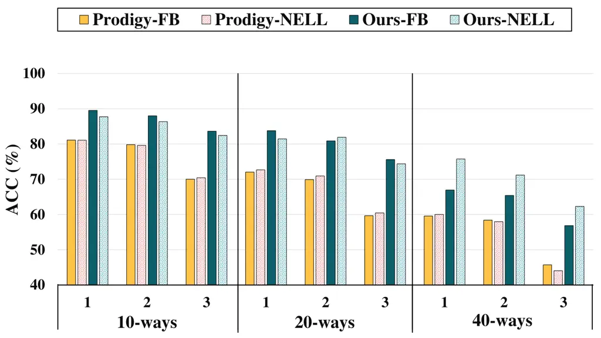

Fig. 8: Experiment with multi-hop (1/2/3-hop) subgraph on FB15k-237
(note as “FB”) and NELL dataset.

### V-F Time Efficiency Analysis

We present the training details of our model in Figure 9 and compare it
with Prodigy, including the loss convergence curve and the increase in
training accuracy. As shown in the figure, our model performs comparably
to the baseline in terms of both convergence speed and accuracy. Both
the reconstruction layers and selection layers do not incur significant
computational costs during pretraining, as we use a two-layer neural
network and the same pretraining steps as Prodigy. The additional
computational complexity introduced by the MLP is negligible compared to
the overall cost of the GNNs. All of our experiments were conducted
using a single NVIDIA A100 (40GB) GPU. A single pretraining run of 10k
steps typically takes approximately 3 hours, which is consistent with
Prodigy’s performance.

Our inference time overhead primarily stems from prompt retrieval in the
selector and augmentator in Task graphs. For $`N`$ candidates, $`k`$
prompts, $`m`$ ways, and $`d`$ dimensions:

```math
T_{\text{Prodigy}}=O((k+q)md^{2}), \tag{15}
```

```math
T_{\text{Ours}}=O((N+q)md)+O((2k+q)md^{2}). \tag{16}
```

Due to the incorporation of an additional $`c=3`$ pseudo-label prompts
via the cache mechanism, where $`\hat{S}=\hat{S}\cup C`$ and
$`|\hat{S^{\prime}}|=2*k=6`$, the inference time of the model has
increased by a factor of two to three. The retrieval module we use is
pluggable. We can balance model performance and speed based on the
specific scenario. In real-world applications, we can remove the
retrieval module or reduce the size of the candidate set to find the
optimal solution. The results, shown in Table VIII, indicate that while
GraphPrompter adds some additional time for prompt selection, it does
not introduce a significant computational burden.

|               | FB15K-237 |       |       | NELL |       |       |
| ------------- | --------- | ----- | ----- | ---- | ----- | ----- |
| Classes       | 10        | 20    | 40    | 10   | 20    | 40    |
| Prodigy       | 34ms      | 68ms  | 106ms | 26ms | 42ms  | 82ms  |
| GraphPrompter | 90ms      | 150ms | 280ms | 80ms | 120ms | 240ms |

TABLE VIII: The inference time of per query on FB15K-237 and NELL
dataset with 10, 20, and 40 classes respectively.

(a) Training Loss

(b) Training Accuracy

Fig. 9: The Comparison of Training Loss and Training Accuracy over 10k
steps on Wiki dataset.

### V-G Prompt Examples

Figure 10 shows a specific prompt example to illustrate the process of
Graph In-Context Learning. First, the input graph $`G`$ is a knowledge
graph containing multi-hop logical relationships. Our goal is to predict
the edge category of a query $`q\in Q`$, where $`Q\subset G`$,
represented in the graph as the relationship between ”Robert Downey Sr.”
and ”America.” We then randomly sample some triples from $`G`$ and
extract subgraphs, where their embeddings are denoted as $`x`$ and edge
categories as $`y`$, forming a bipartite Task Graph, as described in
Section IV. Finally, our algorithm infers the answer to the query based
on the examples provided in the prompt. It is important to note that the
main contribution of GraphPrompter lies in optimizing the prompt.
Specifically, we optimize the generation of embeddings, the selection,
and supplementation of prompts. For example, our method tends to select
”Robert Downey Jr., America” as the prompt rather than ”Robert Downey
Jr., The Avengers,” since the former is closer to the query in the
latent space.

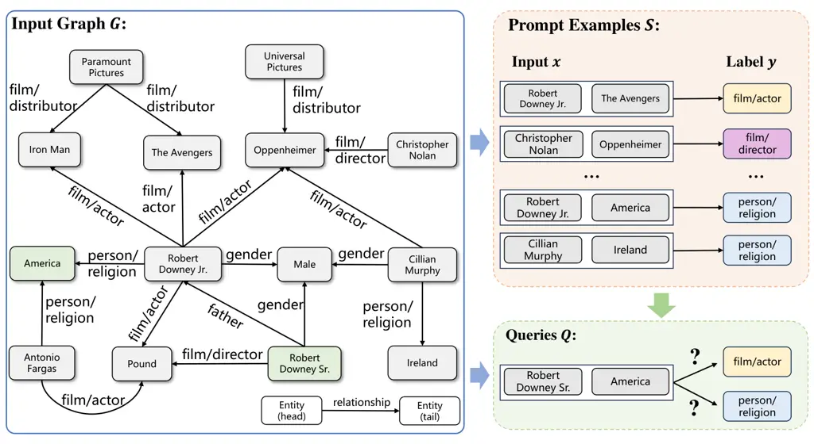

Fig. 10: A prompt example of Graph In-Context Learning.

## VI Conclusion

To tackle the limitations of prompt construction strategies of existing
graph in-context learning methods and enhance their generalization
ability, we have for the first time validated the impact of prompt
quality on the performance of the graph foundation model based on prompt
graphs, and we proposed a novel multi-stage adaptive prompt optimization
method GraphPrompter, including Prompt Generator, Prompt Selector, and
Prompt Augmentor. With Prompt Generator and Prompt Selector, we can
generate and select the most suitable prompts for each query based on
graph topology and semantic similarity, thereby significantly improving
the predictive accuracy of the model. Furthermore, we also propose
Prompt Augemntor, a non-parametric adaptive method for testing, based on
the LFU cache replacement strategy, to enhance the generalization
performance of the pre-trained graph model on new datasets. Our
GraphPrompter achieves superior generalization to downstream graphs
without gradient updates, consistently outperforming all baselines on
node classification and link prediction tasks.

Futher Discussion: We have for the first time validated the impact of
prompt quality on the performance of the graph foundation model based on
prompt graphs, and proposed improved solutions from the generation,
selection, and use stages of prompts. The framework we proposed has
excellent applicability and scalability. Specifically, the
reconstruction layer in the prompt generator can be replaced with
networks other than just MLP. In the retrieval stage, we can also use
other clustering methods to dynamically and adaptively select prompts.
Similarly, we can replace the cache in the prompt augmenter with other
caching solutions. Extensive results reflect the advantages of the
method we proposed and demonstrate the potential of graph in-context
learning.

## VII Acknowledgment

This research was supported by grants from the National Key Research and
Development Program of China (Grant No. 2024YFC3308200), the Key
Technologies R & D Program of Anhui Province (No. 202423k09020039), and
the Fundamental Research Funds for the Central Universities.

## References

- \[1\] T. Brown, B. Mann, N. Ryder, M. Subbiah, J. D. Kaplan,
  P. Dhariwal, A. Neelakantan, P. Shyam, G. Sastry, A. Askell, et al.,
  “Language models are few-shot learners,” Conference on Neural
  Information Processing Systems, 2020.
- \[2\] Q. Dong, L. Li, D. Dai, C. Zheng, Z. Wu, B. Chang, X. Sun,
  J. Xu, and Z. Sui, “A survey for in-context learning,” arXiv preprint
  arXiv:2301.00234, 2022.
- \[3\] Q. Huang, H. Ren, P. Chen, G. Kržmanc, D. Zeng, P. Liang, and
  J. Leskovec, “Prodigy: Enabling in-context learning over graphs,”
  Conference on Neural Information Processing Systems, 2023.
- \[4\] X. Sun, H. Cheng, J. Li, B. Liu, and J. Guan, “All in one:
  Multi-task prompting for graph neural networks,” in Proceedings of the
  29th ACM SIGKDD Conference on Knowledge Discovery and Data Mining, KDD
  ’23, p. 2120–2131, 2023.
- \[5\] H. Liu, J. Feng, L. Kong, N. Liang, D. Tao, Y. Chen, and
  M. Zhang, “One for all: Towards training one graph model for all
  classification tasks,” in International Conference on Learning
  Representations, 2024.
- \[6\] Z. ZHANG, Q. Liu, Q. Hu, and C.-K. Lee, “Hierarchical graph
  transformer with adaptive node sampling,” in Advances in Neural
  Information Processing Systems (S. Koyejo, S. Mohamed, A. Agarwal,
  D. Belgrave, K. Cho, and A. Oh, eds.), vol. 35, pp. 21171–21183,
  Curran Associates, Inc., 2022.
- \[7\] C. Zheng, B. Zong, W. Cheng, D. Song, J. Ni, W. Yu, H. Chen, and
  W. Wang, “Robust graph representation learning via neural
  sparsification,” in International Conference on Machine
  Learning, 2020.
- \[8\] D. Zha, Z. P. Bhat, K.-H. Lai, F. Yang, and X. Hu, “Data-centric
  ai: Perspectives and challenges,” in SDM’23, pp. 945–948, SIAM, 2023.
- \[9\] L. Dongsheng, C. Wei, Y. Wenchao, Z. Bo, N. Jingchao,
  C. Haifeng, and Z. Xiang, “Learning to drop: Robust graph neural
  network via topological denoising,” in The ACM International
  Conference on Web Search and Data Mining, 2021.
- \[10\] W. Jin, Y. Ma, X. Liu, X. Tang, S. Wang, and J. Tang, “Graph
  structure learning for robust graph neural networks,” in
  SIGKDD’20, 2020.
- \[11\] J. Liu, D. Shen, Y. Zhang, B. Dolan, L. Carin, and W. Chen,
  “What makes good in-context examples for GPT-3?,” in Proceedings of
  Deep Learning Inside Out (DeeLIO 2022): The 3rd Workshop on Knowledge
  Extraction and Integration for Deep Learning Architectures,
  pp. 100–114, Association for Computational Linguistics, May 2022.
- \[12\] Z. Zhao, E. Wallace, S. Feng, D. Klein, and S. Singh,
  “Calibrate before use: Improving few-shot performance of language
  models,” in International Conference on Machine Learning, 2021.
- \[13\] O. Rubin, J. Herzig, and J. Berant, “Learning to retrieve
  prompts for in-context learning,” in Proceedings of the 2022
  Conference of the North American Chapter of the Association for
  Computational Linguistics: Human Language Technologies, pp. 2655–2671,
  Association for Computational Linguistics, 2022.
- \[14\] H. SU, J. Kasai, C. H. Wu, W. Shi, T. Wang, J. Xin, R. Zhang,
  M. Ostendorf, L. Zettlemoyer, N. A. Smith, and T. Yu, “Selective
  annotation makes language models better few-shot learners,” in
  International Conference on Learning Representations, 2023.
- \[15\] Z. Wu, Y. Wang, J. Ye, and L. Kong, “Self-adaptive in-context
  learning: An information compression perspective for in-context
  example selection and ordering,” in ACL’22, 2022.
- \[16\] Z. ZHANG, Q. Liu, H. Wang, C. Lu, and C.-K. Lee, “Motif-based
  graph self-supervised learning for molecular property prediction,” in
  Advances in Neural Information Processing Systems (M. Ranzato,
  A. Beygelzimer, Y. Dauphin, P. Liang, and J. W. Vaughan, eds.),
  vol. 34, pp. 15870–15882, Curran Associates, Inc., 2021.
- \[17\] P. Veličković, G. Cucurull, A. Casanova, A. Romero, P. Liò, and
  Y. Bengio, “Graph attention networks,” in International Conference on
  Learning Representations, 2018.
- \[18\] T. N. Kipf and M. Welling, “Semi-supervised classification with
  graph convolutional networks,” in International Conference on Learning
  Representations, 2017.
- \[19\] H. Li, S. Di, L. Chen, and X. Zhou, “E2gcl: Efficient and
  expressive contrastive learning on graph neural networks,” in 2024
  IEEE 40th International Conference on Data Engineering (ICDE),
  pp. 859–873, 2024.
- \[20\] T. Peng, W. Wu, H. Yuan, Z. Bao, Z. Pengru, X. Yu, X. Lin,
  Y. Liang, and Y. Pu, “Graphrare: Reinforcement learning enhanced graph
  neural network with relative entropy,” in 2024 IEEE 40th International
  Conference on Data Engineering (ICDE), pp. 2489–2502, 2024.
- \[21\] Y. Zhou, S. Gong, F. Yao, H. Chen, S. Yu, P. Liu, Y. Zhang,
  G. Yu, and J. X. Yu, “Fast iterative graph computing with updated
  neighbor states,” in 2024 IEEE 40th International Conference on Data
  Engineering (ICDE), pp. 2449–2462, IEEE, 2024.
- \[22\] W. Hamilton, Z. Ying, and J. Leskovec, “Inductive
  representation learning on large graphs,” Conference on Neural
  Information Processing Systems, vol. 30, 2017.
- \[23\] W. Hu\*, B. Liu\*, J. Gomes, M. Zitnik, P. Liang, V. Pande, and
  J. Leskovec, “Strategies for pre-training graph neural networks,” in
  International Conference on Learning Representations, 2020.
- \[24\] Y. You, T. Chen, Y. Sui, T. Chen, Z. Wang, and Y. Shen, “Graph
  contrastive learning with augmentations,” Conference on Neural
  Information Processing Systems, vol. 33, pp. 5812–5823, 2020.
- \[25\] Z. Hu, Y. Dong, K. Wang, K.-W. Chang, and Y. Sun, “Gpt-gnn:
  Generative pre-training of graph neural networks,” in Proceedings of
  the 26th ACM SIGKDD International Conference on Knowledge Discovery &
  Data Mining, pp. 1857–1867, 2020.
- \[26\] J. Qiu, Q. Chen, Y. Dong, J. Zhang, H. Yang, M. Ding, K. Wang,
  and J. Tang, “Gcc: Graph contrastive coding for graph neural network
  pre-training,” in Proceedings of the 26th ACM SIGKDD international
  conference on knowledge discovery & data mining, pp. 1150–1160, 2020.
- \[27\] Q. Zhang, L. Xia, X. Cai, S.-M. Yiu, C. Huang, and C. S.
  Jensen, “Graph augmentation for recommendation,” in 2024 IEEE 40th
  International Conference on Data Engineering (ICDE),
  pp. 557–569, 2024.
- \[28\] Y. Zhu, Y. Wang, H. Shi, Z. Zhang, and S. Tang, “Graphcontrol:
  Adding conditional control to universal graph pre-trained models for
  graph domain transfer learning,” in Proceedings of the ACM Web
  Conference, 2024.
- \[29\] L. Yue, Q. Liu, Y. Liu, W. Gao, F. Yao, and W. Li, “Cooperative
  classification and rationalization for graph generalization,” in
  Proceedings of the ACM Web Conference 2024, WWW ’24, p. 344–352,
  Association for Computing Machinery, 2024.
- \[30\] T. Fang, Y. M. Zhang, Y. Yang, C. Wang, and L. CHEN, “Universal
  prompt tuning for graph neural networks,” in Conference on Neural
  Information Processing Systems, 2023.
- \[31\] X. Sun, J. Zhang, X. Wu, H. Cheng, Y. Xiong, and J. Li, “Graph
  prompt learning: A comprehensive survey and beyond,” arXiv preprint
  arXiv:2311.16534, 2023.
- \[32\] X. Sun, H. Cheng, J. Li, B. Liu, and J. Guan, “All in one:
  Multi-task prompting for graph neural networks,” in Proceedings of the
  29th ACM SIGKDD Conference on Knowledge Discovery and Data Mining, KDD
  ’23, p. 2120–2131, 2023.
- \[33\] M. Sun, K. Zhou, X. He, Y. Wang, and X. Wang, “Gppt: Graph
  pre-training and prompt tuning to generalize graph neural networks,”
  in Proceedings of the 28th ACM SIGKDD Conference on Knowledge
  Discovery and Data Mining, pp. 1717–1727, 2022.
- \[34\] Z. Liu, X. Yu, Y. Fang, and X. Zhang, “Graphprompt: Unifying
  pre-training and downstream tasks for graph neural networks,” in
  Proceedings of the ACM Web Conference 2023, p. 417–428, 2023.
- \[35\] C. Gong, X. Li, J. Yu, C. Yao, J. Tan, C. Yu, and D. Yin,
  “Prompt tuning for multi-view graph contrastive learning,” arXiv
  preprint arXiv:2310.10362, 2023.
- \[36\] Z. Tan, R. Guo, K. Ding, and H. Liu, “Virtual node tuning for
  few-shot node classification,” in Proceedings of the ACM SIGKDD
  International Conference on Knowledge Discovery & Data Mining, 2023.
- \[37\] Q. Ge, Z. Zhao, Y. Liu, A. Cheng, X. Li, S. Wang, and D. Yin,
  “Enhancing graph neural networks with structure-based prompt,” arXiv
  preprint arXiv:2310.17394, 2023.
- \[38\] Y. Ma, N. Yan, J. Li, M. Mortazavi, and N. V. Chawla, “Hetgpt:
  Harnessing the power of prompt tuning in pre-trained heterogeneous
  graph neural networks,” in Proceedings of the ACM Web
  Conference, 2024.
- \[39\] P. Liu, W. Yuan, J. Fu, Z. Jiang, H. Hayashi, and G. Neubig,
  “Pre-train, prompt, and predict: A systematic survey of prompting
  methods in natural language processing,” ACM Computing Surveys,
  vol. 55, no. 9, 2023.
- \[40\] S. Min, M. Lewis, L. Zettlemoyer, and H. Hajishirzi, “MetaICL:
  Learning to learn in context,” in Proceedings of the 2022 Conference
  of the North American Chapter of the Association for Computational
  Linguistics: Human Language Technologies, pp. 2791–2809, July 2022.
- \[41\] Y. Chen, R. Zhong, S. Zha, G. Karypis, and H. He,
  “Meta-learning via language model in-context tuning,” in Proceedings
  of the 60th Annual Meeting of the Association for Computational
  Linguistics (Volume 1: Long Papers), pp. 719–730, May 2022.
- \[42\] A. Holtzman, P. West, V. Shwartz, Y. Choi, and L. Zettlemoyer,
  “Surface form competition: Why the highest probability answer isn’t
  always right,” arXiv preprint arXiv:2104.08315, 2021.
- \[43\] T. B. Hashimoto, K. Guu, Y. Oren, and P. S. Liang, “A
  retrieve-and-edit framework for predicting structured outputs,”
  Advances in Neural Information Processing Systems, vol. 31, 2018.
- \[44\] J. Bai, H. Guo, J. Liu, J. Yang, X. Liang, Z. Yan, and Z. Li,
  “Griprank: Bridging the gap between retrieval and generation via the
  generative knowledge improved passage ranking,” in Proceedings of the
  32nd ACM International Conference on Information and Knowledge
  Management, CIKM ’23, p. 36–46, Association for Computing
  Machinery, 2023.
- \[45\] D. Wang, E. Shelhamer, S. Liu, B. Olshausen, and T. Darrell,
  “Tent: Fully test-time adaptation by entropy minimization,” in
  International Conference on Learning Representations, 2021.
- \[46\] M. M. Zhang, S. Levine, and C. Finn, “MEMO: Test time
  robustness via adaptation and augmentation,” in NeurIPS 2021 Workshop
  on Distribution Shifts: Connecting Methods and Applications, 2021.
- \[47\] Y. Iwasawa and Y. Matsuo, “Test-time classifier adjustment
  module for model-agnostic domain generalization,” in Conference on
  Neural Information Processing Systems (A. Beygelzimer, Y. Dauphin,
  P. Liang, and J. W. Vaughan, eds.), 2021.
- \[48\] W. Xiong, M. Yu, S. Chang, X. Guo, and W. Y. Wang, “One-shot
  relational learning for knowledge graphs,” in EMNLP’17, 2018.
- \[49\] A. Dubey, V. Ramanathan, A. Pentland, and D. Mahajan, “Adaptive
  methods for real-world domain generalization,” in Proceedings of the
  IEEE/CVF Conference on Computer Vision and Pattern Recognition,
  pp. 14340–14349, 2021.
- \[50\] Y.-F. Zhang, X. Wang, K. Jin, K. Yuan, Z. Zhang, L. Wang,
  R. Jin, and T. Tan, “Adanpc: Exploring non-parametric classifier for
  test-time adaptation,” in Proceedings of the 40th International
  Conference on Machine Learning, 2023.
- \[51\] D. Mátáni, K. Shah, and A. Mitra, “An O(1) algorithm for
  implementing the LFU cache eviction scheme,” CoRR, 2021.
- \[52\] W. Hu, M. Fey, H. Ren, M. Nakata, Y. Dong, and J. Leskovec,
  “Ogb-lsc: A large-scale challenge for machine learning on graphs,”
  arXiv preprint arXiv:2103.09430, 2021.
- \[53\] W. Hu, M. Fey, M. Zitnik, Y. Dong, H. Ren, B. Liu, M. Catasta,
  and J. Leskovec, “Open graph benchmark: Datasets for machine learning
  on graphs,” Conference on Neural Information Processing Systems,
  vol. 33, pp. 22118–22133, 2020.
- \[54\] R. Speer, J. Chin, and C. Havasi, “Conceptnet 5.5: An open
  multilingual graph of general knowledge,” in AAAI’17, 2017.
- \[55\] S. Arora, W. Hu, and P. K. Kothari, “An analysis of the t-sne
  algorithm for data visualization,” in Conference on learning theory,
  pp. 1455–1462, PMLR, 2018.
