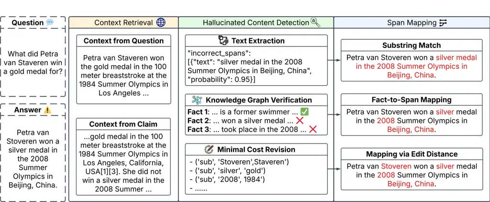

# UCSC at SemEval-2025 Task 3: Context, Models and Prompt Optimization for Automated Hallucination Detection in LLM Output

Sicong Huang    Jincheng He    Shiyuan Huang Affiliation: Karthik Raja
Anandan    Arkajyoti Chakraborty    Ian Lane Affiliation: University of
California, Santa Cruz Affiliation: {shuan213, jhe516, shuan101,
kanandan, achakr24, ialane}@ucsc.edu

###### Abstract

Hallucinations pose a significant challenge for large language models
when answering knowledge-intensive queries. As LLMs become more widely
adopted, it is crucial not only to detect if hallucinations occur but
also to pinpoint exactly where in the LLM output they occur. SemEval
2025 Task 3, Mu-SHROOM: Multilingual Shared-task on Hallucinations and
Related Observable Overgeneration Mistakes, is a recent effort in this
direction. This paper describes the UCSC system submission to the shared
Mu-SHROOM task. We introduce a framework that first retrieves relevant
context, next identifies false content from the answer, and finally maps
them back to spans in the LLM output. The process is further enhanced by
automatically optimizing prompts. Our system achieves the highest
overall performance, ranking \#1 in average position across all
languages. We release our code and experiment results.¹¹ 1
[https://github.com/nlp-ucsc/semeval-2025-task3](https://github.com/nlp-ucsc/semeval-2025-task3)

## 1 Introduction

Hallucinations in Large Language Model (LLM) outputs remain a
significant concern (Sahoo et al., 2024; Huang et al., 2025),
undermining user trust in knowledge-intensive tasks. In question
answering, hallucinations manifest when models generate false or
unverified information given world knowledge while maintaining a
coherent response structure (Mishra et al., 2024).

While previous research has developed metrics and benchmarks to detect
the presence of hallucinations (Lin et al., 2022; Min et al., 2023),
most approaches provide only binary or scalar outputs. These
measurements, though valuable, offer limited insight into the specific
locations of hallucinated content, despite precise localization being
crucial for fact-checking and model improvement.

The SemEval 2025 Task 3, Mu-SHROOM: Multilingual Shared-task on
Hallucinations and Related Observable Overgeneration Mistakes (Vázquez
et al., 2025), addresses this gap by challenging participants to
identify both the spans of hallucinated text and the associated
confidence. The task encompasses 14 languages and evaluates system
performance on Intersection-over-Union (IoU) and spearman correlation
(Corr) on LLM outputs with human-annotated ground truth labels.

The UCSC team approached this challenge using a multi-step framework
consisting of: (i) context retrieval from external knowledge sources,
(ii) detection of false or unverifiable content, and (iii) mapping error
contents back to text spans. Additionally, we explored the use of
automatic prompt optimization in step (ii) and showed this further
improved system performance. The proposed pipeline grounds LLM responses
in the retrieved context to distinguish true from fabricated content,
while prompt optimization enhances detection reliability and span
labeling accuracy.

Our systems rank highly among the submitted systems, achieving a win in
5 languages and a top two position in 11 of the 14 languages on IoU and
10 of the 14 languages on Corr. Our participation in Mu-SHROOM revealed
an important insight: when paired with "good context," a simple
prompting-based approach can reliably detect hallucinations with
better-than-human accuracy.



Figure 1: The UCSC hallucination detection framework. We retrieve
context from external sources, identify false content in the answer, and
then map these errors back to specific spans in the LLM output. In
multilingual settings, we explore retrieving context either in the
original language or in English by translating the question. In all
cases the hallucinated content generated in the second step remains in
the original language and is mapped to the answer.

## 2 Background

### 2.1 Related work

Recent efforts aiming at span-level hallucination detection for question
answering, such as HaluQuestQA (Sachdeva et al., 2024) and RAGTruth (Niu
et al., 2024) provide fine-grained annotations of hallucinated spans,
enabling the development of error informed refinement and
retrieval-augmented fact-checking systems. For summarization, Zhou
et al. (2021) proposes a token-level hallucinations prediction task and
introduce a method for learning to solve the task using models
fine-tuned on synthetic data. Marfurt and Henderson (2022) proposes to
detect hallucinations in an unsupervised fashion from the transformer’s
self-attentions. Min et al. (2023) proposes to break generations down to
atomic facts and assign a binary label to each fact, indicating its
truthfulness. However, despite these advances, recent benchmarks, e.g.
FaithBench (Bao et al., 2024) highlight persistent challenges, as even
state-of-the-art systems struggle at reliably detecting hallucinations.
The SemEval-2025 Task 3 (Mu-SHROOM) builds upon these efforts by
introducing a multilingual, span-level hallucination detection
benchmark, pushing research toward more fine-grained, cross-lingual, and
context-aware hallucination localization.

### 2.2 Task Description

The Mu-SHROOM task aims to identify hallucinated spans in LLM-generated
answers across 14 languages. Human annotators provide ground truth
labels: a span is a soft label if at least one annotator marks it as
hallucinated and a hard label if more than half do. Participants must
predict both soft and hard label spans. Hard labels are evaluated using
the character-level Intersection-of-Union metric (IoU), while soft
labels are evaluated using Spearman correlation (Corr).

## 3 System Overview

Our main system adopts a three-stage pipeline (see Figure 1), consisting
of context retrieval, hallucinated content detection, and span mapping.
On top of the three-stage pipeline, we use prompt optimization to
automatically search for an optimal prompt to perform hallucinated
content detection. In addition, we also explored a system combination
technique where we treated each system as an individual labeler and
aggregated the results together to further increase system performance.

### 3.1 Context Retrieval

Retrieval augmented generation (RAG) (Lewis et al., 2020) has been shown
effective at reducing hallucination at knowledge-intensive tasks (Jiang
et al., 2023; Gao et al., 2024). We argue it is equally crucial to
include relevant context when verifying generated text. Step one in our
pipeline is to gather information that should be helpful at either
answering the input question or at confirming or refuting claims in the
given answer.

#### Context from Questions

Here we use the question directly as the the search query which is
passed to an external search API. The returned content is used as the
context. We assume that the returned content will contain all
information required to answer the input question and thus should be
sufficient to verify another answer to the same question.

#### Context from Claims

In this approach, we construct a set of queries from the claims in the
answer. The resulting context can then be used to fact-check all claims
in the answer, not just those directly related to the question. This
approach will help verify claims in the answer that are missing from the
context obtained from querying a search API with just the question.

### 3.2 Hallucinated Content Detection

In step two, we identify content in the answer unverifiable by the
retrieved context. Here we compare three distinct implementations.

#### Direct Text Extraction

We prompt the LLM to analyze the answer text and identify specific
segments not verifiable from the retrieved context. The LLM compares
text in the answer against the context, extracting any text spans that
contain information absent from or contradicting the context.

#### Verification with Knowledge Graph

In this approach the context is parsed into a knowledge graph comprising
entities and relations, while the answer is decomposed into individual
facts. The LLM is then used to verify each fact by querying information
about entities, checking for accuracy against the knowledge graph. This
method ensures each fact is cross-verified with structured data, with
the goal to enhance the reliability of the hallucination detection
process.

#### Minimal Cost Revision

In this approach, we use a reasoning LLM to correct the provided answer
by making the fewest possible changes. This method ensures that
corrections are limited to only the necessary parts of the text, with
the differences between the original and corrected answer being deemed
hallucinated.

### 3.3 Span Mapping

After identifying the hallucinated content in the answer, we convert
these broad segments into character-level spans. This conversion uses
three specific methods, each corresponding to one of the three
hallucinated content detection techniques:

#### Substring Match

Match the exact substring to locate the hallucinated spans within the
answer. This approach is used with direct text extraction in step 2,
where specific segments of text are identified as hallucinated.

#### Fact-to-Span Mapping

We prompt an LLM to map the identified false facts back to the specific
spans of the answer text that generated those facts. This method is
applied following verification with knowledge graph in step 2, ensuring
that each false fact is accurately traced to its source text.

#### Mapping via Edit Distance

Calculate the minimum edit distance required to transform the original
answer into the corrected version. During this process, all deletions
and substitutions of words are identified, with these words being
labeled as hallucinations. This method ensures the precise
identification of unnecessary or incorrect information in the text.

### 3.4 Prompt Optimization with MiPROv2

To refine the hallucinated content detection step, we employed MiPROv2
(Opsahl-Ong et al., 2024), a systematic framework for optimizing prompts
in language model programs. MiPROv2 leverages Bayesian search to explore
candidate prompts to optimize task metrics (e.g. IoU or Corr). In each
iteration, MiPROv2 proposes updates to both the instructions and
few-shot demonstrations, evaluates them on a subset of data, and uses
those results to guide the next round of proposals. This process
systematically discovers prompts that yield strong performance,
improving the reliability of step 2.

| Model                    | Opt. | Trans. | ar   | ca   | cs   | de   | en   | es   | eu   | fa   | fi   | fr   | hi   | it   | sv   | zh   |
| ------------------------ | ---- | ------ | ---- | ---- | ---- | ---- | ---- | ---- | ---- | ---- | ---- | ---- | ---- | ---- | ---- | ---- |
|                          |      |        | IoU  |      |      |      |      |      |      |      |      |      |      |      |      |      |
| gpt-4o-mini              | ✗    | ✓      | 0.61 | 0.63 | 0.47 | 0.59 | 0.55 | 0.43 | 0.55 | 0.50 | 0.62 | 0.54 | 0.67 | 0.71 | 0.60 | 0.44 |
| gpt-4o-mini              | ✗    | ✗      | 0.59 | 0.64 | 0.48 | 0.60 | 0.56 | 0.43 | 0.57 | 0.58 | 0.60 | 0.57 | 0.68 | 0.74 | 0.63 | 0.44 |
| DeepSeek-R1              | ✗    | ✗      | 0.66 | 0.72 | 0.54 | 0.62 | 0.57 | 0.48 | 0.58 | 0.64 | 0.63 | 0.59 | 0.72 | 0.74 | 0.61 | 0.46 |
| gpt-4o                   | ✗    | ✗      | 0.60 | 0.66 | 0.50 | 0.58 | 0.55 | 0.41 | 0.55 | 0.62 | 0.62 | 0.59 | 0.69 | 0.72 | 0.64 | 0.45 |
| gpt-4o                   | ✓    | ✗      | 0.59 | 0.71 | 0.53 | 0.59 | 0.61 | 0.40 | 0.59 | 0.69 | 0.62 | 0.56 | 0.74 | 0.79 | 0.62 | 0.47 |
| Multi-System Combination |      |        | 0.65 | 0.69 | 0.53 | 0.63 | 0.58 | 0.44 | 0.59 | 0.63 | 0.65 | 0.57 | 0.71 | 0.76 | 0.65 | 0.46 |
|                          |      |        | Corr |      |      |      |      |      |      |      |      |      |      |      |      |      |
| gpt-4o-mini              | ✗    | ✓      | 0.53 | 0.71 | 0.45 | 0.57 | 0.51 | 0.53 | 0.50 | 0.54 | 0.50 | 0.47 | 0.68 | 0.70 | 0.37 | 0.29 |
| gpt-4o-mini              | ✗    | ✗      | 0.52 | 0.71 | 0.50 | 0.57 | 0.51 | 0.53 | 0.51 | 0.63 | 0.48 | 0.49 | 0.72 | 0.74 | 0.33 | 0.28 |
| DeepSeek-R1              | ✗    | ✗      | 0.63 | 0.78 | 0.58 | 0.65 | 0.59 | 0.60 | 0.55 | 0.68 | 0.57 | 0.56 | 0.76 | 0.77 | 0.50 | 0.37 |
| gpt-4o                   | ✗    | ✗      | 0.52 | 0.73 | 0.47 | 0.56 | 0.50 | 0.53 | 0.47 | 0.64 | 0.43 | 0.44 | 0.69 | 0.70 | 0.32 | 0.25 |
| gpt-4o                   | ✓    | ✗      | 0.59 | 0.76 | 0.56 | 0.62 | 0.55 | 0.47 | 0.58 | 0.70 | 0.58 | 0.52 | 0.76 | 0.79 | 0.42 | 0.40 |
| Multi-System Combination |      |        | 0.65 | 0.79 | 0.58 | 0.66 | 0.65 | 0.63 | 0.62 | 0.67 | 0.65 | 0.60 | 0.76 | 0.79 | 0.53 | 0.43 |

Table 1: Multilingual test IoU and Corr results. Opt. indicates that
prompt optimization was performed and Trans. indicates if the input was
translated into English before performing context retrieval. All
contexts are sourced from Perplexity Sonar Pro. IoU is used as the
prompt optimization metric for all languages except English, where Corr
was applied. We underline the best-performing individual system, and
bold the overall best.

### 3.5 Multilingual Systems

Our framework design was motivated by the assumption that the
pre-trained LLMs we employed might perform better in English, given the
abundance of English-language training data that is generally available.
For hallucination detection of non-English text use used exactly the
same methods as described above. We did however explore one specific
variation: we compared the use of English context vs. target-language
(i.e. non-English) context for the 13 other languages within the
Mu-SHROOM task. The English-language context is obtained by translating
the given questions or claims into English before retrieval. For the
target-language contexts we used the question or claims in the original
language to retreive the required context. In both these cases, the
unverifiable content is labeled in the original language and then mapped
back to the answer.

### 3.6 Multi-System Combination

Our focus in this work has been to generate hard labels for hallucinated
segments with the goal to maximize IoU score. We believe this approach
is best if the goal is to provide explicit feedback to users of such
systems. For example when we want to highlight which segments in an LLM
output could be incorrect or non-factual. When considering the
probability of a specific token in an LLM output being a hallucination
or not, prior methods largely rely on the language model itself to
generate a "likelihood of correctness score." Such scores are found to
always be too high, as the models are overly confident of their own
output. Additionally, the resulting scores do not align well with the
definition of soft labels in the Mu-SHROOM task, i.e., labels based on
the proportion of annotators who agree on whether certain spans are
hallucinated.

In the Mu-SHROOM challenge task, we attempted to replicate the human
labeling process by having multiple different systems output
hard-labels. We then combined these sets of hard-labels to generate the
soft-labels based on label agreement. The expectation is that like human
annotators, systems will vary in which specific tokens they label in the
LLM output. For system combination in our submission systems, we
combined the output of five different systems together. By treating each
system as an annotator, we calculate the proportion of systems that
labeled a specific span as hallucinated.

## 4 Experimental Setup

### 4.1 Models and Tools

For context retrieval, we use the sonar-pro model via the Perplexity
API²² 2 [https://sonar.perplexity.ai](https://sonar.perplexity.ai) (more
details can be found in Appendix C). For the detection of hallucinated
content, we generally use OpenAI’s GPT-4o and GPT-4o-mini (OpenAI
et al., 2024). For the task of correcting answers with minimal changes,
i.e. Minimal Cost Revision as described in section 3.2, we found that
the OpenAI o1 reasoning model (OpenAI, 2024) out-performed the GPT-4
models. For the multilingual systems, we also evaluated the performance
of DeepSeek-R1 (DeepSeek-AI et al., 2025) and when performing system
combination, we also included Llama3.3-70B (Grattafiori et al., 2024) as
one of the 5 systems that was combined.

We used LangChain³³ 3 [https://langchain.com](https://langchain.com) to
build the pipeline for our submission system and to also construct the
knowledge graphs⁴⁴ 4
[https://python.langchain.com/docs/how_to/graph_constructing/](https://python.langchain.com/docs/how_to/graph_constructing/)
used for the verification with knowledge-graph + fact-to-span mapping
approach. DSPy (Khattab et al., 2024) was used to perform prompt
optimization. When performing prompt optimization on the validation set
we perform 2-fold cross-validation to ensure reliability.

### 4.2 Annotations and Alternative Metrics

To better understand the challenges of the hallucination span-labeling
task, we manually labeled the English validation set ourselves. When we
evaluated our internal annotations against the hard and soft annotations
provided by the organizers, we found that our average IoU was 0.43, and
the average Corr was 0.40. The best annotator in the group obtained an
IoU of 0.48 and a Corr of 0.48 and the annotator with the lowest scores
obtained an IoU of 0.37 and a Corr or 0.34. We found that even our best
individual annotator performed significantly worse than all of our
LLM-based systems. For comparison our best performing system on the
validation set obtained an IoU of 0.57 and a Corr of 0.55. We
hypothesize that two factors limited our overlap with the ground truth:
(i) lack of exact reference contexts, leading to discrepancies in
verification, and (ii) potential differences in labeling guidelines.

Due to the low agreement among our internal annotators, to better guide
system development, we introduced a new metric MaxIoU, inspired by the
maximum average Jaccard index Cronin et al. (2017). MaxIoU mitigates
human labeling inconsistencies by identifying the IoU with the single
annotation that provides the highest IoU, rather than aggregating
results into soft or hard labels. The details of the metric are provided
in appendix A.

|                                       |     |      |      |     |      |
| ------------------------------------- | --- | ---- | ---- | --- | ---- |
| Lang                                  | IoU | Corr | Lang | IoU | Corr |
| ar                                    | 2   | 2    | fa   | 2   | 3    |
| ca                                    | 1   | 1    | fi   | 1   | 1    |
| cs                                    | 2   | 1    | fr   | 5   | 3    |
| de                                    | 1   | 1    | hi   | 2   | 2    |
| en                                    | 2   | 2    | it   | 1   | 2    |
| es                                    | 6   | 1    | sv   | 1   | 5    |
| eu                                    | 2   | 1    | zh   | 9   | 9    |
| Avg IoU rank: 2.6; Avg Corr rank: 2.4 |     |      |      |     |      |

Table 2: System rankings across all languages.

## 5 Results & Analyses

|         |                            |      |      |      |      |
| ------- | -------------------------- | ---- | ---- | ---- | ---- |
| Context | Method                     | Val  |      | Test |      |
|         |                            | IoU  | Corr | IoU  | Corr |
| None    | Text Extr.+ Substr. Match  | 0.41 | 0.45 | 0.44 | 0.43 |
| From Q  | Text Extr.+ Substr. Match  | 0.55 | 0.46 | 0.56 | 0.52 |
|         | KG Verif.+ Fact-to-Span    | 0.23 | 0.24 | 0.22 | 0.19 |
|         | Min-cost Revi.+ Edit Dist. | 0.52 | 0.40 | 0.53 | 0.49 |
| From C  | Text Extr.+ Substr. Match  | 0.46 | 0.48 | 0.55 | 0.53 |
|         | KG Verif.+ Fact-to-Span    | 0.22 | 0.24 | 0.20 | 0.14 |
|         | Min-cost Revi.+ Edit Dist. | 0.55 | 0.46 | 0.53 | 0.49 |

Table 3: English results of different system flows. Text extraction and
knowledge graph verification use gpt-4o-mini and minimum cost revision
uses o1.

### 5.1 Main Results

Across 43 participant groups, the UCSC systems consistently achieve
strong performance across almost all languages. Table 2 shows our
systems rank in the top two positions in 11 of the 14 languages on IoU
and 10 of the 14 languages on Corr. Furthermore, we rank the highest in
average position across all 14 languages. As our system development was
focused only on English, these results demonstrate the effectiveness and
generalization of our approach.

Our multilingual results are presented in Table 1. Among single-system
results with no prompt optimization or translation, DeepSeek-R1 performs
the best in terms of both IoU (0.59) and Corr (0.60). However, when
prompt optimization is involved, GPT-4o becomes the overall best model,
although not all languages benefit from prompt optimization. Table 1
also compares the effect of translating the question to English before
retrieval, and the results indicate it slightly lowers performance: from
0.58 to 0.56 IoU and from 0.54 to 0.53 Corr.

Table 1 further includes the best performing combined system from a
diverse set of individual systems. System combination improves Corr
score, by 5% on average (between 0% and 12% across the 14 languages) but
it generally also incurs a -5% degradation (between 0% and -16% across
the 14 languages) in IoU.

### 5.2 Analysis of Results

#### System Flow

Table 3 compares the performance for different system flows. We found
that including retrieved context boosts performance by a considerable
margin. Increasing IoU by 27% from 0.44 to 0.56 and Corr by 23% from
0.43 to 0.53. Creating context from questions works slightly better than
creating from claims in terms of IoU for text extraction and knowledge
graph verification, but for minimum-cost revision, creating context from
claims is more effective. We suspect that the reason is that the o1
model can make better use of the fact-checking information because of
its reasoning abilities. The knowledge graph-based method performs
significantly worse than other approaches, with IoU and Corr scores
approximately 1/2 that of the other methods. Upon manual inspection, we
found the knowledge graph verification step can reasonably identify
false facts by querying the knowledge graph, but fact-to-span mapping is
extremely unreliable, resulting in a high amount of noise in labeled
spans. This results in significantly lower overall system performance.
Minimum cost revision stands out as a competitive approach, although it
has a significantly higher computational cost due to the reasoning
required during inference.

#### Prompt Optimization

Table 4 shows the performance of GPT-4o with different prompt
optimization targets. The performance gains from prompt optimization are
evident. However, no single optimization target consistently outperforms
the others across both the validation and test sets. This is likely
because we use the same prompting model to propose prompts, despite
optimizing different targets.

#### System Combination

As discussed in 3.6, we explored combining predictions from multiple
systems to improve correlation scores. We carefully selected a group of
high-performing models that differ in architecture, context handling,
and optimization strategies. We found that system combination improves
Corr score, by 5% on average (between 0% and 12% across the 14
languages) but it generally also incurs a -5% degradation (between 0%
and -16% across the 14 languages) in IoU. Details of the multilingual
combination systems, including their configurations and methodologies,
are provided in Appendix B.

| Opt. Target | Valid. |      | Test |      |
| ----------- | ------ | ---- | ---- | ---- |
|             | IoU    | Corr | IoU  | Corr |
| ✗           | 0.44   | 0.51 | 0.55 | 0.51 |
| IoU         | 0.57   | 0.55 | 0.60 | 0.55 |
| Corr        | 0.54   | 0.54 | 0.61 | 0.55 |
| MaxIoU      | 0.55   | 0.57 | 0.60 | 0.55 |
| IoU + Corr  | 0.53   | 0.56 | 0.57 | 0.53 |

Table 4: English results of GPT-4o on text extraction pipeline with
different prompt optimization targets.

### 5.3 Error Analysis

Despite achieving remarkable performance, some limitations exist. The
system underperforms in Chinese, likely due to the high complexity of
Chinese datasets and the models’ limited familiarity with this knowledge
in Chinese. Upon inspecting the system, we find that it performs well in
context retrieval and hallucinated content detection, particularly
through the knowledge graph verification approach. This aligns with the
observations of inconsistencies in human labeling. Moreover, our system
is heavily dependent on the context and the generative labeling
capabilities of the LM. Obtaining the extremely high performance of the
best-performing system in this paper may not be cost effective in a
real-world use case.

## 6 Conclusion

In this paper we described our system architecture, exploration and
submission systems to SemEval 2025 Task 3 (Mu-SHROOM) for multilingual
hallucination span labeling in LLM output. Our multistage framework,
which combines context retrieval, hallucination detection, and span
mapping with prompt optimization, achieves strong performance, ranking
in the top two positions in 11 of the 14 languages in the evaluation
set. Through our work, we discovered that (i) retrieving relevant
context is crucial for hallucination detection, (ii) simple
text-extraction often outperforms more complex approaches, and (iii)
prompt optimization improves system performance. Moreover, we find
significant variations in annotated spans among human annotators, even
when agreeing on underlying facts, suggesting that a more well-defined
framework for annotation could benefit both automatic and human labeling
of hallucinated spans.

## References

- Bao et al. (2024) Forrest Sheng Bao, Miaoran Li, Renyi Qu, Ge Luo,
  Erana Wan, Yujia Tang, Weisi Fan, Manveer Singh Tamber, Suleman Kazi,
  Vivek Sourabh, Mike Qi, Ruixuan Tu, Chenyu Xu, Matthew Gonzales, Ofer
  Mendelevitch, and Amin Ahmad. 2024. [Faithbench: A diverse
  hallucination benchmark for summarization by modern
  llms](https://arxiv.org/abs/2410.13210). _Preprint_, arXiv:2410.13210.
- Cronin et al. (2017) Robert M Cronin, Daniel Fabbri, Joshua C Denny,
  S Trent Rosenbloom, and Gretchen Purcell Jackson. 2017. A comparison
  of rule-based and machine learning approaches for classifying patient
  portal messages. _International journal of medical informatics_,
  105:110–120.
- DeepSeek-AI et al. (2025) DeepSeek-AI, Daya Guo, Dejian Yang, Haowei
  Zhang, Junxiao Song, Ruoyu Zhang, Runxin Xu, Qihao Zhu, Shirong Ma,
  and et al. Peiyi Wang. 2025. [Deepseek-r1: Incentivizing reasoning
  capability in llms via reinforcement
  learning](https://arxiv.org/abs/2501.12948). _Preprint_,
  arXiv:2501.12948.
- Gao et al. (2024) Yunfan Gao, Yun Xiong, Xinyu Gao, Kangxiang Jia,
  Jinliu Pan, Yuxi Bi, Yi Dai, Jiawei Sun, Meng Wang, and Haofen
  Wang. 2024. [Retrieval-augmented generation for large language models:
  A survey](https://arxiv.org/abs/2312.10997). _Preprint_,
  arXiv:2312.10997.
- Grattafiori et al. (2024) Aaron Grattafiori, Abhimanyu Dubey, Abhinav
  Jauhri, Abhinav Pandey, Abhishek Kadian, Ahmad Al-Dahle, Aiesha
  Letman, Akhil Mathur, Alan Schelten, and Alex Vaughan et al. 2024.
  [The llama 3 herd of models](https://arxiv.org/abs/2407.21783).
  _Preprint_, arXiv:2407.21783.
- Huang et al. (2025) Lei Huang, Weijiang Yu, Weitao Ma, Weihong Zhong,
  Zhangyin Feng, Haotian Wang, Qianglong Chen, Weihua Peng, Xiaocheng
  Feng, Bing Qin, and Ting Liu. 2025. [A survey on hallucination in
  large language models: Principles, taxonomy, challenges, and open
  questions](https://doi.org/10.1145/3703155). _ACM Transactions on
  Information Systems_, 43(2):1–55.
- Jiang et al. (2023) Zhengbao Jiang, Frank Xu, Luyu Gao, Zhiqing Sun,
  Qian Liu, Jane Dwivedi-Yu, Yiming Yang, Jamie Callan, and Graham
  Neubig. 2023. [Active retrieval augmented
  generation](https://doi.org/10.18653/v1/2023.emnlp-main.495). In
  _Proceedings of the 2023 Conference on Empirical Methods in Natural
  Language Processing_, pages 7969–7992, Singapore. Association for
  Computational Linguistics.
- Khattab et al. (2024) Omar Khattab, Arnav Singhvi, Paridhi Maheshwari,
  Zhiyuan Zhang, Keshav Santhanam, Sri Vardhamanan A, Saiful Haq,
  Ashutosh Sharma, Thomas T. Joshi, Hanna Moazam, Heather Miller, Matei
  Zaharia, and Christopher Potts. 2024. [DSPy: Compiling declarative
  language model calls into state-of-the-art
  pipelines](https://openreview.net/forum?id=sY5N0zY5Od). In _The
  Twelfth International Conference on Learning Representations_.
- Lewis et al. (2020) Patrick Lewis, Ethan Perez, Aleksandra Piktus,
  Fabio Petroni, Vladimir Karpukhin, Naman Goyal, Heinrich Küttler, Mike
  Lewis, Wen-tau Yih, Tim Rocktäschel, Sebastian Riedel, and Douwe
  Kiela. 2020. Retrieval-augmented generation for knowledge-intensive
  nlp tasks. In _Proceedings of the 34th International Conference on
  Neural Information Processing Systems_, NIPS ’20, Red Hook, NY, USA.
  Curran Associates Inc.
- Lin et al. (2022) Stephanie Lin, Jacob Hilton, and Owain Evans. 2022.
  [TruthfulQA: Measuring how models mimic human
  falsehoods](https://doi.org/10.18653/v1/2022.acl-long.229). In
  _Proceedings of the 60th Annual Meeting of the Association for
  Computational Linguistics (Volume 1: Long Papers)_, pages 3214–3252,
  Dublin, Ireland. Association for Computational Linguistics.
- Marfurt and Henderson (2022) Andreas Marfurt and James
  Henderson. 2022. [Unsupervised token-level hallucination detection
  from summary generation
  by-products](https://doi.org/10.18653/v1/2022.gem-1.21). In
  _Proceedings of the 2nd Workshop on Natural Language Generation,
  Evaluation, and Metrics (GEM)_, pages 248–261, Abu Dhabi, United Arab
  Emirates (Hybrid). Association for Computational Linguistics.
- Min et al. (2023) Sewon Min, Kalpesh Krishna, Xinxi Lyu, Mike Lewis,
  Wen-tau Yih, Pang Koh, Mohit Iyyer, Luke Zettlemoyer, and Hannaneh
  Hajishirzi. 2023. [FActScore: Fine-grained atomic evaluation of
  factual precision in long form text
  generation](https://doi.org/10.18653/v1/2023.emnlp-main.741). In
  _Proceedings of the 2023 Conference on Empirical Methods in Natural
  Language Processing_, pages 12076–12100, Singapore. Association for
  Computational Linguistics.
- Mishra et al. (2024) Abhika Mishra, Akari Asai, Vidhisha Balachandran,
  Yizhong Wang, Graham Neubig, Yulia Tsvetkov, and Hannaneh
  Hajishirzi. 2024. [Fine-grained hallucination detection and editing
  for language models](https://openreview.net/forum?id=dJMTn3QOWO). In
  _First Conference on Language Modeling_.
- Niu et al. (2024) Cheng Niu, Yuanhao Wu, Juno Zhu, Siliang Xu, KaShun
  Shum, Randy Zhong, Juntong Song, and Tong Zhang. 2024. [RAGTruth: A
  hallucination corpus for developing trustworthy retrieval-augmented
  language models](https://doi.org/10.18653/v1/2024.acl-long.585). In
  _Proceedings of the 62nd Annual Meeting of the Association for
  Computational Linguistics (Volume 1: Long Papers)_, pages 10862–10878,
  Bangkok, Thailand. Association for Computational Linguistics.
- OpenAI (2024) OpenAI. 2024. [Openai o1 system
  card](https://cdn.openai.com/o1-system-card-20241205.pdf).
- OpenAI et al. (2024) OpenAI, Aaron Hurst, Adam Lerer, Adam P. Goucher,
  Adam Perelman, Aditya Ramesh, Aidan Clark, AJ Ostrow, Akila Welihinda,
  and et al. Alan Hayes. 2024. [Gpt-4o system
  card](https://arxiv.org/abs/2410.21276). _Preprint_, arXiv:2410.21276.
- Opsahl-Ong et al. (2024) Krista Opsahl-Ong, Michael J Ryan, Josh
  Purtell, David Broman, Christopher Potts, Matei Zaharia, and Omar
  Khattab. 2024. [Optimizing instructions and demonstrations for
  multi-stage language model
  programs](https://doi.org/10.18653/v1/2024.emnlp-main.525). In
  _Proceedings of the 2024 Conference on Empirical Methods in Natural
  Language Processing_, pages 9340–9366, Miami, Florida, USA.
  Association for Computational Linguistics.
- Sachdeva et al. (2024) Rachneet Sachdeva, Yixiao Song, Mohit Iyyer,
  and Iryna Gurevych. 2024. [Localizing and mitigating errors in
  long-form question answering](https://arxiv.org/abs/2407.11930).
  _Preprint_, arXiv:2407.11930.
- Sahoo et al. (2024) Pranab Sahoo, Prabhash Meharia, Akash Ghosh,
  Sriparna Saha, Vinija Jain, and Aman Chadha. 2024. [A comprehensive
  survey of hallucination in large language, image, video and audio
  foundation
  models](https://doi.org/10.18653/v1/2024.findings-emnlp.685). In
  _Findings of the Association for Computational Linguistics: EMNLP
  2024_, pages 11709–11724, Miami, Florida, USA. Association for
  Computational Linguistics.
- Vázquez et al. (2025) Raúl Vázquez, Timothee Mickus, Elaine Zosa,
  Teemu Vahtola, Jörg Tiedemann, Aman Sinha, Vincent Segonne, Fernando
  Sánchez-Vega, Alessandro Raganato, Jindřich Libovický, Jussi Karlgren,
  Shaoxiong Ji, Jindřich Helcl, Liane Guillou, Ona de Gibert, Jaione
  Bengoetxea, Joseph Attieh, and Marianna Apidianaki. 2025.
  [SemEval-2025 Task 3: Mu-SHROOM, the multilingual shared-task on
  hallucinations and related observable overgeneration
  mistakes](https://helsinki-nlp.github.io/shroom/).
- Zhou et al. (2021) Chunting Zhou, Graham Neubig, Jiatao Gu, Mona Diab,
  Francisco Guzmán, Luke Zettlemoyer, and Marjan Ghazvininejad. 2021.
  [Detecting hallucinated content in conditional neural sequence
  generation](https://doi.org/10.18653/v1/2021.findings-acl.120). In
  _Findings of the Association for Computational Linguistics: ACL-IJCNLP
  2021_, pages 1393–1404, Online. Association for Computational
  Linguistics.

## Appendix A MaxIoU

```math
\text{MaxIoU}=\max_{i}\frac{|A\cap B_{i}|}{|A\cup B_{i}|}
```

where $`A`$ is the predicted annotation, $`B_{i}`$ represents individual
human annotations.

## Appendix B System Combination

- •
  Llama + Substring Match: A system using Llama 3.3-70B with maximum
  substring matching,
- •
  o1 + Minimum Edit Distance: A system based on a reasoning model, o1,
  utilizing minimum edit distance,
- •
  Prompt Optimization Targeting IoU and Corr: A system with prompt
  optimization using MiPROv2 on gpt-4o targeting IoU and correlation,
- •
  Prompt Optimization Targeting MaxIoU: A system utilizing prompt
  optimization with MiPROv2 trained on MaxIoU in validation dataset,
- •
  gpt-4o-mini Reasoning: A system using gpt-4o-mini to reason and map
  via edit distance.

| System                   | IoU  | Cor  |
| ------------------------ | ---- | ---- |
| Llama + Substr. Match    | 0.54 | 0.51 |
| o1 + Edit Dist.          | 0.53 | 0.49 |
| Prompt Opt. (IoU & Corr) | 0.59 | 0.54 |
| Prompt Opt. (MaxIoU)     | 0.60 | 0.55 |
| gpt-4o-mini Reasoning    | 0.54 | 0.51 |
| Multi-System Combination | 0.61 | 0.65 |

Table 5: Performance of individual systems, and the system combination.
Among these systems, the combination achieves the highest IoU and
significantly improves the correlation.

## Appendix C Performance Evaluation By Context

| Model       | Context Source                   | Method                         | IoU    | Corr   |
| ----------- | -------------------------------- | ------------------------------ | ------ | ------ |
| gpt-4o-mini | you.com                          | Text Extraction + String Match | 0.5235 | 0.5270 |
| gpt-4o-mini | perplexity                       | Text Extraction + String Match | 0.5022 | 0.4774 |
| gpt-4o-mini | perplexity-Llama-3.1-sonar-small | Text Extraction + String Match | 0.5133 | 0.5058 |
| gpt-4o-mini | perplexity-sonar-pro             | Text Extraction + String Match | 0.5295 | 0.4554 |

Table 6: Performance evaluation by context in English in validation
dataset.

In Table 6, we present the performance of the text extraction system
across different context sources. This evaluation is conducted on the
validation dataset, focusing on the English language. We find context
generated by perplexity-sonar-pro provides the most performance boost on
IoU, thus we conduct all subsequent experiments using
perplexity-sonar-pro context.

## Appendix D Prompts

The detail of the prompt used for hallucinated content detection can be
also found in the code repository.

### D.1 Text Extraction System Prompt

Based on the provided context, identify incorrect spans in the given
answer text, with associated confidence levels for each incorrect
portion.

You will be provided a context with a question and its corresponding
answer. Your task is to identify any specific parts of the answer that
describes facts that are not supported by the context. If there are
multiple incorrect segments, report each one separately. Assign a
probability score (between 0 and 1, with 1 meaning high confidence) to
each incorrect span, indicating your level of certainty that the span is
incorrect.

\# Steps

1. \*\*Read the Context\*\*: Carefully read the provided context.

2. \*\*Analyze the Answer\*\*: Carefully evaluate the given answer for
   accuracy regarding the question and the context.

3. \*\*Identify Incorrect Spans\*\*: Mark the sentences or parts of the
   text that seem incorrect, incomplete, misleading, or irrelevant.

4. \*\*Assign Probability\*\*: Assign a confidence score for each
   answerspan you identify as incorrect:

- A higher score indicates greater confidence that an identified
  segment is incorrect.

- Provide a score for each span between 0 and 1.

\# Output Format

The output should be in JSONL format as shown below:

‘‘‘json

{{

"incorrect_spans": \[

{{

"text": "\[identified incorrect span\]",

"probability": \[confidence_score\]

}},

{{

"text": "\[another identified incorrect span\]",

"probability": \[confidence_score\]

}}

\]

}}

‘‘‘

If no incorrect spans are identified, return an empty list:
‘"incorrect_spans": \[\]‘.

\# Example

\*\*Input\*\*:

\<context\>

Paris, the capital city of France, is a metropolis steeped in history,
culture, and global significance. This comprehensive analysis will delve
into the city’s current status, basic information, and historical
importance, providing a thorough understanding of why Paris is not just
the capital of France, but also one of the world’s most influential
cities.

\</context\>

\<question\>

What is the capital of France?

\</question\>

\<answer\>

The capital of France is Berlin.

\</answer\>

\*\*Output\*\*:

‘‘‘json

{{

"incorrect_spans": \[

{{

"text": "Berlin",

"probability": 0.99

}}

\]

}}

‘‘‘

\# Notes

- Ensure that the probability reflects your confidence. If unsure about
  the degree of incorrectness, use a lower value.

- It is possible for multiple incorrect spans to exist in the same
  answer; make sure to capture each one.

- If the answer is fully correct, return ‘"incorrect_spans": \[\]‘.

- Try to identify the spans as short as possible.

- The spans should appear in the same order as they appear in the
  original answer.

### D.2 Knowledge Graph Verification System Prompt

Identify incorrect spans in the given answer text, with associated
confidence levels for each incorrect portion.

You will be provided with a question and its corresponding answer. Your
task is to identify any specific parts of the answer that are factually
incorrect, incomplete, or misleading. If there are multiple incorrect
segments, report each one separately. Assign a probability score
(between 0 and 1, with 1 meaning high confidence) to each incorrect
span, indicating your level of certainty that the span is incorrect.

\# Steps

1. \*\*Analyze the Answer\*\*: Carefully evaluate the given answer for
   accuracy regarding the question context.

2. \*\*Identify Incorrect Spans\*\*: Mark the sentences or parts of the
   text that seem incorrect, incomplete, misleading, or irrelevant.

3. \*\*Assign Probability\*\*: Assign a confidence score for each span
   you identify as incorrect:

- A higher score indicates greater confidence that an identified
  segment is incorrect.

- Provide a score for each span between 0 and 1.

\# Output Format

The output should be in JSON format as shown below:

‘‘‘json

{{

"incorrect_spans": \[

{{

"text": "\[identified incorrect span\]",

"probability": \[confidence_score\]

}},

{{

"text": "\[another identified incorrect span\]",

"probability": \[confidence_score\]

}}

\]

}}

‘‘‘

- If no incorrect spans are identified, return an empty list:
  ‘"incorrect_spans": \[\]‘

\# Example

\*\*Input\*\*:

Question: "What is the capital of France?"

Answer: "The capital of France is Berlin."

\*\*Output\*\*:

‘‘‘json

{{

"incorrect_spans": \[

{{

"text": "Berlin",

"probability": 0.99

}}

\]

}}

‘‘‘

\# Notes

- Ensure that the probability reflects your confidence. If unsure about
  the degree of incorrectness, use a lower value.

- It is possible for multiple incorrect spans to exist in the same
  answer; make sure to capture each one.

- If the answer is fully correct, return ‘"incorrect_spans": \[\]‘.

- Try to identify the spans as short as possible.

- The spans should appear in the same order as they appear in the
  original answer.

### D.3 Minimum Cost Revision System Prompt

Use the given context, correct the answer to the question with the
minimum number of changes.

You will be given a context, a question and an answer to the question.
The answer may not be correct. You need to make the minimum number of
changes to the answer to make it correct.

Return the corrected answer wrapped in \<corrected_answer\> tags.

Note: Do not correct for spelling mistakes.

\<context\>

{context}

\</context\>

\<question\>

{question}

\</question\>

\<answer\>

{answer}

\</answer\>

|                          |                      |             |        |        |        |        |        |        |        |        |        |        |
| ------------------------ | -------------------- | ----------- | ------ | ------ | ------ | ------ | ------ | ------ | ------ | ------ | ------ | ------ |
| Model                    | Context              | Translation | IoU    |        |        |        |        |        |        |        |        |        |
|                          |                      |             | ar     | de     | en     | es     | fi     | fr     | hi     | it     | sv     | zh     |
| gpt-4o-mini              | No                   | No          | 0.5248 | 0.4359 | 0.4144 | 0.3809 | 0.4500 | 0.3841 | 0.6376 | 0.5237 | 0.5216 | 0.2722 |
| gpt-4o-mini              | Perplexity Sonar Pro | No          | 0.5658 | 0.5731 | 0.5503 | 0.4501 | 0.5571 | 0.5148 | 0.6277 | 0.6463 | 0.6482 | 0.3831 |
| gpt-4o-mini              | Perplexity Sonar Pro | Yes         | 0.5968 | 0.6054 | 0.5407 | 0.4564 | 0.5434 | 0.5092 | 0.6341 | 0.6149 | 0.5870 | 0.3910 |
| DeepSeek-R1              | Perplexity Sonar Pro | No          | 0.7226 | 0.5683 | 0.4715 | 0.4828 | 0.5712 | 0.5533 | 0.7072 | 0.6975 | 0.6663 | 0.4316 |
| DeepSeek-R1              | Perplexity Sonar Pro | Yes         | 0.6849 | 0.5480 | 0.4970 | 0.4722 | 0.5336 | 0.5064 | 0.6844 | 0.6929 | 0.6138 | 0.3859 |
| o3-mini                  | Perplexity Sonar Pro | No          | 0.5329 | 0.5944 | 0.4542 | 0.3841 | 0.4629 | 0.5443 | 0.4787 | 0.5894 | 0.5932 | 0.3988 |
| Multi-System Combination |                      |             | 0.5862 | 0.6184 | 0.5265 | 0.4396 | 0.5813 | 0.5577 | 0.6521 | 0.6368 | 0.6481 | 0.3882 |

Table 7: Multi-lingual validation IoU results without prompt
optimization.

| Model       | Prompt Opt Metric | IoU    |        |        |        |        |        |        |        |        |        |
| ----------- | ----------------- | ------ | ------ | ------ | ------ | ------ | ------ | ------ | ------ | ------ | ------ |
|             |                   | ar     | de     | en     | es     | fi     | fr     | hi     | it     | sv     | zh     |
| gpt-4o      | IoU               | 0.5996 | 0.6612 | 0.5377 | 0.4197 | 0.5316 | 0.5504 | 0.6779 | 0.6701 | 0.6263 | 0.4171 |
| gpt-4o-mini | IoU               | 0.5579 | 0.5710 | 0.5615 | 0.3974 | 0.4861 | 0.4930 | 0.6385 | 0.5812 | 0.5663 | 0.4271 |
| gpt-4o-mini | Corr              | 0.5101 | 0.5171 | 0.5314 | 0.4461 | 0.5239 | 0.5047 | 0.6208 | 0.6164 | 0.5952 | 0.3634 |

Table 8: Multi-lingual validation IoU results with prompt optimization.
