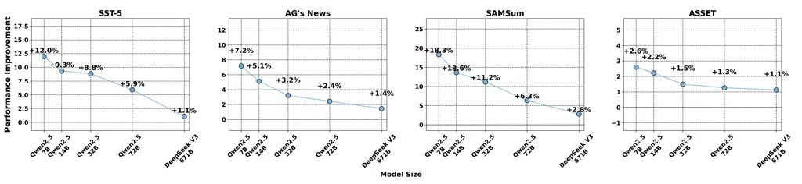

# Evaluating the Effectiveness of Black-Box Prompt Optimization as the Scale of LLMs Continues to Grow

Ziyu Zhou Affiliation: IT Innovation and Research Center, Huawei
Technologies Email: <zhouziyu8@huawei.com>    Yihang Wu Affiliation: IT
Innovation and Research Center, Huawei Technologies
Email: <yangjingyuan2@huawei.com>    Jingyuan Yang Affiliation: IT
Innovation and Research Center, Huawei Technologies
Email: <lirongjun3@huawei.com>    Zhan Xiao Affiliation: Zhejiang Lab
Email: <wuyihang2@h-partners.com>    Rongjun Li Affiliation: IT
Innovation and Research Center, Huawei Technologies
Email: <xz@zhejianglab.org>

###### Abstract

Black-Box prompt optimization methods have emerged as a promising
strategy for refining input prompts to better align large language
models (LLMs), thereby enhancing their task performance. Although these
methods have demonstrated encouraging results, most studies and
experiments have primarily focused on smaller-scale models (e.g., 7B,
14B) or earlier versions (e.g., GPT-3.5) of LLMs. As the scale of LLMs
continues to increase, such as with DeepSeek V3 (671B), it remains an
open question whether these black-box optimization techniques will
continue to yield significant performance improvements for models of
such scale. In response to this, we select three well-known black-box
optimization methods and evaluate them on large-scale LLMs (DeepSeek V3
and Gemini 2.0 Flash) across four NLU and NLG datasets. The results show
that these black-box prompt optimization methods offer only limited
improvements on these large-scale LLMs. Furthermore, we hypothesize that
the scale of the model is the primary factor contributing to the limited
benefits observed. To explore this hypothesis, we conducted experiments
on LLMs of varying sizes (Qwen 2.5 series, ranging from 7B to 72B) and
observed an inverse scaling law, wherein the effectiveness of black-box
optimization methods diminished as the model size increased.

## 1 Introduction

Prompt optimization methods have emerged as an effective strategy for
enhancing task performance by carefully refining input prompts to better
align with LLMs (Brown et al., 2020). Broadly speaking, existing prompt
optimization methods can be classified into two categories: white-box
and black-box prompt optimization methods. White-box prompt optimization
techniques typically involve utilizing gradient information to refine
prompts. For instance, AutoPrompt (Shin et al., 2020) uses
gradient-based methods to iteratively replace discrete prompt tokens,
refining the initial prompt and improving performance on downstream
tasks. Similarly, prefix tuning (Liu et al., 2022) and prompt tuning
(Lester et al., 2021) fine-tune additional soft continuous embeddings,
referred to as "soft tokens," to construct more effective task-specific
prompts. Although these methods show promising results, they require
access to the model’s internal gradients or parameters, limiting their
applicability in many closed-source models, such as GPT4o (Hurst et al., 2024) and Gemini (Anil et al., 2023).

Another category of prompt optimization methods is based on
nonparametric black-box techniques. These methods typically optimize
prompts through calling external APIs, without the need to access the
internal model parameters or gradients. For example, EvoPrompt (Guo
et al., 2023) utilizes evolutionary algorithms to iteratively search for
better task prompts through crossover and mutation. Similarly, methods
like ProTeGi (Pryzant et al., 2023), BPO (Cheng et al., 2023), and OPRO
(Yang et al., 2023) use LLMs themselves as optimizers, generating
improved task prompts by leveraging text feedback signals from the LLMs.
Despite these methods demonstrating substantial performance
improvements, they have primarily been tested on smaller-scale LLMs
(e.g., those with fewer than 14B parameters) or earlier versions of LLMs
(e.g., GPT-3.5 (Ye et al., 2023)). As LLMs continue to scale up, it is
still uncertain whether these black-box optimization techniques will
maintain their ability to deliver substantial performance gains.

To address this question, we selected three popular black-box
optimization methods and evaluated their performance on large-scale
LLMs, DeepSeek V3 (DeepSeek-AI, 2024) and Gemini 2.0 Flash (Pichai
et al., 2024), across four NLU and NLG benchmark datasets. The
experimental results demonstrate that the performance improvements from
these methods have become less significant. For the NLU datasets, the
average accuracy improvements for DeepSeek V3 and Gemini 2.0 Flash
across these three optimization methods were 0.86% and 1.16%,
respectively. Similarly, for the NLG datasets, the corresponding metric
improvements for DeepSeek V3 and Gemini 2.0 Flash were 1.04% and 2.03%,
respectively. We hypothesize that the limited improvements are primarily
due to the issue of model scale. To investigate this further, we
conducted experiments on LLMs of varying sizes, specifically the Qwen
2.5 series, with model sizes ranging from 7B to 72B parameters. The
results revealed an inverse scaling law, in which the efficacy of
black-box optimization methods decreased as the model size increased. In
brief, our work offers two key contributions:

- •
  We evaluate three black-box optimization methods on large-scale LLMs
  using four NLU and NLG datasets, finding only limited improvements in
  performance.
- •
  Our findings reveal an inverse scaling pattern, where the
  effectiveness of black-box optimization decreases as the size of the
  LLM increases.

## 2 Related Work

### 2.1 White-Box Prompt Optimization Methods

Early white-box prompt optimization methods, such as AutoPrompt (Shin
et al., 2020), utilize gradients to search for discrete prompt tokens to
improve model performance. Wen et al. (2023) expanded these hard prompt
optimization methods to multimodal tasks, including text-to-image
generation. Prefix-Tuning (Li and Liang, 2021) introduced continuous,
task-specific vectors as “soft tokens," optimizing them via gradients to
boost performance. Furthermore, P-Tuning v2 (Liu et al., 2022) optimized
“soft embeddings" across multiple transformer layers, achieving
improvements across a broader range of tasks. More recently, GReaTer
(Das et al., 2024) incorporated reasoning path information into
gradient-based prompt searches, yielding significant performance
improvements over prior methods.

### 2.2 Black-Box Prompt Optimization

Black-box prompt optimization methods seek to enhance task performance
by refining prompts without accessing the model’s internal parameters or
gradients. For example, EvoPrompt (Guo et al., 2023) employs
evolutionary algorithms, including crossover and mutation, to
iteratively refine prompts. APE (Zhou et al., 2022) frames black-box
prompt optimization as a program synthesis problem, refining prompts
through top-k sampling and resampling. OPRO (Yang et al., 2023)
integrates historical optimization trajectory information to improve the
stability of the optimization process. ProTeGi (Pryzant et al., 2023)
refines prompts through iterative language feedback, resulting in
enhanced performance. Likewise, BPO (Cheng et al., 2023) optimizes
prompts using human feedback and utilizes a small LLM as a prompt
optimizer, reducing the high costs associated with large-scale LLMs.

|                    |                           |                           |                           |                           |
| ------------------ | ------------------------- | ------------------------- | ------------------------- | ------------------------- |
| Model              | SST-5 (acc.)              | AG’s News (acc.)          | SAMSum (ROUGE)            | ASSET (SARI)              |
| DeepSeek V3        |                           |                           |                           |                           |
| \+ EvoPrompt       | 56.0 $`\rightarrow`$ 56.6 | 83.6 $`\rightarrow`$ 84.8 | 34.4 $`\rightarrow`$ 35.4 | 45.3 $`\rightarrow`$ 45.8 |
| \+ ProTeGi         | 56.0 $`\rightarrow`$ 56.4 | 84.0 $`\rightarrow`$ 85.8 | 33.9 $`\rightarrow`$ 33.7 | 46.4 $`\rightarrow`$ 46.9 |
| \+ BPO             | 56.0 $`\rightarrow`$ 56.4 | 84.6 $`\rightarrow`$ 83.8 | 33.9 $`\rightarrow`$ 34.1 | 45.3 $`\rightarrow`$ 45.8 |
| Average % Increase | 0.83%                     | 0.88%                     | 0.97%                     | 1.10%                     |
| Gemini 2.0 Flash   |                           |                           |                           |                           |
| \+ EvoPrompt       | 56.4 $`\rightarrow`$ 56.8 | 82.4 $`\rightarrow`$ 85.4 | 37.2 $`\rightarrow`$ 38.5 | 45.4 $`\rightarrow`$ 47.6 |
| \+ ProTeGi         | 55.6 $`\rightarrow`$ 56.2 | 82.5 $`\rightarrow`$ 83.5 | 37.2 $`\rightarrow`$ 37.6 | 44.6 $`\rightarrow`$ 46.0 |
| \+ BPO             | 57.6 $`\rightarrow`$ 58.2 | 82.8 $`\rightarrow`$ 82.2 | 37.2 $`\rightarrow`$ 36.9 | 44.2 $`\rightarrow`$ 44.4 |
| Average % Increase | 0.94%                     | 1.38%                     | 1.25%                     | 2.81%                     |

Table 1: Performance of Black-Box Prompt Optimization Methods on
DeepSeek V3 & Gemini 2.0 Flash.

| Model            | Comparison of the Initial and Optimized Prompts on the AG’s News Dataset                                                                                          |
| ---------------- | ----------------------------------------------------------------------------------------------------------------------------------------------------------------- |
| Initial          | Identify the category of the text (e.g. Technology, Sports, World, Business).                                                                                     |
| DeepSeek V3      | Identify the main topic of the content and select from the categories: World, Sports, Business, or Tech.                                                          |
| Gemini 2.0 Flash | Categorize the following news article under one of these themes: World, Sports, Business, or Tech. Identify the article’s primary subject to make your selection. |
| Model            | Comparison of the Initial and Optimized Prompts on the SAMSum Dataset                                                                                             |
| Initial          | Please summarize the main context.                                                                                                                                |
| DeepSeek V3      | Provide a clear and concise summary of the main idea, removing any redundant or extraneous information.                                                           |
| Gemini 2.0 Flash | Create a very short, jargon-free summary that captures the core message and vital information, avoiding any repetition or fluff.                                  |

Table 2: Comparison of the Initial and Optimized Prompts on DeepSeek V3
and Gemini 2.0 Flash.

## 3 The Effectiveness of Black-Box Prompt Optimization Methods on Large-Scale LLMs

### 3.1 Datasets and Evaluation Metrics

The four datasets used in this study include SST-5 (Socher et al.,
2013), a dataset for sentiment classification based on movie reviews;
AG’s News (Zhang et al., 2015), a corpus for news categorization across
four primary topics: World, Sports, Business, and Sci/Tech; SAMSum
(Gliwa et al., 2019), a dialogue summarization using messenger-style
conversations and ASSET (Alva-Manchego et al., 2020), a dataset for
sentence simplification, where each sentence is paired with multiple
reference simplifications. For NLU datasets, we randomly sample 500
examples as training dataset for prompt optimization and 500 examples as
test dataset for evaluation, while the NLG datasets are trained and
assessed on their complete examples respectively. For evaluation
metrics, accuracy is used for SST-5 and AG’s News, while ROUGE-L (Lin, 2004) and SARI (Xu et al., 2016) are employed for SAMSum and ASSET,
respectively.

### 3.2 Experimental Design

Three black-box prompt optimization methods are utilized for evaluation.
Specifically, the EvoPrompt method (Guo et al., 2023) refines the
initial prompts through a stepwise evolutionary process, generating
candidate prompts via crossover and mutation, and selecting the
best-performing prompt after four iterative optimization cycles on the
training data. The ProTeGi method (Pryzant et al., 2023) optimizes
initial prompts by leveraging text language gradients derived from the
training data, also undergoing four optimization rounds. The BPO method
(Cheng et al., 2023) directly applies the released sequence-to-sequence
prompt optimizer, performing five optimization rounds. For all three
black-box prompt optimization methods, we evaluate them on these four
datasets using large-scale LLMs, including DeepSeek V3 (DeepSeek-AI, 2024) and Gemini 2.0 Flash (Pichai et al., 2024).

### 3.3 Results and Analysis

As presented in Table 1, Black-Box prompt optimization methods show
limited improvements in performance when applied to larger scale LLMs.
Specifically, for DeepSeek V3, the average improvement across NLU tasks
was only 0.86%, and 1.16% for NLG tasks. Similarly, for Gemini 2.0
Flash, the NLU task improvement was 1.04%, and the NLG task improvement
was 2.03%. These results suggest that prompt optimization has a minimal
effect on very large models. To explore this further, we conducted a
comparative analysis of prompts before and after optimization using the
EvoPrompt method. As shown in Table 2, the optimized prompts exhibit
only slight modifications compared to the initial prompts for both
datasets. The primary adjustments involve replacing synonyms and subtly
rephrasing to improve clarity. For instance, in the SAMSum dataset, the
initial prompt simply instructs, “Please summarize the main context.”
After optimization, the prompts become more detailed, such as “Provide a
clear and concise summary of the main idea, removing any redundant or
extraneous information.” (DeepSeek V3), or “Create a very short,
jargon-free summary that captures the core message and vital
information, avoiding any repetition or fluff.” (Gemini 2.0 Flash).
These minor synonym substitutions are unlikely to have a significant
impact on large-scale LLMs. This could be because, generally, larger
LLMs exhibit more refined alignment, making them less sensitive to such
subtle variations in lexical choices. Similar findings are discussed in
(Shirafuji et al., 2023), where the authors explore the effects of
superficial prompt changes in code generation tasks.

## 4 The Impact of LLMs Scale for Black-Box Prompt Optimization

### 4.1 Experimental Design

To examine whether the size of an LLM influences the effectiveness of
black-box prompt optimization, we evaluated the Qwen-2.5 family,
encompassing models from 7B to 72B parameters. Specifically, we applied
the EvoPrompt black-box optimization method under the same experimental
setup described in Section  3.

Figure 1: Performance Improvements of EvoPrompt Across Different Scales
of Qwen 2.5 Series.

| Model       | Comparison of the Initial and Optimized Prompts on AG’s News Dataset.                                                       |
| ----------- | --------------------------------------------------------------------------------------------------------------------------- |
| Initial     | Identify the category of the text (e.g. Technology, Sports, World, Business).                                               |
| Qwen2.5 7B  | Identify the main topic of the news article and classify it under "World", "Sports", "Tech", or "Business".                 |
| Qwen2.5 14B | Based on the primary theme of the provided news article, categorize it as "World", "Sports", "Tech", or "Business".         |
| Qwen2.5 32B | Determine the primary topic of the news article and select from the following categories: World, Sports, Business, or Tech. |
| Qwen2.5 72B | Your task is to identify the primary topic of the news article and choose from World, Sports, Business and Tech.            |
| Model       | Comparison of the Initial and Optimized Prompts on SAMSum Dataset.                                                          |
| Initial     | Please summarize the main context.                                                                                          |
| Qwen2.5 7B  | Use concise language to summarize the main points, avoiding any unnecessary details or repetition.                          |
| Qwen2.5 14B | Summarize the main context briefly, focusing only on the key points and omitting any redundant or irrelevant information.   |
| Qwen2.5 32B | Summarize the key points briefly, omitting any extraneous details or repetition.                                            |
| Qwen2.5 72B | Use concise language to summarize the key points, ensuring clarity and omitting unnecessary details or repetition.          |

Table 3: Comparison of the Initial and Optimized Prompts across
different Qwen 2.5 Scales.

### 4.2 Results and Analysis

Figure 1 illustrates a distinct inverse-scaling phenomenon, wherein the
improved performance gains obtained from black-box prompt optimization
methods decline significantly as model scale increases. Specifically, on
the SST-5 benchmark, accuracy improvements diminish notably from 12% for
the Qwen-2.5 7B model to 5.9% for the Qwen-2.5 72B model, ultimately
reaching just 1.1% for the DeepSeek-V3 671B model. Comparable trends are
observed across other datasets.

To further investigate the underlying reasons for these observations, we
analyzed performance gains across the Qwen 2.5 series. As illustrated in
Table 3, smaller LLMs (7B and 14B) exhibit a relative significant
improvement, likely attributable to the incorporation of domain-specific
clues in the optimized prompts. For instance, in the case of AG’s News,
the optimized prompt explicitly includes the phrase “news article”,
providing clear, context-specific guidance that smaller models greatly
benefit from.

Meanwhile, larger models (32B and 72B) yield relatively modest
improvements. This may be due to the fact that larger models inherently
possess a more comprehensive domain understanding and semantic
alignment, making explicit domain cues gradually redundant, while
lexical refinements or synonym replacements, such as "identify" to
"determine," become ineffective.

## 5 Conclusion

In this paper, we investigate whether black-box prompt optimization can
deliver substantial benefits for large-scale LLMs. Our experiments
reveal that as model size increases, the performance gains on both NLU
and NLG datasets progressively diminish, exhibiting a clear inverse
scaling trend.

## Limitations

Our preliminary experiments indicate that black-box prompt optimization
yields only limited benefits for large-scale LLMs. Nonetheless, several
limitations temper the scope of our conclusions. First, the largest
Qwen-2.5 model we assess contains 72B parameters, leaving an unexplored
gap between this scale and the 671B DeepSeek-V3, intermediate-sized
models therefore remain untested. Second, our analyses focus on
English-language benchmarks, restricting the generalizability of the
findings to multilingual contexts, especially low-resource languages,
whose response to prompt optimization is still unknown. Third, we only
consider text-based prompts, leaving multi-modal prompt optimization,
incorporating visual or audio modality unexamined. Furthermore, our
evaluation omits treasoning-oriented LLMs, such as DeepSeek R1
(DeepSeek-AI, 2025) or OpenAI o3 (OpenAI, 2025), which may display
distinct scaling behavior and prompt-sensitivity characteristics.

## References

- Alva-Manchego et al. (2020) Fernando Alva-Manchego, Louis Martin,
  Antoine Bordes, Carolina Scarton, Benoît Sagot, and Lucia
  Specia. 2020. [Asset: A dataset for tuning and evaluation of sentence
  simplification models with multiple rewriting
  transformations](https://doi.org/10.18653/v1/2020.acl-main.424). In
  _Proceedings of the 58th Annual Meeting of the Association for
  Computational Linguistics (ACL 2020)_, pages 4668–4679. Association
  for Computational Linguistics.
- Anil et al. (2023) Rohan Anil, Sebastian Borgeaud, Yonghui Wu,
  Jean-Baptiste Alayrac, Jiahui Yu, Radu Soricut, Johan Schalkwyk, and 1
  others. 2023. Gemini: A family of highly capable multimodal models.
  _arXiv preprint arXiv:2312.11805_.
- Brown et al. (2020) Tom B. Brown, Benjamin Mann, Nick Ryder, and 1
  others. 2020. Language models are few-shot learners. _Advances in
  Neural Information Processing Systems_, 33:1877–1901.
- Cheng et al. (2023) Jiale Cheng, Xiao Liu, Kehan Zheng, Pei Ke,
  Hongning Wang, Yuxiao Dong, Jie Tang, and Minlie Huang. 2023.
  Black-box prompt optimization: Aligning large language models without
  training them. _arXiv preprint arXiv:2311.04155_.
- Das et al. (2024) Sarkar Snigdha Sarathi Das, Ryo Kamoi, Bo Pang,
  Yusen Zhang, Caiming Xiong, and Rui Zhang. 2024. Greater: Gradients
  over reasoning makes smaller language models strong prompt optimizers.
  _arXiv preprint arXiv:2405.12406_.
- DeepSeek-AI (2024) DeepSeek-AI. 2024. [Deepseek-v3 technical
  report](https://arxiv.org/abs/2412.19437). _arXiv preprint
  arXiv:2412.19437_.
- DeepSeek-AI (2025) DeepSeek-AI. 2025. [Deepseek-r1: Incentivizing
  reasoning capability in llms via reinforcement
  learning](https://arxiv.org/abs/2501.12948). _arXiv preprint
  arXiv:2501.12948_.
- Gliwa et al. (2019) Bogdan Gliwa, Iwona Mochol, Maciej Biesek, and
  Aleksander Wawer. 2019. [Samsum corpus: A human-annotated dialogue
  dataset for abstractive
  summarization](https://arxiv.org/abs/1911.12237). _arXiv preprint
  arXiv:1911.12237_.
- Guo et al. (2023) Qingyan Guo, Rui Wang, Junliang Guo, Bei Li, Kaitao
  Song, Xu Tan, Guoqing Liu, Jiang Bian, and Yujiu Yang. 2023.
  Connecting large language models with evolutionary algorithms yields
  powerful prompt optimizers. _arXiv preprint arXiv:2309.08532_.
- Hurst et al. (2024) Aaron Hurst, Alec Lerer, AP Goucher, Alex
  Perelman, Aditya Ramesh, Arthur Clark, AJ Ostrow, and 1 others. 2024.
  Gpt-4o system card. _arXiv preprint arXiv:2410.21276_.
- Lester et al. (2021) Brian Lester, Rami Al-Rfou, and Noah
  Constant. 2021. The power of scale for parameter-efficient prompt
  tuning. In _Proceedings of the 2021 Conference on Empirical Methods in
  Natural Language Processing_, pages 3045–3059.
- Li and Liang (2021) Xiang Lisa Li and Percy Liang. 2021.
  Prefix-tuning: Optimizing continuous prompts for generation. In
  _Proceedings of the 59th Annual Meeting of the Association for
  Computational Linguistics and the 11th International Joint Conference
  on Natural Language Processing (Volume 1: Long Papers)_, pages
  4582–4597.
- Lin (2004) Chin-Yew Lin. 2004. [Rouge: A package for automatic
  evaluation of summaries](https://aclanthology.org/W04-1013.pdf). In
  _Proceedings of the Workshop on Text Summarization Branches Out
  (W04-1013)_, pages 74–81. Association for Computational Linguistics.
- Liu et al. (2022) Xiao Liu, Kaixuan Ji, Yicheng Fu, Weng Tam,
  Zhengxiao Du, Zhilin Yang, and Jie Tang. 2022. P-tuning: Prompt tuning
  can be comparable to fine-tuning across scales and tasks. In
  _Proceedings of the 60th Annual Meeting of the Association for
  Computational Linguistics (Volume 2: Short Papers)_, pages 61–68.
- OpenAI (2025) OpenAI. 2025. [Openai o3 and o4-mini system
  card](https://cdn.openai.com/pdf/2221c875-02dc-4789-800b-e7758f3722c1/o3-and-o4-mini-system-card.pdf).
  Technical report, OpenAI.
- Pichai et al. (2024) Sundar Pichai, Demis Hassabis, and Koray
  Kavukcuoglu. 2024. [Introducing gemini 2.0: our new ai model for the
  agentic
  era](https://blog.google/technology/google-deepmind/google-gemini-ai-update-december-2024/#ceo-message).
  Google Blog.
- Pryzant et al. (2023) Reid Pryzant, Dan Iter, Jerry Li, Yin Tat Lee,
  Chenguang Zhu, and Michael Zeng. 2023. Automatic prompt optimization
  with "gradient descent" and beam search. _arXiv preprint
  arXiv:2305.03495_.
- Shin et al. (2020) Taylor Shin, Yasaman Razeghi, Robert L Logan IV,
  Eric Wallace, and Sameer Singh. 2020. Autoprompt: Eliciting knowledge
  from language models with automatically generated prompts. In
  _Proceedings of the 2020 Conference on Empirical Methods in Natural
  Language Processing (EMNLP)_, pages 4222–4235.
- Shirafuji et al. (2023) Atsushi Shirafuji, Yutaka Watanobe, Takumi
  Ito, Makoto Morishita, Yuki Nakamura, Yusuke Oda, and Jun
  Suzuki. 2023. [Exploring the robustness of large language models for
  solving programming problems](https://arxiv.org/abs/2306.14583).
  _arXiv preprint arXiv:2306.14583_.
- Socher et al. (2013) Richard Socher, Alex Perelygin, Jean Wu, Jason
  Chuang, Christopher Manning, Andrew Ng, and Christopher Potts. 2013.
  Recursive deep models for semantic compositionality over a sentiment
  treebank.
  [https://nlp.stanford.edu/sentiment/](https://nlp.stanford.edu/sentiment/).
  Accessed: 2025-04-27.
- Wen et al. (2023) Yuxin Wen, Neel Jain, John Kirchenbauer, Micah
  Goldblum, Jonas Geiping, and Tom Goldstein. 2023. Hard prompts made
  easy: Gradient-based discrete optimization for prompt tuning and
  discovery. _Advances in Neural Information Processing Systems_,
  36:51008–51025.
- Xu et al. (2016) Wei Xu, Courtney Napoles, Ellie Pavlick, Quanze Chen,
  and Chris Callison-Burch. 2016. [Optimizing statistical machine
  translation for text
  simplification](https://doi.org/10.1162/tacl_a_00107). _Transactions
  of the Association for Computational Linguistics_, 4:401–415.
- Yang et al. (2023) Chengrun Yang, Xuezhi Wang, Yifeng Lu, Hanxiao Liu,
  Quoc V. Le, Denny Zhou, and Xinyun Chen. 2023. Large language models
  as optimizers. _arXiv preprint arXiv:2309.03409_.
- Ye et al. (2023) Junjie Ye, Xuanting Chen, Nuo Xu, Can Zu, Zekai Shao,
  Shichun Liu, Yuhan Cui, Zeyang Zhou, Chao Gong, Yang Shen, Jie Zhou,
  Siming Chen, Tao Gui, Qi Zhang, and Xuanjing Huang. 2023. [A
  comprehensive capability analysis of gpt-3 and gpt-3.5 series
  models](https://arxiv.org/abs/2303.10420). _arXiv preprint
  arXiv:2303.10420_.
- Zhang et al. (2015) Xiang Zhang, Junbo Zhao, and Yann LeCun. 2015.
  Character-level convolutional networks for text classification.
  [https://github.com/mhjabreel/CharCnn_Keras/tree/master/data/ag_news_csv](https://github.com/mhjabreel/CharCnn_Keras/tree/master/data/ag_news_csv).
  Accessed: 2025-04-27.
- Zhou et al. (2022) Yongchao Zhou, Andrei Ioan Muresanu, Ziwen Han,
  Keiran Paster, Silviu Pitis, Harris Chan, and Jimmy Ba. 2022. Large
  language models are human-level prompt engineers. _arXiv preprint
  arXiv:2211.01910_.
