# Visually Guided Decoding: Gradient-Free Hard Prompt Inversion with Language Models

Donghoon Kim Affiliation: Seoul National University    Minji Bae
Affiliation: Seoul National University    Kyuhong Shim    Byonghyo Shim
^(†)^(†)thanks: Corresponding authors Affiliation: Seoul National
University Affiliation: Sungkyunkwan University{dhkim, mjbae,
bshim}@islab.snu.ac.kr; khshim@skku.edu

###### Abstract

Text-to-image generative models like DALL-E and Stable Diffusion have
revolutionized visual content creation across various applications,
including advertising, personalized media, and design prototyping.
However, crafting effective textual prompts to guide these models
remains challenging, often requiring extensive trial and error. Existing
prompt inversion approaches, such as soft and hard prompt techniques,
are not so effective due to the limited interpretability and incoherent
prompt generation. To address these issues, we propose Visually Guided
Decoding (VGD), a gradient-free approach that leverages large language
models (LLMs) and CLIP-based guidance to generate coherent and
semantically aligned prompts. In essence, VGD utilizes the robust text
generation capabilities of LLMs to produce human-readable prompts.
Further, by employing CLIP scores to ensure alignment with
user-specified visual concepts, VGD enhances the interpretability,
generalization, and flexibility of prompt generation without the need
for additional training. Our experiments demonstrate that VGD
outperforms existing prompt inversion techniques in generating
understandable and contextually relevant prompts, facilitating more
intuitive and controllable interactions with text-to-image models.
(Implementation code is available at
[https://github.com/DonghoonKim-1938/VGD](https://github.com/DonghoonKim-1938/VGD))

|     |
| --- |
|     |

## 1 Introduction

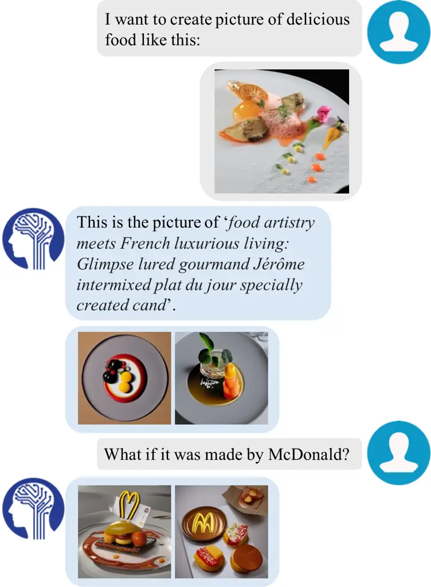

Figure 1: Visually Guided Decoding (VGD) works with any LLM without
extra training, making it easy to integrate into a chat-based interface
that offers interpretable and controllable text-to-image generation.

In recent years, image generative models such as DALL-E and Stable
Diffusion have shown remarkable success in generating high-fidelity
images (Ramesh et al., 2022; Rombach et al., 2022; Podell et al., 2024).
These models are widely used in a variety of applications, including
visual content generation (e.g., advertisement, movie, game),
personalized content generation (e.g., caricature, photo editing), and
prototyping (e.g., architecture and product design). Recent studies have
shown that, just as humans can draw an image of an object solely based
on detailed descriptions (e.g., criminal composite sketch), generative
models can generate images of objects using a well-crafted prompt, even
if they have not been trained on those specific objects (Gal et al.,
2023; Everaert et al., 2023).

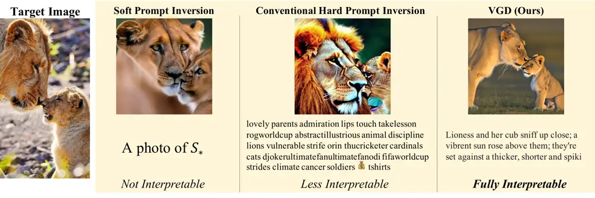

Figure 2: VGD generates fully interpretable prompts that enhance
generalizability across tasks and models in text-to-image generation.

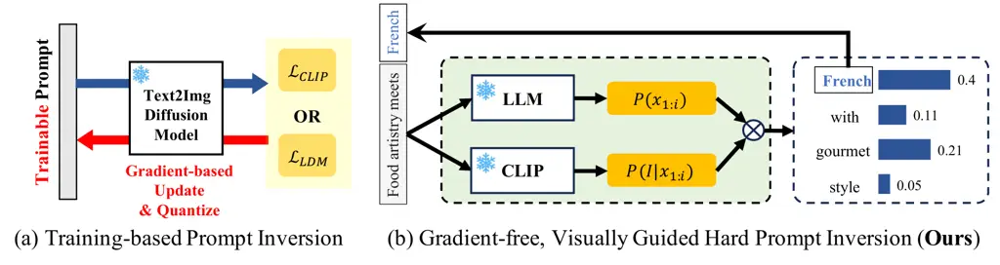

Figure 3: While conventional prompt inversion techniques update prompt
embeddings through gradient-based optimization and quantization, VGD is
a gradient-free technique that utilizes large language models and CLIP
to generate relevant sentences.

A well-known drawback of these approaches is the difficulty in finding a
textual description (a.k.a., prompt) that effectively guides the
generation of the desired visual content (Hao et al., 2024). For
example, to create a culinary masterpiece (see Fig. 1), one needs to
have enough knowledge on exquisite cooking styles such as French cuisine
or molecular gastronomy. Without the expertise to craft prompts, users
have to rely on laborious trial and error to generate high-quality
gourmet images.

To address the difficulty in finding the prompt, soft prompt inversion
techniques have been proposed (Gal et al., 2023; Kumari et al., 2023;
Ruiz et al., 2023; Voynov et al., 2023). In these approaches, similar to
the prompt learning technique in natural language processing (Li &
Liang, 2021; Lester et al., 2021; Liu et al., 2022; Kim et al., 2024),
an image is transformed into the embedding vector. Specifically, a
learnable input vector for the conditioning network (Radford et al., 2021) in Stable Diffusion is trained to reconstruct user-provided images
through an iterative de-noising process (a.k.a., reverse diffusion
process). After training, the learned vector is used as a soft prompt.
Since the soft prompt is used as a word, to generate the desired image,
it should be combined with other words (see Fig. 2). Unfortunately, it
is a non-human-readable vector, users have no clue to handle it.

Recently, to mitigate the lack of interpretability, hard prompt
inversion has been suggested (Mahajan et al., 2024; Wen et al., 2024).
Essentially, training process of the hard prompt inversion is similar to
the soft-prompt learning but the trained input vector is projected to
the nearest neighbor in a predefined vocabulary to ensure
human-readability (see Fig. 3 (a)). The potential drawbacks of hard
prompt inversion are: 1) the vanishing gradient problem caused by the
long gradient path in the reverse diffusion process, and 2) the
difficulty in identifying the essential words for generating the desired
image. In fact, as described in Fig. 2, a sequence of the hard prompts
contain meaningless as well as useful words.

An aim of this paper is to propose a novel prompt generation technique
that generates fully interpretable prompts, thereby reducing the need
for trial-and-error in text-to-image generation. Essence of our
technique, henceforth referred to as visually guided decoding (VGD), is
to generate contextually meaningful sentence for hard prompt through the
token generation process of large language models (LLMs)  (Ouyang
et al., 2022; Touvron et al., 2023). In order to align the generated
token in the provided images, we use the CLIP model in the token
generation process (see Fig. 3 (b)). This process ensures that the
resulting prompt is not only semantically relevant to the image but also
easily understood by humans. The major benefit of VGD is that one can
fully understand the meaning of the prompt (interpretability) and
synthesize images for various applications (generalizability) (e.g.,
style transfer, image editing, and image variation). Also, when users
want to modify objects, background, and/or style, one can easily change
the generated prompt (flexibility).

In our experiments, we show that VGD qualitatively and quantitatively
achieves state-of-the-art (SOTA) performance, demonstrating superior
interpretability, generalizability, and flexibility in text-to-image
generation compared to previous soft and hard prompt inversion methods.
We also show that VGD is compatible with a combination of various LLMs
(i.e., LLaMA2, LLaMA3, Mistral) and image generation models (i.e.,
DALL-E 2, MidJourney, Stable Diffusion 2). Since VGD seamlessly stitches
LLMs and text-to-image models without additional training (i.e.,
gradient-free), VGD provides a flexible and efficient solution for
chat-interfaced image generation services using LLM (e.g., DALL-E
extension on ChatGPT) (see Fig. 1).

## 2 Background and Related Works

### 2.1 CLIP Model

CLIP model aligns semantically related visual and textual content within
a shared representation space (Radford et al., 2021; Lee et al., 2025).
It consists of an image encoder $`\text{CLIP}_{\text{img}}(\cdot)`$ and
a text encoder $`\text{CLIP}_{\text{txt}}(\cdot)`$. The image encoder
encodes an input image $`I`$ into a visual embedding
$`\mathbf{f}_{\text{img}}=\text{CLIP}_{\text{img}}(I)`$. The text
encoder processes the input text
$`T=\left[x_{1}^{\text{txt}},x_{2}^{\text{txt}},...,x_{N}^{\text{txt}}\right]`$
to generate a textual embedding
$`\mathbf{f}_{\text{txt}}=\text{CLIP}_{\text{txt}}(T)`$. CLIP is trained
using a contrastive learning approach such that the similarity between
$`\mathbf{f}_{\text{txt}}`$ and $`\mathbf{f}_{\text{img}}`$ for matched
sentence-image pair is maximized, while the similarity for unmatched
pairs is minimized. The similarity is defined as:

```math
\text{Sim}(\mathbf{f}_{\text{txt}},\mathbf{f}_{\text{img}})\coloneq s\frac{\mathbf{f}_{\text{txt}}\cdot\mathbf{f}_{\text{img}}}{\|\mathbf{f}_{\text{txt}}\|_{2}\|\mathbf{f}_{\text{img}}\|_{2}} \tag{1}
```

where $`s`$ is a scalar scaling factor. Then, the training objective of
CLIP is formulated as:

```math
\underset{\text{CLIP}_{\text{img}},\text{CLIP}_{\text{txt}}}{\mathrm{\textbf{Maximize}}}\quad\log P\left(T|I\right)+\log P\left(I|T\right), \tag{2}
```

```math
P(T|I)=\frac{\exp\left(\text{Sim}({{\mathbf{f}}_{\text{txt}}}\cdot{\mathbf{f}}_{\text{img}})\right)}{\sum_{j=1}^{B}\exp\left(\text{Sim}({{\mathbf{f}}_{\text{txt}_{j}}}\cdot{\mathbf{f}}_{\text{img}})\right)},\quad P(I|T)=\frac{\exp\left(\text{Sim}({{\mathbf{f}}_{\text{txt}}\cdot{\mathbf{f}}_{\text{img}}})\right)}{\sum_{j=1}^{B}\exp\left(\text{Sim}({{\mathbf{f}}_{\text{txt}}\cdot{\mathbf{f}}_{\text{img}_{j}}})\right)}, \tag{3}
```

where $`B`$ indicates the number of text-image pairs in the mini-batch.

### 2.2 Text-to-Image Diffusion Model

Text-to-image models generate an image $`I`$ that maximizes $`P(I|T)`$
given textual description $`T`$. Modern text-to-image models, such as
Stable Diffusion, are based on Latent Diffusion Model (LDM), which
usually takes CLIP text embedding $`\mathbf{f}_{\text{txt}}`$ as a
condition to generate an image. Our goal is to find the optimal text
condition $`T`$ that yields the image containing desired visual
concepts.

### 2.3 Prompt Inversion

#### Soft Prompt Inversion

Following prompt-tuning approach Li & Liang (2021), Soft Prompt
Inversion techniques (Gal et al., 2023; Kumari et al., 2023) extend the
vocabulary of the model with a new special token $`S_{*}`$, which embeds
the objects from the provided images. During the generation process, the
continuous embedding vector of $`S_{*}`$ is prepended to the embeddings
of the input text tokens (e.g., “A photo of $`S_{*}`$”, “A rendition of
$`S_{*}`$”) and then used as an input to the LDM model. The soft prompt
is a high-dimensional vector with real elements so that it is
non-human-readable.

#### Hard Prompt Inversion

To mitigate the limitations of Soft Prompt Inversion, hard prompt
techniques has been proposed (Wen et al., 2024; Mahajan et al., 2024).
In this scheme, the generated soft prompt is mapped to the nearest word
token to produce the hard prompt. Often, the sequence of hard prompts
consists of unrelated words, so that it is very difficult to identify
words to be modified in the desired image generation. Moreover, hard
prompt inversion involves a complex training process due to the discrete
optimization and multi-stage pipelining.

#### Image Captioning

One might think of an idea to generate an image directly from captions
using LMM (Li et al., 2022; Li et al., 2023; Alayrac et al., 2022; Liu
et al., 2024). This approach is conceptually simple but the generated
captions lack the fine details necessary for detailed image synthesis
control. To complement the missing information of image captions, prompt
generation services like CLIP-Interrogator ¹¹ 1
https://github.com/pharmapsychotic/clip-interrogator have been
introduced (see Appendix A.4 for more details).

## 3 Gradient Free Prompt Inversion with Language Models

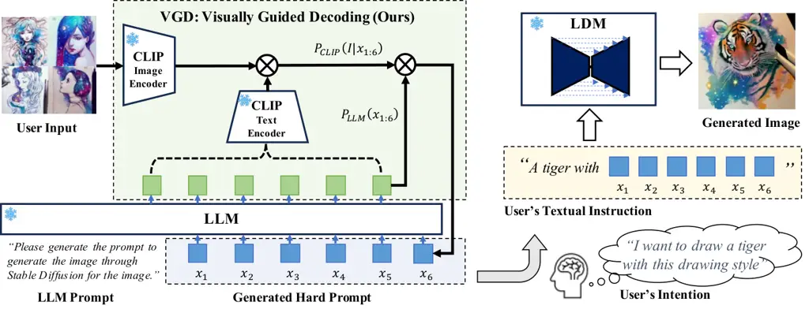

Figure 4: Overview of the proposed hard prompt inversion method, VGD,
which seamlessly integrates LLM, CLIP, and LDM for user-friendly image
generation process.

### 3.1 Interpretability Degradation of Previous Hard Prompt Inversion

The goal of hard prompt inversion is to determine the text prompt
$`T=\left[x_{1}^{\text{txt}},x_{2}^{\text{txt}},...,x_{N}^{\text{txt}}\right]`$
that maximizes the LDM’s probability $`P(I|T)`$ for a target image
$`I`$, with each $`x_{i}^{\text{txt}}`$ being chosen from the model’s
vocabulary. By applying Bayes’ theorem, this objective can be
reformulated as

```math
P(I|T)=\frac{P(I)P(T|I)}{P(T)}. \tag{4}
```

Since the prior probability of the image $`P(I)`$ is independent of
$`T`$, finding the optimal $`\hat{T}`$ is equivalent to finding $`T`$
that maximizes $`{P(T|I)}/{P(T)}`$. That is,

```math
\hat{T}=\underset{T}{\mathrm{argmax}}\frac{P(T|I)}{P(T)}. \tag{5}
```

As indicated in Eq. 5, the inversion process maximizes $`P(T|I)`$
(a.k.a., image captioning objective) while simultaneously minimizing
$`P(T)`$, the prior probability of text. In the $`P(T)`$ minimization
process, the hard prompt $`T`$ might contain uncommon or awkward
phrasing, resulting in a degradation of interpretability. We argue that
this is why conventional hard prompt inversion techniques exhibit lower
interpretability (see Section 4.3 for qualitative comparison).

### 3.2 Visually Guided Decoding

#### Step 1 - Problem Formulation

Our goal is to find an interpretable text prompt without training prompt
embeddings, using the gradient-free approach. Inspired by the noisy
channel model (Jurafsky, 2000; Brown et al., 1993), widely used in
machine translation and speech recognition, we model the prompt
discovery process by integrating an LDM objective with a regularization
term for language modeling. The objective is formulated as

```math
\hat{T}=\underset{T}{\mathrm{argmax}}\;{P\left(I|T\right)}{P\left(T\right)}. \tag{6}
```

#### Step 2 - Approximation with CLIP Score

Computing $`P\left(I|T\right)`$ using forward and reverse diffusion
processes in every token generation step is computationally intractable.
To alleviate this computational burden, we approximate
$`P\left(I|T\right)`$ using CLIP, such that
$`P(I|T)\approx P_{\text{CLIP}}(I|T)`$. This approximation is justified
by the fact that Stable Diffusion utilizes the frozen CLIP text encoder.
Empirically, we demonstrate that when a CLIP model different from the
one aligned with Stable Diffusion is used, the approximation no longer
holds, leading to a degradation in performance (see Section 4.4 for the
ablation study on CLIP image encoders).

For the prior probability of text $`P(T)`$, we leverage an external
language model (e.g., LLaMA, Mistral, GPT). Our main objective is then
formulated as

```math
\hat{T}=\underset{T}{\mathrm{argmax}}\;{P_{\text{CLIP}}\left(I|T\right)}{P_{\text{LLM}}\left(T\right)}^{\alpha}, \tag{7}
```

where $`\alpha`$ is a hyperparameter.

#### Step 3 - Token-by-Token Generation

We can express Eq. 7 using a left-to-right decomposition of the text
probability $`P_{\text{LLM}}(T)`$. That is,

```math
{P_{\text{CLIP}}\left(I|x_{1:N}^{\text{txt}}\right)}\prod_{i=1}^{N}{P_{\text{LLM}}\left(x_{i}^{\text{txt}}|x_{1:i-1}^{\text{txt}}\right)}^{\alpha}. \tag{8}
```

This decomposition facilitates token-by-token text generation using a
beam search decoding strategy (Anderson et al., 2017; Post & Vilar,
2018; Hu et al., 2019; Holtzman et al., 2020). Specifically, we
iteratively select the $`i`$-th token $`x_{i}^{\text{txt}}`$ that
maximizes the objective in Eq. 8. In doing so, VGD generates prompts
that are semantically aligned with the target image (via CLIP) while
ensuring linguistic coherence and interpretability (via LLM).

### 3.3 Implementation of Visually Guided Decoding

#### LLM Prompting

Instead of fine-tuning LLM for each image generation task, we design
specific system and user prompts tailored to different tasks. Using the
designed system and user prompt, LLM is queried to generate tokens as if
it were creating text prompts for text-to-image models (see Appendix A.1
for details).

#### Beam Initialization

Providing LLM with image-related words at the start of the generation
process increases the probability of generating tokens that align with
the image in subsequent steps. To do so, we first compare all text
embeddings $`\mathbf{f}_{\text{txt}}`$ in CLIP vocabulary with the
target image embedding $`\mathbf{f}_{\text{img}}`$, selecting the
top-$`M`$ tokens $`x_{1:M}^{\text{txt}}`$ as the initial input prefix
for LLM. Empirically, we find that even $`M=1`$ is sufficient for VGD.
This process is computationally efficient since all text embeddings can
be precomputed.

#### Beam Expansion and Pruning

Since CLIP does not provide next-token probabilities, we use LLM’s
next-token predictions to select beam search candidates. Specifically,
for a beam width of $`K`$, each beam is expanded by appending the $`K`$
highest-probability next-token candidates based on
$`P_{\text{LLM}}(x_{i}^{\text{txt}}|x_{1:i-1}^{\text{txt}})`$. The
expanded set of $`K^{2}`$ candidates is then pruned to retain only $`K`$
beams according to Eq. 8. Unless otherwise specified, we set $`K=10`$
for the experiments.

#### Beam Search Termination

The beam search terminates when either 1) beam expansion fails to
improve the score (Eq. 8), or 2) the predefined maximum prompt length is
reached. The final result $`\hat{T}`$ is then selected from the
remaining candidates based on the highest score.

## 4 Experiments

### 4.1 Setup

#### Datasets

We conduct experiments on four datasets with diverse distributions:
LAION-400M (Schuhmann et al., 2021; Schuhmann et al., 2022), MS
COCO (Lin et al., 2014), Celeb-A (Liu et al., 2015), and Lexica.art ²² 2
https://huggingface.co/datasets/Gustavosta/Stable-Diffusion-Prompts.
Following PEZ (Wen et al., 2024), we randomly sample 100 images from
each dataset and evaluate prompt inversion methods across 5 runs using
different random seeds. See Appendix A.3 for more details.

#### Baselines

We compare the proposed method with the hard prompt inversion (PEZ (Wen
et al., 2024)), soft prompt inversion (Textual Inversion (Gal et al.,
2023)), LLaVA-1.5 (Liu et al., 2024) generated caption, and LLaVA-1.5
combined with CLIP-Interrogator. Images are generated with the Stable
Diffusion 2.1-768 model across all comparisons (Podell et al., 2024).

|                      |            |              |         |         |            |                     |        |       |                        |        |       |
| -------------------- | ---------- | ------------ | ------- | ------- | ---------- | ------------------- | ------ | ----- | ---------------------- | ------ | ----- |
| Method               | \#Tokens   | LAION        | MS COCO | Celeb-A | Lexica.art | MS COCO (BERTScore) |        |       | Lexica.art (BERTScore) |        |       |
|                      |            | CLIP-I Score |         |         |            | Precision           | Recall | F1    | Precision              | Recall | F1    |
| Textual Inversion    | 1          | 0.388        | 0.569   | 0.522   | 0.697      | \-                  | \-     | \-    | \-                     | \-     | \-    |
| LLaVA-1.5            | 32         | 0.513        | 0.642   | 0.463   | 0.580      | 0.914               | 0.918  | 0.916 | 0.858                  | 0.780  | 0.817 |
| \+ CLIP Interrogator | $`\sim`$77 | 0.540        | 0.685   | 0.511   | 0.762      | 0.794               | 0.898  | 0.843 | 0.818                  | 0.819  | 0.819 |
| LLaVA-1.5 + VGD      | 32         | 0.573        | 0.718   | 0.546   | 0.769      | 0.831               | 0.879  | 0.854 | 0.835                  | 0.793  | 0.813 |
|                      | $`\sim`$77 | 0.569        | 0.724   | 0.544   | 0.785      | 0.800               | 0.874  | 0.835 | 0.810                  | 0.794  | 0.802 |
| PH2P                 | 16         | 0.442        | 0.589   | 0.413   | 0.678      | 0.800               | 0.842  | 0.820 | 0.805                  | 0.780  | 0.792 |
| PEZ                  | 16         | 0.538        | 0.687   | 0.622   | 0.743      | 0.760               | 0.834  | 0.795 | 0.772                  | 0.783  | 0.777 |
|                      | 32         | 0.530        | 0.685   | 0.619   | 0.745      | 0.736               | 0.830  | 0.780 | 0.752                  | 0.784  | 0.768 |
|                      | 64         | 0.507        | 0.670   | 0.584   | 0.728      | 0.715               | 0.825  | 0.766 | 0.734                  | 0.783  | 0.758 |
| VGD (Ours)           | 16         | 0.484        | 0.650   | 0.482   | 0.700      | 0.833               | 0.862  | 0.847 | 0.827                  | 0.779  | 0.802 |
|                      | 32         | 0.493        | 0.670   | 0.506   | 0.735      | 0.818               | 0.868  | 0.842 | 0.816                  | 0.786  | 0.801 |
|                      | 64         | 0.511        | 0.678   | 0.514   | 0.753      | 0.787               | 0.863  | 0.823 | 0.799                  | 0.789  | 0.794 |
|                      | $`\sim`$77 | 0.510        | 0.678   | 0.513   | 0.754      | 0.788               | 0.864  | 0.824 | 0.801                  | 0.791  | 0.795 |

Table 1: Image quality (CLIP-I score) and prompt quality (BERTScore)
comparison.

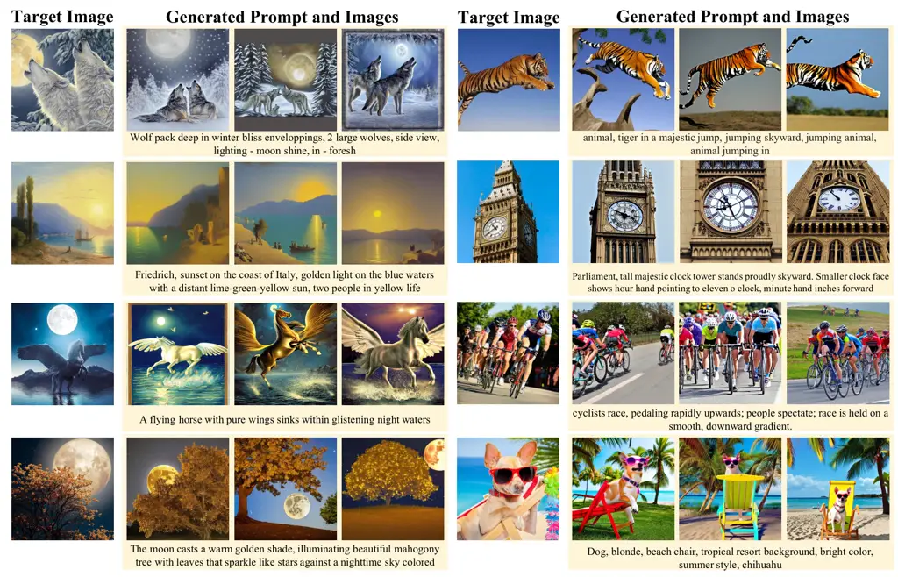

Figure 5: Generated images using hard prompts produced by the proposed
VGD.

#### Evaluation Metric

We evaluate the quality of the prompt via image embedding similarity
between the target image and an image generated using the generated hard
prompt. We call this similarity-based metric CLIP-I score. To ensure
fairness, we utilize different CLIP models for generation and
evaluation: CLIP-ViT-H-14 for generation and larger CLIP-ViT-G-14 for
similarity evaluation. Following (Mahajan et al., 2024), we also compare
the contextual similarity between the generated prompt and the
ground-truth annotations (captions) of the target image, using
BERTScore (Zhang et al., 2020) as metric.

### 4.2 Image Generation with VGD Prompts

In Fig. 5, we qualitatively demonstrate that VGD generates realistic and
diverse images without overfitting to the original target image.

#### Qualitative Evaluation

As shown in Table 1, the images generated by VGD are the most similar to
the original images, as measured by the CLIP-I score, even without using
a gradient-based optimization process like PEZ. When using LLaVA-1.5 as
the language model, VGD achieves SOTA CLIP-I scores across all four
datasets, surpassing the strong baseline that exploits an external
database (LLaVA 1.5 + CLIP Interrogator) by a considerable margin.
Furthermore, unlike PEZ, VGD exhibits a positive correlation between the
CLIP-I score and the number of tokens, highlighting the effectiveness of
VGD’s token-by-token generation process.

#### Multi-concept Generation

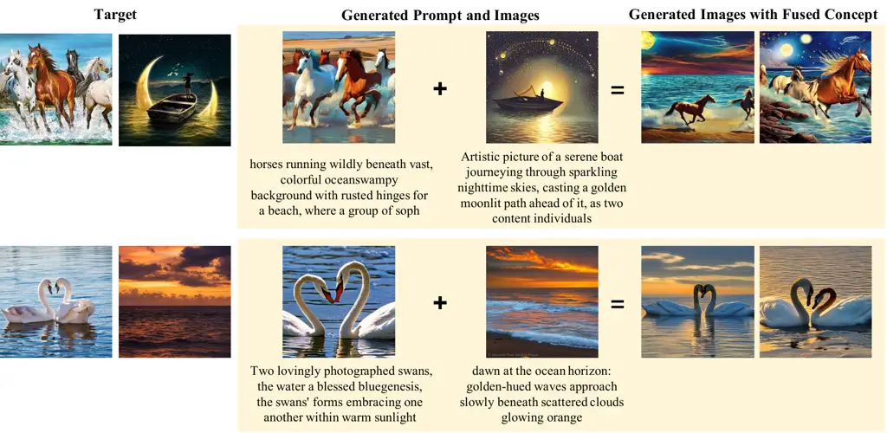

Figure 6: Multi-concept image generation with VGD. We show that the hard
prompts obtained from two different images can be concatenated to fuse
the semantic concepts.

VGD is capable of fusing multiple concepts from different images without
additional effort. For each image with its own distinct concept, we
individually extract prompts and concatenate them to generate a single
image that combines their concepts. Fig. 6 presents two examples of
multi-concept generation, illustrating that VGD accurately extracts the
key elements from each image so that the generated image can contain
multiple concepts without omitting any. We show the example of
multi-concept generation of 5 images with VGD and PEZ in Fig. 21 of the
Appendix.

#### Style Transfer

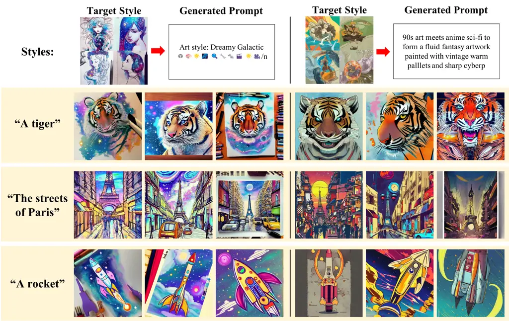

Figure 7: Decoded hard prompt for style transfer. Given several sample
images with the same style, we can extract the style with a hard prompt
and transfer it to other objects or scenes.

VGD can also be easily adapted to style transfer. Given several examples
(typically 4 images) that share the same style, we extract their shared
style characteristics as a single hard prompt and use this prompt to
apply the style to new objects or scenes. Fig. 7 shows two examples of
style transfer, demonstrating that VGD correctly embeds the shared style
elements in the prompt, which can be easily combined with new objects.

### 4.3 Quality of VGD Prompts

#### Quantitative Evaluation

To assess the coherence of generated prompts, we measure the BERTScore
between the prompts generated by each method and the ground-truth
captions. As shown in Table 1, VGD achieves a significant improvement in
BERTScore compared to PEZ, especially when using more than 64 tokens.
Although LLaVA-based baselines show higher BERTScore, their CLIP-I
scores are worse than those of VGD. This implies that the LLaVA captions
fail to describe the target image in detail, even though the text itself
may be semantically similar to ground-truth captions.

#### Interpretability

When a prompt closely aligns with the image content and is interpretable
by humans, it becomes easier for users to modify the image in the
desired direction by making slight edits to the prompt. To evaluate the
interpretability of the generated prompts, we make minimal modifications
to the prompt and observe the effects. For example, we change “winter”
to “spring” and see if the generated image successfully reflects the
change. As illustrated in Fig. 9, we compare VGD with previous
gradient-based prompt inversion techniques, namely PEZ (hard) and
Textual Inversion (soft).

The results indicate that VGD exhibits superior interpretability. When
we adjust the number of objects, background elements, atmosphere
(seasons), and species in the prompt, VGD successfully incorporates
these changes. The relevant terms are already present in the original
prompt, enabling accurate image generation with the modified prompts. In
contrast, the competitors struggle to produce the desired outcomes. For
instance, when we try to generate four wolves, both PEZ and Textual
Inversion fail to change the number of wolves included.

#### Prompt Distillation

Figure 8: Prompt distillation on Lexica.art dataset.

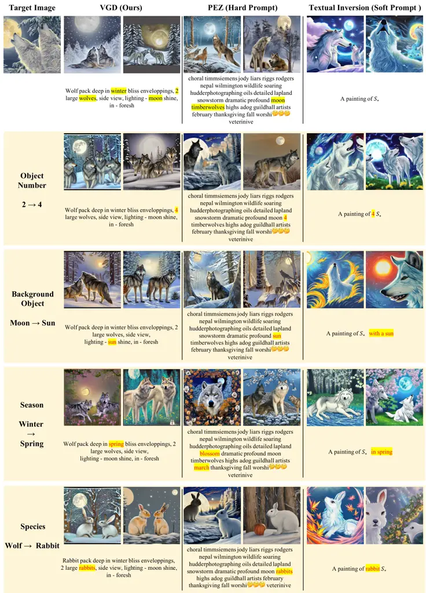

Figure 9: Prompt interpretability. With the good interpretability of the
prompt, we can modify them to edit the original image to the desired
direction.

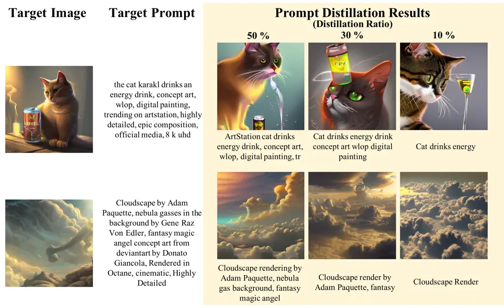

Figure 10: Prompt distillation results generated by the proposed VGD.
With VGD, we can distillate the hard prompt that can still generate
images similar in concept to the original.

We can also utilize prompt inversion to reduce the length of prompts
while preserving their capability, a.k.a. prompt distillation. Long
prompts may contain redundant and unimportant information, especially
when hand-crafted. This becomes problematic, particularly when there
exists a limit on the number of tokens that the model can process. Using
VGD, we can generate a shorter prompt that preserves the key aspects of
the original prompt. As illustrated in Fig. 10, the images generated
with distilled prompts are very similar to the original image. In
addition, images generated with distilled prompts do not show
significant performance degradation on CLIP-I score compared to the
original prompt, as shown in Fig. 8.

### 4.4 Effect of CLIP and Language Model

|           |            |           |        |       |
| --------- | ---------- | --------- | ------ | ----- |
| Model     | CLIP Score | BERTScore |        |       |
|           |            | Precision | Recall | F1    |
| VGD       | 0.735      | 0.816     | 0.786  | 0.801 |
| LLM only  | 0.487      | 0.811     | 0.773  | 0.791 |
| CLIP only | 0.768      | 0.727     | 0.779  | 0.751 |
|           |            |           |        |       |

Table 2: Comparison of VGD variants.

|                           |          |            |
| ------------------------- | -------- | ---------- |
| CLIP Model                | \#Tokens | CLIP Score |
| laion/ViT-H-14 (original) | 32       | 0.735      |
| openai/ViT-B-32           | 32       | 0.655      |
| openai/ViT-L-14           | 32       | 0.626      |
|                           |          |            |

Table 3: Ablation on CLIP models.

#### Role of CLIP and LLM

To investigate the effect of using both CLIP and LLM, we modify VGD in
two ways and compare these variants on the Lexica.art. In the ‘LLM only’
variant, VGD selects the next token based solely on
$`P_{\text{LLM}}(x^{\text{txt}}_{i}|x^{\text{txt}}_{1:i-1})`$ without
considering CLIP score, operating like typical LLM text decoding. In the
‘CLIP only’ variant, VGD determines the next token using only the CLIP
model. Table 3 shows that the ‘LLM only’ variant suffers from a drastic
performance degradation in the CLIP score because it does not consider
the target image at all. On the other hand, the ‘CLIP only’ variant
achieves the highest CLIP score but the lowest BERTScore, suggesting
that the generated prompt is less coherent and harder to interpret. In
comparison, the proposed VGD demonstrates strong and balanced
performance on the CLIP score and BERTScore.

#### CLIP Model Ablation

VGD leverages the same CLIP model that is used in the text-to-image
model, Stable Diffusion 2.1. To assess the importance of this alignment,
we perform an ablation study using two alternative CLIP models:
openai/ViT-B-32 and openai/ViT-L-14. Table 3 shows that using a
misaligned CLIP model leads to significant performance degradation. This
highlights the importance of proper approximation
$`P(T|I)\simeq P_{\text{CLIP}}(T|I)`$. When a different CLIP model is
used, the approximation no longer holds, leading to a drop in
performance.

#### Language Model Ablation

|            |          |              |         |         |            |           |        |       |            |        |       |
| ---------- | -------- | ------------ | ------- | ------- | ---------- | --------- | ------ | ----- | ---------- | ------ | ----- |
| LLM        | \#Tokens | LAION        | MS COCO | Celeb-A | Lexica.art | MS COCO   |        |       | Lexica.art |        |       |
|            |          | CLIP-I Score |         |         |            | Precision | Recall | F1    | Precision  | Recall | F1    |
| Mistral-7B | 16       | 0.443        | 0.615   | 0.422   | 0.706      | 0.808     | 0.850  | 0.828 | 0.815      | 0.780  | 0.797 |
|            | 32       | 0.463        | 0.656   | 0.466   | 0.729      | 0.803     | 0.858  | 0.829 | 0.808      | 0.787  | 0.797 |
|            | 64       | 0.497        | 0.680   | 0.476   | 0.751      | 0.783     | 0.858  | 0.818 | 0.791      | 0.789  | 0.790 |
| LLaMA2-7B  | 16       | 0.484        | 0.650   | 0.482   | 0.700      | 0.833     | 0.862  | 0.847 | 0.827      | 0.779  | 0.802 |
|            | 32       | 0.493        | 0.670   | 0.506   | 0.735      | 0.818     | 0.868  | 0.842 | 0.816      | 0.786  | 0.801 |
|            | 64       | 0.511        | 0.678   | 0.514   | 0.753      | 0.787     | 0.863  | 0.823 | 0.799      | 0.789  | 0.794 |
| LLaMA3-8B  | 16       | 0.480        | 0.648   | 0.521   | 0.731      | 0.820     | 0.861  | 0.840 | 0.829      | 0.784  | 0.806 |
|            | 32       | 0.506        | 0.661   | 0.540   | 0.752      | 0.805     | 0.864  | 0.833 | 0.817      | 0.790  | 0.803 |
|            | 64       | 0.515        | 0.685   | 0.543   | 0.769      | 0.769     | 0.858  | 0.811 | 0.796      | 0.794  | 0.795 |

Table 4: Ablation on language models.

We conduct an ablation study using three different LLMs:
Mistral-7B (Jiang et al., 2023), LLaMA2-7B (Touvron et al., 2023), and
LLaMA3-8B (Dubey et al., 2024). As shown in Table 4, although LLaMA3-8B
exhibits the best performance, the overall differences among the models
are marginal. This indicates that VGD is not dependent on the specific
language model used, allowing users to choose an LLM that best suits
their system.

## 5 Conclusion

This paper tackles the difficulty of creating effective textual prompts
for advanced text-to-image models like DALL-E and Stable Diffusion.
Traditional prompt inversion methods often lack interpretability and
coherence, limiting their usefulness. We introduce VGD, a gradient-free
technique that combines LLMs with CLIP-based guidance to generate clear
and semantically accurate prompts. VGD enhances prompt interpretability,
generalization, and flexibility without requiring additional training.
Our experiments show that VGD outperforms existing methods, producing
more understandable and contextually relevant prompts. By integrating
seamlessly with various LLMs such as LLaMA2, LLaMA3, and Mistral, VGD
provides an efficient and versatile solution for improving user
interactions with text-to-image generative models.

## Acknowledgments

This work was supported by Institute of Information & communications
Technology Planning & Evaluation (IITP) grant funded by the Korea
government(MSIT) (IITP-2023-RS-2023-00256081 and RS-2024-00398157. The
authors would like to thank Jinwoo Son for his valuable assistance in
proofreading this manuscript.

## References

- Alayrac et al. (2022) Jean-Baptiste Alayrac, Jeff Donahue, Pauline
  Luc, Antoine Miech, Iain Barr, Yana Hasson, Karel Lenc, Arthur Mensch,
  Katherine Millican, Malcolm Reynolds, et al. Flamingo: a visual
  language model for few-shot learning. _Advances in neural information
  processing systems_, 35:23716–23736, 2022.
- Anderson et al. (2017) Peter Anderson, Basura Fernando, Mark Johnson,
  and Stephen Gould. Guided open vocabulary image captioning with
  constrained beam search. In _Proceedings of the 2017 Conference on
  Empirical Methods in Natural Language Processing_, pp. 936–945, 2017.
- Brooks et al. (2023) Tim Brooks, Aleksander Holynski, and Alexei A
  Efros. Instructpix2pix: Learning to follow image editing instructions.
  In _Proceedings of the IEEE/CVF Conference on Computer Vision and
  Pattern Recognition_, pp. 18392–18402, 2023.
- Brown et al. (1993) Peter F Brown, Stephen A Della Pietra, Vincent J
  Della Pietra, and Robert L Mercer. The mathematics of statistical
  machine translation: Parameter estimation. _Computational
  linguistics_, 19(2):263–311, 1993.
- Dubey et al. (2024) Abhimanyu Dubey, Abhinav Jauhri, Abhinav Pandey,
  Abhishek Kadian, Ahmad Al-Dahle, Aiesha Letman, Akhil Mathur, Alan
  Schelten, Amy Yang, Angela Fan, et al. The llama 3 herd of models.
  _arXiv preprint arXiv:2407.21783_, 2024.
- Everaert et al. (2023) Martin Nicolas Everaert, Marco Bocchio, Sami
  Arpa, Sabine Süsstrunk, and Radhakrishna Achanta. Vetim: Expanding the
  vocabulary of text-to-image models only with text. In _The 34th
  British Machine Vision Conference (BMVC 2023)_. BMVA, 2023.
- Gal et al. (2023) Rinon Gal, Yuval Alaluf, Yuval Atzmon, Or Patashnik,
  Amit Haim Bermano, Gal Chechik, and Daniel Cohen-or. An image is worth
  one word: Personalizing text-to-image generation using textual
  inversion. In _The Eleventh International Conference on Learning
  Representations_, 2023.
- Ge et al. (2023) Songwei Ge, Taesung Park, Jun-Yan Zhu, and Jia-Bin
  Huang. Expressive text-to-image generation with rich text. In
  _Proceedings of the IEEE/CVF International Conference on Computer
  Vision_, pp. 7545–7556, 2023.
- Guo & Lin (2024) Qin Guo and Tianwei Lin. Focus on your instruction:
  Fine-grained and multi-instruction image editing by attention
  modulation. In _Proceedings of the IEEE/CVF Conference on Computer
  Vision and Pattern Recognition_, pp. 6986–6996, 2024.
- Hao et al. (2024) Yaru Hao, Zewen Chi, Li Dong, and Furu Wei.
  Optimizing prompts for text-to-image generation. _Advances in Neural
  Information Processing Systems_, 36, 2024.
- Hertz et al. (2023) Amir Hertz, Ron Mokady, Jay Tenenbaum, Kfir
  Aberman, Yael Pritch, and Daniel Cohen-or. Prompt-to-prompt image
  editing with cross-attention control. In _The Eleventh International
  Conference on Learning Representations_, 2023.
- Holtzman et al. (2020) Ari Holtzman, Jan Buys, Li Du, Maxwell Forbes,
  and Yejin Choi. The curious case of neural text degeneration. In
  _International Conference on Learning Representations_, 2020.
- Hu et al. (2019) J Edward Hu, Huda Khayrallah, Ryan Culkin, Patrick
  Xia, Tongfei Chen, Matt Post, and Benjamin Van Durme. Improved
  lexically constrained decoding for translation and monolingual
  rewriting. In _Proceedings of the 2019 Conference of the North
  American Chapter of the Association for Computational Linguistics:
  Human Language Technologies_, pp. 839–850, 2019.
- Jiang et al. (2023) Albert Q Jiang, Alexandre Sablayrolles, Arthur
  Mensch, Chris Bamford, Devendra Singh Chaplot, Diego de las Casas,
  Florian Bressand, Gianna Lengyel, Guillaume Lample, Lucile Saulnier,
  et al. Mistral 7b. _arXiv preprint arXiv:2310.06825_, 2023.
- (15) Dong Jing, Xiaolong He, Yutian Luo, Nanyi Fei, Guoxing Yang, Wei
  Wei, Huiwen Zhao, and Zhiwu Lu. Fineclip: Self-distilled region-based
  clip for better fine-grained understanding. In _The Thirty-eighth
  Annual Conference on Neural Information Processing Systems_.
- Jurafsky (2000) Daniel Jurafsky. Speech and language processing, 2000.
- Kim et al. (2024) Donghoon Kim, Gusang Lee, Kyuhong Shim, and Byonghyo
  Shim. Preserving pre-trained representation space: On effectiveness of
  prefix-tuning for large multi-modal models. In Yaser Al-Onaizan, Mohit
  Bansal, and Yun-Nung Chen (eds.), _Findings of the Association for
  Computational Linguistics: EMNLP 2024_, pp. 797–819, Miami, Florida,
  USA, November 2024. Association for Computational Linguistics. doi:
  10.18653/v1/2024.findings-emnlp.44. URL
  [https://aclanthology.org/2024.findings-emnlp.44/](https://aclanthology.org/2024.findings-emnlp.44/).
- Kong et al. (2024) Xianghao Kong, Ollie Liu, Han Li, Dani Yogatama,
  and Greg Ver Steeg. Interpretable diffusion via information
  decomposition. In _The Twelfth International Conference on Learning
  Representations_, 2024.
- Kumari et al. (2023) Nupur Kumari, Bingliang Zhang, Richard Zhang, Eli
  Shechtman, and Jun-Yan Zhu. Multi-concept customization of
  text-to-image diffusion. In _Proceedings of the IEEE/CVF Conference on
  Computer Vision and Pattern Recognition_, pp. 1931–1941, 2023.
- Lee et al. (2025) Insu Lee, Jiseob Kim, Kyuhong Shim, and Byonghyo
  Shim. Learning primitive relations for compositional zero-shot
  learning. _arXiv preprint arXiv:2501.14308_, 2025.
- Lester et al. (2021) Brian Lester, Rami Al-Rfou, and Noah Constant.
  The power of scale for parameter-efficient prompt tuning. In
  Marie-Francine Moens, Xuanjing Huang, Lucia Specia, and Scott Wen-tau
  Yih (eds.), _Proceedings of the 2021 Conference on Empirical Methods
  in Natural Language Processing_, pp. 3045–3059, November 2021.
- Li et al. (2022) Junnan Li, Dongxu Li, Caiming Xiong, and Steven Hoi.
  Blip: Bootstrapping language-image pre-training for unified
  vision-language understanding and generation. In _International
  conference on machine learning_, pp. 12888–12900. PMLR, 2022.
- Li et al. (2023) Junnan Li, Dongxu Li, Silvio Savarese, and Steven
  Hoi. Blip-2: Bootstrapping language-image pre-training with frozen
  image encoders and large language models. In _International conference
  on machine learning_, pp. 19730–19742. PMLR, 2023.
- Li & Liang (2021) Xiang Lisa Li and Percy Liang. Prefix-tuning:
  Optimizing continuous prompts for generation. In _Proceedings of the
  59th Annual Meeting of the Association for Computational Linguistics
  and the 11th International Joint Conference on Natural Language
  Processing_, 2021.
- Lin et al. (2014) Tsung-Yi Lin, Michael Maire, Serge Belongie, James
  Hays, Pietro Perona, Deva Ramanan, Piotr Dollár, and C Lawrence
  Zitnick. Microsoft coco: Common objects in context. In _Computer
  Vision–ECCV 2014: 13th European Conference, Zurich, Switzerland,
  September 6-12, 2014, Proceedings, Part V 13_, pp. 740–755.
  Springer, 2014.
- Liu et al. (2024) Haotian Liu, Chunyuan Li, Qingyang Wu, and Yong Jae
  Lee. Visual instruction tuning. _Advances in neural information
  processing systems_, 36, 2024.
- Liu et al. (2022) Xiao Liu, Kaixuan Ji, Yicheng Fu, Weng Tam,
  Zhengxiao Du, Zhilin Yang, and Jie Tang. P-tuning: Prompt tuning can
  be comparable to fine-tuning across scales and tasks. In _Proceedings
  of the 60th Annual Meeting of the Association for Computational
  Linguistics_, 2022.
- Liu et al. (2015) Ziwei Liu, Ping Luo, Xiaogang Wang, and Xiaoou Tang.
  Deep learning face attributes in the wild. In _Proceedings of
  International Conference on Computer Vision (ICCV)_, December 2015.
- Mahajan et al. (2024) Shweta Mahajan, Tanzila Rahman, Kwang Moo Yi,
  and Leonid Sigal. Prompting hard or hardly prompting: Prompt inversion
  for text-to-image diffusion models. In _Proceedings of the IEEE/CVF
  Conference on Computer Vision and Pattern Recognition_, pp.
  6808–6817, 2024.
- Orgad et al. (2023) Hadas Orgad, Bahjat Kawar, and Yonatan Belinkov.
  Editing implicit assumptions in text-to-image diffusion models. In
  _Proceedings of the IEEE/CVF International Conference on Computer
  Vision_, pp. 7053–7061, 2023.
- Ouyang et al. (2022) Long Ouyang, Jeffrey Wu, Xu Jiang, Diogo Almeida,
  Carroll Wainwright, Pamela Mishkin, Chong Zhang, Sandhini Agarwal,
  Katarina Slama, Alex Ray, et al. Training language models to follow
  instructions with human feedback. _Advances in Neural Information
  Processing Systems_, 35:27730–27744, 2022.
- Paiss et al. (2023) Roni Paiss, Ariel Ephrat, Omer Tov, Shiran Zada,
  Inbar Mosseri, Michal Irani, and Tali Dekel. Teaching clip to count to
  ten. In _Proceedings of the IEEE/CVF International Conference on
  Computer Vision_, pp. 3170–3180, 2023.
- Podell et al. (2024) Dustin Podell, Zion English, Kyle Lacey, Andreas
  Blattmann, Tim Dockhorn, Jonas Müller, Joe Penna, and Robin Rombach.
  SDXL: Improving latent diffusion models for high-resolution image
  synthesis. In _The Twelfth International Conference on Learning
  Representations_, 2024.
- Post & Vilar (2018) Matt Post and David Vilar. Fast lexically
  constrained decoding with dynamic beam allocation for neural machine
  translation. In _Proceedings of the 2018 Conference of the North
  American Chapter of the Association for Computational Linguistics:
  Human Language Technologies_, 2018.
- Radford et al. (2021) Alec Radford, Jong Wook Kim, Chris Hallacy,
  Aditya Ramesh, Gabriel Goh, Sandhini Agarwal, Girish Sastry, Amanda
  Askell, Pamela Mishkin, Jack Clark, et al. Learning transferable
  visual models from natural language supervision. In _International
  conference on machine learning_, pp. 8748–8763. PMLR, 2021.
- Ramesh et al. (2022) Aditya Ramesh, Prafulla Dhariwal, Alex Nichol,
  Casey Chu, and Mark Chen. Hierarchical text-conditional image
  generation with clip latents. _arXiv preprint arXiv:2204.06125_, 2022.
- Ranasinghe et al. (2023) Kanchana Ranasinghe, Brandon McKinzie, Sachin
  Ravi, Yinfei Yang, Alexander Toshev, and Jonathon Shlens. Perceptual
  grouping in contrastive vision-language models. In _Proceedings of the
  IEEE/CVF International Conference on Computer Vision_, pp.
  5571–5584, 2023.
- Rombach et al. (2022) Robin Rombach, Andreas Blattmann, Dominik
  Lorenz, Patrick Esser, and Björn Ommer. High-resolution image
  synthesis with latent diffusion models. In _Proceedings of the
  IEEE/CVF conference on computer vision and pattern recognition_, pp.
  10684–10695, 2022.
- Ruiz et al. (2023) Nataniel Ruiz, Yuanzhen Li, Varun Jampani, Yael
  Pritch, Michael Rubinstein, and Kfir Aberman. Dreambooth: Fine tuning
  text-to-image diffusion models for subject-driven generation. In
  _Proceedings of the IEEE/CVF Conference on Computer Vision and Pattern
  Recognition_, pp. 22500–22510, 2023.
- Schuhmann et al. (2021) Christoph Schuhmann, Richard Vencu, Romain
  Beaumont, Robert Kaczmarczyk, Clayton Mullis, Aarush Katta, Theo
  Coombes, Jenia Jitsev, and Aran Komatsuzaki. Laion-400m: Open dataset
  of clip-filtered 400 million image-text pairs. _arXiv preprint
  arXiv:2111.02114_, 2021.
- Schuhmann et al. (2022) Christoph Schuhmann, Romain Beaumont, Richard
  Vencu, Cade Gordon, Ross Wightman, Mehdi Cherti, Theo Coombes, Aarush
  Katta, Clayton Mullis, Mitchell Wortsman, et al. Laion-5b: An open
  large-scale dataset for training next generation image-text models.
  _Advances in Neural Information Processing Systems_,
  35:25278–25294, 2022.
- Tang et al. (2023) Raphael Tang, Linqing Liu, Akshat Pandey, Zhiying
  Jiang, Gefei Yang, Karun Kumar, Pontus Stenetorp, Jimmy Lin, and
  Ferhan Ture. What the DAAM: Interpreting stable diffusion using cross
  attention. In _Proceedings of the 61st Annual Meeting of the
  Association for Computational Linguistics_, 2023.
- Touvron et al. (2023) Hugo Touvron, Louis Martin, Kevin Stone, Peter
  Albert, Amjad Almahairi, Yasmine Babaei, Nikolay Bashlykov, Soumya
  Batra, Prajjwal Bhargava, Shruti Bhosale, et al. Llama 2: Open
  foundation and fine-tuned chat models. _arXiv preprint
  arXiv:2307.09288_, 2023.
- Voynov et al. (2023) Andrey Voynov, Qinghao Chu, Daniel Cohen-Or, and
  Kfir Aberman. p+: Extended textual conditioning in text-to-image
  generation. _arXiv preprint arXiv:2303.09522_, 2023.
- Wang et al. (2024) Zhijie Wang, Yuheng Huang, Da Song, Lei Ma, and
  Tianyi Zhang. Promptcharm: Text-to-image generation through
  multi-modal prompting and refinement. In _Proceedings of the CHI
  Conference on Human Factors in Computing Systems_, pp. 1–21, 2024.
- Wen et al. (2024) Yuxin Wen, Neel Jain, John Kirchenbauer, Micah
  Goldblum, Jonas Geiping, and Tom Goldstein. Hard prompts made easy:
  Gradient-based discrete optimization for prompt tuning and discovery.
  _Advances in Neural Information Processing Systems_, 36, 2024.
- Yuksekgonul et al. (2022) Mert Yuksekgonul, Federico Bianchi,
  Pratyusha Kalluri, Dan Jurafsky, and James Zou. When and why
  vision-language models behave like bags-of-words, and what to do about
  it? _arXiv preprint arXiv:2210.01936_, 2022.
- Zhang et al. (2020) Tianyi Zhang, Varsha Kishore, Felix Wu, Kilian Q.
  Weinberger, and Yoav Artzi. Bertscore: Evaluating text generation with
  bert. In _International Conference on Learning Representations_, 2020.
- Zhang et al. (2024) Yuechen Zhang, Shengju Qian, Bohao Peng, Shu Liu,
  and Jiaya Jia. Prompt highlighter: Interactive control for multi-modal
  llms. In _Proceedings of the IEEE/CVF Conference on Computer Vision
  and Pattern Recognition_, pp. 13215–13224, 2024.
- Zhong et al. (2022) Yiwu Zhong, Jianwei Yang, Pengchuan Zhang,
  Chunyuan Li, Noel Codella, Liunian Harold Li, Luowei Zhou, Xiyang Dai,
  Lu Yuan, Yin Li, et al. Regionclip: Region-based language-image
  pretraining. In _Proceedings of the IEEE/CVF conference on computer
  vision and pattern recognition_, pp. 16793–16803, 2022.

## Appendix A Details

### A.1 Prompt Setup for Large Language Models

We use different system and user prompts for different image generation
tasks. Tables 5 and 6 show the prompts used for the experiments.

|                                                                                                                                                                                                      |
| ---------------------------------------------------------------------------------------------------------------------------------------------------------------------------------------------------- |
| System Prompt                                                                                                                                                                                        |
| You are a respectful and honest visual description generator for Stable Diffusion text prompt. Answer in 1 sentence and do not mention anything other than the prompt. Do not mention ‘description’. |
| User Prompt (Prompt Inversion)                                                                                                                                                                       |
| Please generate the diffusion prompt on the given condition containing the objects, people, background, and the style of the image:                                                                  |
| User Prompt (Style Transfer)                                                                                                                                                                         |
| Please generate the diffusion prompt of the image style based on the given condition containing the painting style, color, and shapes of the image:                                                  |
| User Prompt (Prompt Distillation)                                                                                                                                                                    |
| Please generate the diffusion prompt within \${max_length} tokens so that you can generate same images with a given prompt: \${target_prompt}                                                        |
| Model prompt                                                                                                                                                                                         |
| Answer: Sure, here is a prompt for stable diffusion within \${model.max_length} tokens:                                                                                                              |

Table 5: LLM prompt setting for different image generation tasks.

|                                                                                                                                                                                                                                 |
| ------------------------------------------------------------------------------------------------------------------------------------------------------------------------------------------------------------------------------- |
| Prompt (Image Captioning)                                                                                                                                                                                                       |
| USER: $`<\text{image}>`$ Describe the scene in this image with one sentence. ASSISTANT:                                                                                                                                         |
| Prompt (VGD)                                                                                                                                                                                                                    |
| USER: $`<\text{image}>`$ Please generate the diffusion prompt containing the objects, people, background and the style of the image. ASSISTANT: Sure, here is a prompt for stable diffusion within \${model.max_length} tokens: |

Table 6: LLaVA prompt setting for different image generation tasks.

### A.2 Hyperparameters and Models

The beam width $`K`$ is set to 10. The balancing hyperparameter
$`\alpha`$ is set to 0.67. For VGD generation, we used
laion/CLIP-ViT-H-14-laion2B-s32B-b79K³³ 3
https://huggingface.co/laion/CLIP-ViT-H-14-laion2B-s32B-b79K. For CLIP-I
score evaluation, we used laion/CLIP-ViT-g-14-laion2B-s12B-b42K⁴⁴ 4
https://huggingface.co/laion/CLIP-ViT-g-14-laion2B-s12B-b42K. We used
Stable Diffusion stabilityai/stable-diffusion-2-1⁵⁵ 5
https://huggingface.co/stabilityai/stable-diffusion-2-1 for
text-to-image model.

### A.3 Dataset Characteristics

LAION-400M (Schuhmann et al., 2021; Schuhmann et al., 2022) comprises
400 million diverse CLIP-filtered images. MS COCO (Lin et al., 2014)
mainly contains real-life photographs with multiple common objects,
whereas Celeb-A (Liu et al., 2015) consists of celebrity portraits.
Lexica.art contains AI-generated paintings with their prompts. While
different datasets exhibit different characteristics, VGD works
effectively regardless of the data type.

### A.4 CLIP-Interrogator’s Approach

CLIP-Interrogator supplements missing details in generated image
captions by extensive trial-and-error approach. Specifically,
CLIP-Interrogator augments the caption with additional tokens selected
from a pre-collected bank of 100K keywords (e.g., artist names, styles,
mediums, movements), and compare each with the target image through CLIP
model to filter out image-irrelevant keywords. While effective in
generating the hard prompt, CLIP-Interrogator has several drawbacks: 1)
an inability to generate images for styles, artists, or objects that are
not registered in the keyword bank, and 2) the computational burden of
processing 100K phrases through a CLIP encoder. These limitations
highlight the challenges of relying solely on image captions for image
synthesis, and underscore the need for efficient and flexible hard
prompt generation techniques.

## Appendix B Additional Related Works

### B.1 Prompt Editing for Text-to-Image Models

To fully harness the capabilities of text-to-image models, various
approaches have been proposed to tailor text prompts to the user’s
specific intentions (Hertz et al., 2023; Brooks et al., 2023; Wang
et al., 2024) Notably, a rich text editor has been introduced, enabling
users to design complex textual guidance to image generation models (Ge
et al., 2023). Similarly, Prompt Highlighter, an interactive
text-to-image interface utilizing multi-modal LLMs, has been
proposed (Zhang et al., 2024). These studies underscore the necessity
for user-friendly and controllable text editing methods. Our VGD can be
seamlessly integrated into LLM-based user interfaces, as illustrated in
Fig. 1. VGD leverages the same token generation process as LLMs,
benefiting from the highly optimized inference process without requiring
additional training.

### B.2 Interpretability of Text-to-Image Models

As text-to-image applications become standard in the industry,
interpretability studies for these models have gained significant
attention. For instance, research has focused on the cross-attention
mechanism to identify the model’s attention for each word (Tang et al.,
2023). In advance, the diffusion objective has been investigated to
understand the internal behavior of text-to-image models (Kong et al.,
2024). Building on these findings, recent works modified the model’s
architecture to more faithfully reflect user’s instructions (Orgad
et al., 2023; Guo & Lin, 2024). We emphasize that VGD aims to enhance
the human interpretability without architectural modifications. We
believe that previous works can also be also applied to VGD to further
improve usability.

## Appendix C Additional Experimental Results

### C.1 Generalization of Generated Prompts to Different T2I Models

We demonstrate how prompts generated by our method and other baseline
methods behave when applied to different text-to-image models (see
Fig. 13, 14,  15, and 16). In this experiment, we did not generate any
new prompt for the newly tested T2I model (i.e., MidJourney, DALL-E 2),
meaning that we simply reused the prompts generated for SD in evaluating
the effectiveness of producing high-quality images with various T2I
models. In doing so, we can ensure a fair comparison and also highlight
the generalizability of the prompts across models. Finally, we would
like to point out that this type of generalization cannot be done with
soft prompt methods like Textual Inversion, as they are inherently tied
to the specific model they are trained on. When compared to hard prompt
inversion methods (such as PH2P and PEZ), VGD generates consistently
better results in various text-to-image models, which underscores the
robustness and flexibility of the proposed VGD.

### C.2 Prompt Generation Time

We further investigate the efficiency of VGD in comparison with other
baseline methods, measured on a single A100 80GB GPU. As shown in
Table 7, the proposed VGD needs significantly less time to generate each
image; 7x faster than Textual Inversion, 12x faster than PEZ, and more
than 2200x faster than PH2P. This is because VGD does not require any
training steps and only the decoding process is slightly modified.

|              |          |            |                     |                     |              |
| ------------ | -------- | ---------- | ------------------- | ------------------- | ------------ |
|   Method     |   PEZ    |   PH2P     |   Textual Inversion |   CLIP Interrogator |   VGD (ours) |
|   Time (sec) |   193.14 |   34264.74 |   103.45            |   24.85             |   15.33      |

Table 7: Prompt generation time of VGD, PEZ, PH2P, Textual Inversion,
and CLIP Interrogator.

### C.3 More Qualitative Comparison

As shown in Fig. 17, 18 and 19, we conduct a qualitative comparison of
image variation and style transfer performance across different methods,
including PEZ, Textual Inversion, and CLIP Interrogator. The results
demonstrate that, similar to the findings in Table 1, our method
outperforms prior works, with CLIP Interrogator coming second.

While CLIP Interrogator captures objects effectively by generating
captions using LLaVA (Liu et al., 2024) and predefined rich keyword
bank, there are some critical weaknesses in prompts generated by the
CLIP Interrogator (see Fig. 17). First, the subsequent keywords
extracted from the caption’s keyword bank using CLIP similarity often
suffer from redundancy and lack of interpretability. Second, CLIP
Interrogator tends to generate prompts of full length (77 words), which
limits its applicability to diverse tasks like multi-concept image
generation and style transfer. Finally, as seen in the prompt example
for the tiger image in Fig. 17, the quality of the generated images
often decreases when using the extracted keywords, compared to images
generated without attaching the keywords. In some cases, this leads to
all extracted keywords being rejected entirely.

### C.4 Human Evaluation

To evaluate whether the images generated by VGD are semantically aligned
with the original image and to assess image quality, we conduct human
preference evaluation. For this experiment, participants were shown
images generated for image variation and style transfer by five
different methods (VGD, Textual Inversion, PEZ, PH2P, and CLIP
Interrogator) and were asked to select the image most similar to the
target image and style (Kumari et al., 2023) (see Fig. 12). The
evaluation was conducted using 65 images randomly sampled from
Lexica.art dataset. Fig. 11 demonstrates that our method consistently
performed best in both image variation and style transfer tasks
according to user preferences. Specifically, 60.5% and 52.6% of the
participants selected VGD’s results as the most similarly generated ones
for image variation and most instruction-following generations for style
transfer tasks, respectively.

Figure 11: Human preference evaluation for image variation (left) and
style transfer (right) tasks using different prompt generation methods.
CI indicates CLIP Interrogator. Best viewed in color.

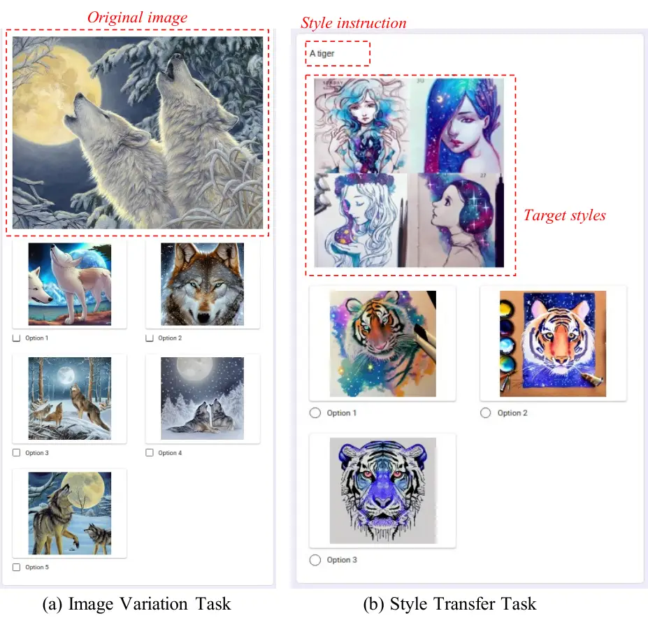

Figure 12: Webpage used for human preference evaluation.

### C.5 Bad Cases

While VGD generally shows decent results, our method sometimes struggles
to capture fine-grained details of regional or background objects in
complex images. These cases occur when the image contains multiple
objects (see Fig. 20). This is because VGD has difficulty in generating
prompts for regional or local objects in the background. We believe this
phenomenon is mainly due to the CLIP vision encoder’s tendency to
prioritize main objects in an image (Jing et al., ; Paiss et al., 2023;
Ranasinghe et al., 2023; Yuksekgonul et al., 2022; Zhong et al., 2022).

### C.6 Multi-concept Generation

We further explore the potential of VGD by combining five different
concepts into a single image. Fig. 21 demonstrates that the prompts
generated by VGD can be concatenated to generate a complex image without
missing concepts. However, generated prompts from PEZ suffers omits
important details, such as the parliamentary, wolves, and the style of
The Starry Night. This shows that VGD generates hard prompts that are
compact and meaningful.

## Appendix D Limitation and Ethical Statement

### D.1 Limitations

Although we showcase the generalizability of VGD-generated prompts
across multiple text-to-image models, our evaluations primarily focus on
popular models such as Stable Diffusion and MidJourney. However, since
many other models are trained on similar datasets and follow comparable
methods and architectures, we anticipate that the results would be
consistent across these models as well.

### D.2 Ethics Statement

The development of VGD raises important ethical considerations,
particularly regarding potential misuse. While our method improves the
interpretability and generalizability of text-to-image generation, it
could also be exploited to generate harmful or inappropriate content,
such as deepfakes or offensive imagery. We strongly discourage such uses
and emphasize that this method is intended for responsible applications
in creative, educational, and professional contexts.

|                |            |            |         |         |            |
| -------------- | ---------- | ---------- | ------- | ------- | ---------- |
| Method         | \#Tokens   | LAION-400M | MS COCO | Celeb-A | Lexica.art |
| PEZ            | 32         | 813.27     | 766.81  | 971.35  | 659.39     |
| LLaVA-1.5 + CI | $`\sim`$77 | 102.62     | 80.97   | 67.59   | 76.04      |
| PH2P           | 16         | 1274.14    | 947.29  | 892.04  | 1126.11    |
| VGD            | 32         | 94.96      | 89.48   | 68.69   | 91.12      |
| VGD+LLaVA      | 32         | 190.37     | 106.84  | 108.80  | 121.11     |
| VGD+LLaVA      | 77         | 42.00      | 36.11   | 34.39   | 47.07      |

Table 8: Prompt interpretability evaluation with Perplexity metric.
Lower scores indicate better performance.

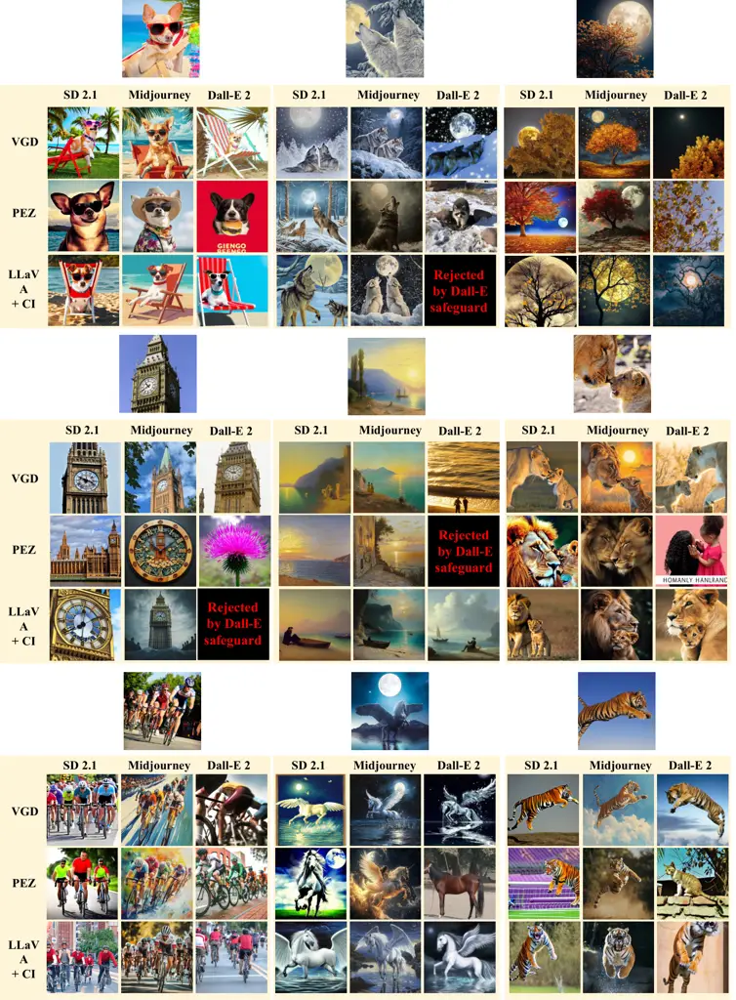

Figure 13: Qualitative examples generated by Stable Diffusion,
Midjourney and Dall-E 2 using prompts generated from VGD, PEZ, and
LLaVA+CLIP-Interrogator.

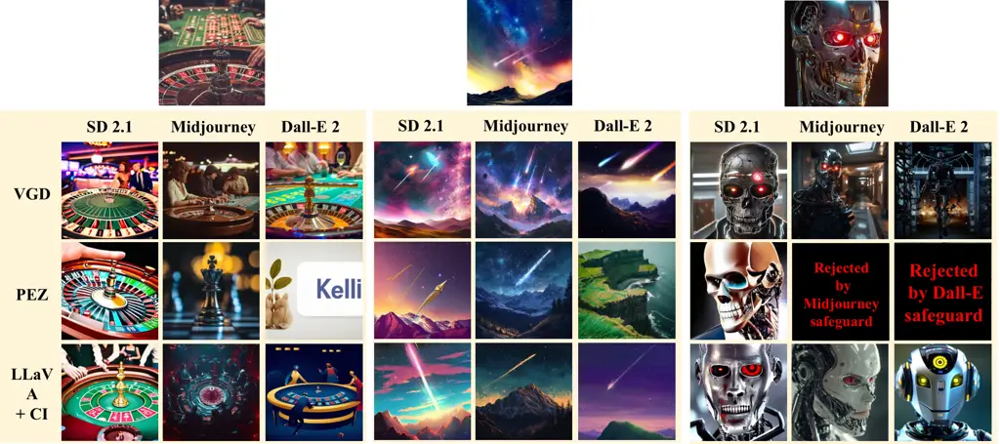

Figure 14: More qualitative examples generated by Stable Diffusion,
Midjourney and Dall-E 2 using prompts generated from VGD, PEZ, and
LLaVA+CLIP-Interrogator.

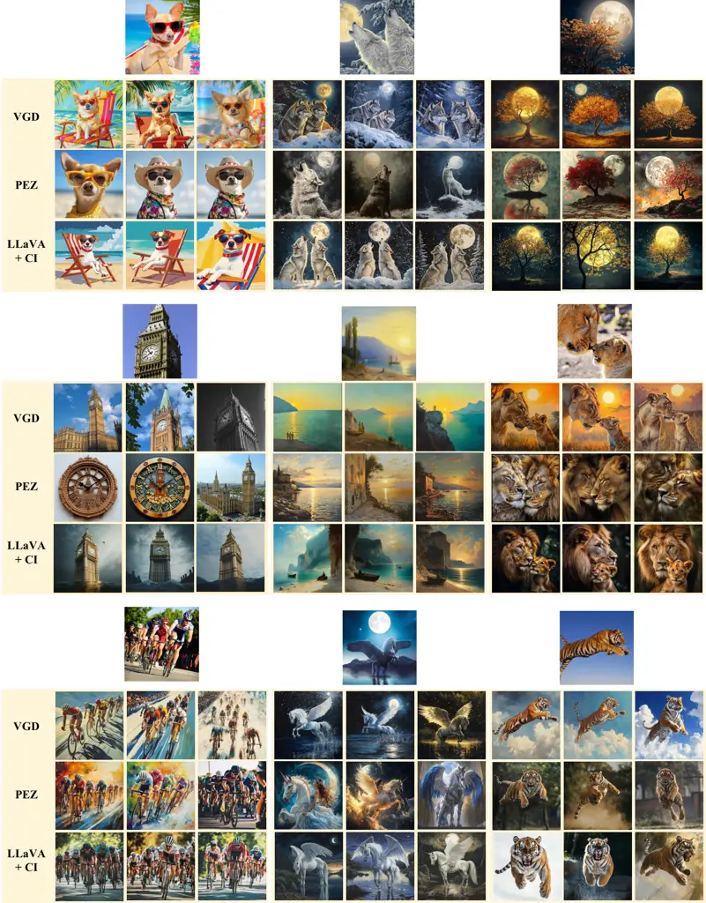

Figure 15: More examples generated by MidJourney.

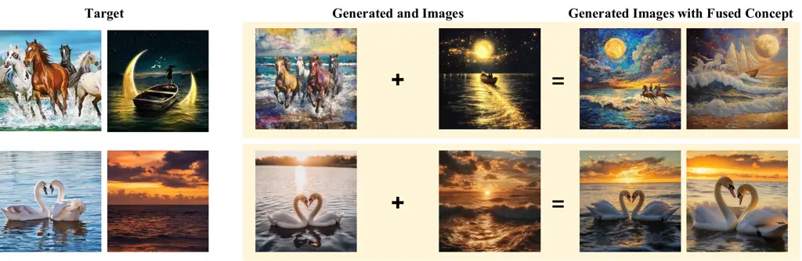

Figure 16: Multi-concept image generation by MidJourney.

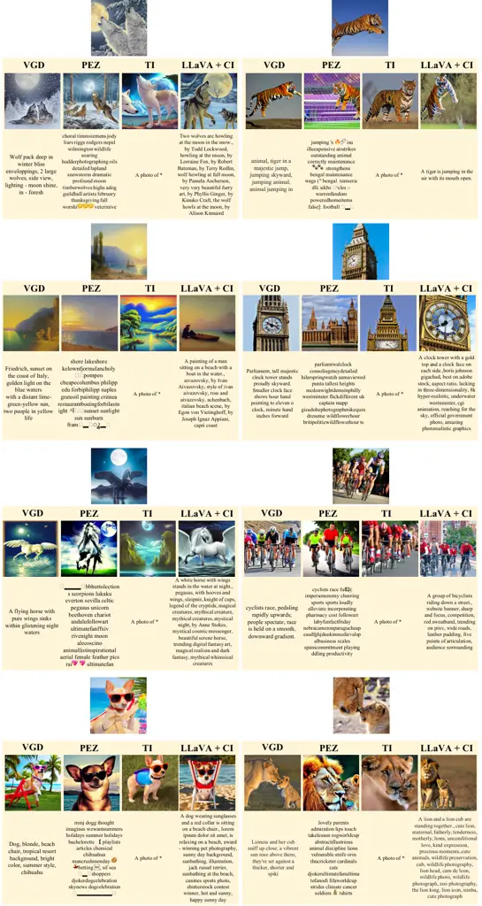

Figure 17: Image variation comparison between VGD and baselines
(generated by Stable Diffusion).

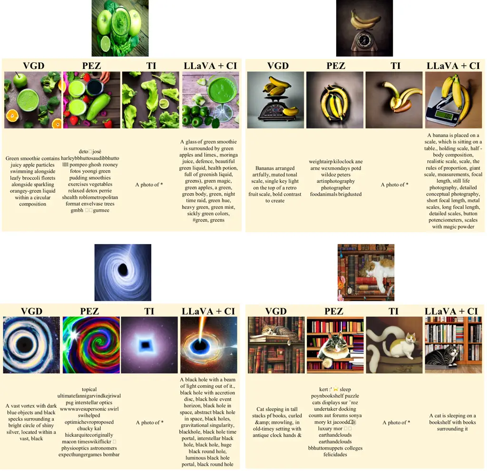

Figure 18: More image variation comparison between VGD and baselines
(generated by Stable Diffusion).

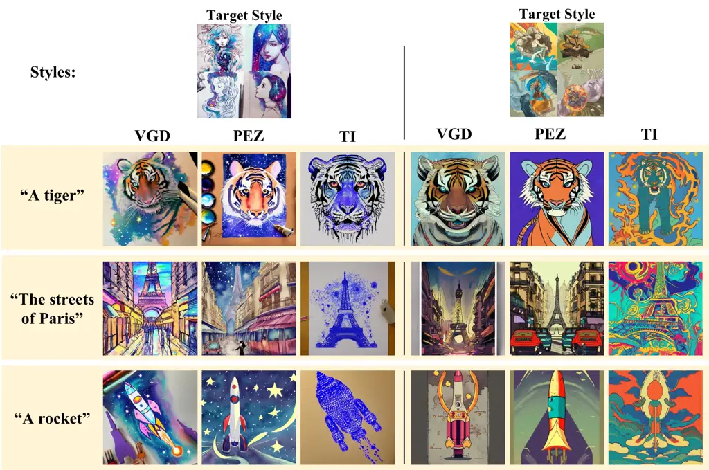

Figure 19: Style transfer comparison between VGD and baselines.

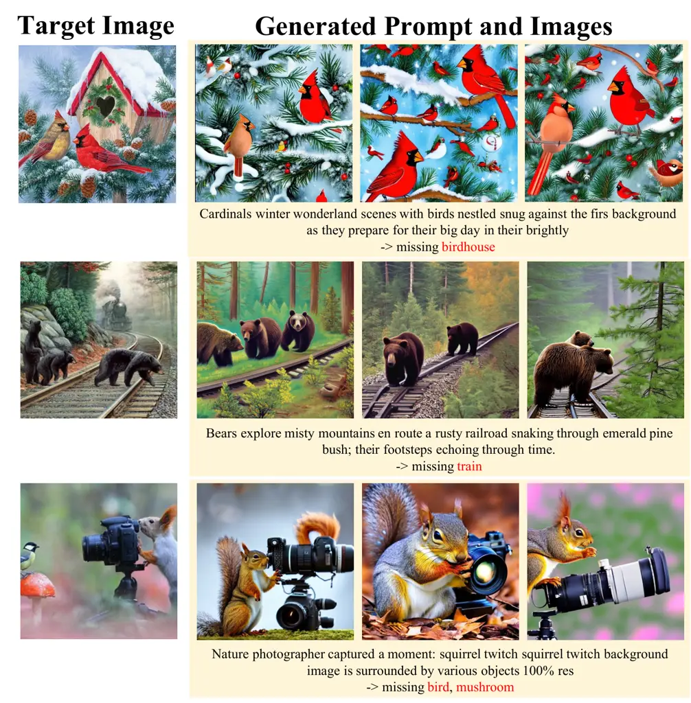

Figure 20: Bad case examples of VGD.

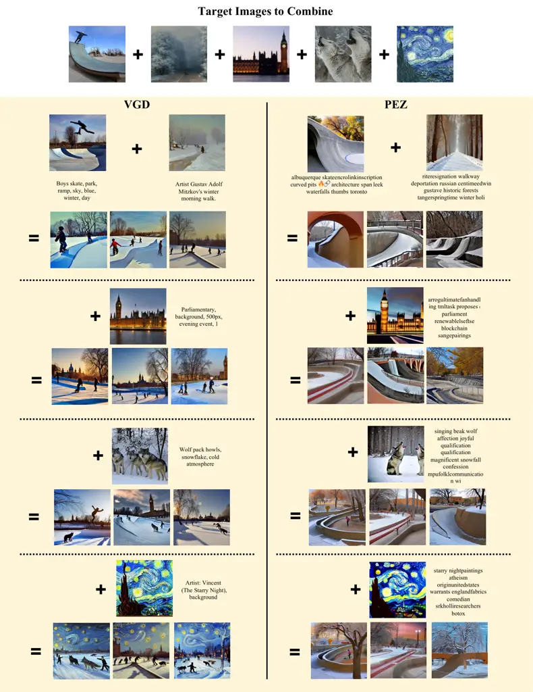

Figure 21: Five-concept image generation comparison between VGD and PEZ.
