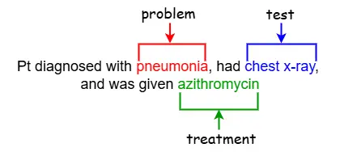
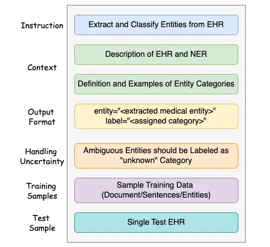
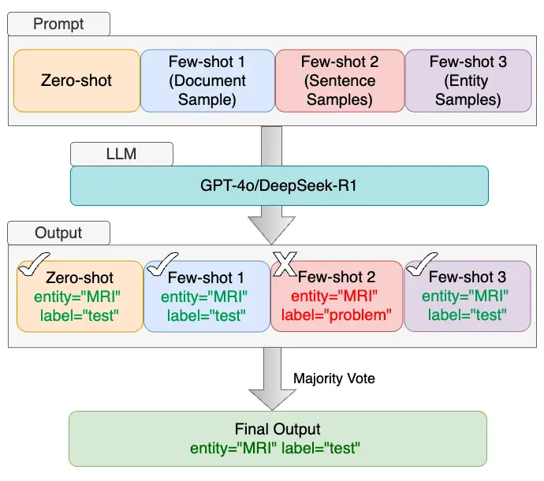
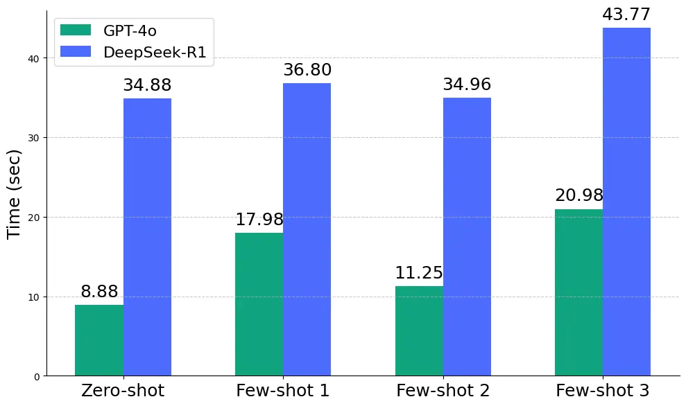

# LLM-based Prompt Ensemble for Reliable Medical Entity Recognition from EHRs

PubID: pubid:

K M Sajjadul Islam Affiliation: Marquette University  
sajjad.islam@marquette.edu    Ayesha Siddika Nipu
Affiliation: University of Wisconsin-Milwaukee  
nipua@uwm.edu Affiliation:     Jiawei Wu Affiliation: Medical College of
Wisconsin  
jiawu@mcw.edu    Praveen Madiraju Affiliation: Marquette University  
praveen.madiraju@marquette.edu

###### Abstract

Electronic Health Records (EHRs) are digital records of patient
information, often containing unstructured clinical text. Named Entity
Recognition (NER) is essential in EHRs for extracting key medical
entities like problems, tests, and treatments to support downstream
clinical applications. This paper explores prompt-based medical entity
recognition using large language models (LLMs), specifically GPT-4o and
DeepSeek-R1, guided by various prompt engineering techniques, including
zero-shot, few-shot, and an ensemble approach. Among all strategies,
GPT-4o with prompt ensemble achieved the highest classification
performance with an F1-score of 0.95 and recall of 0.98, outperforming
DeepSeek-R1 on the task. The ensemble method improved reliability by
aggregating outputs through embedding-based similarity and majority
voting.

###### Index Terms: 

EHR, NER, LLM, GPT, DeepSeek, Prompt Engineering, Healthcare

## I Introduction

Electronic Health Records (EHRs) are digital systems that store and
manage patient information across clinical encounters. Initially
designed to support administrative tasks like billing and scheduling,
EHRs have now become essential tools in healthcare delivery and
research. Over the past two decades, adoption of EHRs has grown rapidly,
especially in the United States \[1\]. Beyond routine clinical use, EHRs
enable secondary applications such as real-world evidence generation,
disease surveillance, and clinical trial design. However, the
unstructured and fragmented nature of much of the data requires advanced
techniques such as natural language processing (NLP) and machine
learning to make it usable for research.

Named Entity Recognition (NER) is a fundamental task in NLP that
involves identifying and categorizing key entities in text into
predefined categories such as problems, tests, and treatments as
illustrated in Figure 1. In the context of EHR, NER plays a crucial role
by extracting clinically relevant information from unstructured text
such as physician notes and discharge summaries. This structured
information enables more efficient indexing, retrieval, and analysis of
patient data. Accurate medical entity recognition supports downstream
applications like clinical decision support, cohort identification, and
disease surveillance, thereby improving patient care and healthcare
research outcomes\[2\].

Despite its importance, clinical NER presents many challenges due to the
nature of medical language and documentation. Clinical notes are often
unstructured, written in narrative form, and filled with domain-specific
terminology, abbreviations, and inconsistencies. The same abbreviation
may have multiple meanings depending on context, and many entity names
overlap or have ambiguous boundaries. Variability in writing styles and
the lack of standard document structure across institutions further
complicate automated extraction. Additionally, accurate entity
recognition requires handling negation, disjoint mentions, and
classification of findings into actionable or historical categories
\[3\]. These issues make NER in clinical text a non-trivial task and
necessitate robust, adaptable methods.

Large Language Models (LLMs) have shown strong potential in performing
NER through prompt-based learning. Unlike traditional models that
require fine-tuning, LLMs can identify entities using natural language
instructions and examples. Recent studies have demonstrated that LLMs
can achieve competitive results on general NER tasks with minimal
supervision \[4\]. In the clinical domain, LLMs have also been
successfully applied to extract medical entities from EHRs. When guided
by well-designed prompts, LLMs like GPT-4 can approach the performance
of specialized models trained on medical data, offering a scalable and
flexible solution for clinical information extraction \[5\]. In this
work, we pursue two main research aims:

Aim 1 is to investigate the effectiveness of prompting strategies,
including zero shot, few shot, and ensemble for medical entity
recognition using GPT-4o and DeepSeek-R1.

Aim 2 is to systematically evaluate the performance of GPT-4o and
DeepSeek-R1 on clinical entity recognition tasks by measuring entity
extraction and classification performance across different prompting
strategies.

Fig. 1: Example of entities in EHR

## II Related Work

### II-A Traditional Approaches for Medical NER

Early approaches to recognition of medical entities relied heavily on
rule-based systems and expert-crafted lexicons to identify clinical
concepts such as medications, symptoms and diagnoses. These systems
demonstrated good precision in restricted domains, but were
time-consuming to maintain and lacked adaptability to unseen data \[6\].
To overcome these limitations, statistical machine learning models like
Conditional Random Fields (CRFs) and Support Vector Machines (SVMs) were
introduced, treating NER as a sequence labeling task \[7\]. These models
required manual feature engineering and were limited in handling
long-range dependencies in text.

With the advancement of deep learning, neural models such as BiLSTM-CRF
began to dominate clinical NER tasks by automatically learning
contextual features from annotated corpora \[6\]. More recently,
transformer-based models have significantly improved performance in
medical NER. Pretrained language models like BERT and its biomedical
variants such as BioBERT \[8\], ClinicalBERT \[7\], and Med-BERT \[9\],
leverage large domain-specific corpora and deep contextual encoding to
achieve results on clinical entity recognition benchmarks.

### II-B LLMs for Downstream Clinical Applications

LLMs, such as GPT-4 and Claude, have emerged as powerful tools capable
of understanding and generating human-like text. These models are
increasingly applied in the medical domain because they can process
unstructured clinical data and support decision-making through
prompt-based interactions. Prompting allows users to communicate with
LLMs in natural language, enabling flexible and context-aware outputs
without requiring task-specific fine-tuning. Studies show that LLMs can
interpret patient complaints, summarize clinical records, and assist
with disease classification through carefully designed prompts \[10\].
For instance, GPT-4 has demonstrated strong performance in classifying
patient complaints using few-shot prompts, improving accuracy as more
training examples are provided \[11\]. Moreover, applications like LLM
on FHIR leverage prompting to translate complex medical records into
patient-friendly language, improving health literacy and access to
care\[10\]. Despite their promise, the variability in LLM responses and
risks of hallucination underline the importance of rigorous evaluation
and context filtering in clinical use.

### II-C LLM-based Prompting Approaches for Clinical NER

Prompting has emerged as a flexible alternative to fine-tuning in
clinical NER, reducing the need for large annotated datasets. Recent
studies show that language models like GPT-3.5 and GPT-4 can perform
clinical NER when guided by well-crafted prompts. Hu et al. proposed a
structured prompting framework that combines task instructions,
annotation guidelines, and few-shot examples. Their results showed that
GPT-4, when properly prompted, achieved competitive performance with
domain-specific models like BioClinicalBERT on datasets such as
MTSamples and VAERS \[5\]. Chen et al. introduced KGPC, a method that
frames NER as a question answering task using knowledge-guided prompts
and contrastive learning. Their model outperformed existing few-shot
baselines by leveraging UMLS-based entity generation and prompt tuning
\[12\]. Shen et al. evaluated ChatGPT for extracting structured data
from clinical notes using few-shot prompting and evidence-based
reasoning. Their approach surpassed CRF and BERT-based NER models,
highlighting the potential of prompt-based inference for real-world
clinical applications \[13\]. Together, these studies demonstrate that
prompt engineering enables general-purpose language models to perform
robust clinical NER without task-specific training.

Many recent studies in prompt-based medical NER rely on benchmark
datasets such as the 2010 i2b2/VA Natural Language Processing
Challenge\[14\], which provides standardized clinical annotations for
evaluating entity extraction and classification. While prompting
strategies have shown promise, most works focus on individual prompt
designs or specific evaluation metrics. To the best of our knowledge, no
prior study has explored a prompt ensemble approach with a robust
evaluation across both entity extraction and classification. Our work is
among the first to apply such an approach to state-of-the-art LLMs,
including GPT-4o and DeepSeek-R1, highlighting the importance of prompt
reliability and consistency in clinical entity recognition.

| Entity Type | Most Frequent | Least Frequent  |
| ----------- | ------------- | --------------- |
| Problem     | hypertension  | minimal ooze    |
| Test        | glucose       | CIWA scale      |
| Treatment   | aspirin       | pneumatic boots |

TABLE I: Frequent Clinical Entities in Dataset

## III Methodology

### III-A Dataset Description

We used the publicly available dataset from the 2010 i2b2/VA Natural
Language Processing Challenge\[14\], which focuses on extracting
concepts, assertions, and relations from clinical text. The dataset
comprises de-identified EHRs, primarily discharge summaries, annotated
with three types of clinical entities: Problem, Test, and Treatment.
Each entity is marked with its span in the text and categorized
according to its clinical role. Problems represent diseases or symptoms,
Tests indicate diagnostic procedures, and Treatments refer to
medications or interventions. Table I presents examples of the most and
least frequent entities for each category.

To support prompt-based medical entity recognition, we constructed a
compact dataset tailored to each prompting strategy, as extensive data
is not required for LLMs. We employed five prompting techniques to
extract and classify entities (more details on section III-B). For
training, we sampled one full document, 100 labeled sentences from five
documents, and all available entities from 73 documents, depending on
the prompting technique. We used a separate document with 190 annotated
entities as the test sample. Table II summarizes the distribution of
entity types used across different prompting configurations.

| Prompt      | Samples           | Problem | Test | Treatment |
| ----------- | ----------------- | ------- | ---- | --------- |
| Zero-shot   | No sample         | \-      | \-   | \-        |
| Few-shot 1  | Single Doc        | 53      | 54   | 52        |
| Few-shot 2  | 100 Sentences^(a) | 60      | 90   | 71        |
| Few-shot 3  | All Entities^(b)  | 2567    | 1206 | 1582      |
| Test Sample | Single Doc        | 72      | 66   | 52        |

^(a)Collected from 5 documents, ^(b)Collected from 73 documents

TABLE II: Entity Distribution for Different Prompting

### III-B Prompt Engineering

We utilized two LLMs, GPT-4o \[15\] and DeepSeek-R1 \[16\], to perform
medical entity recognition directly through prompt-based interaction.
While these models can be accessed via user interfaces or APIs, in this
study, we integrated them using API endpoints to enable automated
querying and result collection across various prompting strategies. We
configured the generation parameters with a $`temperature`$ of 0.2 and a
$`top\_p`$ value of 1 to promote deterministic and focused outputs while
still allowing a limited degree of sampling diversity, ensuring
consistency across multiple runs without completely eliminating
variation.

Prompt engineering is a key methodological component in this work,
enabling us to harness the reasoning capabilities of LLMs without any
fine-tuning\[17\]. It involves crafting input prompts that clearly
communicate the task, including structured instructions, relevant
context, and expected output formats. Effective prompts help LLMs
understand both what to do and how to do it, guiding them to extract and
categorize entities from clinical text. In this study, we experimented
with various prompting strategies that differ in the amount and type of
supervision provided, such as instructions alone or examples at
different levels of granularity. These strategies are detailed in the
following subsections.

Fig. 2: Components of Prompting Template

To ensure consistent and interpretable interactions with the language
models, we designed a structured prompt template. It includes clear
instructions, relevant context, and formatting cues, as shown in
Figure 2. The prompt begins with a task definition that focuses on both
entity extraction and classification. This is followed by context
describing the clinical data source, specifically EHRs used in NER. The
prompt then introduces the three target categories: Problem, Test, and
Treatment. Each category is explained with examples to help the model
understand their roles in clinical text. We also define the expected
output format to reduce ambiguity in the model’s response. This format
also makes it easier to evaluate the model’s performance. In addition,
we instruct the model to assign an “unknown” label when it cannot
confidently classify an entity. This helps reduce hallucinations or
incorrect assumptions. We designed the template to be concise and
modular to address the issue of models forgetting information in the
middle of long prompts \[18\]. For few-shot prompting, we included
training samples using three different formats: document, sentence, and
entity level. This allowed us to examine how different levels of context
affect the model’s ability to extract and classify medical entities.
During the prompt template development, we performed an ‘ablation study’
\[19\] comparing various prompt structures and sample configurations.
Based on the evaluation, we selected the most effective template and
input format for our prompting strategies.

Input:

$`\mathcal{P}=\{p_{1},p_{2},p_{3},p_{4}\}`$ // entity-label pair from 4
prompts

$`\tau=0.92`$   // cosine similarity threshold

Output: Entity predictions with majority-voted labels

// entity embedding

for _each entity in $`p_{i}\in\mathcal{P}`$_ do

   Compute ClinicalBERT embedding for entity

   Add {entity, label, embedding} to $`\mathcal{E}`$

end for

// greedy hierarchical clustering

for _each entity $`e_{i}\in\mathcal{E}`$_ do

   Compute cosine similarity $`s`$ between entities

   if _$`s\geq\tau`$_ then

      Add to cluster $`\mathcal{C}`$

   end if

end for

// majority vote count

for _each cluster $`c\in\mathcal{C}`$_ do

   Count label frequencies $`f`$ in $`c`$

   if _$`f>=2`$_ then

      Assign majority label

   else

      Assign label as unknown

   end if

   Add entity, label to output $`\mathcal{O}`$

end for

Algorithm 1 Prompt Ensemble with Majority Voting

Zero-shot prompting involves providing the model with task instructions
and label definitions without any annotated examples, relying entirely
on its pretrained knowledge to perform the task\[20\]. In this setting,
the prompt includes a concise task description, background context,
definitions for the entity categories (Problem, Test, Treatment), and
formatting expectations. The clinical text is then appended at the end
of the prompt. This approach serves as a baseline to evaluate the
model’s ability to understand and execute the task without seeing any
in-context examples.

Few-shot prompting with a document sample involves providing the model
with a single annotated clinical document to help it learn how to
extract and categorize entities from context, where medical entities are
tagged using XML-style tags such as $`<problem>`$, $`<test>`$, and
$`<treatment>`$. Additional instructions clarify that not all sentences
may contain entities, and some may include multiple entities from
different categories. This training sample is enclosed within triple
quotes and inserted before the test input. The goal of this setup is to
allow the model to learn entity patterns from a realistic,
document-level context and apply similar reasoning to unseen clinical
text.

Few-shot with sentence samples uses a set of 100 annotated clinical
sentences collected from 5 documents as training input. Medical entities
in each sentence are labeled using XML style tags to indicate their
respective categories. Unlike the document level approach, this format
excludes unrelated or unlabeled sentences, helping the model focus only
on relevant patterns. The goal is to provide clear, sentence level
guidance to improve the model’s ability to generalize entity recognition
logic when processing new clinical text.

Few-shot with entity samples provides the model with a curated list of
labeled medical entities, grouped by their respective categories. These
entities are presented in a flat, comma-separated format enclosed within
triple quotes, without full sentence or document context. Each entity is
tagged using XML style tags to indicate its classification. We supplied
a large number of training entities, 5,355 in total, collected from 73
clinical documents. This included 2,567 Problem, 1,206 Test, and 1,582
Treatment entities. Although this approach is straightforward, it is
significantly longer compared to previous approaches due to the size of
the entity list. The document and sentence level few-shot strategies
teach the model how entities appear within context. This method focuses
on showing the model individual medical entities without any surrounding
text, emphasizing category-specific terminology.

Prompt ensemble is employed as our final strategy to improve prediction
consistency by aggregating outputs from multiple prompt formats. We run
three different few-shot configurations using different types of
training samples: document, sentences, and entities, each offering a
distinct view of the data. After extracting entities from each prompt,
we embed them using ClinicalBERT\[21\] and match similar entities
utilizing cosine similarity. For each semantically similar entity
appearing in at least two prompt outputs, we assign a final label using
majority voting; otherwise, the label is set to “unknown”. The detailed
steps of this ensemble prompting strategy are outlined in Algorithm 1.
Examples of matched entity pairs with their cosine similarity scores are
shown in Table III, illustrating the effectiveness of embedding-based
entity alignment. This embedding-based ensemble approach mitigates
prompt level variation and enhances robustness in medical entity
recognition. An overview of this ensemble prompting workflow is
illustrated in Figure 3.

Fig. 3: Workflow of the Prompt Ensemble

|                      |                  |                  |
| -------------------- | ---------------- | ---------------- |
| Actual Entity        | Extracted Entity | Similarity Score |
| lower abdominal pain | lower abd pain   | 0.98             |
| angiography          | angiogram        | 0.96             |
| UREA N               | urea n-25        | 0.94             |
| colitis              | ulcer            | 0.91             |
| fluid                | URINE            | 0.90             |

TABLE III: Entity Similarity Matching Samples

## IV Result Analysis And Discussion

This section presents a comprehensive evaluation of our experimental
findings. We analyze performance across several dimensions: findings
from similarity measurement, entity extraction and classification
performance, computational efficiency, and ethical considerations
related to prompt design. Our discussion not only interprets the
metrics, but also reflects on model behavior and the practical
implications of design choices in prompt-based medical entity
recognition.

We used ClinicalBERT embeddings with cosine similarity to identify
entity similarity extracted by different prompting strategies. We
applied a similarity threshold of 0.92, which was empirically chosen to
keep the matches accurate while still covering enough relevant entities.
Unlike simple string matching, which fails to capture variations in
clinical terminology and abbreviations, it often misses semantically
related terms. Embedding-based similarity considers the meaning of the
text, enabling more robust matching of entities with different surface
forms. As shown in Table III, pairs such as “lower abdominal pain” and
“lower abd pain” (similarity: 0.98), and “angiography” and “angiogram”
(0.96) are correctly matched. Conversely, less precise pairs like
“fluid” and “urine” (0.90) fall below the threshold. This design
decision ensures only well-aligned predictions are grouped during
ensemble voting, helping reduce hallucinations and label noise in final
outputs. It also improves the quality of entity classification
evaluation by ensuring that only semantically consistent entity mentions
are assigned a final label.

| Model       | Prompt     | Predict | Match | Unknown | Accuracy |
| ----------- | ---------- | ------- | ----- | ------- | -------- |
| GPT-4o      | Zero-shot  | 76      | 71    | 0       | 0.37     |
|             | Few-shot 1 | 121     | 108   | 7       | 0.56     |
|             | Few-shot 2 | 117     | 112   | 0       | 0.59     |
|             | Few-shot 3 | 139     | 123   | 0       | 0.65     |
|             | Ensemble   | 75      | 70    | 0       | 0.37     |
| DeepSeek-R1 | Zero-shot  | 54      | 50    | 3       | 0.26     |
|             | Few-shot 1 | 84      | 79    | 0       | 0.41     |
|             | Few-shot 2 | 106     | 99    | 0       | 0.52     |
|             | Few-shot 3 | 58      | 53    | 0       | 0.28     |
|             | Ensemble   | 49      | 42    | 3       | 0.22     |

TABLE IV: Entity Extraction Performance

Table IV presents the entity extraction performance of GPT-4o and
DeepSeek-R1. For GPT-4o, we observe performance differences across
prompting formats, with the highest accuracy of 65% achieved using
Few-shot 3. This setup includes a comprehensive list of training
entities (excluding those present in the test document), which likely
helps the model recognize similar entities through exposure to extensive
medical terminology. Zero-shot and ensemble prompting both resulted in
an accuracy of 37%. While this lower performance is expected in the
absence of training examples for zero-shot, ensemble prompting’s result
reflects the conservative nature of majority voting. Although less
accurate, the ensemble output is more reliable due to its stricter
agreement criteria. In contrast, DeepSeek-R1 showed generally lower
performance. Its best result, 52% accuracy, was achieved using Few-shot
2, where the prompt includes a set of annotated clinical sentences.
Ensemble prompting further reduced performance for DeepSeek-R1,
highlighting its inconsistency across different prompting strategies.
Overall, GPT-4o consistently outperformed DeepSeek-R1, demonstrating
stronger generalization capabilities in prompt-based clinical entity
extraction.

| Model       | Prompt     | Precision | Recall | F1   |
| ----------- | ---------- | --------- | ------ | ---- |
| GPT-4o      | Zero-shot  | 0.88      | 0.94   | 0.91 |
|             | Few-shot 1 | 0.92      | 0.97   | 0.94 |
|             | Few-shot 2 | 0.92      | 0.96   | 0.94 |
|             | Few-shot 3 | 0.81      | 0.92   | 0.86 |
|             | Ensemble   | 0.92      | 0.98   | 0.95 |
| DeepSeek-R1 | Zero-shot  | 0.90      | 0.92   | 0.91 |
|             | Few-shot 1 | 0.92      | 0.97   | 0.94 |
|             | Few-shot 2 | 0.89      | 0.96   | 0.93 |
|             | Few-shot 3 | 0.84      | 0.92   | 0.88 |
|             | Ensemble   | 0.85      | 0.93   | 0.89 |

TABLE V: Entity Classification Performance

Table V summarizes entity classification performance of GPT-4o and
DeepSeek-R1 across various prompting strategies, based on precision,
recall, and F1 score. For GPT-4o, the zero-shot configuration achieves a
strong F1 score of $`0.91`$, which further improves with Few-shot 1
approach when a clinical document was given as the training sample. The
ensemble prompting strategy for GPT-4o achieves the highest F1 score of
0.95, highlighting its effectiveness in capturing a broader set of true
positive entities. Although entity extraction performance is low, the
classification F1-score surpasses the 0.924 achieved by the i2b2/VA
concept extraction system \[14\]. The recall achieved by GPT-4o is 0.98
for ensemble prompting, indicating strong sensitivity in identifying
relevant clinical entities. Recall, also known as sensitivity, reflects
the model’s ability to correctly identify actual positive cases. A
higher recall helps minimize the chance of overlooking important
clinical information, which is especially critical in healthcare
applications. In contrast, DeepSeek-R1 demonstrates stable performance,
with a zero-shot F1 score of 0.91 and its highest score of 0.94 achieved
under Few-shot 1. However, its performance declines under Few-shot 3,
yielding an F1 of 0.89 despite a relatively high recall of 0.93. These
results suggest that while DeepSeek-R1 benefits from moderate few-shot
supervision, it is more sensitive to prompt length and complexity.
Overall, GPT-4o consistently achieves higher recall and F1 across
strategies, making it more reliable for comprehensive clinical entity
classification tasks.

We further analyze the computational efficiency and prompt length
sensitivity of both models. As shown in Figure 4, GPT-4o consistently
executes faster than DeepSeek-R1, with the most notable difference in
the zero-shot setting, where GPT-4o completes the task in 8.88 seconds
compared to 34.88 seconds for DeepSeek-R1. In the Few-shot 3
configuration, which includes all entity list as training sample,
execution time increases significantly for both models. GPT-4o takes
20.98 seconds, while DeepSeek-R1 takes 43.77 seconds. This increase in
execution time is primarily due to the larger number of tokens in the
Few-shot 3 configuration compared to other prompting techniques. Longer
prompts result in more tokens being processed, which leads to longer
response generation time. GPT-4o, despite stronger performance,
triggered a token limit error when the prompt exceeded the model’s
tokens-per-minute (TPM) allowance. To address this, we reduced the input
size by trimming 10% of entities from each category. It ensures that the
prompt remains within the model token limits while preserving balanced
representation across entity types. These findings highlight the
importance of prompt efficiency and model-specific tuning when designing
few-shot configurations, particularly for large-scale or time-sensitive
clinical applications.

Fig. 4: Prompt Execution Time

Ethical Consideration: In our study, we used the publicly available and
anonymized dataset from the 2010 i2b2/VA NLP Challenge, which removes
risks related to patient identification as the records are anonymized.
However, when deploying LLMs via third-party APIs, one should consider
possible data leakage as clinical data transmitted externally may be
exposed without proper safeguards. Recent studies have also highlighted
key ethical concerns about LLM hallucination, where models generate
plausible but incorrect outputs. Huang et al. noted that ChatGPT
occasionally fabricated clinical values when data was missing, instead
of indicating uncertainty, which could compromise patient safety if used
unsupervised \[13\]. To address this, we introduced an “unknown” label
in our prompting strategy, allowing the model to abstain from
classification when confidence is low. While this helped reduce
hallucination, it still required human judgment to review the outcome
\[11\].

## V Conclusion

This study explored prompt-based medical entity recognition from EHRs
using two LLMs, GPT-4o and DeepSeek-R1. Among the evaluated prompting
strategies, GPT-4o consistently outperformed DeepSeek-R1 across both
entity extraction and classification tasks. The prompt ensemble method
demonstrated improved reliability by aggregating predictions from
multiple prompt formats and using embedding-based similarity with
majority voting to reduce hallucination and label noise. This approach
enhances the robustness and consistency of LLMs in clinical entity
recognition, making them more dependable for extracting structured
information from unstructured medical text.

## Acknowledgment

We gratefully acknowledge the support of the Northwestern Mutual Data
Science Institute for funding this project.

## References

- \[1\] E. Kim, S. M. Rubinstein, K. T. Nead, A. P. Wojcieszynski, P. E.
  Gabriel, and J. L. Warner, “The evolving use of electronic health
  records (ehr) for research,” in _Seminars in radiation oncology_,
  vol. 29, no. 4. Elsevier, 2019, pp. 354–361.
- \[2\] P. Yadav, M. Steinbach, V. Kumar, and G. Simon, “Mining
  electronic health records (ehrs) a survey,” _ACM Computing Surveys
  (CSUR)_, vol. 50, no. 6, pp. 1–40, 2018.
- \[3\] S. R. Kundeti, J. Vijayananda, S. Mujjiga, and M. Kalyan,
  “Clinical named entity recognition: Challenges and opportunities,” in
  _2016 IEEE International Conference on Big Data (Big Data)_. IEEE,
  2016, pp. 1937–1945.
- \[4\] S. Wang, X. Sun, X. Li, R. Ouyang, F. Wu, T. Zhang, J. Li, and
  G. Wang, “Gpt-ner: Named entity recognition via large language
  models,” _arXiv preprint arXiv:2304.10428_, 2023.
- \[5\] Y. Hu, Q. Chen, J. Du, X. Peng, V. K. Keloth, X. Zuo, Y. Zhou,
  Z. Li, X. Jiang, Z. Lu _et al._, “Improving large language models for
  clinical named entity recognition via prompt engineering,” _Journal of
  the American Medical Informatics Association_, vol. 31, no. 9, pp.
  1812–1820, 2024.
- \[6\] P. Bose, S. Srinivasan, W. C. Sleeman IV, J. Palta, R. Kapoor,
  and P. Ghosh, “A survey on recent named entity recognition and
  relationship extraction techniques on clinical texts,” _Applied
  Sciences_, vol. 11, no. 18, p. 8319, 2021.
- \[7\] S. Fu, D. Chen, H. He, S. Liu, S. Moon, K. J. Peterson, F. Shen,
  L. Wang, Y. Wang, A. Wen _et al._, “Clinical concept extraction: a
  methodology review,” _Journal of biomedical informatics_, vol. 109, p.
  103526, 2020.
- \[8\] X. Yu, W. Hu, S. Lu, X. Sun, and Z. Yuan, “Biobert based named
  entity recognition in electronic medical record,” in _2019 10th
  international conference on information technology in medicine and
  education (ITME)_. IEEE, 2019, pp. 49–52.
- \[9\] N. Liu, Q. Hu, H. Xu, X. Xu, and M. Chen, “Med-bert: A
  pretraining framework for medical records named entity recognition,”
  _IEEE Transactions on Industrial Informatics_, vol. 18, no. 8, pp.
  5600–5608, 2021.
- \[10\] P. Schmiedmayer, A. Rao, P. Zagar, V. Ravi, A. Zahedivash,
  A. Fereydooni, and O. Aalami, “Llm on fhir–demystifying health
  records,” _arXiv preprint arXiv:2402.01711_, 2024.
- \[11\] A. S. Nipu, K. S. Islam, and P. Madiraju, “How reliable ai
  chatbots are for disease prediction from patient complaints?” in _2024
  IEEE International Conference on Information Reuse and Integration for
  Data Science (IRI)_. IEEE, 2024, pp. 210–215.
- \[12\] P. Chen, J. Wang, H. Lin, D. Zhao, and Z. Yang, “Few-shot
  biomedical named entity recognition via knowledge-guided instance
  generation and prompt contrastive learning,” _Bioinformatics_,
  vol. 39, no. 8, p. btad496, 2023.
- \[13\] J. Huang, D. M. Yang, R. Rong, K. Nezafati, C. Treager, Z. Chi,
  S. Wang, X. Cheng, Y. Guo, L. J. Klesse _et al._, “A critical
  assessment of using chatgpt for extracting structured data from
  clinical notes,” _npj Digital Medicine_, vol. 7, no. 1, p. 106, 2024.
- \[14\] Ö. Uzuner, B. R. South, S. Shen, and S. L. DuVall, “2010
  i2b2/va challenge on concepts, assertions, and relations in clinical
  text,” _Journal of the American Medical Informatics Association_,
  vol. 18, no. 5, pp. 552–556, 2011.
- \[15\] A. Hurst, A. Lerer, A. P. Goucher, A. Perelman, A. Ramesh,
  A. Clark, A. Ostrow, A. Welihinda, A. Hayes, A. Radford _et al._,
  “Gpt-4o system card,” _arXiv preprint arXiv:2410.21276_, 2024.
- \[16\] D. Guo, D. Yang, H. Zhang, J. Song, R. Zhang, R. Xu, Q. Zhu,
  S. Ma, P. Wang, X. Bi _et al._, “Deepseek-r1: Incentivizing reasoning
  capability in llms via reinforcement learning,” _arXiv preprint
  arXiv:2501.12948_, 2025.
- \[17\] J. Alammar and M. Grootendorst, _Hands-on large language
  models: language understanding and generation_. ” O’Reilly Media,
  Inc.”, 2024.
- \[18\] N. F. Liu, K. Lin, J. Hewitt, A. Paranjape, M. Bevilacqua,
  F. Petroni, and P. Liang, “Lost in the middle: How language models use
  long contexts,” _Transactions of the Association for Computational
  Linguistics_, vol. 12, pp. 157–173, 2024.
- \[19\] J. Wei, X. Wang, D. Schuurmans, M. Bosma, F. Xia, E. Chi, Q. V.
  Le, D. Zhou _et al._, “Chain-of-thought prompting elicits reasoning in
  large language models,” _Advances in neural information processing
  systems_, vol. 35, pp. 24 824–24 837, 2022.
- \[20\] K. S. Islam, A. S. Nipu, P. Madiraju, and P. Deshpande,
  “Autocompletion of chief complaints in the electronic health records
  using large language models,” in _2023 IEEE International Conference
  on Big Data (BigData)_. IEEE, 2023, pp. 4912–4921.
- \[21\] E. Alsentzer, J. R. Murphy, W. Boag, W.-H. Weng, D. Jin,
  T. Naumann, and M. McDermott, “Publicly available clinical bert
  embeddings,” _arXiv preprint arXiv:1904.03323_, 2019.
