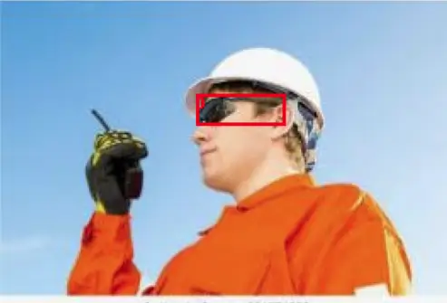
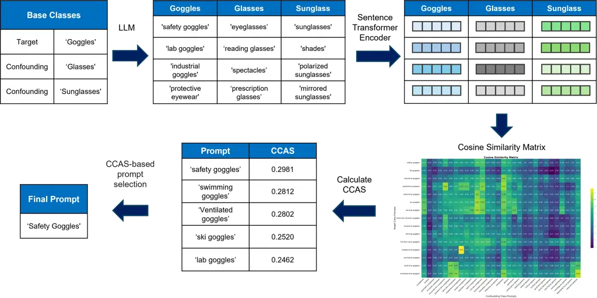
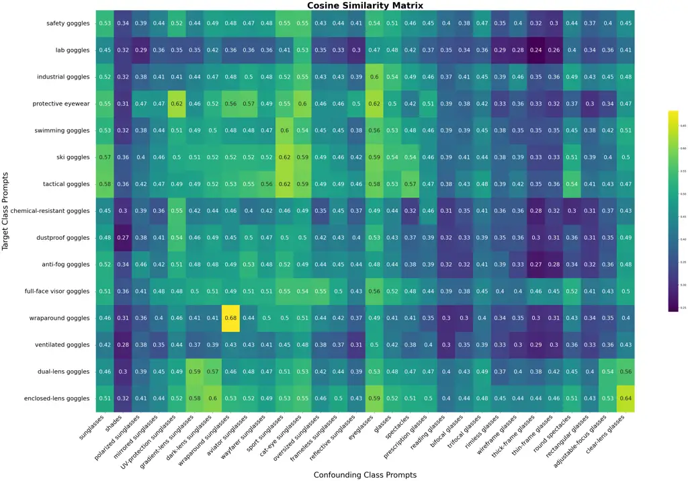

# Beyond General Prompts: Automated Prompt Refinement using Contrastive Class Alignment Scores for Disambiguating Objects in VLMs

Lucas Choi Affiliation: Archbishop Mitty  
lucasleechoi@gmail.com    Ross Greer Affiliation: University of
California, Merced  
rossgreer@ucmerced.edu

###### Abstract

Vision-language models (VLMs) offer flexible object detection through
natural language prompts but suffer from performance variability
depending on prompt phrasing. In this paper, we introduce a method for
automated prompt refinement using a novel metric called the Contrastive
Class Alignment Score (CCAS), which ranks prompts based on their
semantic alignment with a target object class while penalizing
similarity to confounding classes. Our method generates diverse prompt
candidates via a large language model and filters them through CCAS,
computed using prompt embeddings from a sentence transformer. We
evaluate our approach on challenging object categories, demonstrating
that our automatic selection of high-precision prompts improves object
detection accuracy without the need for additional model training or
labeled data. This scalable and model-agnostic pipeline offers a
principled alternative to manual prompt engineering for VLM-based
detection systems.

###### Index Terms: 

vision-language models, zero-shot object detection, automated prompt
refinement

## I Introduction

Vision-language models (VLMs) have expanded object detection
capabilities by replacing fixed class labels with open-ended natural
language prompts. However, the performance of these models is highly
sensitive to the phrasing and specificity of the prompts used\[1, 2, 3,
4\]. A generic prompt may not perform well compared to a carefully
chosen descriptive prompt, yet on the other hand, a too descriptive
prompt may cause a model to fail to detect the object \[5\]. In datasets
where visual distinctions are critical—such as differentiating “safety
goggles” from “glasses” or ”sunglasses”—poor prompt choices can
introduce ambiguity, such as in Figure 1, reducing both precision and
recall \[6, 7\]. This sensitivity poses the challenge of systematically
generating and selecting prompts that maximize detection accuracy while
minimizing confusion with visually or semantically similar classes.



Fig. 1: This is a sample detection from foundation VLM OWLv2 prompted
with ’goggles’. The model mistakenly detected these sunglasses as
goggles, which may have serious safety implications in a worksite
monitoring task where safety goggles are important. As illustrated,
certain prompts have ambiguity in their definitions, reflecting the
many-object-encompassing aspect of natural language, but also resulting
in poor precision detections and necessitating more descriptive prompts
to ensure unintended objects are not mistakenly detected.

In this research, we propose a method for algorithmically identifying
high-precision natural language prompts for object detection in
vision-language models using what we refer to as a contrastive class
alignment score (CCAS). We propose a similarity-based prompt filtering
pipeline that selects prompts most semantically aligned with a target
object class while reducing confusion with similar but distinct classes.
This process, as illustrated in Figure 2, provides a scalable
alternative to manual prompt engineering and improves detection
performance through prompt optimization.



Fig. 2: System Diagram of our proposed algorithmic pipeline for
identifying an optimal high-precision prompt through our CCAS metric.
The diagram utilizes goggles as the example classes and prompts, with
only a sample of prompts being shown in the diagram. The complete
pipeline and illustrated example are discussed in Algorithm and
Experimental Evaluation.

## II Related Research

Existing methods for enhancing prompting for open-vocabulary object
detection include fine-tuning an LLM that generates prompts,
diversifying prompts to include both text and images \[8, 9\], and
visual input modification.

Avshalumov et al. \[10\] defines a “Reframing” method that uses feedback
from detection models to finetune an LLM to optimize its queries,
facilitating stronger detection performance. Du et al. \[11\] introduce
the DetPro method to learn prompt representations, which use background
interpretation and separation of foreground elements during the training
of the prompting model. By contrast, our method avoids LLM training or
finetuning, using only an inference stage.

The T-Rex2 model of Jiang et al. \[12\] extends the prompt reception of
VLM-based detection models to accept input in the form of images and the
combination of images and text; though the method achieves strong
performance, we restrict our research problem to a true zero-shot (no
prior exemplar images) setting, utilizing only abstract text prompts.

Yang et al. \[13\] take an opposite approach to the enhancement problem,
instead modifying the input image rather than the prompt via outline or
mask elements, finding that blurring outside the target mask enhances
localization. This method requires first the successful recognition of
the target, then refinement of the object localization; our research is
centered on the preliminary step of recognition.

Recent advances also explore continuous prompt embeddings in approaches
like CoOp by Zhou et al. \[1\] and ProDA by Lu et al.\[14\], which
fine-tune soft prompts for downstream vision tasks. These methods
contrast with our discrete, interpretable phrase-level prompts but share
the goal of adapting language to better match visual representations.

Additionally, interactive and human-in-the-loop methods have gained
interest as viable strategies for dynamic prompt adaptation, especially
in safety-critical applications. Studies such as SugarCrepe++ by Dumpala
et al. \[2\] and FINER by Kim and Ji\[7\] focus on prompt robustness and
sensitivity to semantic variation, underlining the importance of prompt
phrasing in zero-shot VLM performance.

More complex approaches to prompt refinement exist for particular
domains; for example, towards camouflaged-object recognition, Zhang et
al. \[15\] integrate motion and appearance cues to refine multiple
prompts to the Segment Anything (SAM2) model \[16\].Wu et al. present
AttriPrompter \[17, 18\], an autoprompting pipeline using attribute
generation, augmentation, and relevance sorting specific to the task of
nuclei detection in histopathology images.

## III Algorithm

Input to our system includes a dataset, target class $`T`$, and a set of
known confounding classes to the target $`C:c_{1},...,c_{m}`$. We
generate $`N`$ possible versions and specifications of each class, both
target and confounding, using a large language model (LLM). We refer to
these LLM-augmented lists as $`T:t_{1},...,t_{N}`$ and
$`C_{i}:c_{i,1},...,c_{i,N}`$, where $`i`$ refers to the index of the
class in the original set $`C`$. We prompted the LLM:

> “Generate an extensive list of possible descriptions, synonyms, and
> detection-oriented prompts without negatives, limiting the prompt to a
> phrase, to detect the following base object classes with $`N`$ prompts
> per class, intended for use with a vision-language model: \<class1\>,
> \<class2\>, etc.”

This prompt was chosen as short phrases are best for prompts as they
disallow for too much specificity, which is non-optimal for detecting
objects across the various environments in a typical image dataset.
Additionally, negatives were discouraged as they only add confusion to
the prompts, and it is unnecessary to prompt for what we do not want to
detect. Finally, we specified the number of prompts generated per class,
as the number is variable based on the base class name and the number of
classes provided.

With the extensive list of prompts obtained for each class, including
the base class name in the list, we then take the embeddings of each
prompt using a sentence transformer to make comparisons of semantic
meaning, specifically between the target and the confusion classes. This
is to help narrow the obtained prompts and reduce the overlap in
generated prompts. To achieve this, we compute the cosine similarity
between every pair of embeddings between a target class and its
confounding classes, constructing a similarity matrix.

With the target class on the y-axis, we take the average similarity from
each row and compute the CCA scores for the precision of each prompt of
the target class. This is done through the two following equations,
investigating which of the two results in higher accuracy prompts.

```math
CCAS_{avg}(t_{i})=\cos(\vec{t_{i}},\vec{T})-\frac{1}{NM}\sum_{m=1}^{M}\sum_{k=1}^{N}\cos(\vec{t_{i}},\vec{c}_{m,k}) \tag{1}
```

```math
CCAS_{max}(t_{i})=\cos(\vec{t_{i}},\vec{T})-\max_{m,k}\cos(\vec{t_{i}},\vec{c}_{m,k}) \tag{2}
```

where

- •
  $`\vec{t_{i,j}}`$: Embedding vector of the $`j`$-th candidate prompt
  for target class $`i`$
- •
  $`\vec{t_{i}}`$: Embedding vector of the $`i`$-th target base class
  name
- •
  $`\vec{c}_{m,k}`$: Embedding vector of the $`k`$-th prompt of the
  $`m`$-th confounding class
- •
  $`\cos(\vec{a},\vec{b})`$: Cosine similarity between vectors
  $`\vec{a}`$ and $`\vec{b}`$
- •
  $`M`$: Total number of confounding classes
- •
  $`N`$: Total number of prompts per class

By ranking the prompts with their score, we can take the top target
prompts to remove vague and general prompts or prompts that overlap with
confusion classes.

## IV Experimental Evaluation

To evaluate the proposed algorithm, we used two datasets: the Safety
Goggles Computer Vision Project dataset¹¹ 1
https://universe.roboflow.com/database-sjrvw/safety-goggles with the
target class of ‘goggles’ and confusion classes of ‘glasses’ and
‘sunglasses’, and the Self-Driving Cars Computer Vision Project dataset
\[19\], with ‘stop’ as the target class and ‘red light’ and ‘speed
limit’ as the confounding classes. Confounding classes were selected due
to their frequent appearance in the dataset and similarity to the target
class. We set $`N`$ as 15 and 25 for the goggles and stop sign tasks,
respectively.

GPT-4o\[20\] was chosen as the LLM for prompt generation. We then
utilized the sentence transformer, all-MiniLM-L6-v2, the fine-tuned
version of Minilm\[21\], to create embedding. With these embeddings, we
generated the similarity matrix of cosine similarities as shown in
Figure 3 and computed the CCA scores through both equations of each
target class prompt as shown in Table I and Table II. The examples shown
in the figures and tables are both of the goggle detection task.



Fig. 3: Similarity Matrix of the Goggle Detection task prompts,
specifically between the ‘goggle’, ‘glasses’, and ‘sunglasses’ classes.
The y-axis consists of the target class prompts, while the x-axis
consists of all of the prompts from the confounding classes.

| Prompt                     | $`CCAS_{avg}`$ |
| -------------------------- | -------------- |
| swimming goggles           | 0.4294         |
| safety goggles             | 0.4128         |
| lab goggles                | 0.4098         |
| ventilated goggles         | 0.4019         |
| ski goggles                | 0.4004         |
| tactical goggles           | 0.3794         |
| industrial goggles         | 0.3614         |
| dustproof goggles          | 0.3568         |
| wraparound goggles         | 0.3563         |
| anti-fog goggles           | 0.3194         |
| dual-lens goggles          | 0.3135         |
| chemical-resistant goggles | 0.2966         |
| full-face visor goggles    | 0.2917         |
| enclosed-lens goggles      | 0.2878         |
| protective eyewear         | 0.0621         |

TABLE I: Prompt variations and their CCA scores averages, sorted in
descending order.

| Prompt                     | $`CCAS_{max}`$ |
| -------------------------- | -------------- |
| safety goggles             | 0.2981         |
| swimming goggles           | 0.2812         |
| ventilated goggles         | 0.2802         |
| ski goggles                | 0.2520         |
| lab goggles                | 0.2462         |
| tactical goggles           | 0.2413         |
| dustproof goggles          | 0.2229         |
| industrial goggles         | 0.2140         |
| anti-fog goggles           | 0.2122         |
| full-face visor goggles    | 0.2016         |
| dual-lens goggles          | 0.1794         |
| enclosed-lens goggles      | 0.1429         |
| chemical-resistant goggles | 0.1403         |
| wraparound goggles         | 0.0788         |
| protective eyewear         | -0.1016        |

TABLE II: Prompt variations and their CCA scores maxes, sorted in
descending order.

We used OWLv2\[22\] as the vision language model for zero-shot object
detection to benchmark this method without having variability in the
training. We evaluate the differences in performance based on how many
of the top-scoring prompts from each CCAS method we give to the model as
well as if we prompted only the base class name as shown in Table III
and IV, with average precision (AP) as the metric of evaluation. We use
the class name provided directly by the dataset as baseline, in
evaluating a hypothetical fully-automated pipeline without human
intervention. Such intervention would bias the experiment not only in
the selection of base class, but also in the filtering of obviously
incorrect prompts (e.g. swimming goggles and ski goggles for the lab
safety goggles setting); we allow these errors to propagate to show the
robustness of the method when considering the top-$`n`$ prompts during
our experiments.

| Prompt Configuration | $`CCAS_{avg}`$ AP | $`CCAS_{max}`$ AP |
| -------------------- | ----------------- | ----------------- |
| Baseline (“goggles”) | 0.2555            | 0.2555            |
| $`CCAS_{Top1}`$      | 0.3559            | 0.5415            |
| $`CCAS_{Top3}`$      | 0.5108            | 0.5279            |
| $`CCAS_{Top5}`$      | 0.5049            | 0.5049            |
| $`CCAS_{TopN}`$      | 0.4343            | 0.4343            |

TABLE III: Comparison of prompt configurations and their corresponding
average precisions on Safety Goggles Detection

| Prompt Configuration | $`CCAS_{avg}`$ AP | $`CCAS_{max}`$ AP |
| -------------------- | ----------------- | ----------------- |
| Baseline (“stop”)    | 0.006858          | 0.006858          |
| $`CCAS_{Top1}`$      | 0.3835            | 0.3045            |
| $`CCAS_{Top3}`$      | 0.3118            | 0.2991            |
| $`CCAS_{Top5}`$      | 0.1808            | 0.1856            |
| $`CCAS_{TopN}`$      | 0.1939            | 0.1939            |

TABLE IV: Comparison of prompt configurations and their corresponding
average precisions on Stop Sign Detection

## V Discussion

The OWLv2 evaluation results demonstrate that fewer high-scoring prompts
result in higher average precision. Specifically for the goggle
evaluation, the $`CCAS_{max}`$ had consistently better performance for
the top 3 and top 1 prompts. However, for the stop sign task, the
$`CCAS_{avg}`$ performed better, demonstrating that both are plausible
methods to form top-contender prompts.

As shown with the top 5 performance, both methods of averages and maxes
output a similar list. However, as we reduce the number of top prompts
taken, we can notice the effects of small changes in the orders of the
prompts, as ‘ventilated goggles’ scores higher than ‘lab goggles’, and
‘safety goggles’ scores higher than ‘swimming goggles.

Additionally, it is best to choose the top single prompt from the
$`CCAS`$ method as average precision notably decreases with the addition
of more prompts. Although this may increase recall, it contributes to
the same problem of ambiguity, where there is a higher chance of
detecting unintended objects with a wider variety of prompts.

Based on the amount of ambiguity between the confounding classes and the
target class, there exist instances when the base object class name is
distinguishable enough to perform the best. In this case, we would
choose the baseline prompt over the CCAS top-scoring prompts. On the
other hand, with enough ambiguity, the CCAS prompts help to discern
specifically for the desired object.

Literature review suggests that measuring ambiguity in language has been
investigated as an interesting niche problem of linguistics \[23, 24,
25\], followed by early application in object description for computer
vision \[26\], and we expect this research area to be increasingly
relevant as more prompt-driven models become effective at zero-shot
performance on tasks relevant to an expanding set of domain applications
\[27, 28\].

While our results demonstrate improvements, the method’s effectiveness
is inherently influenced by the diversity and quality of the
LLM-generated prompt pool. Future extensions could incorporate user
feedback or reinforcement learning strategies to iteratively refine
prompt sets based on real-world model behavior.

The use of discrete, human-readable prompts scored through contrastive
alignment creates an interpretable layer between user input and model
output. Our pipeline allows users to understand why certain prompts
performed better based on their semantic distance from confounding
classes. This transparency is particularly valuable in domains like
healthcare or industrial safety, where black-box systems face
resistance. As such, CCAS does more than improve performance—it enhances
the trustworthiness of zero-shot detection pipelines.

## VI Concluding Remarks

In this research, we present a method for the automatic refinement of
prompts in the presence of confounding classes. The method does not
require model finetuning, leveraging cosine distances between positive
and negative paired words to identify prompts that best describe a
target class with minimal overlap to additional classes imagined by an
LLM in the system pipeline. This method may be applied in zero-shot for
the detection of objects where distinct recognition between objects with
similar attributes is important, such as safety-based domains, where an
object improperly identified or improperly worn by a user may have
serious consequences \[29, 30, 31, 32\]. As the utilization of
vision-language models increases across many application domains,
automated prompt refinement presents an opportunity for improved model
accuracy to enable downstream perception, planning, and control tasks in
intelligent and autonomous systems.

## References

- \[1\] K. Zhou, J. Yang, C. C. Loy, and Z. Liu, “Learning to prompt for
  vision-language models,” International Journal of Computer Vision,
  vol. 130, no. 9, pp. 2337–2348, 2022.
- \[2\] S. H. Dumpala, A. Jaiswal, C. Shama Sastry, E. Milios, S. Oore,
  and H. Sajjad, “Sugarcrepe++ dataset: Vision-language model
  sensitivity to semantic and lexical alterations,” Advances in Neural
  Information Processing Systems, vol. 37, pp. 17972–18018, 2024.
- \[3\] R. Greer, B. Antoniussen, A. Møgelmose, and M. Trivedi,
  “Language-driven active learning for diverse open-set 3d object
  detection,” in Proceedings of the Winter Conference on Applications of
  Computer Vision, pp. 980–988, 2025.
- \[4\] A. Keskar, S. Perisetla, and R. Greer, “Evaluating multimodal
  vision-language model prompting strategies for visual question
  answering in road scene understanding,” in Proceedings of the Winter
  Conference on Applications of Computer Vision, pp. 1027–1036, 2025.
- \[5\] Y. Du, W. Sun, and C. Snoek, “Ipo: Interpretable prompt
  optimization for vision-language models,” Advances in Neural
  Information Processing Systems, vol. 37, pp. 126725–126766, 2024.
- \[6\] G. Geigle, R. Timofte, and G. Glavaš, “African or european
  swallow? benchmarking large vision-language models for fine-grained
  object classification,” arXiv preprint arXiv:2406.14496, 2024.
- \[7\] J. Kim and H. Ji, “Finer: Investigating and enhancing
  fine-grained visual concept recognition in large vision language
  models,” arXiv preprint arXiv:2402.16315, 2024.
- \[8\] G. Medisetti, Z. Compson, H. Fan, H. Yang, and Y. Feng, “Litai:
  Enhancing multimodal literature understanding and mining with
  generative ai,” in 2024 IEEE 7th International Conference on
  Multimedia Information Processing and Retrieval (MIPR), pp. 471–476,
  IEEE, 2024.
- \[9\] B. Tian, M. Wu, R. Zhang, H. Zheng, B. Chen, Y. Wang,
  S. Trivedi, S. Zhang, R. B. Kaufman, L. Espenhahn, et al.,
  “Gaugetracker: Ai-powered cost-effective analog gauge monitoring
  system,” in 2024 IEEE 7th International Conference on Multimedia
  Information Processing and Retrieval (MIPR), pp. 477–483, IEEE, 2024.
- \[10\] M. Avshalumov, Z. Volovikova, D. Yudin, and A. Panov,
  “Reframing: Detector-specific prompt tuning for enhancing
  open-vocabulary object detection,” in International Conference on
  Hybrid Artificial Intelligence Systems, pp. 128–140, Springer, 2024.
- \[11\] Y. Du, F. Wei, Z. Zhang, M. Shi, Y. Gao, and G. Li, “Learning
  to prompt for open-vocabulary object detection with vision-language
  model,” in Proceedings of the IEEE/CVF conference on computer vision
  and pattern recognition, pp. 14084–14093, 2022.
- \[12\] Q. Jiang, F. Li, Z. Zeng, T. Ren, S. Liu, and L. Zhang,
  “T-rex2: Towards generic object detection via text-visual prompt
  synergy,” in European Conference on Computer Vision, pp. 38–57,
  Springer, 2024.
- \[13\] L. Yang, Y. Wang, X. Li, X. Wang, and J. Yang, “Fine-grained
  visual prompting,” Advances in Neural Information Processing Systems,
  vol. 36, pp. 24993–25006, 2023.
- \[14\] Y. Lu, J. Liu, Y. Zhang, Y. Liu, and X. Tian, “Prompt
  distribution learning,” in Proceedings of the IEEE/CVF Conference on
  Computer Vision and Pattern Recognition, pp. 5206–5215, 2022.
- \[15\] X. Zhang, K. Fu, and Q. Zhao, “Camosam2: Motion-appearance
  induced auto-refining prompts for video camouflaged object detection,”
  arXiv preprint arXiv:2504.00375, 2025.
- \[16\] A. Kirillov, E. Mintun, N. Ravi, H. Mao, C. Rolland,
  L. Gustafson, T. Xiao, S. Whitehead, A. C. Berg, W.-Y. Lo, et al.,
  “Segment anything,” in Proceedings of the IEEE/CVF international
  conference on computer vision, pp. 4015–4026, 2023.
- \[17\] Y. Wu, Y. Zhou, J. Saiyin, B. Wei, M. Lai, J. Shou, Y. Fan, and
  Y. Xu, “Zero-shot nuclei detection via visual-language pre-trained
  models,” in International Conference on Medical Image Computing and
  Computer-Assisted Intervention, pp. 693–703, Springer, 2023.
- \[18\] Y. Wu, Y. Zhou, J. Saiyin, B. Wei, M. Lai, J. Shou, and Y. Xu,
  “Attriprompter: Auto-prompting with attribute semantics for zero-shot
  nuclei detection via visual-language pre-trained models.,” IEEE
  Transactions on Medical Imaging, 2024.
- \[19\] S. Car, “Self-driving cars dataset.”
  https://universe.roboflow.com/selfdriving-car-qtywx/self-driving-cars-lfjou,
  jun 2023.
- \[20\] A. Hurst, A. Lerer, A. P. Goucher, A. Perelman, A. Ramesh,
  A. Clark, A. Ostrow, A. Welihinda, A. Hayes, A. Radford, et al.,
  “Gpt-4o system card,” arXiv preprint arXiv:2410.21276, 2024.
- \[21\] W. Wang, F. Wei, L. Dong, H. Bao, N. Yang, and M. Zhou,
  “Minilm: Deep self-attention distillation for task-agnostic
  compression of pre-trained transformers,” Advances in neural
  information processing systems, vol. 33, pp. 5776–5788, 2020.
- \[22\] M. Minderer, A. Gritsenko, and N. Houlsby, “Scaling
  open-vocabulary object detection,” Advances in Neural Information
  Processing Systems, vol. 36, pp. 72983–73007, 2023.
- \[23\] A. Dumitrache, L. Aroyo, and C. Welty, “Crowdtruth measures for
  language ambiguity,” in Proc. of LD4IE Workshop, ISWC, 2015.
- \[24\] N. Kiyavitskaya, N. Zeni, L. Mich, and D. M. Berry,
  “Requirements for tools for ambiguity identification and measurement
  in natural language requirements specifications,” Requirements
  engineering, vol. 13, pp. 207–239, 2008.
- \[25\] M. Ceccato, N. Kiyavitskaya, N. Zeni, L. Mich, and D. M. Berry,
  “Ambiguity identification and measurement in natural language
  texts,” 2004.
- \[26\] J. Mao, J. Huang, A. Toshev, O. Camburu, A. L. Yuille, and
  K. Murphy, “Generation and comprehension of unambiguous object
  descriptions,” in Proceedings of the IEEE conference on computer
  vision and pattern recognition, pp. 11–20, 2016.
- \[27\] R. Greer and M. Trivedi, “Towards explainable, safe autonomous
  driving with language embeddings for novelty identification and active
  learning: Framework and experimental analysis with real-world data
  sets,” arXiv preprint arXiv:2402.07320, 2024.
- \[28\] T. E. W. Bossen, A. Møgelmose, and R. Greer, “Can
  vision-language models understand and interpret dynamic gestures from
  pedestrians? pilot datasets and exploration towards instructive
  nonverbal commands for cooperative autonomous vehicle,” in CVPR DriveX
  workshop, 2025.
- \[29\] L. Choi and R. Greer, “Evaluating cascaded methods of
  vision-language models for zero-shot detection and association of
  hardhats for increased construction safety,” arXiv preprint
  arXiv:2410.12225, 2024.
- \[30\] L. Choi and R. Greer, “Evaluating vision-language models for
  zero-shot detection, classification, and association of motorcycles,
  passengers, and helmets,” in 2024 IEEE 100th Vehicular Technology
  Conference (VTC2024-Fall), pp. 1–7, IEEE, 2024.
- \[31\] R. Greer, M. V. Andersen, A. Møgelmose, and M. M. Trivedi,
  “Driver activity classification using generalizable representations
  from vision-language models,” in Vision and Language for Autonomous
  Driving and Robotics Workshop, CVPR, 2024.
- \[32\] S. Shriram, S. Perisetla, A. Keskar, H. Krishnaswamy, T. E. W.
  Bossen, A. Møgelmose, and R. Greer, “Towards a multi-agent
  vision-language system for zero-shot novel hazardous object detection
  for autonomous driving safety,” arXiv preprint arXiv:2504.13399, 2025.
