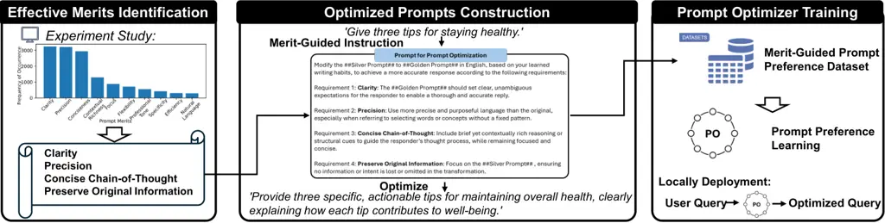

# Rethinking Prompt Optimizers: From Prompt Merits to Optimization

Zixiao Zhu Affiliation: School of Electrical and Electronic Engineering,
Nanyang Technological University, Singapore
Email: [zixiao001@e.ntu.edu.sg](mailto:)    Hanzhang Zhou
Affiliation: School of Electrical and Electronic Engineering, Nanyang
Technological University, Singapore
Email: [hanzhang001@e.ntu.edu.sg](mailto:)    Zijian Feng
Affiliation: School of Electrical and Electronic Engineering, Nanyang
Technological University, Singapore
Email: [feng0119@e.ntu.edu.sg](mailto:)    Tianjiao Li
Affiliation: School of Electrical and Electronic Engineering, Nanyang
Technological University, Singapore
Email: [tianjiao.li@ntu.edu.sg](mailto:)    Chua Jia Jim Deryl
Affiliation: Home Team Science and Technology Agency, Singapore
Email: [ekzmao@ntu.edu.sg](mailto:)    Mak Lee Onn Affiliation: Home
Team Science and Technology Agency, Singapore
Email: [DerylCHUA@htx.gov.sg](mailto:)    Gee Wah Ng Affiliation: Home
Team Science and Technology Agency, Singapore
Email: [MAKLeeOnn@htx.gov.sg](mailto:)    Kezhi Mao ^(†)^(†)thanks:
Corresponding author Affiliation: School of Electrical and Electronic
Engineering, Nanyang Technological University, Singapore
Email: [NGGeeWah@htx.gov.sg](mailto:)

###### Abstract

Prompt optimization (PO) provides a practical way to improve response
quality when users lack the time or expertise to manually craft
effective prompts. Existing methods typically rely on LLMs’
self-generation ability to optimize prompts. However, due to limited
downward compatibility, the instruction-heavy prompts generated by
advanced LLMs can overwhelm lightweight inference models and degrade
response quality, while also lacking interpretability due to implicit
optimization. In this work, we rethink prompt optimization through the
lens of explicit and interpretable design. We first identify a set of
model-agnostic prompt quality merits and empirically validate their
effectiveness in enhancing prompt and response quality. We then
introduce MePO, a merit-guided, locally deployable prompt optimizer
trained on our merit-guided prompt preference dataset generated by a
lightweight LLM. MePO avoids online optimization, reduces privacy
concerns, and, by learning clear, interpretable merits, generalizes
effectively to both large-scale and lightweight inference models.
Experiments demonstrate that MePO achieves better results across diverse
tasks and model types, offering a scalable and robust solution for
real-world deployment. The code, model and dataset can be found in
[https://github.com/MidiyaZhu/MePO](https://github.com/MidiyaZhu/MePO).

## 1 Introduction

Large language models (LLMs) have achieved impressive results across
many NLP tasks (Achiam et al., 2023; Touvron et al., 2023), but their
performance remains highly sensitive to prompt phrasing. Although
careful prompt crafting can improve output quality, it is often
impractical in real-world settings, where users typically lack the time
or expertise to manually refine prompts. This has sparked growing
interest in automatic prompt optimization (APO) Liu et al. (2023).

(a) Prompts optimized by advanced models can trigger incorrect responses
from lightweight inference models. Irrelevant response examples are
provided in Appx. A.1.

(b) Lightweight LLMs fail under complex optimization algorithms,
yielding results equal to or worse than the Basic Prompt.

(c) Lightweight LLMs perform well as PO models with merit guidance.

Figure 1: Empirical analysis of prompt optimization behavior across
model scales and optimization algorithms. (a) Raw and GPT-4 optimized
prompts are drawn from the GSM8K Cobbe et al. (2021) and Lu et al.
(2025). (b) Basic and EvoPrompt examples, along with the optimization
algorithm used, are adapted from Guo et al. (2024). (c) The optimized
prompt is generated using our merit-guided instruction (Fig. 16). We
present DeepSeek-R1 (DS)’s prompt and response evaluations (Results are
consistent with GPT-4o). Further details are provided in Appx.A.

A dominant APO paradigm is discrete automatic prompt optimization, which
employs an advanced, large-scale LLM¹¹ 1 In this work, we categorize
LLMs ranging from GPT-4-size to 70B as large-scale, while those with
fewer than 13B are denoted as lightweight, following ChunLiu et al.
(2024). as the prompt optimization model to optimize prompts. These
prompts are then used as inputs to either similarly sized (Xiang et al.,
2025; Ye et al., 2024) or smaller (Guo et al., 2024) inference models
for response generation.

One line of work uses API-based models such as GPT-4 for online prompt
optimization, typically inserting a task-specific meta-prompt before or
after each query to reduce cost, while leaving the query itself
unoptimized (Xiang et al., 2025; Ye et al., 2024). This approach
requires prior task knowledge, limiting its use in open-ended scenarios.
Another line explores locally deployable optimizers that optimize each
prompt and are trained independently of specific tasks. However, most of
their training data still originates from prompts generated by advanced
online LLMs (Lu et al., 2025; Cheng et al., 2024), or selecting
optimized prompts based on the LLMs’ implicit self-generation and
evaluation capabilities (Liang et al., 2024).

Despite the differences in deployment strategies, both online and local
optimization approaches rely on prompts produced by advanced online LLMs
as the gold-standard optimal prompts. This design implicitly assumes
downward compatibility: the notion that prompts generated by large-scale
LLMs can be effectively interpreted by lightweight inference models.
However, our empirical analysis challenges this assumption. As shown in
Fig. 1(a), prompts from large-scale LLMs are often verbose and
instruction-heavy, which may overwhelm lightweight models with limited
memory and reasoning capacity Yang et al. (2023), leading to missed key
points or excessive reasoning and ultimately incorrect or irrelevant
responses.

The finding on the limited downward compatibility of large-scale LLMs
raises a crucial question: Can lightweight LLMs themselves serve as
effective optimization models?

Lightweight models are typically not used for prompt optimization due to
their perceived limitations in handling complex optimization
processes Wang et al. (2024); Lu et al. (2025), as further illustrated
in Fig. 1(b). However, our research reveals a promising alternative. We
find that these models can indeed serve as effective prompt optimizers
when guided by explicit and interpretable prompt design merits
(Fig. 1(c)). This suggests that, with clear, learnable structures, even
lightweight LLMs can function as capable optimizers, offering an
efficient and locally deployable alternative to online methods,
particularly in low-resource or privacy-sensitive settings.

To this end, we propose MePO, a Merit-Guided Prompt Optimization model.
Unlike implicit optimization like POIR Liang et al. (2024), we begin by
conducting a systematic analysis to identify four sets of explicit
prompt merits that consistently characterize high-quality prompts,
offering actionable insights into effective prompt construction. Guided
by these merits, we build a prompt optimization preference dataset using
optimized prompts generated by a lightweight LLM, eschewing reliance on
advanced online LLMs, and use it to train an end-to-end prompt
optimization model. At the prompt level, our approach produces precise
and clear merit guidance that can be generated by lightweight prompt
optimization models. At the response level, our optimized prompts not
only enhance the performance of similarly scaled inference models, but
also demonstrate strong downward and upward compatibility, as the
learned prompt merits generalize effectively across both large-scale and
lightweight inference models. Besides, using lightweight models for
dataset construction reduces external dependencies, enabling scalable,
privacy-preserving local deployment.

Our main contributions are as follows:

1\. We identify and formalize a set of interpretable prompt merits that
contribute to both high-quality prompts and responses.

2\. We construct a 40k-scale, merit-guided, prompt optimization
preference dataset using lightweight LLMs while maintaining high
optimization quality.

3\. We propose MePO, a lightweight, locally deployable prompt
optimization model trained on our merit-guided preference dataset.

4\. Evaluations of MePO at both the prompt and response levels show it
matches or exceeds existing discrete APO methods and remains effective
across inference models of varying capacities.

## 2 Empirical Analysis: What Merits a Good Prompt?

Prior APO frameworks commonly rely on advanced online LLMs (Guo et al.,
2024; Yuksekgonul et al., 2024; Cheng et al., 2024) to generate
optimized prompts, directly leveraging the high-quality prompt
generation capabilities of large-scale models (Pan et al., 2023).
However, some studies raise concerns about the transferability of such
prompt optimization capabilities to smaller models. Wang et al. (2024)
caution that PromptAgent is designed to optimize prompts for
state-of-the-art LLMs, yet these expert-level prompts often fail to
transfer to smaller models such as GPT-2 or LLaMA2-7b, resulting in
substantial performance degradation. Similarly, Lu et al. (2025) observe
that small optimizers (13b) fail in difficult prompt optimization tasks.

We argue that these limitations are not solely due to the generation
capacity of lightweight LLMs, but rather to the overly vague or
underspecified optimization instructions used in prior work.
Specifically, Wang et al. (2024) adopt the prompt “Given error feedback,
generate a better prompt”, and Lu et al. (2025) use “You are an expert
in prompt optimization”. Both are overly general and lack concrete
guidance. In contrast, we find that when lightweight LLMs are explicitly
instructed with detailed prompt patterns, they can generate effective
optimized prompts despite their limited capacity (Fig. 1(c)), which
aligns with findings that lightweight LLMs—with limited contextual
memory Yang et al. (2023)—particularly benefit from explicit and
structurally clear prompts Ying et al. (2024). This observation
motivates a key question: What merits a good prompt?

To enable lightweight LLMs as effective prompt optimizers, in this
section, we analyze response-level and prompt-level characteristics to
identify core merits that contribute to high-quality prompts.

### 2.1 Merit Discovery

Literature Grounding: Prior studies explore various merits that
contribute to prompt effectiveness. Wei et al. (2022) propose that
including Chain-of-Thought (CoT) reasoning in prompts enhances
performance, while Lampinen et al. (2022) find that Detailed
Explanations improve prompt quality. Bsharat et al. (2023) introduce 26
prompting principles, categorized into dimensions such as Prompt
Structure and Clarity, and Specificity and Information. Ye et al. (2024)
propose three key components for reasoning prompts: Detailed
Descriptions, Context Specification, and Step-by-Step Reasoning.

Although each of these works contributes valuable insights, they often
emphasize different dimensions, resulting in a lack of consensus on what
constitutes a high-quality prompt. To further explore this space, we
take an empirical approach to uncover the merits of effective prompts
through comparative evaluation.

Empirical Analysis: We randomly select 5000 raw questions from the
Alpaca dataset Taori et al. (2023) and ask a lightweight LLM²² 2
[https://huggingface.co/Qwen/Qwen2.5-7B-Instruct](https://huggingface.co/Qwen/Qwen2.5-7B-Instruct)
to rewrite each question five times. We then use the same LLM as the
inference model to generate responses for both the raw and rewritten
questions. The quality of each response is scored using DeepSeek-R1 (Guo
et al., 2025). Interestingly, we observe that even small changes in a
prompt—sometimes just a few words—can lead to significant differences in
response scores. This suggests that certain rewrites yield better
prompts, which in turn lead to more effective answers.

Based on this observation, we identify raw-rewritten prompt pairs and
categorize them as: (1) prompts that led to higher-scoring responses,
and (2) those that resulted in lower-scoring responses, with a score
difference greater than 4 points. We then ask DeepSeek-R1 to identify
the merits that make the higher-scoring prompts more effective compared
to the lower-scoring ones.

Figure 2: Key merits of high-performing prompts extracted from
DeepSeek-R1 evaluations.

As shown in Fig. 2, the merits most frequently associated with
high-performing prompts include _Clarity_, _Precision_, and
_Conciseness_. These results reveal that strong prompts consistently
exhibit a core set of qualities that can be effectively generated even
by lightweight LLMs. We further verify this trend using GPT-4o and
Qwen3-32B (see Sec. B.2). Although _Chain-of-Thought_ is frequently
emphasized in the literature, it was less prominent in our dataset,
likely due to its focus on general open-ended queries rather than
reasoning-specific tasks. To strike a balance, we consolidate
_Conciseness_ and _Chain-of-Thought_ into _Concise Chain-of-Thought_,
mitigating verbosity while preserving reasoning cues and introduce
_Preserve Original Information_ to keep that essential content.

Motivated by empirical findings and prior insights, we propose the
following design merits to guide the construction of optimal prompts:

$`\bullet`$ Clarity: The optimal prompt should set clear, unambiguous
expectations for the responder to enable a thorough and accurate reply.

$`\bullet`$ Precision: Use more precise and purposeful language,
especially when referring to selecting words or concepts without a fixed
pattern.

$`\bullet`$ Concise Chain-of-Thought: Include brief yet contextually
rich reasoning or structural cues to guide the responder’s thought
process, while remaining focused and concise.

$`\bullet`$ Preserve Original Information: Focus on the original prompt,
ensuring no information or intent is lost or omitted in the
transformation.

Guided by the discovered merits, we optimize the prompts into their
merit-guided versions using a lightweight LLM under the instruction in
Fig.16.

Response-Level Evaluation: To assess whether merit-guided prompts
improve response quality, we compare responses generated from
merit-guided prompts against those from raw prompts across two datasets
(2,000 samples each), with scores assigned by DeepSeek-R1.

$`\bullet`$ Alpaca Dataset (30k)³³ 3
[https://huggingface.co/datasets/tatsu-lab/alpaca](https://huggingface.co/datasets/tatsu-lab/alpaca):
Raw responses are generated by text-davinci-003

$`\bullet`$ BPO Dataset (13.9k)⁴⁴ 4
[https://huggingface.co/datasets/THUDM/BPO](https://huggingface.co/datasets/THUDM/BPO):
Raw responses are sourced from human-preferred answers.

Figure 3: Response-level win rate comparison. ‘Win’ indicates that the
merit-guided prompt’s response received a higher score than that from
the raw prompt.



Figure 4: Overall stages of merit-guided prompt optimization (MePO).

As shown in Fig. 3, prompts optimized using our designed merits, despite
being applied to a lightweight model, can match or even outperform
GPT-3.5-generated responses (Alpaca) and significantly beat
human-preferred responses (BPO).

Prompt-Level Evaluation: To move beyond response quality and directly
assess prompt quality, a dimension largely overlooked in prior work, we
asked DeepSeek-R1 to evaluate raw and optimized prompts in isolation.
Across 2000 prompt comparisons per dataset, optimized prompts were
preferred in 95.75% of cases on BPO and 97.9% on Alpaca. These results
reinforce the effectiveness of our proposed prompt merits and
demonstrate that prompt quality can be reliably evaluated independently
of generated outputs.

Summary: Our evaluations demonstrate that prompts optimized using these
interpretable merits yield higher prompt quality and stronger responses.
Moreover, effective prompt optimization is not exclusive to advanced,
large-scale LLMs; with merit-based guidance, lightweight LLMs can also
serve as capable and practical prompt optimizers.

The detailed implementation of the merit discovery process is provided
in Appx.B.

## 3 Method: From Merits to Optimizer

To incorporate the proposed merits into the APO pipeline, we apply them
at the optimization stage as supervision signals for preference
learning⁵⁵ 5 Alternatively, the merits could be used in conjunction with
response feedback to iteratively guide the optimization process through
the inference model. In this work, we focus on the optimization stage
and leave integration with inference feedback for future exploration..

Our objective is to end-to-end optimize arbitrary input prompts
$`P_{\text{silver}}`$ into refined prompts $`P_{\text{golden}}`$,
enabling inference models to generate higher-quality responses. To
achieve this, we introduce MePO, a lightweight LLM-based prompt
optimization model designed for local deployment. MePO is trained under
a preference learning framework, supervised by our proposed dataset,
where prompts are constructed according to the merits identified in
Sec.2. An overview of MePO is shown in Fig.4.

### 3.1 Constructing the Merit-Aligned Prompt Preference Dataset

To train MePO, we construct an API-free Prompt Optimization Preference
(POP) dataset grounded in our discovered merits. Following Cheng et al.
(2024); Lu et al. (2025), we adopt Alpaca and BPO as our base datasets.
The instruction field in Alpaca and the prompt field in BPO are treated
as raw prompts $`P_{\text{silver}}`$, which are then refined by a
lightweight LLM $`M_{\text{ref}}`$2 using the defined merits to generate
$`P_{\text{golden}}`$, eliminating dependence on online LLM
optimization.

We then use $`M_{\text{ref}}`$ to generate responses
$`\hat{R}_{\text{golden}}`$ from each optimized prompt
$`P_{\text{golden}}`$, and retrieve the corresponding raw responses
$`\hat{R}_{\text{silver}}`$ from Alpaca’s output and BPO’s bad*res. Each
response is then evaluated by DeepSeek-R1, and we retain only those
pairs that satisfy two criteria: (1) $`\hat{R}*{\text{golden}}`$
receives a higher evaluation score than $`\hat{R}_{\text{silver}}`$, and
(2) the score of $`\hat{R}_{\text{golden}}`$ exceeds 8⁶⁶ 6 According to
our scoring rubric in Fig. 15, responses with scores above 8 are
considered accurate and well-aligned with the prompt.. The retained
samples are relabeled as $`R*{\text{golden}}`$ and
$`R*{\text{silver}}`$, forming a structured 4-tuple used in training:

```math
(P_{\text{silver}},P_{\text{golden}},R_{\text{silver}},R_{\text{golden}}).
```

Since Alpaca and BPO contain relatively well-formed prompts, either
produced by text-davinci-003 or curated by humans, we further simulate
real-world usage by randomly selecting 10% of $`P_{\text{silver}}`$ and
intentionally degrading them using a base model. These lower-quality
prompts better reflect common user inputs and are paired with their
corresponding $`P_{\text{golden}}`$ to enhance data diversity.

|                          |            |                  |       |             |
| ------------------------ | ---------- | ---------------- | ----- | ----------- |
| Prompt Source Statistics | Alpaca     |                  | BPO   |             |
| Category                 | Naive      | Degraded         | Naive | Degraded    |
| \# 4-Tuples              | 25526      | 3000             | 10225 | 1400        |
| Total samples: 40151     |            |                  |       |             |
| Validation (Win Rate)    | GPT-4o(5k) | DeepSeek-R1(40k) |       | Human (400) |
| Response Win Rate        | 94.82%     | 100.00%          |       | 81.50%      |
| Prompt Win Rate          | 97.68%     | 97.62%           |       | 83.99%      |

Table 1: Overview of our POP dataset. The top section reports the number
of prompt–response 4-tuples derived from Alpaca and BPO. The bottom
section shows validation results from DeepSeek-R1, GPT-4o and four human
evaluations, with win rate denoting the proportion where
$`R_{\text{golden}}`$ or $`P_{\text{golden}}`$ outperforms its silver
counterpart.

| Inference Model   | Optimizer       | ARC-Easy | ARC-Challenge | GSM8K | BBH   | PiQA  | Avg.  |
| ----------------- | --------------- | -------- | ------------- | ----- | ----- | ----- | ----- |
| Qwen2-7b          | \-              | 80.68    | 65.19         | 76.88 | 49.34 | 80.20 | 70.46 |
|                   | Inference Model | 81.22    | 66.21         | 79.01 | 52.68 | 81.34 | 72.09 |
|                   | BPO             | 80.89    | 66.38         | 77.38 | 53.07 | 82.64 | 72.07 |
|                   | FIPO            | 82.37    | 67.49         | 82.71 | 52.74 | 82.48 | 73.56 |
|                   | MePO            | 83.33    | 68.52         | 83.12 | 54.35 | 83.46 | 74.56 |
| Tulu2-7b-dpo      | \-              | 45.37    | 26.54         | 30.63 | 35.67 | 70.02 | 41.65 |
|                   | Inference Model | 46.40    | 29.35         | 32.93 | 38.27 | 70.78 | 43.55 |
|                   | BPO             | 47.98    | 31.57         | 32.08 | 39.33 | 71.60 | 44.51 |
|                   | FIPO            | 50.55    | 36.95         | 33.66 | 39.56 | 72.63 | 46.67 |
|                   | MePO            | 55.05    | 38.14         | 35.18 | 43.25 | 73.60 | 49.04 |
| LLaMA2-7b-chat-hf | \-              | 35.40    | 29.27         | 17.51 | 34.17 | 49.95 | 33.26 |
|                   | Inference Model | 36.74    | 29.52         | 18.88 | 36.65 | 51.41 | 34.64 |
|                   | BPO             | 38.30    | 30.89         | 25.25 | 39.60 | 52.56 | 37.32 |
|                   | FIPO            | 36.24    | 29.44         | 24.72 | 39.14 | 51.58 | 36.22 |
|                   | MePO            | 39.86    | 31.74         | 29.42 | 41.97 | 55.33 | 39.66 |
| Gemma2-9b         | \-              | 89.86    | 38.05         | 63.03 | 61.41 | 82.01 | 66.87 |
|                   | Inference Model | 90.61    | 40.36         | 64.75 | 64.29 | 82.54 | 68.51 |
|                   | BPO             | 91.41    | 38.16         | 65.36 | 64.30 | 83.04 | 68.45 |
|                   | FIPO            | 89.88    | 46.29         | 64.75 | 66.10 | 83.35 | 70.07 |
|                   | MePO            | 92.30    | 48.89         | 68.67 | 69.47 | 85.35 | 72.94 |
| Qwen3-8b          | \-              | 82.11    | 52.60         | 89.46 | 68.07 | 77.80 | 74.01 |
|                   | Inference Model | 83.85    | 52.72         | 90.07 | 69.45 | 79.87 | 75.19 |
|                   | BPO             | 82.75    | 53.12         | 86.96 | 70.03 | 79.11 | 74.39 |
|                   | FIPO            | 78.53    | 50.11         | 83.55 | 70.21 | 73.72 | 71.22 |
|                   | MePO            | 84.38    | 54.68         | 91.12 | 71.12 | 83.08 | 76.88 |

Table 2: Performance comparison of prompt optimization methods across
multiple datasets and inference models. ‘-’ denotes the original
unoptimized prompt. ‘Inference Model’ refers to using the inference
model itself as the optimizer (based on the instruction format in
Fig. 13). Detailed BBH task-level results are provided in Appx.D.1.

After filtering and aggregation, the final POP dataset comprises 40k
samples. Table 1 summarizes the dataset composition and quality
validation scores from both advanced LLMs and humans, showing
consistently strong preference for the optimized prompts across both
response- and prompt-level evaluations. More analysis and evaluation
cost are in Appx.C.

### 3.2 Training the Merit-Guided Prompt Optimizer

To guide the model toward generating more preferred prompts, we train
the optimizer using the Direct Preference Optimization (DPO)
framework (Rafailov et al., 2023). The objective is to learn a prompt
optimizer that prefers merit-guided prompts yielding higher-quality
responses.

In our setup, each training instance includes a chosen prompt
$`P_{\text{golden}}`$ that yields a higher-quality response and a
rejected prompt $`P_{\text{silver}}`$ with a lower-quality response.

The DPO objective is formulated as:

```math
\mathcal{L}_{\text{DPO}}(M_{o};M_{\text{ref}})=-\mathbb{E}_{(x,\text{c},\text{r})\sim\mathcal{D}}\left[\log\sigma\left(\beta\cdot\Delta\right)\right]
```

```math
\Delta=\log\frac{M_{o}(\text{c}\mid x)}{M_{\text{ref}}(\text{c}\mid x)}-\log\frac{M_{o}(\text{r}\mid x)}{M_{\text{ref}}(\text{r}\mid x)}
```

where $`M_{\text{ref}}`$ serves as the reference model, $`M_{o}`$ is the
optimization model ($`M_{\text{ref}}`$ with adapters), $`x`$ denotes the
input prompt in Fig.12, $`c`$ and $`r`$ are the chosen and rejected
prompts defined in the DPO algorithm.

Further implementation details on dataset construction and optimizer
training are in Appx.C.

## 4 Experiments

We evaluate the effectiveness of MePO from the following perspectives:
(1) Comparison with SOTA local prompt optimizers (Sec. 4.2); (2)
Evaluation on instruction-following datasets (Sec. 4.3); (3) Ablation
studies on training (Sec. 4.4) and merits (Sec. 4.5); and (4) Further
analysis (Sec. 4.6)

### 4.1 Setups

MePO is trained using Qwen2.5-7B-Instruct2, selected for its strong
generation ability among similarly sized models Qwen et al. (2025). This
choice ensures that the optimizer is built on a lightweight LLM that
maximizes performance within its size class, allowing efficient
deployment without sacrificing generation quality.

Datasets We evaluate MePO on a diverse set of tasks, including ARC (Easy
and Challenge) (Clark et al., 2018), GSM8K (Cobbe et al., 2021),
BigBench-Hard (BBH, 25 datasets) (Suzgun et al., 2023), and PiQA (Bisk
et al., 2020), as well as three instruction-following benchmarks: Vicuna
Eval Chiang et al. (2023), BPO-Test Eval Cheng et al. (2024), and
Self-Instruct Eval Wang et al. (2023). Following Lu et al. (2025), we
adopt 3-shot for GSM8K, BBH, and PiQA, and zero-shot for others, with
instructions for answer extraction. Prompt optimization is applied only
to the test query, while others remain unchanged.

Baselines We compare MePO with two state-of-the-art local prompt
optimization models: BPO (Cheng et al., 2024) and FIPO (Lu et al.,
2025). We also use the inference model itself as an optimization
baseline, motivated by the inherent alignment between a model and its
own preferences, as leveraging an LLM’s natural capability to refine
prompts for itself better reflects its aligned outputs (Xiang et al.,
2025). We evaluate optimizers’ performance across seven inference model
families: Qwen (Yang et al., 2024), Tulu (Ivison et al., 2023), Gemma
Team et al. (2024), LLaMA (Touvron et al., 2023), Vicuna Zheng et al.
(2023), Deepseek Guo et al. (2025) and GPT4o Achiam et al. (2023).
Additional implementation details and dataset descriptions are provided
in Appx.D.

### 4.2 Main Results

We present the performance of each optimizer, including our MePO, on
different inference models. The results across QA and math datasets,
summarized in Table 2, lead to the following conclusions:

| Model        | Method |           | Vicuna Eval |      |       | BPO-test Eval |      |       | Self-Instruct Eval |      |       |               |
| ------------ | ------ | --------- | ----------- | ---- | ----- | ------------- | ---- | ----- | ------------------ | ---- | ----- | ------------- |
|              | A      | B         | A Win       | Tie  | B Win | A Win         | Tie  | B Win | A Win              | Tie  | B Win | $`\Delta`$ WR |
| GPT-4o       | MePO   | \-        | 31.7        | 61.9 | 6.4   | 32.0          | 61.0 | 7.0   | 47.5               | 50.0 | 2.5   | +31.8         |
|              | MePO   | Inference | 25.0        | 63.5 | 11.5  | 30.0          | 53.5 | 16.5  | 43.8               | 53.7 | 2.5   | +22.8         |
|              | MePO   | BPO       | 23.4        | 61.9 | 14.7  | 28.5          | 54.0 | 17.5  | 41.3               | 55.1 | 3.7   | +19.1         |
|              | MePO   | FIPO      | 24.2        | 62.3 | 13.5  | 22.5          | 62.0 | 15.5  | 30.0               | 65.0 | 5.0   | +14.2         |
| DeepSeek-R1  | MePO   | \-        | 7.5         | 86.1 | 6.4   | 37.0          | 58.0 | 5.0   | 31.2               | 52.5 | 16.3  | +16.0         |
|              | MePO   | Inference | 27.8        | 66.3 | 5.9   | 16.5          | 71.0 | 12.5  | 20.7               | 55.0 | 24.3  | +7.4          |
|              | MePO   | BPO       | 19.8        | 73.0 | 7.2   | 18.5          | 71.0 | 10.5  | 32.5               | 60.0 | 7.5   | +15.2         |
|              | MePO   | FIPO      | 16.7        | 76.6 | 6.7   | 26.0          | 60.0 | 14.0  | 31.3               | 60.0 | 8.7   | +14.9         |
| Qwen-7B-chat | MePO   | \-        | 52.7        | 12.3 | 35.0  | 54.5          | 23.5 | 22.5  | 60.0               | 15.0 | 25.0  | +28.2         |
|              | MePO   | Inference | 47.2        | 12.3 | 40.5  | 54.0          | 13.5 | 32.5  | 46.3               | 24.9 | 28.8  | +15.2         |
|              | MePO   | BPO       | 51.2        | 23.3 | 25.5  | 51.5          | 6.0  | 42.5  | 59.0               | 6.0  | 35.0  | +19.5         |
|              | MePO   | FIPO      | 45.2        | 32.3 | 22.5  | 49.0          | 11.5 | 39.5  | 49.9               | 11.4 | 38.7  | +14.6         |
| Vicuna-7B    | MePO   | \-        | 56.8        | 10.7 | 32.5  | 59.0          | 9.5  | 31.5  | 61.3               | 8.7  | 30.0  | +27.7         |
|              | MePO   | Inference | 48.8        | 18.7 | 32.5  | 56.5          | 12.5 | 31.0  | 46.3               | 23.7 | 30.0  | +19.4         |
|              | MePO   | BPO       | 42.0        | 18.3 | 39.7  | 51.0          | 12.0 | 37.0  | 48.8               | 22.5 | 28.7  | +12.1         |
|              | MePO   | FIPO      | 36.9        | 33.3 | 29.8  | 66.5          | 15.0 | 18.5  | 53.8               | 12.5 | 33.7  | +25.1         |

Table 3: Win-rate evaluations of MePO prompt compared with raw prompt
(‘-’), prompt optimized by inference model (‘Inference’), BPO prompt and
FIPO prompt. $`\Delta`$WR denotes the change in win rate compared to the
baseline.

Efficacy MePO consistently outperforms all baselines across datasets and
task models, with average accuracy gains of 1% on Qwen2-7B, 2.37% on
Tulu2-7B, 2.34% on LLaMA2-7B, 2.86% on Gemma2-9B and 1.69% on Qwen3-8B.
Notable improvements are observed on GSM8K with LLaMA2-7B and Gemma2-9b
(+4.17%, +3.31%), ARC-Easy and BBH with Tulu2-7B (+4.5%, +3.69%) and
PiQA on Qwen3-8b (+3.21%).

Robustness Inference models often perform better when the optimizer
shares the same architecture, reflecting alignment with model-specific
preferences. For example, BPO (based on LLaMA2) performs better with
LLaMA2-7B, while FIPO (based on Tulu2) excels with Tulu2-7B. However,
both optimizers show misalignment when responding under different
architectures such as Gemma2, Qwen2 and Qwen3. Compared with inference
model itself as the optimizer, on GSM8K, the inference model outperforms
BPO by +2.2% (Gemma2), +1.63% (Qwen2), and +3.11% (Qwen3), and surpasses
FIPO by +6.52% on Qwen3. On ARC-Easy, it outperforms BPO by +0.33%
(Qwen2) and +1.1% (Qwen3), and FIPO by +0.73% (Gemma2) and +5.32%
(Qwen3). On PiQA, Qwen3 surpasses BPO by +0.76% and FIPO by +6.15%. Both
BPO and FIPO fail to transfer effectively to Qwen3, with average
performance drops of 0.8% and 3.97%, respectively. In contrast, MePO
consistently outperforms inference model optimization across all
datasets, indicating that its learned prompt merits are broadly
interpretable across architectures, demonstrating both robustness and
strong generalization capability.

Further results on DeepSeek models and significance tests are in
Appx. E.3-E.7.

### 4.3 Instruction-following Dataset Evaluation

To more accurately evaluate alignment quality, we assess three
instruction-following datasets across four widely used inference models:
GPT-4o, DeepSeek-R1, Qwen-7B-Chat⁷⁷ 7
[https://huggingface.co/Qwen/Qwen-7B-Chat](https://huggingface.co/Qwen/Qwen-7B-Chat),
and Vicuna-7B⁸⁸ 8
[https://huggingface.co/lmsys/vicuna-7b-v1.5](https://huggingface.co/lmsys/vicuna-7b-v1.5).
We compare MePO with three optimizers: the inference model itself, BPO,
and FIPO. All comparisons are scored by GPT-4o to ensure consistency and
high-quality preference judgments, following Liang et al. (2024).

As shown in Table 3, MePO outperforms all compared methods across all
datasets. Even for powerful inference models such as GPT-4o and
DeepSeek-R1, the clear, merit-aligned structure of MePO’s optimized
prompts leads to further improvements. The results also suggest that
stronger models can benefit from prompt optimization, as their superior
generation capabilities enable them to better leverage high-quality
prompts. Additional comparisons with POIR are provided in Sec. E.6.

### 4.4 Ablation Study: Training Ablation

As shown in Table 1, we retain 25.5k Alpaca and 10k BPO samples by
discarding cases where merit-guided prompts fail to outperform their raw
counterparts. This ensures MePO is trained only on reliably successful
examples, promoting robust learning of merit application.

| Task Model         | Optimizer     | ARC-E | ARC-C | GSM8K | BBH   | PiQA  | Avg.  |
| ------------------ | ------------- | ----- | ----- | ----- | ----- | ----- | ----- |
| Qwen2-7b           | Training Free | 82.79 | 68.17 | 81.52 | 52.93 | 82.32 | 73.55 |
|                    | MePO          | 83.33 | 68.52 | 83.12 | 54.35 | 83.46 | 74.56 |
| Tulu2-7b -dpo      | Training Free | 49.58 | 34.30 | 32.93 | 40.96 | 72.60 | 46.22 |
|                    | MePO          | 55.05 | 38.14 | 35.18 | 43.25 | 73.60 | 49.04 |
| LLaMA2- 7b-chat-hf | Training Free | 36.91 | 30.55 | 25.23 | 39.88 | 53.10 | 37.13 |
|                    | MePO          | 39.86 | 31.74 | 29.42 | 41.97 | 55.33 | 39.66 |
| Gemma2-9b          | Training Free | 91.33 | 48.32 | 67.17 | 66.23 | 85.00 | 71.61 |
|                    | MePO          | 92.30 | 48.89 | 68.67 | 69.47 | 85.35 | 72.94 |
| Qwen3-8b           | Training Free | 83.63 | 54.57 | 89.84 | 70.82 | 82.54 | 76.28 |
|                    | MePO          | 84.38 | 54.68 | 91.12 | 71.12 | 83.08 | 76.88 |

Table 4: Comparison between training-free prompts and MePO. Detailed BBH
results are in Appx.D.1.

To isolate the effect of learning, we compare MePO with a training-free
baseline where the inference model itself rewrites raw prompts using
static merit-guided templates (Fig. 16), and then generates responses
from the rewritten prompts. This comparison tests whether learning to
apply merits is more effective than applying them heuristically. As
shown in Table 4, MePO outperforms the training-free approach across all
datasets and model backbones. The average accuracy improves by 1.01%,
2.38%, 2.53%, 1.33%, and 0.6% on Qwen2, Tulu2, LLaMA2, Gemma2 and Qwen3,
demonstrating the value of end-to-end optimization over training-free
prompting.

### 4.5 Ablation Study: Merit Ablation

To assess the contribution of each merit proposed in Sec. 2, we conduct
an ablation study targeting four designed merits under the training-free
setup: (1) Clarity, (2) Precision, (3) Concise CoT, and (4)
Preservation. We evaluate on ARC-Easy, ARC-Challenge, GSM8K, and PiQA
under Qwen2-7B and Vicuna under Qwen-7B-Chat.

| Optimizer | ARC-E | ARC-C | GSM8K | PiQA  | Avg.  | Vicuna ($`\Delta`$WR) |
| --------- | ----- | ----- | ----- | ----- | ----- | --------------------- |
| \-        | 80.68 | 65.19 | 76.88 | 80.20 | 75.74 | \-                    |
| MePO      | 82.79 | 68.17 | 81.52 | 82.32 | 78.70 | 33.5                  |
| MePO_wo1  | 80.01 | 66.21 | 77.58 | 80.52 | 76.08 | 12.5                  |
| MePO_wo2  | 82.03 | 68.00 | 77.03 | 80.25 | 76.83 | 15.0                  |
| MePO_wo3  | 81.31 | 67.32 | 81.27 | 81.18 | 77.77 | 21.3                  |
| MePO_wo4  | 81.48 | 67.66 | 80.82 | 81.50 | 77.87 | 27.5                  |

Table 5: Merit Ablation. MePO_wo1–MePO_wo4 each remove one merit while
keeping the others. All variants follow the template in Fig.16,
excluding the targeted merit. “-” corresponds to the original dataset
prompts without any optimization. In Vicuna comparison, we evaluate the
$`\Delta`$ Win Rate between MePO variants and without optimization.

As shown in Table 5, all MePO variants outperform the raw prompts,
demonstrating the overall effectiveness of merit-driven optimization.
The removal of Clarity (MePO_wo1) and Precision (MePO_wo2) results in
the most significant performance drops, consistent with Fig.2, where
these merits were most frequently associated with advanced
LLMs-identified “good prompts”.

Notably, removing Concise CoT (MePO_wo3) has minimal impact, even on
GSM8K, suggesting that when prompts are already clear and precise, LLMs
can reason effectively without explicit CoT prompting. This also helps
explain why LLMs sometimes fail on raw prompts but succeed with CoT: the
benefit of CoT may stem not from added reasoning capacity but from
clarifying vague inputs. When clarity and precision are provided
directly, CoT prompting becomes less necessary.

### 4.6 Further Analyses

More in-depth analyses are in Appx.E, including downward compatibility
with weaker LLMs (E.1), upward compatibility with larger LLMs (E.2),
newly released LLM comparison (E.3), interpretability and examples of
MePO (E.4), dataset ablation studies (E.5), POIR comparison (E.6),
significant test (E.7), online-based meta-prompts comparison (E.8); and
iterative optimization (E.9).

## 5 Related Work

Automatic Prompt Optimization (APO) provides a practical alternative to
fine-tuning by optimizing prompts (Yang et al., ; Zhu et al., 2023).
Beyond exploration-based methods search over predefined prompt pools (Ma
et al., 2023; Shi et al., ), recent works favor discrete
exploitation-based methods that directly generate or revise prompts
without relying on the quality of initial pools, making them more
flexible and better suited for generative tasks beyond fixed-answer
classification.

Online-Based Discrete APO Several works perform discrete prompt
optimization using high-capacity, API-based LLMs as optimization models.
For example, Zhou et al. (2022) use InstructGPT; Wang et al. (2024); Guo
et al. (2024); Pryzant et al. (2023) rely on GPT-3.5; Xiang et al.
(2025) adopt Claude 3.5; and Yuksekgonul et al. (2024) utilize GPT-4o.
While effective, these approaches depend on proprietary APIs,
introducing practical concerns around cost, inference latency, and
privacy risks.

Local Discrete APO Locally trainable prompt optimizers have been
explored for general use. FIPO (Lu et al., 2025) trains a Tulu2-based
model using a GPT3.5/4-generated dataset. BPO (Cheng et al., 2024) uses
a LLaMA-based optimizer trained on ChatGPT-optimal prompts. POIR Liang
et al. (2024) implicitly trains a lightweight PO using model
self-reasoning and self-evaluation. MAPO (Chen et al., 2023) adopts a
model-adaptive strategy with GPT-3.5-generated prompts but is
task-specific, limiting generalization. In contrast, our model uses
explicit merit-guided prompts from a lightweight LLM to enable a
high-performance, locally deployable task-agnostic optimizer.

Prompt Merits Exploration To improve prompt quality, Arora et al. ()
show that prompts in open-ended QA formats outperform restrictive ones.
Wei et al. (2022) introduce intermediate reasoning steps in prompts.
Zhou et al. (2023) propose decomposing prompts into simpler
subcomponents. Besides, several studies provide design principles for
prompt optimization (Bsharat et al., 2023; Ye et al., 2024). However,
these merits are largely proposed heuristically and validated through
downstream experiments, leading to inconsistencies in perspective. In
contrast, we derive prompt merits by prompt–response empirical analysis,
grounding them in measurable improvements.

## 6 Conclusion

In this work, we introduce MePO, a lightweight, locally deployable
prompt optimization model trained under a merit-guided preference
framework. Empirical analyses are conducted to discover prompt
merits—clarity, precision, and concise chain-of-thought—that contribute
to high-quality prompts, resulting in a prompt preference dataset
proposed using the lightweight LLMs. Experimental results show that MePO
not only generates structurally clear and precise prompts, but also
exhibits strong downward and upward compatibility, maintaining robust
performance across variously scaled inference models. Our findings
demonstrate that, with well-defined optimization merits, even
lightweight LLMs can serve as effective prompt optimizers—enabling
scalable, cost-efficient, and privacy-friendly deployment in real-world
settings.

## 7 Limitations

While MePO demonstrates strong performance across diverse tasks and
model scales, several limitations remain: (1) Lack of Interactive
Feedback: MePO currently operates as a one-shot prompt optimizer,
without incorporating iterative signals from users or inference model
feedback. In real-world deployments, both user interactions and model
responses can provide valuable guidance for continual prompt refinement.
Integrating MePO into an interactive, feedback-driven optimization loop
remains a promising direction for future work. (2) Limited Model
Adaptation: Although MePO exhibits robustness across different inference
models, further gains may be possible by aligning the base architectures
of the optimization and inference models. While our results show that
MePO performs well even under architectural mismatch, explicitly
training model-adaptive optimizers could improve performance by
leveraging shared internal representations.

## Acknowledgments

This research was supported by the Home Team Science and Technology
Agency (HTX), Singapore under the NTU-HTX collaboration project:
Parsimonious Domain Specific Large Language Model Enabled Multimodality
Sensemaking. We express our sincere appreciation to HTX for their
continued support and collaboration.

## References

- Achiam et al. (2023) J. Achiam, S. Adler, S. Agarwal, L. Ahmad, I.
  Akkaya, F. L. Aleman, D. Almeida, J. Altenschmidt, S. Altman, S.
  Anadkat, et al. Gpt-4 technical report. arXiv preprint
  arXiv:2303.08774. Cited by: §1, §4.1.
- \[2\] S. Arora, A. Narayan, M. F. Chen, L. Orr, N. Guha, K. Bhatia, I.
  Chami, and C. Re Ask me anything: a simple strategy for prompting
  language models. In The Eleventh International Conference on Learning
  Representations, Cited by: §5.
- Bisk et al. (2020) Y. Bisk, R. Zellers, J. Gao, Y. Choi, et al. Piqa:
  reasoning about physical commonsense in natural language. In
  Proceedings of the AAAI conference on artificial intelligence, Vol.
  34, pp. 7432–7439. Cited by: §4.1.
- Bsharat et al. (2023) S. M. Bsharat, A. Myrzakhan, and Z. Shen
  Principled instructions are all you need for questioning llama-1/2,
  gpt-3.5/4. arXiv preprint arXiv:2312.16171 3. Cited by: §2.1, §5.
- Chen et al. (2023) Y. Chen, Z. Wen, G. Fan, Z. Chen, W. Wu, D. Liu, Z.
  Li, B. Liu, and Y. Xiao MAPO: boosting large language model
  performance with model-adaptive prompt optimization. In Findings of
  the Association for Computational Linguistics: EMNLP 2023,
  pp. 3279–3304. Cited by: §5.
- Cheng et al. (2024) J. Cheng, X. Liu, K. Zheng, P. Ke, H. Wang, Y.
  Dong, J. Tang, and M. Huang Black-box prompt optimization: aligning
  large language models without model training. In Proceedings of the
  62nd Annual Meeting of the Association for Computational Linguistics
  (Volume 1: Long Papers), pp. 3201–3219. Cited by: §1, §2, §3.1, §4.1,
  §4.1, §5.
- Chiang et al. (2023) W. Chiang, Z. Li, Z. Lin, Y. Sheng, Z. Wu, H.
  Zhang, L. Zheng, S. Zhuang, Y. Zhuang, J. E. Gonzalez, et al. Vicuna:
  an open-source chatbot impressing gpt-4 with 90%\* chatgpt quality.
  See https://vicuna. lmsys. org (accessed 14 April 2023) 2 (3), pp. 6.
  Cited by: §4.1.
- ChunLiu et al. (2024) C. ChunLiu, H. Zhang, K. Zhao, X. Ju, and L.
  Yang LLMEmbed: rethinking lightweight llm’s genuine function in text
  classification. In Proceedings of the 62nd Annual Meeting of the
  Association for Computational Linguistics (Volume 1: Long Papers),
  pp. 7994–8004. Cited by: footnote 1.
- Clark et al. (2018) P. Clark, I. Cowhey, O. Etzioni, T. Khot, A.
  Sabharwal, C. Schoenick, and O. Tafjord Think you have solved question
  answering? try arc, the ai2 reasoning challenge. arXiv:1803.05457v1.
  Cited by: §4.1.
- Cobbe et al. (2021) K. Cobbe, V. Kosaraju, M. Bavarian, M. Chen, H.
  Jun, L. Kaiser, M. Plappert, J. Tworek, J. Hilton, R. Nakano, et al.
  Training verifiers to solve math word problems. arXiv preprint
  arXiv:2110.14168. Cited by: Figure 1, §4.1.
- Grattafiori et al. (2024) A. Grattafiori, A. Dubey, A. Jauhri, A.
  Pandey, A. Kadian, A. Al-Dahle, A. Letman, A. Mathur, A. Schelten, A.
  Vaughan, et al. The llama 3 herd of models. arXiv preprint
  arXiv:2407.21783. Cited by: Appendix D.
- Guo et al. (2025) D. Guo, D. Yang, H. Zhang, J. Song, R. Zhang, R.
  Xu, Q. Zhu, S. Ma, P. Wang, X. Bi, et al. Deepseek-r1: incentivizing
  reasoning capability in llms via reinforcement learning. arXiv
  preprint arXiv:2501.12948. Cited by: §2.1, §4.1.
- Guo et al. (2024) Q. Guo, R. Wang, J. Guo, B. Li, K. Song, X. Tan, G.
  Liu, J. Bian, and Y. Yang Connecting large language models with
  evolutionary algorithms yields powerful prompt optimizers. In The
  Twelfth International Conference on Learning Representations, External
  Links: [Link](https://openreview.net/forum?id=ZG3RaNIsO8) Cited by:
  §A.2, §A.2, Figure 1, §1, §2, §5.
- Ivison et al. (2023) H. Ivison, Y. Wang, V. Pyatkin, N. Lambert, M.
  Peters, P. Dasigi, J. Jang, D. Wadden, N. A. Smith, I. Beltagy, and H.
  Hajishirzi Camels in a changing climate: enhancing lm adaptation with
  tulu 2. External Links: 2311.10702 Cited by: §4.1.
- Lampinen et al. (2022) A. Lampinen, I. Dasgupta, S. Chan, K.
  Mathewson, M. Tessler, A. Creswell, J. McClelland, J. Wang, and F.
  Hill Can language models learn from explanations in context?. In
  Findings of the Association for Computational Linguistics: EMNLP 2022,
  pp. 537–563. Cited by: §2.1.
- Liang et al. (2024) Z. Liang, B. Chen, Z. Ran, Z. Wang, H. Dai, Y.
  Ma, D. Gao, X. Cai, and L. Yang Self-renewal prompt optimizing with
  implicit reasoning. In Findings of the Association for Computational
  Linguistics: EMNLP 2024, pp. 3030–3041. Cited by: §1, §1, §4.3, §5.
- Liu et al. (2023) P. Liu, W. Yuan, J. Fu, Z. Jiang, H. Hayashi, and G.
  Neubig Pre-train, prompt, and predict: a systematic survey of
  prompting methods in natural language processing. ACM computing
  surveys 55 (9), pp. 1–35. Cited by: §1.
- Lu et al. (2025) J. Lu, S. An, M. Zhang, Y. He, D. Yin, and X. Sun
  FIPO: free-form instruction-oriented prompt optimization with
  preference dataset and modular fine-tuning schema. In Proceedings of
  the 31st International Conference on Computational Linguistics,
  pp. 11029–11047. Cited by: §A.1, Figure 1, §1, §1, §2, §2, §3.1, §4.1,
  §4.1, §5.
- Ma et al. (2023) H. Ma, C. Zhang, Y. Bian, L. Liu, Z. Zhang, P.
  Zhao, S. Zhang, H. Fu, Q. Hu, and B. Wu Fairness-guided few-shot
  prompting for large language models. Advances in Neural Information
  Processing Systems 36, pp. 43136–43155. Cited by: §5.
- Pan et al. (2023) A. Pan, J. S. Chan, A. Zou, N. Li, S. Basart, T.
  Woodside, H. Zhang, S. Emmons, and D. Hendrycks Do the rewards justify
  the means? measuring trade-offs between rewards and ethical behavior
  in the machiavelli benchmark. In International conference on machine
  learning, pp. 26837–26867. Cited by: §2.
- Pryzant et al. (2023) R. Pryzant, D. Iter, J. Li, Y. Lee, C. Zhu,
  and M. Zeng Automatic prompt optimization with “gradient descent” and
  beam search. In Proceedings of the 2023 Conference on Empirical
  Methods in Natural Language Processing, pp. 7957–7968. Cited by: 1st
  item, §5.
- Qwen et al. (2025) Qwen, :, A. Yang, B. Yang, B. Zhang, B. Hui, B.
  Zheng, B. Yu, C. Li, D. Liu, F. Huang, H. Wei, H. Lin, J. Yang, J.
  Tu, J. Zhang, J. Yang, J. Yang, J. Zhou, J. Lin, K. Dang, K. Lu, K.
  Bao, K. Yang, L. Yu, M. Li, M. Xue, P. Zhang, Q. Zhu, R. Men, R.
  Lin, T. Li, T. Tang, T. Xia, X. Ren, X. Ren, Y. Fan, Y. Su, Y.
  Zhang, Y. Wan, Y. Liu, Z. Cui, Z. Zhang, and Z. Qiu Qwen2.5 technical
  report. External Links: 2412.15115,
  [Link](https://arxiv.org/abs/2412.15115) Cited by: §E.1, §4.1.
- Rafailov et al. (2023) R. Rafailov, A. Sharma, E. Mitchell, C. D.
  Manning, S. Ermon, and C. Finn Direct preference optimization: your
  language model is secretly a reward model. Advances in Neural
  Information Processing Systems 36, pp. 53728–53741. Cited by: §3.2.
- \[24\] C. Shi, K. Yang, Z. Chen, J. Li, J. Yang, and C. Shen Efficient
  prompt optimization through the lens of best arm identification. In
  The Thirty-eighth Annual Conference on Neural Information Processing
  Systems, Cited by: §5.
- Suzgun et al. (2023) M. Suzgun, N. Scales, N. Schärli, S. Gehrmann, Y.
  Tay, H. W. Chung, A. Chowdhery, Q. Le, E. Chi, D. Zhou, et al.
  Challenging big-bench tasks and whether chain-of-thought can solve
  them. In Findings of the Association for Computational Linguistics:
  ACL 2023, pp. 13003–13051. Cited by: §4.1.
- Taori et al. (2023) R. Taori, I. Gulrajani, T. Zhang, Y. Dubois, X.
  Li, C. Guestrin, P. Liang, and T. B. Hashimoto Stanford alpaca: an
  instruction-following llama model. GitHub. Note:
  [https://github.com/tatsu-lab/stanford_alpaca](https://github.com/tatsu-lab/stanford_alpaca)
  Cited by: §2.1.
- Team et al. (2024) G. Team, M. Riviere, S. Pathak, P. G. Sessa, C.
  Hardin, S. Bhupatiraju, L. Hussenot, T. Mesnard, B. Shahriari, A.
  Ramé, et al. Gemma 2: improving open language models at a practical
  size. arXiv preprint arXiv:2408.00118. Cited by: §4.1.
- Touvron et al. (2023) H. Touvron, T. Lavril, G. Izacard, X.
  Martinet, M. Lachaux, T. Lacroix, B. Rozière, N. Goyal, E. Hambro, F.
  Azhar, et al. Llama: open and efficient foundation language models.
  arXiv preprint arXiv:2302.13971. Cited by: §1, §4.1.
- Wang et al. (2024) X. Wang, C. Li, Z. Wang, F. Bai, H. Luo, J.
  Zhang, N. Jojic, E. Xing, and Z. Hu PromptAgent: strategic planning
  with language models enables expert-level prompt optimization. In The
  Twelfth International Conference on Learning Representations, External
  Links: [Link](https://openreview.net/forum?id=22pyNMuIoa) Cited by:
  §1, §2, §2, §5.
- Wang et al. (2023) Y. Wang, Y. Kordi, S. Mishra, A. Liu, N. A.
  Smith, D. Khashabi, and H. Hajishirzi Self-instruct: aligning language
  models with self-generated instructions. In Proceedings of the 61st
  Annual Meeting of the Association for Computational Linguistics
  (Volume 1: Long Papers), pp. 13484–13508. Cited by: §4.1.
- Wei et al. (2022) J. Wei, X. Wang, D. Schuurmans, M. Bosma, F. Xia, E.
  Chi, Q. V. Le, D. Zhou, et al. Chain-of-thought prompting elicits
  reasoning in large language models. Advances in neural information
  processing systems 35, pp. 24824–24837. Cited by: §2.1, §5.
- Xiang et al. (2025) J. Xiang, J. Zhang, Z. Yu, F. Teng, J. Tu, X.
  Liang, S. Hong, C. Wu, and Y. Luo Self-supervised prompt optimization.
  arXiv preprint arXiv:2502.06855. Cited by: §1, §1, §4.1, §5.
- Yang et al. (2024) A. Yang, B. Yang, B. Hui, B. Zheng, B. Yu, C.
  Zhou, C. Li, C. Li, D. Liu, F. Huang, G. Dong, H. Wei, H. Lin, J.
  Tang, J. Wang, J. Yang, J. Tu, J. Zhang, J. Ma, J. Yang, J. Xu, J.
  Zhou, J. Bai, J. He, J. Lin, K. Dang, K. Lu, K. Chen, K. Yang, M.
  Li, M. Xue, N. Ni, P. Zhang, P. Wang, R. Peng, R. Men, R. Gao, R.
  Lin, S. Wang, S. Bai, S. Tan, T. Zhu, T. Li, T. Liu, W. Ge, X.
  Deng, X. Zhou, X. Ren, X. Zhang, X. Wei, X. Ren, X. Liu, Y. Fan, Y.
  Yao, Y. Zhang, Y. Wan, Y. Chu, Y. Liu, Z. Cui, Z. Zhang, Z. Guo,
  and Z. Fan Qwen2 technical report. External Links: 2407.10671,
  [Link](https://arxiv.org/abs/2407.10671) Cited by: Appendix D, §4.1.
- \[34\] C. Yang, X. Wang, Y. Lu, H. Liu, Q. V. Le, D. Zhou, and X. Chen
  GReaTer: gradients over reasoning makes smaller language models strong
  prompt optimizers\]. In The Twelfth International Conference on
  Learning Representations, Cited by: §5.
- Yang et al. (2023) C. Yang, X. Wang, Y. Lu, H. Liu, Q. V. Le, D. Zhou,
  and X. Chen Large language models as optimizers. In The Twelfth
  International Conference on Learning Representations, Cited by: §E.4,
  §1, §2.
- Yang et al. (2025) Z. Yang, Y. Hu, Z. Du, D. Xue, S. Qian, J. Wu, F.
  Yang, W. Dong, and C. Xu SVBench: a benchmark with temporal multi-turn
  dialogues for streaming video understanding. In The Thirteenth
  International Conference on Learning Representations, External Links:
  [Link](https://openreview.net/forum?id=Hz4BYVY8YM) Cited by: Appendix
  B.
- Ye et al. (2024) Q. Ye, M. Ahmed, R. Pryzant, and F. Khani Prompt
  engineering a prompt engineer. In Findings of the Association for
  Computational Linguistics ACL 2024, pp. 355–385. Cited by: 3rd item,
  §E.8, §1, §1, §2.1, §5.
- Ying et al. (2024) J. Ying, Y. Cao, K. Xiong, L. Cui, Y. He, and Y.
  Liu Intuitive or dependent? investigating llms’ behavior style to
  conflicting prompts. In Proceedings of the 62nd Annual Meeting of the
  Association for Computational Linguistics (Volume 1: Long Papers),
  pp. 4221–4246. Cited by: §E.4, §2.
- Yuksekgonul et al. (2024) M. Yuksekgonul, F. Bianchi, J. Boen, S.
  Liu, Z. Huang, C. Guestrin, and J. Zou Textgrad: automatic"
  differentiation" via text. arXiv preprint arXiv:2406.07496. Cited by:
  §2, §5.
- Zheng et al. (2023) L. Zheng, W. Chiang, Y. Sheng, S. Zhuang, Z.
  Wu, Y. Zhuang, Z. Lin, Z. Li, D. Li, E. Xing, et al. Judging
  llm-as-a-judge with mt-bench and chatbot arena. Advances in neural
  information processing systems 36, pp. 46595–46623. Cited by: §4.1.
- Zhou et al. (2023) D. Zhou, N. Schärli, L. Hou, J. Wei, N. Scales, X.
  Wang, D. Schuurmans, C. Cui, O. Bousquet, Q. V. Le, and E. H. Chi
  Least-to-most prompting enables complex reasoning in large language
  models. In The Eleventh International Conference on Learning
  Representations, External Links:
  [Link](https://openreview.net/forum?id=WZH7099tgfM) Cited by: §5.
- Zhou et al. (2022) Y. Zhou, A. I. Muresanu, Z. Han, K. Paster, S.
  Pitis, H. Chan, and J. Ba Large language models are human-level prompt
  engineers. In The Eleventh International Conference on Learning
  Representations, Cited by: 2nd item, §5.
- Zhu et al. (2023) K. Zhu, J. Wang, J. Zhou, Z. Wang, H. Chen, Y.
  Wang, L. Yang, W. Ye, Y. Zhang, N. Zhenqiang Gong, et al. Promptbench:
  towards evaluating the robustness of large language models on
  adversarial prompts. arXiv e-prints, pp. arXiv–2306. Cited by: §5.

## Appendix A Empirical Study: Prompt Optimization Across Model Scales

### A.1 Evaluating GPT-4 Optimized Prompts on Smaller Inference Models

To evaluate the downward compatibility of large-scale optimization
models with lightweight inference models, beyond the results shown in
Fig. 1(a), we conduct additional experiments that yield irrelevant
responses.

We adopt the optimized prompts from Lu et al. (2025), which are derived
from a GPT-4 optimization dataset and used to train a Tulu2-70B-DPO
model. We then evaluate the effectiveness of these prompts on smaller
inference models (LLaMA2-7B and Tulu2-7B-DPO) by generating responses
and scoring them with DeepSeek-R1 (see Fig. 15 for scoring setup).

LLaMA2-7B-chat-hf Response:  
"Sure, here’s a traditional haiku about the ocean:  
Waves roll in, peaceful  
Soothing sounds, endless blue  
Lullaby of sea  
In this haiku, I wanted to capture the peaceful and soothing quality of
ocean waves, much like a lullaby. The image of waves rolling in and out
of the shore is a common one in haiku poetry, and I wanted to emphasize
the sense of endlessness and tranquility that it evokes. The use of the
word ‘peaceful’ in the first line sets the tone for the rest of the
poem, and the image of ‘endless blue’ in the second line conveys the
vastness and depth of the ocean. The final line, ‘Lullaby of sea,’ adds
a sense of melody and rhythm to the poem, which is fitting given the
soothing nature of ocean waves."

DeepSeek-R1 Evaluation: The response does not include irrelevant
content, but the additional explanatory text is somewhat unnecessary for
the task.

Tulu2-7B-DPO Response:  
"Haiku is a traditional form of Japanese poetry that consists of three
lines with a syllable pattern of 5-7-5. It is a concise and evocative
form that aims to capture a moment or emotion in a few words. A lullaby,
on the other hand, is a song that is typically sung to put children to
sleep. It often has a soothing and calming melody, and the lyrics are
usually simple and repetitive.Here’s my traditional haiku about the
ocean:  
Gentle ocean waves  
Crash upon the shore in peace  
Lullaby of the sea  
In this haiku, I’ve captured the peaceful and soothing quality of ocean
waves, as they gently crash upon the shore. The repetition of the "ocean
waves" phrase in the first and third lines creates a sense of
continuity, emphasizing the endless cycle of the ocean’s"

DeepSeek-R1 Evaluation: High accuracy in the haiku itself but a minor
deduction for the slightly off-topic preface.

These examples show that prompts crafted by powerful optimization models
may not be directly interpretable by smaller models due to verbosity or
overly rich CoT structure, leading to unnecessary or off-topic outputs.

### A.2 Evaluating Lightweight LLMs with Complex Optimization Algorithms

We evaluate whether lightweight LLMs can follow optimization
instructions designed for advanced, large-scale models. Specifically, we
adopt the Differential Evolution (DE) algorithm from Guo et al. (2024),
which uses EvoPrompt instructions to guide prompt generation. We provide
both the EvoPrompt prompt and the DE-generated optimal prompt as input
to lightweight LLMs, and compare their quality using DeepSeek-R1 (see
Fig. 7).

As shown in Fig. 1(b), DeepSeek-R1 evaluations report that the EvoPrompt
prompt is “clearer and more structured,” directly aligning with the
task, while the prompt generated by the lightweight LLM “introduces
unnecessary steps that may distract from the core goal.” These results
indicate that GPT-3.5, as used in EvoPrompt, produces higher-quality
prompts than those generated by LLaMA-3.2-3B or Tulu2-7b-dpo under the
same algorithm—suggesting that lightweight LLMs struggle to serve as
effective optimizers when guided by complex optimization instructions.

##### Evaluating Merits-Guided Prompt Optimization with Lightweight LLMs.

We further test whether lightweight LLMs can act as effective
optimization models when guided by clear, interpretable merits. Using
the Basic Prompt from Guo et al. (2024), we apply our proposed
merit-based instruction (see Fig. 16) to generate optimized prompts. We
then evaluate the difference between Basic and Optimized Prompts using
DeepSeek-R1 with the pairwise setup shown in Fig. 11. The same
evaluation is conducted with GPT-4o under the same setup, and it
produces consistent results, confirming that the merit-guided prompts
generated by lightweight LLMs outperform the Basic Prompt in quality.

These studies collectively show that lightweight LLMs struggle with
vague or complex optimization instructions but can perform competitively
when provided with structured, merit-aligned guidance.

## Appendix B Identifying Effective Prompt Merits via Comparative Evaluation

To systematically analyze effective prompt characteristics, we conduct
comparative evaluations. All experiments are implemented using the
lightweight LLM $`M_{\text{ref}}`$ (Qwen2.5-7B-Instruct), which serves
as: (1) the merit-guided prompt optimization model, (2) the inference
model, and (3) the prompt rewriting model. Below are the details for
each evaluation step.

##### Prompt Rewriting.

We begin by using a rewriting prompt (shown in Fig. 8) to generate
multiple reformulations of each raw question. Specifically, five
rewritten versions are produced for each input prompt to preserve
diversity. Below is an example from the Alpaca dataset, where the raw
prompt results in an incorrect response, while Rewrite 1 and Rewrite 2
yield correct answers under the same inference model:

Raw: What does DNA stand for?

Rewrite 1: Can you tell me what the acronym DNA represents?

Rewrite 2: What is the full form of DNA?

##### Prompt Preference Judgement.

We use a prompt template (see Fig. 11) to conduct direct pairwise
comparisons between two prompts, with judgments provided by DeepSeek-R1.
The positions of the prompts are randomly assigned to mitigate
positional bias.

##### Response Scoring.

The quality of the model’s response to each prompt is evaluated using
DeepSeek-R1. The scoring prompt is shown in Fig. 15, inspired by Yang et
al. (2025). This rubric ranges from 0 to 10, where a score difference of
4 or more points represents over half the scale and thus indicates a
substantial quality gap. We consider responses scoring 5 or above as
good, as they contain at least partially relevant information (e.g.,
“4–5: provides some relevant information but misses key aspects”). In
contrast, responses rated 2–3 or lower often reflect minimal relevance
or severe misconstrual of the ground truth. Accordingly, we define a
“score difference greater than 4 points” as the threshold to identify
prompts that elicit substantially better responses from those that do
not.

##### Prompt Optimization.

The prompt template used to refine raw prompts into merit-guided
optimized versions is shown in Fig. 16.

### B.1 Prompt Merits Recognition

To evaluate prompt quality at the prompt level (i.e., independent of
response content), we design a comparison prompt that asks DeepSeek-R1
to assess which of the two prompt variants is better and explain why, as
illustrated in Fig. 10. The summarized features provided by DeepSeek-R1
are then collected for merit discovery. Below presents two examples from
DeepSeek’s evaluations, highlighting which prompt was preferred and why,
along with the associated merit types.

Example 1

DeepSeek Evaluation:

> \###Explicit Guidance: The Golden Prompt provides a clearer direction
> by specifying the focus on "the importance of customer service," which
> helps the responder structure their thoughts around a central theme
> rather than a vague topic.
>
> \###Contextual Richness: By emphasizing "the importance," the Golden
> Prompt encourages the responder to include reasons, examples, or
> impacts, leading to a more substantive and engaging tweet.
>
> \###Engagement Potential: The Golden Prompt is more likely to generate
> a tweet that resonates with readers, as discussing "importance"
> naturally invites the responder to highlight value or benefits, making
> the content more compelling and shareable.
>
> In contrast, the Sliver Prompt ("Craft a tweet regarding customer
> service experiences") is too broad and could lead to generic or
> unfocused responses, such as simple complaints or praises without
> deeper insight.

Example 2

DeepSeek Evaluation:

> \###Precision in Terminology: The Golden Prompt uses the more accurate
> linguistic term "form" instead of "conjugation," which is more
> appropriate for discussing verb structures in English grammar.
>
> \###Clarity of Focus: By placing the verb phrase in quotation marks
> ("will have helped"), it clearly identifies the exact linguistic
> element to be analyzed, reducing ambiguity.
>
> \###Technical Accuracy: The phrasing aligns better with grammatical
> analysis, as "form" encompasses tense, aspect, and mood, which are all
> relevant to "will have helped" (future perfect tense).
>
> \###Conciseness: It removes the unnecessary framing of "Identify the
> conjugation of the verb:" and gets straight to the point, making it
> more efficient for analysis.

### B.2 GPT-4o and Qwen3 Merits Recognition

To ensure that our results are not overly dependent on DeepSeek-R1, we
additionally conducted merit discovery experiments with GPT-4o and
Qwen3-32B⁹⁹ 9
[https://huggingface.co/Qwen/Qwen3-32B](https://huggingface.co/Qwen/Qwen3-32B)
on the same random sample of 2,000 prompt–response pairs, using the same
discovery template (Fig. 10). The merits and their frequencies are given
in Fig. 5 and Fig. 6, respectively.

Figure 5: Key merits of high-performing prompts extracted from GPT-4o
evaluations.

Figure 6: Key merits of high-performing prompts extracted from Qwen3-32B
evaluations.

Across DeepSeek-R1, GPT-4o, and Qwen3-32B, the top-3 merits (Clarity,
Precision, Conciseness) consistently dominated. Although additional
merits (e.g., Explicit Guidance, Conclusion) appeared in some models,
they are less stable and not consistently aligned. This cross-model
consistency strongly supports the robustness of our final merits
identification.

## Appendix C POP Dataset Construction, Evaluation and Training Details

In dataset construction and prompt optimizer training, the lightweight
LLM $`M_{\text{ref}}`$ (Qwen2.5-7B-Instruct) serves as: (1) the prompt
degradation model, (2) the inference model, (3) the merit-guided prompt
optimization model, and (4) the base model for prompt optimization
learning.

### C.1 Human Annotator Evaluation Results.

Four human annotators evaluated 200 samples optimized from each of the
Alpaca and BPO datasets in our constructed POP dataset, assessing both
prompt-level and response-level quality. The results are shown in
Table 6.

[TABLE]

Table 6: Human evaluation results on the POP dataset. Each human
evaluator (HE\_(i)) compares MePO-optimized prompts against raw prompts
on samples from the Alpaca and BPO datasets.

We also ask the four annotators to select one or more merits for each
preferred prompt and report their preferences based on the selected
merits. The merit recognition results are presented in E.5.2.

### C.2 Dataset Evaluation API Cost.

In our method, the primary cost arises from dataset evaluation and
filtering using DeepSeek-R1 to assess prompt and response quality for
constructing the (P_silver, P_golden, R_silver, R_golden) tuples. The
total DeepSeek-R1 token usage was: Input Cache Hit: 55,060,029; Input
Cache Miss: 53,429,910; and Output Tokens: 29,892,599. The corresponding
cost is approximately 40.67 USD. This usage occurred between April 8 and
May 1, 2025. Notably, DeepSeek offered off-peak discounts during this
period, which may have affected the final token billing.

### C.3 Dataset Under-performance Case Analysis.

Although MePO prompts were preferred in most cases, a small portion was
disfavored during dataset construction. We conducted an error analysis
from both human evaluation and DeepSeek evaluation perspectives to
understand the underlying reasons.

From the human evaluation side, annotators occasionally favored simpler
raw prompts, even when MePO versions offered greater specificity.

BPO Example.

Raw Prompt (Preferred): If someone is having second thoughts about
something, what should I tell him/her to calm down?

MePO Prompt: When someone is experiencing second thoughts about a
decision, provide reassurance by emphasizing the following points
clearly and concisely: 1. Reiterate the positive aspects and rationale
behind the initial decision. 2. Highlight past experiences where similar
concerns were resolved positively. 3. Encourage reflective thinking to
identify specific reasons for the current doubt and consider their
validity. 4. Suggest taking a brief break to regain perspective before
making a final judgment. 5. Remind them of their own capabilities and
past successes in handling similar situations. 6. Offer emotional
support and validation of their feelings without dismissing them. By
guiding them through these steps, help them regain confidence and make
an informed decision calmly.

Alpaca Example.

Raw Prompt (Preferred): Compare the differences between a wooden and
plastic baseball bat.

MePO Prompt: Identify and describe with precision the key differences in
design, material properties, performance characteristics, and player
preferences between a traditional wooden baseball bat and a modern
plastic baseball bat, providing a detailed comparative analysis.

These examples suggest a preference among some annotators for brevity
and clarity over elaboration, particularly in straightforward tasks.

From the DeepSeek evaluation side, preference differences arose from
subtle distinctions in precision and phrasing naturalness.
Representative comments include:

Comment 1. “Both prompts are very similar, but ‘force on a 1 kg mass due
to the gravitational force’ is slightly more precise because it
explicitly mentions the cause of the force (gravitational force), which
could help avoid any ambiguity.”

Comment 2. “##Prompt 2## is slightly better because it is more concise
and direct, while still clearly conveying the task. The instruction
‘Rewrite the following sentence in a more formal way’ is straightforward
and leaves no ambiguity. \##Prompt 1## is also clear but slightly more
verbose without adding value.”

Comment 3. “Prompt 2 is more concise and direct, which is generally
better for eliciting a straightforward answer. Prompt 1’s request for a
‘step-by-step explanation’ is unnecessary for a simple fact like this,
and may lead to overly verbose responses.”

In sum, these cases highlight that optimized prompts, while generally
preferred, may underperform when verbosity outweighs clarity or when
evaluators favor conciseness in simple tasks.

### C.4 Prompt Degradation.

To simulate noisy user inputs—such as “how can i go fr sigapor?”—we
degrade 10% of the raw prompts from the Alpaca and BPO datasets using a
base model. The prompt used for degradation is shown in Fig. 9. Below is
an example from the proposed dataset:

Raw: Describe the atmosphere at the beach.

Degraded: describ the atmossphre at the bheach.

Raw: Calculate the interior angle of a triangle when three of its sides
are 8 cm, 3 cm, and 7 cm.

Degraded: find th angle of a traingle with sidz 8cm, 3cm, an 7cm.

Raw: Take this equation and solve it for x. 5x + 7 = 57

Degraded: solve 5x+7=57 what is x

Raw: What are the probabilities that I get struck by lightning

Degraded: What r the chances I get lightnin’?

### C.5 DPO Input Construction.

To train MePO under the DPO objective, we formulate each training
instance using the format shown in Fig. 12, where S*P is the silver
(unoptimized) prompt $`P*{\text{silver}}`$, S_R is its corresponding
response $`R*{\text{silver}}`$, and G_R is the preferred response
$`R*{\text{golden}}`$.

### C.6 Training Configuration.

We fine-tune MePO based on Qwen2.5-7B-Instruct2 using 4 NVIDIA RTX A5000
GPUs. Each input instruction $`x`$ is truncated or padded to 2000
tokens. Training hyperparameters and cost are summarized in Table 7.

[TABLE]

Table 7: Training setup and hyperparameters used for fine-tuning MePO.

## Appendix D Dataset Information and Experimental Implementation

We evaluate MePO on question-answering, math, and instruction-following
benchmark datasets:

- •
  ARC¹⁰¹⁰ 10
  [https://huggingface.co/datasets/allenai/ai2_arc](https://huggingface.co/datasets/allenai/ai2_arc):
  A grade-school science QA benchmark divided into ARC-Easy (2,376
  questions) and ARC-Challenge (1,172 questions).
- •
  GSM8K¹¹¹¹ 11
  [https://huggingface.co/datasets/openai/gsm8k](https://huggingface.co/datasets/openai/gsm8k):
  A dataset of 1,319 grade-school math word problems requiring free-form
  answer generation.
- •
  BBH¹²¹² 12
  [https://huggingface.co/datasets/lukaemon/bbh/](https://huggingface.co/datasets/lukaemon/bbh/):
  A suite of 25 complex reasoning tasks from BigBench.
- •
  PiQA¹³¹³ 13
  [https://huggingface.co/datasets/ybisk/piqa](https://huggingface.co/datasets/ybisk/piqa):
  A multiple-choice dataset assessing commonsense physical reasoning,
  with 1,838 questions.
- •
  Vicuna Eval¹⁴¹⁴ 14
  [https://huggingface.co/datasets/zhengxuanzenwu/vicuna-eval-with-gpt4](https://huggingface.co/datasets/zhengxuanzenwu/vicuna-eval-with-gpt4):
  An instruction-following dataset with 80 diverse questions across 8
  categories. The optimization part is the instruction.
- •
  BPO-Test Eval4: A 200-sample split from the BPO dataset. We optimized
  the prompt part in the dataset.
- •
  Self-Instruct Eval¹⁵¹⁵ 15
  [https://huggingface.co/datasets/HuggingFaceH4/self-instruct-eval](https://huggingface.co/datasets/HuggingFaceH4/self-instruct-eval):
  A human evaluation benchmark with 252 expert-written, user-oriented
  instructions based on real-world use cases. We optimize the
  instruction part and leave the input part unchanged.

##### Evaluation Protocol.

GSM8K, PiQA, and BBH are evaluated in a 3-shot setting to facilitate
answer extraction, while all other datasets are evaluated in a zero-shot
setting. For consistency, all BBH tasks are reformatted into
multiple-choice format, except for multistep_arithmetic_two,
object_counting, and word_sorting, which retain their original formats.
PiQA, which includes two-solution questions, is also converted to
multiple-choice format.

Unlike previous Qwen and LLaMA evaluations (Yang et al., 2024;
Grattafiori et al., 2024), which select the option (e.g., A, B, or 1, 2)
based on the highest next-token logit probability, we extract the answer
from the model’s generated reasoning. Specifically, we use
format-specific instructions—e.g., for zero-shot ARC: “Reply with the
answer option starting with \##, like \##A, \##B, \##C, or \##D”—and
extract the answer that follows the \## marker in the response. This
approach better reflects the model’s reasoning ability during answer
selection.

##### Prompt Templates.

Fig. 14 illustrates the prompt formats used for GSM8K, PiQA, and ARC.
For BBH, multiple-choice tasks follow the PiQA format, with in-context
examples prepended to the test query along with the corresponding golden
answers. Math-related tasks in BBH adopt the GSM8K format.

##### Baseline Implementations.

We compare MePO with two state-of-the-art prompt optimizers. The prompt
instructions used for inference models (Qwen2-7b¹⁶¹⁶ 16
[https://huggingface.co/Qwen/Qwen2-7B](https://huggingface.co/Qwen/Qwen2-7B),
Tulu2-7b-dpo¹⁷¹⁷ 17
[https://huggingface.co/allenai/tulu-2-dpo-7b](https://huggingface.co/allenai/tulu-2-dpo-7b),
LLaMA2-7b-chat-hf¹⁸¹⁸ 18
[https://huggingface.co/meta-llama/Llama-2-7b-chat-hf](https://huggingface.co/meta-llama/Llama-2-7b-chat-hf),
Gemma2-9b¹⁹¹⁹ 19
[https://huggingface.co/google/gemma-2-9b](https://huggingface.co/google/gemma-2-9b),
and Qwen3-8b²⁰²⁰ 20
[https://huggingface.co/Qwen/Qwen3-8B](https://huggingface.co/Qwen/Qwen3-8B))
serving as prompt optimizers are shown in Fig. 13. Details of the
baselines are as follows:

- •
  FIPO is trained on Tulu2-70B-DPO²¹²¹ 21
  [https://huggingface.co/Junrulu/FIPO-IPL-IPO-Tulu2-70B](https://huggingface.co/Junrulu/FIPO-IPL-IPO-Tulu2-70B),
  using a GPT-3.5/GPT-4-generated preference dataset focused on
  chain-of-thought reasoning.
- •
  BPO is trained on LLaMA2-7B²²²² 22
  [https://huggingface.co/THUDM/BPO](https://huggingface.co/THUDM/BPO),
  with a dataset built from human-preferred prompts optimized by
  GPT-3.5.

All optimization models, including MePO, are loaded in 8-bit precision
for prompt generation. Inference models are run in 4-bit mode with a
generation length below 512 to reduce memory overhead.

### D.1 BBH Experimental Results

Detailed results for the 25 BBH tasks are presented in the following
tables: Table 8 (raw prompts), Table 9 (optimized by the inference
model), Table 10 (training-free merit-guided optimization), Table 11
(BPO), Table 12 (FIPO), and Table 13 (MePO).

[TABLE]

Table 8: Results of raw BBH dataset across the evaluated inference
models.

[TABLE]

Table 9: Results of the BBH dataset optimized by the inference model
across the evaluated inference models.

| -                                       | Qwen2-7b | Tulu2-7b-dpo | LLaMA2-7b-chat-hf | LLaMA3-8b-instruct | Gemma2-9b | Qwen3-8b |
| --------------------------------------- | -------- | ------------ | ----------------- | ------------------ | --------- | -------- |
| date_understanding                      | 55.6     | 36           | 34                | 48                 | 60        | 58       |
| disambiguation_qa                       | 66       | 37.2         | 35.2              | 35.2               | 69.2      | 70.4     |
| hyperbaton                              | 78.4     | 50           | 48.4              | 49.6               | 86.8      | 93.6     |
| logical_deduction_five_objects          | 55.6     | 25.2         | 19.2              | 34.8               | 73.8      | 73.8     |
| logical_deduction_seven_objects         | 44       | 28.4         | 21.6              | 38.8               | 67.2      | 52.4     |
| logical_deduction_three_objects         | 75.2     | 34.4         | 42.4              | 40.4               | 58        | 76.8     |
| movie_recommendation                    | 53.2     | 31.2         | 24.4              | 37.6               | 75.6      | 76.4     |
| penguins_in_a_table                     | 56.16    | 27.4         | 23.29             | 36.99              | 62.53     | 53.42    |
| reasoning_about_colored_objects         | 50.8     | 34           | 35.2              | 20.8               | 30.8      | 58.8     |
| ruin_names                              | 38       | 28.4         | 40                | 39.6               | 46        | 73.2     |
| salient_translation_error_detection     | 38.4     | 34           | 37.2              | 18.8               | 73.34     | 73.34    |
| snarks                                  | 62.36    | 50           | 50.56             | 48.88              | 72.81     | 71.35    |
| word_sorting                            | 94.4     | 87.2         | 87.6              | 90                 | 100       | 100      |
| temporal_sequences                      | 64.4     | 36.8         | 36.8              | 31.2               | 58.4      | 78.8     |
| tracking_shuffled_objects_five_objects  | 29.6     | 38.4         | 34.8              | 33.2               | 32.8      | 40.4     |
| tracking_shuffled_objects_seven_objects | 14.4     | 24.8         | 23.2              | 14.4               | 25.2      | 30.4     |
| tracking_shuffled_objects_three_objects | 30       | 31.6         | 31.6              | 31.2               | 56.4      | 56.4     |
| causal_judgement                        | 55.08    | 52.41        | 51.87             | 52.41              | 92.57     | 75.82    |
| formal_fallacies                        | 54       | 54           | 54                | 52                 | 65.2      | 70.2     |
| navigate                                | 57.2     | 58.8         | 43.2              | 42.4               | 88.8      | 88.4     |
| web_of_lies                             | 52.4     | 49.6         | 49.2              | 51.6               | 57.2      | 52.8     |
| sports_understanding                    | 76       | 64.8         | 49.2              | 79.6               | 78.8      | 84       |
| boolean_expressions                     | 41.6     | 60.4         | 53.6              | 50                 | 72        | 100      |
| multistep_arithmetic_two                | 41.2     | 12.6         | 12                | 41.6               | 84.4      | 93.2     |
| object_counting                         | 39.2     | 36.4         | 58.4              | 50.8               | 68        | 68.8     |

Table 10: Results of the BBH dataset optimized by training-free
merit-guidance across the evaluated inference models.

[TABLE]

Table 11: Results of the BBH dataset optimized by BPO across the
evaluated inference models.

[TABLE]

Table 12: Results of the BBH dataset optimized by FIPO across the
evaluated inference models.

[TABLE]

Table 13: Results of the BBH dataset optimized by MePO across the
evaluated inference models.

| Inference Model      | Optimizer       | ARC-Easy | ARC-Challenge | GSM8K | BBH   | PiQA  | Avg.  |
| -------------------- | --------------- | -------- | ------------- | ----- | ----- | ----- | ----- |
| LLaMA3-8b-instruct   | \-              | 46.72    | 41.31         | 72.02 | 38.76 | 65.56 | 52.87 |
|                      | Inference Model | 52.02    | 42.32         | 74.37 | 40.97 | 67.19 | 55.37 |
|                      | BPO             | 50.88    | 44.37         | 75.06 | 42.68 | 71.81 | 56.96 |
|                      | FIPO            | 49.12    | 44.97         | 73.24 | 42.66 | 75.56 | 57.11 |
|                      | MePO            | 55.01    | 51.88         | 78.01 | 45.52 | 76.66 | 61.42 |
| LLaMA3.2-1b-instruct | \-              | 27.02    | 23.13         | 16.38 | 31.05 | 49.56 | 29.43 |
|                      | Inference Model | 28.79    | 24.23         | 20.24 | 32.29 | 49.73 | 31.06 |
|                      | BPO             | 27.99    | 24.04         | 15.85 | 31.77 | 49.89 | 29.91 |
|                      | FIPO            | 25.19    | 23.55         | 21.30 | 31.72 | 50.27 | 30.41 |
|                      | MePO            | 29.42    | 24.40         | 21.46 | 33.40 | 50.44 | 31.82 |
| LLaMA3.2-3b-instruct | \-              | 73.32    | 55.46         | 63.23 | 37.55 | 66.32 | 59.18 |
|                      | Inference Model | 78.16    | 60.75         | 63.00 | 40.12 | 69.37 | 62.28 |
|                      | BPO             | 74.75    | 55.74         | 56.71 | 40.01 | 67.14 | 58.87 |
|                      | FIPO            | 78.62    | 60.98         | 65.13 | 40.27 | 69.53 | 62.91 |
|                      | MePO            | 79.55    | 61.43         | 65.66 | 43.56 | 70.29 | 64.10 |

Table 14: Downward compatibility: Response evaluation of optimizer in
lightweight inference models.

## Appendix E Further Studies

In this section, we conducted more detailed experiments and case studies
to analyze the effectiveness of MePO.

### E.1 Case Study: Downward Compatibility

FIPO shows performance degradation compared to the inference model
optimizer on LLaMA2-7b (-0.5% on ARC-Easy, -0.08% on ARC-Challenge) in
Table 2. As FIPO is a 70b optimizer trained on prompts optimized by
GPT-4, its outputs may be too complex for smaller inference models to
interpret, indicating a lack of downward compatibility.

To further analyze the downward compatibility of optimization models, we
evaluate performance using three inference models:
LLaMA3-8b-Instruct²³²³ 23
[https://huggingface.co/meta-llama/Meta-Llama-3-8B-Instruct](https://huggingface.co/meta-llama/Meta-Llama-3-8B-Instruct),
LLaMA-3.2-3B-Instruct²⁴²⁴ 24
[https://huggingface.co/meta-llama/Llama-3.2-3B-Instruct](https://huggingface.co/meta-llama/Llama-3.2-3B-Instruct)
and LLaMA-3.2-1B-Instruct²⁵²⁵ 25
[https://huggingface.co/meta-llama/Llama-3.2-1B-Instruct](https://huggingface.co/meta-llama/Llama-3.2-1B-Instruct).

As shown in Table 14, both BPO and FIPO experience notable performance
drops when paired with lightweight inference models. For example, under
LLaMA3-8B-Instruct, BPO drops by 1.14% on ARC-Easy, while FIPO drops by
2.90% on ARC-Easy and 1.13% on GSM8K. The degradation is more pronounced
under LLaMA3.2-3B-Instruct, where BPO drops by 3.41% (ARC-Easy), 5.01%
(ARC-Challenge), 6.29% (GSM8K), and 2.23% (PiQA). Similarly, under
LLaMA3.2-1B-Instruct, FIPO drops by 3.60% (ARC-Easy), and BPO by 4.39%
(GSM8K). Both methods also show degraded performance on BBH with 3B and
1B models.

In contrast, MePO, while built upon a relatively strong base model
compared to LLaMA3-8b Qwen et al. (2025), consistently improves
performance across all datasets, with average gains of 4.31%, 1.19%, and
0.76% on the 8B, 3B, and 1B models respectively, demonstrating strong
downward compatibility and robustness in low-resource settings.

### E.2 Case Study: Upward Compatibility

To evaluate MePO’s upward compatibility, we examine whether its
optimized prompts improve response quality in large-scale inference
models.

[TABLE]

Table 15: Response evaluation of MePO prompts in larger LLMs. Detailed
BBH results are in Table 8 and 13.

As shown in Table 15, applying MePO prompts to larger inference LLMs
consistently matches or improves performance across all datasets. These
results demonstrate that MePO, despite being lightweight, produces clear
and concise reasoning guidance that large-scale LLMs can effectively
interpret, highlighting its strong upward compatibility and potential
for general applicability.

Error Analysis: For the accuracy drop on ARC with LLaMA-3.3-70B, we
found that MePO’s detailed and clarifying prompts sometimes led the
model to attend to misleading keywords present in incorrect options.
Below are examples:

Example 1:

Raw: ‘A research scientist writes a paper on the initial regrowth of a
forest after a fire has damaged the entire ecosystem. Which title would
be best for the paper?’ -\> chosen answer: ’Secondary Succession’
(Correct)

MePO: ‘Identify an appropriate title for a research paper focusing
specifically on the process and characteristics of initial regrowth in a
forest ecosystem following a widespread fire event that completely
devastated the area.’ -\> chosen answer: ’Primary Succession’
(Incorrect)

Example 2:

Raw: ‘A student is investigating in which type of soil a plant will grow
best. Which should the student measure to answer the question?’

MePO: ‘What specific measurements should a student take to determine in
which type of soil a particular plant species grows optimally?’

Example 3:

Raw: ‘Which of these is the main source of the electromagnetic energy we
use?’

MePO: ‘What specifically is identified as the primary origin of the
electromagnetic energy commonly utilized in technological applications?’

However, a small human evaluation involving 20 participants from diverse
backgrounds found that all rated the MePO prompt as either better or
equally good in terms of clarity. This suggests that the observed errors
are not due to poor prompt quality, but likely stem from internal
attention or reasoning mechanisms within the model.

### E.3 Case Study: Newly Released LLMs Evaluation

To comprehensively evaluate MePO on recently released LLMs, we test
MePO-optimized prompts under two inference models:
DeepSeek-R1-Qwen3-8B²⁶²⁶ 26
[https://huggingface.co/deepseek-ai/DeepSeek-R1-0528-Qwen3-8B](https://huggingface.co/deepseek-ai/DeepSeek-R1-0528-Qwen3-8B),
and DeepSeek-R1-LLaMA3.1-8B²⁷²⁷ 27
[https://huggingface.co/deepseek-ai/DeepSeek-R1-Distill-Llama-8B](https://huggingface.co/deepseek-ai/DeepSeek-R1-Distill-Llama-8B).

As shown in Table 16, MePO consistently outperforms all baselines across
all evaluated datasets, even on the latest LLMs. In contrast, BPO and
FIPO show degraded performance, particularly on GSM8K, across all
models. These results demonstrate MePO’s robustness and broad
applicability across diverse LLM families.

| Inference Model      | Optimizer       | ARC-Easy | ARC-Challenge | GSM8K | BBH   | PiQA  | Avg.  |
| -------------------- | --------------- | -------- | ------------- | ----- | ----- | ----- | ----- |
| DeepSeek-Qwen3-8b    | \-              | 79.09    | 46.90         | 75.66 | 49.53 | 59.79 | 62.19 |
|                      | Inference Model | 80.35    | 48.80         | 77.18 | 51.86 | 60.99 | 63.84 |
|                      | BPO             | 78.26    | 46.49         | 65.43 | 51.08 | 63.66 | 60.98 |
|                      | FIPO            | 77.30    | 44.98         | 63.38 | 49.58 | 60.88 | 59.22 |
|                      | MePO            | 83.75    | 48.42         | 79.68 | 56.98 | 67.90 | 67.35 |
| DeepSeek-LLaMA3.1-8b | \-              | 59.76    | 42.86         | 55.04 | 50.55 | 59.14 | 53.47 |
|                      | Inference Model | 60.99    | 52.19         | 57.07 | 52.62 | 59.36 | 56.45 |
|                      | BPO             | 61.21    | 45.29         | 49.96 | 50.06 | 56.37 | 52.58 |
|                      | FIPO            | 60.54    | 43.82         | 51.10 | 48.78 | 57.45 | 52.34 |
|                      | MePO            | 62.47    | 48.60         | 58.30 | 53.13 | 61.04 | 56.71 |

Table 16: Evaluation results on the latest DeepSeek-R1 models.

### E.4 Case Study: Interpretability of MePO

Prior work Yang et al. (2023) notes that “the length limit of the LLM
context window makes it hard to fit large-scale optimization problem
descriptions in the prompt”. For lightweight LLMs with smaller parameter
sizes and weaker memory, long or overly complex prompts can exceed their
effective working memory, degrading performance. Ying et al. (2024)
further show that larger models inherently improve memory retention and
instruction-following abilities, while lightweight LLMs benefit more
from concise, explicit, and structurally clear prompts, qualities
directly aligned with the merits encoded in MePO. As noted in Sec. 1, we
observed that lightweight models often struggle with verbose,
instruction-heavy prompts, but respond more effectively to clear and
compact inputs.

Together, these theoretical and empirical insights guided the design of
MePO: by prioritizing clarity, specificity, and brevity, it produces
prompts that better match the processing characteristics of lightweight
LLMs, thereby improving their performance.

#### E.4.1 Qualitative Analysis

To understand the effectiveness of MePO’s optimized prompts, we conduct
a qualitative analysis on samples from the GSM8K dataset.

Example 1

Raw: Carla is downloading a 200 GB file. Normally she can download 2
GB/minute, but 40% of the way through the download, Windows forces a
restart to install updates, which takes 20 minutes. Then Carla has to
restart the download from the beginning. How load does it take to
download the file?

MePO: Carla is attempting to download a 200 GB file at a rate of 2 GB
per minute. At 40% completion, her download is interrupted for 20
minutes to allow for a Windows update installation. After this
interruption, she must restart the entire download from the beginning.
Calculate the total time required to complete the file download,
including the initial download time, the update interruption, and the
subsequent restart.

Observation: The optimized prompt offers clearer structure and
explicitly outlines the three components required for correct reasoning.
This clarity facilitates more accurate downstream responses.

Example 2

Raw: Shiela bought five cell phones for \$150 each for a 3-month
installment. A 2% interest will be charged for each unit. How much will
Shiela pay each month for 3 months?

MePO: Shiela purchased five cell phones at \$150 each, with a 3-month
installment plan that includes a 2% total interest rate on each phone.
Calculate the total monthly payment Shiela will make over the 3-month
period, considering the interest applied to each phone separately.

Observation: The raw prompt is ambiguous—it’s unclear whether the 2%
interest is monthly or total. The MePO version resolves this ambiguity
by clearly specifying a 2% total interest rate, enabling the model to
reason correctly.

Conclusion: These examples illustrate how MePO’s optimized prompts
reflect our defined merits—clarity, precision, and concise CoT
guidance—to reduce ambiguity and improve task performance.

#### E.4.2 Real-World Cases

Raw Prompt: Is it safe to take Panadol with coffee?

MePO: Can you provide specific details on whether taking Panadol
alongside coffee is considered safe for health? Please include any
potential interactions or side effects to consider.

Raw Prompt: How can I reset a Singtel WiFi router safely?

MePO: What specific steps are required to reset a Singtel WiFi router,
and what potential issues should be considered during the process?

Raw Prompt: What announcements did Apple make at the iPhone launch event
this year?

MePO: Which key announcements did Apple release during its most recent
iPhone launch event?

Raw Prompt: Do you think the man in the video is criminal? If so, what
kind of crime did he commit? Explain your reasons step by step.

MePO: Evaluate whether the individual depicted in the provided video
exhibits characteristics or engages in actions that suggest criminal
behavior. If you determine that criminal activity is present, specify
the type of crime and provide a detailed rationale for your assessment,
including specific evidence from the video that supports your
conclusion.

Raw Prompt: Did the first man provoke the second man, if so, how?
Explain your reasons step by step.

MePO: Analyze whether the first individual intentionally provoked the
second individual, providing specific details and reasoning for your
conclusion step by step.

#### E.4.3 Merit-Level Evaluation

We further evaluate MePO’s interpretability by prompting GPT-4o to
assess merit-level improvements across several examples.

Example 1

Raw Prompt: A glass of water at 110°F is placed in a room next to a
glass of water that is 50°F. The temperature of the room is 73°F at all
times. If the two glasses were left in the room overnight, the
temperature for both glasses of water the next day would be
approximately

MePO Prompt: Describe the specific thermal dynamics involved when
placing two glasses of water, one at 110F and the other at 50F, into a
consistently 73F room, and calculate the approximate final temperature
of both glasses after being left there overnight.

GPT4o evaluation: The MePO prompt improves on all four merits (1, 2, 3,
4). It enhances clarity of expectations by clearly asking for both an
explanation of the thermal dynamics and a calculation of the final
temperature. It improves precision in request by using specific terms
like "thermal dynamics" and "calculate final temperature." It adds
concise chain-of-thought guidance by instructing the responder to
explain the process before calculating. Finally, it preserves original
information by fully retaining all key details from the raw prompt.

Example 2

Raw Prompt: Adaptive characteristics that help dolphins survive life in
the ocean include all of these except

MePO Prompt: Identify specific adaptive characteristics necessary for
dolphins to survive in oceanic environments, and specify which one among
the given options does not serve this purpose.

GPT4o evaluation: The MePO prompt improves on three merits (1, 2, 4). It
enhances clarity of expectations by explicitly instructing the responder
to identify the adaptive characteristics and point out the incorrect
one. It improves precision in request by clearly specifying the focus on
"adaptive characteristics necessary for survival" and highlighting the
need to identify the exception. It preserves original information by
retaining the core question about dolphin adaptations and the exclusion
task. Concise chain-of-thought guidance (3) is not present, as the
prompt does not introduce reasoning steps or thought scaffolding.

Example 3

Raw Prompt: Josh decides to try flipping a house. He buys a house for
\$80,000 and then puts in \$50,000 in repairs. This increased the value
of the house by 150%. How much profit did he make?

MePO Prompt: What is the specific profit Josh made after purchasing a
house for \$80,000 and spending an additional \$50,000 on repairs, which
subsequently increased the house’s value by 150%? Please calculate and
provide the exact amount of profit.

GPT4o evaluation: The MePO prompt improves on three merits (1, 2, 4). It
enhances clarity of expectations by explicitly asking for the
calculation and the exact amount of profit. It improves precision in
request by clearly detailing the purchase price, repair cost, and
percentage increase in value, and by using targeted phrases like
"specific profit" and "exact amount." It preserves original information
by fully retaining all numerical details and contextual information from
the raw prompt. Concise chain-of-thought guidance (3) is not present, as
the prompt does not add reasoning steps or intermediate guidance.

Example 4

Raw Prompt: Gunter is trying to count the jelly beans in a jar. He asks
his friends how many they think are in the jar. One says 80. Another
says 20 more than half the first one. A third says 25% more than the
first one. What is their average guess?

MePO Prompt: Provide specific numerical guesses for each of Gunter’s
friends regarding the number of jelly beans in a jar: one friend
estimates 80, another estimates 20 more than half of the first estimate,
and a third estimates 25% more than the first estimate. Calculate each
guess first and then calculate the average of these guesses.

GPT4o evaluation: The MePO prompt improves on three merits (1, 2, 3). It
enhances clarity of expectations by clearly asking the responder to
first calculate each friend’s guess and then compute the average. It
improves precision in request by specifying the stepwise calculation:
individual guesses followed by the average. It introduces concise
chain-of-thought guidance by breaking the task into two explicit steps
(calculate each guess, then average), guiding the responder’s reasoning
process. Preserve original information (4) is also present, as all
numerical details and relationships from the raw prompt are retained.

Conclusion: These merit-level evaluations validate that MePO-generated
prompts not only preserve task fidelity but also improve
interpretability through structured and clarified guidance.

### E.5 Ablation Study

#### E.5.1 Degraded Data Ablation

We also investigate the effect of training MePO with vs. without
degraded user inputs. While downstream task performance remained
similar, we observe clear advantages on realistic noisy queries.

Example:

User Input: how can i go fr sigapor?

MePO_withDegrade: What is the best method for traveling from your
current location to Singapore?

MePO_withoutDegrade: Could you please provide more context or
information about how to go from SIGAPOR? (incorrect)

Conclusion: This illustrates the importance of training on degraded
prompts for real-world chatbot robustness, an aspect often overlooked in
prior prompt optimization work.

SOTA Comparison: We compared the MePO, BPO, and FIPO’s optimization
ability under noisy raw prompts. Examples are shown below:

Raw Prompt: "python list sort unique value no dup how??"

MePO Prompt: How can you sort a Python list to ensure all values are
unique and there are no duplicates?

FIPO Prompt: "How can I sort a list of unique values in Python, removing
any duplicates?"

BPO Prompt: How can I sort a list of unique values in Python without any
duplicates?

Raw Prompt: "Who the top NBA plyaers r in 2024"

MePO Prompt: Which specific NBA players are the top performers in the
2024 season?

FIPO Prompt: As of 2024, could you please provide a list of the top 10
NBA players based on their current performance, statistics, and overall
impact on the game? This list should include players’ names, positions,
and their respective teams. Additionally, could you also provide a brief
analysis of what makes each player stand out in their respective roles?
Please note that the ranking of these players is subject to change and
may vary based on different sources and criteria. The information
provided should be accurate as of 2024 and should not include any
speculative or future projections beyond that year. Thank you for your
assistance in providing this information."

BPO Prompt: Who are the top NBA players in 2024?

Raw Prompt: "idk whats the probablity of gettin hit by lightning lol"

MePO Prompt: What is the specific probability of being struck by
lightning, and is this scenario considered likely or unlikely?

FIPO Prompt: "What is the average likelihood of a person being struck by
lightning in their lifetime, and how can one assess this risk?"

BPO Prompt: What is the probability of being hit by lightning?

Raw Prompt: "last week u told me abt that machine learning thing, can u
explain it again simpler"

MePO Prompt: Request for a simplified explanation of the machine
learning topic you discussed with me last week.

FIPO Prompt: "Hey, could you please explain the concept of machine
learning in simpler terms? Just to clarify, I’m asking about the process
where a computer program learns from data and improves its performance
over time, without being explicitly programmed. Could you also provide a
basic example of how it works? Thank you!"

BPO Prompt: Can you explain machine learning and its applications in
simpler terms?

Conclusion: These comparisons show that MePO produces concise, clarified
prompts that remove noise while preserving intent. In contrast, BPO is
closer to literal rewriting, and FIPO often produces verbose
instructions.

#### E.5.2 Annotator Study: Merit Recognition

We asked four human evaluators to examine 30 winning samples per dataset
(BPO and Alpaca) and mark whether the MePO prompt exhibited each of the
four defined merits. Annotators were told which prompt was MePO vs. Raw.

| Merit        | BPO |     |     |     | Alpaca |     |     |     |
| ------------ | --- | --- | --- | --- | ------ | --- | --- | --- |
|              | HE1 | HE2 | HE3 | HE4 | HE1    | HE2 | HE3 | HE4 |
| Clarity      | 30  | 25  | 30  | 26  | 30     | 26  | 30  | 25  |
| Precision    | 30  | 27  | 30  | 25  | 30     | 25  | 30  | 23  |
| Concise CoT  | 18  | 16  | 18  | 20  | 15     | 20  | 23  | 16  |
| Preservation | 30  | 30  | 30  | 30  | 30     | 30  | 30  | 30  |

Table 17: Merit Recognition: HE1-HE4 denote human annotator 1 to
annotator 4.

According to the results in Table 17, we ask annotators HE2 and HE4 to
explain why certain merits (e.g., clarity or precision) were marked as
absent. We find HEs occasionally marked ‘No’ for clarity and precision
when MePO added extra reasoning hits. Although the MePO prompt became
longer, annotators still perceived it as better overall, because the
added reasoning guidance was viewed as beneficial despite making the
prompt less concise.

| Model        | Method |     | Vicuna Eval |      |       | BPO-test Eval |      |       | Self-Instruct Eval |      |       |               |
| ------------ | ------ | --- | ----------- | ---- | ----- | ------------- | ---- | ----- | ------------------ | ---- | ----- | ------------- |
|              | A      | B   | A Win       | Tie  | B Win | A Win         | Tie  | B Win | A Win              | Tie  | B Win | $`\Delta`$ WR |
| Qwen-7B-chat | POIR   | \-  | 59.3        | 5.0  | 35.7  | 58.0          | 4.0  | 38.0  | 61.3               | 1.0  | 35.9  | +23.6         |
|              | MePO   | \-  | 52.7        | 12.3 | 35.0  | 54.5          | 23.5 | 22.5  | 60.0               | 15.0 | 25.0  | +28.2         |
|              | POIR   | BPO | 51.4        | 6.9  | 41.7  | 47.3          | 4.3  | 37.4  | 56.5               | 3.0  | 40.5  | +11.9         |
|              | MePO   | BPO | 51.2        | 23.3 | 25.5  | 51.2          | 6.3  | 42.5  | 59.0               | 6.0  | 35.0  | +19.5         |
| Vicuna-7B    | POIR   | \-  | 60.0        | 6.0  | 34.0  | 52.4          | 4.4  | 43.3  | 53.8               | 6.2  | 40    | +16.3         |
|              | MePO   | \-  | 56.8        | 10.7 | 32.5  | 59.0          | 9.5  | 31.5  | 61.3               | 8.7  | 30.0  | +27.7         |
|              | POIR   | BPO | 56.4        | 5.1  | 38.5  | 54.0          | 3.5  | 42.5  | 51.2               | 1.3  | 47.5  | +11.0         |
|              | MePO   | BPO | 42.0        | 18.3 | 39.7  | 51.0          | 12.0 | 37.0  | 48.8               | 22.5 | 28.7  | +12.1         |

Table 18: POIR comparison. The reported results from POIR are derived
from its paper.

Example 1:

Raw: What are some methods I could use to improve my aim in FPS games?

MePO: What specific techniques or strategies can I employ to enhance my
accuracy and precision in first-person shooter (FPS) games? Please
include detailed methods such as practice routines, visual focusing
exercises, and any other relevant approaches that have been proven
effective.

Example 2:

Raw: Please explain the difference between a chemist and a chemical
engineer.

MePO: Please provide a detailed comparison between the roles and
responsibilities of a chemist and a chemical engineer, including their
educational backgrounds, typical job functions, and areas of expertise.

Conclusion: These findings confirm that annotators valued the enhanced
detail and guidance introduced by MePO, even if it occasionally
conflicted with strict interpretations of brevity.

### E.6 Case Study: POIR Comparison

POIR is a lightweight LLM-based prompt optimizer trained using the
model’s implicit self-reasoning and self-evaluation capabilities. As
POIR is a closed-source model, full experimental replication is not
possible. Therefore, we compare MePO against POIR on
instruction-following datasets using two inference models, Qwen-7B-Chat
and Vicuna-7B-Chat, based on the win rates reported in POIR’s original
paper.

As shown in Table 18, MePO consistently achieves better performance
compared to the win rates reported for POIR.

For further clarity, we conducted a head-to-head comparison on example
prompts directly taken from POIR’s Figure 4, using GPT-4o as an
evaluator. For each original prompt, we presented GPT-4o with both the
POIR-optimized prompt and our MePO-optimized prompt, asking it to judge
which one is better and why.

Below are the detailed cases and GPT-4o’s verdicts:

Origin Prompt: Summarize the novel ’Pride and Prejudice’ in three
sentences.

POIR Prompt: Can you provide a concise summary of the novel ’Pride and
Prejudice’ by Jane Austen, including the main characters and themes, in
three sentences or less?

MePO Prompt: Provide a specific summary consisting of exactly three
sentences for the literary work "Pride and Prejudice," focusing solely
on the key plot points without including personal opinions or additional
details.

GPT4o evaluation: MePO is better because it enforces stricter output
control, aligns more closely with the original task (which focuses
purely on a 3-sentence plot summary), and minimizes LLM drift into
themes, character analysis, or opinions.

Origin Prompt: Come up with a tagline for a fast-casual restaurant
serving grilled cheese sandwiches.

POIR Prompt: Design a tagline for a fast-casual restaurant that
specializes in grilled cheese sandwiches, and provide a brief expla-
nation of how the tagline reflects the restaurant’s concept and target
audience.

MePO Prompt: Create a concise and memorable tagline specifically for a
fast-casual restaurant that focuses on quickly preparing and serving a
variety of grilled cheese sandwiches to customers seeking a convenient
meal option.

GPT4o evaluation: MePO is better because it stays tightly aligned with
the original task (tagline only), avoids unnecessary explanation, and
keeps the LLM focused on producing a concise, memorable tagline without
distraction.

Origin Prompt: Can I make cotton candy at home? My kids would be very
excited if I could make it at home.

POIR Prompt: I’m interested in making cotton candy at home, but I’m not
sure if it’s possible or if it’s safe for my kids. Can you provide more
information on how to make cotton candy at home and any safety
precautions I should take?

MePO Prompt: What specific safety concerns should be considered when
attempting to make cotton candy at home, and could you detail the
step-by-step process for creating cotton candy, including any necessary
equipment and potential risks to ensure both the quality and safety of
the final product for consumption by children?

GPT4o evaluation: MePO is better because it explicitly structures the
LLM’s response to cover both detailed safety considerations and the
step-by-step cotton candy-making process, tightly aligning with the
original user concern about both feasibility and child safety.

### E.7 Case Study: Significance Testing and Robustness Checking

#### E.7.1 Significance Testing.

To further validate the statistical significance of MePO’s performance
gains over baselines, we conduct significance testing (t-tests) on the
results reported in Table 2. The corresponding t-values and p-values are
summarized in Table 19.

| Model             | Comparison        | t-value | p-value |
| ----------------- | ----------------- | ------- | ------- |
| Qwen2-7b          | MePO vs raw       | 6.1749  | 0.0035  |
|                   | MePO vs Inference | 5.802   | 0.0044  |
|                   | MePO vs BPO       | 2.874   | 0.0453  |
|                   | MePO vs FIPO      | 5.2487  | 0.0063  |
| Tulu2-7b-dpo      | MePO vs raw       | 4.9002  | 0.008   |
|                   | MePO vs Inference | 3.9493  | 0.0168  |
|                   | MePO vs BPO       | 4.5979  | 0.01    |
|                   | MePO vs FIPO      | 3.2994  | 0.0299  |
| LLaMA2-7b-chat-hf | MePO vs raw       | 3.95    | 0.0168  |
|                   | MePO vs Inference | 3.4176  | 0.0268  |
|                   | MePO vs BPO       | 4.1556  | 0.0142  |
|                   | MePO vs FIPO      | 8.3582  | 0.0011  |
| Gemma2-9b         | MePO vs raw       | 3.9337  | 0.017   |
|                   | MePO vs Inference | 3.7565  | 0.0198  |
|                   | MePO vs BPO       | 2.6205  | 0.0588  |
|                   | MePO vs FIPO      | 8.2887  | 0.0012  |

Table 19: Significance testing results (t-value and p-value) based on
Table 2.

As shown in Table 19, MePO significantly outperforms other methods
across most models and comparisons. For Qwen2-7B, Tulu2-7B-DPO and
LLaMA2-7B-Chat all comparisons are statistically significant
($`p<0.05`$), indicating that MePO performs significantly better than
the raw prompt, inference model, BPO, and FIPO. For Gemma2-9B, only the
comparison with BPO yields a p-value slightly above the significance
threshold ($`p=0.0588`$), suggesting a marginal difference. These
results demonstrate that MePO consistently delivers significant
improvements over existing prompt optimization methods, particularly on
Qwen-based, Tulu-based, LLaMA-based, and Gemma-based models.

#### E.7.2 Robustness Checking.

To ensure our results are not overly dependent on demonstration
selection, we conduct 3-shot experiments on GSM8K and PiQA using three
random seeds (1, 56, 1024) with Gemma2-9B as the inference model. As
shown in Table 20, MePO consistently outperforms all compared methods
across different seeds, demonstrating robustness to variation in
in-context examples.

| Inference Model | Optimizer       | GSM8K |       |       |       | PiQA  |       |       |       |
| --------------- | --------------- | ----- | ----- | ----- | ----- | ----- | ----- | ----- | ----- |
| Seed            |                 | 1     | 56    | 1024  | Avg.  | 1     | 56    | 1024  | Avg.  |
| Gemma2-9B       | \-              | 62.02 | 63.08 | 63.99 | 63.03 | 81.94 | 82.43 | 81.66 | 82.01 |
|                 | Inference Model | 63.08 | 64.75 | 63.08 | 63.64 | 82.37 | 83.19 | 82.05 | 82.54 |
|                 | BPO             | 66.79 | 67.32 | 68.01 | 67.37 | 84.77 | 84.98 | 85.26 | 85.00 |
|                 | FIPO            | 64.75 | 66.19 | 65.13 | 65.36 | 82.97 | 83.13 | 83.03 | 83.04 |
|                 | MePO            | 68.16 | 68.54 | 69.29 | 68.66 | 85.36 | 86.40 | 84.28 | 85.35 |

Table 20: Results of three repeated runs on PiQA and GSM8K using
Gemma2-9B as the inference model. MePO consistently achieves the highest
average performance across all seeds.

### E.8 Case Study: Online-Based Discrete APO Comparison

To further validate MePO’s effectiveness in optimizing prompts and
instructions, we compare it against three discrete APO methods on GSM8K.
These methods enhance reasoning by appending an optimized meta-prompt
after the query, keeping the original query unchanged while MePO
directly optimizes each query:

- •
  APO Pryzant et al. (2023), a prompt optimization method that performs
  optimization via textual gradients using GPT-3.5-Turbo-Instruct in a
  text-based dialogue setting;
- •
  Iterative APE Zhou et al. (2022), a template-based strategy in which
  GPT-3.5 generates a pool of candidate prompts, followed by selection
  based on development set performance;
- •
  PE2 Ye et al. (2024), a prompt engineering method that optimizes
  prompts through three key components using GPT-3.5-Turbo-Instruct.

The meta-prompts for each method are listed in Table 21, adapted from Ye
et al. (2024), and are prepended before the \##Answer segment shown in
Fig. 14(a).

[TABLE]

Table 21: GSM8K meta-prompts used for each baseline discrete APO method.

As shown in Table 22, MePO outperforms all baselines, indicating that
per-query merit-driven optimization is more effective than applying a
fixed meta-prompt across diverse inputs.

[TABLE]

Table 22: Comparison between meta-prompts and MePO.

### E.9 Case Study: Iterative Prompt Refinement

To further examine MePO’s prompt optimization capabilities, we conduct a
case study on its iterative refinement behavior. Specifically, we
present two example cases comparing MePO’s multi-step prompt
optimization with two state-of-the-art baselines: BPO and FIPO.

Example 1: Raw: Who is the father of NLP?

MePO Iterative Optimization Outputs:

- 1st iteration:

What specific individual is widely recognized as the founder or key
pioneer in the field of natural language processing, and why is this
person considered such an important figure in NLP?

- 2nd iteration:

Which particular individual is most commonly acknowledged as the key
originator or significant pioneer in the domain of natural language
processing, and what specific contributions or impacts have made this
person particularly crucial to the field of NLP?

- 3th iteration:

What specific individual is widely recognized as the primary founder or
major innovator in the area of natural language processing, and please
include details about their key advancements or impacts that have
significantly shaped the development of this field?

BPO Iterative Optimization Outputs:

- 1st iteration:

Who is considered the ‘father’ of natural language processing (NLP)?

- 2nd iteration:

Who is considered the ‘father’ of natural language processing (NLP)?

(No further changes observed beyond the first iteration.)

FIPO Iterative Optimization Outputs:

- 1st iteration:

Who is considered a prominent figure or one of the pioneers in the
development of Natural Language Processing as a discipline?

- 2nd iteration:

Identify a key figure widely recognized as one of the pioneers in the
field of Natural Language Processing (NLP) and whose contributions
significantly impacted the development of this discipline. This
individual should be a prominent researcher or scientist known for
groundbreaking work in NLP, such as advancing the understanding of
language processing in computers, developing influential algorithms or
models, or making substantial theoretical contributions. The response
should specifically name this person and provide a brief overview of
their most significant contributions to the field of NLP.

- 3th iteration - Prompt Optimization with Response:

Identify a key figure in the field of Natural Language Processing (NLP)
who is widely recognized as one of its pioneers. This individual should
be a prominent researcher or scientist known for groundbreaking work in
NLP, such as advancing the understanding of language processing in
computers, developing influential algorithms or models, or making
substantial theoretical contributions. Specifically, name Daniel
Jurafsky, an American computer scientist and linguist, who has made
significant contributions to the field of NLP. Jurafsky’s work has
focused on developing statistical models for language processing,
including the development of the Jelinek-Mercer algorithm, which is
widely used in speech recognition systems. He has also made significant
contributions to the understanding of language acquisition and language
evolution, and has authored several influential books on NLP, including
"Speech and Language Processing: An Introduction to Natural Language
Processing, Computational Linguistics, and Speech Recognition." Overall,
Jurafsky’s work has had a profound impact on the development of NLP, and
he is widely recognized as one of its pioneers.

Example 2: Raw: can green tea be drunk daily night?

MePO Iterative Optimization Outputs:

- 1st iteration:

Is it safe and beneficial to consume green tea daily, specifically in
the evening?

- 2nd iteration:

Specifically, is consuming green tea daily, particularly in the evening,
considered safe and beneficial for health?

- 3th iteration:

What specific health benefits and potential risks are associated with
consuming green tea daily, especially in the evening?

BPO Iterative Optimization Outputs:

- 1st iteration:

Is it safe to drink green tea daily at night?

- 2nd iteration:

Is it safe to drink green tea daily at night?

(No further changes observed beyond the first iteration.)

FIPO Iterative Optimization Outputs:

- 1st iteration: Is it safe to consume green tea on a daily basis in the
  evening?

- 2nd iteration- Only Response:

According to numerous studies, green tea consumption is generally
considered safe for most individuals when consumed in moderation.
However, it is essential to note that green tea contains caffeine, which
may cause sleep disturbances if consumed in the evening. Therefore, it
is advisable to limit green tea intake in the afternoon or evening if
you are sensitive to caffeine or have trouble sleeping. Additionally,
green tea contains tannins, which can interfere with the absorption of
certain nutrients, such as iron. To minimize this effect, it is
recommended to drink green tea between meals rather than with meals.
Overall, green tea can be a healthy addition to your daily routine when
consumed in moderation and at appropriate times.

Observations: We observe that MePO, BPO, and FIPO generally produce
effective prompt improvements in the first iteration. Given that both
models are primarily trained for single-step (one-shot) prompt
optimization, they are naturally strong at producing an effective
optimized prompt in the first round. However, unlike BPO, which shows no
changes beyond the initial output, MePO continues to refine prompts
across iterations. This demonstrates MePO’s flexibility and capacity for
multi-step improvement, enabling more nuanced and contextually enriched
prompt construction. In contrast, FIPO often embeds the answer directly
into the optimized prompt, significantly increasing prompt length and
optimization time, while deviating from the intended function of a
prompt optimizer.

## Appendix F Prompt Templates

The prompts used in this work are listed below:

Figure 7: Prompt used to evaluate EvoPrompt Prompt and Optimal Prompts
generated by the EvoPrompt algorithm under lightweight LLMs.

Figure 8: Prompt used to rewrite raw questions.

Figure 9: Prompt used to generate degraded prompts. S_P denotes the
original raw prompt.

Figure 10: Prompt used to evaluate the effectiveness of two prompts. S_P
denotes the prompt yielding a lower-scoring response; G_P yields a
higher-scoring response.

Figure 11: Prompt used to compare raw and optimized prompts. The two
prompts are randomly placed in S_P and G_P to mitigate position bias.

Figure 12: Prompt used to construct DPO training inputs. S*P, S_R, and
G_R denote $`P*{\text{silver}}`$, $`R*{\text{silver}}`$, and
$`R*{\text{golden}}`$, respectively.

Figure 13: Prompt used to optimize prompts for inference model. S_P
denotes the original raw prompt.

(a) GSM8K, BBH math-related tasks

(b) PiQA

(c) ARC, BBH multiple-choice tasks

Figure 14: Prompt formats used for downstream task evaluation.

Figure 15: Prompt used by DeepSeek-R1 to score responses. {question} is
replaced by the prompt; {modelresponse} is replaced by the model’s
response.

Figure 16: Prompt used for prompt optimization in constructing the POP
dataset and generating training-free merit-guided prompts. S_P denotes
the prompt to be optimized.
