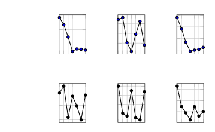

#  SOCIA-$`\nabla`$: Textual Gradient Meets Multi-Agent Orchestration for Automated Spatially Grounded Simulator Generation

Conference: The 34th ACM International Conference on Advances in
Geographic Information Systems; November 03–06, 2026; Riverside, CA,
USAThe 34th ACM International Conference on Advances in Geographic
Information Systems (SIGSPATIAL ’26), November 03–06, 2026, Riverside,
CA,
USADOI: [10.1145/3841645.3844183](https://doi.org/10.1145/3841645.3844183)ISBN: 979-8-4007-2950-8/2026/11CCS: Computing
methodologies Intelligent agents

Yuncheng Hua Affiliation: University of New South Wales, Sydney, NSW,
Australia email: <devin.hua@unsw.edu.au> , Sion Weatherhead
Affiliation: University of New South Wales, Sydney, NSW, Australia
email: <s.weatherhead@unsw.edu.au> , Mehdi Jafari
Affiliation: University of New South Wales, Sydney, NSW, Australia
email: <mehdi.jafari@unsw.edu.au> , Hao Xue Affiliation: University of
New South Wales, Sydney, NSW, Australia email: <hao.xue1@unsw.edu.au>
and Flora D. Salim Affiliation: University of New South Wales, Sydney,
NSW, Australia email: <flora.salim@unsw.edu.au>

© cc

###### Abstract.

In this paper, we present SOCIA-$`\nabla`$, a diagnosis-driven
multi-agent framework for automated simulator-code construction.
SOCIA-$`\nabla`$ iteratively refines executable simulator code within a
textual computation graph, where LLM-driven agents synthesize, execute,
evaluate, diagnose, and repair simulators. A grounded simulator
blueprint attributes behavioral residuals to candidate mechanisms and
their spatial or interaction contexts, which are then converted into
localized textual repair signals with history-aware memory and
constraint projection. We evaluate SOCIA-$`\nabla`$ on the real-world
LLMob personal-mobility benchmark and a controlled semi-synthetic
geo-social mask-adoption benchmark. Across in-distribution simulation,
out-of-distribution what-if generation, and geo-social diffusion,
SOCIA-$`\nabla`$ achieves the strongest overall simulator fidelity.
SOCIA-$`\nabla`$’s code and data are publicly available
[here](https://github.com/cruiseresearchgroup/SOCIA-Nabla).

###### Keywords: 

Spatially Grounded Simulation, Textual Gradients, Mechanism Diagnosis,
Multi-Agent Orchestration, Simulator Code Refinement

^(†)^(†)cc-license: by

## 1. Introduction

Figure 1. Overview of SOCIA-$`\nabla`$. The framework iteratively
generates, executes, evaluates, diagnoses, and repairs simulator code.
During backward repair, metric residuals are attributed to candidate
simulator mechanisms and grounded in their relevant spatial or
interaction contexts, producing localized repair signals. Right:
personal mobility simulation and geo-social mask-adoption diffusion.
Third-party icons © Iconjam, Magnific, Uniconlabs, wanicon, zero_wing,
agus raharjo, Rusmicon, Catkuro, and Eucalyp, via Flaticon, used under
the Flaticon Free License.

Spatio-temporal and geo-social simulators are increasingly important for
studying human mobility, public-health diffusion, urban interventions,
and “what-if” decision support (Piao et al., 2025). They provide
low-cost, reproducible in-silico sandboxes for controlled intervention
analysis, while enabling researchers to probe emergent outcomes under
shifts and unseen regimes (Bonabeau, 2002; Cohen-Boulakia et al., 2017;
Alves Furtado and Nadalin, 2023). By design, simulators span two
paradigms: _policy-oriented aggregate (system-dynamics / compartmental)
models_, which summarize populations through equations over aggregated
state variables, and _agent-based / microsimulation models_, which
follow heterogeneous decision units and their interactions to capture
fine-grained dynamics (Van Dyke Parunak et al., 1998; Mitton et al.,
2000; Macal and North, 2005; Howick et al., 2024). These approaches
arise across cyber, physical, and social (CPS) domains (Ren et al.,
2018a; Ren et al., 2018b; Kaur et al., 2020; Pasandideh et al., 2022;
McCulloch et al., 2022), and are especially valuable in spatially
grounded settings where mobility, interaction, information diffusion,
and intervention effects unfold over time.

For the class of simulators considered in this work, behavioral
mechanisms are ultimately instantiated as executable programs that can
be run, inspected, and modified. In practice, a simulator is only useful
when its rules, interfaces, and data flows are embodied in code that can
be run, evaluated, and calibrated (Kennedy and O’Hagan, 2001; Law
et al., 2007; Grimm et al., 2020).

However, simulator generation is not merely a code-synthesis problem. A
generated simulator may compile and produce outputs, yet still implement
the wrong behavioral mechanism: an incorrect state-transition rule, a
missing interaction pathway, a mis-specified intervention effect, or an
output process that matches the required schema but fails to reproduce
observed behavior. These errors are rarely exposed by code-level checks
alone; they often appear as residuals between simulated and observed
aggregate behaviors, such as mismatched adoption curves, mobility
distributions, transition statistics, or destination-recovery scores.
This observation motivates a more precise goal: to automate not only the
construction of runnable simulator code, but also the diagnosis and
repair of simulator mechanisms from behavioral residuals.

Existing pathways only partially meet this bar. *Manual, expert-built
simulators* (Zhang et al., 2025; Piao et al., 2025; Ju et al., 2025;
JIAWEI et al., 2024; Yang et al., 2024; Tang et al., 2024; Yan et al., 2024) can encode rich domain mechanisms but are expensive to design and
maintain. _Description-driven systems_—for example, YuLan-OneSim (Wang
et al., 2025), which converts natural-language scenario descriptions
into code using ODD protocol (Grimm et al., 2010) and behavior
graphs—reduce coding burden but do not, by themselves, provide an inner
loop for _data calibration_ of the generated programs. At the other end,
recent _automatic frameworks_ such as G-Sim (Holt et al., 2025) pair
LLM-proposed designs with simulation-based inference, showing promising
alignment to observed data; however, these efforts have largely focused
on aggregate models and may not readily extend to highly heterogeneous,
micro-level simulators. More importantly, existing systems often leave
under-specified the diagnostic step between evaluation and repair: given
an aggregate mismatch between simulated and observed behavior, which
simulator mechanism should be changed, and how should this change be
translated into executable code?

In parallel, _multi-agent code generation_ has advanced rapidly:
CAMEL (Li et al., 2023), ChatDev (Qian et al., 2024), AgentCoder (Huang
et al., 2023), AutoGen (Harper, 2024), and AI Scientist-v2 (Yamada
et al., 2025) stage specialized LLM agents to propose, test, and refine
software or to conduct scientific experiments. These frameworks
demonstrate compelling task decomposition and collaboration patterns,
but they are typically _prompt-sensitive, hand-tuned, and not designed
for simulator construction or data calibration_. Their agent protocols
and success criteria are rarely coupled to behavioral residuals for
mechanism-level diagnosis and localized repair. As a result, they may
produce runnable programs without systematically improving the
behavioral mechanisms that make a simulator faithful to observed data.

To overcome these challenges, we introduce SOCIA-$`\nabla`$ (Simulation
Orchestration for Computational Intelligence with Agents), an end-to-end
multi-agent framework for diagnosis-driven simulator-code refinement.
SOCIA-$`\nabla`$ treats simulator building as iterative refinement of
executable code within a textual computation graph. It defines
specialized agents for data analysis, code generation, execution,
evaluation, and feedback, and embeds each agent as a node in a directed
graph that carries textual artifacts, such as code, logs, diagnoses, and
repair feedback, together with numeric signals, such as metrics and
residuals. A centralized workflow manager orchestrates _forward
execution_—generate code, run the simulator, compute validation metrics,
and check constraints—and _backward repair_—attribute behavioral
residuals to candidate simulator mechanisms, identify the spatial or
interaction context in which those mechanisms operate when such
grounding is supported by the task and data, generate localized textual
repair signals, and update the affected simulator components. For
spatially grounded tasks, this attribution is guided by a simulator
blueprint that associates residual-relevant mechanisms with the spatial
entities, transitions, relations, or interaction structures on which
they operate.

Following TextGrad, SOCIA-$`\nabla`$ uses the terminology of _textual
gradients_, _Textual Gradient Descent_, _momentum_, and _projected
gradient descent (PGD)-style projection_, but operationalizes them as
structured code-repair abstractions rather than numerical
differentiation. A textual gradient denotes a loss-aligned,
evidence-grounded repair signal that explains how simulator code should
change to reduce downstream behavioral residuals. Momentum corresponds
to history-aware aggregation of previous diagnoses and patches, helping
avoid repeated mistakes during long-horizon editing. PGD-style
projection corresponds to constraint-aware repair that preserves
compilability, interface validity, and output-schema conformance. Thus,
SOCIA-$`\nabla`$ directly refines executable simulator code, while using
metric residuals, grounded mechanism diagnosis, and constraint checking
to guide iterative repair.

Our focus on executable simulator code is complementary to learned world
models (Hafner et al., 2023; Bruce et al., \[n. d.\]) rather than a
claim that code-based simulation is universally preferable. Learned
world models are particularly attractive when the relevant environment
dynamics can be learned reliably from available observational or
interaction data and predictive performance is the primary
objective (Levy et al., 2024; Chen et al., 2025). Our setting instead
emphasizes simulators with explicit behavioral mechanisms that support
intervention and counterfactual analysis, including settings in which
the target regime is only partially observed or entirely unseen during
construction. In such cases, learning expressive agent-specific dynamics
directly from data can be difficult, particularly when individual
histories are sparse. Executable simulators provide a complementary
inductive bias by representing behavioral states, transition rules,
interaction pathways, and intervention effects explicitly. These
mechanisms can be inspected, modified, and re-executed under alternative
assumptions. The resulting artifact is therefore not only a predictor of
future observations, but also a reusable agent-level sandbox for
studying interventions and distribution shifts.

In summary, this paper makes three main contributions: (1) We formulate
automated simulator generation as diagnosis-driven iterative refinement,
where behavioral residuals are attributed to simulator mechanisms rather
than used only as aggregate evaluation scores. (2) We introduce a
spatially grounded residual-to-mechanism formulation in which each
candidate mechanism is paired with the spatial entities, transitions,
relations, or interaction structures on which it operates. This
grounding is propagated through mechanism diagnosis and textual repair,
enabling localized structural edits while preserving unrelated simulator
components. (3) We demonstrate empirically that SOCIA-$`\nabla`$
constructs accurate and extrapolatable simulators on personal mobility
and geo-social diffusion benchmarks, covering in-distribution
simulation, out-of-distribution what-if generation, individual
calibration, and transition dynamics.

## 2. Related Work

Multi-agent systems (MAS) in Software Engineering. MAS are widely used
for code and software generation (Huang et al., 2023; Li et al., 2023;
Harper, 2024; Jin et al., 2025; Islam et al., 2025; Lin et al., 2025).
Frameworks like MetaGPT (Hong et al., 2024) and ChatDev (Qian et al., 2024) formalize workflows via structured roles, while CodeR (Chen
et al., 2024b), RGD (Jin et al., 2024), UnitTest (Alshahwan et al.,
2024), and AI Scientist-v2 (Yamada et al., 2025) target specific phases
(issue resolution, testing, or experimentation). In contrast to general
software-engineering workflows whose primary objectives are code
correctness, testing, or task completion, SOCIA-$`\nabla`$ organizes
specialized agents around simulator fidelity: execution results are
evaluated against behavioral targets, attributed to simulator
mechanisms, and translated into localized simulator repairs.

Simulator construction. Prior work spans: (1) Domain-crafted simulators,
which are manually authored by domain experts and therefore create a
substantial engineering bottleneck (Zhang et al., 2025; Piao et al.,
2025; Ju et al., 2025; JIAWEI et al., 2024; Yang et al., 2024; Tang
et al., 2024; Yan et al., 2024; Law et al., 2007); (2) LLM-based
multi-agent systems for constructing or operating agent-based
simulations (Park et al., 2023; Chen et al., 2024a; Rasal, 2024; Harper,
2024; Shang et al., 2025; Wang et al., 2025; Yue et al., 2025; Cui
et al., 2025; Du et al., 2025; Liu et al., 2026; Shao et al., 2026;
Zhang et al., 2026); (3) Automated, data-calibrated pipelines (e.g.,
G-Sim) that align models to observations yet emphasize aggregate
calibration over localized code repair (Holt et al., 2025). While
parameter calibration can be effective when simulator structure is
already adequate, it may be insufficient when behavioral discrepancies
arise from missing or misspecified mechanisms. In contrast,
SOCIA-$`\nabla`$ treats executable simulator mechanisms themselves as
the object of refinement: metric residuals are attributed to candidate
mechanisms through a structured simulator blueprint, and the resulting
diagnosis is translated into localized structural code repair rather
than only parameter adjustment. For spatially grounded tasks, the
blueprint further associates each candidate mechanism with the spatial
entities, transitions, relations, or interaction structures in which it
operates, allowing spatial or interaction structure to participate
directly in diagnosis and repair.

Textual gradients & iterative self-improvement. DSPy (Khattab et al.,
\[n. d.\]) formalizes LM pipelines as text-transformation graphs and
optimizes them algorithmically; TextGrad (Yüksekgönül et al., 2024)
improves upstream components in compound systems by _backpropagating
textual feedback_; and Self-Refine (Madaan et al., 2023) and
Reflexion (Shinn et al., 2023) demonstrate that iterative critiques and
episodic memory outperform one-shot prompting across tasks.
SOCIA-$`\nabla`$ adopts the textual-gradient abstraction for backward
feedback propagation, but differs in how the repair signal is
constructed and grounded. Rather than propagating generic downstream
critique, SOCIA-$`\nabla`$ first attributes metric-level behavioral
residuals to candidate simulator mechanisms through an explicit
blueprint and then converts the resulting diagnosis into localized
code-edit instructions. For spatially grounded tasks, this attribution
additionally associates each candidate mechanism with its relevant
spatial or interaction context. This also differs from Reflexion-style
self-reflection, where feedback is primarily represented as verbal
experience for subsequent attempts: in SOCIA-$`\nabla`$, feedback is
explicitly tied to residual-relevant simulator mechanisms and the
contexts in which they operate. History-aware textual momentum retains
previous diagnoses and repairs, while projection preserves
executable-code constraints. Thus, our contribution is not a new
numerical gradient formulation, but a simulator-specific,
residual-grounded pathway from behavioral mismatch to grounded mechanism
attribution and constrained code repair.

## 3. SOCIA-$`\nabla`$: Approach

As shown in Figure 1, SOCIA-$`\nabla`$ addresses a central difficulty in
automated simulator generation: generating runnable code is not
sufficient, because the resulting simulator may still implement the
wrong behavioral mechanisms. A simulator can compile, execute, and
produce outputs, yet fail to capture the intended agent states,
interaction rules, intervention pathways, transition dynamics, or
output-generation logic. Such mechanism-level errors are often not
visible from code-level checks alone; instead, they appear as residuals
between simulated outputs and observed behavioral signals.

SOCIA-$`\nabla`$ therefore treats simulator construction as
_diagnosis-driven iterative refinement_. Given a task description and
data, SOCIA-$`\nabla`$ generates executable simulator code, executes the
simulator, evaluates its outputs against observed behavior, diagnoses
which simulator mechanisms are likely responsible for the residual
errors, and converts the diagnosis into localized repair feedback. This
loop is organized as a _textual computation graph_: agents exchange
code, execution traces, metric values, residual summaries, grounded
diagnoses, and repair signals. Following TextGrad (Yüksekgönül et al.,
2024), we retain the terminology of _textual gradients_, _Textual
Gradient Descent_, _momentum_, and _projection_; however, in
SOCIA-$`\nabla`$ these terms denote structured credit-assignment and
repair abstractions rather than numerical differentiation.

In this section, §3.1 introduces the diagnosis-driven refinement view;
§3.2 describes the roles and functionalities of the individual agents;
§3.3 formalizes grounded residual-to-mechanism attribution; and §3.4
explains how this attribution is propagated through textual-gradient
repair, memory, and projection.

### 3.1. Diagnosis-Driven Simulator Code Refinement

The key challenge in simulator generation is not merely producing
syntactically valid code, but producing code whose mechanisms match the
target phenomenon. For example, a generated simulator may contain a
plausible state-update function but use the wrong transition rule; it
may include an intervention variable but connect it to the wrong agent
behavior; or it may generate outputs in the correct schema while failing
to reproduce observed population-level dynamics. These failures are
_mechanism-level_ rather than purely syntactic.

SOCIA-$`\nabla`$ closes this gap by converting behavioral residuals into
mechanism-level repair signals. At iteration $`t`$, the current
simulator program $`x_{t}`$ is executed on task inputs $`I`$, producing
simulator outputs $`o_{t}`$. The outputs are compared against observed
targets $`Y`$ using task-specific metrics, producing a scalar validation
objective together with metric-level residuals. Rather than treating
these residuals only as aggregate scores, SOCIA-$`\nabla`$ uses them as
diagnostic evidence: each residual is linked to plausible simulator
mechanisms and, when supported by the task and data, to the spatial or
interaction structures through which those mechanisms act.

This yields an iterative refinement cycle consisting of simulator
generation, execution, residual evaluation, grounded mechanism
diagnosis, localized repair, and constraint checking. The update signal
is not a numerical gradient; instead, it is a structured textual repair
signal grounded in metric residuals, execution evidence, mechanism
attribution, and constraint information.

### 3.2. Orchestrated Agents

#### Workflow Manager

The Workflow Manager controls the full refinement loop. It activates
agents, routes artifacts through the textual computation graph, records
iteration history, and terminates refinement when validation performance
plateaus and all hard constraints are satisfied, or the maximum
iteration budget is reached. It also maintains the best feasible
simulator encountered so far, allowing the system to fall back to an
earlier valid version when a later repair introduces failures.

#### Data Analysis Agent (DAA)

DAA converts the task description, dataset, and task inputs into a
structured simulator blueprint $`\mathcal{B}`$. Using a
data-schema-analysis prompt, it identifies data fields, agent
attributes, environmental variables, interaction relations, observable
outputs, and links across data sources. Using a structured
task-specification protocol, it then constructs the simulator brief by
specifying: (1) target phenomena and modeling stance; (2) temporal
resolution, spatial or interaction granularity, and population size; (3)
agent units, static attributes, and dynamic states; (4) interaction
mechanisms among agents or entities; (5) information-diffusion or
influence pathways when applicable; (6) external signals or
interventions and their access paths to simulator modules; (7) actions
and decision policies; and (8) task-relevant metrics.

Crucially, $`\mathcal{B}`$ additionally records grounding information
for later diagnosis. For each task metric, the blueprint records
candidate simulator mechanisms that may affect that metric and, when
supported by the task specification or data, the spatial or interaction
context in which each mechanism operates. Such context may include
spatial entities such as POIs or anchors, spatiotemporal transitions,
pairwise spatial relations, or typed interaction structures. The
blueprint therefore supports diagnosis of not only _which_ mechanism may
explain a residual, but also _through which spatial or relational
structure_ that mechanism affects simulator behavior.

#### Code Generation Agent (CGA)

CGA is responsible for both initial simulator synthesis and subsequent
repair. It supports three working modes:

- •
  _Initial code synthesis._ CGA reads the simulator blueprint
  $`\mathcal{B}`$ and role description and produces the initial runnable
  simulator.
- •
  _Code refinement._ During iterative repair, CGA consumes textual
  gradients—i.e., structured mechanism-level repair signals—and edits
  the diagnosed simulator mechanisms while preserving unaffected
  components whenever possible.
- •
  _Constraint repair._ CGA applies minimal edits to satisfy hard
  constraints such as compilability, interface validity, I/O policy,
  deterministic execution, and output-schema conformity.

CGA performs a self-check after generation or editing, including checks
for syntax errors, empty functions, interface mismatches, and runtime
risks, followed by localized repair when required.

#### Simulation Execution Agent (SEA)

SEA compiles and executes simulator code $`x_{t}`$ on task inputs $`I`$.
It returns simulator outputs $`o_{t}`$, intermediate traces when
available, execution logs, timing information, and compilation or
runtime errors. These artifacts form the forward-pass evidence used by
later evaluation and diagnosis.

#### Result Evaluation Agent (REA)

REA compares simulator outputs $`o_{t}`$ with observed targets $`Y`$
using task-specific metrics. Its role is not limited to reporting a
scalar objective. Instead, it preserves metric-level residuals,
identifies abnormal output patterns, and records constraint violations.
REA therefore converts raw simulator behavior into structured evidence
that can be consumed by the diagnosis process.

#### Feedback Generation Agent (FGA)

FGA converts residual evidence into mechanism-grounded repair feedback.
Given the current simulator, metric residuals, execution evidence,
constraint violations, and the grounded blueprint produced by DAA, FGA
performs residual-to-mechanism attribution. For mechanisms with
supported spatial or interaction grounding, the attribution explicitly
considers the relevant entities, transitions, relations, or interaction
structures. The resulting diagnosis identifies one or more likely
residual-relevant mechanisms together with the spatial or interaction
contexts in which those mechanisms operate. FGA then converts this
grounded diagnosis into a textual gradient: localized repair feedback
specifying which simulator mechanisms should be revised and why.

Together, these agents separate simulator generation into specification,
execution, evaluation, diagnosis, repair, and constraint checking. This
decomposition is important because aggregate losses alone rarely
indicate how simulator code should change; the intermediate artifacts
make the path from behavioral mismatch to executable repair explicit.

### 3.3. From Behavioral Residuals to Grounded Mechanism Diagnosis

The central operation in SOCIA-$`\nabla`$ is to convert metric-level
behavioral residuals into grounded mechanism diagnoses, which are
subsequently translated into localized textual repair feedback. The
residual-to-mechanism principle is task-general, while the grounding is
task-dependent. The specific metrics and spatial or interaction
structures differ across domains, but the diagnostic principle is the
same: observable mismatches are linked to a structured simulator
blueprint, plausible responsible mechanisms are identified, and
localized repair instructions are produced.

#### Metric Residual Construction

Given simulator output $`o_{t}`$ and observed targets $`Y`$, REA
computes a set of task-specific metrics:

```math
\boldsymbol{\mu}_{t}=[\mu_{t}^{(1)},\mu_{t}^{(2)},\ldots,\mu_{t}^{(K)}],
```

where each metric measures one observable dimension of simulator
fidelity. The corresponding residual vector is

```math
\mathbf{r}_{t}=\mathrm{Residual}(\boldsymbol{\mu}_{t},\boldsymbol{\mu}^{\star}),
```

where $`\boldsymbol{\mu}^{\star}`$ denotes reference metric values
derived from observations. A scalar validation objective $`L_{t}`$ may
aggregate these residuals, but SOCIA-$`\nabla`$ preserves the individual
components of $`\mathbf{r}_{t}`$ because different metrics provide
evidence about different simulator mechanisms.

#### Grounded Residual-to-Mechanism Linking

The simulator blueprint produced by DAA associates each evaluation
metric with candidate simulator mechanisms and, when applicable, their
spatial or interaction grounding:

```math
\mathcal{B}:\mu^{(k)}\mapsto\left\{(h_{j},\rho_{j})\right\}_{j=1}^{q}. \tag{1}
```

Here $`h_{j}`$ denotes a candidate simulator mechanism or code
component, such as an agent state variable, interaction function,
transition rule, intervention handler, calibration parameter, or
output-construction routine. The grounding variable $`\rho_{j}`$ denotes
the spatial or interaction structure through which $`h_{j}`$ influences
the corresponding observable, including spatial entities, spatiotemporal
transitions, spatial relations, anchors, or typed interaction layers.

The grounding is _evidence-bounded_: when no spatial or interaction
structure is supported by the task specification or data, $`\rho_{j}`$
is left unspecified. Accordingly, $`\rho_{j}`$ should not be interpreted
as a geographic error location or as a hard spatial constraint. Instead,
it provides structured context for credit assignment by limiting
diagnosis to mechanisms and relational structures that are plausible
explanations of the observed residual.

#### Grounded Mechanism Diagnosis

FGA combines the current simulator, metric residuals, grounded
blueprint, execution evidence, and constraint violations to produce a
diagnosis:

```math
d_{t}=\mathcal{D}_{\mathrm{LLM}}(x_{t},\mathbf{r}_{t},\mathcal{B},e_{t},v_{t}). \tag{2}
```

The diagnosis may contain multiple grounded mechanism attributions,
which we extract as

```math
\mathcal{A}_{t}=\mathrm{Attr}(d_{t})=\left\{(\hat{h}_{t,\ell},\hat{\rho}_{t,\ell})\right\}_{\ell=1}^{N_{t}}. \tag{3}
```

Here $`\hat{h}_{t,\ell}`$ denotes a likely residual-relevant mechanism,
while $`\hat{\rho}_{t,\ell}`$ denotes its associated spatial or
interaction context when such grounding is supported. The operator
$`\mathrm{Attr}(\cdot)`$ denotes extraction of the grounded
residual-to-mechanism attributions contained in the diagnosis. Thus,
$`d_{t}`$ is not merely a generic critique: it contains explicit credit
assignment from observed residuals to plausible simulator mechanisms and
their operating contexts.

These attributions are diagnostic rather than causal guarantees. A
residual can be consistent with multiple mechanisms, and the role of
$`\mathcal{B}`$ is to constrain the hypothesis space for repair rather
than to establish causal identification.

### 3.4. Textual-Gradient Repair Abstraction

Following TextGrad (Yüksekgönül et al., 2024), we represent the
SOCIA-$`\nabla`$ pipeline as a textual computation graph and use
gradient-inspired terminology to organize backward credit assignment and
iterative repair. These terms are operational abstractions rather than
numerical differentiation: the simulator pipeline is generally
non-differentiable, and we do not assume differentiability or monotonic
improvement of the resulting updates.

#### (1) Problem Definition

We study iterative refinement of an executable simulator program.

- •
  Simulator blueprint: $`\mathcal{B}`$, constructed by DAA from the task
  description and structured data analysis.
- •
  Data: task inputs $`I`$ and observed targets $`Y`$.
- •
  Variable: $`x\in\mathcal{X}`$, a runnable simulator program
  represented as code.
- •
  Role description: $`r`$, specifying the simulator’s intended
  interface, I/O behavior, semantics, and constraints.
- •
  Hard constraints:

  ```math
  \mathcal{C}=\{x:c_{j}(x)\leq 0,\;j=1,\ldots,J\}.
  ```

  These include syntactic validity, compilability, valid file access,
  non-empty execution flow, deterministic behavior when required, and
  output-schema conformity.

- •
  Refinement objective:

  ```math
  \min_{x\in\mathcal{X}}L(x)\qquad\text{s.t.}\qquad x\in\mathcal{C}.
  ```

  Here $`L(x)`$ measures behavioral mismatch between simulated and
  observed outputs, while $`\mathcal{C}`$ defines executable and
  interface-valid simulator programs.

We use $`LLM(z)`$ to denote prompting a language model with input $`z`$
and collecting its response.

#### (2) Textual Computation Graph

We model the system as a DAG $`\mathcal{G}=(V,E)`$. Nodes are black-box
operators: LLM nodes generate or edit textual artifacts, while function
nodes execute code, compute metrics, check constraints, or aggregate
evidence. Edges carry simulator code, task specifications, execution
outputs, metric residuals, grounded diagnoses, and repair feedback.

Each node $`v`$ computes

```math
z_{v}=f_{v}(\{z_{u}:u\in\mathrm{Pa}(v)\}),
```

where $`\mathrm{Pa}(v)`$ denotes the parents of $`v`$. Many $`f_{v}`$
are non-differentiable, including LLM calls, compilers, and simulators.
We therefore use textual gradients as structured backward signals:
downstream residual evidence is attributed to upstream simulator
mechanisms and converted into localized repair instructions.

#### (3) Forward Pass and Behavioral Residuals

Code initialization produces the first simulator:

```math
x_{0}=f_{\mathrm{CGA}}(\mathcal{B},r).
```

At iteration $`t`$, SEA executes

```math
o_{t}=f_{\mathrm{Sim}}(x_{t},I),
```

where $`o_{t}`$ contains simulated observables and, when available,
execution traces. REA computes

```math
L_{t}=\ell(o_{t},Y)+\lambda\sum_{j}\max(0,c_{j}(x_{t})).
```

The first term measures behavioral mismatch and the second penalizes
constraint violations. Importantly, REA also preserves the metric
residual vector $`\mathbf{r}_{t}`$, execution evidence $`e_{t}`$, and
constraint violations $`v_{t}`$, rather than reducing all downstream
evidence to the scalar $`L_{t}`$.

#### (4) Textual Gradient as Grounded Credit Assignment

The backward repair signal is represented as

```math
g_{t}=\mathcal{G}_{\mathrm{LLM}}(x_{t},\mathbf{r}_{t},d_{t},e_{t},v_{t}), \tag{4}
```

where $`d_{t}`$ is the grounded diagnosis from Eq. 2, and
$`\mathcal{A}_{t}=\mathrm{Attr}(d_{t})`$ denotes its grounded
attribution set.

Conceptually, backward responsibility is routed in two stages:
output-level residual evidence is first attributed to plausible
simulator mechanisms, and the resulting grounded diagnosis is then
converted into localized repair feedback. Operationally, the backward
pathway is

```math
(\mathbf{r}_{t},\mathcal{B},x_{t},e_{t},v_{t})\rightarrow d_{t}\rightarrow\mathcal{A}_{t}\rightarrow g_{t}.
```

Consequently, $`g_{t}`$ is neither a numerical gradient vector nor a
generic critique. It is a localized repair direction conditioned on
residual evidence and grounded mechanism attribution, specifying how
diagnosed mechanisms should be revised while preserving unrelated
simulator mechanisms and spatial or interaction structures whenever
possible.

#### (5) Textual Momentum as History-Aware Repair Memory

To stabilize long-horizon editing, SOCIA-$`\nabla`$ maintains a textual
momentum buffer:

```math
m_{t}=\mathrm{Decay}_{\beta}(m_{t-1})\oplus g_{t},
```

where $`\oplus`$ denotes ordered merge and $`\mathrm{Decay}_{\beta}`$
down-weights stale items. In implementation, $`m_{t}`$ is a concise
textual memory over recent diagnoses, failed repairs, successful fixes,
and unresolved issues. We retain the latest $`K`$ iterations, with
$`K=3`$ in our experiments.

Rather than responding only to the current residual, CGA therefore
receives recent repair context indicating what previously failed, what
has already been repaired, and which simulator mechanisms should remain
unchanged. Textual momentum thus serves as history-aware repair memory
within the gradient-inspired abstraction.

#### (6) Textual Repair and Constraint Projection

Given the aggregated textual repair signal $`m_{t}`$, CGA performs the
TGD-style update

```math
x_{t+1}^{\mathrm{unproj}}=\mathrm{TGD.step}(x_{t},m_{t};r),
```

where $`\mathrm{TGD.step}`$ denotes an LLM-based code-repair operator
rather than numerical gradient descent. It applies the grounded repair
signal to diagnosed simulator mechanisms while preserving unaffected
components whenever possible.

A subsequent projection-style repair maps the edited simulator back to
the feasible set:

```math
x_{t+1}=\Pi_{\mathcal{C}}(x_{t+1}^{\mathrm{unproj}}),\qquad\Pi_{\mathcal{C}}:\mathcal{X}\rightarrow\mathcal{C}.
```

The projector performs static checks, interface tests, compilation
checks, schema validation, and other task-specific feasibility checks.
If a violation is detected, CGA performs minimal-edit repair and repeats
the self-check procedure. The projection step preserves executability
and interface validity; it should not be interpreted as imposing
additional geographic or spatial feasibility constraints.

#### (7) One-Line Summary

The complete refinement pathway is:


The system stops when validation performance plateaus and all hard
constraints are satisfied, or the outer-loop budget is reached.
Throughout refinement, the Workflow Manager maintains the best feasible
simulator observed so far; if a later repair violates feasibility
constraints or fails to improve validation performance, the earlier
incumbent is retained.

#### What the Textual Gradient Encodes

The textual gradient in SOCIA-$`\nabla`$ represents three linked
operations:

- •
  Residual-to-grounded diagnosis: metric-level residuals are attributed
  to plausible simulator mechanisms together with their relevant spatial
  or interaction contexts.
- •
  Diagnosis-to-localized repair: grounded diagnoses are translated into
  targeted mechanism-level repair instructions while unrelated simulator
  components are preserved whenever possible.
- •
  Repair-to-feasible simulator: CGA applies the repair signal to
  executable simulator code, while projection preserves compilability,
  interface validity, output-schema conformity, and other hard execution
  constraints.

## 4. SOCIA-$`\nabla`$: Experimental Setup

### 4.1. Benchmarks

We evaluate SOCIA-$`\nabla`$ on two complementary spatially grounded
settings: the real-world LLMob mobility benchmark and a controlled
semi-synthetic geo-social mask-adoption benchmark. Together, they cover
four evaluation regimes and test SOCIA-$`\nabla`$ across
trajectory-level physical mobility simulation and social-spatial
information diffusion.

#### (1) Personal Mobility Generation

We adopt the LLMob (JIAWEI et al., 2024) dataset, which contains
real-world spatiotemporal trajectories from residents in Japan. The goal
is to generate each individual’s next-day mobility trajectory from
historical observations, requiring the simulator to capture both
temporal activity regularities and spatial footprint patterns. We
evaluate three mobility regimes:

Mobility N$`\rightarrow`$N is an in-distribution routine-mobility
simulation setting, where the simulator is constructed using
normal-period history and generates normal-period next-day trajectories.
This regime evaluates whether the generated simulator can recover
regular spatiotemporal routines.

Mobility A$`\rightarrow`$A is an in-distribution abnormal-period
simulation setting, where the simulator is constructed using
abnormal/pandemic-period history and generates abnormal/pandemic-period
next-day trajectories. This regime evaluates whether the simulator can
capture mobility behavior under shifted but observed conditions.

Mobility N$`\rightarrow`$A is an out-of-distribution what-if simulation
setting, where only normal-period history is available but the simulator
must generate abnormal/pandemic-period mobility trajectories. This
regime is the most challenging setting because it requires the simulator
to generalize under distribution shift and to model changes in activity
timing, trip frequency, and spatial footprint. Unlike the two
in-distribution regimes, N$`\rightarrow`$A provides no target-regime
trajectory history for direct model fitting, making it a particularly
relevant setting for evaluating whether an explicit simulator can
combine observed history with prior structural knowledge to support
counterfactual generation.

#### (2) Controlled Geo-Social Mask-Adoption Benchmark.

We introduce Mask Adoption as a controlled, semi-synthetic benchmark
rather than an external real-world dataset. Its generator constructs
agents with demographic attributes and daily states indicating mask
adoption and information exposure, together with typed family,
work/school, and community interaction layers through which
public-health information and behavioral influence propagate over time.
A public-health intervention is introduced from Day 10 onward, creating
a known exogenous shift in the agents’ information environment.

Running this predefined generative process produces the reference
aggregate adoption curve, individual adoption states, and day-to-day
state transitions used as ground-truth observables for evaluation. The
controlled construction is intentional: rather than claiming to
reproduce a particular real-world population, the benchmark tests
whether an automatically generated simulator can recover known
geo-social diffusion, heterogeneous interaction, and intervention
dynamics at aggregate and individual levels. Inspired by the data
paradigms in BESSIE (Mortveit et al., 2022) and pandemic-era mask
decision simulators (Mitsopoulos et al., 2023), it complements LLMob by
providing a controlled mechanism-recovery setting for social-spatial
diffusion. The benchmark generator and generated data are released with
our code. The ground-truth generator itself is withheld from
SOCIA-$`\nabla`$ and all baselines; they receive only the benchmark
inputs and observed training signals defined by the common evaluation
protocol.

### 4.2. Baseline Methods

We compare SOCIA-$`\nabla`$ against several baselines. AI
Scientist-v2 (Yamada et al., 2025) is an automated pipeline that ingests
experimental data and constructs/executes ML-based models; however, due
to the complexity of simulator construction, AI Scientist-v2 still
requires a certain amount of manual code adjustment to complete
executable simulator generation. We also include YuLan-OneSim (Wang
et al., 2025), which structures scenarios via the ODD protocol (Grimm
et al., 2010), generates code with a Behavior Graph, and improves it via
an iterative _verify–repair–regenerate_ loop. YuLan-OneSim provides
scenario-aware simulation construction, but it is not a general-purpose
statistical calibration toolkit. For evaluation consistency, we adapt it
to the same task inputs, output schemas, and metrics used by the other
methods. The G-Sim family (Holt et al., 2025) is another key baseline:
it uses LLMs to generate simulator code and integrates gradient-free
calibration, including evolutionary strategies (G-Sim-ES) and
simulation-based inference (G-Sim-SBI), to produce calibrated,
uncertainty-aware simulators. Finally, we compare with Reflexion (Shinn
et al., 2023), which uses verbal reflections from trial feedback as
episodic memory to guide subsequent code updates. In our implementation,
Reflexion follows the same execution and evaluation protocol as
SOCIA-$`\nabla`$, but replaces SOCIA-$`\nabla`$’s structured
feedback-generation and repair process with Reflexion-style
self-reflection.

### 4.3. Evaluation Metrics

We report means with 95% confidence intervals. Stochastic LLM- and
simulator-based runs are repeated with five seeds (Colas et al., 2018),
while SBI draws $`1{,}000`$ posterior samples to propagate parameter
uncertainty (Falkiewicz et al., 2023).

For LLMob personal mobility simulation, we evaluate both
distribution-level and location-level fidelity. Specifically, we use JSD
and WD to compare simulated and observed mobility distributions, and
Top-$`k`$ POI Recall to assess whether the simulator recovers key
frequently visited locations. These metrics jointly measure whether the
generated trajectories match the observed mobility distribution and
preserve important spatial destinations.

For Mask Adoption, we evaluate adoption dynamics at both aggregate and
individual levels. RMSE measures the fidelity of the global
mask-adoption curve over time. Brier score evaluates individual-level
probabilistic calibration of mask-wearing decisions. Transition
Divergence (TD) measures how well the simulator reproduces day-to-day
adoption-state transitions under information exposure and social
influence. Unless otherwise specified, lower values indicate better
performance, except for Top-$`k`$ POI Recall where higher is better.

### 4.4. Implementation and Refinement Budget

Unless otherwise specified, all SOCIA-$`\nabla`$ agents, and the
reproduced baselines, are built on GPT-5.2 (OpenAI, 2025). We
re-implemented baselines either via code reproduction or via
dataset-level reproduction to ensure evaluation consistency. Across
tasks, SOCIA-$`\nabla`$ typically requires 3–5 outer-loop iterations to
obtain stable, high-quality simulator code. In our setup, the first
simulator draft is generated in approximately 20 minutes, and each
subsequent refinement takes approximately 10 minutes, resulting in a
total end-to-end wall-clock time of roughly 40–60 minutes per task. Most
of this latency comes from LLM inference and simulator execution: code
generation is the dominant LLM call, while diagnosis and
patch-generation calls are shorter; simulator runtime varies with the
complexity of the generated model and any task-specific calibration it
invokes.

Each iteration makes a fixed number of LLM calls involving the data
analysis, code generation, execution and evaluation, and feedback
generation agents, yielding an overall budget of approximately
$`10^{6}`$ tokens per task and an API cost of approximately
\$1.50–\$2.00 in our setup. Because the compared methods use different
internal refinement and stopping procedures, we preserve their native
algorithms rather than equating iteration counts across methods; all
reproduced LLM-based baselines use the same backbone and common task
inputs, output schemas, and evaluation protocol.

The additional computation of SOCIA-$`\nabla`$ is most justified when
simulator structure itself may be misspecified, or when OOD what-if
generation, mechanism inspection, and reusable intervention analysis are
important. When the simulator structure is already trusted and the
objective is primarily low-cost in-distribution calibration,
calibration-only approaches such as G-Sim can be computationally more
attractive. We stop SOCIA-$`\nabla`$ when validation performance
plateaus and all hard constraints are satisfied, or when the maximum
outer-loop budget is reached.

## 5. SOCIA-$`\nabla`$: Evaluation

| Methods $`\downarrow`$ | Mob. N$`\rightarrow`$N (ID) |                     |                     | Mob. A$`\rightarrow`$A (ID) |                     |                     | Mob. N$`\rightarrow`$A (OOD) |                     |                     |
| ---------------------- | --------------------------- | ------------------- | ------------------- | --------------------------- | ------------------- | ------------------- | ---------------------------- | ------------------- | ------------------- |
|                        | JSD $`\downarrow`$          | WD $`\downarrow`$   | POI $`\uparrow`$    | JSD $`\downarrow`$          | WD $`\downarrow`$   | POI $`\uparrow`$    | JSD $`\downarrow`$           | WD $`\downarrow`$   | POI $`\uparrow`$    |
| AI Scientist-v2        | 0.887 $`\pm`$ 0.006         | 3.224 $`\pm`$ 0.006 | 0.003 $`\pm`$ 0.001 | 0.451 $`\pm`$ 0.006         | 3.373 $`\pm`$ 0.006 | 0.190 $`\pm`$ 0.003 | 0.773 $`\pm`$ 0.007          | 2.045 $`\pm`$ 0.006 | 0.070 $`\pm`$ 0.007 |
| YuLan-OneSim           | 0.793 $`\pm`$ 0.004         | 2.191 $`\pm`$ 0.004 | 0.200 $`\pm`$ 0.008 | 0.366 $`\pm`$ 0.005         | 2.485 $`\pm`$ 0.005 | 0.310 $`\pm`$ 0.004 | 0.639 $`\pm`$ 0.006          | 1.541 $`\pm`$ 0.006 | 0.091 $`\pm`$ 0.008 |
| Reflexion              | 0.423 $`\pm`$ 0.005         | 0.783 $`\pm`$ 0.006 | 0.410 $`\pm`$ 0.006 | 0.187 $`\pm`$ 0.006         | 0.713 $`\pm`$ 0.006 | 0.550 $`\pm`$ 0.006 | 0.553 $`\pm`$ 0.007          | 0.612 $`\pm`$ 0.007 | 0.220 $`\pm`$ 0.003 |
| G-Sim-ES               | 0.546 $`\pm`$ 0.002         | 0.225 $`\pm`$ 0.003 | 0.802 $`\pm`$ 0.002 | 0.272 $`\pm`$ 0.004         | 0.467 $`\pm`$ 0.004 | 0.601 $`\pm`$ 0.002 | 0.534 $`\pm`$ 0.005          | 0.456 $`\pm`$ 0.005 | 0.105 $`\pm`$ 0.002 |
| G-Sim-SBI              | 0.635 $`\pm`$ 0.003         | 1.638 $`\pm`$ 0.003 | 0.097 $`\pm`$ 0.001 | 0.012 $`\pm`$ 0.003         | 1.690 $`\pm`$ 0.006 | 0.990 $`\pm`$ 0.002 | 0.045 $`\pm`$ 0.005          | 0.633 $`\pm`$ 0.003 | 0.214 $`\pm`$ 0.004 |
| SOCIA-$`\nabla`$       | 0.041 $`\pm`$ 0.002         | 0.332 $`\pm`$ 0.003 | 0.811 $`\pm`$ 0.002 | 0.007 $`\pm`$ 0.001         | 0.532 $`\pm`$ 0.003 | 0.997 $`\pm`$ 0.001 | 0.043 $`\pm`$ 0.005          | 0.289 $`\pm`$ 0.006 | 0.614 $`\pm`$ 0.003 |

Table 1. Evaluation results ($`\pm`$ denotes 95% CIs) on the LLMob
personal mobility simulation benchmark. Mob. N$`\rightarrow`$N and Mob.
A$`\rightarrow`$A are in-distribution settings, while Mob.
N$`\rightarrow`$A is an out-of-distribution what-if setting. Lower is
better for JSD/WD and higher is better for POI. Best and second-best
results are shown in bold and underlined, respectively.

### 5.1. Simulator Overview

SOCIA-$`\nabla`$ produces task-specific executable simulators with
mechanisms consistent with the corresponding spatial setting. For
Personal Mobility, the generated simulator models individual activity
schedules, home/work anchors, destination selection, and spatiotemporal
travel constraints. For Mask Adoption, it models individual behavioral
states and information diffusion over typed family, work/school, and
community interaction layers. Detailed simulator structures and
representative generated mechanisms are provided in Appendix A.1.

### 5.2. Findings (Tables 1 and 2)

| Method           | RMSE $`\downarrow`$ | Brier $`\downarrow`$ | TD $`\downarrow`$   |
| ---------------- | ------------------- | -------------------- | ------------------- |
| AI Scientist-v2  | $`0.551\pm 0.010`$  | $`0.424\pm 0.002`$   | $`0.523\pm 0.004`$  |
| YuLan-OneSim     | $`0.413\pm 0.009`$  | $`0.391\pm 0.006`$   | $`0.410\pm 0.004`$  |
| Reflexion        | $`0.263\pm 0.005`$  | $`0.334\pm 0.003`$   | $`0.321\pm 0.005`$  |
| G-Sim-ES         | $`0.089\pm 0.002`$  | 0.298 $`\pm`$ 0.003  | $`0.279\pm 0.002`$  |
| G-Sim-SBI        | $`0.199\pm 0.003`$  | $`0.285\pm 0.003`$   | $`0.194\pm 0.002`$  |
| SOCIA-$`\nabla`$ | 0.075 $`\pm`$ 0.007 | 0.255 $`\pm`$ 0.002  | 0.161 $`\pm`$ 0.007 |

Table 2. Evaluation results ($`\pm`$ denotes 95% CIs) on the Mask
Adoption task. RMSE measures global adoption-curve fidelity, Brier
evaluates individual-level probabilistic calibration of mask-wearing
decisions, and TD (Transition Divergence) measures day-to-day
adoption-state transition fidelity under information exposure and social
influence. Lower values indicate better performance.

#### (1) SOCIA-$`\nabla`$ achieves the strongest overall mobility simulation performance.

Table 1 shows that SOCIA-$`\nabla`$ obtains the best result on seven out
of nine LLMob metrics across the three mobility regimes. For
normal$`\rightarrow`$normal simulation, SOCIA-$`\nabla`$ achieves the
lowest JSD ($`0.041`$) and the highest POI recall ($`0.811`$), while
remaining second-best on WD. For abnormal$`\rightarrow`$abnormal
simulation, SOCIA-$`\nabla`$ again performs best on JSD ($`0.007`$) and
POI recall ($`0.997`$), and second-best on WD. Most importantly, in the
OOD normal$`\rightarrow`$abnormal setting, SOCIA-$`\nabla`$ achieves the
best scores on all three metrics: JSD ($`0.043`$), WD ($`0.289`$), and
POI recall ($`0.614`$). This indicates that the generated simulator not
only fits in-distribution mobility patterns but also better supports
what-if generation under distribution shift.

#### (2) Distributional shape and destination recovery favor mechanism-level repair.

JSD and WD capture complementary aspects of mobility fidelity: JSD
measures distribution-shape divergence, whereas WD measures
distributional displacement. The results show that SOCIA-$`\nabla`$ is
strong in matching the shape of observed mobility distributions, with
large improvements over AI Scientist-v2, YuLan-OneSim, Reflexion, and
G-Sim in most regimes. At the same time, Top-$`k`$ POI Recall shows that
SOCIA-$`\nabla`$ also recovers key frequently visited locations more
reliably. This is particularly clear in the OOD N$`\rightarrow`$A
setting, where SOCIA-$`\nabla`$ reaches $`0.614`$ POI recall,
substantially higher than G-Sim-ES ($`0.105`$), G-Sim-SBI ($`0.214`$),
and Reflexion ($`0.220`$). Thus, SOCIA-$`\nabla`$ does not merely reduce
an aggregate discrepancy; it improves simulator mechanisms related to
distributional mobility structure and destination-selection fidelity.

#### (3) SOCIA-$`\nabla`$ also leads on geo-social mask-adoption diffusion.

Table 2 shows that SOCIA-$`\nabla`$ achieves the best performance on all
three Mask Adoption metrics. It obtains the lowest aggregate adoption
RMSE ($`0.075`$), outperforming the strongest competing baseline,
G-Sim-ES ($`0.089`$). It also achieves the best Brier score ($`0.255`$),
indicating better individual-level probabilistic calibration of
mask-wearing decisions. Finally, SOCIA-$`\nabla`$ obtains the lowest
Transition Divergence ($`0.161`$), showing that it better reproduces
day-to-day adoption-state transitions under information exposure and
social influence. These results suggest that the generated simulator
captures not only the global adoption curve but also the individual
decision and temporal transition mechanisms underlying geo-social
diffusion.

#### (4) Comparison with G-Sim reveals a metric- and setting-dependent trade-off between parameter calibration and structural repair.

G-Sim remains a strong calibration-oriented baseline. In particular,
G-Sim-ES achieves the lowest WD in the two in-distribution mobility
regimes: 0.225 versus 0.332 for SOCIA-$`\nabla`$ in N$`\rightarrow`$N,
and 0.467 versus 0.532 in A$`\rightarrow`$A. This indicates that when
target-regime observations are available, parameter calibration can be
highly effective at reducing distributional displacement even without
modifying simulator structure. However, these same G-Sim-ES solutions
have substantially larger JSD than SOCIA-$`\nabla`$ (0.546 vs. 0.041 in
N$`\rightarrow`$N and 0.272 vs. 0.007 in A$`\rightarrow`$A), showing
that lower WD does not necessarily imply faithful recovery of the
overall distributional shape.

We also observe that, under our reproduced LLMob setting, G-Sim-ES
obtains lower WD than G-Sim-SBI, whereas the original G-Sim study
reports stronger SBI performance in some of its settings. Our results
are obtained under a unified task protocol, backbone, simulator
construction setting, and evaluation metrics rather than the original
G-Sim experimental configuration; therefore, the relative ordering of ES
and SBI should be interpreted as setting- and metric-dependent rather
than as general dominance of one calibration procedure. Indeed,
G-Sim-SBI remains highly competitive on JSD in A$`\rightarrow`$A and
N$`\rightarrow`$A, despite its weaker WD.

The distinction becomes clearest under the OOD N$`\rightarrow`$A
setting, where SOCIA-$`\nabla`$ achieves the best JSD, WD, and POI
Recall simultaneously. Overall, these results suggest that
calibration-only methods can be highly competitive on individual metrics
in observed regimes, whereas mechanism-level repair becomes particularly
useful when fidelity must be maintained jointly across metrics or under
distribution shift.

#### (5) Comparison with Reflexion shows the benefit of loss-aligned localized repair.

Reflexion improves over more general automated-generation baselines, but
it remains weaker than SOCIA-$`\nabla`$ across both LLMob and Mask
Adoption. The gap is especially visible in the OOD mobility setting and
in the Mask transition metric. This supports the role of
SOCIA-$`\nabla`$’s loss-aligned repair loop: evaluation residuals,
execution failures, and constraint violations are converted into
localized code-edit signals rather than generic self-reflection. As a
result, SOCIA-$`\nabla`$ can preserve working simulator components while
repairing specific mechanisms such as mobility conditioning, POI
selection, information exposure, and adoption-state transitions.

#### (6) Why AI Scientist-v2 and YuLan-OneSim trail.

AI Scientist-v2 is designed primarily for automated ML experimentation
rather than simulator construction, and therefore lacks a dedicated loop
for generating, executing, evaluating, and repairing simulator code
against task-specific behavioral metrics. YuLan-OneSim provides useful
scenario structuring and behavior-graph generation, but it lacks
loss-aligned, instance-level code refinement. Consequently, both methods
perform worse across the LLMob mobility regimes and the Mask Adoption
task. The results indicate that simulator generation requires more than
executable code synthesis: it requires continuous calibration against
observed behavior, structured diagnostics, and mechanism-level repair.

#### (7) Method-level interpretation.

The results directly support the core design of SOCIA-$`\nabla`$. First,
improvements across multiple metric types show that SOCIA-$`\nabla`$
does not merely target a single aggregate score: it improves
distributional fidelity, destination recovery, individual calibration,
and transition dynamics. Second, the comparison with G-Sim shows that
parameter calibration can be highly competitive on individual
in-distribution metrics, while mechanism-level repair provides more
consistent gains when fidelity must be maintained jointly across metrics
or under distribution shift. Third, the comparison with Reflexion shows
that generic self-reflection is weaker than residual-grounded, localized
repair. Together, these findings validate the residual-to-diagnosis and
diagnosis-to-repair design: different metric residuals expose different
simulator mechanisms, and SOCIA-$`\nabla`$ uses structured feedback to
repair them jointly. A representative residual-to-diagnosis-to-repair
trace is provided in Appendix A.4.

#### Takeaway.

Across trajectory-level physical mobility and geo-social information
diffusion, SOCIA-$`\nabla`$ delivers the strongest overall simulator
fidelity. Its advantage is most pronounced when the task requires both
distributional alignment and structural reasoning, such as OOD mobility
generation and mask-adoption transition dynamics. These findings support
the central claim that loss-aligned, constraint-aware, and localized
simulator-code repair can produce more faithful executable simulators
than one-shot generation, generic reflection, or calibration-only
baselines.

### 5.3. Ablation and Backbone Sensitivity (Table 3)

We conduct an ablation and backbone-sensitivity study to quantify the
contribution of each component in SOCIA-$`\nabla`$. Unless otherwise
noted, we report performance deltas ($`\Delta`$) relative to the full
GPT-5.2-based SOCIA-$`\nabla`$ configuration on Mask Adoption and
Personal Mobility N$`\rightarrow`$A. For Mask Adoption, we report
$`\Delta`$RMSE; for Personal Mobility N$`\rightarrow`$A, we report
$`\Delta`$JSD and $`\Delta`$WD. Positive values indicate performance
degradation, while negative values indicate improvement over the full
configuration.

The ablation variants are:

- •
  w/o mom.: remove the history-aware repair memory, i.e., the buffer
  that summarizes previous critiques and code patches.
- •
  w/o proj.: remove the projection-style constraint repair step, so
  generated code is no longer explicitly repaired against compilation,
  interface, schema, and other execution constraints before the next
  iteration.
- •
  w/o data-analysis: replace the Data Analysis Agent with a naive
  data-understanding prompt, thereby weakening structured schema
  analysis, task specification, metric-to-mechanism linking, and
  task-specific data-to-simulator grounding.
- •
  w/o eval.: replace the Result Evaluation Agent with a heuristic
  diagnostic prompt that only asks the LLM to infer code problems from
  the computed metrics, without structured residual analysis or
  component-level error localization.
- •
  w/o feedback: replace the Feedback Generation Agent with a coarse
  feedback prompt that asks the LLM to suggest code improvements from
  the current diagnostics, without structured attribution, localized
  repair proposals, or feedback synthesis.
- •
  w/o iter: disable iterative code evolution and use only the first
  simulator generated by the code-generation agent.

In addition to component ablations, we replace GPT-5.2 with
Qwen3-Next-80B-A3B-Instruct and Llama-3.3-70B-Instruct-Turbo while
keeping the task settings, evaluation protocol, and iterative refinement
pipeline unchanged.

Results. Table 3 shows that removing any major SOCIA-$`\nabla`$
component degrades performance on both Mask Adoption and Mobility
N$`\rightarrow`$A. The largest degradation occurs without iterative
refinement: w/o iter increases Mask RMSE by $`+0.413`$, Mobility JSD by
$`+0.317`$, and Mobility WD by $`+0.370`$. Among the agent-role
ablations, w/o feedback causes the largest degradation, followed by w/o
eval. and w/o data-analysis. Removing momentum or projection produces
smaller but consistent performance drops.

The backbone results are mixed. Qwen3-Next-80B remains competitive with
the GPT-5.2 configuration, with $`\Delta`$RMSE $`=-0.024`$,
$`\Delta`$JSD $`=+0.002`$, and $`\Delta`$WD $`=-0.193`$. In contrast,
Llama-3.3-70B substantially degrades all three metrics, with
$`\Delta`$RMSE $`=+0.666`$, $`\Delta`$JSD $`=+0.506`$, and $`\Delta`$WD
$`=+1.494`$. Detailed component-wise interpretations are provided in
Appendix A.2.

### 5.4. Additional Refinement Stability Analysis

|                       |                               |                              |                             |
| --------------------- | ----------------------------- | ---------------------------- | --------------------------- |
| Models $`\downarrow`$ | Mask.                         | Mob. N$`\rightarrow`$A       |                             |
|                       | $`\Delta`$RMSE $`\downarrow`$ | $`\Delta`$JSD $`\downarrow`$ | $`\Delta`$WD $`\downarrow`$ |
| SOCIA-$`\nabla`$      | -                             | -                            | -                           |
| w/o mom.              | +0.123 $`\pm`$ 0.003          | +0.056 $`\pm`$ 0.002         | +0.093 $`\pm`$ 0.006        |
| w/o proj.             | +0.173 $`\pm`$ 0.003          | +0.098 $`\pm`$ 0.005         | +0.131 $`\pm`$ 0.006        |
| w/o data-analysis     | +0.307 $`\pm`$ 0.005          | +0.203 $`\pm`$ 0.008         | +0.247 $`\pm`$ 0.003        |
| w/o eval.             | +0.362 $`\pm`$ 0.004          | +0.207 $`\pm`$ 0.006         | +0.235 $`\pm`$ 0.004        |
| w/o feedback          | +0.381 $`\pm`$ 0.004          | +0.264 $`\pm`$ 0.006         | +0.314 $`\pm`$ 0.007        |
| w/o iter              | +0.413 $`\pm`$ 0.007          | +0.317 $`\pm`$ 0.009         | +0.370 $`\pm`$ 0.004        |
| Qwen3-Next-80B        | -0.024 $`\pm`$ 0.003          | +0.002 $`\pm`$ 0.001         | -0.193 $`\pm`$ 0.003        |
| Llama-3.3-70B         | +0.666 $`\pm`$ 0.007          | +0.506 $`\pm`$ 0.006         | +1.494 $`\pm`$ 0.004        |

Table 3. Ablation and backbone-sensitivity results on Mask Adoption and
Personal Mobility N$`\rightarrow`$A. Deltas are relative to the full
GPT-5.2-based SOCIA-$`\nabla`$ configuration; positive values indicate
degradation and negative values indicate improvement.

Appendix A.3 reports refinement trajectories over outer-loop iterations,
and it shows that SOCIA-$`\nabla`$ reaches a stable low-error region
within a few iterations, whereas G-Sim-SBI shows stronger oscillations
across Mask Adoption and OOD Mobility metrics. This further supports the
role of residual-grounded diagnosis and repair memory in stabilizing
iterative simulator-code refinement.

## 6. Conclusion, Limitations, and Future Work

#### Conclusion.

We introduced SOCIA-$`\nabla`$, a diagnosis-driven multi-agent framework
for automated simulator-code construction. SOCIA-$`\nabla`$ directly
refines executable simulator code through execution, evaluation,
grounded mechanism diagnosis, localized textual repair, history-aware
memory, and constraint projection. Across the real-world LLMob mobility
benchmark and the controlled semi-synthetic Mask Adoption benchmark,
SOCIA-$`\nabla`$ achieves the strongest overall simulator fidelity,
including robust OOD mobility generation and better aggregate,
individual-level, and transition-level mask-adoption dynamics. Ablations
further show that iteration, structured data analysis, evaluation
diagnostics, feedback generation, repair memory, and constraint
projection are all important for high-fidelity simulator construction.

#### Limitations.

The present evaluation considers simulators of moderate scale and
complexity, and SOCIA-$`\nabla`$’s cost may increase with population
size, interaction density, and calibration dimensionality. We also do
not yet evaluate region-specific errors or calibration disparities
across demographic subgroups, which are important for spatially
heterogeneous deployments. Generated mechanisms and code should
therefore remain subject to human review in high-stakes settings. In
public-health applications, SOCIA-$`\nabla`$ is intended for decision
support and scenario analysis rather than autonomous decision making.

#### Future Work.

We do not claim that executable simulator construction dominates learned
world models in fully supervised, in-distribution settings. A systematic
comparison between code-based simulators and learned dynamics models
across different data regimes is an important direction for future work,
particularly to characterize when editability and mechanism transparency
outweigh the predictive efficiency of purely learned models. We also
plan to evaluate SOCIA-$`\nabla`$ on larger and more complex simulators
and to extend its diagnostic pipeline toward region- and
subgroup-specific residual analysis for spatially heterogeneous
deployments.

## AI Use Disclosure

GPT-5.2 was used as the backbone language model for the agents in
SOCIA-$`\nabla`$ and for the experiments reported in this paper. ChatGPT
was also used for language polishing and grammar correction during
manuscript preparation. No AI system was used to independently determine
the scientific claims, interpret experimental results, or make final
decisions regarding the technical content of the manuscript. The authors
reviewed, verified, and take full responsibility for all technical
content, experimental results, analyses, citations, and final manuscript
text.

###### Acknowledgements.

This research is supported by the ARC Center of Excellence for Automated
Decision Making and Society (CE200100005). Computational facilities were
provided by the School of Computer Science and Engineering at UNSW
Sydney through the Wolfpack computational cluster. We used icon assets
from Flaticon.com to create the illustrations in this paper. We
appreciate the artists who created and shared these icons on
[Flaticon.com](https://Flaticon.com).

## References

- Alshahwan et al. (2024) Nadia Alshahwan, Jubin Chheda, Anastasia
  Finegenova, Beliz Gokkaya, Mark Harman, Inna Harper, Alexandru
  Marginean, Shubho Sengupta, and Eddy Wang. 2024. Automated Unit Test
  Improvement using Large Language Models at Meta.
  arXiv:2402.09171 \[cs.SE\]
  [https://arxiv.org/abs/2402.09171](https://arxiv.org/abs/2402.09171)
- Alves Furtado and Nadalin (2023) Bernardo Alves Furtado and Vanessa
  Nadalin. 2023. Policy Comparisons and Causality in an Agent-Based
  Model. In _Conference of the European Social Simulation Association_.
  Springer, 95–106.
- Bonabeau (2002) Eric Bonabeau. 2002. Agent-based modeling: Methods and
  techniques for simulating human systems. _Proceedings of the national
  academy of sciences_ 99, suppl_3 (2002), 7280–7287.
- Bruce et al. (\[n. d.\]) Jake Bruce, Michael D Dennis, Ashley Edwards,
  Jack Parker-Holder, Yuge Shi, Edward Hughes, Matthew Lai, Aditi
  Mavalankar, Richie Steigerwald, Chris Apps, et al. \[n. d.\]. Genie:
  Generative interactive environments. In _Forty-first international
  conference on machine learning_.
- Chen et al. (2024b) Dong Chen, Shaoxin Lin, Muhan Zeng, Daoguang Zan,
  Jian-Gang Wang, Anton Cheshkov, Jun Sun, Hao Yu, Guoliang Dong, Artem
  Aliev, Jie Wang, Xiao Cheng, Guangtai Liang, Yuchi Ma, Pan Bian, Tao
  Xie, and Qianxiang Wang. 2024b. CodeR: Issue Resolving with
  Multi-Agent and Task Graphs. arXiv:2406.01304 \[cs.CL\]
  [https://arxiv.org/abs/2406.01304](https://arxiv.org/abs/2406.01304)
- Chen et al. (2024a) Guangyao Chen, Siwei Dong, Yu Shu, Ge Zhang,
  Jaward Sesay, Börje Karlsson, Jie Fu, and Yemin Shi. 2024a.
  AutoAgents: A Framework for Automatic Agent Generation. In
  _Proceedings of the Thirty-Third International Joint Conference on
  Artificial Intelligence, IJCAI 2024, Jeju, South Korea, August 3-9,
  2024_. ijcai.org, 22–30.
  [https://www.ijcai.org/proceedings/2024/3](https://www.ijcai.org/proceedings/2024/3)
- Chen et al. (2025) Jiayu Chen, Le Xu, Aravind Venugopal, and Jeff
  Schneider. 2025. Policy-driven world model adaptation for robust
  offline model-based reinforcement learning. _arXiv preprint
  arXiv:2505.13709_ (2025).
- Cohen-Boulakia et al. (2017) Sarah Cohen-Boulakia, Khalid Belhajjame,
  Olivier Collin, Jérôme Chopard, Christine Froidevaux, Alban Gaignard,
  Konrad Hinsen, Pierre Larmande, Yvan Le Bras, Frédéric Lemoine,
  et al. 2017. Scientific workflows for computational reproducibility in
  the life sciences: Status, challenges and opportunities. _Future
  Generation Computer Systems_ 75 (2017), 284–298.
- Colas et al. (2018) Cédric Colas, Olivier Sigaud, and Pierre-Yves
  Oudeyer. 2018. How many random seeds? statistical power analysis in
  deep reinforcement learning experiments. _arXiv preprint
  arXiv:1806.08295_ (2018).
- Cui et al. (2025) Jiaxun Cui, Chen Tang, Jarrett Holtz, Janice Nguyen,
  Alessandro G Allievi, Hang Qiu, and Peter Stone. 2025. Talking
  Vehicles: Cooperative Driving via Natural Language.
  [https://openreview.net/forum?id=VYlfoA8I6A](https://openreview.net/forum?id=VYlfoA8I6A)
- Du et al. (2025) Yuwei Du, Jie Feng, Jian Yuan, and Yong Li. 2025.
  Cams: A citygpt-powered agentic framework for urban human mobility
  simulation. _arXiv preprint arXiv:2506.13599_ (2025).
- Falkiewicz et al. (2023) Maciej Falkiewicz, Naoya Takeishi, Imahn
  Shekhzadeh, Antoine Wehenkel, Arnaud Delaunoy, Gilles Louppe, and
  Alexandros Kalousis. 2023. Calibrating neural simulation-based
  inference with differentiable coverage probability. _Advances in
  Neural Information Processing Systems_ 36 (2023), 1082–1099.
- Grimm et al. (2010) Volker Grimm, Uta Berger, Donald L DeAngelis,
  J Gary Polhill, Jarl Giske, and Steven F Railsback. 2010. The ODD
  protocol: a review and first update. _Ecological modelling_ 221, 23
  (2010), 2760–2768.
- Grimm et al. (2020) Volker Grimm, Steven F Railsback, Christian E
  Vincenot, Uta Berger, Cara Gallagher, Donald L DeAngelis, Bruce
  Edmonds, Jiaqi Ge, Jarl Giske, Juergen Groeneveld, et al. 2020. The
  ODD protocol for describing agent-based and other simulation models: A
  second update to improve clarity, replication, and structural realism.
  _Journal of Artificial Societies and Social Simulation_ 23, 2 (2020).
- Hafner et al. (2023) Danijar Hafner, Jurgis Pasukonis, Jimmy Ba, and
  Timothy Lillicrap. 2023. Mastering diverse domains through world
  models. _arXiv preprint arXiv:2301.04104_ (2023).
- Harper (2024) Jeremy Harper. 2024. AutoGenesisAgent: Self-Generating
  Multi-Agent Systems for Complex Tasks. arXiv:2404.17017 \[cs.MA\]
  [https://arxiv.org/abs/2404.17017](https://arxiv.org/abs/2404.17017)
- Holt et al. (2025) Samuel Holt, Max Ruiz Luyten, Antonin Berthon, and
  Mihaela van der Schaar. 2025. G-Sim: Generative Simulations with Large
  Language Models and Gradient-Free Calibration. _CoRR_ abs/2506.09272
  (2025). arXiv:2506.09272
  [doi:10.48550/ARXIV.2506.09272](https://doi.org/10.48550/ARXIV.2506.09272)
- Hong et al. (2024) Sirui Hong, Mingchen Zhuge, Jonathan Chen, Xiawu
  Zheng, Yuheng Cheng, Jinlin Wang, Ceyao Zhang, Zili Wang, Steven
  Ka Shing Yau, Zijuan Lin, Liyang Zhou, Chenyu Ran, Lingfeng Xiao,
  Chenglin Wu, and Jürgen Schmidhuber. 2024. MetaGPT: Meta Programming
  for A Multi-Agent Collaborative Framework. In _The Twelfth
  International Conference on Learning Representations, ICLR 2024,
  Vienna, Austria, May 7-11, 2024_. OpenReview.net.
  [https://openreview.net/forum?id=VtmBAGCN7o](https://openreview.net/forum?id=VtmBAGCN7o)
- Howick et al. (2024) Susan Howick, Itamar Megiddo, et al. 2024. A
  framework for conceptualising hybrid system dynamics and agent-based
  simulation models. _European Journal of Operational Research_ 315, 3
  (2024), 1153–1166.
- Huang et al. (2023) Dong Huang, Jie M Zhang, Michael Luck, Qingwen Bu,
  Yuhao Qing, and Heming Cui. 2023. Agentcoder: Multi-agent-based code
  generation with iterative testing and optimisation. _arXiv preprint
  arXiv:2312.13010_ (2023).
- Islam et al. (2025) Md Ashraful Islam, Mohammed Eunus Ali, and
  Md Rizwan Parvez. 2025. Codesim: Multi-agent code generation and
  problem solving through simulation-driven planning and debugging. In
  _Findings of the Association for Computational Linguistics: NAACL
  2025_. 5128–5154.
- JIAWEI et al. (2024) WANG JIAWEI, Renhe Jiang, Chuang Yang, Zengqing
  Wu, Ryosuke Shibasaki, Noboru Koshizuka, Chuan Xiao, et al. 2024.
  Large language models as urban residents: An llm agent framework for
  personal mobility generation. _Advances in Neural Information
  Processing Systems_ 37 (2024), 124547–124574.
- Jin et al. (2025) Haolin Jin, Linghan Huang, Haipeng Cai, Jun Yan, Bo
  Li, and Huaming Chen. 2025. From LLMs to LLM-based Agents for Software
  Engineering: A Survey of Current, Challenges and Future.
  arXiv:2408.02479 \[cs.SE\]
  [https://arxiv.org/abs/2408.02479](https://arxiv.org/abs/2408.02479)
- Jin et al. (2024) Haolin Jin, Zechao Sun, and Huaming Chen. 2024. RGD:
  Multi-LLM Based Agent Debugger via Refinement and Generation Guidance.
  arXiv:2410.01242 \[cs.SE\]
  [https://arxiv.org/abs/2410.01242](https://arxiv.org/abs/2410.01242)
- Ju et al. (2025) Chenlu Ju, Jiaxin Liu, Shobhit Sinha, Hao Xue, and
  Flora Salim. 2025. TrajLLM: A Modular LLM-Enhanced Agent-Based
  Framework for Realistic Human Trajectory Simulation. _CoRR_
  abs/2502.18712 (2025). arXiv:2502.18712
  [doi:10.48550/ARXIV.2502.18712](https://doi.org/10.48550/ARXIV.2502.18712)
- Kaur et al. (2020) Manpreet Kaur, Flora D. Salim, Yongli Ren, Jeffrey
  Chan, Martin Tomko, and Mark Sanderson. 2020. Joint Modelling of Cyber
  Activities and Physical Context to Improve Prediction of Visitor
  Behaviors. _ACM Trans. Sens. Networks_ 16, 3 (2020), 28:1–28:25.
  [doi:10.1145/3393692](https://doi.org/10.1145/3393692)
- Kennedy and O’Hagan (2001) Marc C Kennedy and Anthony O’Hagan. 2001.
  Bayesian calibration of computer models. _Journal of the Royal
  Statistical Society: Series B (Statistical Methodology)_ 63, 3 (2001),
  425–464.
- Khattab et al. (\[n. d.\]) Omar Khattab, Arnav Singhvi, Paridhi
  Maheshwari, Zhiyuan Zhang, Keshav Santhanam, Saiful Haq, Ashutosh
  Sharma, Thomas T Joshi, Hanna Moazam, Heather Miller, et al.
  \[n. d.\]. Dspy: Compiling declarative language model calls into
  state-of-the-art pipelines. In _The Twelfth International Conference
  on Learning Representations_.
- Law et al. (2007) Averill M Law, W David Kelton, and W David
  Kelton. 2007. _Simulation modeling and analysis_. Vol. 3. Mcgraw-hill
  New York.
- Levy et al. (2024) Jacob Levy, Tyler Westenbroek, and David
  Fridovich-Keil. 2024. Learning to walk from three minutes of
  real-world data with semi-structured dynamics models. _arXiv preprint
  arXiv:2410.09163_ (2024).
- Li et al. (2023) Guohao Li, Hasan Hammoud, Hani Itani, Dmitrii
  Khizbullin, and Bernard Ghanem. 2023. Camel: Communicative agents for"
  mind" exploration of large language model society. _Advances in Neural
  Information Processing Systems_ 36 (2023), 51991–52008.
- Lin et al. (2025) Feng Lin, Dong Jae Kim, and Tse-Hsun Chen. 2025.
  Soen-101: Code generation by emulating software process models using
  large language model agents. In _2025 IEEE/ACM 47th International
  Conference on Software Engineering (ICSE)_. IEEE, 1527–1539.
- Liu et al. (2026) Qi Liu, Can Li, and Wanjing Ma. 2026. GATSim: Urban
  mobility simulation with generative agents. _Transportation Research
  Part C: Emerging Technologies_ 186 (2026), 105576.
- Macal and North (2005) Charles M Macal and Michael J North. 2005.
  Tutorial on agent-based modeling and simulation. In _Proceedings of
  the Winter Simulation Conference, 2005._ IEEE, 14–pp.
- Madaan et al. (2023) Aman Madaan, Niket Tandon, Prakhar Gupta, Skyler
  Hallinan, Luyu Gao, Sarah Wiegreffe, Uri Alon, Nouha Dziri, Shrimai
  Prabhumoye, Yiming Yang, et al. 2023. Self-refine: Iterative
  refinement with self-feedback. _Advances in Neural Information
  Processing Systems_ 36 (2023), 46534–46594.
- McCulloch et al. (2022) Josie McCulloch, Jiaqi Ge, Jonathan A Ward,
  Alison Heppenstall, J Gareth Polhill, and Nick Malleson. 2022.
  Calibrating agent-based models using uncertainty quantification
  methods. _Journal of Artificial Societies and Social Simulation_ 25, 2
  (2022).
- Mitsopoulos et al. (2023) Konstantinos Mitsopoulos, Lawrence Baker,
  Christian Lebiere, Peter Pirolli, Mark Orr, and Raffaele
  Vardavas. 2023. Masking behaviors in epidemiological networks with
  cognitively-plausible reinforcement learning. _arXiv preprint
  arXiv:2312.03301_ (2023).
- Mitton et al. (2000) Lavinia Mitton, Holly Sutherland, and Melvyn
  Weeks. 2000. _Microsimulation modelling for policy analysis:
  challenges and innovations_. Cambridge University Press.
- Mortveit et al. (2022) Henning S. Mortveit, Stephen C. Adams, Faraz
  Dadgostari, Samarth Swarup, and Peter A. Beling. 2022. BESSIE: A
  Behavior and Epidemic Simulator for Use With Synthetic Populations.
  _CoRR_ abs/2203.11414 (2022). arXiv:2203.11414
  [doi:10.48550/ARXIV.2203.11414](https://doi.org/10.48550/ARXIV.2203.11414)
- OpenAI (2025) OpenAI. 2025. Introducing GPT-5.2.
  [https://openai.com/index/introducing-gpt-5-2/](https://openai.com/index/introducing-gpt-5-2/).
  Accessed: 2026-09-02.
- Park et al. (2023) Joon Sung Park, Joseph C. O’Brien, Carrie J. Cai,
  Meredith Ringel Morris, Percy Liang, and Michael S. Bernstein. 2023.
  Generative Agents: Interactive Simulacra of Human Behavior.
  arXiv:2304.03442 \[cs.HC\]
  [https://arxiv.org/abs/2304.03442](https://arxiv.org/abs/2304.03442)
- Pasandideh et al. (2022) Shabnam Pasandideh, Pedro Pereira, and Luís
  Gomes. 2022. Cyber-Physical-Social Systems: Taxonomy, Challenges, and
  Opportunities. _IEEE Access_ 10 (2022), 42404–42419.
  [doi:10.1109/ACCESS.2022.3167441](https://doi.org/10.1109/ACCESS.2022.3167441)
- Piao et al. (2025) Jinghua Piao, Yuwei Yan, Jun Zhang, Nian Li, Junbo
  Yan, Xiaochong Lan, Zhihong Lu, Zhiheng Zheng, Jing Yi Wang, Di Zhou,
  Chen Gao, Fengli Xu, Fang Zhang, Ke Rong, Jun Su, and Yong Li. 2025.
  AgentSociety: Large-Scale Simulation of LLM-Driven Generative Agents
  Advances Understanding of Human Behaviors and Society. _CoRR_
  abs/2502.08691 (2025). arXiv:2502.08691
  [doi:10.48550/ARXIV.2502.08691](https://doi.org/10.48550/ARXIV.2502.08691)
- Qian et al. (2024) Chen Qian, Wei Liu, Hongzhang Liu, Nuo Chen, Yufan
  Dang, Jiahao Li, Cheng Yang, Weize Chen, Yusheng Su, Xin Cong,
  et al. 2024. ChatDev: Communicative Agents for Software Development.
  In _Proceedings of the 62nd Annual Meeting of the Association for
  Computational Linguistics (Volume 1: Long Papers)_. 15174–15186.
- Rasal (2024) Sumedh Rasal. 2024. LLM Harmony: Multi-Agent
  Communication for Problem Solving. arXiv:2401.01312 \[cs\]
  [doi:10.48550/arXiv.2401.01312](https://doi.org/10.48550/arXiv.2401.01312)
- Ren et al. (2018b) Yongli Ren, Martin Tomko, Flora Dilys Salim,
  Jeffrey Chan, Charles L. A. Clarke, and Mark Sanderson. 2018b. A
  Location-Query-Browse Graph for Contextual Recommendation. _IEEE
  Trans. Knowl. Data Eng._ 30, 2 (2018), 204–218.
  [doi:10.1109/TKDE.2017.2766059](https://doi.org/10.1109/TKDE.2017.2766059)
- Ren et al. (2018a) Yongli Ren, Martin Tomko, Flora D. Salim, Jeffrey
  Chan, and Mark Sanderson. 2018a. Understanding the predictability of
  user demographics from cyber-physical-social behaviours in indoor
  retail spaces. _EPJ Data Sci._ 7, 1 (2018), 1.
  [doi:10.1140/EPJDS/S13688-017-0128-2](https://doi.org/10.1140/EPJDS/S13688-017-0128-2)
- Shang et al. (2025) Yu Shang, Yu Li, Keyu Zhao, Likai Ma, Jiahe Liu,
  Fengli Xu, and Yong Li. 2025. AgentSquare: Automatic LLM Agent Search
  in Modular Design Space. arXiv:2410.06153 \[cs\]
  [doi:10.48550/arXiv.2410.06153](https://doi.org/10.48550/arXiv.2410.06153)
- Shao et al. (2026) Chenyang Shao, Bingbing Fan, Jingtao Ding, Yuan
  Yuan, Meng Wang, and Fengli Xu. 2026. Generating Realistic Human
  Mobility Data with Hybrid Large Language Model Agent. In _Proceedings
  of the 32nd ACM SIGKDD Conference on Knowledge Discovery and Data
  Mining V. 1_. 2758–2769.
- Shinn et al. (2023) Noah Shinn, Federico Cassano, Ashwin Gopinath,
  Karthik Narasimhan, and Shunyu Yao. 2023. Reflexion: Language agents
  with verbal reinforcement learning. _Advances in Neural Information
  Processing Systems_ 36 (2023), 8634–8652.
- Tang et al. (2024) Jiakai Tang, Heyang Gao, Xuchen Pan, Lei Wang,
  Haoran Tan, Dawei Gao, Yushuo Chen, Xu Chen, Yankai Lin, Yaliang Li,
  et al. 2024. GenSim: A General Social Simulation Platform with Large
  Language Model based Agents. _arXiv preprint arXiv:2410.04360_ (2024).
- Van Dyke Parunak et al. (1998) H Van Dyke Parunak, Robert Savit, and
  Rick L Riolo. 1998. Agent-based modeling vs. equation-based modeling:
  A case study and users’ guide. In _International workshop on
  multi-agent systems and agent-based simulation_. Springer, 10–25.
- Wang et al. (2025) Lei Wang, Heyang Gao, Xiaohe Bo, Xu Chen, and
  Ji-Rong Wen. 2025. Yulan-onesim: Towards the next generation of social
  simulator with large language models. _arXiv preprint
  arXiv:2505.07581_ (2025).
- Yamada et al. (2025) Yutaro Yamada, Robert Tjarko Lange, Cong Lu,
  Shengran Hu, Chris Lu, Jakob Foerster, Jeff Clune, and David Ha. 2025.
  The ai scientist-v2: Workshop-level automated scientific discovery via
  agentic tree search. _arXiv preprint arXiv:2504.08066_ (2025).
- Yan et al. (2024) Yuwei Yan, Qingbin Zeng, Zhiheng Zheng, Jingzhe
  Yuan, Jie Feng, Jun Zhang, Fengli Xu, and Yong Li. 2024. Opencity: A
  scalable platform to simulate urban activities with massive llm
  agents. _arXiv preprint arXiv:2410.21286_ (2024).
- Yang et al. (2024) Ziyi Yang, Zaibin Zhang, Zirui Zheng, Yuxian Jiang,
  Ziyue Gan, Zhiyu Wang, Zijian Ling, Jinsong Chen, Martz Ma, Bowen
  Dong, et al. 2024. Oasis: Open agents social interaction simulations
  on one million agents. _arXiv preprint arXiv:2411.11581_ (2024).
- Yue et al. (2025) Ling Yue, Nithin Somasekharan, Yadi Cao, and Shaowu
  Pan. 2025. Foam-Agent: Towards Automated Intelligent CFD Workflows.
  _arXiv preprint arXiv:2505.04997_ (2025).
- Yüksekgönül et al. (2024) Mert Yüksekgönül, Federico Bianchi, Joseph
  Boen, Sheng Liu, Zhi Huang, Carlos Guestrin, and James Zou. 2024.
  TextGrad: Automatic "Differentiation" via Text. _CoRR_ abs/2406.07496
  (2024). arXiv:2406.07496
  [doi:10.48550/ARXIV.2406.07496](https://doi.org/10.48550/ARXIV.2406.07496)
- Zhang et al. (2026) Borui Zhang, Nariman Mahdavi, Subbu
  Sethuvenkatraman, and Flora Salim. 2026. AutoB2G: Agentic Simulation
  and Reinforcement Learning for Spatio-Temporal Grid-Interactive
  Building Control. _arXiv preprint arXiv:2603.26005_ (2026).
- Zhang et al. (2025) Xinnong Zhang, Jiayu Lin, Xinyi Mou, Shiyue Yang,
  Xiawei Liu, Libo Sun, Hanjia Lyu, Yihang Yang, Weihong Qi, Yue Chen,
  et al. 2025. SocioVerse: A World Model for Social Simulation Powered
  by LLM Agents and A Pool of 10 Million Real-World Users. _arXiv
  preprint arXiv:2504.10157_ (2025).

## Appendix A Appendix

### A.1. Generated Simulator Structures

Our SOCIA-$`\nabla`$ derives task-specific simulator code through
data-driven execution, evaluation, and repair. We focus on two
complementary evaluation settings: the real-world LLMob
personal-mobility benchmark, which evaluates trajectory-level physical
mobility, and the controlled semi-synthetic Mask Adoption benchmark,
which evaluates geo-social information diffusion over typed interaction
spaces. By inspecting the generated code, we briefly summarize the
simulator structures learned by SOCIA-$`\nabla`$.

#### Personal Mobility Generation.

SOCIA-$`\nabla`$ builds the Personal Mobility Simulator as a city-scale,
agent-based pipeline that consumes an individual’s historical
spatiotemporal traces and generates a feasible next-day itinerary with
timestamps and locations. The simulator defines _Resident_, _Location_,
and _Simulation Environment_ primitives, and derives resident profiles,
including home/work anchors, daily routines, activity preferences, and
temporal activity patterns. An LLM-based schedule generator then plans a
day as a sequence of activities, such as work, dining, study, and
shopping, and selects candidate POIs using preference- and context-aware
scoring under spatiotemporal constraints such as opening hours,
travel-time budgets, and inter-POI distance. The same simulator
structure supports three regimes by switching conditioning data and
behavioral priors: normal$`\rightarrow`$normal,
abnormal$`\rightarrow`$abnormal, and normal$`\rightarrow`$abnormal. The
last setting is an OOD what-if setting, requiring the simulator to
generate abnormal/pandemic trajectories from normal-period history.

#### Mask Adoption.

SOCIA-$`\nabla`$ implements the Mask Adoption Simulator as a geo-social
diffusion model over typed interaction spaces. Although this task is not
a geographic trajectory-generation task, it is spatially relevant in the
geo-social sense: agents are embedded in family, work/school, and
community interaction layers, where information exposure and behavioral
influence propagate over time. Each agent maintains dynamic states such
as mask status, risk perception, information exposure, and behavioral
memory. At each daily step, the simulator computes a latent adoption
score by combining personal profile factors, multi-layer neighborhood
influence, temporal persistence, and intervention-related information
exposure; this score is mapped to a probabilistic mask-wearing decision.
The public-health information shock around Day 10 is modeled as an
external intervention whose effect propagates through the typed
interaction layers, allowing the simulator to capture not only aggregate
adoption trends but also individual decision calibration and day-to-day
behavioral transitions. This benchmark therefore complements LLMob by
evaluating SOCIA-$`\nabla`$ on social-spatial diffusion rather than
physical mobility.

### A.2. Details of Ablation and Backbone Sensitivity

This section provides additional interpretation of the ablation results
reported in Table 3.

#### History-aware repair memory.

Removing the memory buffer causes moderate but consistent degradation
across both tasks. This suggests that retaining recent diagnoses and
repairs helps prevent repeated mistakes and reduces the tendency to undo
useful previous edits.

#### Constraint projection.

Removing projection also degrades all reported metrics. The result
supports the role of explicit repair against compilation, interface,
schema, and execution constraints: localized behavioral repair is more
effective when candidate code updates are prevented from introducing new
feasibility failures.

#### Data Analysis Agent.

Replacing DAA with a naive data-analysis prompt substantially weakens
performance. DAA does more than summarize the dataset: it constructs the
structured simulator blueprint that links metrics to candidate
mechanisms and, when supported by the task and data, to their spatial or
interaction grounding. Weakening this stage therefore reduces the
quality of later residual-to-mechanism attribution.

#### Result Evaluation Agent.

Replacing REA with heuristic diagnostics causes substantial degradation,
showing that scalar losses alone provide insufficient information for
repair. Structured metric-level residuals and execution evidence provide
more informative signals for localizing simulator failures.

#### Feedback Generation Agent.

Removing structured FGA produces the largest degradation among the
agent-role ablations. This indicates that effective simulator repair
depends not only on observing residuals but also on translating them
into mechanism-level, localized repair instructions. Generic improvement
suggestions are less effective at identifying which simulator mechanisms
should be revised.

#### Iterative refinement.

The largest overall degradation occurs when iterative refinement is
disabled. This supports the central design of SOCIA-$`\nabla`$: one-shot
simulator generation is insufficient, especially under distribution
shift, and repeated execution, evaluation, diagnosis, and repair are
necessary to obtain high-fidelity simulator behavior.

#### Backbone sensitivity.

The Qwen3-Next-80B results show that the SOCIA-$`\nabla`$ pipeline is
not intrinsically tied to GPT-5.2. However, the large degradation with
Llama-3.3-70B shows that the framework still depends on reliable
instruction following, diagnosis, and code generation at individual LLM
nodes. A weak backbone can therefore disrupt either the
residual-to-diagnosis or diagnosis-to-repair stage.

### A.3. Supplementary Experiments



Figure 2. Evidence-based refinement trajectories over outer-loop
iterations. We compare SOCIA-$`\nabla`$ and G-Sim-SBI under the same
calibration setting to examine how each method improves simulator
fidelity during iterative refinement. The top row shows
SOCIA-$`\nabla`$, and the bottom row shows G-Sim-SBI. Across columns, we
track three macro-level metrics: Mask Adoption RMSE, and OOD Mobility
(N$`\rightarrow`$A) measured by JSD and Wasserstein distance (WD). Lower
values indicate better performance.

Figure 2 compares the refinement trajectories of SOCIA-$`\nabla`$ and
G-Sim-SBI over outer-loop iterations under the same calibration setting.
We track three representative macro-level metrics: Mask Adoption RMSE,
Mobility N$`\rightarrow`$A JSD, and Mobility N$`\rightarrow`$A WD. These
metrics cover both geo-social diffusion fidelity and out-of-distribution
mobility fidelity.

The main observation is that SOCIA-$`\nabla`$ reaches a stable low-error
region within the first few iterations. For Mask Adoption, RMSE
decreases consistently from $`0.191`$ at iteration 0 to $`0.075`$ at
iteration 3, and then remains close to this low-error region in later
iterations. For Mobility N$`\rightarrow`$A, JSD also drops from
$`0.109`$ to $`0.043`$ by iteration 3, while WD decreases from $`0.581`$
to $`0.289`$. Although later iterations are not strictly monotonic, the
fluctuations are relatively small compared with the initial improvement,
suggesting that SOCIA-$`\nabla`$ quickly identifies and repairs the
dominant simulator-design errors.

In contrast, G-Sim-SBI exhibits more pronounced oscillations. For Mask
Adoption, RMSE alternates between high and low values across iterations,
e.g., $`0.436`$ at iteration 1, $`0.217`$ at iteration 2, $`0.365`$ at
iteration 3, and $`0.199`$ at iteration 5. For Mobility
N$`\rightarrow`$A, G-Sim-SBI sometimes improves one metric but then
regresses in later iterations, especially on WD, which drops from
$`2.15`$ to $`0.633`$ by iteration 3 but rises again to $`1.226`$ at
iteration 4 and $`1.000`$ at iteration 6. This indicates that
calibration can reduce a metric at one iteration without necessarily
maintaining that improvement across subsequent iterations.

These trajectories support the design motivation of SOCIA-$`\nabla`$.
Instead of only searching for better calibrated parameters,
SOCIA-$`\nabla`$ converts metric residuals into mechanism-level
diagnoses and localized code repairs. The history-aware momentum buffer
helps the system remember previous failures and avoid repeatedly undoing
useful repairs, while PGD-style projection prevents code edits from
violating hard execution and schema constraints. As a result,
SOCIA-$`\nabla`$ typically reaches a stable, high-fidelity region after
a small number of iterations, whereas G-Sim-SBI is more vulnerable to
oscillatory behavior across metrics.

### A.4. Representative Diagnosis-and-Repair Case Study

To examine whether the diagnosis module identifies meaningful
simulator-level failure mechanisms, we present a representative repair
trace from the LLMob N$`\rightarrow`$N experiment. The case shows how a
behavioral residual is translated into a mechanism-level diagnosis and a
localized structural modification.

#### Observed residual.

At the first refinement iteration, the generated trajectories showed a
substantial mismatch in daily stop counts, with a stop-count MAE of
4.663 and KL divergence of 6.656. The overall validation objective was
5.346. Although the simulator was executable, these discrepancies
indicated that its daily activity generation mechanism was inconsistent
with the observed mobility data.

#### Mechanism diagnosis.

The Feedback Generation Agent (FGA) traced the residual to an
inconsistency between the planned stop-count mechanism and end-of-day
handling. The simulator first sampled a fixed number of activities from
the learned stop-count distribution, but terminated generation when
accumulated travel time pushed an arrival beyond the daily boundary. As
a result, the sampled stop count could exceed the number of activities
realizable within the remaining time budget. FGA identified this
“sample-then-truncate” behavior as a source of systematic censoring.

#### Localized repair.

Guided by this diagnosis, the subsequent Code Generation Agent (CGA)
revision modified the simulator’s daily activity generation mechanism
rather than merely adjusting a numerical parameter. Before generating
activities, the revised simulator estimated a feasible activity cap from
the remaining daily time and expected travel-plus-dwell time per
activity, and constrained the sampled stop count accordingly. It also
aligned activity start times with travel feasibility by taking the later
of the target activity time and simulated arrival time.

#### Result after repair.

On the same N$`\rightarrow`$N validation set of 69 agents and 1,071
agent-days, the next iteration reduced stop-count MAE from 4.663 to
1.749 and KL divergence from 6.656 to 1.223. The overall objective
decreased from 5.346 to 2.165. Time-of-day JSD decreased from 0.0912 to
0.0387, distance Wasserstein distance from 0.5918 to 0.3778, and
transition divergence from 0.01068 to 0.00969, while top-$`k`$ POI
recall increased from 0.2188 to 0.2855.

This example illustrates a diagnosis-consistent repair trace in which a
behavioral discrepancy is localized to a simulator mechanism, translated
into a targeted structural modification, and followed by improved
behavioral fidelity. We treat it as a qualitative illustration rather
than a single-edit causal ablation, since other refinements may also
occur between successive iterations.
