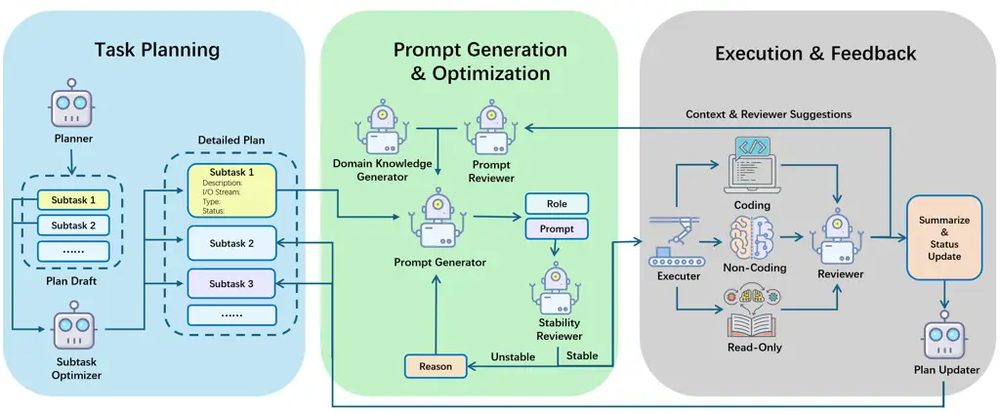
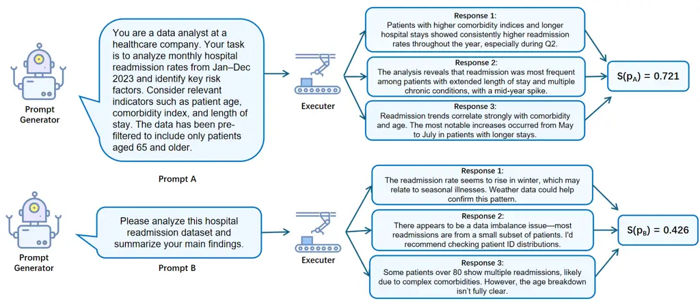
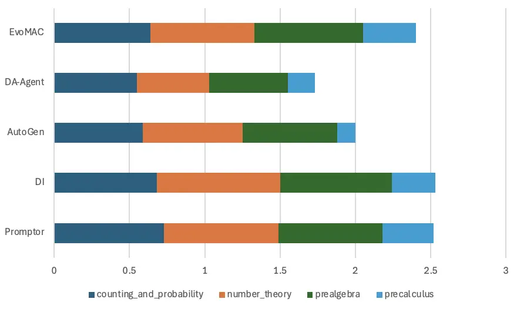
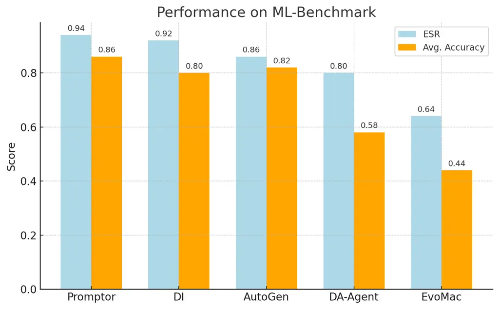

# Prompt Stability Matters: Evaluating and Optimizing Auto-Generated Prompt in General-Purpose Systems

Ke Chen Affiliation: School of Information Sciences, University of
Illinois Urbana-Champaign, USA Email: [kec10@illinois.edu](mailto:)   
Xucheng Yu Affiliation: School of Information Sciences, University of
Illinois Urbana-Champaign, USA Email: [xy63@illinois.edu](mailto:)   
Yufei Zhou Affiliation: Department of Economics, Duke University, USA
Email: [yz597@duke.edu](mailto:)    Haohan Wang Affiliation: School of
Information Sciences, University of Illinois Urbana-Champaign, USA
Email: [haohanw@illinois.edu](mailto:)

###### Abstract

Automatic prompt generation plays a crucial role in enabling
general-purpose multi-agent systems to perform diverse tasks
autonomously. Existing methods typically evaluate prompts based on their
immediate task performance, overlooking the intrinsic qualities that
determine their reliability. This outcome-centric view not only limits
interpretability but also fails to account for the inherent
stochasticity of large language models (LLMs). In this work, we bring
attention to prompt stability—the consistency of model responses across
repeated executions—as a key factor for building robust and effective
prompt generation systems. To quantify this, we propose semantic
stability as a criterion for assessing the response consistency of
prompts. Based on the proposed metric, we developed the first
stability-aware general-purpose prompt generation system that leverages
stability feedback to iteratively enhance both prompt quality and
system-level performance. Furthermore, we establish a logical chain
between prompt stability and task success by analyzing the structural
dependencies within our system, proving stability as a necessary
condition for effective system-level execution. Empirical results across
general and domain-specific tasks demonstrate that our stability-aware
framework improves both accuracy and output consistency. By shifting the
focus from one-off results to persistent reliability, our work offers a
new perspective on prompt design and contributes practical tools for
building more trustworthy general-purpose systems. The UI and source
code for our system are publicly available at:
[https://xucheng63.github.io/MyDataPilot/](https://xucheng63.github.io/MyDataPilot/).

   

## 1 Introduction

Imagine a project manager acting as a planner. Their job is to decompose
a complex project into individual tasks, assign them to team members,
and write clear instructions for each one. The project’s success hinges
on the clarity of these instructions—any ambiguity may lead to
misinterpretation, misalignment, and ultimately, failure to realize the
original vision.

Now, imagine the same scenario with a twist: both the project manager
and the team are highly versatile, capable of handling tasks across
diverse domains. This general-purpose setting magnifies the challenge,
as domain-specific language increases the risk of misunderstanding. In
such context, instructions must be precise, consistent, and unambiguous.

This is no longer hypothetical. While human teams rarely have such
general-purpose abilities, AI agents increasingly do. General-purpose
multi-agent systems built on large language models (LLMs) assign roles
and responsibilities via prompts \[1, 2, 3, 4, 5, 6\], which define
agent behavior, interaction, and decision-making. When prompts are
ambiguous or unstable, agents may misinterpret roles, leading to
coordination breakdown and unpredictable system behavior.

This fragility is worsened by the stochasticity of LLMs \[7, 8, 9\]. A
prompt that yields a reasonable response once may generate a different
one under the same conditions \[10, 11, 12\]. In multi-agent systems
where agents depend on one another’s outputs, such inconsistencies can
cascade. Thus, we argue that prompts should be evaluated not only for
correctness or accuracy, but also for _stability_—their ability to
consistently elicit semantically coherent responses across executions.

One of the key factors that determines whether general-purpose systems
can achieve robust and reliable performance is prompt construction.
Task-oriented systems typically rely on human-written prompts tailored
to specific tasks, ensuring clarity and alignment \[13, 14, 15, 16\]. In
contrast, general-purpose systems often depend on automatic prompt
generation mechanisms, which offer scalability but may produce prompts
that are poorly aligned with task or model behavior. Most existing
methods for automatic prompt generation adopt an outcome-driven
perspective, evaluating prompts based on downstream performance metrics
such as task success rate or accuracy \[17, 18, 19, 20\]. While this
provides a practical measure of effectiveness, it essentially evaluates
the result of the prompt rather than the prompt itself. A particularly
critical yet often overlooked limitation of this approach is its
inability to account for _prompt stability_, the consistency of a
prompt’s outputs across repeated executions.

In stochastic LLMs, a prompt that succeeds once may fail when repeated,
as minor changes in phrasing, sampling, or surrounding context can alter
the model’s output. This lack of reproducibility poses a fundamental
challenge for applications that require stable and predictable
responses, where occasional success is insufficient for reliable
operation.

However, despite its importance, prompt stability remains underexplored,
in part due to the lack of frameworks to define or measure it \[21\].
Unlike performance, which can be evaluated per run, stability requires
reasoning over distributions of outputs. Moreover, prompts are usually
treated as static inputs, overlooking the output variance introduced by
LLM sampling dynamics.

This paper presents _prompt stability_ as a core design objective in
automated prompt generation. We argue that prompt quality should be
judged not only by outcome success, but also by the ability to achieve
it consistently under varying conditions.

To justify this principle, we first conduct a theoretical analysis that
formally links prompt stability to system-level execution quality.
Through structural modeling and probabilistic reasoning, we show that
variability in prompt interpretation can lead to significant deviations
from the planner’s intended output, particularly in multi-agent
workflows. We further conduct empirical validation to prove that
compared with traditional metrics (e.g., mutual information \[22\],
prompt entropy \[23\], clarity \[24\], etc.), our proposed metric has
better interpretability of prompt success rate.

Building on this insight, we introduce a unified framework for
evaluating and optimizing prompt stability in general-purpose LLM-based
systems. We propose _semantic stability_, a novel metric that quantifies
robustness by measuring the consistency of LLM outputs across repeated
executions. Based on this metric, we design a self-optimizing prompt
generation system, Promptor, that leverages stability feedback to
iteratively refine prompt quality.

Through formal reasoning and empirical studies, we demonstrate that
improving prompt stability leads to higher accuracy, reduced output
variance, and greater reliability across a range of tasks and
domains—including applications in finance, biology, and chemistry.

## 2 Related Work

### 2.1 Performance-driven prompt optimization in multi-agent systems

Recent studies have explored automated prompt optimization to improve
general-purpose language model systems. \[25\] propose LLM-AutoDiff, a
framework inspired by automatic differentiation that updates prompts
using natural language feedback derived from task performance. The
system generates textual explanations of errors and uses another LLM to
revise prompts accordingly. While it supports fine-grained tuning within
multi-component workflows and incorporates structural cues such as
prompt composition and revision history, its optimization remains
fundamentally output-driven—guided by task-level metrics such as
accuracy or factual consistency. It does not explicitly assess intrinsic
prompt properties such as semantic stability or output variance across
repeated executions.

Beyond single-round feedback-based refinement, more recent works have
introduced iterative and closed-loop optimization strategies. REVOLVE
\[26\] tracks how model responses evolve across multiple rounds of
textual optimization. Instead of relying solely on feedback from the
current iteration, it analyzes the trajectory of response changes over
time, identifying whether the model exhibits stable improvement,
stagnation, or oscillation. By incorporating response evolution trends
into the refinement process, REVOLVE simulates a second-order
optimization effect, leading to more stable and directed updates that
help escape local optima in reasoning, problem-solving, and code
generation tasks.

Similarly, SIPDO \[27\] adopts a closed-loop optimization framework via
synthetic data feedback. Rather than passively evaluating prompts on
fixed datasets, SIPDO enables the model to generate increasingly
challenging test cases to probe the weaknesses of the current prompt.
Through a self-generated cycle of question construction, error
identification, and prompt revision, the system progressively
strengthens the prompt until performance stabilizes. This
“generate–diagnose–refine” loop enhances robustness under diverse task
scenarios.

Although these approaches advance prompt optimization beyond static
evaluation, they remain primarily performance-driven. Their objective
functions are defined in terms of downstream task success or error
correction. As a result, they focus on improving observable outcomes,
without explicitly modeling the stochastic variability of model
responses under repeated executions. In contrast, our work shifts the
focus from outcome improvement alone to intrinsic prompt stability,
introducing semantic stability as a principled criterion for evaluating
and optimizing consistency in general-purpose systems.

### 2.2 Existing prompt evaluation methods

Several works have focused on evaluating prompt quality from different
angles. \[28\] introduce Automatic Prompt Engineer (APE), which scores
prompts by the log-likelihood of model outputs, using it as a proxy for
model confidence.

\[29\] propose PromptEval, which assesses prompt effectiveness across
examples via a probabilistic model based on item response theory (IRT).
This framework estimates the likelihood that a prompt yields correct
outputs, capturing both average performance and variability. However, it
does not evaluate a prompt’s stability when repeatedly applied to the
same input.

These approaches contribute valuable tools for evaluating prompts in
terms of accuracy, confidence, and expected performance. However, they
do not consider whether a prompt can elicit semantically consistent
outputs across repeated runs—an important property for building reliable
systems. In other words, the stability of a prompt’s behavior under
varying model conditions remains largely unexamined.

## 3 Motivations and Analytical Results

We consider a planner–executor structure to analyze how prompt stability
affects the overall behavior of a general-purpose multi-agent system.
Let $`P`$ denote the planner module, which takes a task description
$`t`$ (e.g., “Given a large set of scRNA-seq data from multiple tissue
types, identify major cell subpopulations, infer their lineage
relationships, and generate hypotheses about potential marker genes for
each subpopulation”) and decomposes it into a set of task-specific
prompts. This process can be written as:

```math
\displaystyle P(t) \displaystyle\mapsto\{p_{1},p_{2},\dots,p_{n}\},\qquad\mathbf{x}_{i}=A_{i}(p_{i}).
```

where $`p_{i}`$ denotes the $`i`$^(th) prompt, including both textual
instructions and assigned data, to be sent to executor agent $`A_{i}`$.
Note that since $`A_{i}`$ is a generic agent, its output can be of
various formats either in texts, codes, or processed data. Without loss
of generality, we can find certain encoding schema to encode the output
into a scalar. Therefore, we collect these outputs into a diagonal
matrix:

```math
\mathbf{X}=\mathrm{diag}(\mathbf{x}_{1},\mathbf{x}_{2},\dots,\mathbf{x}_{n}),
```

and define the final output of the multi-agent system as:

```math
\mathbf{s}=\mathbf{u}^{T}\mathbf{X}\mathbf{v}
```

where $`\mathbf{u},\mathbf{v}\in\mathbb{R}^{n}`$ encode aggregation
vectors across agents.

Importantly, given a fixed task assignment, all randomness in the system
originates from the LLMs (planner or executors). We use $`\Lambda`$ to
denote the conditional distribution governing this stochastic behavior.
For each executor $`A_{i}`$, we denote its corresponding stochastic
process by $`\Lambda^{(i)}`$, which reflects the variability introduced
by the LLM’s autoregressive sampling. Therefore, we have:
$`\mathbf{x}_{i}\sim\Lambda^{(i)}(p_{i})`$.

We conjecture that one of the key challenges of a general-purpose
multi-agent system is the ambiguity induced by the prompts $`p_{i}`$
constructed by the planner. When the planner $`P`$ writes the prompts
$`p_{i}`$, these prompts are supposed to guide the LLM to complete the
task in a way that aligns with the planner’s own interpretation. In
other words, if we use $`\Lambda^{\star}`$ to interpret these prompts,
we obtain:

```math
\hat{\mathbf{x}_{i}}=\Lambda^{\star}(p_{i}),\quad\hat{\mathbf{s}}=\mathbf{u}^{T}\hat{\mathbf{X}}\mathbf{v}=\sum_{i=1}^{n}u_{i}v_{i}\hat{\mathbf{x}_{i}},
```

where $`\hat{\mathbf{s}}`$ represents the ideal system behavior as
envisioned by the planner.

However, these prompts are not interpreted by the planner itself, but by
executor agents using their own sampling processes (i.e.,
$`\Lambda^{(i)}`$). Even if the models are parameterized identically,
stochastic sampling may yield diverging interpretations. Therefore, the
actual execution gives:

```math
\mathbf{x}_{i}=\Lambda^{(i)}(p_{i}),\quad\mathbf{s}=\sum_{i=1}^{n}u_{i}v_{i}\mathbf{x}_{i}.
```

The deviation between the envisioned and actual outputs is:

```math
\left|\mathbf{s}-\hat{\mathbf{s}}\right|=\left|\mathbf{u}^{T}(\mathbf{X}-\hat{\mathbf{X}})\mathbf{v}\right|=\left|\sum_{i=1}^{n}u_{i}v_{i}(\mathbf{x}_{i}-\hat{\mathbf{x}_{i}})\right|.
```

###### Lemma 1.

With assumptions that $`\mathbf{x}_{i}`$ are independent, we have

```math
\mathbf{P}\left(\left|\mathbf{s}-\hat{\mathbf{s}}\right|\geq\epsilon\right)\leq 2\exp\left(\frac{-\epsilon^{2}}{2\sum_{i=1}^{n}(u_{i}v_{i})^{2}\text{Var}(\mathbf{x}_{i})}\right).
```

The proof is in Appendix A.1.

Conclusion. This analysis shows that the deviation between actual and
intended system outputs is primarily driven by the variance of executor
responses. Even with clear prompts, LLM stochasticity can amplify small
inconsistencies across agents. Reducing this variance by stabilizing the
prompt–response relationship offers a principled path to improving
system reliability—making prompt stability not just a heuristic goal,
but a theoretically grounded optimization target.

## 4 Method

### 4.1 Evaluate prompt via semantic stability

As discussed in Section 3, the deviation between the system’s actual and
intended outputs is closely tied to the variance of individual agent
responses $`\text{Var}(\mathbf{x}_{i})`$. However, since
$`\mathbf{x}_{i}`$ is typically a generated string, direct variance
computation is impractical. We thus seek a proxy that captures the
consistency of outputs generated from the same prompt.

A natural idea is to model the token-level distributions and measure
their divergence using KL divergence \[30\]. However, such methods
overlook semantic differences—for instance, “I agree with the
statement.” and “I do not agree with the statement” may share similar
token distributions but convey opposite meanings. This motivates
embedding-based evaluation \[31, 32\].

Specifically, we encode each sampled output $`y_{i}`$ into a semantic
vector $`v_{i}=\phi(y_{i})`$ using a pre-trained embedding model. In
high-dimensional space, Euclidean distance becomes unreliable due to the
_curse of dimensionality_, so we use cosine distance, which is more
robust for natural language applications \[33, 32\].

For any output pair, the cosine distance is computed as:

```math
d_{ij}=1-\frac{v_{i}\cdot v_{j}}{\|v_{i}\|\|v_{j}\|},\quad v_{i}=\phi(y_{i})
```

We define the semantic stability $`S(p)`$ of a prompt $`p`$ as the
average pairwise cosine similarity:

```math
S(p)=1-\frac{2}{N(N-1)}\sum_{i<j}d_{ij}
```

Higher values of $`S(p)`$ indicate greater semantic consistency and thus
stronger prompt stability, serving as a practical proxy for output
variance in stochastic LLM settings.

### 4.2 Stability-guided optimization framework

Section 3 shows that the deviation between the planner’s expected output
$`\hat{\mathbf{s}}`$ and the actual system output $`\mathbf{s}`$ is
governed by executor variance. Ultimately, what matters is alignment
with the true task goal $`\mathbf{s}^{\star}`$, which is typically
unobservable. Since $`\mathbf{s}^{\star}`$ cannot be directly accessed,
we instead introduce a proxy target $`\mathbf{s}^{\star^{\prime}}`$,
representing the best output that a high-performing LLM can reasonably
achieve within its capability. Optimizing toward
$`\mathbf{s}^{\star^{\prime}}`$ therefore serves as the closest
operational objective available to the system. This yields the following
decomposition with respect to the proxy target:

```math
|\mathbf{s}^{\star^{\prime}}-\mathbf{s}|\leq|\mathbf{s}^{\star^{\prime}}-\hat{\mathbf{s}}|+|\hat{\mathbf{s}}-\mathbf{s}|
```

Accordingly, our system jointly optimizes two objectives:

```math
\displaystyle\max_{p_{i}}\;S(p_{i})\ \ \textbf{(2) Planner Alignment Objective:}\ \min_{p_{i}}\;|\mathbf{s}^{\star^{\prime}}-\hat{\mathbf{s}}| \tag{1}
```

The first reduces execution variance via stability-aware prompt
generation; the second improves task decomposition by minimizing the gap
between planner intent and idealized output. Figure 1 illustrates how
these objectives are operationalized in our system.



Figure 1: Promptor system pipeline of our stability-aware prompt
generation framework.

#### 4.2.1 Reducing Execution Deviation.

To reduce $`\text{Var}(\mathbf{x}_{i})`$, we directly optimize the
semantic stability $`S(p_{i})`$ for each prompt:

```math
\text{Var}(\mathbf{x}_{i})\propto 1-S(p_{i})
```

Prompts with $`S(p_{i})<\tau`$ (a predefined threshold) trigger a
Reviewer Agent, which diagnoses instability and revises the responsible
component.

Each prompt $`p_{i}`$ is modularized as:

```math
p_{i}=[r_{i},q_{i},k_{i},h_{i}]
```

with $`r_{i}`$: role definition, $`q_{i}`$: task requirements,
$`k_{i}`$: domain knowledge, and $`h_{i}`$: context/history. The
Reviewer identifies the unstable subcomponent
$`z\in\{r_{i},q_{i},k_{i},h_{i}\}`$ and revises it to $`z^{\prime}`$,
forming an updated prompt $`p_{i}^{\prime}`$. This refinement continues
until $`S(p_{i}^{(t)})\geq\tau`$.

Once a prompt is deemed stable, a Summarizer Agent distills its raw
output $`\mathbf{s}`$ into a structured summary $`\hat{\mathbf{s}}`$.
The summarizer has access to the global task description and system
plan, enabling it to selectively preserve only the information most
relevant to the planner’s intent. This mechanism helps align the actual
output with the planner’s expected structure, effectively reducing the
execution deviation $`|\mathbf{s}-\hat{\mathbf{s}}|`$.

#### 4.2.2 Reducing Planner Error.

To reduce $`|\mathbf{s}^{\star^{\prime}}-\hat{\mathbf{s}}|`$, we
implement mechanisms that refine both the planner’s initial
decomposition and its dynamic updates.

Subtask Optimization. Each subtask $`t_{i}`$ inherently has an ideal
granularity $`g_{i}^{\star}`$: if $`t_{i}`$ is too coarse, it becomes
ambiguous or overloaded with multi-step goals; if too fine, it may cause
contextual fragmentation and hinder global coordination. Let
$`g(t_{i})`$ denote the actual granularity. Then,

```math
\left|\mathbf{s}^{\star^{\prime}}-\hat{\mathbf{s}}\right|\propto\sum_{i=1}^{n}\left|g(t_{i})-g_{i}^{\star}\right|
```

Our Subtask Optimizer minimizes this quantity by adjusting subtask
boundaries, types, and I/O specifications, thereby improving the
alignment between the planner’s internal objectives and the ideal
output.

Plan Updater. To further reduce the planner-side deviation
$`|\mathbf{s}^{\star^{\prime}}-\hat{\mathbf{s}}|`$, we employ a Plan
Updater that iteratively adjusts future subtasks based on the observed
results of completed ones. Let $`\hat{\mathbf{s}}^{(t)}`$ represent the
planner’s intermediate output up to step $`t`$, and $`\mathcal{T}_{>t}`$
denote the set of unexecuted subtasks following $`t`$. The updater
injects a corrective signal $`\Delta_{t}`$ into each
$`t_{j}\in\mathcal{T}_{>t}`$:

```math
\hat{\mathbf{s}}^{(t+1)}=\hat{\mathbf{s}}^{(t)}+\sum_{j>t}\Delta_{t}^{(j)}
```

where each $`\Delta_{t}^{(j)}`$ modifies the formulation or structure of
future subtask $`t_{j}`$ in response to execution feedback at step
$`t`$.

The form of $`\Delta_{t}^{(j)}`$ depends on whether subtask $`t`$
succeeds or fails. If $`t`$ succeeds, $`\Delta_{t}^{(j)}`$ propagates
structural patterns, technical details, or constraints from
$`\mathbf{x}_{t}`$ to improve the setup of $`t_{j}`$, enhancing clarity
and knowledge continuity. If $`t`$ fails, it triggers a strategy
shift—reformulating or replacing $`t_{j}`$, adjusting assumptions, or
invoking fallback plans—guiding $`\hat{\mathbf{s}}`$ toward a more
achievable trajectory.

In both cases, the Plan Updater integrates feedback into future
subtasks, refining the planner’s trajectory $`\hat{\mathbf{s}}`$ and
reducing accumulated misalignment. This iterative process helps minimize
the gap between planner intent and the ideal output:
$`|\mathbf{s}^{\star^{\prime}}-\hat{\mathbf{s}}|\to\min`$

### 4.3 Engineering Specifications

While our system is theoretically grounded in the planner–executor
structure and stability-aware prompt optimization framework, its
practical success also depends on several engineering components beyond
the core method. Modules like the Domain Knowledge Generator, Executor
Module, and other agents shown in Figure 1 are essential for robust
performance. In addition, we designed a lightweight UI to support
interactive usage and facilitate seamless integration of these modules.

These modules are excluded from the main theoretical discussion for two
reasons: some are intuitive without formal mathematical backing, while
others are adopted in existing systems and not novel enough. Thus, we
provide their implementation details and design considerations in
Appendix A.2.

## 5 Experiments

### 5.1 Experimental Setup

We evaluate the effectiveness of our stability-aware prompt optimization
framework and semantic stability metric through a series of experiments
based on the proposed general-purpose multi-agent system, Promptor. This
system integrates all key components—including prompt stability
evaluation, guided refinement, and feedback-based optimization—and
serves as the unified platform for all results reported in this section.

All experiments use GPT-4o as the language model backbone. Unless noted
otherwise, all baselines also use GPT-4o, ensuring fair comparison under
identical model and I/O settings.

Our evaluation covers three complementary aspects:

Performance on General tasks: We test on diverse tasks—math reasoning,
data analysis, code generation, and machine learning—and compare against
existing systems such as AutoGen \[34\], Data Interpreter (DI) \[35\],
EvoMAC \[36\], and DA-Agent \[37\].

Performance on Domain-specific tasks: We assess performance on
expert-level tasks in biology, finance, and chemistry, where we compare
against domain-specific systems with handcrafted prompts or fine-tuned
models.

Ablation studies: We disable individual modules (e.g., subtask
optimizer, stability evaluator, prompt reviewer, plan updater) to
quantify their contributions to task success and stability.

Unlike baselines with complex coordination or handcrafted pipelines, our
system uses a simple architecture focused on automated prompt design.
Its strong performance highlights the practical value of prompt
stability as a core optimization target.

### 5.2 Validating semantic stability as a prompt evaluation metric

To justify the use of semantic stability as a proxy for output
stability, we conduct both qualitative and quantitative evaluations that
demonstrate its alignment with intuitive notions of prompt consistency
and task success.

Qualitative Analysis. To evaluate semantic stability, we compare two
prompts for the same data analysis task with different structures. As
shown in Fig. 2, Prompt B lacks clear role, scope, and domain context,
leading to divergent outputs. Prompt A follows our structured
format—with explicit role, requirements, knowledge, and history—and
yields consistent results aligned with the planner’s intent. Their
semantic stability score difference highlights that stability reliably
reflects output variance caused by prompt ambiguity. This demonstrates
that well-structured prompts improve both consistency and
interpretability, making semantic stability an effective evaluation
metric.



Figure 2: Illustration of semantic stability as a metric.

Quantitative Analysis – Correlation with Task Success Rate. We
quantitatively assess semantic stability by computing its correlation
with task success across 2000 prompts from our pipeline. For each
prompt, we measure its stability score and average success rate in 6
executions. The results show a strong positive correlation ($`r=0.73`$):
more stable prompts are significantly more likely to succeed. To further
evaluate the interpretability of our proposed metric to prompt
performance, we compared Stability Score with several traditional
metrics, including mutual information \[22\], prompt entropy \[23\],
clarity, specificity, and coherence \[24\], by jointly using them as
predictors in XGBoost regressor to predict the success rate. As shown in
Table 1, Stability Score exhibits the highest importance among all
considered metrics, indicating that it provides the strongest
explanatory signal compared to existing alternatives. This confirms that
semantic stability reflects not just surface-level variance, but deeper
ambiguities that affect performance—making it a reliable and
interpretable metric for prompt refinement.

| Feature                | Importance (mean $`\pm`$ std) |
| ---------------------- | ----------------------------- |
| Stability Score (ours) | 0.544 $`\pm`$ 0.062           |
| Mutual Information     | 0.391 $`\pm`$ 0.027           |
| Prompt Entropy         | 0.303 $`\pm`$ 0.012           |
| Clarity                | 0.149 $`\pm`$ 0.021           |
| Specificity            | 0.135 $`\pm`$ 0.019           |
| Coherence              | 0.115 $`\pm`$ 0.011           |

Table 1: Feature importance of different metrics on XGB Regressor.

### 5.3 Effectiveness of Stability-Aware Prompt Optimization Framework

#### 5.3.1 General Ability Assessment Result

To evaluate our system’s ability to handle general tasks, we compared
our system, Promptor, with several general-purpose or multi-functional
systems across four domains: mathematical reasoning, data analysis, code
writing, and basic machine learning. Scores are reported in Table 2.

| System   | Math Reasoning | Data Analysis | Code Writing | Machine Learning | Avg  |
| -------- | -------------- | ------------- | ------------ | ---------------- | ---- |
| Promptor | 0.63           | 0.88          | 0.94         | 0.86             | 0.84 |
| DI       | 0.63           | 0.95          | 0.84         | 0.80             | 0.82 |
| AutoGen  | 0.50           | 0.71          | 0.88         | 0.82             | 0.73 |
| DA-Agent | 0.43           | 0.65          | 0.73         | 0.58             | 0.62 |
| EvoMac   | 0.60           | 0.43          | 0.95         | 0.44             | 0.63 |

Table 2: Comparison of different systems across four general task
domains.

Math Reasoning  We evaluate level-5 problems from four MATH subdomains
\[38\], which require multi-step symbolic reasoning beyond simple
retrieval. Promptor matches DI—the strongest baseline—and outperforms
the others. This highlights its ability to support structured
problem-solving with automatically generated prompts. See Appendix
Figure 3.

Data Analysis  On the InfiAgent-DABench benchmark \[39\], which covers
over 250 real-world CSV-based analysis tasks, Promptor reaches a high
similarity score of 0.88. This indicates strong performance in tasks
involving coding, debugging, and dynamic reasoning. The result
highlights how stability-guided prompt refinement improves reliability
in open-ended, data-driven scenarios.

Code Writing  On HumanEval \[40\], a benchmark for functional code
generation, Promptor reaches 0.94, rivaling EvoMac—a system fine-tuned
for programming. Our result shows that prompt stability alone enables
complex generation and self-correction.

Machine Learning  We test on ML-Benchmark, covering 10 tasks involving
prediction, evaluation, and visualization. To ensure fairness, we remove
restrictive instructions and retain only the core task descriptions.
Each task is repeated five times, and we report the execution success
rate (ESR) and prediction accuracy in Appendix Figure 4. Promptor
achieves the highest score (0.86), demonstrating strong adaptability in
complex ML scenarios.

#### 5.3.2 Professional Ability Assessment Result

General-purpose systems often underperform task-oriented systems in
specialized domains requiring structured and professional domain
knowledge. To test whether our stability-guided framework overcomes this
limitation, we evaluate Promptor on expert-level tasks in biology,
chemistry, and finance, against both general-purpose baselines and
task-oriented systems that use domain-specific pretraining or
handcrafted prompts. Results are shown in Table 4.

Biology We evaluate Promptor on single-cell RNA sequencing (scRNA-seq)
analysis using the CellAgent benchmark, which includes 50+ datasets
across diverse tissues and cell types \[41\]. Promptor achieves 86%
accuracy—outperforming general-purpose baselines and approaching
CellAgent (92%), despite not using domain-specific planning. This
suggests that stability-aware prompting can support complex biomedical
tasks by reducing ambiguity.

Chemistry On the SMILES-to-molecular-formula (S2MF) task from
ChemLLMBench \[42\], Promptor achieves the highest accuracy, surpassing
even the fine-tuned ChemDFM model. Although differences in model size
and pretraining scale may account for part of the gap, the results show
that prompt stability substantially benefits symbolic reasoning even
without domain-specific pretraining.

Finance We assess financial decision-making using Apple (AAPL) stock
data and measure Annual Rate of Return (ARR). Promptor achieves +16.2%,
outperforming general-purpose systems and approaching FinAgent, a
domain-optimized system \[43\]. Several baselines fail to complete runs,
suggesting that stability-aware optimization enhances robustness in
high-stakes environments.

Across domains, Promptor consistently narrows the gap with task-specific
systems and exceeds general-purpose baselines, indicating that prompt
stability helps general agents adapt to professional tasks without
requiring domain-specific finetuning.

| System        | Biology | Chemistry | Finance |
| ------------- | ------- | --------- | ------- |
| Promptor      | 0.86    | 0.75      | +16.2   |
| DI            | 0.63    | 0.69      | -2.29   |
| AutoGen       | 0.68    | 0.60      | +8.74   |
| DA-Agent      | –       | 0.41      | –       |
| EvoMac        | 0.43    | 0.57      | –       |
| Task-Oriented | 0.92    | 0.73      | +31.9   |

Table 3: Comparison across three professional domains.

| Condition             | ESR % |                  | CR % |                  |
| --------------------- | ----- | ---------------- | ---- | ---------------- |
| Promptor(Our system)  | 98    | $`\rightarrow`$  | 91   | $`\rightarrow`$  |
| w/o Subtask Optimizer | 92    | $`6\downarrow`$  | 78   | $`13\downarrow`$ |
| w/o Prompt Reviewer   | 97    | $`1\downarrow`$  | 77   | $`14\downarrow`$ |
| w/o S(p), w/ KL(p)    | 97    | $`1\downarrow`$  | 83   | $`8\downarrow`$  |
| w/o Plan Updater      | 73    | $`25\downarrow`$ | 60   | $`31\downarrow`$ |

Table 4: Ablation experiment results for different disabled modules.

#### 5.3.3 Ablation Experiment Result

We evaluate the contribution of each stability-aware module via ablation
studies. Specifically, we remove the Subtask Optimizer, Prompt Reviewer,
or Plan Updater individually, and assess the impact on system
performance. We also test a variant that replaces semantic stability
$`S(p)`$ with token-level KL divergence as the refinement criterion.

We use 50 multi-step code generation tasks from the HumanEval dataset.
Each task is repeated five times, and average execution success rate
(ESR) and the correctness rate (CR) are reported in Table 4.

The results show that each module in our framework plays a critical
role—removing any one degrades performance. Furthermore, replacing
semantic stability with token-level KL also hurts results, confirming
$`S(p)`$ as a more effective refinement signal.

Importantly, while the removal of engineering modules (e.g., the Plan
Updater) results in larger performance drops, this primarily reflects
their role as essential infrastructure that enables the system to
function end-to-end. In contrast, our stability-aware optimization
strategy contributes at a different level: it improves the reliability
and interpretability of prompt refinement once a working pipeline is in
place. Thus, the apparent dominance of engineering components in
ablation studies does not diminish the methodological value of
stability-aware design; rather, the two are complementary, with
stability providing principled gains beyond what engineering alone can
achieve.

## 6 Conclusion

This paper introduces prompt stability as a core design principle for
general-purpose multi-agent systems. Through theoretical analysis and
empirical validation, we show that semantic stability provides a
practical and interpretable proxy for measuring output variance and
guiding prompt optimization. Our proposed system, Promptor, integrates
stability-aware refinement and feedback-driven planning to improve
execution consistency and task success. Experiments across both general
and domain-specific tasks demonstrate that enhancing prompt stability
can significantly improve system reliability, even in complex,
high-stakes environments. These findings suggest that prompt stability
offers a robust foundation for scaling multi-agent coordination in
LLM-based systems.

## Acknowledgment

This work was partially supported by the National Artificial
Intelligence Research Resource (NAIRR) Pilot under awards NAIRR250400
and NAIRR240283, and Standing Up to POTS.

## References

- \[1\] Y. Shen et al. (2023) HuggingGPT: Solving AI Tasks with ChatGPT
  and its Friends in HuggingFace. In Advances in Neural Information
  Processing Systems (NeurIPS), Cited by: §1.
- \[2\] G. Li et al. (2023) CAMEL: Communicative Agents for ’Mind’
  Exploration of Large Language Model Society. arXiv preprint
  arXiv:2303.17760. External Links: 2303.17760 Cited by: §1.
- \[3\] Q. Wu et al. (2024) AutoGen: Enabling Next-Gen LLM Applications
  via Multi-Agent Conversations. In First Conference on Language
  Modeling, Cited by: §1.
- \[4\] J. S. Park et al. (2023) Generative Agents: Interactive
  Simulacra of Human Behavior. In Proceedings of the 36th ACM Symposium
  on User Interface Software and Technology (UIST), Cited by: §1.
- \[5\] B. Liu, X. Li, J. Zhang, and et al. (2025) Advances and
  challenges in foundation agents: from brain-inspired intelligence to
  evolutionary, collaborative, and safe systems. arXiv preprint
  arXiv:2504.01990. External Links: 2504.01990 Cited by: §1.
- \[6\] K. Chen, P. Wang, Y. Yu, et al. (2025) Large language
  model-based data science agent: a survey. arXiv preprint
  arXiv:2508.02744. External Links: 2508.02744 Cited by: §1.
- \[7\] B. Atil et al. (2024) LLM Stability: A detailed analysis with
  some surprises. arXiv preprint arXiv:2408.04667. External Links:
  2408.04667 Cited by: §1.
- \[8\] H. Jin, P. Zhang, M. Luo, and H. Wang Evaluating the inductive
  abilities of large language models: why chain-of-thought reasoning
  sometimes hurts more than helps. In The Thirty-ninth Annual Conference
  on Neural Information Processing Systems, Cited by: §1.
- \[9\] Y. Zhang, Y. Li, T. Zhao, K. Zhu, H. Wang, and N.
  Vasconcelos (2025) Achilles heel of distributed multi-agent systems.
  arXiv preprint arXiv:2504.07461. Cited by: §1.
- \[10\] X. Wang et al. (2023) Self-Consistency Improves Chain of
  Thought Reasoning in Language Models. In International Conference on
  Learning Representations (ICLR), Cited by: §1.
- \[11\] J. Moore et al. (2024) Are Large Language Models Consistent
  over Value-laden Questions?. arXiv preprint arXiv:2407.02996. External
  Links: 2407.02996 Cited by: §1.
- \[12\] M. T. Ribeiro et al. (2020) Beyond Accuracy: Behavioral Testing
  of NLP Models with CheckList. In Proceedings of the 58th Annual
  Meeting of the Association for Computational Linguistics (ACL), Cited
  by: §1.
- \[13\] T. Brown et al. (2020) Language Models are Few-Shot Learners.
  In Advances in Neural Information Processing Systems (NeurIPS), Cited
  by: §1.
- \[14\] S. Mishra et al. (2022) Cross-Task Generalization via Natural
  Language Crowdsourcing Instructions. arXiv preprint arXiv:2104.08773.
  External Links: 2104.08773 Cited by: §1.
- \[15\] T. Schick and H. Schütze (2021) Exploiting Cloze Questions for
  Few-Shot Text Classification and Natural Language Inference. arXiv
  preprint arXiv:2001.07676. External Links: 2001.07676 Cited by: §1.
- \[16\] J. Wei et al. (2023) Chain-of-Thought Prompting Elicits
  Reasoning in Large Language Models. arXiv preprint arXiv:2201.11903.
  External Links: 2201.11903 Cited by: §1.
- \[17\] T. Shin et al. (2020) AutoPrompt: Eliciting Knowledge from
  Language Models with Automatically Generated Prompts. In Proceedings
  of the 2020 Conference on Empirical Methods in Natural Language
  Processing (EMNLP), Cited by: §1.
- \[18\] X. L. Li and P. Liang (2021) Prefix-Tuning: Optimizing
  Continuous Prompts for Generation. arXiv preprint arXiv:2101.00190.
  External Links: 2101.00190 Cited by: §1.
- \[19\] M. Deng et al. (2022) RLPrompt: Optimizing Discrete Text
  Prompts with Reinforcement Learning. arXiv preprint arXiv:2205.12548.
  External Links: 2205.12548 Cited by: §1.
- \[20\] Y. Zhou et al. (2023) Large Language Models Are Human-Level
  Prompt Engineers. arXiv preprint arXiv:2211.01910. External Links:
  2211.01910 Cited by: §1.
- \[21\] P. Liu et al. (2021) Pre-train, Prompt, and Predict: A
  Systematic Survey of Prompting Methods in NLP. arXiv preprint
  arXiv:2107.13586. External Links: 2107.13586 Cited by: §1.
- \[22\] T. Sorensen, J. Robinson, C. M. Rytting, A. P. Delorey, et
  al. (2022) An Information-theoretic Approach to Prompt Engineering
  Without Ground Truth Labels. arXiv preprint. External Links:
  2203.11364 Cited by: §1, §5.2.
- \[23\] Y. Lu, M. Bartolo, A. Moore, S. Riedel, and P. Stenetorp (2022)
  Fantastically ordered prompts and where to find them: overcoming
  few-shot prompt order sensitivity. In Proceedings of the 60th Annual
  Meeting of the Association for Computational Linguistics (Volume 1:
  Long Papers), S. Muresan, P. Nakov, and A. Villavicencio (Eds.),
  Dublin, Ireland, pp. 8086–8098. External Links:
  [Link](https://aclanthology.org/2022.acl-long.556/),
  [Document](https://dx.doi.org/10.18653/v1/2022.acl-long.556) Cited by:
  §1, §5.2.
- \[24\] L. Blog (2025) Qualitative Metrics for Prompt Evaluation:
  clarity, relevance, coherence. Note: Online blog postAccessed:
  2025-03-01 Cited by: §1, §5.2.
- \[25\] W. Yin and W. Wang (2024) LLM-AutoDiff: Textual Gradient
  Descent for Language Model Programming. arXiv preprint
  arXiv:2501.16673. External Links: 2501.16673 Cited by: §2.1.
- \[26\] P. Zhang, H. Jin, L. Hu, et al. (2024) Revolve: optimizing ai
  systems by tracking response evolution in textual optimization. arXiv
  preprint arXiv:2412.03092. External Links: 2412.03092 Cited by: §2.1.
- \[27\] Y. Yu, Y. Yu, K. Wei, et al. (2025) SIPDO: closed-loop prompt
  optimization via synthetic data feedback. arXiv preprint
  arXiv:2505.19514. External Links: 2505.19514 Cited by: §2.1.
- \[28\] Q. Zhou, N. Schärli, L. Hou, Q. Le, M. Weber, and A.
  Roberts (2023) Large Language Models Are Human-Level Prompt Engineers.
  arXiv preprint arXiv:2211.01910. External Links: 2211.01910 Cited by:
  §2.2.
- \[29\] M. Polo, S. Gehrmann, and R. Das (2024) Efficient Multi-Prompt
  Evaluation of LLMs. arXiv preprint arXiv:2405.17202. External Links:
  2405.17202 Cited by: §2.2.
- \[30\] S. Kullback and R. A. Leibler (1951) On Information and
  Sufficiency. Annals of Mathematical Statistics. Cited by: §4.1.
- \[31\] T. Zhang et al. (2020) BERTScore: Evaluating Text Generation
  with BERT. In International Conference on Learning Representations
  (ICLR), Cited by: §4.1.
- \[32\] N. Reimers and I. Gurevych (2019) Sentence-BERT: Sentence
  Embeddings using Siamese BERT-Networks. In Proceedings of the 2019
  Conference on Empirical Methods in Natural Language Processing
  (EMNLP-IJCNLP), Cited by: §4.1, §4.1.
- \[33\] D. Cer et al. (2018) Universal Sentence Encoder for English. In
  Proceedings of the 2018 Conference on Empirical Methods in Natural
  Language Processing (EMNLP), System Demonstrations, Cited by: §4.1.
- \[34\] Q. Wu et al. (2023) AutoGen: Enabling Next-Gen LLM Applications
  via Multi-Agent Conversation. arXiv preprint arXiv:2308.08155.
  External Links: 2308.08155 Cited by: §5.1.
- \[35\] S. Hong et al. (2024) Data Interpreter: An LLM Agent for Data
  Science. arXiv preprint arXiv:2402.18679. External Links: 2402.18679
  Cited by: §5.1.
- \[36\] Y. Hu et al. (2024) Self-Evolving Multi-Agent Collaboration
  Networks for Software Development. arXiv preprint arXiv:2410.16946.
  External Links: 2410.16946 Cited by: §5.1.
- \[37\] Y. Huang et al. (2024) DA-Code: Agent Data Science Code
  Generation Benchmark for LLMs. arXiv preprint arXiv:2410.07331.
  External Links: 2410.07331 Cited by: §5.1.
- \[38\] D. Hendrycks et al. (2021) Measuring Mathematical Problem
  Solving With the MATH Dataset. arXiv preprint arXiv:2103.03874.
  External Links: 2103.03874 Cited by: §5.3.1.
- \[39\] X. Hu et al. (2024) InfiAgent-DABench: Evaluating Agents on
  Data Analysis Tasks. arXiv preprint arXiv:2401.05507. External Links:
  2401.05507 Cited by: §5.3.1.
- \[40\] M. Chen et al. (2021) Evaluating Large Language Models Trained
  on Code. arXiv preprint arXiv:2107.03374. External Links: 2107.03374
  Cited by: §5.3.1.
- \[41\] Y. Xiao et al. (2024) CellAgent: An LLM-driven Multi-Agent
  Framework for Automated Single-cell Data Analysis. arXiv preprint
  arXiv:2407.09811. External Links: 2407.09811 Cited by: §5.3.2.
- \[42\] D. Zhang et al. (2024) ChemLLM: A Chemical Large Language
  Model. arXiv preprint arXiv:2402.06852. External Links: 2402.06852
  Cited by: §5.3.2.
- \[43\] W. Zhang et al. (2024) A Multimodal Foundation Agent for
  Financial Trading. arXiv preprint arXiv:2402.18485. External Links:
  2402.18485 Cited by: §5.3.2.
- \[44\] S. Boucheron, G. Lugosi, and P. Massart (2013) Concentration
  Inequalities: A Nonasymptotic Theory of Independence. Oxford
  University Press. Cited by: §A.1.

## Appendix A Appendix

### A.1 Proof of the bounded probability

Let $`Z_{i}=u_{i}v_{i}(\mathbf{x}_{i}-\hat{\mathbf{x}_{i}})`$, then we
have $`\text{Var}(Z_{i})=(u_{i}v_{i})^{2}\text{Var}(x_{i})`$. The
deviation becomes:

```math
\left|\mathbf{s}-\hat{\mathbf{s}}\right|=\left|\sum_{i=1}^{n}Z_{i}\right|.
```

The concentration inequality for the sum of independent centered
variables \[44\]:

```math
\mathbf{P}\left(\left|\sum_{i=1}^{n}Z_{i}\right|\geq\epsilon\right)\leq 2\exp\left(\frac{-\epsilon^{2}}{2\sum_{i=1}^{n}\text{Var}(Z_{i})}\right),
```

By applying this inequality, we can derive a bound on the probability
that this deviation exceeds a threshold $`\epsilon`$:

```math
\mathbf{P}\left(\left|\mathbf{s}-\hat{\mathbf{s}}\right|\geq\epsilon\right)\leq 2\exp\left(\frac{-\epsilon^{2}}{2\sum_{i=1}^{n}(u_{i}v_{i})^{2}\text{Var}(\mathbf{x}_{i})}\right).
```

### A.2 Engineering Specifications

##### I/O Stream Specification.

We enforce explicit input-output specifications for each subtask. By
standardizing the format and content of outputs, we constrain the
support of the output distribution to a subset $`\mathcal{C}`$, i.e.,
$`\mathbf{x}_{i}\sim\Lambda^{(i)}(p_{i}\mid\mathbf{x}_{i}\in\mathcal{C})`$.
This restriction reduces semantic variance and improves stability across
executions.

##### Domain Knowledge Generation.

We elicit domain-specific knowledge directly from the LLM using a Domain
Knowledge Generator, which prompts the model to recall relevant facts
from its internal corpus. Unlike retrieval-augmented generation (RAG)
methods, our approach is independent of external databases and thus
avoids issues of limited coverage or retrieval imprecision. This enables
scalable, on-demand access to expert-level information, particularly in
under-documented domains.

##### Semi-Automatic Interaction Generation.

Dynamically generating roles and their interactions remains a key
challenge in general-purpose systems. Fully automated pipelines often
lead to over-generated roles and unstable information flows. To address
this, we adopt a semi-automatic approach: tasks are categorized into a
small number of templates, each associated with a fixed interaction
structure that supports both linear and nonlinear flows. The system
selects a suitable template based on task type and instantiates roles
accordingly. This approach reduces coordination errors while preserving
flexibility. Each role also supports modular subfunctions that can be
invoked on demand, further reducing redundancy and stabilizing agent
collaboration.

##### Requirement Augmentation.

To mimic the iterative nature of human prompt refinement, our system
incorporates a feedback loop that monitors execution outcomes. When a
subtask fails or yields suboptimal results, the Reviewer Agent evaluates
whether the failure stems from missing constraints. If so, new
requirements are appended to the prompt, steering the model toward more
reliable behavior. This process continues until performance reaches an
acceptable threshold, preventing recurrence of similar issues.

##### Context and History Management.

Maintaining coherent information flow across subtasks is critical in
long-horizon tasks. The Subtask Optimizer defines explicit data paths
and formats during planning, enabling the Prompt Generator to structure
prompts accordingly. After each execution, results are stored in a
structured format and passed through a Summarizer Agent, which distills
lengthy outputs into concise summaries. These summaries serve as compact
memory units, enhancing context retention and reducing semantic drift in
downstream subtasks.

##### User Interface Design.

To demonstrate the practical applicability of our framework, we
implemented a web-based user interface named MyDataPilot. The system
follows a three-tier architecture with a React frontend, Node.js
middleware, and a Python backend. The UI is designed to support
stability-aware multi-agent task decomposition, ensuring consistent and
reliable responses through semantic stability optimization. Key
functionalities include:

- •
  Intelligent task decomposition with stability-aware planning.
- •
  Real-time conversational interaction with agents.
- •
  Task execution management and progress tracking.
- •
  Automated exploratory data analysis (EDA) with visualization.
- •
  User authentication and session management.
- •
  Code generation with file saving and download support.

This system has been deployed as a complete web application, bridging
the gap between research and practice. An interactive demonstration is
available at
[https://xucheng63.github.io/MyDataPilot/](https://xucheng63.github.io/MyDataPilot/).

### A.3 Detailed Results on Some Benchmarks

The MATH benchmark consists of four sub-tasks, covering algebra,
geometry, number theory, and probability. Figure 3 shows the performance
of different systems on each sub-task individually, as well as the
aggregated overall score. The comparison allows us to observe how each
system behaves across tasks with varying reasoning difficulty and
mathematical structure.

For the ML-Bench benchmark, we evaluate two important dimensions of
system capability:

Execution Success Rate (ESR) – whether the system can successfully
complete the task.

Accuracy – whether the generated output is correct when execution is
successful.

Figure 4 presents the ESR and accuracy of five systems, enabling a clear
comparison across both reliability and correctness.



Figure 3: Performance on the MATH benchmark. The horizontal axis shows
cumulative accuracy defined as
$`\mathrm{CumAcc}=\sum_{k=1}^{4}\mathrm{Acc}_{k}`$, where
$`\mathrm{Acc}_{k}\in[0,1]`$ denotes the accuracy on each of the four
subtasks (counting and probability, number theory, pre-algebra, and
pre-calculus). Each colored segment corresponds to one subtask.



Figure 4: Performance on ML-Bench benchmark.
