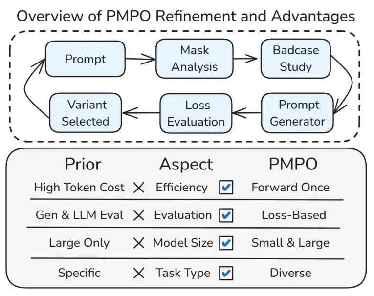
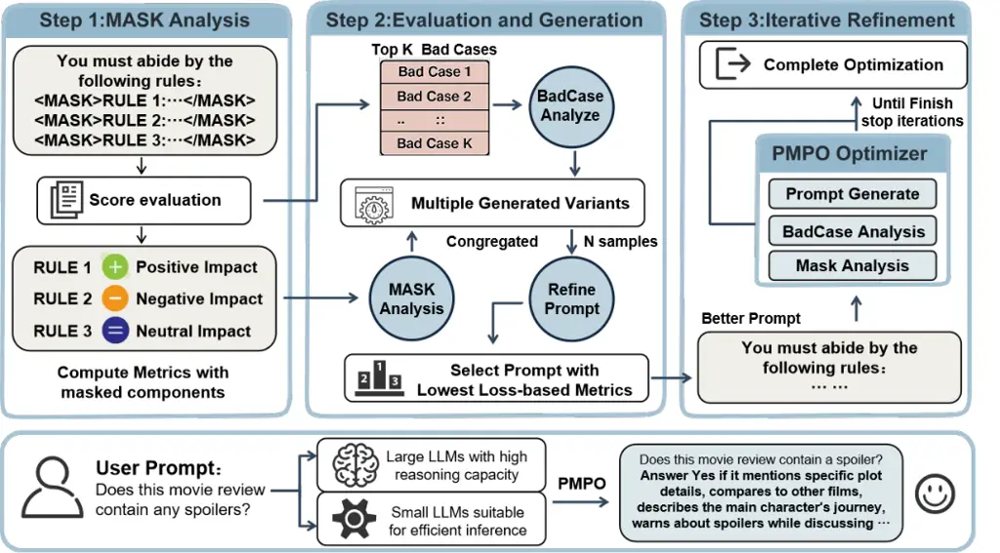
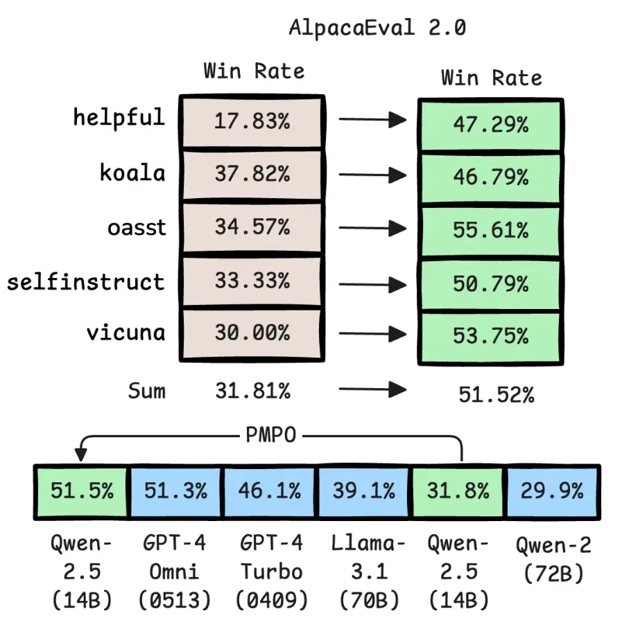
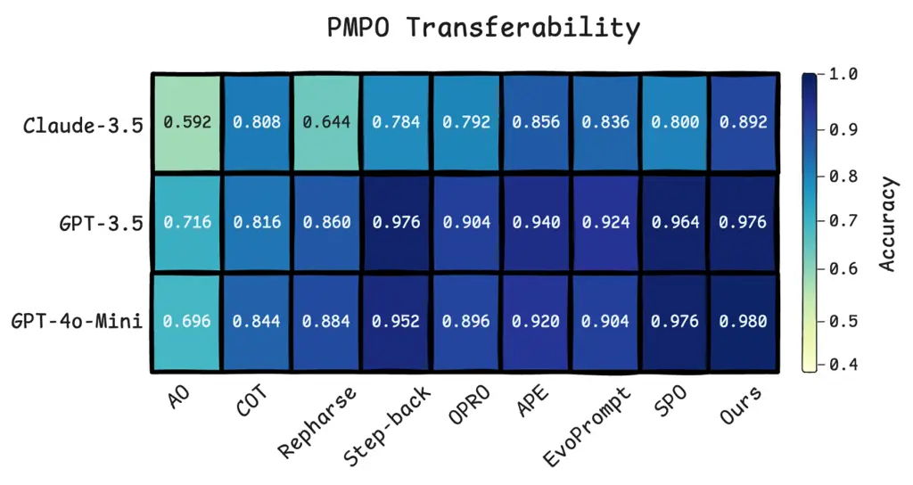
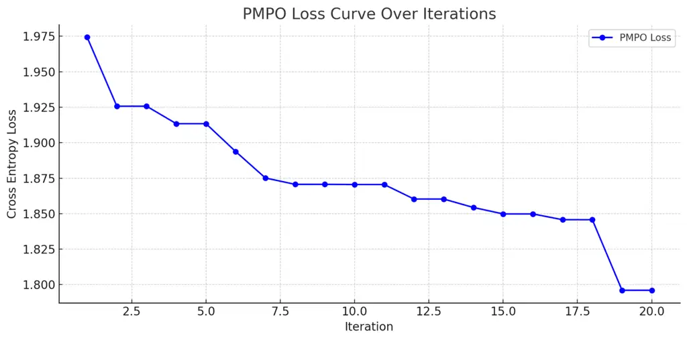

# PMPO: Probabilistic Metric Prompt Optimization for Small and Large Language Models

Chenzhuo Zhao ^(†)^(†)thanks: Contributed equally. Affiliation: Peking
University Email: [cyzcz@stu.pku.edu.cn](mailto:)    Ziqian
Liu¹¹footnotemark: 1 Affiliation: Independent Researcher
Email: [nevsettle@stu.pku.edu.cn](mailto:)    Xinda Wang
Affiliation: Peking University
Email: [aidan.lew.37@stu.pku.edu.cn](mailto:)    Junting Lu
Affiliation: Peking University Email: [liuziqian25@gmail.com](mailto:)
   Chaoyi Ruan ^(†)^(†)thanks: Corresponding author.
Affiliation: National University of Singapore
Email: [ruancy@comp.nus.edu.sg](mailto:)

###### Abstract

Prompt optimization is a practical and widely applicable alternative to
fine tuning for improving large language model performance. Yet many
existing methods evaluate candidate prompts by sampling full outputs,
often coupled with self critique or human annotated preferences, which
limits scalability, especially for smaller models or models that are not
instruction tuned. We present PMPO (Probabilistic Metric Prompt
Optimization), a unified framework that uses token level cross entropy
as a direct, lightweight evaluation signal. PMPO locates low quality
prompt segments via a masking based analysis and iteratively rewrites
them to propose improved variants. Crucially, during evaluation, PMPO
selects among variants by minimizing loss in a single forward pass,
eliminating output sampling and human or judge based scoring for
selection while still using standard generation only to propose
rewrites. This unified, loss based strategy supports both supervised and
preference based tasks. Across model sizes and datasets, PMPO
outperforms prior prompt optimizers: it achieves the highest average
accuracy on BBH, performs strongly on GSM8K and AQuA RAT, and raises
AlpacaEval 2.0 win rates by over 19 points. These results demonstrate
PMPO’s effectiveness, efficiency, and broad applicability.

## 1 Introduction



Figure 1: Overview of PMPO. Top: Iterative prompt refinement via
loss-based evaluation. Bottom: Comparative strengths over prior methods
in terms of evaluation strategy, efficiency, model support, and task
generality.

Prompt design has emerged as a critical factor in steering large
language models (LLMs) toward reliable performance across diverse tasks.
As fine-tuning becomes increasingly costly or restricted , automatic
prompt optimization has become a practical alternative to improve model
behavior without modifying parameters (Agarwal et al., 2024; Wang
et al., 2023). Recent methods tackle this by iteratively refining
prompts through model feedback (Xiang et al., 2025), human
preferences (Cheng et al., 2023), or reward-based search (Zheng et al.,
2024). While effective, these approaches often face three main
challenges: (1) high cost due to output generation and evaluation loops,
(2) reliance on large models capable of introspection or multi-step
reasoning, and (3) lack of generality across task types and model sizes.

Some methods, such as PromptWizard (Agarwal et al., 2024) and
PromptAgent (Wang et al., 2023), rely on model-internal critique and
iterative analysis, achieving strong results on complex tasks but
requiring significant computation and model cooperation. Others like
BPO (Cheng et al., 2023) and PAS (Zheng et al., 2024) improve efficiency
via offline learning of prompt-rewriting models, but require substantial
labeled data or preference annotations, and their applicability to new
tasks or small models is limited. SPO (Xiang et al., 2025) avoids ground
truth by using the model’s own judgment to compare outputs, but this
self-evaluation is less reliable for smaller LMs.

A central limitation across these approaches is how prompt quality is
evaluated. Most techniques treat prompt evaluation as a generative task,
where outputs are generated and then scored externally, making the
process computationally expensive and less reliable. External scoring
often lacks consistency or sufficient granularity, especially when
relying on models to assess complex outputs. Moreover, methods tend to
specialize: some focus on supervised tasks with explicit labels, while
others target alignment tasks defined by preferences or style. Few offer
a unified, efficient mechanism applicable to both.

In this work, we introduce PMPO (Probabilistic Metric Prompt
Optimization), a novel prompt optimization framework that directly uses
the model’s cross-entropy loss as the evaluation signal. PMPO frames
prompt optimization as a classic loss minimization problem: given a
prompt and input, it computes the likelihood of the desired or preferred
output without requiring the model to generate or rank outputs
explicitly. This evaluation is efficient, fully automated, and
compatible with models of varying scales, making PMPO applicable to both
large and small language models in diverse deployment settings.
Moreover, PMPO supports both accuracy-based tasks (e.g., classification,
QA) and preference-based tasks (e.g., summarization, instruction
following) under a unified loss-based evaluation strategy: it minimizes
cross-entropy loss for tasks with labeled outputs and maximizes the
likelihood of preferred responses over less preferred ones when
comparative preference information is available.

Figure 1 presents an overview of the PMPO refinement loop and summarizes
its advantages over existing approaches. Compared to prior methods, PMPO
offers the following key advantages:

- •
  Loss-based evaluation. Unlike prior methods, PMPO’s evaluation of
  candidate prompts requires no output sampling or human evaluation,
  relying only on a single forward pass to compute log-likelihoods,
  which makes its evaluation process highly efficient.
- •
  General applicability. PMPO unifies preference-based and supervised
  settings by treating prompt optimization as maximizing either output
  likelihood or reward, depending on the task signal available.
- •
  Support for small models. PMPO requires only forward passes and
  likelihoods, not introspection or reasoning, making it usable for
  smaller LMs that cannot critique their outputs or support complex
  prompting.
- •
  High sample efficiency. Since loss evaluation is batchable and cheap,
  PMPO can explore more candidate prompts under fixed budget
  constraints, enabling extensive search with minimal overhead.



Figure 2: Overview of the PMPO framework. Step 1: Mask Analysis
estimates the impact of each prompt part by measuring loss changes when
masked, identifying positive, negative, or neutral effects. Step 2:
Evaluation and Generation selects hard cases and generates refined
candidates, scored with the same loss-based metric. The best-performing
prompt is retained. Step 3: Iterative Refinement repeats this process
until stop.

## 2 Related Works

### 2.1 Prompt Engineering

Early prompt engineering methods rely on manually crafted instructions
and few-shot exemplars to guide language model behavior Brown et al.
(2020); Deng et al. (2023); Zheng et al. (2023c); Wang et al. (2024b).
Chain-of-Thought (CoT) prompting Wei et al. (2022) enhances this
paradigm by encouraging step-by-step reasoning, leading to substantial
gains on complex tasks. Other structured prompting methods, such as
Step-Back prompting Zheng et al. (2023a), introduce abstraction or
meta-reasoning steps to improve logical inference. Similarly,
Rephrase-and-Respond Deng et al. (2024) enhances model comprehension by
prompting it to rephrase questions before answering. These techniques
improve performance by enriching intermediate reasoning or input
interpretation, but they are based on fixed templates and do not perform
automated prompt generation or optimization.

In contrast, another line of work explores automatic prompt
construction. Methods like APE Shen et al. (2023) treat prompt design as
a search problem, using language models to generate and rank instruction
variants based on task performance. While these approaches reduce manual
effort, they often rely on large models for generation and evaluation,
limiting scalability in low-resource or small-model settings. Overall,
this body of work underscores the importance of prompt formulation and
motivates the development of more systematic and efficient optimization
frameworks.

### 2.2 Prompt Optimization

Recent work on automated prompt optimization can be broadly categorized
into generation-based and introspection-based methods Yan et al. (2024);
Wang et al. (2024a); Guo12 et al. (); Zhou et al. (2022). OPRO Yang
et al. (2023) treats the optimization process as a black-box loop, where
an LLM proposes new prompts based on previous attempts and their
performance (e.g., accuracy). EvoPrompt Tong et al. (2025) and
PromptBreeder Fernando et al. (2023) further adopt evolutionary
strategies—maintaining populations of prompts that evolve through
mutation and selection, with PromptBreeder uniquely co-evolving its
mutation strategies. While these approaches often achieve strong
performance, they rely on repeated output generation and scoring, which
makes them resource-intensive and task-specific. Moreover, their
effectiveness depends heavily on large LLMs serving as optimizers,
limiting applicability to smaller models or open-ended preference-based
tasks.

Another direction leverages the model’s own introspective signals to
refine prompts. PromptWizard Agarwal et al. (2024) uses model-internal
critiques to iteratively improve prompts and in-context examples.
TextGuard Pei et al. (2023) adopts a unit-test framework, generating
adversarial test cases to probe and correct prompt weaknesses. Though
effective in structured tasks with clear correctness criteria, these
methods often assume explicit feedback or reference outputs, and require
natural-language generation for both diagnosis and revision.
Self-supervised approaches like SPO Xiang et al. (2025) and
TextGuard Pei et al. (2023) reduce reliance on labels by comparing
outputs or generating improvement suggestions, yet still depend on
costly output sampling or heuristic reward models.

## 3 PMPO Framework

We introduce PMPO, a unified framework designed to iteratively refine
prompts using fine-grained cross-entropy evaluation and adaptive
rewriting strategies (see Figure 2). PMPO systematically analyzes
prompts by applying a model-adaptive masking technique to quantify
token-level impacts (Step 1, detailed in Section3.2), and selectively
rewrites the lowest-performing segments using language model-generated
variants (Step 2, described in Sections3.3 and3.4). Through an iterative
cycle of prompt generation, evaluation, and refinement (Step 3,
corresponding to the overall loop in Section3.1), PMPO automatically
enhances prompt effectiveness without human intervention, adapting
flexibly across different model architectures and tasks.

Problem Definition Given a task $`\mathcal{T}`$, our framework
initializes with a base instruction $`\mathcal{P}`$ and leverages a
problem description paired with a dataset
$`\mathcal{D}={(x_{i},y_{i},r_{i})}_{i=1}^{N}`$, where each example
consists of an input $`x_{i}`$, an output $`y_{i}`$, and an associated
label or preference score $`r_{i}`$ indicating the quality or
desirability of $`y_{i}`$ for $`x_{i}`$. The language model $`M`$
generates outputs with probabilities $`P_{M}(y\mid x,\mathcal{P})`$
conditioned on input $`x`$ and instruction $`\mathcal{P}`$. Our
objective is to derive an optimal prompt $`\mathcal{P}^{*}`$ that
maximizes the expected weighted log-probability, that is,
$`\mathbb{E}_{(x,y,r)\sim\mathcal{D}}\left[r\cdot\log P_{M}(y\mid x,\mathcal{P})\right]`$,
where $`r`$ can represent either a binary label or a scalar preference
score. Concretely, in accuracy-based tasks (e.g., QA/classification) we
set $`r_{i}\equiv 1`$, whereas in preference-based tasks we form pairs
and assign $`r=+1`$ to the preferred output and $`r=-1`$ to the
non-preferred one. This unified formulation enables the framework to
enhance the model’s target-aligned generation capability by amplifying
preferences over desired outputs.

### 3.1 Iterative Framework for PMPO

We propose an iterative algorithm that progressively refines prompt
quality based on evaluation metrics and targeted modifications. The full
procedure is outlined in Algorithm 1.

1: Dataset $`\mathcal{D}`$, Initial prompt $`\mathcal{P}_{0}`$, Language
model $`M`$, Max iterations $`T`$, Top-$`k`$ samples $`k`$, Variants per
sample $`n`$

2: Optimized prompt $`\mathcal{P}^{*}`$

3: $`\mathcal{P}^{*}\leftarrow\mathcal{P}_{0}`$

4: for iteration $`\leftarrow 1`$ to $`T`$ do

5:   Compute metric $`\mathcal{L}(\mathcal{P}^{*},M)`$ on
$`\mathcal{D}`$

6:   Select top-$`k`$ samples $`\{(x_{j},y_{j})\}`$

7:   Initialize variant set $`\mathcal{V}\leftarrow\{\mathcal{P}^{*}\}`$

8:   for each $`(x_{j},y_{j})`$ do

9:    Analyze failure and token importance using $`M`$

10:    Generate $`n`$ variants
$`\{\mathcal{P}^{\prime}_{j,1},...,\mathcal{P}^{\prime}_{j,n}\}`$

11:
   $`\mathcal{V}\leftarrow\mathcal{V}\cup\{\mathcal{P}^{\prime}_{j,1},...,\mathcal{P}^{\prime}_{j,n}\}`$

12:   end for

13:   Evaluate all prompts in $`\mathcal{V}`$ and select best
$`\mathcal{P}^{\text{new}}`$

14:   if
$`\mathcal{L}(\mathcal{P}^{*},M)>\mathcal{L}(\mathcal{P}^{\text{new}},M)`$
then

15:    $`\mathcal{P}^{*}\leftarrow\mathcal{P}^{\text{new}}`$

16:   end if

17: end for

18: return $`\mathcal{P}^{*}`$

Algorithm 1 An Overview of PMPO

In each iteration, the PMPO framework begins with a detailed,
mask-guided analysis using the model $`M`$ to identify specific segments
within the current prompt that affect performance. It then computes the
cross-entropy or preference-based loss across the entire dataset and
selects the most challenging examples, defined as those with the highest
losses, as priority targets for improvement. Based on the insights from
the mask-guided analysis, the framework generates multiple refined
prompt variants, each designed to address the detected weaknesses. These
candidates are re-evaluated using batch-level loss performance, and the
variant demonstrating the greatest improvement is retained for the next
iteration. This refinement process continues until the maximum number of
iterations is reached.

### 3.2 Mask-Guided Importance Evaluation

To identify influential components within a instruction $`\mathcal{P}`$,
we first decompose it into a set of semantic units
$`{s_{1},s_{2},...,s_{m}}`$. Instead of relying on predefined rules, we
leverage the language model’s own reasoning capability to perform this
segmentation. This process is driven by a carefully designed
meta-prompt, which instructs the model to analyze the instruction and
segment it into up to 5 independent and removable semantic units, such
as methods, rules, or examples, whose removal would not disrupt the
overall coherence of the prompt. The model then wraps these selected
segments with \<mask\>...\</mask\> tags. A detailed description of our
masking formulation and the full meta-prompt template can be found in
Appendix A.1.

These identified semantic units are then used to quantify each
component’s importance. For each unit $`s_{j}`$, we create a perturbed
prompt variant by masking it:

```math
\mathcal{P}^{-j}=\{s_{1},s_{2},...,s_{j-1},\texttt{<MASK>},s_{j+1},...,s_{m}\} \tag{1}
```

We then compute the change in batch-level cross-entropy loss when
$`s_{j}`$ is masked:

```math
\Delta\mathcal{L}_{j}=\mathcal{L}_{\text{batch}}(\mathcal{P}^{-j},M)-\mathcal{L}_{\text{batch}}(\mathcal{P},M) \tag{2}
```

Here, $`\mathcal{L}_{\text{batch}}(\cdot,M)`$ denotes the average
cross-entropy loss over the dataset under model $`M`$. A positive
$`\Delta\mathcal{L}_{j}`$ indicates that $`s_{j}`$ contributes
positively to task performance (its removal increases loss), whereas a
negative value suggests a detrimental or redundant effect. Values of
$`\Delta\mathcal{L}_{j}`$ close to zero imply negligible impact on model
behavior.

### 3.3 Prompt Evaluation via Loss-based Metrics

To quantitatively assess the effectiveness of prompts, we utilize
loss-based metrics derived from the model’s internal probability
estimates.

Given a model $`M`$, a instruction $`\mathcal{P}`$, input $`x`$, and
expected output $`y`$, we define the token-level cross-entropy loss as:

```math
\mathcal{L}_{CE}(x,y,\mathcal{P},M)=-\sum_{i=1}^{|y|}\log P_{M}(y_{i}\mid y_{<i},x,\mathcal{P}) \tag{3}
```

where $`y_{i}`$ is the $`i`$-th token of the output sequence and
$`y_{<i}`$ denotes all preceding tokens. The batch-level loss over
dataset $`\mathcal{D}`$ is computed as:

```math
\mathcal{L}_{\text{batch}}(\mathcal{P},M)=\frac{1}{n}\sum_{i=1}^{n}\mathcal{L}_{CE}(x_{i},y_{i},\mathcal{P},M) \tag{4}
```

Unlike binary accuracy metrics, $`\mathcal{L}_{\text{batch}}`$ captures
token-wise generation probabilities, provides a continuous evaluation
space, and reflects variations in model confidence induced by different
prompts.

In scenarios where candidate outputs are associated with preference
signals, we additionally incorporate a pairwise preference loss inspired
by preference optimization techniques. Given a preferred output
$`y^{+}`$ and a less preferred alternative $`y^{-}`$, we define:

```math
\begin{split}\mathcal{L}_{\text{pref}}(x,y^{+},y^{-},\mathcal{P},M)=&\\
-\log\sigma\Big(\beta\cdot\big(s_{M}(x,y^{+},\mathcal{P})&-s_{M}(x,y^{-},\mathcal{P})\big)\Big)\end{split} \tag{5}
```

where $`s_{M}(x,y,\mathcal{P})=\log P_{M}(y\mid x,\mathcal{P})`$ is the
model-assigned log-probability, $`\sigma`$ is the sigmoid function, and
$`\beta`$ is a scaling factor.

### 3.4 Prompt Variant Generation

To generate new prompt candidates, PMPO employs a model-in-the-loop
rewriting mechanism that leverages the language model itself to revise
instructions. Rather than using predefined rules or templates, a
rewriting prompt is constructed for each selected hard example $`(x,y)`$
identified by high preference-based cross-entropy loss under the current
instruction $`\mathcal{P}`$. This rewriting prompt includes five key
elements: the task description $`\mathcal{T}`$ to maintain generality,
the current instruction $`\mathcal{P}`$ as the base for revision, the
hard example $`(x,y)`$ to expose weaknesses, editing instructions
focused on improving clarity, specificity, and structural quality, and a
token-level mask analysis that highlights segments in $`\mathcal{P}`$
contributing most to the loss.

The mask-guided analysis functions as a soft signal rather than a hard
pruning mechanism. It does not constrain the optimization to specific
regions; it merely suggests areas where targeted edits may be
beneficial. During candidate generation, the model is encouraged to
explore multiple rewriting variants that are not strictly limited to the
masked regions, ensuring comprehensive exploration. This approach also
confers robustness: even if the initial LLM-based segmentation is
imperfect, the framework is iterative and combines variant selection
with evaluation to enable continuous improvement and refinement across
multiple cycles.

The model is guided to first diagnose flaws in $`\mathcal{P}`$ and then
apply a multi-step refinement strategy. These steps include rephrasing
rigid wording, refining task constraints, removing redundancy,
simplifying overly complex instructions, improving logical flow,
expanding underspecified parts, merging overlapping rules, and enhancing
overall language quality. These edits are applied in an adaptive and
integrated manner based on the specific issues observed, preventing
overfitting to individual cases and encouraging broadly effective
improvements. Each hard example $`(x_{j},y_{j})`$ yields a set of
revised prompts
$`{\mathcal{P}^{\prime}{j,1},\ldots,\mathcal{P}^{\prime}{j,n}}`$
generated via temperature-controlled top-$`p`$ sampling. These variants
are pooled and evaluated using batch-level cross-entropy, and the
best-performing candidate, measured by loss or accuracy, is selected as
the updated prompt for the next iteration.

### 3.5 Efficiency of PMPO

A core advantage of PMPO is its computational and architectural
efficiency across both evaluation and candidate prompt generation. For
each prompt variant under consideration, PMPO directly leverages token
level likelihoods, computing cross entropy over the target outputs in a
single forward pass per example and thereby bypassing costly
autoregressive decoding. While the overall optimization framework is
iterative, cycling through prompt generation, selection, and refinement,
this highly efficient per candidate scoring enables rapid evaluation of
many variants under a fixed compute budget without relying on external
classifiers, preference models, or second pass LLM judges. This enables
batched scoring of many prompt candidates even under limited compute.
Prompt rewriting is likewise streamlined: for each high-loss example,
the model performs a one-shot analysis and proposes revised prompt
variants without iterative reasoning, multi-step prompting, or
introspective feedback. As summarized in Table 1, this combination of
token-level evaluation and multi-candidate scoring yields a favorable
efficiency profile relative to generation-heavy methods such as OPRO or
PromptWizard, whose multi-step refinement loops are computationally
intensive and can underperform on smaller models with limited reasoning
capacity Zhang et al. (2024); Mayilvaghanan et al. (2025).

| Method       | Evaluation Level | Candidate Count |
| ------------ | ---------------- | --------------- |
| SPO          | Sequence-Level   | Single          |
| PromptWizard | Sequence-Level   | Multiple        |
| EvoPrompt    | Sequence-Level   | Multiple        |
| OPRO         | Sequence-Level   | Single          |
| PMPO         | Token-Level      | Multiple        |

Table 1: Comparison of Efficiency.

|                                     |       |       |       |          |       |           |              |       |
| ----------------------------------- | ----- | ----- | ----- | -------- | ----- | --------- | ------------ | ----- |
| Task Name                           | AO    | CoT   | RaR   | StepBack | OPRO  | EvoPrompt | PromptWizard | Ours  |
| boolean_expressions                 | 0.756 | 0.920 | 0.952 | 0.936    | 0.972 | 0.952     | 0.976        | 0.984 |
| causal_judgement                    | 0.674 | 0.631 | 0.695 | 0.658    | 0.636 | 0.647     | 0.599        | 0.695 |
| date_understanding                  | 0.684 | 0.740 | 0.708 | 0.752    | 0.800 | 0.772     | 0.636        | 0.784 |
| disambiguation_qa                   | 0.656 | 0.776 | 0.716 | 0.640    | 0.848 | 0.760     | 0.892        | 0.736 |
| dyck_languages                      | 0.096 | 0.240 | 0.236 | 0.228    | 0.392 | 0.308     | 0.220        | 0.256 |
| formal_fallacies                    | 0.704 | 0.800 | 0.784 | 0.808    | 0.856 | 0.792     | 0.816        | 0.816 |
| geometric_shapes                    | 0.440 | 0.616 | 0.576 | 0.684    | 0.580 | 0.620     | 0.508        | 0.676 |
| hyperbaton                          | 0.632 | 0.704 | 0.768 | 0.848    | 0.740 | 0.756     | 0.752        | 0.896 |
| logical_deduction                   | 0.692 | 0.856 | 0.844 | 0.847    | 0.767 | 0.864     | 0.845        | 0.864 |
| movie_recommendation                | 0.564 | 0.636 | 0.624 | 0.640    | 0.636 | 0.596     | 0.676        | 0.684 |
| multistep_arithmetic_two            | 0.052 | 0.968 | 0.972 | 0.956    | 0.988 | 0.948     | 0.976        | 0.988 |
| navigate                            | 0.660 | 0.908 | 0.856 | 0.924    | 0.896 | 0.944     | 0.848        | 0.960 |
| object_counting                     | 0.508 | 0.812 | 0.772 | 0.756    | 0.688 | 0.876     | 0.832        | 0.884 |
| penguins_in_a_table                 | 0.753 | 0.945 | 0.932 | 0.952    | 0.932 | 0.959     | 0.726        | 0.952 |
| reasoning_about_colored_objects     | 0.708 | 0.892 | 0.768 | 0.880    | 0.876 | 0.872     | 0.912        | 0.888 |
| ruin_names                          | 0.632 | 0.660 | 0.556 | 0.716    | 0.788 | 0.680     | 0.692        | 0.840 |
| salient_translation_error_detection | 0.600 | 0.572 | 0.604 | 0.644    | 0.624 | 0.604     | 0.504        | 0.600 |
| snarks                              | 0.831 | 0.809 | 0.837 | 0.848    | 0.843 | 0.882     | 0.787        | 0.826 |
| sports_understanding                | 0.752 | 0.660 | 0.680 | 0.804    | 0.828 | 0.812     | 0.544        | 0.836 |
| temporal_sequences                  | 0.832 | 0.908 | 0.864 | 0.900    | 0.964 | 0.916     | 0.900        | 0.944 |
| tracking_shuffled_objects           | 0.599 | 0.900 | 0.852 | 0.847    | 0.860 | 0.871     | 0.839        | 0.880 |
| web_of_lies                         | 0.536 | 0.900 | 0.972 | 0.920    | 0.820 | 0.900     | 0.716        | 0.976 |
| word_sorting                        | 0.276 | 0.444 | 0.624 | 0.600    | 0.388 | 0.608     | 0.544        | 0.580 |
| Best performing tasks               | 0     | 1     | 2     | 2        | 5     | 3         | 2            | 11    |
| Average Accuracy                    | 0.593 | 0.752 | 0.747 | 0.773    | 0.770 | 0.780     | 0.728        | 0.806 |

Table 2: Average test accuracy in the 1-shot setting across multiple
tasks for different prompting methods, evaluated on
Qwen2.5-14B-Instruct. Bold values indicate the best-performing method
for each task.

|               |       |          |
| ------------- | ----- | -------- |
| Method        | GSM8K | AQUA-RAT |
| AO            | 0.871 | 0.760    |
| APE           | 0.939 | 0.827    |
| COT           | 0.907 | 0.843    |
| RaR           | 0.932 | 0.843    |
| Step-back     | 0.925 | 0.811    |
| OPRO          | 0.936 | 0.819    |
| PromptBreeder | 0.917 | 0.831    |
| PromptWizard  | 0.882 | 0.799    |
| Textguard     | 0.939 | 0.807    |
| Ours          | 0.940 | 0.846    |

Table 3: Accuracy on math reasoning datasets GSM8K and AQUA-RAT using
different prompt optimization methods(0-Shot), use Qwen2.5-14B as their
optimization models.

## 4 Experiment

### 4.1 Experiment Settings

Dataset. We evaluate PMPO on a diverse set of benchmarks covering
mathematical reasoning, logical inference, and open-ended instruction
following. For math problem solving, we use GSM8K and AQUA-RAT, which
require models to perform multi-step numerical reasoning. To assess
logical reasoning capabilities, we adopt the BBH benchmark, designed to
challenge models with complex inference tasks under minimal guidance.
For evaluating general instruction-following and open-ended task
performance, we use AlpacaEval 2.0, which includes a broad range of user
instructions and uses GPT-4 Turbo as an automatic evaluator to compare
model responses against reference answers.

Baseline. We compare PMPO against two categories of prompting methods
across benchmark datasets. The first category includes conventional
manually designed prompting strategies: CoT, RaR, and StepBack, which
enhance model reasoning or answer formulation through structural or
logical heuristics. The second category comprises recent automated
prompt optimization approaches: OPRO, EvoPrompt, PromptWizard,
TextGuard, and PromptBreeder, which leverage language models to search,
mutate, or iteratively improve prompts without human intervention.

Implementation Details. We conduct experiments using a mix of
open-source and proprietary language models, including Qwen2.5 (0.5B,
14B, 32B), LLaMA3.1 (8B), DeepSeek-R1-Distill-Qwen (1.5B). For each
dataset, we randomly select 20% of the examples for training (capped at 50) and evaluate on the remaining set. The preference scaling factor
$`\beta`$ is fixed at 1 across all experiments. In each optimization
round, we choose the top-$`k=3`$ most challenging samples and generate 4
prompt variants per sample. Optimization runs for up to 20 iterations.
All experiments are conducted on a single NVIDIA H800 GPU, with each
full optimization taking approximately 20 minutes.

### 4.2 Experimental Results and Analysis

Reasoning Tasks. As shown in Table 2, our method consistently
outperforms existing prompting approaches across a wide range of
reasoning and understanding tasks, evaluated on Qwen2.5-14B-Instruct
under a 1 shot setting for fair comparison. PMPO achieves the highest
average accuracy of 80.6%, surpassing strong baselines such as EvoPrompt
(78.0%), OPRO (77.1%), and PromptWizard (72.8%), and ranks first on 11
out of 23 tasks, significantly more than any other method. Unlike
generation heavy strategies like OPRO and EvoPrompt, which use black box
search or population based mutation, PMPO’s single pass, loss based
evaluation enables more efficient optimization and stronger performance,
especially on tasks that require multi step or spatial reasoning. While
PromptWizard is competitive on some logic tasks, its self critique based
rewrites often create verbose, rigid prompts that limit generalization.
In contrast, PMPO produces lightweight and structurally adaptive prompts
that more effectively align with model behavior, yielding robust
performance across both symbolic and naturalistic reasoning.

Math Tasks. As shown in Table 3, our method achieves the best
performance on two widely used math reasoning benchmarks, GSM8K and
AQUA-RAT, with accuracies of 94.0% and 84.6% respectively. It
outperforms all baselines, including APE, CoT (90.7% on GSM8K, 84.3% on
AQUA-RAT), and PromptBreeder. Notably, both datasets provide complete
solution steps rather than just final answers, which we incorporate as
positive targets during training. This enables PMPO to iteratively
refine prompts using token-level confidence (cross-entropy loss),
effectively guiding the model to generate detailed, accurate multi-step
reasoning. In contrast to methods like Chain-of-Thought that rely on
manually designed heuristics, PMPO’s approach not only enhances final
answer accuracy but also significantly improves the quality and fidelity
of intermediate steps. It encourages the model to emulate human-like
problem-solving behaviors such as decomposition, variable definition,
and numeric justification, thereby demonstrating stronger alignment with
complex mathematical reasoning tasks while maintaining generalizability.

| Target $`\backslash`$ Prompt Source | Qwen2.5 0.5B | DeepSeek 1.5B | LLaMA 3.1–8B | Qwen2.5 14B | Qwen2.5 32B |
| ----------------------------------- | ------------ | ------------- | ------------ | ----------- | ----------- |
| Qwen2.5-0.5B                        | 0.580        | 0.568         | 0.464        | 0.500       | 0.580       |
| DeepSeek-1.5B                       | 0.612        | 0.772         | 0.700        | 0.640       | 0.584       |
| LLaMA-3.1–8B                        | 0.708        | 0.792         | 0.800        | 0.852       | 0.860       |
| Qwen2.5-14B                         | 0.912        | 0.948         | 0.896        | 0.960       | 0.956       |
| Qwen2.5-32B                         | 0.972        | 0.948         | 0.952        | 0.972       | 0.980       |

Table 4: Cross-model accuracy on Navigate. Each row corresponds to a
target model and each column to the prompt source model. Diagonal
entries represent same-model optimization. Models are ordered from
smallest to largest.

Open-ended Dataset. To evaluate PMPO on open-ended instruction-following
tasks, we conduct experiments on the AlpacaEval 2.0 benchmark. Using
GPT-4 Turbo as the evaluator, we compare model-generated responses with
reference outputs across five instruction categories. As shown in
Figure 3, PMPO-optimized prompts raise the average win rate of
Qwen2.5-14B from 31.81% to 51.52%, a substantial improvement. Notably,
our method boosts performance across all instruction subsets, including
difficult ones like helpful (from 17.83% to 47.29%) and oasst (from
34.57% to 55.61%).



Figure 3: Win rate comparisons on AlpacaEval 2.0. Left: original
Qwen2.5-14B win rates across instruction sources. Right: PMPO-optimized
results using the same model. Bottom: average win rates across models.

These results show that PMPO enables mid-sized models like Qwen2.5-14B
to produce competitive outputs, surpassing larger models such as
LLaMA3.1-70B (39.1%) and GPT-4 Turbo (46.1%), and nearly matching GPT-4
Omni (51.3%). This highlights PMPO’s effectiveness in enhancing
instruction alignment without model fine-tuning or explicit preference
labels.

### 4.3 Open-Source Cross-Model Generalization Analysis

To assess adaptability across model scales and architectures, we conduct
cross model evaluation by applying prompts optimized on one model to
others (Table 4, BBH:Navigate). Models of various sizes, including
small, medium, and large, are evaluated in a zero shot manner using the
optimized prompts for inference.

Results reveal a notable instruction-following capacity gap: prompts
optimized on large models, though effective on similarly large or medium
models, often degrade when transferred to smaller ones, which may
struggle with complex or verbose instructions. Furthermore, prompts
consistently perform best on the originating model, indicating that
prompt effectiveness is closely linked to the internal reasoning and
instruction-following mechanisms of each model.



Figure 4: Cross-model performance on BBH:Navigate using prompts
optimized on Qwen2.5-32B.

### 4.4 Transferability to Proprietary Models

While PMPO is fully applicable to open-source models that support
token-level likelihood access, applying it to proprietary systems
introduces additional constraints. These models typically provide
log-probabilities only for generated tokens, without supporting
full-sequence evaluation through a single forward pass. As a result, it
is not straightforward to compute cross-entropy loss over an entire
dataset. One potential workaround is to construct step-wise input
sequences by incrementally appending target tokens and querying the
model at each step to obtain token-level probabilities. However, this
procedure can lead to substantial token consumption and high latency.
Therefore, we do not recommend applying the full PMPO optimization
process directly on these models in practice.

Despite the limited access to loss signals on proprietary systems,
prompts optimized via PMPO on open-source models still demonstrate
strong cross-model transferability. Although optimized on Qwen2.5-32B,
these prompts consistently improve performance on the BBH:Navigate
benchmark when applied to GPT-3.5 Turbo 0613, Claude 3.5 Haiku 20241022,
and GPT-4o (Figure 4).

### 4.5 Reasoning Process Fidelity

To quantitatively validate our claim that PMPO improves the fidelity of
intermediate reasoning steps, we conducted an additional analysis on the
GSM8K benchmark using a specialized Process Reward Model (PRM),
Qwen2.5-Math-PRM-7B. This model is specifically trained to assess the
quality of individual steps in mathematical solutions. For each
prompting method, we parsed the generated solutions into individual
reasoning steps using the newline character as a delimiter. Each step
was then independently scored by the PRM, and we computed the average
score across all steps to determine the final process reward for each
sample.

As shown in Table 5, PMPO achieves the highest average process reward
score (0.9950), indicating that the reasoning steps it generates are of
the highest quality among all compared methods. This result provides
direct, quantitative evidence that PMPO not only excels in final answer
accuracy but also generates more reliable and logically sound
intermediate steps. This validates our claim that PMPO’s loss-guided
refinement encourages the model to emulate more structured and correct
human-like problem-solving behaviors.

| Prompting Method | Process Reward Score |
| ---------------- | -------------------- |
| AO               | 0.5510               |
| PromptWizard     | 0.8867               |
| CoT              | 0.9637               |
| PromptBreeder    | 0.9776               |
| RaR              | 0.9910               |
| OPRO             | 0.9926               |
| APE              | 0.9930               |
| Step-back        | 0.9932               |
| TextGrad         | 0.9940               |
| PMPO (Ours)      | 0.9950               |

Table 5: Process reward scores on GSM8K evaluated by
Qwen2.5-Math-PRM-7B. Higher scores indicate better intermediate
reasoning quality. PMPO achieves the highest score.

### 4.6 Ablation Study

To assess the contribution of individual components within PMPO, we
conduct a cumulative ablation study on the BBH benchmark using
Qwen2.5-14B for both optimization and evaluation. Holding the iterative
refinement mechanism fixed, we successively ablate Token Importance
Masking (TIM), Bad Case Analysis (BCA), and Preference Loss (PrefLoss).
TIM localizes low-performing prompt spans via token-level loss
attribution, enabling edits to concentrate where the model struggles;
removing it drops accuracy from 80.63% to 79.05%. Eliminating BCA, which
prioritizes high-loss examples for targeted refinement, yields a further
decline to 77.96%. Finally, omitting PrefLoss, our preference-learning
objective used to rank and select candidate rewrites, reduces accuracy
to 76.74%.

The strictly monotonic degradation observed in Table 6 indicates that
each module makes a non-redundant, complementary contribution: TIM
identifies where to edit, BCA focuses which cases to fix first, and
PrefLoss guides how to prefer improved rewrites. Together, these
mechanisms deliver a synergistic gain beyond the core iterative loop,
underscoring the importance of fine-grained evaluation and targeted
rewriting for maximizing performance.

| Setting              | TIM | BCA | PrefLoss | Acc. (%) |
| -------------------- | --- | --- | -------- | -------- |
| Full                 | ✓   | ✓   | ✓        | 80.63    |
| w/o TIM              | ✗   | ✓   | ✓        | 79.05    |
| w/o TIM,BCA          | ✗   | ✗   | ✓        | 77.96    |
| w/o TIM,BCA,PrefLoss | ✗   | ✗   | ✗        | 76.74    |

Table 6: Ablation results on BBH dataset using Qwen2.5-14B. Removing
individual modules leads to progressive performance degradation.

## 5 Conclusion

We present PMPO, a unified and efficient framework for prompt
optimization that relies on loss-based evaluation and iterative
rewriting. Instead of relying on output generation or human feedback,
PMPO uses token-level likelihoods to identify and refine underperforming
prompt segments, enabling scalable and efficient optimization.
Experimental results on reasoning, mathematical, and
instruction-following benchmarks show that PMPO consistently outperforms
existing methods in both accuracy and efficiency. Its lightweight
design, compatibility with smaller models, and minimal need for manual
supervision make it well-suited for both academic research and practical
deployment.

## Limitations

Despite the promising results, our study has several imitations.

While PMPO demonstrates strong efficiency and effectiveness in
optimizing prompts across a range of open-source models, its application
to proprietary, closed-source language models remains limited. Most
commercial APIs (e.g., OpenAI, Anthropic) do not expose full
log-likelihoods, which restricts the direct use of PMPO’s loss-based
evaluation due to privacy constraints and concerns around model behavior
leakage. Although approximate likelihoods can be estimated via
autoregressive token-by-token querying, this significantly increases
latency and token usage, making it impractical for large-scale
optimization. Nonetheless, some API-based frameworks, such as vLLM, do
provide access to token-level log-probabilities (e.g., via
prompt_logprobs), allowing PMPO to be applied in those settings. We view
this as a positive direction, and hope that more commercial providers
will consider offering similar transparency to facilitate research on
prompt optimization and model alignment.

Additionally, in extremely low-resource scenarios (e.g., using only one
training example), PMPO may exhibit reduced robustness. Since the
optimization directly minimizes model loss on a limited number of
instances, it is prone to overfitting in such cases. If no additional
data is introduced, the resulting prompt variants may align too closely
with the few observed examples, leading to reduced generalization. While
this setup is inherently challenging for most learning algorithms, it
highlights a fundamental limitation of data-scarce prompt optimization.

## References

- Agarwal et al. (2024) Eshaan Agarwal, Joykirat Singh, Vivek Dani,
  Raghav Magazine, Tanuja Ganu, and Akshay Nambi. 2024. Promptwizard:
  Task-aware prompt optimization framework. _arXiv preprint
  arXiv:2405.18369_.
- Brown et al. (2020) Tom B. Brown, Benjamin Mann, Nick Ryder, Melanie
  Subbiah, Jared Kaplan, Prafulla Dhariwal, Arvind Neelakantan, Pranav
  Shyam, Girish Sastry, Amanda Askell, Sandhini Agarwal, Ariel
  Herbert-Voss, Gretchen Krueger, Tom Henighan, Rewon Child, Aditya
  Ramesh, Daniel M. Ziegler, Jeffrey Wu, Clemens Winter, and 12
  others. 2020. [Language models are few-shot
  learners](https://arxiv.org/abs/2005.14165). _Preprint_,
  arXiv:2005.14165.
- Cheng et al. (2023) Jiale Cheng, Xiao Liu, Kehan Zheng, Pei Ke,
  Hongning Wang, Yuxiao Dong, Jie Tang, and Minlie Huang. 2023.
  Black-box prompt optimization: Aligning large language models without
  model training. _arXiv preprint arXiv:2311.04155_.
- Cobbe et al. (2021) Karl Cobbe, Vineet Kosaraju, Mohammad Bavarian,
  Mark Chen, Heewoo Jun, Lukasz Kaiser, Matthias Plappert, Jerry Tworek,
  Jacob Hilton, Reiichiro Nakano, and 1 others. 2021. Training verifiers
  to solve math word problems. _arXiv preprint arXiv:2110.14168_.
- Deng et al. (2023) Yihe Deng, Weitong Zhang, Zixiang Chen, and
  Quanquan Gu. 2023. Rephrase and respond: Let large language models ask
  better questions for themselves. _arXiv preprint arXiv:2311.04205_.
- Deng et al. (2024) Yihe Deng, Weitong Zhang, Zixiang Chen, and
  Quanquan Gu. 2024. [Rephrase and respond: Let large language models
  ask better questions for
  themselves](https://arxiv.org/abs/2311.04205). _Preprint_,
  arXiv:2311.04205.
- Dubois et al. (2025) Yann Dubois, Balázs Galambosi, Percy Liang, and
  Tatsunori B. Hashimoto. 2025. [Length-controlled alpacaeval: A simple
  way to debias automatic evaluators](https://arxiv.org/abs/2404.04475).
  _Preprint_, arXiv:2404.04475.
- Fernando et al. (2023) Chrisantha Fernando, Dylan Banarse, Henryk
  Michalewski, Simon Osindero, and Tim Rocktäschel. 2023. Promptbreeder:
  Self-referential self-improvement via prompt evolution. _arXiv
  preprint arXiv:2309.16797_.
- (9) Qingyan Guo12, Rui Wang, Junliang Guo, Bei Li23, Kaitao Song,
  Xu Tan, Guoqing Liu, Jiang Bian, and Yujiu Yang. Connecting large
  language models with evo-lutionary algorithms yields powerful prompt
  optimizers.
- Ling et al. (2017) Wang Ling, Dani Yogatama, Chris Dyer, and Phil
  Blunsom. 2017. Program induction by rationale generation: Learning to
  solve and explain algebraic word problems. _arXiv preprint
  arXiv:1705.04146_.
- Mayilvaghanan et al. (2025) Kawin Mayilvaghanan, Varun Nathan, and
  Ayush Kumar. 2025. Propel: Prompt optimization with expert priors for
  small and medium-sized llms. In _Proceedings of the 4th International
  Workshop on Knowledge-Augmented Methods for Natural Language
  Processing_, pages 272–302.
- Pei et al. (2023) Hengzhi Pei, Jinyuan Jia, Wenbo Guo, Bo Li, and Dawn
  Song. 2023. [Textguard: Provable defense against backdoor attacks on
  text classification](https://arxiv.org/abs/2311.11225). _Preprint_,
  arXiv:2311.11225.
- Shen et al. (2023) Yunhang Shen, Chaoyou Fu, Peixian Chen, Mengdan
  Zhang, Ke Li, Xing Sun, Yunsheng Wu, Shaohui Lin, and Rongrong
  Ji. 2023. [Aligning and prompting everything all at once for universal
  visual perception](https://arxiv.org/abs/2312.02153). _Preprint_,
  arXiv:2312.02153.
- Suzgun et al. (2022) Mirac Suzgun, Nathan Scales, Nathanael Schärli,
  Sebastian Gehrmann, Yi Tay, Hyung Won Chung, Aakanksha Chowdhery,
  Quoc V Le, Ed H Chi, Denny Zhou, and 1 others. 2022. Challenging
  big-bench tasks and whether chain-of-thought can solve them. _arXiv
  preprint arXiv:2210.09261_.
- Tong et al. (2025) Zeliang Tong, Zhuojun Ding, and Wei Wei. 2025.
  Evoprompt: Evolving prompts for enhanced zero-shot named entity
  recognition with large language models. In _Proceedings of the 31st
  International Conference on Computational Linguistics_, pages
  5136–5153.
- Wang et al. (2024a) Wenyi Wang, Hisham A Alyahya, Dylan R Ashley, Oleg
  Serikov, Dmitrii Khizbullin, Francesco Faccio, and Jürgen Schmidhuber.
  2024a. How to correctly do semantic backpropagation on language-based
  agentic systems. _arXiv preprint arXiv:2412.03624_.
- Wang et al. (2023) Xinyuan Wang, Chenxi Li, Zhen Wang, Fan Bai,
  Haotian Luo, Jiayou Zhang, Nebojsa Jojic, Eric P Xing, and Zhiting
  Hu. 2023. Promptagent: Strategic planning with language models enables
  expert-level prompt optimization. _arXiv preprint arXiv:2310.16427_.
- Wang et al. (2024b) Xu Wang, Cheng Li, Yi Chang, Jindong Wang, and
  Yuan Wu. 2024b. Negativeprompt: Leveraging psychology for large
  language models enhancement via negative emotional stimuli. _arXiv
  preprint arXiv:2405.02814_.
- Wei et al. (2022) Jason Wei, Xuezhi Wang, Dale Schuurmans, Maarten
  Bosma, Fei Xia, Ed Chi, Quoc V Le, Denny Zhou, and 1 others. 2022.
  Chain-of-thought prompting elicits reasoning in large language models.
  _Advances in neural information processing systems_, 35:24824–24837.
- Xiang et al. (2025) Jinyu Xiang, Jiayi Zhang, Zhaoyang Yu, Fengwei
  Teng, Jinhao Tu, Xinbing Liang, Sirui Hong, Chenglin Wu, and Yuyu
  Luo. 2025. Self-supervised prompt optimization. _arXiv preprint
  arXiv:2502.06855_.
- Yan et al. (2024) Cilin Yan, Jingyun Wang, Lin Zhang, Ruihui Zhao,
  Xiaopu Wu, Kai Xiong, Qingsong Liu, Guoliang Kang, and Yangyang
  Kang. 2024. Efficient and accurate prompt optimization: the benefit of
  memory in exemplar-guided reflection. _arXiv preprint
  arXiv:2411.07446_.
- Yang et al. (2023) Chengrun Yang, Xuezhi Wang, Yifeng Lu, Hanxiao Liu,
  Quoc V Le, Denny Zhou, and Xinyun Chen. 2023. Large language models as
  optimizers. _arXiv preprint arXiv:2309.03409_.
- Zhang et al. (2024) Tuo Zhang, Jinyue Yuan, and Salman
  Avestimehr. 2024. [Revisiting opro: The limitations of small-scale
  llms as optimizers](https://arxiv.org/abs/2405.10276). _Preprint_,
  arXiv:2405.10276.
- Zheng et al. (2023a) Huaixiu Steven Zheng, Swaroop Mishra, Xinyun
  Chen, Heng-Tze Cheng, Ed H Chi, Quoc V Le, and Denny Zhou. 2023a. Take
  a step back: Evoking reasoning via abstraction in large language
  models. _arXiv preprint arXiv:2310.06117_.
- Zheng et al. (2023b) Huaixiu Steven Zheng, Swaroop Mishra, Xinyun
  Chen, Heng-Tze Cheng, Ed H Chi, Quoc V Le, and Denny Zhou. 2023b. Take
  a step back: Evoking reasoning via abstraction in large language
  models. _arXiv preprint arXiv:2310.06117_.
- Zheng et al. (2023c) Lianmin Zheng, Wei-Lin Chiang, Ying Sheng, Siyuan
  Zhuang, Zhanghao Wu, Yonghao Zhuang, Zi Lin, Zhuohan Li, Dacheng Li,
  Eric Xing, and 1 others. 2023c. Judging llm-as-a-judge with mt-bench
  and chatbot arena. _Advances in Neural Information Processing
  Systems_, 36:46595–46623.
- Zheng et al. (2024) Miao Zheng, Hao Liang, Fan Yang, Haoze Sun,
  Tianpeng Li, Lingchu Xiong, Yan Zhang, Youzhen Wu, Kun Li, Yanjun
  Shen, and 1 others. 2024. Pas: Data-efficient plug-and-play prompt
  augmentation system. _arXiv preprint arXiv:2407.06027_.
- Zhou et al. (2022) Yongchao Zhou, Andrei Ioan Muresanu, Ziwen Han,
  Keiran Paster, Silviu Pitis, Harris Chan, and Jimmy Ba. 2022. Large
  language models are human-level prompt engineers. In _The Eleventh
  International Conference on Learning Representations_.

## Appendix A Appendix

### A.1 Detailed Prompts of ours

In this section, we present the meta prompts used in ours for prompt
optimization, evaluation, and segment-level masking. These prompts
enable the framework to analyze, rewrite, and assess instructions with
minimal human intervention. We include variants adapted for large and
small models, as well as the masking strategy used for loss attribution.

Prompt Optimization (Large Model). We first show the optimization prompt
used with capable instruction-following LMs:


Prompt Optimization (Small Model). To accommodate smaller LMs with
limited instruction-following capacity, we use a simplified variant:


Prompt Evaluation. To evaluate candidate outputs, we use a lightweight
semantic comparison prompt that tolerates format variation:


Mask Generation. For prompt segmentation, we generate masked variants to
localize ineffective segments based on their contribution to loss:


This prompt is used during the mask-guided analysis phase in PMPO to
identify local prompt segments whose removal yields significant loss
changes. These segments are considered candidates for targeted rewriting
in subsequent iterations.

### A.2 Experiment Details

#### A.2.1 Tasks and Data Details

We evaluate PMPO across multiple datasets covering symbolic reasoning,
math problem-solving, and instruction-following. Table A7 summarizes
dataset sizes and splits used in our experiments.

| Dataset Name   | Test Size | Train (max) |
| -------------- | --------- | ----------- |
| BBH\*          | 6,511     | 1304        |
| GSM8K          | 1,319     | 50          |
| AQUA-RAT       | 254       | 50          |
| AlpacaEval 2.0 | 805       | 50          |

Table A7: Dataset sizes and data splits used for training and
evaluation.

###### BBH\*

The BIG-Bench Hard (BBH) benchmark Suzgun et al. (2022) comprises 23
challenging tasks selected from the BIG-Bench suite, focusing on areas
where language models previously underperformed compared to average
human raters. Each task includes 250 test examples, totaling 6,511
samples. We utilize the full BBH dataset for evaluation and randomly
sample 50 examples for training.

###### GSM8K

GSM8K Cobbe et al. (2021) is a math word problem benchmark requiring
multi-step numerical reasoning. We use the standard test split (1,319
samples) for evaluation. For training, we randomly sample up to 50
examples from the training set.

###### AQUA-RAT

AQUA-RAT Ling et al. (2017) contains multiple-choice math questions
requiring algebraic reasoning and textual comprehension. Following prior
work, we use the full test set (2,371 questions) and randomly sample 50
training examples for optimization.

###### AlpacaEval 2.0

AlpacaEval 2.0 Dubois et al. (2025) is a benchmark for evaluating
instruction-following ability of language models using GPT-4 Turbo as
the judge. The dataset contains 805 diverse prompts spanning tasks such
as open-ended generation, roleplay, summarization, and reasoning. We use
the full evaluation set for testing. For prompt optimization training,
we use preference-labeled pairs (selected vs. rejected responses) from
the public repository reciprocate/alpaca-eval, which offers high-quality
alignment signals derived from automatic LLM feedback. From this set, we
sample 50 training pairs with clear preference margins. These examples
allow PMPO to optimize prompts for alignment-style objectives using
cross-entropy on preferred vs. dispreferred completions.

Note: \* BBH refers to the complete set of 23 tasks in the BIG-Bench
Hard benchmark.

- •
  Boolean Expressions: Evaluate the truth value of a random Boolean
  expression consisting of Boolean constants (True, False) and basic
  Boolean operators (and, or, and not).
- •
  Causal Judgment: Given a short story (involving moral, intentional, or
  counterfactual analysis), determine how a typical person would answer
  a causal question about the story.
- •
  Date Understanding: Given a small set of sentences about a particular
  date, answer the provided question (e.g., “The concert was scheduled
  to be on 06/01/1943, but was delayed by one day to today. What is the
  date yesterday in MM/DD/YYYY?”).
- •
  Disambiguation QA: Given a sentence with an “ambiguous” pronoun,
  either determine whether the sentence is inherently ambiguous or state
  the antecedent of the pronoun.
- •
  Dyck Languages: Predict the sequence of the closing parentheses of a
  Dyck-4 word without its last few closing parentheses.
- •
  Formal Fallacies Syllogisms Negation: Determine whether an
  argument—presented informally—can be logically deduced from a provided
  set of statements.
- •
  Geometric Shapes: Given a full SVG path element containing multiple
  commands, determine the geometric shape that would be generated.
- •
  Hyperbaton (Adjective Ordering): Given two English-language sentences,
  determine the one with the correct adjective order.
- •
  Logical Deduction: Deduce the order of a sequence of objects based on
  clues about their spatial relationships and placements.
- •
  Movie Recommendation: Given a list of movies a user might have watched
  and liked, recommend a new, relevant movie from a list of candidates.
- •
  Multi-Step Arithmetic: Solve multi-step equations involving basic
  arithmetic operations.
- •
  Navigate: Given a series of navigation steps, determine whether the
  agent would return to the starting point.
- •
  Object Counting: Given a list of items and quantities, determine the
  count of a certain object class (e.g., fruits).
- •
  Penguins in a Table: Given a table of penguins (and sometimes new
  information), answer a question about the penguins’ attributes.
- •
  Reasoning about Colored Objects: Answer a simple question about the
  color of an object based on a given context.
- •
  Ruin Names: Given an artist, band, or movie name, identify a
  one-character edit that changes the meaning humorously.
- •
  Salient Translation Error Detection: Given a German sentence and its
  English translation, determine the type of translation error present.
- •
  Snarks: Given two nearly-identical sentences, determine which one is
  sarcastic.
- •
  Sports Understanding: Determine whether a fictitious sports-related
  sentence is plausible.
- •
  Temporal Sequences: Given a person’s daily schedule, determine when
  they could perform another activity.
- •
  Tracking Shuffled Objects: Given initial object positions and a series
  of swaps, determine final positions.
- •
  Web of Lies: Evaluate the truth value of a Boolean function expressed
  as a word problem.
- •
  Word Sorting: Given a list of words, sort them lexicographically.

#### A.2.2 Configuration

We compare ours against two categories of baseline methods: manually
designed prompting strategies and automated prompt optimization
frameworks. The former apply structural heuristics to improve reasoning,
while the latter leverage LLMs or search algorithms to generate and
refine prompts automatically.

##### Manually Designed Prompting Strategies

###### Chain-of-Thought (CoT) Wei et al. (2022).

CoT prompting enhances reasoning by encouraging the model to generate
intermediate steps before the final answer. It improves performance in
arithmetic and multi-step tasks by including phrases like “Let’s think
step by step” to elicit structured reasoning chains.

###### Step-Back Zheng et al. (2023b).

Step-Back prompting first guides the model to abstract high-level
concepts before applying them to the specific task. This abstraction
step enables more principled reasoning, particularly in STEM tasks, by
helping the model organize relevant knowledge before execution.

###### Rephrase-and-Respond Deng et al. (2024).

Rephrase-and-Respond (RaR) improves answer quality by prompting the
model to reformulate the input question before solving it. This internal
clarification reduces ambiguity and enhances robustness, especially in
under-specified or complex queries.

##### Automated Prompt Optimization Approaches

###### OPRO Yang et al. (2023).

OPRO treats prompt design as a black-box optimization problem. An LLM
iteratively proposes and evaluates new prompts based on previous ones
and their accuracy on training examples. Although effective, it depends
on repeated generation and evaluation over full datasets.

###### EvoPrompt Tong et al. (2025).

EvoPrompt combines evolutionary algorithms with LLMs to maintain and
evolve a population of prompts through mutation and selection. New
prompts are generated via LLM-guided variation, and top-performing
variants are retained across generations.

###### PromptWizard Agarwal et al. (2024).

PromptWizard uses a critique-and-synthesis loop where one LLM analyzes
prompt weaknesses and another generates refinements. This
self-reflective mechanism incrementally improves prompts based on
failure analysis, with high sample efficiency and task specialization.

###### TextGrad Pei et al. (2023).

TextGrad performs optimization via pseudo-gradients derived from
LLM-generated feedback. It applies gradient descent-like updates to
prompts, reverting bad updates using validation feedback, and supports
optimization without requiring explicit supervision labels.

###### PromptBreeder Fernando et al. (2023).

PromptBreeder evolves both task prompts and mutation strategies in
parallel. It uses co-evolution to generate increasingly effective
prompts without human intervention, achieving state-of-the-art
performance on complex reasoning benchmarks.

###### SPO Xiang et al. (2025).

SPO avoids human-labeled data by comparing outputs from multiple prompts
and selecting better-performing variants through self-judgment. This
self-supervised loop incrementally refines prompts based on model
preference rather than external metrics.

###### PMPO (Probabilistic Metric Prompt Optimization).

Ours introduces a unified loss-based prompt optimization framework. It
evaluates prompt quality using token-level cross-entropy or preference
loss, requiring only forward passes without output sampling. In each
iteration, ours identifies low-utility prompt segments via
model-adaptive masking, generates variants based on hard examples, and
selects improved candidates via likelihood minimization. Unlike
black-box or introspection-based methods, ours supports both supervised
and preference tasks under a consistent evaluation scheme and
demonstrates scalability to smaller models with limited data.

#### A.2.3 Baseline Prompt

In this section, we present the baseline prompts used for comparison
across all methods. For fairness, all prompt optimization approaches
that require an initial prompt use the same COT Prompt as the starting
point.


### A.3 Case Study



Figure A5: Cross-entropy loss per iteration during prompt optimization
on AQUA-RAT.

To better understand how PMPO progressively improves prompt quality
during optimization, we conduct a case study on the AQUA-RAT dataset.
Starting with the base prompt Let’s think step by step, we observe how
PMPO rewrites the prompt over 20 iterations by identifying high-loss
examples and refining the prompt to better capture general mathematical
reasoning patterns. Table A5 shows selected steps in this evolution
along with the corresponding cross-entropy losses. As observed, the
prompts gradually become more structured and specific in mathematical
reasoning and format expectations.

Figure A5 shows the loss curve, highlighting the performance gains
across the 20 iterations. Notably, early iterations achieve rapid
improvements, while later refinements focus on polishing structure and
clarity.


Even with the use of mask-based analysis and model-in-the-loop rewriting
for supervision, PMPO does not guarantee improvement in every single
iteration. In cases where no generated candidate outperforms the current
prompt, the original prompt is retained as the starting point for the
next round of optimization.

The degree of improvement across steps may vary due to factors like
sampling randomness, batch composition, and the inherent difficulty of
refining an already strong prompt. Unlike model fine-tuning, prompt
generation lacks a stable optimization trajectory, making step-to-step
changes inherently more variable.

|                                 |       |              |          |       |       |           |       |       |
| ------------------------------- | ----- | ------------ | -------- | ----- | ----- | --------- | ----- | ----- |
| Task                            | AO    | PromptWizard | StepBack | CoT   | OPRO  | EvoPrompt | RaR   | Ours  |
| boolean_expressions             | 0.840 | 0.904        | 0.936    | 0.892 | 0.868 | 0.804     | 0.964 | 0.940 |
| causal_judgement                | 0.572 | 0.503        | 0.599    | 0.487 | 0.503 | 0.567     | 0.583 | 0.615 |
| date_understanding              | 0.544 | 0.536        | 0.616    | 0.580 | 0.636 | 0.620     | 0.604 | 0.652 |
| disambiguation_qa               | 0.592 | 0.640        | 0.700    | 0.648 | 0.660 | 0.664     | 0.616 | 0.644 |
| dyck_languages                  | 0.392 | 0.248        | 0.168    | 0.148 | 0.180 | 0.176     | 0.156 | 0.320 |
| formal_fallacies                | 0.596 | 0.612        | 0.728    | 0.724 | 0.748 | 0.748     | 0.660 | 0.740 |
| geometric_shapes                | 0.304 | 0.440        | 0.624    | 0.596 | 0.612 | 0.616     | 0.608 | 0.652 |
| hyperbaton                      | 0.568 | 0.632        | 0.808    | 0.808 | 0.784 | 0.824     | 0.772 | 0.828 |
| movie_recommendation            | 0.604 | 0.584        | 0.444    | 0.352 | 0.388 | 0.412     | 0.368 | 0.592 |
| multistep_arithmetic_two        | 0.044 | 0.972        | 0.928    | 0.976 | 0.984 | 0.948     | 0.944 | 0.988 |
| navigate                        | 0.680 | 0.700        | 0.872    | 0.872 | 0.848 | 0.912     | 0.900 | 0.920 |
| object_counting                 | 0.484 | 0.520        | 0.800    | 0.824 | 0.636 | 0.804     | 0.672 | 0.816 |
| penguins_in_a_table             | 0.541 | 0.568        | 0.904    | 0.856 | 0.897 | 0.904     | 0.863 | 0.904 |
| reasoning_about_colored_objects | 0.588 | 0.948        | 0.940    | 0.896 | 0.908 | 0.924     | 0.908 | 0.948 |
| ruin_names                      | 0.596 | 0.608        | 0.592    | 0.596 | 0.636 | 0.492     | 0.552 | 0.784 |
| salient_translation             | 0.444 | 0.516        | 0.496    | 0.504 | 0.512 | 0.648     | 0.520 | 0.620 |
| snarks                          | 0.747 | 0.640        | 0.860    | 0.753 | 0.584 | 0.747     | 0.680 | 0.742 |
| sports_understanding            | 0.648 | 0.084        | 0.536    | 0.324 | 0.720 | 0.296     | 0.248 | 0.584 |
| temporal_sequences              | 0.652 | 0.736        | 0.688    | 0.608 | 0.736 | 0.656     | 0.604 | 0.760 |
| tracking_shuffled_objects       | 0.188 | 0.269        | 0.809    | 0.853 | 0.845 | 0.832     | 0.764 | 0.829 |
| logical_deduction               | 0.589 | 0.641        | 0.756    | 0.747 | 0.753 | 0.765     | 0.739 | 0.761 |
| web_of_lies                     | 0.576 | 0.500        | 0.844    | 0.916 | 0.676 | 0.912     | 0.384 | 0.836 |
| word_sorting                    | 0.348 | 0.464        | 0.324    | 0.228 | 0.448 | 0.272     | 0.488 | 0.552 |
| Average Accuracy                | 0.531 | 0.582        | 0.705    | 0.687 | 0.704 | 0.698     | 0.648 | 0.733 |
| Best performing tasks           | 2     | 1            | 3        | 3     | 1     | 3         | 1     | 13    |

Table A8: Performance comparison on the BBH benchmark using the smaller
Qwen2.5-7B model. PMPO (Ours) achieves the highest average accuracy and
outperforms other methods on the majority of tasks. Bold values indicate
the best-performing method(s) for each task.

### A.4 Further Analysis

#### A.4.1 Qualitative Analysis of Sample Efficiency

Our claim of high sample efficiency is rooted in PMPO’s computational
design and the granularity of its evaluation signal. Computationally,
unlike methods such as PromptWizard or OPRO that require generating full
outputs via costly autoregressive decoding, PMPO evaluates prompts by
computing token-level likelihoods through a single forward pass for each
sample. This bypasses the expensive decoding step, making the
optimization loop significantly faster and more scalable. Furthermore,
the optimization signal in PMPO is the cross-entropy loss, which
captures per-token deviations from the target output rather than relying
on a binary correctness score. This fine-grained signal provides a more
informative gradient, allowing the framework to learn more effectively
from fewer samples.

However, the number of samples remains a critical factor. When
optimizing on only one sample, PMPO is prone to overfitting to lexical
artifacts or task-specific details. For instance, in a sentiment
classification task, training on a single negative review might yield an
overly rigid instruction like:

> “If the reviewer says the filmmakers tried hard but the movie seems
> awfully sloppy, and mentions many factual errors about Lucille Ball,
> respond with ‘Negative’. Otherwise, respond with ‘Positive’.”

Such a prompt fails to generalize. In contrast, when optimizing over a
small batch of top-k examples ($`k\geq 3`$), we observe that the learned
prompts consistently capture generalized patterns aligned with the
underlying task (e.g., abstract reasoning steps or classification
criteria). This suggests PMPO can achieve stable optimization with very
few samples (e.g., 3–5) by leveraging the cross-entropy signal across a
small but diverse set of examples to avoid overfitting.

#### A.4.2 Performance Evaluation on Smaller Models

To further demonstrate the empirical reliability and scalability of PMPO
across different model sizes, we conducted a comprehensive evaluation on
a smaller model, Qwen2.5-7B. Table A8 shows that PMPO continues to
outperform strong baselines across the diverse tasks in the BBH
benchmark, achieving the highest average accuracy.

Notably, the instruction rewrites generated by methods like PromptWizard
tend to be significantly more verbose. This verbosity can lead to
performance degradation in smaller models, which may struggle with
capacity constraints and overly specified instructions. These findings
further emphasize PMPO’s generalizability and robustness, particularly
in resource-constrained settings where concise and effective prompts are
crucial.

#### A.4.3 Complementary Effects with Few-Shot Prompting

PMPO and n-shot prompting are not mutually exclusive; rather, they
target complementary dimensions of prompt design. Few-shot prompting
conveys task format and solution patterns through concrete examples,
while PMPO focuses on refining the core instruction to improve its
clarity, coverage, and alignment with the task’s intent. The benefits of
both approaches can be additive, with PMPO enhancing the instruction’s
generalizability and few-shot examples providing task-specific
grounding.

To empirically validate this relationship, we conducted experiments on
the BBH benchmark under various few-shot configurations, using both a
standard base prompt and a PMPO-optimized prompt. The results are
summarized in Table A9.

| Number of Shots ($`n`$) | Prompt Type | Average Score |
| ----------------------- | ----------- | ------------- |
| 0                       | Base        | 73.75         |
|                         | PMPO        | 79.21         |
| 1                       | Base        | 75.02         |
|                         | PMPO        | 80.69         |
| 3                       | Base        | 76.69         |
|                         | PMPO        | 81.11         |
| 5                       | Base        | 76.89         |
|                         | PMPO        | 82.19         |
| 7                       | Base        | 76.58         |
|                         | PMPO        | 81.59         |
| 9                       | Base        | 77.97         |
|                         | PMPO        | 82.37         |
| 16                      | Base        | 78.17         |
|                         | PMPO        | 82.23         |

Table A9: Comparison of a base prompt and a PMPO-optimized prompt across
different numbers of few-shot examples ($`n`$). Scores are averaged over
BBH tasks. The results show that for every value of $`n`$, the
PMPO-optimized prompt outperforms the base prompt.

The results lead to several key observations. First, the PMPO-optimized
prompt in a zero-shot setting (79.21) already outperforms the base
prompt with 16-shots (78.17), demonstrating the substantial impact of
instruction optimization alone. Second, combining PMPO with few-shot
examples consistently yields the highest scores, confirming the additive
nature of the two techniques. Finally, performance does not
monotonically increase with the number of shots; for example, the 7-shot
performance is lower than the 5-shot performance in both settings. This
suggests that an excessive number of examples can introduce noise or
cause instruction drift. In contrast, PMPO systematically improves the
base prompt’s structure, making the instruction more interpretable and
robust to input variation. Thus, PMPO offers a significant improvement
over few-shot prompting alone, and the two approaches are best utilized
in tandem.

### A.5 Prompt Optimized by ours

In this section, we present the optimized prompts produced by our method
during the main experiments. All prompts were optimized using
Qwen2.5-14B as the optimization model, with the original model also
serving as the evaluation and execution model. For brevity, we show
representative examples for each benchmark dataset.

##### BBH (Big-Bench Hard)

For PMPO training on BBH, we treat the correct answer option as the
selected output, and the remaining distractor options as rejected,
enabling preference-based supervision using the model’s likelihoods.


##### AQUA-RAT

AQUA-RAT Ling et al. (2017) contains multiple-choice math questions
requiring algebraic reasoning and textual comprehension. The dataset
includes detailed rationales for each question, making it suitable for
supervision via explanation. In our experiments, we adopt a
non-preference-based optimization setup by treating the step-by-step
rationale as the supervision target. This enables PMPO to optimize
prompts using cross-entropy loss over full reasoning sequences.

Additionally, since AQUA-RAT is a multiple-choice task, we also support
a preference-based training variant, where the correct answer choice is
treated as the selected output and the incorrect options as rejected,
allowing PMPO to operate under both supervised and preference paradigms.


##### GSM8K

GSM8K Cobbe et al. (2021) is a benchmark of grade-school math word
problems that require multi-step reasoning and precise arithmetic. Since
each instance in the dataset comes with a detailed rationale, we treat
the full explanation as the supervision target in PMPO training. The
optimization objective is to minimize cross-entropy loss over the
complete reasoning sequence.

As a result, the optimized prompts tend to preserve the distinctive
answer format seen in GSM8K (e.g., \<\<calculation=answer\>\>) to better
align with the ground truth and reduce token-level loss. This shows that
PMPO can adapt prompt style and structure based on dataset-specific
signal during training.


##### AlpacaEval 2.0

For AlpacaEval 2.0 Dubois et al. (2025), we use the
reciprocate/alpaca-eval dataset as our training source. This dataset
contains a large number of paired outputs annotated as selected
(preferred) and rejected (less preferred) responses across various
instruction-following tasks.

We construct preference-based supervision by treating the selected
outputs as positive targets and the rejected ones as negatives. PMPO is
then trained to minimize loss on preferred examples while discouraging
prompts that increase likelihood on rejected ones. This setup enables
effective instruction tuning without requiring explicit gold answers.


#### A.5.1 Cross-Model Prompt Analysis

We compare the final prompts optimized by our PMPO framework across
different language models, all targeting the same BBH-Navigate task. The
results demonstrate that PMPO consistently tailors its optimizations to
the reasoning abilities and strengths of the underlying model, while
maintaining adherence to the general task formulation. Below, we present
the optimized prompts with no additional examples, as used in our final
evaluations.


Analysis: For smaller models like Qwen2.5-0.5B, PMPO generates prompts
that emphasize procedural redundancy and compensatory strategies (e.g.,
feedback loops, real-time updates). This suggests the model benefits
from prompts that scaffold task understanding through expanded
heuristics rather than strict symbolic reasoning.


Analysis: On LLaMA3.1-8B, the optimized prompt prioritizes precision and
input standardization. Compared to Qwen2.5-0.5B, this prompt uses less
redundancy and more explicit spatial constraints, aligning well with the
model’s stronger logical parsing ability.


Analysis: Qwen2.5-14B benefits from richer instruction structures.
PMPO’s optimized prompt includes explicit reasoning breakdowns and
distinguishes between movement and orientation changes, showcasing the
model’s ability to follow hierarchical and procedural plans.


Analysis: The prompt tailored for Qwen2.5-32B reflects its strong
symbolic reasoning capacity. PMPO optimizes for Cartesian reasoning by
introducing coordinate systems, directional vectors, and arithmetic
evaluation—enhancing spatial comprehension without overcomplicating the
structure.


Analysis: For distilled or small-scale models like DeepSeek-R1, PMPO
simplifies the logic into linear additive operations. This aligns with
the model’s limited abstraction depth, ensuring the task is achievable
with minimal symbolic overhead.
