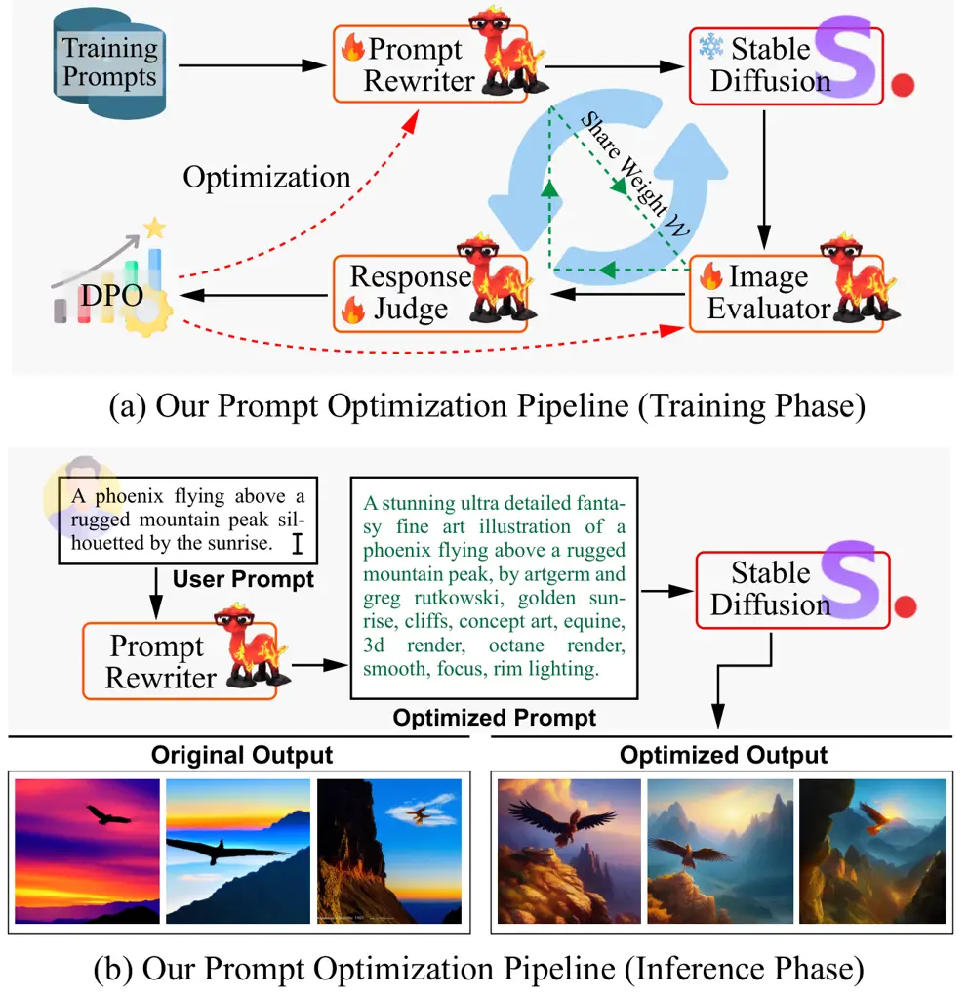
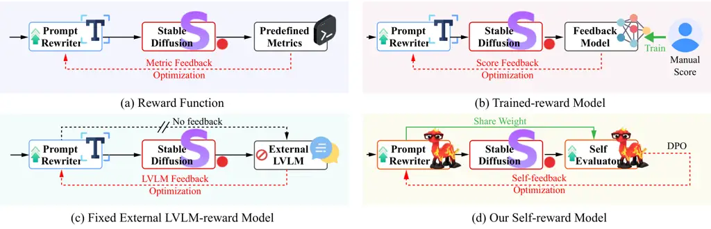
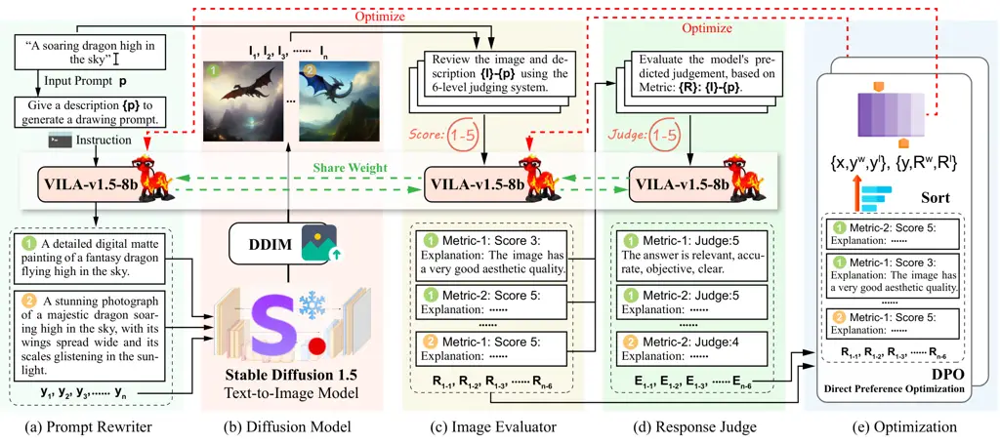
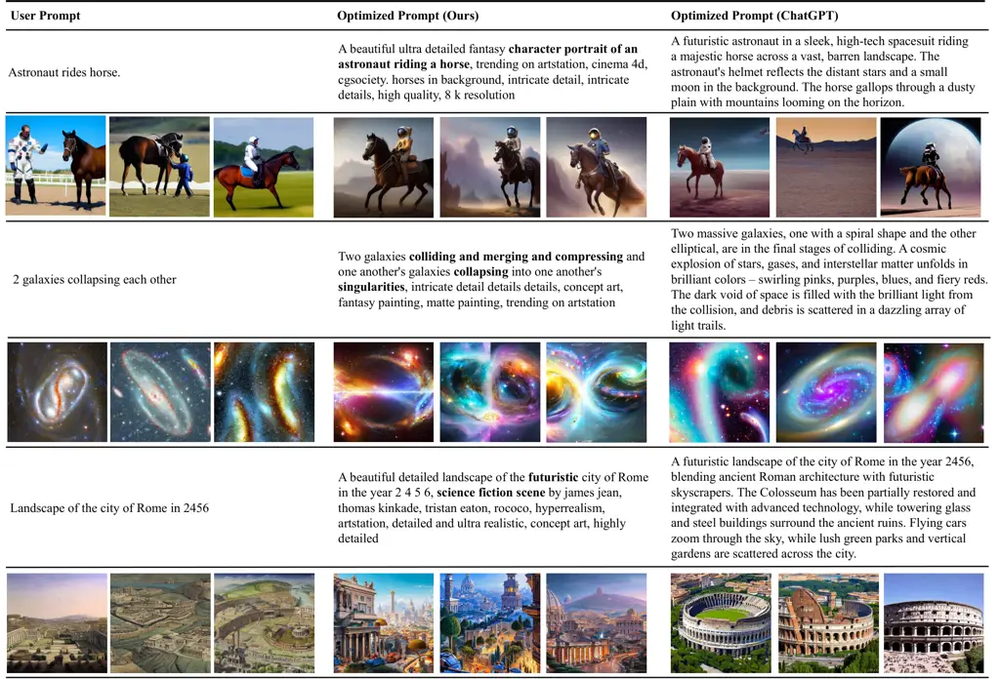
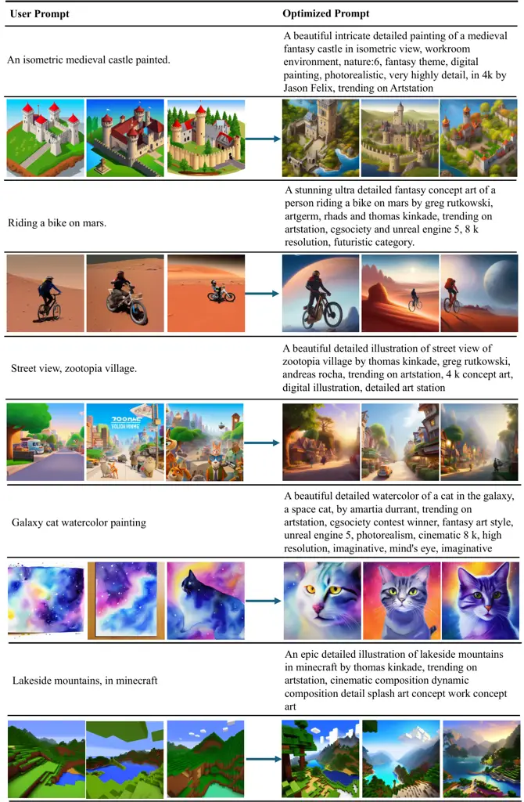

# Self-Rewarding Large Vision-Language Models for Optimizing Prompts in Text-to-Image Generation

Hongji Yang    Yucheng Zhou    Wencheng Han    Jianbing Shen¹¹ 1
Corresponding author. This work was supported by the Science and
Technology Development Fund of Macau SAR (FDCT) under grants
0102/2023/RIA2 and 0154/2022/A3 and 001/2024/SKL and CG2025-IOTSC, the
National Natural Science Foundation of China (No. 624B2002), and the
Jiangyin Hi-tech Industrial DevelopmentZone under the Taihu Innovation
Scheme (EF2025-00003-SKL-IOTSC). Affiliation: SKL-IOTSC, CIS, University
of Macau Affiliation: yc47942@um.edu.mo, yucheng.zhou@connect.um.edu.mo,
wencheng256@gmail.com

###### Abstract

Text-to-image models are powerful for producing high-quality images
based on given text prompts, but crafting these prompts often requires
specialized vocabulary. To address this, existing methods train
rewriting models with supervision from large amounts of manually
annotated data and trained aesthetic assessment models. To alleviate the
dependence on data scale for model training and the biases introduced by
trained models, we propose a novel prompt optimization framework,
designed to rephrase a simple user prompt into a sophisticated prompt to
a text-to-image model. Specifically, we employ the large vision language
models (LVLMs) as the solver to rewrite the user prompt, and
concurrently, employ LVLMs as a reward model to score the aesthetics and
alignment of the images generated by the optimized prompt. Instead of
laborious human feedback, we exploit the prior knowledge of the LVLM to
provide rewards, i.e., AI feedback. Simultaneously, the solver and the
reward model are unified into one model and iterated in reinforcement
learning to achieve self-improvement by giving a solution and judging
itself. Results on two popular datasets demonstrate that our method
outperforms other strong competitors.

## 1 Introduction



Figure 1: The motivation of our prompt optimization pipeline. When
training, the large model continuously improves prompt rewriting and
image quality evaluation capabilities through self-play without any
external sources or models. The generated images from the user prompts
and the rewritten prompts. It can be observed that the image from the
modified prompt has higher aesthetics.

Text-to-image models Rombach et al. (2022); Saharia et al. (2022); Yu
et al. (2022) can generate diverse high-quality images based on
user-provided prompts. However, effective interaction with these models
requires users to possess specific expertise, including familiarity with
specialized vocabularies, e.g., “35mm” for camera parameters and “art by
Greg Rutkowski” to invoke a particular artistic style. As shown in
Figure 1, rewriting prompts according to model-specific knowledge
significantly improves the quality of the generated images.

To bridge the gap between laymen and experts in using text-to-image
models, some methods Liu and Chilton (2022); Datta et al. (2023);
Oppenlaender (2023) employ large-scale human-annotated datasets to train
rewriting models that produce more professional and effective prompts.
However, these approaches are prohibitively expensive. To reduce
reliance on high-quality human annotations, some efforts Hao et al.
(2024); Rosenman et al. (2023); Cao et al. (2023) leverage specific
calculated metrics, i.e., aesthetics and alignment, which are then
regarded as rewarding for reinforcement learning (RL). However,
collecting high-quality human-annotated datasets for reward model
training is both time-consuming and costly. Large Vision-Language Models
(LVLMs) have recently shown remarkable vision reasoning capabilities.
Consequently, some studies Li et al. (2022); Liu et al. (2024); Chen
et al. (2024a); Yang et al. (2023); Yu et al. (2023) employ LVLMs as
evaluators to assess human preferences. These methods effectively
deliver interpretable AI feedback, offering a more efficient alternative
to the time-consuming and labor-intensive human feedback Yuan et al.
(2024a).

Besides, previous prompt optimization methods using RL suffer from two
limitations: (1) They require extensive training data to train an image
reward model; (2) The reward model remains fixed during the proxy model
training, preventing it from learning and improving alongside the proxy
model. This limitation results in a lack of dynamic feedback throughout
the training process. To mitigate the data limitation and explore
dynamic feedback, Yuan et al. (2024b) introduce a self-rewarding
training strategy, enabling the model to train effectively with limited
data while approximating the upper performance bound. It fosters
self-improvement or self-play Chen et al. (2024b), wherein the solver
generates its judgments or rewards by a continuous iterative DPO Xu
et al. (2023).

In this study, we introduce a self-rewarding prompt optimization
framework for text-to-image models. This framework leverages an LVLM
which functions both as a solver and an evaluator. The training pipeline
is structured into five key components: model initialization, prompt
generation, image generation, LVLM rewarding, and RL training. The
pipeline is as follows: (1) Model initialization: we train the LVLM for
prompt optimization on human-annotated prompt rewriting pairs and
limited evaluation data, encapsulating LVLM’s basic capability to
rewrite prompts and assess the preference of generated images. (2)
Prompt Generation: we employ a large version of LVLM to generate
responses for a combination of an existing image quality evaluation
dataset with the image evaluation prompt we used. (3) Image Generation:
the model rewrites the raw prompt according to the instruction and
samples multiple results, i.e., “candidates”, and a fixed text-to-image
model is used to generate the corresponding image. (4) LVLM Rewarding:
the LVLM is employed to evaluate the aesthetics and alignment of the
image with the original prompt, and is utilized as a rating system to
score the images due to endowing with the capability to assess
preferences. (5) RL Training: we select the highest and lowest-scored
candidates to form preference pairs, which are used to train the model
and adjust its output preferences by DPO training. To further enhance
the model’s ability to judge image quality, we also make the model
itself act as a judge on the model’s responses to image aesthetics or
alignment to pick the most and least confident responses to construct
preference pairs.

The main contributions are summarized below:

- •
  We provide an AI-feedback approach to achieve aesthetic and alignment
  understanding of images using an LVLM. This approach effectively
  transforms the LVLM into a reward model to facilitate prompt
  optimization.
- •
  We introduce self-rewarding training into prompt optimizing for the
  first time, which obtained prompts with higher quality by iterating
  the model on a small amount of training data, alleviating the
  shortcomings of models that require larger and higher quality data for
  reinforcement learning training.
- •
  In the experiments, we compare our method and other strong competitors
  on two popular text-to-image datasets, i.e., beautiful-prompt and
  DiffusionDB. Results show our method achieves state-of-the-art
  performance.

## 2 Background

### 2.1 Prompt Rewriting

The purpose of the prompt rewriting is to unlock the maximum potential
of text-to-image models. Given an original user prompt x, the prompt
rewrite models with weight $`\theta`$ can produce more professional
prompts y to help text-to-image models achieve images with more
aesthetic pleasure and relevance. The process can be expressed as
follows:

```math
\displaystyle\textbf{y}=p(y|\textbf{x};\theta) \tag{1}
```



Figure 2: Four types of framework in prompt optimizing. The main
difference among them is the reward generation. (a) The reward function
(or Metrics) is pre-defined for reinforcement learning, which typically
involves mathematical equations for text or images, such as work Hao
et al. (2024). (b) A feedback model is trained using a large annotated
dataset (typical manual score) and then is employed for RL, like PPO,
which is employed in Cao et al. (2023); Rosenman et al. (2023). (c)
Rewards are generated through a fixed external LVLM. The upper bound of
evaluation depends on external models. (d) Rewriter and Reward Model
share the same weight, achieving self-improvement by an iterative method
to generating answers and self-judgment.

### 2.2 Self-Rewarding Learning

Self-Rewarding Learning uses the same model to perform iterative
training to realize self-improvement. Given a sequence pair $`(x,y)`$,
reinforcement learning fine-tuning demands the definition of the reward
function $`\textbf{r}(\textbf{x},\textbf{y})`$ to quantify the value of
the response y to the given input x. The objective of the RL fine-tuning
can be defined as:

```math
\displaystyle\mathcal{L}_{RL}(\theta) \displaystyle=\mathbb{E}_{\textbf{x}\sim q(\cdot),\textbf{y}\sim p_{\theta}(\cdot|\textbf{x})}[r(\textbf{x},\textbf{y})] \tag{2}
```

```math
\displaystyle-\lambda\mathbb{E}_{\textbf{x}\sim q(\cdot)}{\rm KL}(p_{\theta}(\cdot|\textbf{x})||p_{ref}(\cdot|\textbf{x}))
```

where the KL regularization enforces the policy model $`p_{\theta}`$ to
be close to the reference model $`p_{ref}`$, and $`\lambda`$ is set to
control the deviation between policy model $`p_{\theta}`$ and the
reference model $`p_{ref}`$.

Assuming a pair of responses $`<\textbf{y}^{1},\textbf{y}^{2}>`$, with a
human annotator labeling one of them to be more aligned with human
preferences, denoted as $`\textbf{y}^{w}\succ\textbf{y}^{l}|x`$. the
Bradley-Terry (BT) Brown et al. (2020) model stipulates that the human
preference distribution $`p^{*}`$ can be written as follows:

```math
\!\!p^{*}(\textbf{y}^{1}\!\succ\!\textbf{y}^{2}|\textbf{x})\!=\!\frac{{\rm exp}(r(\textbf{x},\textbf{y}^{1}))}{{\rm exp}(r(\textbf{x},\textbf{y}^{1}))\!+\!{\rm exp}(r(\textbf{x},\textbf{y}^{2}))}\! \tag{3}
```

In self-rewarding training, the same LVLM is used to produce reward
$`\textbf{r}=[r_{1},r_{2},...,r_{l}]`$, so the conditional probability
distribution $`p_{\theta}(r|(\textbf{x},\textbf{y}))`$ can be expressed
as follows:

```math
p_{\theta}(\textbf{r}|(\textbf{x},\textbf{y}))=\prod_{k=1}^{l}{(r_{k}|(\textbf{x},\textbf{y}),\textbf{r}_{<k})} \tag{4}
```

where $`\textbf{r}_{<1}`$ is usually null or a start token and
$`\textbf{r}_{<k}=[r_{1},r_{2},..,r_{l-1}]`$, $`k\in\{2,...,l\}`$.

### 2.3 Related Work



Figure 3: The overall framework in our prompt optimizing framework. It
involves five steps, arranged from left to right, (a) Prompt Rewriter
sample multiple candidates y, (b) Diffusion Model generates images from
the candidates, (c) Image Evaluator act as image evaluate models, to
generate image evaluate responses R, (d) Response Judge act as judge
models to judge the response from evaluator and get response evaluation
E, and (e) Optimization with the response from evaluator and judge, and
then update the LVLM.

Prompt Engineering. Hao et al. (2024) propose a prompt adaption
framework for prompt engineering. To implement reinforcement learning
fine-tuning, a reward function for image aesthetics and alignment is
defined. Bestprompt Pavlichenko and Ustalov (2023) is proposed to detect
keywords by genetic algorithm and then form prompts to obtain the better
aesthetics of images. Beautiful-Prompt Cao et al. (2023) first trains
two reward models: Aesthetics and PickScore with a large dataset and
then optimizes the language model using PPO. NeuroPrompt Rosenman et al.
(2023) utilizes constrained text decoding with a pre-trained language
model to produce prompts. Datta et al. (2023) is proposed as a Prompt
Expansion framework to improve the diversity in text-to-image
generation. Inspired by visual language modeling, recently, more and
more methods Li et al. (2022); Liu et al. (2024); Chen et al. (2024a);
Yang et al. (2023); Yu et al. (2023) attempt to use a prior knowledge of
LVLM to analyze images. The vision-language model is a large multimodal
model, which bridges the gap between language and images. CLIP Radford
et al. (2021) is trained with large-scale paired text and images using
contrastive learning. In this way, the pre-trained LVLMs capture rich
vision-language correspondence knowledge. ALIGN Jia et al. (2021) scales
up the training process, using the larger images-text pairs but noisy
data. Recently, with the great success of Large Language Models (LLMs),
some work has been devoted to enabling LLMs to use image inputs.
OpenFlamingo Awadalla et al. (2023) and LLaMA-Adapter Zhang et al.
(2023) construct multimodal models based on the best LLM LlaMA Touvron
et al. (2023). To further improve the model’s instruction-following
abilities, LlaVA Liu et al. (2024) employs visual instruction tuning
that yields promising results. ViLA Lin et al. (2024) achieves
multi-image reasoning through a better training strategy.

Text-to-Image generation. Text-to-image models usually refer to the
generative model which synthesizes an image from a given text. Earlier
work, GAN Reed et al. (2016); Tao et al. (2022) and VAE Ramesh et al.
(2021); Ding et al. (2021) have been extensively studied in this field.
Recently, the diffusion-based models Rombach et al. (2022); Gu et al.
(2022) further improve the quality of text-to-image generation. Given
the generated output is no longer a serious concern, exploring how to
optimize the prompt to maximize the potential of generative models
becomes the primary object of our research. Several works Hao et al.
(2024); Cao et al. (2023) have been put into unlocking the maximum
potential of text-to-image models by optimizing prompts using large
language models. Besides, some reinforcement learning-based methods have
gained consistent improvements in changing the output preferences of
large language models. Reinforcement Learning from Human Feedback (RLHF)
Yuan et al. (2024a) yields promising results in various NLP tasks
Christiano et al. (2017); Ibarz et al. (2018); Stiennon et al. (2020);
Jaques et al. (2019), at the cost of collecting large amounts of human
feedback. Proximal Policy Optimization (PPO) Schulman et al. (2017) is
optimized according to the reward signal rather than human feedback and
remains stable by approximating the old and new strategies. With these
challenges in mind, Direct Preference Optimization (DPO) Rafailov et al.
(2024) avoids the drawback of large amounts of human-annotated data to
train reward models by using its language model as a reward model. The
different strategies to provide rewards are shown in Figure 2.

## 3 Methodology

In this section, we first describe the pipeline of dataset construction
(Section 3.1), and how to initialize LVLM with both prompt optimization
and preference assessing capabilities (Section 3.2) and then detail
self-rewarding training algorithms (Section 3.3). Next, we introduce the
use of AI feedback for RL in self-rewarding training (Section 3.4) and
how to transform LVLM into a reward model by LVLM-as-a-judge
(Section 3.5).

### 3.1 Dataset Construction Pipeline

Prompt rewrite data. To equip the LVLM with initial rewriting
capabilities, rewrite prompts data is first given to train in the
supervised fine-tuning (SFT) manner. This type of data is presented in
pairs, i.e., {raw prompt, rewritten prompt}, to guide the LVLM to
rewrite prompt. Prompt rewrite data contains 104,487 prompt pairs in Cao
et al. (2023).

Evaluation data. The LVLM specializes in image understanding and
analyzing Zhu et al. (2024); Li et al. (2022). However, image aesthetics
is still a subjective understanding and not easy for models. Although
unnecessary, LVLM appears more difficult to score images and construct
preference pairs without fine-tuning on evaluation data Yuan et al.
(2024b). Therefore, evaluation data is constructed to offer the model
some examples to understand the aesthetics. The prompt data in the
previous paragraph is used to generate images by diffusion model Rombach
et al. (2022). These images are then scored using the prompt template in
the LVLM-as-a-judge way Zheng et al. (2024); Chen et al. (2024a). We use
a subset of the aesthetics training set and the Pickapic-v1 training
set. The paired images and evaluation prompt are both fed into VILA-40B
as well as the facts to obtain the response as truth response for
training. We add a truth cue to the evaluation prompt, if the VILA-40B’s
scoring of the two images is consistent with the facts, the evaluation
response is retained.

Judgment data. To improve the LVLM’s evaluation capabilities for
responses Zheng et al. (2024); Zhu et al. (2023), we also create a
dataset for the model to understand which responses to aesthetics or
alignment are more reasonable. Specifically, we construct data that
assign higher scores to reasonable responses and lower scores to
irrelevant responses, which is some kind of confidence. To improve the
evaluation ability of LVLM, we create a new dataset to evaluate the
model’s responses to aesthetics and PickScore of the images. Similarly,
we feed the standard (i.e., VILA-40B’s response) and irrelevant answers
into VILA-40B, and if the model has a higher score in the standard
answer than in the irrelevant answer, the answer remains in the dataset.
A common observation is that most images generated from rewritten
prompts are typically assigned scores of 3 or 4. Therefore, we also
include some raw prompts to maintain a more uniform score distribution.

### 3.2 Initialization LVLM Capability of Rewriting and Assessing Preference

After we obtain the initial dataset, supervised fine-tuning (SFT) is
employed to initiate the model with the ability of image evaluation and
response judgment. Therefore, we consider the input x for a specific
task to be derived from the distribution $`q(\cdot)`$. Meanwhile, the
probability distribution in the SFT training data can be represented as
$`p_{data}(\cdot|\textbf{x})`$. The object function of SFT can be
represented as:

```math
\mathcal{L}_{SFT}(\theta)=-\mathbb{E}_{\textbf{x}\sim q(\cdot),\textbf{y}\sim p_{data}(\cdot|\textbf{x})}[{\rm log}p_{\theta}(\textbf{y}|\textbf{x})] \tag{5}
```

Since the SFT training data has high-quality labeled responses y, the
main purpose of this object function is to approximate the model’s
predictive distribution $`p_{\theta}(\textbf{y}|\textbf{x})`$ to the
target $`p_{data}(\textbf{y}|\textbf{x})`$.

### 3.3 Training with Self-Rewarding

The main objective of the self-rewarding model is to complete iterative
training with limited amounts of human-labeled data on the pre-trained
model. During an iteration, the model generates a solution and a
judgment on this solution. Unlike other methods that use a fixed reward
model Ouyang et al. (2022), the self-rewarding model uses the model of
the current iteration to generate the rewards. Therefore, the model can
both improve its generative capabilities when acting as a generative
model and get its boost when acting as a rewarding model, since the
corresponding responses are generated by the same mechanism Yuan et al.
(2024b).

The whole training process is concluded as follows: the model first
starts with pre-trained LVLMs (denoted as $`\VLM_{init}`$), training
with prompt rewrite data and evaluation data in SFT manner, resulting in
$`\VLM_{SFT}`$. To further enhance the model’s performance, we sample
multiple candidates from the raw prompt and construct preference pairs
based on the LVLM scores, and then the model is trained in the DPO
manner. This training process is iterated M times, yielding models
denoted as
$`\{\VLM_{\DPO_{1}},\VLM_{\DPO_{2}},\cdots,\VLM_{\DPO_{M}}\}`$. The
bottleneck of prompt engineering can be summarized into two aspects: 1)
it is difficult to align with human preference and thus a large number
of human-labeled data is required; 2) the whole training process is too
complex, typically requiring a larger trained reward model. Therefore,
we propose a self-rewarding prompt rewriting model to obtain better
performance through AI self-feedback and an evolving training process.
The overall framework is shown in Fig. 3. First, the model acts as a
solver sampling multiple candidate answers from raw prompts. These
candidates are then fed into a fixed text-to-image model to generate the
corresponding images. Again, the previous solver is used as the reward
model to generate responses, for scoring these images generated from
candidates. The details of scoring are discussed below. Finally,
preference pairs are constructed for model DPO training.

#### 3.3.1 Training on Rewriting

We consider an LVLM to be parameterized by $`\theta`$ and denoted by
$`p_{\theta}`$. The model takes a prompt as sequence
$`\textbf{x}=[x_{1},x_{2},...,x_{n}]`$ to generate the corresponding
response $`\textbf{y}=[y_{1},y_{2},...,y_{m}]`$. The response y is thus
regarded as a sample from the conditional probability distribution
$`p_{\theta}(\cdot|\textbf{x})`$. Specifically, $`x_{i}`$ and $`y_{j}`$
represent the tokens from the same predetermined vocabulary within the
sequences x and y, respectively. To generate the $`y_{j}`$ for a given
position, the auto-regressive model $`p_{\theta}`$ exploits the
previously generated tokens to generate subsequent tokens up to the
maximum length or the end token. Therefore, the conditional probability
distribution $`p_{\theta}(\textbf{y}|\textbf{x})`$ can be expressed as:

```math
p_{\theta}(\textbf{y}|\textbf{x})=\prod_{j=1}^{m}{(y_{j}|\textbf{x},\textbf{y}_{<j})} \tag{6}
```

where $`\textbf{y}_{<1}`$ is usually null or a start token and
$`\textbf{y}_{<j}=[y_{1},y_{2},..,y_{j-1}]`$, $`j\in\{2,...,m\}`$.

#### 3.3.2 Training on Preference Assessing

Beyond the model training on prompt rewriting, we also perform
preference assessing training on the same model to improve its assessing
ability. Similar to Sec. 3.3.1, the model generates the judgment on the
response R for a response y on prompt and the generated image. The
conditional probability distribution can be defined as:

```math
p_{\theta}(\textbf{R}|\textbf{y})=\prod_{k=1}^{n}{(R_{j}|\textbf{y},\textbf{R}_{<k})} \tag{7}
```

where $`\textbf{y}_{<1}`$ is usually null or a start token and
$`\textbf{R}_{<k}=[R_{1},R_{2},..,R_{k-1}]`$, $`j\in\{2,...,n\}`$.

Therefore, RL fine-tuning in self-rewarding can be optimized with the
loss function, i.e.,

```math
\displaystyle\mathcal{L}_{RL}(\theta_{t+1}) \displaystyle=\mathbb{E}_{\textbf{x}\sim q(\cdot),\textbf{y}\sim p_{\theta_{t}},\textbf{r}\sim p_{\theta_{t}}(\cdot|\textbf{(x,y)})}[r(\textbf{x},\textbf{y})]
```

```math
\displaystyle-\lambda\mathbb{E}_{\textbf{x}\sim q(\cdot)}{\rm KL}(p_{\theta}(\cdot|\textbf{x})||p_{ref}(\cdot|\textbf{x}))
```

```math
\displaystyle+\mathbb{E}_{\textbf{y}\sim q(\cdot),\textbf{R}\sim p_{\theta_{t}},\textbf{E}\sim p_{\theta_{t}}(\cdot|\textbf{(y,R)})}[E(\textbf{y},\textbf{R})]
```

```math
\displaystyle-\lambda\mathbb{E}_{\textbf{y}\sim q(\cdot)}{\rm KL}(p_{\theta}(\cdot|\textbf{y})||p_{ref} \tag{8}
```

where $`\theta_{t}`$ denotes the $`t`$-th parameters of the model, the
$`r(\textbf{x},\textbf{y})`$ and the $`E(\textbf{y},\textbf{R})`$ denote
the reward function of the prompt $`x`$ and the response $`y`$,
respectively. Since the self-reward model is an iterative model, in
which the iterative process results in a series of models with different
weights of the same structure. For better understanding, the parameter
of the result model by Equation 5 is denoted as $`\theta_{0}`$, while
the parameters of the result models optimized through Equation 8 are
denoted as $`\{\theta_{1},\theta_{2},\cdots\}`$. As the model’s
parameters continue to be optimized for the ability to follow
instructions, so does the reward ability, thereby facilitating
self-improvement.

### 3.4 RL from AI Feedback

AI Feedback. One of the main investigations of our work is how to use
prior knowledge of large models to guide text-to-image models. Unlike
time-consuming and labour-intensive human feedback training, AI feedback
Lee et al. (2023) training can provide reward signals for a given task
through its own knowledge. This approach usually requires two models,
one acting as a solver of the downstream task, and one acting as a judge
of the solver. It is feasible to apply an external language model as a
judge (or reward model) or to use only itself (i.e. a model that acts as
both a solver and a judge) to achieve self-improvement in a specific
task.

Therefore, preference pairs $`\langle`$ raw prompt $`x`$, winner prompt
$`y^{w}`$, loser prompt $`y^{l}`$ $`\rangle`$ need to be constructed to
train the model. The model first generates different $`N`$ candidates
from randomly selected raw prompts (in the previous data). After
generating images using a fixed text-to-image model, the images and
evaluation prompts are input into the model for scoring. Next, the
prompts corresponding to the highest and lowest-scored images are
treated as winners and losers, respectively. In addition, the image
evaluation responses are judged by LVLM and the pairwise data for DPO
are also constructed. The model is then tuned with DPO Rafailov et al.
(2024).

DPO. Assuming access to a static dataset of comparisons
$`\mathcal{D}=\{\textbf{x}_{i},\textbf{y}^{w}_{i},\textbf{y}^{l}_{i}\}`$,
which is sampled from $`p^{*}`$. The optimal RLHF policy $`\pi^{*}`$
under the Bradley-Terry model satisfies the preference model:

```math
\displaystyle p^{*}(\textbf{y}^{1}\succ\textbf{y}^{2}|\textbf{x})=\Big[1 \displaystyle+\exp\left(\lambda\log\frac{\pi^{*}(\textbf{y}^{2}|\textbf{x})}{\pi_{ref}(\textbf{y}^{2}|\textbf{x})}\right)
```

```math
\displaystyle-\lambda\log\frac{\pi^{*}(\textbf{y}^{1}|\textbf{x})}{\pi_{ref}(\textbf{y}^{1}|\textbf{x})})\Big]^{-1} \tag{9}
```

Given a preference pair $`\langle\textbf{x}`$, $`\textbf{y}^{w}`$,
$`\textbf{y}^{l}\rangle`$, the object function of DPO is to seek a
maximum likelihood of the parameterized policy $`\pi_{\theta}`$ by
reference model $`\pi_{ref}`$.

```math
\displaystyle\mathcal{L}_{DPO}(\pi_{\theta};\pi_{ref})
```

```math
\displaystyle=-\mathbb{E}_{(\textbf{x},\textbf{y}^{w},\textbf{y}^{l})\sim\mathcal{D}}\Big[{\rm log}\sigma\big(\Delta_{\lambda}(\textbf{y}^{w}|\textbf{x})-\Delta_{\lambda}(\textbf{y}^{l}|\textbf{x})\big)\Big],
```

```math
\displaystyle\text{where}~~\Delta_{\lambda}(y|x)=\lambda\log\frac{\pi_{\theta}(y|x)}{\pi_{ref}(y|x)}. \tag{10}
```

The $`\lambda`$ is a parameter controlling the deviation from the base
reference policy $`\pi_{ref}`$.

### 3.5 LVLM-as-a-judge for Aesthetics and Rewarding

To improve the text-to-image models, we consider this from two
perspectives: the aesthetics of the generated image and the capability
to follow instructions, respectively. Hence, to empower the model in
generating appropriate reward signals for the images, we establish a
judging template comprising aesthetic score, pick score and alignment
score. This enables the LVLM to evaluate the generated images
effectively. Details of prompts for LVLM-as-a-judge can be found in
Appendix.

Aesthetic Score. Aesthetics are assessed by prompting the model to
consider aspects such as composition, color, lighting, and visual
appeal. To facilitate judgment-making, we design a grading system that
allows the model to attribute a certain grade to the generated images,
thus obtaining the corresponding score. For each evaluation, the model
is asked to provide both the score and a brief explanation, employing a
chain-of-thought reasoning approach.

PickScore Kirstain et al. (2024). PickScore is an important metric to
measure human preferences. We consider whether the image represents the
given text in a way that is favored by humans. Nonetheless, it is
difficult for the model to understand human preferences directly, so we
included evaluation data (details in Section 3.2) for model
initialization.

Relevance Score. The judgment template for the relevance score uses the
same hierarchical form as the aesthetic score. The key difference is
that it evaluates the model’s attention to the user instructions for
text-to-image generation in three areas: presence of the object,
accurate count of the object, and correct relationships between objects.

## 4 Experiments

### 4.1 Settings

Experiments are conducted on the public text-to-image model Stable
Diffusion v1.5, and the denoising steps are set to 20 to accelerate the
image sampling. The base model we employ in this paper is the smaller
model VILA-v1.5-8b Lin et al. (2024). For SFT, we use AdamW optimizer
($`\beta_{1}=0.9,\beta_{2}=0.95`$), with a batch size of 16 and a weight
decay of 0.1. We use an initial learning rate of 2e-5, with a linear
warm-up and cosine decay schedule. To improve the diversity of the
candidates, we sample $`N=8`$ candidates with temperature
$`T=0.9,p=0.9`$ from one raw prompt. When validating these candidates
with the reward model, we utilize a temperature $`T=0.9,p=0.9`$,
sampling three times and averaging the scores to determine the final
score for further DPO training. The overall score is calculated by
summing up the aesthetics score, pick Score and the relevance score. The
highest one and the lowest one are kept as winners and losers but
discarded if they have the same score. We perform two DPO iterations and
the size of each prompt rewrite training data is 10k and 20k,
respectively. Besides, 10k judgment data is employed to improve image
evaluation. In the stage of DPO, we employ AdamW with an initial
learning rate of 1e-5, 5e-6 without weight decay. The batch size is set
to 32 and $`\beta`$ in DPO is set to 0.1. The model is trained for 4
epochs at each iteration. All experiments are conducted on $`4\times`$
NVIDIA A800 80G GPUs. For evaluation, we adopt beam search Vijayakumar
et al. (2016) with a beam size of 4 and a length penalty of 1.0.

|                                    |                       |           |      |      |
| ---------------------------------- | --------------------- | --------- | ---- | ---- |
| Method                             | $`{\mathbb{D}}_{rl}`$ | PickScore | Aes. | CLIP |
| Original                           | \-                    | 20.74     | 5.50 | 0.27 |
| MagicPrompt Santana (2022)         | \-                    | 20.11     | 5.79 | 0.22 |
| ChatGPT OpenAI (2023)              | \-                    | 20.73     | 5.92 | 0.25 |
| Beautiful-Prompt Cao et al. (2023) | 40k                   | 20.84     | 6.52 | 0.24 |
| Our Method                         |                       |           |      |      |
| $`\VLM_{\SFT}`$                    | \-                    | 20.79     | 5.95 | 0.25 |
| $`\VLM_{\DPO_{1}}`$                | 10k                   | 20.81     | 6.31 | 0.24 |
| $`\VLM_{\DPO_{2}}`$                | 20k                   | 20.86     | 6.59 | 0.24 |

Table 1: Evaluation of the aesthetic score and CLIP score on
Beautiful-Prompt test set. “$`{\mathbb{D}}_{rl}`$” means the size of the
train set we used in reinforcement learning. “Aes.” and “CLIP” mean the
aesthetic and CLIP scores, respectively.

|                                      |       |      |      |
| ------------------------------------ | ----- | ---- | ---- |
| Method                               | Type  | Aes. | CLIP |
| Original$`{\dagger}`$                | Human | 5.47 | 0.28 |
| Human Engineered Prompt$`{\dagger}`$ | Human | 5.87 | 0.26 |
| NeuroPromptsRosenman et al. (2023)   | AI    | 6.27 | \-   |
| PromptistHao et al. (2024)           | AI    | 6.26 | 0.26 |
| $`\VLM_{\DPO_{2}}`$ (Ours)           | AI    | 6.57 | 0.26 |

Table 2: Evaluation of the aesthetic score and CLIP score on
DiffusionDB. Values marked with $`{\dagger}`$ from Hao et al. (2024).

### 4.2 Comparative Methods

We compare our method with the following approaches: MagicPrompt Santana
(2022), ChatGPT OpenAI (2023), Beautiful-Prompt Cao et al. (2023),
NeuroPrompts Rosenman et al. (2023) and Promptist Hao et al. (2024). It
is worth noting that, we prompt ChatGPT OpenAI (2023) to generate an
expansion of the user-provided prompt for generative models. Other
models generate results using their open-source weights. The “Human
Engineered Prompt” refers to the prompts written by humans, while its
simplified version of these prompts is used as the original prompt. In
real-world usage, users only need to provide simple prompt to obtain
high-quality results.

### 4.3 Results

The model is validated on two datasets, Beautiful-Prompt Cao et al.
(2023) and DiffusionDB Wang et al. (2023) (100k), respectively. As shown
in Table 1, our method outperforms other methods. This performance gap
is more evident on larger datasets DiffusionDB (100k). As can be seen in
Table 2, our method achieves a performance gain compared to other
methods. Compared to the most competitive method Beautiful-Prompt, our
method achieves a 0.1 improvement in the Aesthetic Score, while
maintaining no degradation in the PickScore and CLIP score. However, on
the larger DiffusionDB test set, our method achieves a 0.3 improvement
compared to the Neuroprompt Rosenman et al. (2023) and Promptist Hao
et al. (2024).

| Pick | Aes. | Align | Reward | PickScore | Aes. | CLIP |
| ---- | ---- | ----- | ------ | --------- | ---- | ---- |
| ✓    | ✓    | ✓     | Self   | 20.86     | 6.59 | 0.24 |
|      | ✓    | ✓     | Self   | 20.73     | 6.59 | 0.24 |
| ✓    | ✓    |       | Self   | 20.79     | 6.61 | 0.22 |
| ✓    |      | ✓     | Self   | 20.76     | 6.49 | 0.24 |
| ✓    | ✓    | ✓     | Fixed  | 20.73     | 6.26 | 0.24 |

Table 3: Ablation study on different prompts and reward mode. Checkmark
is enabled prompts in image evaluation.

### 4.4 Ablation Study

We perform ablation experiments from two perspectives: how the prompt
affects the LVLM as a reward model and how self-rewarding training
improves the model. First, as can be seen in Table 3, the model without
Pick Prompt for rewarding received a high aesthetic score but leads a
significant drop in PickScore. It also suggests that some shifts exist
between human preferences and image aesthetics. In addition, it can be
observed a reduction of the aesthetic score and CLIP score when missing
the aesthetic prompt or relevance prompt. Second, we compare the
performance between the model using self-rewarding and fixed-rewarding.
Self-rewarding outperforms the fixed-rewarding methods. More discussion
about the self-rewarding method can be found in the Appendix D.

Figure 4: Human evaluation results. The result of $`\VLM_{DPO_{2}}`$ are
more preferred by human compared with the result of User Prompt and
$`\VLM_{SFT}`$.

Figure 5: Generated prompt length (bar graph) and aesthetic score
improvement (line graph) compared with raw prompt.

### 4.5 Human Evaluation

To better compare the existing methods with our model from the human
perspective, a human study is conducted. We randomly select prompts and
obtain the optimized prompt through different models, and then the
images are generated. Then, 20 volunteers are asked to rank the
different images. Each volunteer is presented with two images at a time
and asked to select the one they find more appealing. The volunteers in
this study are randomly selected from a pool of individuals with diverse
educational backgrounds. The result is shown in Figure 4. It can be
observed that the images obtained through the optimized prompt generated
by our model are selected most frequently by the volunteers. And the DPO
model is better than the SFT baseline, which achieves about 55% win
rate.



Figure 6: The generated images with the optimized prompts using our
method

|                  |                  |           |            |
| ---------------- | ---------------- | --------- | ---------- |
| \# Training Data |                  |           |            |
| Stage            | Beautiful-Prompt | Promptist | Ours       |
| SFT              | 143k             | 360k      | 156k       |
| Rewrite          | 143k             | 360k      | 104k       |
| Evaluation       | \-               | \-        | 32k        |
| Judgment         | \-               | \-        | 20k        |
| RM               | 7M               | -         | -          |
| RL               | 40k              | 90k       | 40k        |
| Rewrite          | 40k              | 90k       | {10k, 20k} |
| Evaluation       | \-               | \-        | 10k        |

Table 4: Training set number on different stages of Beautiful-PromptCao
et al. (2023), PromptistHao et al. (2024), and ours. RM means the
training of the reward model. Our method requires addition data on image
evaluation and response judgment for rewarding.

| Method            | $`\VLM_{init}`$ | $`\VLM_{\SFT}`$ | $`\VLM_{\DPO_{1}}`$ |
| ----------------- | --------------- | --------------- | ------------------- |
| Test-Set Accuracy | 48.0%           | 66.1%           | 66.4%               |

Table 5: Evaluation on Pickapic-v1 test set. Our self-rewarding model
realizes the ability to self-improvement

### 4.6 Further Discussion

To further understand how the prompt optimization affects the original
prompt, we show some analysis in Figure 5. Considering the length of
prompts has a significant relationship with the quality of generation,
we count the length of optimized prompts of $`\VLM_{SFT}`$ and
$`\VLM_{DPO_{2}}`$ and their aesthetic score margins compared to the
original prompt. An immediate observation is that the length of most
optimized prompts is between 30 and 40. Besides, aesthetic scores
gradually increased with the length. Besides, we also present the size
of the training set in Table 4. In SFT stage, we use prompt rewrite data
(104k), evaluation data (32k) and judgment data (20k), while in RL
fine-tuning stage, we use prompt data 10k, 20k and new evaluation data
10k sampled from LVLM. Note that we just expanded the dataset after each
iteration, whereas 10k prompt data is the subset of 20k. This means only
20k training data are needed to train this model, while Beautiful-Prompt
and Promptist employ the larger training set, i.e., 40k and 90k,
respectively. To better exemplify the ability of our model to evaluate
by self-rewarding, we show the accuracy of the test set in Pickapic-v1
after SFT and DPO training. As shown in Table 5, our model realizes an
increase in evaluation capacity.

### 4.7 Quantitative Results

We present more visual results in Figure 6, it can be observed that our
method rewrites the main content appropriately, and describes the
detail, e.g., art style, light, etc. The images generated by these
optimized prompts have better aesthetics than the images generated from
the original prompts, which are bland visually. In addition, some
incorrect prompts can also be corrected. For example, the prompt
“Astronaut rides horse" mislead the text-to-image models to generate an
astronaut standing beside a horse. However, our approach rewrites it as
“…an astronaut riding a horse…" to make the image more in line with the
user’s intention. In addition, the model expands some descriptions on
some objects, like “futuristic"" relative to the “in 2456”. More results
are in the Appendix C.

## 5 Conclusion

In this work, we propose a novel method to optimize prompts for
text-to-image models, which can be used to fill the gap between laymen
and experts when using a generative model. We first transform the LVLM
into a reward model so that it can judge the aesthetics and alignment of
the images. In so doing, we can perform AI feedback rather than human
feedback. Then, to gain the performance boost based on limited data, we
employ self-rewarding training for LVLM. Our model achieves
self-improvement through an iterative training approach. Experiments on
two datasets show that our method outperforms the other methods.

## Limitations

The primary limitation of our work is the inability to utilize larger
parameter models due to the significant computational resources
required. Training and fine-tuning models with billions of parameters,
such as VILA-40B, demand substantial GPU memory and processing power,
which are often constrained by available hardware. Deploying
large-parameter models in real-world applications presents considerable
challenges.

## References

- Awadalla et al. (2023) Anas Awadalla, Irena Gao, Josh Gardner, Jack
  Hessel, Yusuf Hanafy, Wanrong Zhu, Kalyani Marathe, Yonatan Bitton,
  Samir Gadre, Shiori Sagawa, et al. 2023. Openflamingo: An open-source
  framework for training large autoregressive vision-language models.
  _arXiv preprint arXiv:2308.01390_.
- Brown et al. (2020) Tom Brown, Benjamin Mann, Nick Ryder, Melanie
  Subbiah, Jared D Kaplan, Prafulla Dhariwal, Arvind Neelakantan, Pranav
  Shyam, Girish Sastry, Amanda Askell, et al. 2020. Language models are
  few-shot learners. _Advances in Neural Information Processing
  Systems_, 33:1877–1901.
- Cao et al. (2023) Tingfeng Cao, Chengyu Wang, Bingyan Liu, Ziheng Wu,
  Jinhui Zhu, and Jun Huang. 2023. Beautifulprompt: Towards automatic
  prompt engineering for text-to-image synthesis. In _Proceedings of the
  2023 Conference on Empirical Methods in Natural Language Processing:
  Industry Track_, pages 1–11.
- Chen et al. (2024a) Dongping Chen, Ruoxi Chen, Shilin Zhang, Yinuo
  Liu, Yaochen Wang, Huichi Zhou, Qihui Zhang, Pan Zhou, Yao Wan, and
  Lichao Sun. 2024a. Mllm-as-a-judge: Assessing multimodal
  llm-as-a-judge with vision-language benchmark. _arXiv preprint
  arXiv:2402.04788_.
- Chen et al. (2024b) Zixiang Chen, Yihe Deng, Huizhuo Yuan, Kaixuan Ji,
  and Quanquan Gu. 2024b. Self-play fine-tuning converts weak language
  models to strong language models. _arXiv preprint arXiv:2401.01335_.
- Christiano et al. (2017) Paul F Christiano, Jan Leike, Tom Brown,
  Miljan Martic, Shane Legg, and Dario Amodei. 2017. Deep reinforcement
  learning from human preferences. _Advances in Neural Information
  Processing Systems_, 30.
- Datta et al. (2023) Siddhartha Datta, Alexander Ku, Deepak
  Ramachandran, and Peter Anderson. 2023. Prompt expansion for adaptive
  text-to-image generation. _arXiv preprint arXiv:2312.16720_.
- Ding et al. (2021) Ming Ding, Zhuoyi Yang, Wenyi Hong, Wendi Zheng,
  Chang Zhou, Da Yin, Junyang Lin, Xu Zou, Zhou Shao, Hongxia Yang,
  et al. 2021. Cogview: Mastering text-to-image generation via
  transformers. _Advances in Neural Information Processing Systems_,
  34:19822–19835.
- Gu et al. (2022) Shuyang Gu, Dong Chen, Jianmin Bao, Fang Wen,
  Bo Zhang, Dongdong Chen, Lu Yuan, and Baining Guo. 2022. Vector
  quantized diffusion model for text-to-image synthesis. In _Proceedings
  of the IEEE/CVF Conference on Computer Vision and Pattern
  Recognition_, pages 10696–10706.
- Hao et al. (2024) Yaru Hao, Zewen Chi, Li Dong, and Furu Wei. 2024.
  Optimizing prompts for text-to-image generation. _Advances in Neural
  Information Processing Systems_, 36.
- Ibarz et al. (2018) Borja Ibarz, Jan Leike, Tobias Pohlen, Geoffrey
  Irving, Shane Legg, and Dario Amodei. 2018. Reward learning from human
  preferences and demonstrations in atari. _Advances in Neural
  Information Processing Systems_, 31.
- Jaques et al. (2019) Natasha Jaques, Asma Ghandeharioun, Judy Hanwen
  Shen, Craig Ferguson, Agata Lapedriza, Noah Jones, Shixiang Gu, and
  Rosalind Picard. 2019. Way off-policy batch deep reinforcement
  learning of implicit human preferences in dialog. _arXiv preprint
  arXiv:1907.00456_.
- Jia et al. (2021) Chao Jia, Yinfei Yang, Ye Xia, Yi-Ting Chen, Zarana
  Parekh, Hieu Pham, Quoc Le, Yun-Hsuan Sung, Zhen Li, and Tom
  Duerig. 2021. Scaling up visual and vision-language representation
  learning with noisy text supervision. In _International Conference on
  Machine Learning_, pages 4904–4916. PMLR.
- Kirstain et al. (2024) Yuval Kirstain, Adam Polyak, Uriel Singer,
  Shahbuland Matiana, Joe Penna, and Omer Levy. 2024. Pick-a-pic: An
  open dataset of user preferences for text-to-image generation.
  _Advances in Neural Information Processing Systems_, 36.
- Lee et al. (2023) Harrison Lee, Samrat Phatale, Hassan Mansoor, Kellie
  Lu, Thomas Mesnard, Colton Bishop, Victor Carbune, and Abhinav
  Rastogi. 2023. Rlaif: Scaling reinforcement learning from human
  feedback with ai feedback. _arXiv preprint arXiv:2309.00267_.
- Li et al. (2022) Feng Li, Hao Zhang, Yi-Fan Zhang, Shilong Liu, Jian
  Guo, Lionel M Ni, PengChuan Zhang, and Lei Zhang. 2022.
  Vision-language intelligence: Tasks, representation learning, and
  large models. _arXiv preprint arXiv:2203.01922_.
- Lin et al. (2024) Ji Lin, Hongxu Yin, Wei Ping, Pavlo Molchanov,
  Mohammad Shoeybi, and Song Han. 2024. Vila: On pre-training for visual
  language models. In _Proceedings of the IEEE/CVF Conference on
  Computer Vision and Pattern Recognition_, pages 26689–26699.
- Liu et al. (2024) Haotian Liu, Chunyuan Li, Qingyang Wu, and Yong Jae
  Lee. 2024. Visual instruction tuning. _Advances in Neural Information
  Processing Systems_, 36.
- Liu and Chilton (2022) Vivian Liu and Lydia B Chilton. 2022. Design
  guidelines for prompt engineering text-to-image generative models. In
  _Proceedings of the 2022 CHI Conference on Human Factors in Computing
  Systems_, pages 1–23.
- OpenAI (2023) OpenAI. 2023. Chatgpt (mar 14 version) \[large language
  model\]. *https://chat.openai.com/chat*.
- Oppenlaender (2023) Jonas Oppenlaender. 2023. A taxonomy of prompt
  modifiers for text-to-image generation. _Behaviour & Information
  Technology_, pages 1–14.
- Ouyang et al. (2022) Long Ouyang, Jeffrey Wu, Xu Jiang, Diogo Almeida,
  Carroll Wainwright, Pamela Mishkin, Chong Zhang, Sandhini Agarwal,
  Katarina Slama, Alex Ray, et al. 2022. Training language models to
  follow instructions with human feedback. _Advances in Neural
  Information Processing Systems_, 35:27730–27744.
- Pavlichenko and Ustalov (2023) Nikita Pavlichenko and Dmitry
  Ustalov. 2023. Best prompts for text-to-image models and how to find
  them. In _Proceedings of the 46th International ACM SIGIR Conference
  on Research and Development in Information Retrieval_, pages
  2067–2071.
- Radford et al. (2021) Alec Radford, Jong Wook Kim, Chris Hallacy,
  Aditya Ramesh, Gabriel Goh, Sandhini Agarwal, Girish Sastry, Amanda
  Askell, Pamela Mishkin, Jack Clark, et al. 2021. Learning transferable
  visual models from natural language supervision. In _International
  Conference on Machine Learning_, pages 8748–8763. PMLR.
- Rafailov et al. (2024) Rafael Rafailov, Archit Sharma, Eric Mitchell,
  Christopher D Manning, Stefano Ermon, and Chelsea Finn. 2024. Direct
  preference optimization: Your language model is secretly a reward
  model. _Advances in Neural Information Processing Systems_, 36.
- Ramesh et al. (2021) Aditya Ramesh, Mikhail Pavlov, Gabriel Goh, Scott
  Gray, Chelsea Voss, Alec Radford, Mark Chen, and Ilya Sutskever. 2021.
  Zero-shot text-to-image generation. In _International Conference on
  Machine Learning_, pages 8821–8831. PMLR.
- Reed et al. (2016) Scott Reed, Zeynep Akata, Xinchen Yan, Lajanugen
  Logeswaran, Bernt Schiele, and Honglak Lee. 2016. Generative
  adversarial text to image synthesis. In _International Conference on
  Machine Learning_, pages 1060–1069. PMLR.
- Rombach et al. (2022) Robin Rombach, Andreas Blattmann, Dominik
  Lorenz, Patrick Esser, and Björn Ommer. 2022. High-resolution image
  synthesis with latent diffusion models. In _Proceedings of the
  IEEE/CVF conference on Computer Vision and Pattern Recognition_, pages
  10684–10695.
- Rosenman et al. (2023) Shachar Rosenman, Vasudev Lal, and Phillip
  Howard. 2023. Neuroprompts: An adaptive framework to optimize prompts
  for text-to-image generation. _arXiv preprint arXiv:2311.12229_.
- Saharia et al. (2022) Chitwan Saharia, William Chan, Saurabh Saxena,
  Lala Li, Jay Whang, Emily L Denton, Kamyar Ghasemipour, Raphael
  Gontijo Lopes, Burcu Karagol Ayan, Tim Salimans, et al. 2022.
  Photorealistic text-to-image diffusion models with deep language
  understanding. _Advances in Neural Information Processing Systems_,
  35:36479–36494.
- Santana (2022) Gustavo Santana. 2022. Magicprompt - stable diffusion.
- Schulman et al. (2017) John Schulman, Filip Wolski, Prafulla Dhariwal,
  Alec Radford, and Oleg Klimov. 2017. Proximal policy optimization
  algorithms. _arXiv preprint arXiv:1707.06347_.
- Stiennon et al. (2020) Nisan Stiennon, Long Ouyang, Jeffrey Wu, Daniel
  Ziegler, Ryan Lowe, Chelsea Voss, Alec Radford, Dario Amodei, and
  Paul F Christiano. 2020. Learning to summarize with human feedback.
  _Advances in Neural Information Processing Systems_, 33:3008–3021.
- Tao et al. (2022) Ming Tao, Hao Tang, Fei Wu, Xiao-Yuan Jing, Bing-Kun
  Bao, and Changsheng Xu. 2022. Df-gan: A simple and effective baseline
  for text-to-image synthesis. In _Proceedings of the IEEE/CVF
  Conference on Computer Vision and Pattern Recognition_, pages
  16515–16525.
- Touvron et al. (2023) Hugo Touvron, Thibaut Lavril, Gautier Izacard,
  Xavier Martinet, Marie-Anne Lachaux, Timothée Lacroix, Baptiste
  Rozière, Naman Goyal, Eric Hambro, Faisal Azhar, et al. 2023. Llama:
  Open and efficient foundation language models. _arXiv preprint
  arXiv:2302.13971_.
- Vijayakumar et al. (2016) Ashwin K Vijayakumar, Michael Cogswell,
  Ramprasath R Selvaraju, Qing Sun, Stefan Lee, David Crandall, and
  Dhruv Batra. 2016. Diverse beam search: Decoding diverse solutions
  from neural sequence models. _arXiv preprint arXiv:1610.02424_.
- Wang et al. (2023) Zijie J Wang, Evan Montoya, David Munechika,
  Haoyang Yang, Benjamin Hoover, and Duen Horng Chau. 2023. Diffusiondb:
  A large-scale prompt gallery dataset for text-to-image generative
  models. In _The 61st Annual Meeting Of The Association For
  Computational Linguistics_.
- Xu et al. (2023) Jing Xu, Andrew Lee, Sainbayar Sukhbaatar, and Jason
  Weston. 2023. Some things are more cringe than others: Preference
  optimization with the pairwise cringe loss. _arXiv preprint
  arXiv:2312.16682_.
- Yang et al. (2023) Zhengyuan Yang, Linjie Li, Kevin Lin, Jianfeng
  Wang, Chung-Ching Lin, Zicheng Liu, and Lijuan Wang. 2023. The dawn of
  lmms: Preliminary explorations with gpt-4v (ision). _arXiv preprint
  arXiv:2309.17421_, 9(1):1.
- Yu et al. (2022) Jiahui Yu, Yuanzhong Xu, Jing Yu Koh, Thang Luong,
  Gunjan Baid, Zirui Wang, Vijay Vasudevan, Alexander Ku, et al. 2022.
  Scaling autoregressive models for content-rich text-to-image
  generation. _arXiv preprint arXiv:2206.10789_, 2(3):5.
- Yu et al. (2023) Weihao Yu, Zhengyuan Yang, Linjie Li, Jianfeng Wang,
  Kevin Lin, Zicheng Liu, Xinchao Wang, and Lijuan Wang. 2023. Mm-vet:
  Evaluating large multimodal models for integrated capabilities. _arXiv
  preprint arXiv:2308.02490_.
- Yuan et al. (2024a) Hongyi Yuan, Zheng Yuan, Chuanqi Tan, Wei Wang,
  Songfang Huang, and Fei Huang. 2024a. Rrhf: Rank responses to align
  language models with human feedback. _Advances in Neural Information
  Processing Systems_, 36.
- Yuan et al. (2024b) Weizhe Yuan, Richard Yuanzhe Pang, Kyunghyun Cho,
  Sainbayar Sukhbaatar, Jing Xu, and Jason Weston. 2024b. Self-rewarding
  language models. _arXiv preprint arXiv:2401.10020_.
- Zhang et al. (2023) Renrui Zhang, Jiaming Han, Chris Liu, Peng Gao,
  Aojun Zhou, Xiangfei Hu, Shilin Yan, Pan Lu, Hongsheng Li, and
  Yu Qiao. 2023. Llama-adapter: Efficient fine-tuning of language models
  with zero-init attention. _arXiv preprint arXiv:2303.16199_.
- Zheng et al. (2024) Lianmin Zheng, Wei-Lin Chiang, Ying Sheng, Siyuan
  Zhuang, Zhanghao Wu, Yonghao Zhuang, Zi Lin, Zhuohan Li, Dacheng Li,
  Eric Xing, et al. 2024. Judging llm-as-a-judge with mt-bench and
  chatbot arena. _Advances in Neural Information Processing
  Systems_, 36.
- Zhu et al. (2024) Deyao Zhu, Jun Chen, Xiaoqian Shen, Xiang Li, and
  Mohamed Elhoseiny. 2024. [MiniGPT-4: Enhancing vision-language
  understanding with advanced large language
  models](https://openreview.net/forum?id=1tZbq88f27). In _International
  Conference on Learning Representations_.
- Zhu et al. (2023) Lianghui Zhu, Xinggang Wang, and Xinlong Wang. 2023.
  Judgelm: Fine-tuned large language models are scalable judges. _arXiv
  preprint arXiv:2310.17631_.

## Appendix A Comparisons with the common tags

To figure out what word improves the prompt, we count the most frequent
words. Evidently, “fantasy” and “intricate” are popular in the model,
which even appears more than once in the same sentence.

To demonstrate that the performance improvement of the prompt rewriting
method is not the result of adding some fixed words, we select the most
frequent words and randomly combine them into six tags. Then, we combine
it with the original prompt and calculated the scores. The tags are
shown in Tab. 7 and the results are present in Tab. 8.

|                 |           |
| --------------- | --------- |
| Content         | Frequency |
| fantasy         | 2,291     |
| intricate       | 2,146     |
| portrait        | 1,604     |
| beautiful       | 1,211     |
| highly detailed | 701       |
| realistic       | 596       |
| high quality    | 389       |
| elegant         | 381       |
| illustration    | 121       |

Table 6: Analysis of the most frequent words in the optimized prompts in
the beautiful-prompt test set.

| Tag | Content                                 |
| --- | --------------------------------------- |
| 1   | artstation, highly detailed, elegant    |
| 2   | 8k, trending on artstation, concept art |
| 3   | digital painting, intricate, fantasy    |
| 4   | illustration, smooth, fantasy           |
| 5   | portrait, beautiful, illustration       |
| 6   | realistic, dramatic, high quality       |

Table 7: Combinations of common tags

| Metric     | Tag1  | Tag2  | Tag3  | Tag4  | Tag5  | Tag6  | Ours  |
| ---------- | ----- | ----- | ----- | ----- | ----- | ----- | ----- |
| PickScore  | 20.81 | 20.73 | 20.68 | 20.59 | 20.69 | 20.82 | 20.86 |
| Aes. Score | 5.80  | 5.75  | 5.92  | 5.67  | 5.75  | 5.59  | 6.59  |

Table 8: The result using different groups of common tags.

## Appendix B Further Discussion

An essential mechanism in self-rewarding model is sampling multiple
outputs and then judging them to construct preference pairs for RL
fine-tuning. Thus, the diversity of candidates greatly affects the
performance of self-rewarding, which can be demonstrated from Tab. 9. It
is essential to enlarge the margin between winners and losers with more
candidates, which facilitates RL fine-tuning.

| Method              | Reward          | \#Candidates | PickScore | Aesthetic | CLIP |
| ------------------- | --------------- | ------------ | --------- | --------- | ---- |
| $`\VLM_{\SFT}`$     | \-              | \-           | 20.79     | 5.95      | 0.25 |
| $`\VLM_{\DPO_{1}}`$ | $`\VLM_{\SFT}`$ | 2            | 20.65     | 6.03      | 0.23 |
| $`\VLM_{\DPO_{1}}`$ | $`\VLM_{\SFT}`$ | 4            | 20.78     | 6.16      | 0.23 |
| $`\VLM_{\DPO_{1}}`$ | $`\VLM_{\SFT}`$ | 8            | 20.81     | 6.31      | 0.24 |

Table 9: Number of candidates

In addition, the self-reward model is at risk of bias or overfitting.
There are many factors that may contribute to model collapse, including
data quality and scale, the inherent capabilities of the language model,
biases in the generative model, and the number of candidate samples. To
demonstrate the effectiveness of our iterative training, we show the
results of one more round of training. We used an additional 5,000 data
for one more training. As shown in Tab. 10, the third iteration does not
cause a significant performance drop.

| Method              | PickScore | Aes. | CLIP |
| ------------------- | --------- | ---- | ---- |
| $`\VLM_{\SFT}`$     | 20.79     | 5.95 | 0.25 |
| $`\VLM_{\DPO_{1}}`$ | 20.81     | 6.31 | 0.24 |
| $`\VLM_{\DPO_{2}}`$ | 20.86     | 6.59 | 0.24 |
| $`\VLM_{\DPO_{3}}`$ | 20.86     | 6.60 | 0.24 |

Table 10: More iteration training.

## Appendix C More Quantitative Results

We present more visual results between the images generated with
different prompts. As shown in Fig. 7, the optimized prompts result in
more pleasing images. A more intuitive observation is that the flat,
uninteresting view in Minecraft and the more aesthetically pleasing,
more detailed view are represented by the optimized prompt before and
after optimization, respectively. In addition, the modified prompt has
stronger alignment capabilities. For example, the prompt “Riding a bike
on mars” is amended to “… a person riding a bike on mars …”, and the
prompt “Galaxy cat” is added with the description “… a space cat …”.



Figure 7: The images generated using our optimized prompt.

## Appendix D Prompts for LVLM-as-a-judge

We present the prompt to transform the LVLM into the reward model. As
mentioned in Sec. 3.5, we employ the rating system for image aesthetics,
human preferences, and alignment. Note that we input the generated image
by original prompt and the image by candidate prompt here to facilitate
scoring of the model on the same benchmarks.

For responses judgment, we input two responses to the model that are
about how the model evaluated the image in the previous step.


Figure 8: LVLM-as-a-judge prompt in our model, which enables the model
to provide the aesthetic score, pick score and alignment score for each
candidate. All scores are based on the rating system, where inputs are
assigned scores corresponding to their ratings. The model is fine-tuned
in advance with evaluation data to understand the aesthetics of images.
