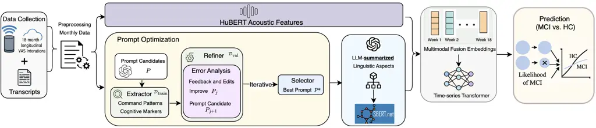
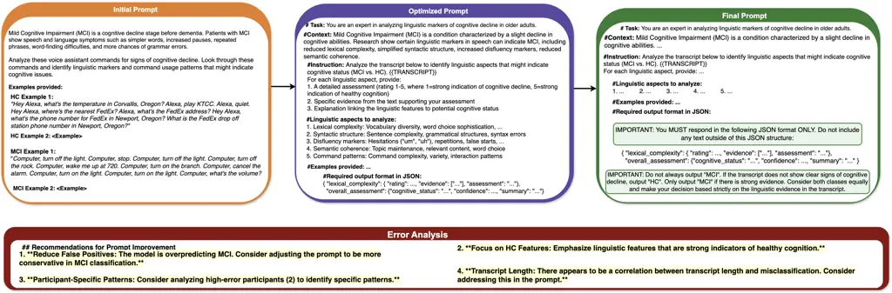

# Cog-TiPRO: Iterative Prompt Refinement with LLMs to Detect Cognitive Decline via Longitudinal Voice Assistant Commands

Kristin Qi¹, Youxiang Zhu¹, Caroline Summerour², John A. Batsis²,
Xiaohui Liang¹ Affiliation:  Affiliation: ¹Computer Science, University
of Massachusetts, Boston, MA, USA Affiliation: ²School of Medicine,
University of North Carolina, Chapel Hill, NC, USA

###### Abstract

Early detection of cognitive decline is crucial for enabling
interventions that can slow neurodegenerative disease progression.
Traditional diagnostic approaches rely on labor-intensive clinical
assessments, which are impractical for frequent monitoring. Our pilot
study investigates voice assistant systems (VAS) as non-invasive tools
for detecting cognitive decline through longitudinal analysis of speech
patterns in short and unstructured voice commands. Over an 18-month
period, we collected voice commands from 35 older adults, with 15
participants providing daily at-home VAS interactions. To address the
challenges of analyzing these short, unstructured and noisy commands, we
propose Cog-TiPRO, a framework that combines (1) LLM-driven iterative
prompt refinement for linguistic feature extraction, (2) HuBERT-based
acoustic feature extraction, and (3) transformer-based temporal
modeling. Using iTransformer, our approach achieves 73.80% accuracy and
72.67% F1-score in detecting MCI, outperforming its baseline by 27.13%.
Through our LLM approach, we identify linguistic features that uniquely
characterize everyday command usage patterns in individuals experiencing
cognitive decline.

###### Index Terms: 

Cognitive decline detection, LLMs, time-series

## I Introduction

Mild Cognitive Impairment (MCI), a precursor to dementia, is
characterized by subtle declines in cognitive functions such as
attention, memory, and language. Early detection of these changes
enables timely intervention to mitigate progression to dementia.
However, detection and continuous monitoring of MCI remain challenging
due to the absence of gold standard biomarkers \[1\]. Additionally,
determining whether cognitive changes represent pathological decline
requires complex clinical judgment. Currently, cognitive impairment
often remains undetected until significant progression to dementia has
occurred, leaving patients and families unprepared for managing its
cognitive and functional impacts \[2, 3\].

Traditional diagnostics for MCI rely on clinical assessments, including
neuroimaging, laboratory tests, and standardized neuropsychological
examinations such as the Montreal Cognitive Assessment (MoCA) \[4\].
While effective for diagnosis, these methods have limitations: They
require administration by trained healthcare professionals in clinical
settings, making them labor-intensive and expensive for frequent
monitoring. Since speech impairments such as increased pauses,
word-finding difficulty, vocal tremors, and weaker coherence are among
the earliest symptom markers of cognitive decline \[5, 6, 7\], speech
processing represents a promising approach for non-invasive and
cost-effective MCI detection that could potentially be implemented in
the everyday environment.

Prior research in cognitive monitoring through speech technology has
predominantly utilized structured speech tasks (e.g. picture
descriptions) \[8, 9, 10\], self-reported questionnaires, and controlled
protocol-based interactions \[11\]. Recent studies have shown potential
in analyzing voice interactions with smart speakers \[12\] and phone
conversations \[13\], demonstrating associations with neuropsychological
test scores. However, these approaches may not capture unstructured
free-speech patterns that characterize everyday voice interactions.
Furthermore, existing methods often analyze cross-sectional rather than
longitudinal data, which is crucial for detecting the subtle progression
of cognitive decline.

To address traditional assessment limitations, we leverage Voice
Assistant Systems (VAS) such as Amazon Alexa for passive data collection
and continuous monitoring. VAS devices are increasingly present in homes
and provide advantages to assist older adults through voice-based,
low-cost, and home-accessible features. VAS interactions capture
real-world command usage that potentially provides more observational
data than clinical assessments. Furthermore, VAS enables continuous data
collection through both designed speech tasks and natural voice
interactions during daily activities that allow for the detection of
pattern changes over time.

Analyzing VAS interaction data for cognitive decline detection presents
several challenges. VAS commands are typically short and unstructured,
which are different from the spontaneous speech traditionally used in
cognitive assessments. Daily VAS usage produces diverse speech samples
without clinical standardization, often containing irrelevant
information and noises that complicate analysis. Additionally,
extracting features from everyday, at-home interactions requires
identifying aspects of behavioral patterns relevant to cognitive decline
while maintaining interpretability for healthcare professionals.

To address these challenges, we propose Cog-TiPRO, a framework
combining: (1) large language model (LLM)-driven iterative prompt
refinement for linguistic feature extraction, (2) multimodal fusion of
acoustic and linguistic features, and (3) transformer-based temporal
modeling. Our approach leverages LLMs to summarize linguistic features
from voice commands and identify cognitive decline indicators. The
iterative prompt refinement improves linguistic feature quality relevant
to MCI detection. By integrating multimodal features with temporal
modeling, Cog-TiPRO effectively captures the subtle progression of
cognitive decline through everyday voice interactions. Our
contributations can be summarized as:

- •
  We conducted an 18-month longitudinal study collecting VAS
  interactions for cognitive monitoring through daily voice commands
  from 15 older adults in their homes.
- •
  We propose Cog-TiPRO, a framework combining LLM-driven iterative
  prompt refinement, multimodal fusion, and time-series modeling to
  detect cognitive decline.
- •
  Our iterative prompt optimization effectively identifies interpretable
  linguistic and behavioral features relevant to cognitive decline from
  everyday voice interactions.



Fig. 1: The Cog-TiPRO framework combines (1) iterative prompt refinement
optimization for linguistic feature extraction, (2) multimodal fusion of
acoustic and linguistic features, and (3) transformer-based temporal
modeling to detect cognitive status of MCI vs. HC.

## II Related Works

### II-A Detecting Cognitive Decline of Dementia

Cognitive decline detection research has primarily utilized the
DementiaBank corpus for dementia detection that contains speech
recordings from structured clinical interviews, such as picture
description and fluency tasks \[11\]. These datasets present
limitations: most datasets contain cross-sectional data rather than
longitudinal change tracking. Traditional approaches focus on
identifying paralinguistic and linguistic markers indicative of
dementia, including reduced word choices, increased pauses, reduced
lexical diversity, and syntactic simplification. Recent natural language
processing (NLP) technologies enable automatic extraction of these
features from speech transcripts, with transformer-based models such as
BERT \[14\] demonstrating effectiveness in capturing semantic and
lexical changes associated with dementia. However, these studies apply
to the onset of dementia and Alzheimer’s disease rather than MCI,
presenting challenges in early-stage detection.

### II-B Large Language Model Application in Dementia Detection

LLMs such as GPT models have transformed automatic information
extraction by leveraging their extensive knowledge and in-context
learning capabilities to identify linguistic patterns, even with limited
training data. Recent studies by Chen _et al._ \[15\] and Du _et
al._\[16\] show that LLMs excel at filtering irrelevant information
while focusing on domain-specific knowledge indicative of dementia,
improving classification accuracy and interpretability in dementia
detection.

## III Voice Commands Data Collection

### III-A Data Collection Details

We conducted an 18-month pilot study (2022-2024) with 35 older adults
aged $`\geq 65`$ (16 females, 19 males; 61–80 years old, mean: 72, SD:
5.1) to collect VAS voice interactions for cognitive decline detection.
Participants were recruited through flyers, with informed consent
obtained and procedures approved by the Institutional Review Board (IRB)
to ensure ethical standards. Data collection underwent seven
session-based assessments and daily in-home voice interactions. A subset
of 15 participants (7 females, 8 males; age mean: 74) consented to daily
in-home voice command collection. The remaining 20 participants
contributed only session-based data. We utilized the 15 participants’
in-home longitudinal data in further analysis.

Participants were classified as MCI or HC based on MoCA scores ($`\geq`$
26 for HC, $`<`$ 26 for MCI). In the initial assessment, 8 were MCI and
7 were HC (labels). Ten participants had prior VAS experiences. All
participants had an average MDPQ-16 (Mobile Device Proficiency
Questionnaire) \[17\] score above 4.5/5, indicating that they had
adequate technical proficiency. The study combined two data collection
elements:

#### III-A1 Session-Based Assessments

Participants completed seven quarterly virtual sessions via Zoom. The
initial session focused on setup and training, with subsequent sessions
(1–7) including MoCA scoring, cognitive assessments, and interviews
about VAS usefulness, feedback, and privacy concerns. A research
assistant (RA) administered all activities.

#### III-A2 At-Home Voice Commands

The 15 participants interacted with Alexa daily at home, with recordings
and transcripts stored in Amazon’s secure portal. All other data, such
as consents, interviews, demographics, and MoCA scores, are stored in
the HIPAA-compliant REDCap database. In the initial session, the RA
provided setup training. The RA monitored participants’ device usage and
gave email support when participation significantly decreased. On
average, each participant generated approximately 47 commands weekly.

### III-B Data Preprocessing

We clean the data for both audio recordings and transcripts. For audio,
we remove background noise and resample all files to a 16 kHz mono
channel. For transcripts, we discard error cases, including system
errors (“audio could not be understood”), multiple devices in the user’s
home (“audio was not intended for this device”), and empty commands. To
analyze command semantics, we remove the wake-up phrase “Alexa”. One
participant used three alternatives: “computer”, “echo”, and “ziggy”. We
identify the first words of commands, rank them by frequency, and remove
the top four high-ranked words that are determined to be wake-up
phrases.

## IV Preliminaries

### IV-A Problem Formulation and Notation

We study cognitive status assessment using an in-home longitudinal
dataset containing $`N=15`$ participants, each participant $`i`$ with a
cognitive label $`y^{(i)}\in\{\text{HC},\text{MCI}\}`$ determined by the
clinical MoCA evaluation. Our data comprises voice interactions
collected over $`18`$ months, indexed as $`t\in\{1,2,\ldots,18\}`$. For
each participant $`i`$ at month $`t`$, we collect voice commands
$`A_{t}^{(i)}`$ and their corresponding transcripts $`X_{t}^{(i)}`$,
from which we derive acoustic features
$`\mathbf{v}_{t}^{(i)}\in\mathbb{R}^{d}`$ and linguistic features
$`\mathbf{u}_{t}^{(i)}\in\mathbb{R}^{e}`$. These are concatenated to
form the multimodal representations:

```math
\mathbf{z}_{t}^{(i)}=[\mathbf{v}_{t}^{(i)};\mathbf{u}_{t}^{(i)}]\in\mathbb{R}^{d+e} \tag{1}
```

The complete time-series sequence of multimodal features for participant
$`i`$ is denoted as:

```math
\mathbf{Z}^{(i)}=\{\mathbf{z}_{1}^{(i)},\mathbf{z}_{2}^{(i)},\ldots,\mathbf{z}_{t}^{(i)}\}\in\mathbb{R}^{t\times(d+e)} \tag{2}
```

where each $`\mathbf{z}_{t}^{(i)}\in\mathbb{R}^{d+e}`$ is month $`t`$’s
multimodal features.

### IV-B Cognitive Status Detection

We formulate cognitive status detection as a sequence classification
problem over the temporal progression of voice commands. Given a
participant’s sequential inputs $`\mathbf{Z}^{(i)}`$ up to month $`t`$,
our objective is to predict the participant’s cognitive status at
$`t+1`$ using a time-series model:

```math
\hat{y}^{(i)}_{t+1}=\mathcal{T}_{\Theta}(\mathbf{z}_{1}^{(i)},\mathbf{z}_{2}^{(i)},\ldots,\mathbf{z}_{t}^{(i)}) \tag{3}
```

where $`\mathcal{T}_{\Theta}`$ denotes a transformer-based time-series
model with parameters $`\Theta`$. The core challenge is to capture
patterns in command usage over time that effectively indicate MCI.

## V Method

In this section, we present Cog-TiPRO, which integrates three
components: (1) iterative prompt refinement optimization for enhanced
linguistic feature extraction, (2) multimodal fusion of acoustic and
linguistic features, and (3) transformer-based time-series modeling for
longitudinal analysis. Figure 1 illustrates our proposed framework.
Algorithm 1 describes the full Cog-TiPRO process.

### V-A LLM-Driven Linguistic Aspect and Feature Extraction

To address the challenges of unstructured, short voice commands and
limited training data, we develop an LLM-driven approach that identifies
aspects related to cognitive markers and command usage as linguistic
features. Below, we detail our iteratively optimized prompting strategy
to generate feature summaries, which are then embedded using the
Sentence-BERT (SBERT) all-MiniLM-L6-v2 model \[18\]. This approach
leverages the language understanding and summarization capabilities of
LLMs to identify aspects relevant to cognitive decline from command
usage. The iterative refinement of LLM prompts aims to produce
increasingly discriminative features.

#### V-A1 Initial Prompt Design

Our initial prompt $`P_{\text{init}}`$ consists of three components:

```math
P_{\text{init}}=\{P_{\text{context}},\;P_{\text{instruction}},\;P_{\text{exemplars}}\} \tag{4}
```

- •
  $`P_{\text{context}}`$ provides background information about
  MCI-related cognitive markers, including lexical complexity, syntactic
  structure, disfluency, and semantic patterns.
- •
  $`P_{\text{instruction}}`$ guides LLMs to identify relevant linguistic
  features by leveraging LLMs’ pretrained knowledge base.
- •
  $`P_{\text{exemplars}}`$ includes few-shot examples of command
  transcripts from both cognitive status groups (MCI vs. HC). These
  examples help LLMs’ understanding of command patterns between the two
  groups.

#### V-A2 Iterative Prompt Optimization Details

Our algorithm begins with an initial prompt $`P_{\text{init}}`$ and
performs automatic prompt optimization using a minibatch of training
($`\mathcal{D}_{\text{train}}`$) and validation data
($`\mathcal{D}_{\text{val}}`$) from monthly transcripts. Using a small
and diverse minibatch gives fast and low-cost feedback in short cycles
that can guide effective edits without overfitting \[19\]. The iterative
refinement runs for three iterations, based on evidence that 3–5
iterations can yield effective prompts \[20\]. The optimized prompt
improves the extraction of linguistic features relevant to MCI
detection. Specifically, the process consists of:

Extractor: At each iteration $`j`$, the Extractor identifies cognitive
markers and command usage patterns from minibatch
$`\mathcal{D}_{\text{train}}`$ to generate linguistic features. We use
$`P_{\text{init}}`$ in the first iteration, then $`P_{j}`$ (the
optimized prompt) in subsequent ones to extract additional features.

```math
\mathbf{u}_{t}^{(i)}=\text{LLM}_{\text{Extractor}}(X_{t}^{(i)},P_{j}) \tag{5}
```

where $`X_{t}^{(i)}`$ is the transcript for participant $`i`$ at month
$`t`$.

Refiner: The LLM refines prompts in three steps:

- •
  It uses the extracted linguistic features from the Extractor along
  with prompt $`P_{j}`$ to instruct the LLM to act as a classifier and
  make direct MCI vs. HC predictions, denoted as
  $`\text{LLM}_{\text{Classifier}}`$.
- •
  It evaluates the LLM’s predictions using F1-score on a validation
  minibatch ($`\mathcal{D}_{\text{val}}`$) and performs error analysis
  to identify specific cases where the LLM produces incorrect
  predictions with $`P_{j}`$.
- •
  The LLM provides feedback by analyzing misclassified cases and
  explicitly suggesting edits to create $`P_{j+1}`$ that help avoid
  similar errors.

After these steps, the current prompt $`P_{j}`$ is updated to
$`P_{j+1}`$ to better capture additional linguistic features:

```math
P_{j+1}=\text{LLM}_{\text{Refiner}}\left(P_{j},\text{AnalyzeErrors}(\text{errors}_{j})\right) \tag{6}
```

Selector: After three iterations, we select the best prompt $`P^{*}`$
that achieves the highest F1-score on the validation minibatch for
generating linguistic feature summaries:

```math
P^{*}=\arg\max_{j\in\{1,2,3\}}\mu(\mathcal{D}_{\text{val}}) \tag{7}
```

where $`\mu`$ denotes the F1-score evaluation metric. Optimized prompt
$`P^{*}`$ is used to extract linguistic features and generate summaries
for these features that are then fed into SBERT.

### V-B Multimodal Feature Embeddings

#### V-B1 Speech Feature Embeddings

We employ the pre-trained HuBERT model \[21\] to extract acoustic
feature embeddings from monthly command audio. HuBERT is trained via
self-supervision on large-scale speech corpora to capture speaker
characteristics, including prosody (e.g. pitch, rhythm, pause), spectral
patterns, and articulation relevant to MCI detection. Formally, let
$`H(\cdot)`$ be the HuBERT feature extractor. For each audio command
$`A_{t}^{(i)}`$, we obtain its acoustic embedding:

```math
\mathbf{v}_{t}^{(i)}=H(A_{t}^{(i)}),\ \mathbf{v}_{t}^{(i)}\in\mathbb{R}^{768}. \tag{8}
```

#### V-B2 Linguistic Feature Embeddings

Using the optimized prompt $`P^{*}`$, we obtain LLM-summarized
linguistic features from monthly command transcripts. We use SBERT to
embed these summaries as linguistic feature embeddings:

```math
\mathbf{u}_{t}^{(i)}=\text{SBERT}(\text{LLM}_{\text{Extractor}}(X_{t}^{(i)},P^{*})),\quad\mathbf{u}_{t}^{(i)}\in\mathbb{R}^{384} \tag{9}
```

#### V-B3 Temporal Sequence Modeling with Transformer

We use a time-series model to capture temporal patterns in the sequence
of historical data from months 1 to $`t`$ ($`t=18`$). The model takes as
input the sequential multimodal embeddings:

```math
\mathbf{Z}^{(i)}=\{\mathbf{z}_{1}^{(i)},\mathbf{z}_{2}^{(i)},\ldots,\mathbf{z}_{t}^{(i)}\}\in\mathbb{R}^{t\times 1152} \tag{10}
```

where each $`\mathbf{z}_{t}^{(i)}`$ is the multimodal features from the
month $`t`$:
$`\mathbf{z}_{t}^{(i)}=[\mathbf{v}_{t}^{(i)};\mathbf{u}_{t}^{(i)}]`$.

We implement and compare transformer-based models such as
PatchTST \[22\] and iTransformer \[23\], which have shown strong
performance in modeling time-series data in several domains. The model
takes $`\mathbf{Z}^{(i)}`$ as input and outputs a cognitive status
prediction:

```math
\hat{y}^{(i)}=\mathcal{T}(\mathbf{Z}^{(i)};\Theta) \tag{11}
```

where $`\Theta`$ denotes the learnable parameters of the transformer.

The complete Cog-TiPRO can be found in Algorithm 1.

0:  $`A_{t}^{(i)}`$, $`X_{t}^{(i)}`$, $`P_{\text{init}}`$, $`y^{(i)}`$,
MaxIter=3, $`\mu`$ 1:  $`P\leftarrow P_{\text{init}}`$,
$`P^{*}\leftarrow P_{\text{init}}`$, $`\mu_{\text{best}}\leftarrow 0`$
2:  for $`j=1`$ to MaxIter do 3:
   $`\mathbf{u}_{t}^{(i)}\leftarrow\text{LLM}_{\text{Extractor}}(X_{t}^{(i)},P)`$
4:
   $`\Theta_{j}\leftarrow\text{LLM}_{\text{Classifier}}(\mathbf{u}_{t}^{(i)},y^{(i)}\mid\mathcal{D}_{\text{train}})`$
5:    $`\mu_{j}\leftarrow\mu(\Theta_{j}\mid\mathcal{D}_{\text{val}})`$
6:    if $`\mu_{j}>\mu_{\text{best}}`$ then 7:
    $`P^{*}\leftarrow P`$; $`\mu_{\text{best}}\leftarrow\mu_{j}`$ 8:
   end if 9:
   $`\text{errors}_{j}\leftarrow\{(i,t)\mid\Theta_{j}(\mathbf{u}_{t}^{(i)})\neq y^{(i)}\}`$
10:
   $`P\leftarrow\text{LLM}_{\text{Refiner}}(P,\text{AnalyzeErrors}(\Theta_{j},\text{errors}_{j}))`$
11:  end for 12:  for $`i,t`$ do 13:
   $`\mathbf{v}_{t}^{(i)}\leftarrow H(A_{t}^{(i)})`$;
$`\text{summary}_{t}^{(i)}\leftarrow\text{LLM}_{\text{Extractor}}(X_{t}^{(i)},P^{*})`$
14:
   $`\mathbf{u}_{t}^{(i)}\leftarrow\text{SBERT}(\text{summary}_{t}^{(i)})`$;
$`\mathbf{z}_{t}^{(i)}\leftarrow[\mathbf{v}_{t}^{(i)};\mathbf{u}_{t}^{(i)}]`$
15:  end for 16:
 $`\mathbf{Z}^{(i)}\leftarrow\{\mathbf{z}_{1}^{(i)},\ldots,\mathbf{z}_{T}^{(i)}\}`$
17:  $`\Theta\leftarrow\mathcal{T}(\mathbf{Z}^{(i)},y^{(i)})`$ 18:
 return $`P^{*}`$, $`\Theta`$

Algorithm 1 Cog-TiPRO

## VI Experimental Setup

Given the limited sample size, we use leave-one-subject-out (LOSO)
cross-validation for robust evaluation. Each experiment is run 5 times
with different random seeds, and we report the average results. We
evaluate performance using classification metrics: accuracy and
F1-score. For prompt optimization, we use a minibatch size of 64 (51
train, 13 validation). Transformer models are trained using the AdamW
optimizer with a learning rate of 1e-4, a cosine annealing schedule with
100 warm-up steps, and a batch size of 8 until reaching early stopping
criteria (validation loss has no drop after 10 epochs). Maximum training
is 50 epochs.

For LLMs, we obtain results by directly prompting without fine-tuning.
Baseline comparisons include BERT-series models and LLMs such as
Qwen2 \[24\], Flan-T5 \[25\], GLM-4 \[26\], Llama-3 \[27\], and
GPT-series models (3.5-turbo, 4o-mini, and 4.1-mini) \[28\]. Training
uses binary cross-entropy loss on an NVIDIA A100 GPU. All pretrained
models use their default dimensional settings.

## VII Results and Discussion

### VII-A Comparison with Baseline Models

Table I compares our Cog-TiPRO framework with various baseline models
for MCI detection. Each approach is evaluated using both PatchTST and
iTransformer. The results reveal the performance of different models and
the impact of LLMs in identifying linguistic features.

We observe that HuBERT-based acoustic features achieve better results
than many linguistic-only models. This finding suggests that HuBERT
effectively extracts acoustic features that can serve as markers of
cognitive function. Among non-LLM linguistic models, RoBERTa-Base
achieves the strongest performance (66.67% acc-(uracy)), 67.57% F1),
followed by BERT-Base and MedBERT (both 60.00% acc). BioBERT shows the
lowest performance (53.33% acc), indicating that domain-specific
pretraining on medical data is more beneficial than on biomedical data
for cognitive assessment tasks.

For LLM-based models, we evaluate their capabilities without fine-tuning
to assess their base effectiveness in identifying cognitive markers from
voice commands. The results show notable performance variation. Larger
models such as Qwen2-7B (66.67% acc, 65.61% F1) significantly outperform
their smaller variants like Qwen2-1.5B (43.33% acc, 46.38% F1). This
difference indicates that higher model capacity enables better handling
of complex tasks that require contextual understanding of unstructured
voice commands. However, model architecture also affects performance.
Flan-T5-Base (60.00% acc) outperforms the larger GLM-4-9B (53.33% acc),
indicating that Flan-T5’s bidirectional context modeling more
efficiently captures linguistic patterns in voice command.

Llama-3-series and GPT-series models show comparable and sometimes
better performance compared with other models. GPT3.5 achieves strong
results (61.42% acc, 60.63% F1). Notably, GPT4.1-mini shows less stable
results, potentially due to its optimization for different types of text
generation tasks rather than analytical classification.

|                       |     |          |        |              |        |
| --------------------- | --- | -------- | ------ | ------------ | ------ |
| Methods               | LLM | PatchTST |        | iTransformer |        |
|                       |     | Acc (%)  | F1 (%) | Acc (%)      | F1 (%) |
| Acoustic              |     |          |        |              |        |
| HuBERT                | -   | 66.67    | 68.00  | 66.67        | 68.00  |
| Linguistic            |     |          |        |              |        |
| BERT-Base             | -   | 60.00    | 63.33  | 49.99        | 53.26  |
| RoBERTa-Base          | -   | 66.67    | 67.57  | 63.33        | 56.67  |
| MedBERT               | -   | 60.00    | 63.33  | 53.33        | 60.00  |
| BioBERT               | -   | 53.33    | 60.00  | 46.67        | 53.38  |
| Qwen2-1.5B-Instruct   | ✓   | 43.33    | 46.38  | 50.20        | 51.82  |
| Qwen2-7B-Instruct     | ✓   | 66.67    | 65.61  | 63.32        | 66.00  |
| Flan-T5-Base          | ✓   | 60.00    | 63.33  | 53.33        | 60.00  |
| GLM-4-9B-Chat         | ✓   | 53.33    | 46.38  | 53.33        | 51.85  |
| Llama-3.2-1B          | ✓   | 56.67    | 56.00  | 53.33        | 60.00  |
| Llama-3.1-8B-Instruct | ✓   | 60.55    | 50.99  | 66.67        | 65.61  |
| GPT3.5                | ✓   | 61.42    | 60.63  | 60.00        | 50.60  |
| GPT4o-mini            | ✓   | 53.93    | 58.00  | 53.33        | 56.38  |
| GPT4.1-mini           | ✓   | 51.50    | 46.70  | 53.33        | 48.83  |
| Multimodal            |     |          |        |              |        |
| Ours (GPT3.5)         | ✓   | 63.33    | 66.20  | 70.00        | 66.90  |
| Ours (GPT4o-mini)     | ✓   | 66.67    | 63.33  | 73.80        | 72.67  |
| Ours (GPT4.1-mini)    | ✓   | 62.00    | 61.33  | 71.33        | 70.67  |

TABLE I: Comparison of Cog-TiPRO performance using PatchTST and
iTransformer for accuracy (Acc) and F1-score (F1).

Effectiveness of Cog-TiPRO: Cog-TiPRO consistently improves performance
across most LLM variants. When combined with GPT4o-mini and
iTransformer, it achieves the highest performance (73.80% acc, 72.67%
F1), showing a 19.87% improvement over its baseline (53.93% acc). GPT3.5
with iTransformer ranks second (70.00% acc, 66.90% F1). These results
indicate that advanced LLMs are more effective at identifying
MCI-relevant aspects and patterns in command usage when guided by our
iterative prompt refinement. This demonstrates the strength of our
LLM-driven strategy with pre-trained LLM models without the need for
specific fine-tuning, in contrast to previous work \[29\]. Additionally,
multimodal fusion outperforms single-modality baselines, suggesting that
feature fusion provides complementary information to enhance feature
quality and detection accuracy.

When comparing transformer architectures, iTransformer consistently
outperforms PatchTST. This highlights that effective cognitive
monitoring via speech requires more than just analyzing linguistic
content. The integration of multimodal features and temporal patterns
better captures the progression of cognitive decline. With GPT4o-mini,
iTransformer achieves 73.80% accuracy versus PatchTST’s 66.67% (7.13%
increase). iTransformer better captures temporal patterns in our data
and supports its selection in our ablation study.

### VII-B Ablation Study of Main Components

Table II presents the ablation study of Cog-TiPRO components using
GPT4o-mini with iTransformer. The baseline model without prompt
refinement achieves the lowest performance (46.67% acc and 43.33% F1).
This substantial performance degradation (27.13% decrease) indicates the
importance of iterative prompt optimization in generating enriched
linguistic features. When prompt optimization is included, the
additional incorporation of time-series transformers yields an
improvement of 13.80%. This highlights the value of incorporating
sequential temporal modeling in longitudinal analysis for more accurate
prediction. Although the inclusion of acoustic features shows a somewhat
less significant improvement of 9.41%, acoustic characteristics provide
essential complementary information not captured by transcripts alone.

Combining all three components yields the best prediction performance.
This finding indicates that integrating LLM-driven linguistic features,
acoustic features, and temporal modeling delivers optimal identification
of aspects and usage patterns in voice commands for detecting cognitive
decline.

| Metric  | Full  | w/o Prompt | w/o Temporal | w/o Acoustic |
| ------- | ----- | ---------- | ------------ | ------------ |
| Acc (%) | 73.80 | 46.67      | 60.00        | 64.39        |
| F1 (%)  | 72.67 | 43.33      | 62.92        | 69.06        |

TABLE II: Ablation study of Cog-TiPRO components using GPT4o-mini with
iTransformer.



Fig. 2: Prompt optimization progress: initial template by a human
(left), intermediate template after the first iteration (middle), and
final optimized prompt after three iterations (right). The bottom panel
shows an example of error analysis feedback for prompt edits.

|                                                                                                                                                                             |
| --------------------------------------------------------------------------------------------------------------------------------------------------------------------------- |
| (1) Reduced lexical diversity and word-finding difficulty:                                                                                                                  |
| $`\bullet`$ Impaired word retrieval with vague placeholders (“that thing”), re-use of identical noun phrases.                                                               |
| $`\bullet`$ Commands that don’t match context (“turn off the rock”), inability to access specific nouns.                                                                    |
| (2) Weak semantic / thematic coherence:                                                                                                                                     |
| $`\bullet`$ Abrupt topic jumps ($`<`$10s: music $`\rightarrow`$ math $`\rightarrow`$ lights), disconnected context (“play thunderstorm” right after “divide 57.5 by 16.9”). |
| $`\bullet`$ Random insertions of irrelevant words without context (“Lent”), garbled tokens, failure to maintain thematic coherence.                                         |
| (3) Difficulty in self-correction:                                                                                                                                          |
| $`\bullet`$ Starts correction but reverts to error (“wake me at 7… uh 8… no, 7”), abandoned corrections (“never mind”).                                                     |
| $`\bullet`$ Persisting with incorrect commands despite system feedback, limited recognition of unsuccessful attempts and inability to request new ones.                     |
| (4) Weaker grammatical structures:                                                                                                                                          |
| $`\bullet`$ Missing tense/number agreement, incomplete clause, omission of necessary elements, subject-verb disagreement.                                                   |
| $`\bullet`$ Imperative-only style on “play/stop/volume” with rare “WH”-clauses, rare conversational or informational queries.                                               |
| (5) Repetitive command patterns and actions:                                                                                                                                |
| $`\bullet`$ Bursts of $`\geq`$3 identical requests within $`<`$30s, re-asking identical information despite immediate answer, no or unrelated follow-ups.                   |
| $`\bullet`$ Rapid on/off toggles of devices, unnecessary multiple timer/alarm resets, alternating command patterns.                                                         |
| (6) Pragmatic function limitations:                                                                                                                                         |
| $`\bullet`$ Day-long logs limited to alarm/light/volume, fewer exploratory queries.                                                                                         |
| $`\bullet`$ Very short commands when the task normally elicits longer phrasing. In HC, same tasks use detailed phrasing.                                                    |
| (7) Disfluency overload:                                                                                                                                                    |
| $`\bullet`$ Filler pauses then command (um/uh… stop alarm), long stretches of hedging before action.                                                                        |

TABLE III: LLM-extracted Linguistic Features Associated with MCI

### VII-C Analysis of LLM-extracted Linguistic Features

Table III categorizes LLM-extracted features from voice commands into
seven types, aligned with existing literature on cognitive decline
markers. These indicators reflect distinct command usage behaviors
between MCI and HC. Our analysis reveals that MCI participants exhibit
difficulties increasing command variety, often repeat identical queries
within short time frames, and demonstrate degradation in organizing
thoughts and language. LLM-extracted command usage patterns also reveal
that MCI participants are less able to respond to unsuccessful attempts,
engage in information-seeking, and perform conversational follow-ups
despite their awareness of device functionality. In contrast, HC
participants demonstrate greater flexibility and exploratory behavior in
language and topic selection, more diverse word choices, and enhanced
information-seeking engagement. This comprehensive feature set presents
a profile of linguistic changes of MCI that can be passively monitored
through everyday voice interactions. Importantly, these early language
changes are detectable in unstructured voice command settings, yet may
not be captured in traditional clinical assessments.

### VII-D Visualization of Prompt Optimization and Error Analysis

Figure 2 illustrates our iterative prompt refinement process across
three stages. The left panel shows the basic initial prompt
$`P_{\text{init}}`$. The middle panel displays the intermediate
iteration, incorporating feedback from error analysis shown at the
bottom. The right panel presents the final optimized prompt $`P^{*}`$,
which achieves the highest validation performance.

## VIII Limitations

Our study has several limitations. First, despite 18 months of
longitudinal data, our pilot study includes a small sample size. We plan
to expand the number of participants in the future work to apply
Cog-TiPRO to broader and more diverse cohorts. Second, variability in
home environments and reliance on voice commands may impact the quality
of features related to cognitive decline and affect model performance.
Our future studies will incorporate task designs and data collection
that better capture established cognitive decline biomarkers to improve
prediction accuracy and reliability. Furthermore, we will address
participants’ concerns regarding data privacy, usage, and bias in future
studies. Lastly, our iterative prompt optimization increases
computational overhead and inference time, which is a challenge for
deployment in low-resource settings and real-time monitoring. We will
focus on this problem in our future study.

## IX Conclusion

In this paper, we demonstrate the viability of using VAS for the
longitudinal data collection and analysis of voice commands to detect
cognitive decline. By collecting daily interactions from 15 older adults
over 18 months in their homes, we capture speech patterns that reflect
cognitive functioning through our Cog-TiPRO framework. Cog-TiPRO
leverages LLMs to extract linguistic features and aspects indicative of
MCI from unstructured, short, and noisy voice commands. The integration
of LLM-driven iterative prompt refinement, acoustic feature extraction,
and temporal modeling enables more accurate detection of MCI. Using
iTransformer, our approach achieves 73.80% accuracy and 72.67% F1-score,
outperforming its baseline by 27.13%. The linguistic features extracted
not only reveal patterns specific to everyday VAS interactions but also
align with established markers of MCI, such as word-finding
difficulties, disfluency, and weaker coherence. This finding
demonstrates the potential of passive monitoring for the early detection
of cognitive decline.

## X Acknowledgement

This research is funded by the US National Institutes of Health National
Institute on Aging R01AG067416. We thank Professor David Kotz and
Professor Brian MacWhinney for providing valuable guidance.

## References

- \[1\] R. C. Petersen, O. Lopez, M. J. Armstrong, T. S. Getchius,
  M. Ganguli, D. Gloss, G. S. Gronseth, D. Marson, T. Pringsheim, G. S.
  Day _et al._, “Practice guideline update summary: Mild cognitive
  impairment: Report of the guideline development, dissemination, and
  implementation subcommittee of the american academy of neurology,”
  _Neurology_, vol. 90, no. 3, pp. 126–135, 2018.
- \[2\] A. Bradford, M. E. Kunik, P. Schulz, S. P. Williams, and
  H. Singh, “Missed and delayed diagnosis of dementia in primary care:
  prevalence and contributing factors,” _Alzheimer disease and
  associated disorders_, vol. 23, no. 4, p. 306, 2009.
- \[3\] K. M. Langa and D. A. Levine, “The diagnosis and management of
  mild cognitive impairment: a clinical review,” _Jama_, vol. 312,
  no. 23, pp. 2551–2561, 2014.
- \[4\] J. Hobson, “The montreal cognitive assessment (moca),”
  _Occupational Medicine_, vol. 65, no. 9, pp. 764–765, 2015.
- \[5\] A. König, A. Satt, A. Sorin, R. Hoory, O. Toledo-Ronen,
  A. Derreumaux, V. Manera, F. Verhey, P. Aalten, P. H. Robert _et al._,
  “Automatic speech analysis for the assessment of patients with
  predementia and alzheimer’s disease,” _Alzheimer’s & Dementia:
  Diagnosis, Assessment & Disease Monitoring_, vol. 1, no. 1, pp.
  112–124, 2015.
- \[6\] J. Peplinski, V. Berisha, J. Liss, S. Hahn, J. Shefner,
  S. Rutkove, K. Qi, and K. Shelton, “Objective assessment of vocal
  tremor,” in _ICASSP 2019-2019 IEEE International Conference on
  Acoustics, Speech and Signal Processing (ICASSP)_. IEEE, 2019, pp.
  6386–6390.
- \[7\] X. Liang, J. A. Batsis, Y. Zhu, T. M. Driesse, R. M. Roth,
  D. Kotz, and B. MacWhinney, “Evaluating voice-assistant commands for
  dementia detection,” _Computer Speech & Language_, vol. 72, p.
  101297, 2022.
- \[8\] J. T. Becker, F. Boiler, O. L. Lopez, J. Saxton, and K. L.
  McGonigle, “The natural history of alzheimer’s disease: description of
  study cohort and accuracy of diagnosis,” _Archives of neurology_,
  vol. 51, no. 6, pp. 585–594, 1994.
- \[9\] S. Luz, F. Haider, D. Fromm, I. Lazarou, I. Kompatsiaris, and
  B. MacWhinney, “Multilingual alzheimer’s dementia recognition through
  spontaneous speech: a signal processing grand challenge,” in _ICASSP
  2023-2023 IEEE International Conference on Acoustics, Speech and
  Signal Processing (ICASSP)_. IEEE, 2023, pp. 1–2.
- \[10\] K. Qi, J. Cheng, Y. Zhu, H. Amiri, and X. Liang, “Unveil
  multi-picture descriptions for multilingual mild cognitive impairment
  detection via contrastive learning,” _arXiv preprint
  arXiv:2505.17067_, 2025.
- \[11\] J. T. Becker, F. Boller, O. L. Lopez, J. Saxton, and K. L.
  McGonigle, “The pittsburgh aphasia corpus: A resource for the study of
  aphasia and dementia,” _Aphasiology_, vol. 8, no. 6, pp.
  511–524, 1994.
- \[12\] K. Qi, J. Shi, C. Summerour, J. A. Batsis, and X. Liang,
  “Exploiting longitudinal speech sessions via voice assistant systems
  for early detection of cognitive decline,” in _2024 IEEE International
  Conference on E-health Networking, Application & Services
  (HealthCom)_. IEEE, 2024, pp. 1–6.
- \[13\] J. Robin, Y. Jia, T. Shirai, M. Thurmon, J. Du, A. Sanseau,
  G. Hristu, M. Dabbah, V. Rao, S. Kinoshita _et al._, “Smartphone-based
  digital phenotyping for dry eye toward point-of-care diagnosis,” _The
  Ocular Surface_, vol. 18, no. 2, pp. 286–294, 2020.
- \[14\] J. Devlin, M.-W. Chang, K. Lee, and K. Toutanova, “Bert:
  Pre-training of deep bidirectional transformers for language
  understanding,” in _Proceedings of the 2019 Conference of the North
  American Chapter of the Association for Computational Linguistics:
  Human Language Technologies, Volume 1 (Long and Short
  Papers)_. Association for Computational Linguistics, 2019, pp.
  4171–4186.
- \[15\] C.-P. Chen and J.-L. Li, “Profiling patient transcript using
  large language model reasoning augmentation for alzheimer’s disease
  detection,” in _2024 46th Annual International Conference of the IEEE
  Engineering in Medicine and Biology Society (EMBC)_. IEEE, 2024, pp.
  1–4.
- \[16\] P. Du, Novoa-Laurentiev _et al._, “Enhancing early detection of
  cognitive decline in the elderly: a comparative study utilizing large
  language models in clinical notes,” _EBioMedicine_, vol. 109, 2024.
- \[17\] N. A. Roque and W. R. Boot, “A new tool for assessing mobile
  device proficiency in older adults: the mobile device proficiency
  questionnaire,” _Journal of Applied Gerontology_, vol. 37, no. 2, pp.
  131–156, 2018.
- \[18\] N. Reimers and I. Gurevych, “Sentence-bert: Sentence embeddings
  using siamese bert-networks,” _arXiv preprint arXiv:1908.10084_, 2019.
- \[19\] R. Pryzant, D. Iter, J. Li, Y. T. Lee, C. Zhu, and M. Zeng,
  “Automatic prompt optimization with” gradient descent” and beam
  search,” _arXiv preprint arXiv:2305.03495_, 2023.
- \[20\] K. Opsahl-Ong, M. J. Ryan, J. Purtell, D. Broman, C. Potts,
  M. Zaharia, and O. Khattab, “Optimizing instructions and
  demonstrations for multi-stage language model programs,”
  _EMNLP_, 2024.
- \[21\] W.-N. Hsu, B. Bolte, Y.-H. H. Tsai, K. Lakhotia,
  R. Salakhutdinov, and A. Mohamed, “Hubert: Self-supervised speech
  representation learning by masked prediction of hidden units,”
  _IEEE/ACM transactions on audio, speech, and language processing_,
  vol. 29, pp. 3451–3460, 2021.
- \[22\] M. Nie, D. Xue, R. Gao, X. Xu, W. Nie, Z. Tasneem, L. Yu,
  Y. Li, J. Song, A. Z. Qin _et al._, “Time series is a special
  sequence: Forecasting with sample convolution and interaction,” _arXiv
  preprint arXiv:2106.09305_, 2022.
- \[23\] Y. Liu, H. Hu, S. Jiang, H. Xie, X. Yu, and other,
  “itransformer: Inverted transformers are effective for time series
  forecasting,” in _Advances in Neural Information Processing Systems_,
  vol. 36, 2023.
- \[24\] J. Bai, S. Lv, H. Qin, Z. Liu, S. Liu, Z. Lin _et al._, “Qwen
  technical report,” _arXiv preprint arXiv:2309.16609_, 2023.
- \[25\] H. W. Chung, L. Hou, S. Longpre, B. Zoph, Y. Tay, W. Fedus,
  E. Li, X. Wang, M. Dehghani, S. Brahma _et al._, “Scaling
  instruction-finetuned language models,” _arXiv preprint
  arXiv:2210.11416_, 2022.
- \[26\] T. GLM, A. Zeng, B. Xu, B. Wang, C. Zhang, D. Yin _et al._,
  “Chatglm: A family of large language models from glm-130b to glm-4 all
  tools,” _arXiv preprint arXiv:2406.12793_, 2024.
- \[27\] A. Grattafiori, A. Dubey, A. Jauhri, A. Pandey, A. Kadian,
  A. Al-Dahle, A. Letman, A. Mathur, A. Schelten, A. Vaughan _et al._,
  “The llama 3 herd of models,” _arXiv preprint arXiv:2407.21783_, 2024.
- \[28\] J. Achiam, S. Adler, S. Agarwal, L. Ahmad, I. Akkaya, F. L.
  Aleman, D. Almeida, J. Altenschmidt, S. Altman, S. Anadkat _et al._,
  “Gpt-4 technical report,” _arXiv preprint arXiv:2303.08774_, 2023.
- \[29\] K. Qi, Y. Zhu, and X. Liang, “UMB@PerAnsSumm 2025: Enhancing
  perspective-aware summarization with prompt optimization and
  supervised fine-tuning,” in _CL4Health @NAACL_, Albuquerque, New
  Mexico, May 2025, pp. 437–444.
