# The Prompt is Mightier than the Example

DOI: [XXXXXXX.XXXXXXX](https://doi.org/XXXXXXX.XXXXXXX)Conference: Make
sure to enter the correct conference title from your rights confirmation
email; June 03–05, 2018; Woodstock, NYISBN: 978-1-4503-XXXX-X/2018/06

Shengzhe Xu Affiliation: Computer Science  
Virginia Tech, Alexandria, VA, USA , Nikhil Muralidhar
Affiliation: Computer Science  
Stevens Institute of Technology, Hoboken, NJ, USA and Naren Ramakrishnan
Affiliation: Computer Science  
Virginia Tech, Alexandria, VA, USA

2018

###### Abstract.

Numerous recent prompt optimization approaches like chain-of-thought,
tree-of-thought prompting, have been demonstrated to significantly
improve the quality of content generated by large language models
(LLMs). In-context learning (ICL), a recent paradigm where a few
representative examples guide content generation has also led to strong
and consistent improvements in generation quality of LLM generated
content. This idea has been applied to great effect in synthetic tabular
data generation, where LLMs, through effective use of ICL and prompt
optimization, can generate data that approximate samples from complex,
heterogeneous distributions based on representative examples. However,
ensuring high-fidelity synthetic data often requires a very large number
of ICL examples which may be unavailable or costly to obtain. At the
same time, as LLMs get larger and larger, their in-built prior knowledge
becomes vast and can potentially substitute for specific data examples.
In this paper, we introduce _Knowledge-Guided Prompting_ (KGP) as a new
knob in prompt optimization and explore the ability of KGP-based prompt
optimization to offset the cost of ICL. Specifically, we explore the
question ‘how many examples can a prompt substitute for?’ and explore
knowledge-guided prompting (KGP) where domain knowledge, either inferred
or available, is explicitly injected into the prompt, reducing
dependence on ICL examples. Our experiments systematically explore the
trade-off between ICL and KGP, revealing an empirical scaling law that
quantifies how quality of generated synthetic data varies with
increasing domain knowledge and decreasing example count. We classify
prior knowledge into strong knowledge (e.g., symbolic constraints,
statistical priors) versus weaker knowledge (e.g., monotonicity
constraints, dependency relationships) and explore relationships between
both forms and in-context examples. Our results demonstrate that
knowledge-guided prompting can be a scalable alternative, or addition,
to in-context examples, unlocking new approaches to synthetic data
generation.

## 1. Introduction

Synthetic data generation is a key ingredient in many KDD pipelines,
e.g., to help overcome privacy limitations (Abay et al., 2019; Jordon
et al., 2018), to support machine learning in domains where there are
imbalanced classes (He and Garcia, 2009), to enable data augmentation
when real data is scarce (Choi et al., 2017), and to simulate rare or
extreme events that are difficult to capture in real-world
datasets (Esteban et al., 2017). Many powerful ML algorithms, e.g.,
generative adversarial networks (GANs) (Goodfellow et al., 2020; Hui
et al., 2023; Wang et al., 2020a; Xie and Huang, 2019; Xu et al., 2019)
rely on synthetic data generation as a key ingredient to their workflow.

Recently, large language models (LLMs), especially the latest variants
such as GPT-4o and the LLaMA series, have been examined for their
potential as structural data regressors or generators. Most modern LLMs
are based on the transformer architecture  (Vaswani et al., 2017) with
parameters ranging from few millions to billions (Hoffmann et al.,
2022), and researchers have developed creative ways to harness LLMs in
traditional machine learning and data contexts. For instance, LIFT (Dinh
et al., 2022) transforms table rows of raw numerical data into sentences
such as ‘An Iris plant with sepal length 5.1cm, sepal width 3.5cm…’, and
employs an LLM to solve traditional machine learning taasks like
classification, regression, and generation. GReaT (Borisov et al., 2022)
fine-tunes an LLM for synthetic data generation and show that even
small-scale models such as Distill-GPT (Radford et al., 2019) are
capable of synthetic data generation (Borisov et al., 2022).

While the above works fine-tune an LLM to support data generation, newer
variants support synthetic data generation out-of-the-box, i.e., with
in-context learning (ICL) (Seedat et al., 2024). After prompt
engineering paradigms are carefully designed to facilitate in-context
learning, just a few example rows in the context window can enable an
LLM to generate synthetic data that conforms to the inferred properties
of the supplied rows. However ensuring fidelity to complex,
heterogeneous distributions by finding representative examples remains a
challenge and requires careful experimentation. Just as sampling points
on a curve might require more points where there are shifts in behavior
(versus regions where there is more normalcy), we will require more ICL
examples for some regions versus others to support improved
generalization.

In this paper, we investigate if prompt optimization by injecting prior
knowledge into the prompt , can help in synthetic data generation and,
more specifically, whether it can replicate behavior that previously
required an inordinate number of ICL examples. We ask the question: ‘how
many examples can a knowledge-guided prompt substitute for?’ and aim to
capture this tradeoff by defining knowledge levels and studying their
interplay with the number of ICL examples. Through our experiments, we
show how prompt optimization with explicit domain priors including
symbolic, statistical priors, can be infused into prompts to reduce or
even eliminate ICL examples.

Our approach is dubbed knowledge-guided prompting (KGP), where domain
knowledge, either inferred or available, is explicitly injected into the
prompt (serving as an additional knob for prompt optimization), reducing
the dependence on ICL examples. This enables new approaches to synthetic
data generation than purely data-driven or purely knowledge-driven
approaches.

Our contributions are:

1.  (1)
    We propose a new approach for prompt optimization called
    knowledge-guided prompting (KGP), to improve the quality of
    structured data generation while at the same time limiting the
    number of ICL examples required. This approach is especially
    valuable in scenarios where there is data paucity or we wish to
    reduce the number of tokens while maintaining synthetic data
    generation quality.
2.  (2)
    The KGP approach proposed here systematizes prior knowledge into
    strong knowledge (e.g., symbolic constraints, statistical priors)
    versus weaker knowledge (e.g., monotonicity constraints, dependency
    relationships), and explores their interplay w.r.t. the number of
    ICL examples.
3.  (3)
    Through numerous experiments, we demonstrate that our KGP approach
    yields better generation quality than using purely ICL examples,
    unlocking new hybrid approaches to synthetic data generation. Most
    importantly, we demonstrate how the KGP framework provides a
    framework to think about scaling laws that predict the number of
    examples needed for given levels of prior knowledge.

|     |
| --- |
|     |
|     |

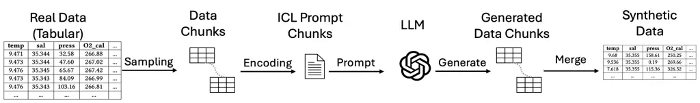

(a)

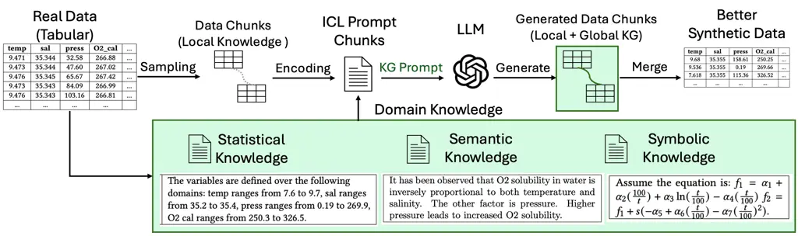

(b)

Figure 1. (a) a traditional synthetic tabular data generation pipeline
using LLMs encodes sample data as in-context learning examples to drive
the generation process. (b) Our prompt optimization approach based on
knowledge-guided prompting (KGP), incorporates automatically inferred
domain knowledge, providing the LLM-based generator a complementary
context in addition to ICL examples. Our experimental findings indicate
that such global property conditioning via. KGP leads to a significant
improvement in synthetic data generation quality, indicating that KGP
can indeed be employed as a useful knob for prompt optimization.

## 2. Related Work

Tabular data synthesis and representation learning for tables have been
extensively studied (Du et al., 2021; Wang et al., 2021; Zhang et al.,
2023b; Margeloiu et al., \[n. d.\]; Fang et al., 2024; Patki et al.,
2016; Du and Li, 2024; McKenna et al., 2019; Park et al., 2018; Wang
et al., 2020b; Singha et al., 2023). For completeness, we survey both
pre-LLM (or non-LLM) and LLM approaches for synthetic table generation.

Pre-LLM approaches. As one of the pre-LLM approaches to synthetic data
generation, Lei et al. (Xu et al., 2019) proposed CTGAN where rows are
independent of each other; a conditional GAN architecture ensures that
the dependency between columns is learned. Tabsyn (Zhang et al., 2023b)
showcased remarkable advancements in joint-distribution learning via a
VAE plus diffusion approach, surpassing previous models of similar
lineage, in terms of distributional correlation measures and machine
learning efficiency. DoppelGanger (Lin et al., 2020) uses a combination
of an RNN and a GAN to incorporate temporal dependencies across rows but
this method has been tested in traditional, low-volume settings such as
Wikipedia daily visit counts. For high-volume applications, STAN (Xu
et al., 2021) utilizes a combination of a CNN and Gaussian mixture
neural networks to generate synthetic network traffic data. GraphDF
 (Chen et al., 2023) is geared toward multi-dimensional time series
data. GOGGLE  (Liu et al., 2022) employs a generative modeling method
for tabular data by learning relational structures.

LLM approaches. LIFT (Dinh et al., 2022) and GReaT (Borisov et al., 2022) mentioned in the introduction fall in this category.
OmniPred (Song et al., 2024), provides a framework for training language
models as universal end-to-end regressors over ($`x,y`$) data from
arbitrary formats. Similarly, Treutlein et al. (Treutlein et al., 2024)
exhibit the ability of inductive out-of-context reasoning (OOCR) in a
regression fine-tuning task of a language model. (A key difference
between these works and our paper is that in the regression setting, the
prompt conditions the output to only predict the target label whereas we
are attempting data conforming to the entire joint distribution at
once.) Recent works (Borisov et al., 2022; Xu et al., 2024; Solatorio
and Dupriez, 2023; Zhang et al., 2023a; Zhao et al., 2023) have shown
the ability to use fine tuning to inject controlled distribution into
LLMs, but these approaches are inflexible and do not leverage prior
LLM’s pre-trained knowledge. Curated LLM (Seedat et al., 2024) is an
approach that prompts LLMs with specific domain requirements (in
English) but this approach is primarily intended for low-data regimes.
In recent times, instruction-tuned models have shown great strides in
‘following instructions’ (and some forms of reasoning) but they are
still limited at generating a diversity of datasets as considered here
(some recent efforts (Ren and Liu, 2024; Dai et al., 2022; Hsieh et al.,
2024; An et al., 2024), e.g., BARE (Zhu et al., 2025), aim to combine
base models with post-training to address this issue).

The Prompt vs the Example. The idea of modeling tradeoffs between
prompts and in-context learning (ICL) examples has been studied
before (Le Scao and Rush, 2021), but primarily in the context of NLP
tasks and for a single prompt, not a range of knowledge levels in
prompting as studied here. Our work is the first to systematically
explore the tradeoff between knowledge and ICL examples for synthetic
tabular data generation.

## 3. Knowledge Guided Tabular Data Generation with LLMs

Synthetic tabular data generation typically comprises a generation
function
$`\mathcal{G}(\cdot):\mathcal{D}_{\mathrm{train}}\rightarrow\mathcal{D}_{\mathrm{out}}`$
where $`\mathcal{D}_{\mathrm{train}}`$ is the set of samples supplied to
$`\mathcal{G}`$ as input and $`\mathcal{D}_{\mathrm{out}}`$ is the
target data distribution. The main objective of the tabular data
generation task is to generate synthetic data
$`\mathcal{D}_{\mathrm{syn}}`$ conditioned upon
$`\mathcal{D}_{\mathrm{in}}`$ such that
$`\mathcal{D}_{\mathrm{syn}}\sim\mathcal{D}_{\mathrm{out}}`$ i.e., the
generated data captures the joint distribution inherent in
$`\mathcal{D}_{\mathrm{out}}`$.

Recently, LLMs owing to their semantic recognition capabilities as well
as pre-trained knowledge, have demonstrated effectiveness in the
synthetic tabular data generation task. In the context of LLM based
tabular data generation, we can think about the LLM as a few-shot
generator where the few-shot nature of the problem arises from the
in-context learning (ICL) examples $`\mathcal{D}_{\mathrm{train}}`$
supplied as input to the LLM-based generator $`\mathcal{G}`$ as part of
the input query $`q=[<\mathrm{prompt}>;\mathcal{D}_{\mathrm{train}}]`$.
The query ‘q’ comprises the prompt along with
$`\mathcal{D}_{\mathrm{train}}`$ ICL examples.

In the LLM tabular data generation task, owing to the limited effective
context windows in LLMs, the input data is chunked into ‘c’ chunks, each
a group of $`k`$ rows
$`\mathcal{D}_{\mathrm{train}}=\{\mathcal{D}^{(1)}_{\mathrm{train}},\dots,\mathcal{D}^{(c)}_{\mathrm{train}}\}`$
and each chunk is supplied to the LLM as a set of in-context learning
(ICL) examples, in addition to a prompt i.e.,
$`q_{i}=[<prompt>;\mathcal{D}^{(i)}_{\mathrm{train}}]`$. The result of
all the queries $`q_{i}|i=1\dots c`$ are merged to form the final
generated table
$`\mathcal{D}_{\mathrm{syn}}=\boldsymbol{\bigcup}^{c}_{i=1}\mathcal{D}^{(i)}_{\mathrm{syn}}`$.
Thus, the LLM, conditioned upon the prompt and ICL examples (i.e.,
$`\mathcal{D}^{(i)}_{\mathrm{train}}`$), generates new table rows
similar to $`\mathcal{D}^{(i)}_{\mathrm{train}}`$.

However, the properties of data in each chunk,
$`\mathcal{D}^{(i)}_{\mathrm{train}}`$ strongly influence the quality of
data generated and issues such as _lack of full distributional coverage_
and _process noise_ may affect the data
$`\mathcal{D}^{(i)}_{\mathrm{train}}`$ thereby carrying over to the
generated output chunk $`\mathcal{D}^{(i)}_{\mathrm{out}}`$, and also
create intra-chunk and inter-chunk inconsistensies. To alleviate these
adverse effects, we propose knowledge-guided prompting (KGP) as a novel
method for prompt optimization by injecting prior domain knowledge about
(global) properties prevalent in the ground-truth data distribution in
addition to the ICL examples $`\mathcal{D}^{(i)}_{\mathrm{train}}`$.
Essentially, this entails augmenting each query with prior knowledge as
follows
$`q_{i}=[<\mathrm{knowledge-guided}\,prompt>;\mathcal{D}^{(i)}_{\mathrm{train}}]`$.
Prior domain knowledge may occur in many forms and we now detail the
various types of domain knowledge and how to inject each into the LLM
tabular data generation pipeline via KGP. The full LLM-based tabular
data generation pipeline with KGP is depicted in Fig. 1.

### 3.1. Encoded Knowledge Types

A knowledge guided prompt (KGP) accompanying a chunk
$`\mathcal{D}^{(i)}_{\mathrm{train}}`$ of a dataset
$`\mathcal{D}_{\mathrm{train}}`$, holds for all of
$`\mathcal{D}_{\mathrm{train}}`$. Otherwise stated, KGP encodes global
knowledge while a data chunk holds local knowledge.

Prior domain knowledge may appear as symbolic relationships, functional
dependencies, semantic descriptions of the data as well as statistical
knowledge about the data distribution. The various types of domain
knowledge we categorize are illustrated in Table 1, along with KGP
examples of each. More detailed examples in the context of specific
datasets investigated in this paper, are included in Table 2. We
specifically focus on three major types of knowledge guidance in this
work:

1.  (1)
    Symbolic KGP: In this form of KGP, we assume access to the symbolic
    (theoretical) relationship governing the (possibly noisy) data
    generation process.
2.  (2)
    Semantic KGP: In this form of KGP, we assume we can encode (partial)
    knowledge of the data distribution in terms of common prior to take
    advantage of the semantic recognition capabilities of the LLM.
3.  (3)
    Statistical KGP: In this form of KGP, we assume (weak) knowledge
    about ranges of specific columns in our tabular data.

Fig. 1(b) depicts the proposed KGP pipeline with the various types of
domain knowledge considered. Throughout our experimentation, we do not
treat all three types of domain knowledge equally, we assume
‘Statistical KGP’ as weak domain knowledge that is the most prevalent,
‘Semantic KGP’ also as weak domain knowledge with relatively lower
prevalence than Stastical knowledge and finally we assume ‘Symbolic KGP’
as the strongest as well as the least prevalent type of domain
knowledge.

|        |                       |                                                                                                                     |
| ------ | --------------------- | ------------------------------------------------------------------------------------------------------------------- |
| Type   | Knowledge             | Example                                                                                                             |
| Strong | Symbolic              | Equation: $`3x^{4}+4x^{3}-12x^{2}+2`$.                                                                              |
| Strong | Distribution          | The data follows a specific form of the Bohachevsky function.                                                       |
| Strong | Functional Dependency | If Protocol is TCP, then packet size is between 40 to 65,535 bytes.                                                 |
| Weak   | Semantic Description  | x and y coordinates of points when plotted visually depict a dinosaur.                                              |
| Weak   | Statistical Knowledge | The variables are defined over the following domains: temp ranges from 7.6 to 9.7, press ranges from 0.19 to 269.9. |

Table 1. Types of domain knowledge along with examples of how each type
can be incorporated into KGP.

|                                |                                                                                                                                           |                                                                                                                                                                                      |                                                                                                                                                                                              |                                                     |                                                                                |
| ------------------------------ | ----------------------------------------------------------------------------------------------------------------------------------------- | ------------------------------------------------------------------------------------------------------------------------------------------------------------------------------------ | -------------------------------------------------------------------------------------------------------------------------------------------------------------------------------------------- | --------------------------------------------------- | ------------------------------------------------------------------------------ |
| Example Data                   | W/o KGP                                                                                                                                   | Statistical (Stat.) KGP                                                                                                                                                              | Semantic (Sem.) KGP                                                                                                                                                                          | Symbolic (Sym.) KGP                                 | Preview                                                                        |
| AP Calculus (Math)             | x is 2.4278, y is -0.8169. x is 0.2925, y is 1.9153. x is 1.1009, y is -0.1916. \[…More\]                                                 | The variables are defined over the following domains: x ranges from -4.0 to 4.0.                                                                                                     | The function f is decreasing if x\<=-2, increasing if -2\<=x\<=0, decreasing if 0\<=x\<=1, and increasing if x\>=1.                                                                          | Consider the equation: $`3x^{4}+4x^{3}-12x^{2}+2`$. | ![[Uncaptioned image]](arxiv-2505-18485v1--782c9efe74a0.figures/figure-3.webp) |
| Datasaurus Dozen (Graphical)   | x is 55.3846, y is 97.1795. x is 51.5385, y is 96.0256. \[…More\]                                                                         | The range of x is from 31.10686656 to 85.4461864, and the range of y is from 4.57766135 to 97.83761472.                                                                              | x and y coordinates of points when plotted visually depict a dinosaur.                                                                                                                       | N/A                                                 | ![[Uncaptioned image]](arxiv-2505-18485v1--782c9efe74a0.figures/figure-4.webp) |
| $`O_{2}`$ Sensing (Real World) | temp is 9.471, sal is 35.344, press is 32.58, O2 cal is 266.88. temp is 9.473, sal is 35.344, press is 47.60, O2 cal is 267.02. \[…More\] | The variables are defined over the following domains: temp ranges from 7.6 to 9.7, sal ranges from 35.2 to 35.4, press ranges from 0.19 to 269.9, O2 cal ranges from 250.3 to 326.5. | It has been observed that O2 solubility in water is inversely proportional to both temperature and salinity. The other factor is pressure. Higher pressure leads to increased O2 solubility. | N/A                                                 | ![[Uncaptioned image]](arxiv-2505-18485v1--782c9efe74a0.figures/figure-5.webp) |

Table 2. Example setup of different types of datasets and different
levels of knowledge. In practice, the data contains more digits;
however, for presentation purposes, we only display up to two to three
decimal places.

## 4. Experimental Results

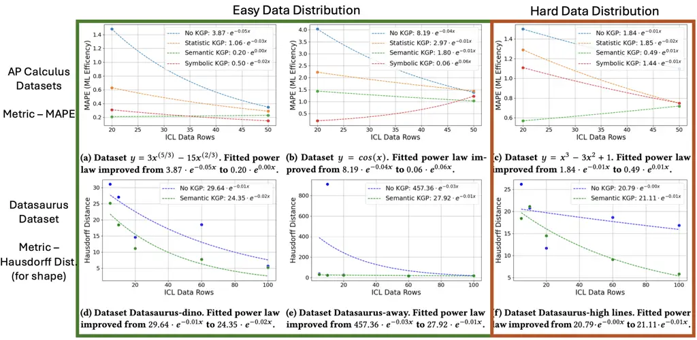

Figure 2. Showcasing the MAPE and Hustoff distance between the synthetic
data and the real data. X-axis represents different ICL data sizes. The
green curve represents the semantic KGP and the blue curve represents
the No-KGP setting. Take (a) for example, by incorporating the visual
knowledge phrase “x and y coordinates of points when plotted visually
depict a dinosaur.” into the prompt, the quality of the generated data
improves when the dataset is limited. The quantitative metric Hausdorff
Distance decreased from 18.54 to 7.72 indicating a significant
improvement when using 60 In-Context Samples.

In this section, we design experiments on synthetic tabular data
generation tasks to investigate the effectiveness of knowledge-guided
prompting (KGP) as a novel prompt optimization strategy for LLMs. We
evaluate our approach using numerous datasets across mathematical,
geometric, and real-world applications. Specifically, we wish to
investigate the following research questions:

1.  RQ1:
    What is the trade-off between domain-knowledge and ICL examples?
    (Section 4.2)
2.  RQ2:
    Can domain-knowledge alleviate effects of poor data coverage or help
    with (out-of-domain) OOD generalization? (Section 4.3)
3.  RQ3:
    Which type of knowledge injection is the most effective?
    (Section 4.4)
4.  RQ4:
    How does KGP affect the quality of the synthetic data generated?
    (Section 4.5)
5.  RQ5:
    (Case Study) Can we characterize the effectiveness of KGP in a
    real-world cyber-physical scenario? (Section 4.6)

### 4.1. Setup & KGP Scope

Datasets. We have adopted real datasets across three application
domains. We manually extracted datasets from the AP Calculus textbook
(specifically, Section 4 (Anton et al., 2011)), featuring variations of
equations and descriptions of function characteristics, Thirteen
datasets from the Datasaurus Dozen exhibiting distinct visual
characteristics (Matejka and Fitzmaurice, 2017), and an $`O_{2}`$
sensing dataset from real-world applications related to cyber-physical
systems ¹¹ 1 https://www.bco-dmo.org/dataset/3426.

Baselines. We aim to investigate the potential of in-context prompting
techniques utilizing large language models, and in this experiment the
flagship OpenAI model GPT-4o is utilized as the foundation model. In
accordance with the system outlined in the previous section, three
levels of knowledge-guidance prompts will be introduced and analyzed in
an ablation study: Statistical KGP, Semantic KGP, and Symbolic KGP.

KGP Scope. It is important to clarify that for the purpose of this
evaluation, we treat the levels of knowledge as a set of concentric
circles. In other words, “Semantic KGP” denotes the combination of
Statistical and Semantic KGP. Similarly, “Symbolic KGP” includes all
three forms of knowledge. Notably, Without knowledge implies no guidance
from knowledge is utilized, serving as the traditional baseline for
synthetic data generation.

Metrics. The traditional metrics for synthetic data from the tabular
data generation community are utilized, including machine learning
utility (MLU), negative log likelihood (NLL), KL divergence, and
distance to the closest record (DCR). Additionally, for datasets
containing ground-truth symbolic equations, we employ mean square error
(MSE) as the primary metric for assessing data record validity. For
datasets characterized by shape-focused distributions, we employ
Hausdorff distance to assess the similarity of the shapes.

### 4.2. RQ1: What is the trade-off between domain-knowledge and ICL examples?

Encoding structural data within a text sentence for LLM utilization
incurs a substantial token load. This underscores the rationale for
saving example data tokens to maintain performance expectations or to
enhance performance in scenarios where example data is insufficient.

Although LLM developers continue to explore the upper limits of context
windows for both input and output, their efforts remain insufficient in
the domain of synthetic structural data generation. Therefore, it is
important to consider strategies for conserving tokens utilized by
in-context data samples, as well as identifying ways to assist a
language model when a user’s example data is limited. Here are two
common cases:

Simple Data Distributions. When the joint distribution of the data is
easy to model, using KGP will decrease data requirements and thereby
reduce token demand, leading to financial and time saving. Figure 2a,b,c
and e investigate the impact of KGP on data generation when the target
data follows a simple joint distribution. Specifically, Figure 2a, b
have been evaluated on datasets from the AP calculus (Anton et al., 2011) data corpus, where 4 KGP variants have been evaluated enabling us
to investigate the full range of knowledge-guidance granularity (i.e.,
statistical, semantic and symbolic knowledge guidance). For each KGP
variant, one context with 20 ICL examples and another with 50 ICL
examples has been evaluated. The plots in Figure 2a,b both clearly
demonstrate the benefit of KGP over the ‘No KGP’ variant in low data
(i.e., 20 ICL examples) scenarios.

Finding: Semantic KGP, Symbolic KGP require 40% fewer ICL examples to
achieve the same generation quality as a variant without KGP.

|     |     |     |     |
| --- | --- | --- | --- |
|     |     |     |     |
|     |     |     |     |

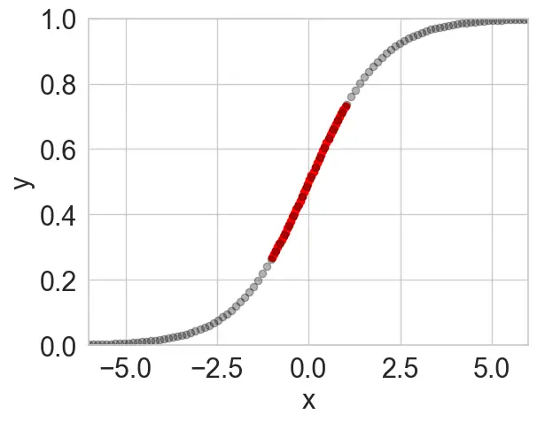

(a)

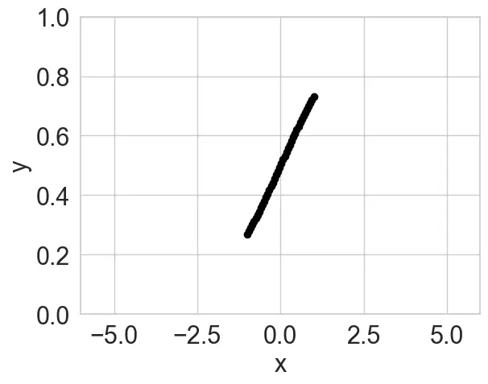

(b)

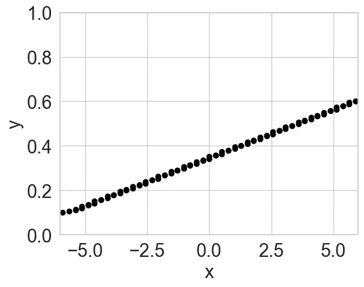

(c)

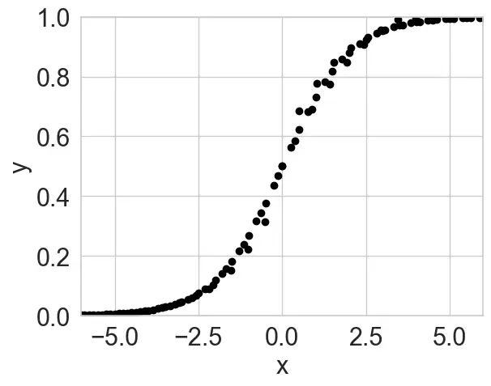

(d)

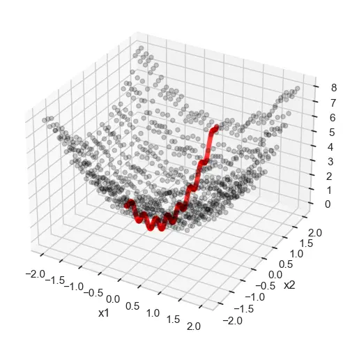

(e)

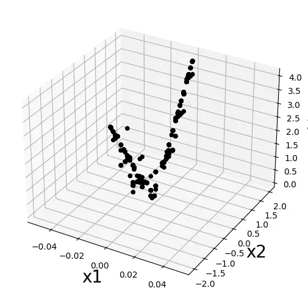

(f)

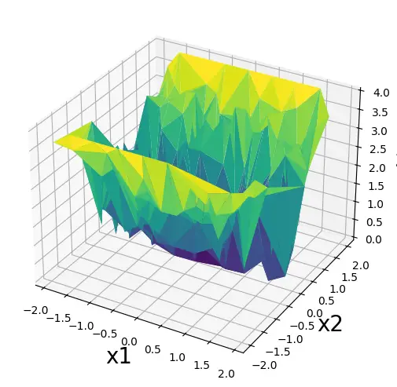

(g)

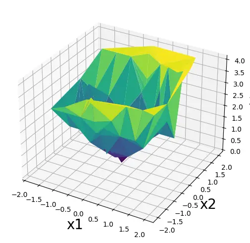

(h)

Figure 3. Visualization of out-of-distribution (OOD) generation,
featuring two mathematical functions: Sigmoid and Bohachevsky. In the
ICL Real Data figure (a) & (e), the red data points represent the
observed field, whereas the grey data points indicate the complete
ground truth field. Figure (b)-(d), (f)-(h) showcase the generated
synthetic data under corresponding KGP settings.

Further, a similar experiment is carried out on the Datasaurus
corpus (Matejka and Fitzmaurice, 2017) employing the popular Hausdorff
distance metric to test data generation quality. In this scenario, we
compare the ‘No KGP’ variant with the ‘Semantic‘ KGP variant. The two
variants are each evaluated in two ICL contexts namely, one with 10 and
another with a 100 random ICL data points. The goal is once again to
evaluate how the KGP affects tabular data generation quality and its
utility in low-data scenarios.

Figure 2d evaluated in the context of the Dino dataset from the
Datasaurus corpus, illustrates that ‘Semantic KGP’ achieves equivalent
generation quality as ‘No-KGP’ with a 40% reduction in the number of ICL
examples. Figure 2e is a similar comparison performed on the _Away
dataset_ from the Datasaurus corpus and demonstrates an even higher
reduction (ie., 90%) in ICL examples in the Semantic KGP context to
achieve thee same generation quality as the No KGP context.

Finding: Overall, KGP improves synthetic-data generation quality with a
40% - 90% reduction in ICL examples while achieving the same generation
quality as a variant without KGP, even in for simple data distributions.

Complex Data Distributions. In Figure 2c and  2f, we evaluate datasets
from the AP Calculus and Datasaurus corpora respectively except here, we
consider datasets where the data exhibits a more complex (i.e., harder
to model) joint distribution. Figure 2f illustrates an example of
modeling a relatively difficult joint distribution (i.e., _High Lines_
dataset) which is difficult owing to the data being distributed in
disparate statistical modes. Here, we notice that despite being
conditioned on 100 in-context samples, even a state-of-the-art LLM like
GPT-4o alone (i.e., (with No KGP) does not generate a valid synthetic
joint distribution (as evidenced by high Hausdorff distance of the blue
line even at ICL 100). However, by simply injecting a semantic KGP
statement such as ‘x and y are visually looking like high lines’, the
model can not only significantly improve the quality of generated data
but achieves the same generation quality as ‘No KGP’ with 80% fewer ICL
examples.

Figure 2 represents a cubic polynomial function, also hard to model in a
purely data-driven manner. We notice that incorporating any form of KGP
(statistical, semantic or Symbolic) leads to a significant reduction in
data generation error and a 50% reduction in ICL examples to achieve the
same generation quality as the ‘No KGP’ variant.

Overall Finding: KGP results in a significant reduction in ICL examples
for synthetic tabular data generation, both in contexts where the data
follows an easy and a hard joint distribution. Specifically, knowledge
guidance leads to a 40%-90% reduction in ICL examples in the easy data
context and between 50%-80% reduction in the hard data context.

### 4.3. RQ2: Can domain-knowledge alleviate effects of poor data coverage or help with OOD generalization?

Table 3 showcases the capability of generating previously unobserved
structural data on the basis of the ‘Statistical’ and ‘Semantic’ KGP
provided, while Figure 3 illustrates the visual representation. When
calculating the MSE of the uncovered field of the ‘No KGP‘ variant,
noise will be examined. ‘Statistical’ KGP and ‘Semantic’ KGP will
generate data to cover those region utilizing the injected domain
knowledge. The mean squared error (MSE) of the sigmoid function can be
significantly reduced by 98%. Furthermore, with respect to the
Bohachevsky function, the absolute value of the error decreased from
1.62 to 0.44 due to its higher dimensionality and increased complexity.
In the realm of complex functions, delving into unfamiliar areas demands
increased caution, as the LLM generator may mistakenly treat unknown
fields as similar to known ones, as illustrated in Figure 3(c) and 3(g).

|                  |         |                 |              |                    |
| ---------------- | ------- | --------------- | ------------ | ------------------ |
| Math Function    | W/o KGP | Statistical KGP | Semantic KGP | MSE Impr.          |
| Sigmoid (2d)     | 0.11    | 0.09            | 0.002        | $`\downarrow`$ 98% |
| Bohachevsky (3d) | 1.62    | 2.23            | 0.44         | $`\downarrow`$ 73% |

Table 3. MSE for OOD generalization.

Overall Finding: With the support of domain knowledge, KGP is capable of
generating out-of-distribution (OOD) data and augmenting datasets that
suffer from poor coverage or missing values. The data generated through
‘Statistical’ plus ‘Semantic’ KGP exhibits an error rate that is 78% to
90% lower compared to the plain ‘No KGP’ method when exploring to
unknown data feild.

### 4.4. RQ3: Which type of knowledge injection is the most effective?

Table 4 shows that the injection of ‘Statistical’ KGP and ‘Semantic’ KGP
generally leads to consistent and improved data quality. Utilizing the
complete equation, notably ‘Symbolic’ KGP, does not always produce
beneficial outcomes due to the limited grasp of complex mathematics.

Overall Finding: The integration of statistical KGP and semantic KGP in
data generation involving various mathematical function relationships
can produce a consistent improvement in quality (i.e., a reduction in
MSE), ranging from 35% to 70%, without occasionally causing negative
error.

|                              |         |                      |                      |                      |
| ---------------------------- | ------- | -------------------- | -------------------- | -------------------- |
| Math Function                | W/o KGP | Statistical KGP      | Semantic KGP         | Symbolic KGP         |
| $`y=3x^{(5/3)}-15x^{(2/3)}`$ | 0.35    | ($`\downarrow`$)0.29 | ($`\downarrow`$)0.23 | ($`\downarrow`$)0.15 |
| $`y=x^{3}-3x^{2}+1`$         | 1.10    | ($`\downarrow`$)0.75 | ($`\sim`$)0.72       | ($`\uparrow`$)0.75   |
| $`y=2x^{3}-15x^{2}+36x`$     | 0.02    | ($`\sim`$)0.02       | ($`\sim`$)0.02       | ($`\downarrow`$)0.01 |
| $`y=x+2sin(x)`$              | 0.40    | ($`\downarrow`$)0.14 | ($`\sim`$)0.12       | ($`\uparrow`$)0.57   |

Table 4. Mean Squared Error at the 50-ICL setting with various levels of
KGP. Arrows indicate the trend of the effect (MSE) as higher levels of
KGP (i.e., more granular knowledge-guidance rules) are injected.

### 4.5. RQ4: How does KGP affect the quality of generated synthetic data?

In addition to the savings on the number of ICL examples, it is equally
crucial for KGP based generation pipelines to ensure high-quality
synthetic data. To investigate this, we quantitatively evaluate the
synthetic data quality with well accepted metrics: low-order statistics
(Sec 4.5.1), machine learning utility (MLU) (Sec 4.5.3), and closest
distance to record (DCR) (Sec 4.5.2).

#### 4.5.1. How close is synthetic data to the full distribution joint (low-order statistics)?

Table 5 provides a quantitative assessment of the performance of the
synthetic table. The negative log likelihood (NLL) quantifies the
resemblance between synthetic data and real data. The low KL-divergence
simultaneously guarantees the mode diversity of the synthetic data.

|                                                |                 |                 |                 |
| ---------------------------------------------- | --------------- | --------------- | --------------- |
| Negative Log Likelihood (NLL) ($`\downarrow`$) |                 |                 |                 |
| Dataset                                        | W/o KGP         | Statistical KGP | Semantic KGP    |
| AP Calculus                                    | 4.75$`\pm`$0.90 | 4.73$`\pm`$0.73 | 4.91$`\pm`$1.14 |
| Datasaurus Dozen                               | 8.99$`\pm`$0.18 | 9.09$`\pm`$0.25 | 8.88$`\pm`$0.04 |
| $`O_{2}`$ Sensing                              | 31.18           | 11.62           | 8.54            |
| KL-Divergence ($`\downarrow`$)                 |                 |                 |                 |
| Dataset                                        | W/o KGP         | Statistical KGP | Semantic KGP    |
| AP Calculus                                    | 0.02$`\pm`$0.02 | 0.04$`\pm`$0.04 | 0.07$`\pm`$0.09 |
| Datasaurus Dozen                               | 0.06$`\pm`$0.07 | 0.10$`\pm`$0.06 | 0.01$`\pm`$0.01 |
| $`O_{2}`$ Sensing                              | 4.43            | 0.70            | 0.20            |

Table 5. Low-order statistics, evaluated by negative log likelihood
(NLL) and KL-divergence. Both of the metrics are smaller the better.

Figure 4 compares real and synthetic data, highlighting shape trends.
Analyzing columns two (no KGP) to five (Symbolic KGP) shows that better
knowledge guidance yields more realistic results within the same sample.
Figure (a) represents the ICL20 conditions, while Figure (b) illustrates
the ICL50 conditions. Comparison of subfigures (a) and (b) in Figure 5
shows that the Semantic KGP form in graphs requires a more detailed
context in English. Otherwise, the Semantic KGP can similarly
contaminate synthetic data, akin to a reverse de-noising process.

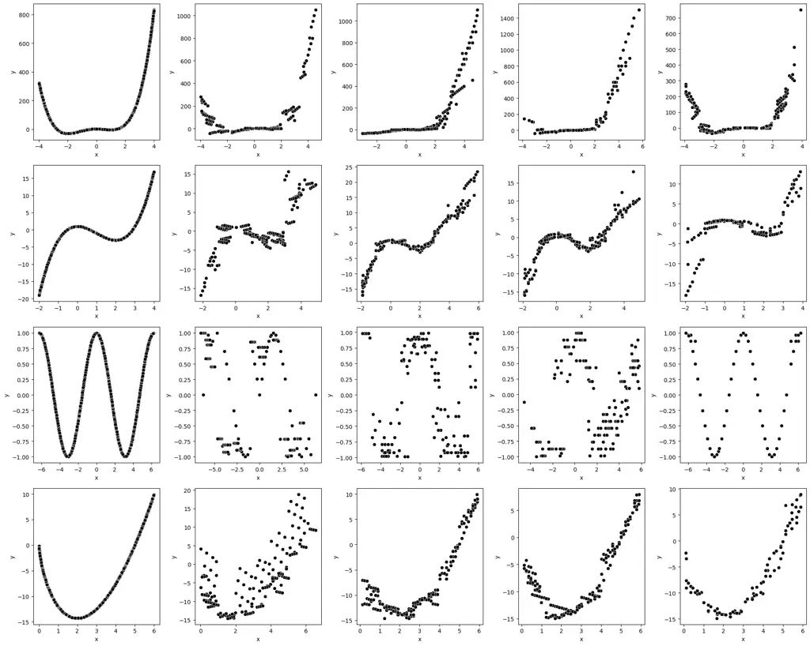

(a) ICL-20 for four functions, one per row:
($`3x^{4}+4x^{3}-12x^{2}+2`$); ($`x^{3}-3x^{2}+1`$); ($`cos(x)`$);
($`3x^{(5/3)}-15x^{(2/3)}`$).

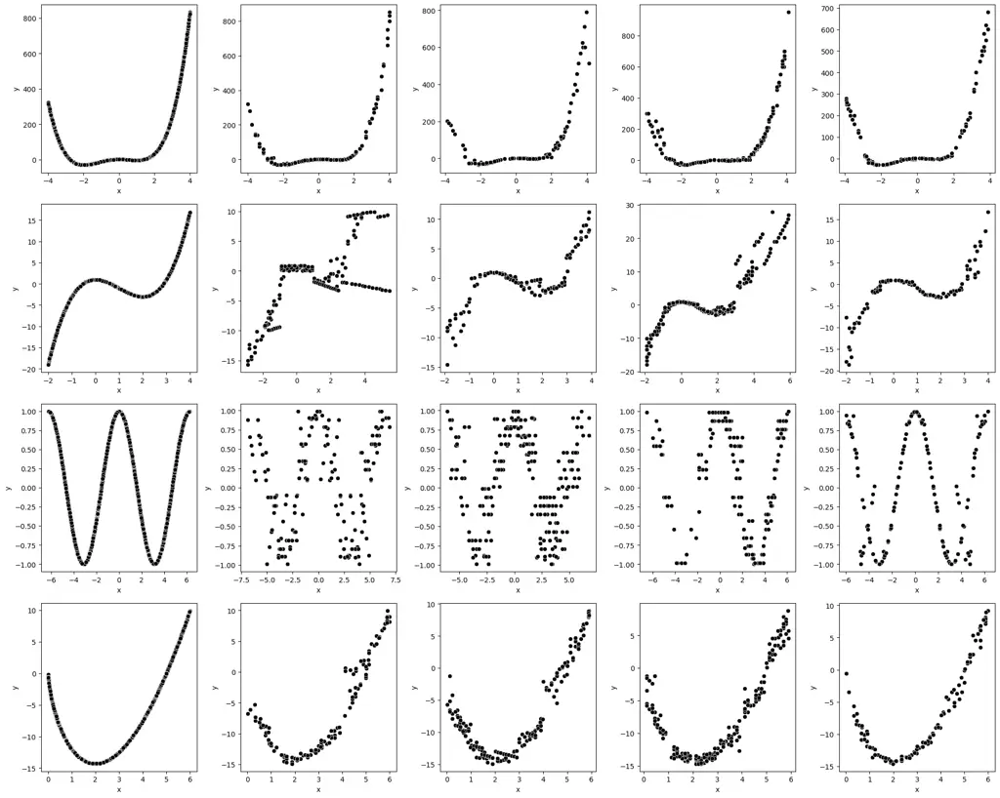

(b) ICL-50 for four functions, one per row:
($`3x^{4}+4x^{3}-12x^{2}+2`$); ($`x^{3}-3x^{2}+1`$); ($`cos(x)`$);
($`3x^{(5/3)}-15x^{(2/3)}`$)

Figure 4. Diversity of modes in synthetic data. Five columns from left
to the right are real data, No KGP, statistical KGP, semantic KGP, and
symbolic KGP.

|     |
| --- |
|     |
|     |

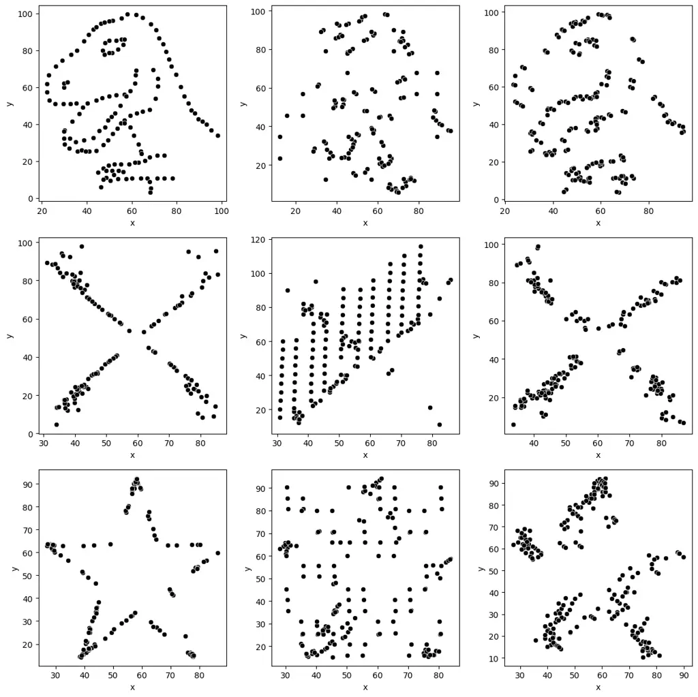

(a)

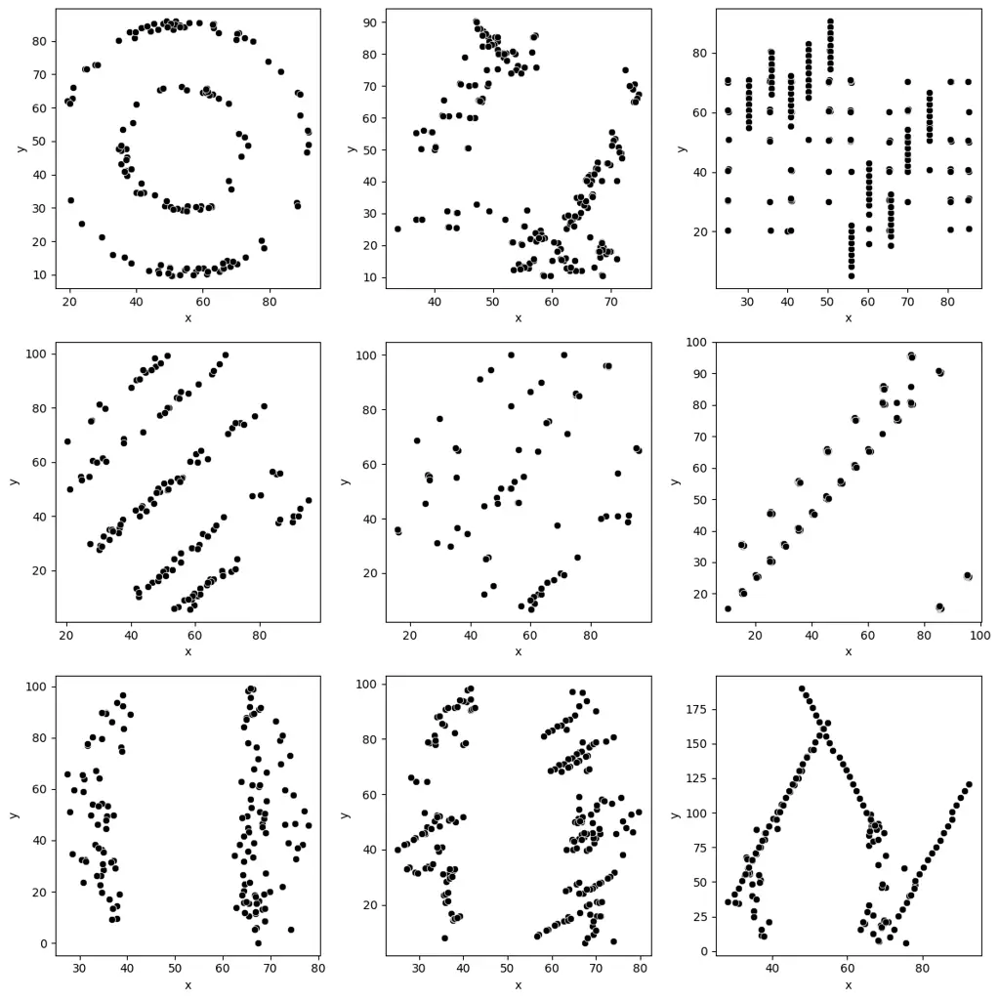

(b)

Figure 5. Diversity of modes in synthetic data. Three columns from left
to the right represent real data, No KGP, Semantic KGP.

#### 4.5.2. How does distance to the closest record change when knowledge is incorporated?

Table 6 shows improved row similarity without adding a new leak record.

|                                                  |                 |                 |                 |
| ------------------------------------------------ | --------------- | --------------- | --------------- |
| Distance to the closest record. ($`\downarrow`$) |                 |                 |                 |
| Dataset                                          | W/o KGP         | Statistical KGP | Semantic KGP    |
| AP Calculus                                      | 0               | 0               | 0               |
| Datasaurus Dozen                                 | 0.21$`\pm`$0.20 | 0.41$`\pm`$0.24 | 0.12$`\pm`$0.09 |
| $`O_{2}`$ Sensing                                | 0.57            | 0.46            | 0.38            |

Table 6. Distance to the closest record: A lower distance yields a
better record in terms of validity; however, the occurrence of a zero
value, which indicates a leak of raw data, is unacceptable.

#### 4.5.3. Can we use synthetic data in ML pipelines?

Table 7 illustrates the performance of machine learning using synthetic
data. The analysis reveals that synthetic data can effectively replace
original data for training two commonly used machine learning models,
random forest and linear regression, yielding low MAPE errors on actual
test data.

|                                                                     |                 |                 |                 |
| ------------------------------------------------------------------- | --------------- | --------------- | --------------- |
| Machine Learning Utility (MLU) - Random Forest ($`\downarrow`$)     |                 |                 |                 |
| Dataset                                                             | W/o KGP         | Statistical KGP | Semantic KGP    |
| AP Calculus                                                         | 0.47$`\pm`$0.45 | 0.30$`\pm`$0.32 | 0.27$`\pm`$0.31 |
| Datasaurus Dozen                                                    | 0.90$`\pm`$0.30 | 0.88$`\pm`$0.25 | 0.60$`\pm`$0.19 |
| $`O_{2}`$ Sensing                                                   | 0.031           | 0.029           | 0.0225          |
| Machine Learning Utility (MLU) - Linear Regression ($`\downarrow`$) |                 |                 |                 |
| Dataset                                                             | W/o KGP         | Statistical KGP | Semantic KGP    |
| AP Calculus                                                         | 1.61$`\pm`$2.02 | 1.61$`\pm`$2.02 | 2.13$`\pm`$2.90 |
| Datasaurus Dozen                                                    | 0.90$`\pm`$0.13 | 0.84$`\pm`$0.08 | 0.79$`\pm`$0.08 |
| $`O_{2}`$ Sensing                                                   | 0.039           | 0.053           | 0.023           |

Table 7. MLU- Random Forest and Linear Regression.

Overall Finding: Using KGP (Statistical and Semantic) resulted in
optimal performance across all three standard synthetic table metrics,
with an average enhancement of 50% for each metric.

### 4.6. Case Study: Characterizing Effectiveness of Prompt Optimization via KGP in a Real-World Cyber-Physical Scenario

This section uses a dataset from a noisy cyber-physical system recording
temperature, salinity, and pressure to predict water’s oxygen
solubility. Table 8 presents the evaluation of generating synthetic data
from noisy raw data using Statistical KGP and Semantic KGP.

|                                                                   |         |                 |              |
| ----------------------------------------------------------------- | ------- | --------------- | ------------ |
| Distance to the closest record under Noisy Case. ($`\downarrow`$) |         |                 |              |
| Dataset                                                           | W/o KGP | Statistical KGP | Semantic KGP |
| $`O_{2}`$ Sensing W/o Noise                                       | 0.57    | 0.46            | 0.38         |
| $`O_{2}`$ Sensing W/ Noise                                        | 1.06    | 0.61            | 0.70         |

Table 8. Distance to the closest record.

Finding: Statistical KGP is vital for preserving a valid row joint
distribution in scenarios characterized by noisy data.

One of the advantages of using modern LLMs is the availability and
flexibility of the agent-embedded framework. Considering that even
explicitly including the instruction “does not copy the original data”
in the prompt, the generated data may still include some, see Table 6.
Given that the LLM generator can utilize foundational and supplementary
domain knowledge (statistical and semantic KGPs) to correct errors, we
will initially introduce noise to the original data and subsequently
employ the LLM to correct this noise, a process referred to as
noise-and-refix. When the real original data are not presented to the
LLM agent, concerns regarding the copying or leaking of data are
eliminated.

Finding: A modicum of in-context example data is essential to generate
the hidden distribution, while knowledge guidance is more effective in
providing dependency, correcting errors, or establishing boundaries.

## 5. Conclusion

This paper proposes the use of a novel prompt optimization strategy
termed Knowledge-Guided Prompting (KGP), to enhance the generation
quality of structural tabular data by a Large Language Model (LLM).
Although examples of in-context learning data are limited in a chunk
size and offer localized knowledge only, the comprehensive domain
knowledge of the entire dataset can be incorporated as an English prompt
using statistical KGP and semantic KGP. We have investigated the
relationship between symbolic and statistical knowledge and prompt
snippets, yielding an empirical ‘scaling law’ that estimates the number
of snippets needed. Our experiments demonstrate that the KGP strategy
can reduce ICL data (that is, tokens) by 40%, improve data with unknown
regions (out-of-distribution generation) or improve the quality of
synthetic data while utilizing the same level of ICL data.

Future work will be aimed at developing a multimodal learning framework
encompassing KGP with visual and semantic facets. A user’s inconsistent
semantic KGP, when compared to the example data, may result in a
decrease in generation quality, constituting a form of model poisoning.
Leveraging associations across modalities via shared parameters will
lead to more resilient approaches for knowledge-guided applications.

## References

- Abay et al. (2019) Nazmiye Ceren Abay, Yan Zhou, Murat Kantarcioglu,
  Bhavani Thuraisingham, and Latanya Sweeney. 2019. Privacy preserving
  synthetic data release using deep learning. In _Machine Learning and
  Knowledge Discovery in Databases: European Conference, ECML PKDD 2018,
  Dublin, Ireland, September 10–14, 2018, Proceedings, Part I 18_.
  Springer, 510–526.
- An et al. (2024) Chenxin An, Jun Zhang, Ming Zhong, Lei Li, Shansan
  Gong, Yao Luo, Jingjing Xu, and Lingpeng Kong. 2024. Why Does the
  Effective Context Length of LLMs Fall Short?
  arXiv:2410.18745 \[cs.CL\]
  [https://arxiv.org/abs/2410.18745](https://arxiv.org/abs/2410.18745)
- Anton et al. (2011) H. Anton, I.C. Bivens, and S. Davis. 2011.
  _Calculus Early Transcendentals, 10th Edition_. Wiley.
- Borisov et al. (2022) Vadim Borisov, Kathrin Seßler, Tobias Leemann,
  Martin Pawelczyk, and Gjergji Kasneci. 2022. Language models are
  realistic tabular data generators. _arXiv preprint arXiv:2210.06280_
  (2022).
- Chen et al. (2023) Hongjie Chen, Ryan A Rossi, Kanak Mahadik, Sungchul
  Kim, and Hoda Eldardiry. 2023. Graph Deep Factors for Probabilistic
  Time-series Forecasting. _ACM Transactions on Knowledge Discovery from
  Data_ 17, 2 (2023), 1–30.
- Choi et al. (2017) Edward Choi, Siddharth Biswal, Bradley Malin, Jon
  Duke, Walter F Stewart, and Jimeng Sun. 2017. Generating multi-label
  discrete patient records using generative adversarial networks. In
  _Machine learning for healthcare conference_. PMLR, 286–305.
- Dai et al. (2022) Damai Dai, Yutao Sun, Li Dong, Yaru Hao, Shuming Ma,
  Zhifang Sui, and Furu Wei. 2022. Why can gpt learn in-context?
  language models implicitly perform gradient descent as
  meta-optimizers. _arXiv preprint arXiv:2212.10559_ (2022).
- Dinh et al. (2022) Tuan Dinh, Yuchen Zeng, Ruisu Zhang, Ziqian Lin,
  Michael Gira, Shashank Rajput, Jy-yong Sohn, Dimitris Papailiopoulos,
  and Kangwook Lee. 2022. Lift: Language-interfaced fine-tuning for
  non-language machine learning tasks. _Advances in Neural Information
  Processing Systems_ 35 (2022), 11763–11784.
- Du et al. (2021) Lun Du, Fei Gao, Xu Chen, Ran Jia, Junshan Wang,
  Jiang Zhang, Shi Han, and Dongmei Zhang. 2021. TabularNet: A neural
  network architecture for understanding semantic structures of tabular
  data. In _Proceedings of the 27th ACM SIGKDD Conference on Knowledge
  Discovery & Data Mining_. 322–331.
- Du and Li (2024) Yuntao Du and Ninghui Li. 2024. Towards principled
  assessment of tabular data synthesis algorithms. _arXiv preprint
  arXiv:2402.06806_ (2024).
- Esteban et al. (2017) Cristóbal Esteban, Stephanie L Hyland, and
  Gunnar Rätsch. 2017. Real-valued (medical) time series generation with
  recurrent conditional gans. _arXiv preprint arXiv:1706.02633_ (2017).
- Fang et al. (2024) Xi Fang, Weijie Xu, Fiona Anting Tan, Jiani Zhang,
  Ziqing Hu, Yanjun (Jane) Qi, Scott Nickleach, Diego Socolinsky, "SHS"
  Srinivasan Sengamedu, and Christos Faloutsos. 2024. Large language
  models (LLMs) on tabular data: Prediction, generation, and
  understanding — a survey. _Transactions on Machine Learning Research_
  (2024).
- Goodfellow et al. (2020) Ian Goodfellow, Jean Pouget-Abadie, Mehdi
  Mirza, Bing Xu, David Warde-Farley, Sherjil Ozair, Aaron Courville,
  and Yoshua Bengio. 2020. Generative adversarial networks. _Commun.
  ACM_ 63, 11 (2020), 139–144.
- He and Garcia (2009) Haibo He and Edwardo A Garcia. 2009. Learning
  from imbalanced data. _IEEE Transactions on knowledge and data
  engineering_ 21, 9 (2009), 1263–1284.
- Hoffmann et al. (2022) Jordan Hoffmann, Sebastian Borgeaud, Arthur
  Mensch, Elena Buchatskaya, Trevor Cai, Eliza Rutherford, Diego de
  Las Casas, Lisa Anne Hendricks, Johannes Welbl, Aidan Clark, Tom
  Hennigan, Eric Noland, Katie Millican, George van den Driessche,
  Bogdan Damoc, Aurelia Guy, Simon Osindero, Karen Simonyan, Erich
  Elsen, Jack W. Rae, Oriol Vinyals, and Laurent Sifre. 2022. Training
  Compute-Optimal Large Language Models. _CoRR_ abs/2203.15556 (2022).
  [doi:10.48550/ARXIV.2203.15556](https://doi.org/10.48550/ARXIV.2203.15556)
  arXiv:2203.15556
- Hsieh et al. (2024) Cheng-Ping Hsieh, Simeng Sun, Samuel Kriman,
  Shantanu Acharya, Dima Rekesh, Fei Jia, and Boris Ginsburg. 2024.
  RULER: What’s the Real Context Size of Your Long-Context Language
  Models?. In _First Conference on Language Modeling_.
  [https://openreview.net/forum?id=kIoBbc76Sy](https://openreview.net/forum?id=kIoBbc76Sy)
- Hui et al. (2023) Shuodi Hui, Huandong Wang, Tong Li, Xinghao Yang,
  Xing Wang, Junlan Feng, Lin Zhu, Chao Deng, Pan Hui, Depeng Jin,
  et al. 2023. Large-scale urban cellular traffic generation via
  knowledge-enhanced gans with multi-periodic patterns. In _Proceedings
  of the 29th ACM SIGKDD Conference on Knowledge Discovery and Data
  Mining_. 4195–4206.
- Jordon et al. (2018) James Jordon, Jinsung Yoon, and Mihaela Van
  Der Schaar. 2018. PATE-GAN: Generating synthetic data with
  differential privacy guarantees. In _International conference on
  learning representations_.
- Le Scao and Rush (2021) Teven Le Scao and Alexander M Rush. 2021. How
  many data points is a prompt worth?. In _Proceedings of the 2021
  Conference of the North American Chapter of the Association for
  Computational Linguistics: Human Language Technologies_. 2627–2636.
- Lin et al. (2020) Zinan Lin, Alankar Jain, Chen Wang, Giulia Fanti,
  and Vyas Sekar. 2020. Using gans for sharing networked time series
  data: Challenges, initial promise, and open questions. In _Proceedings
  of the ACM Internet Measurement Conference_. 464–483.
- Liu et al. (2022) Tennison Liu, Zhaozhi Qian, Jeroen Berrevoets, and
  Mihaela van der Schaar. 2022. GOGGLE: Generative modelling for tabular
  data by learning relational structure. In _The Eleventh International
  Conference on Learning Representations_.
- Margeloiu et al. (\[n. d.\]) Andrei Margeloiu, Xiangjian Jiang, Nikola
  Simidjievski, and Mateja Jamnik. \[n. d.\]. TabEBM: A Tabular Data
  Augmentation Method with Distinct Class-Specific Energy-Based Models.
  In _The Thirty-eighth Annual Conference on Neural Information
  Processing Systems_.
- Matejka and Fitzmaurice (2017) Justin Matejka and George
  Fitzmaurice. 2017. Same stats, different graphs: generating datasets
  with varied appearance and identical statistics through simulated
  annealing. In _Proceedings of the 2017 CHI conference on human factors
  in computing systems_. 1290–1294.
- McKenna et al. (2019) Ryan McKenna, Daniel Sheldon, and Gerome
  Miklau. 2019. Graphical-model based estimation and inference for
  differential privacy. In _International Conference on Machine
  Learning_. PMLR, 4435–4444.
- Park et al. (2018) Noseong Park, Mahmoud Mohammadi, Kshitij Gorde,
  Sushil Jajodia, Hongkyu Park, and Youngmin Kim. 2018. Data synthesis
  based on generative adversarial networks. _Proceedings of the VLDB
  Endowment_ 11, 10 (2018), 1071–1083.
- Patki et al. (2016) Neha Patki, Roy Wedge, and Kalyan
  Veeramachaneni. 2016. The Synthetic data vault. In _IEEE International
  Conference on Data Science and Advanced Analytics (DSAA)_. 399–410.
  [doi:10.1109/DSAA.2016.49](https://doi.org/10.1109/DSAA.2016.49)
- Radford et al. (2019) Alec Radford, Jeffrey Wu, Rewon Child, David
  Luan, Dario Amodei, Ilya Sutskever, et al. 2019. Language models are
  unsupervised multitask learners. _OpenAI blog_ 1, 8 (2019), 9.
- Ren and Liu (2024) Ruifeng Ren and Yong Liu. 2024. Towards
  Understanding How Transformers Learn In-context Through a
  Representation Learning Lens. In _The Thirty-eighth Annual Conference
  on Neural Information Processing Systems_.
- Seedat et al. (2024) Nabeel Seedat, Nicolas Huynh, Boris van Breugel,
  and Mihaela van der Schaar. 2024. Curated LLM: Synergy of LLMs and
  Data Curation for tabular augmentation in low-data regimes. In
  _Forty-first International Conference on Machine Learning_.
- Singha et al. (2023) Ananya Singha, José Cambronero, Sumit Gulwani, Vu
  Le, and Chris Parnin. 2023. Tabular representation, noisy operators,
  and impacts on table structure understanding tasks in llms. _arXiv
  preprint arXiv:2310.10358_ (2023).
- Solatorio and Dupriez (2023) Aivin V Solatorio and Olivier
  Dupriez. 2023. Realtabformer: Generating realistic relational and
  tabular data using transformers. _arXiv preprint arXiv:2302.02041_
  (2023).
- Song et al. (2024) Xingyou Song, Oscar Li, Chansoo Lee, Bangding Yang,
  Daiyi Peng, Sagi Perel, and Yutian Chen. 2024. OmniPred: Language
  Models as Universal Regressors. _Trans. Mach. Learn. Res._ 2024
  (2024).
  [https://openreview.net/forum?id=t9c3pfrR1X](https://openreview.net/forum?id=t9c3pfrR1X)
- Treutlein et al. (2024) Johannes Treutlein, Dami Choi, Jan Betley,
  Samuel Marks, Cem Anil, Roger Grosse, and Owain Evans. 2024.
  Connecting the dots: Llms can infer and verbalize latent structure
  from disparate training data. _arXiv preprint arXiv:2406.14546_
  (2024).
- Vaswani et al. (2017) Ashish Vaswani, Noam Shazeer, Niki Parmar, Jakob
  Uszkoreit, Llion Jones, Aidan N. Gomez, Lukasz Kaiser, and Illia
  Polosukhin. 2017. Attention Is All You Need. _CoRR_ abs/1706.03762
  (2017). arXiv:1706.03762
  [http://arxiv.org/abs/1706.03762](http://arxiv.org/abs/1706.03762)
- Wang et al. (2020a) Eason Wang, Henggang Cui, Sai Yalamanchi, Mohana
  Moorthy, and Nemanja Djuric. 2020a. Improving movement predictions of
  traffic actors in bird’s-eye view models using GANs and differentiable
  trajectory rasterization. In _Proceedings of the 26th ACM SIGKDD
  International Conference on Knowledge Discovery & Data Mining_.
  2340–2348.
- Wang et al. (2020b) Yun Wang, Zhida Sun, Haidong Zhang, Weiwei Cui, Ke
  Xu, Xiaojuan Ma, and Dongmei Zhang. 2020b. DataShot: Automatic
  Generation of Fact Sheets from Tabular Data. _IEEE Transactions on
  Visualization and Computer Graphics_ 26, 1 (2020), 895–905.
  [doi:10.1109/TVCG.2019.2934398](https://doi.org/10.1109/TVCG.2019.2934398)
- Wang et al. (2021) Zhiruo Wang, Haoyu Dong, Ran Jia, Jia Li, Zhiyi Fu,
  Shi Han, and Dongmei Zhang. 2021. Tuta: Tree-based transformers for
  generally structured table pre-training. In _Proceedings of the 27th
  ACM SIGKDD Conference on Knowledge Discovery & Data Mining_.
  1780–1790.
- Xie and Huang (2019) Ming-Kun Xie and Sheng-Jun Huang. 2019. Learning
  class-conditional gans with active sampling. In _Proceedings of the
  25th ACM SIGKDD International Conference on Knowledge Discovery & Data
  Mining_. 998–1006.
- Xu et al. (2019) Lei Xu, Maria Skoularidou, Alfredo Cuesta-Infante,
  and Kalyan Veeramachaneni. 2019. Modeling tabular data using
  conditional gan. _Advances in neural information processing systems_
  32 (2019).
- Xu et al. (2024) Shengzhe Xu, Cho-Ting Lee, Mandar Sharma, Raquib Bin
  Yousuf, Nikhil Muralidhar, and Naren Ramakrishnan. 2024. Are LLMs
  Naturally Good at Synthetic Tabular Data Generation? _arXiv preprint
  arXiv:2406.14541_ (2024).
- Xu et al. (2021) Shengzhe Xu, Manish Marwah, Martin Arlitt, and Naren
  Ramakrishnan. 2021. Stan: Synthetic network traffic generation with
  generative neural models. In _Deployable Machine Learning for Security
  Defense: Second International Workshop, MLHat 2021, Virtual Event,
  August 15, 2021, Proceedings 2_. Springer, 3–29.
- Zhang et al. (2023b) Hengrui Zhang, Jiani Zhang, Balasubramaniam
  Srinivasan, Zhengyuan Shen, Xiao Qin, Christos Faloutsos, Huzefa
  Rangwala, and George Karypis. 2023b. Mixed-type tabular data synthesis
  with score-based diffusion in latent space. _arXiv preprint
  arXiv:2310.09656_ (2023).
- Zhang et al. (2023a) Tianping Zhang, Shaowen Wang, Shuicheng Yan, Li
  Jian, and Qian Liu. 2023a. Generative Table Pre-training Empowers
  Models for Tabular Prediction. In _Proceedings of the 2023 Conference
  on Empirical Methods in Natural Language Processing_. 14836–14854.
- Zhao et al. (2023) Zilong Zhao, Robert Birke, and Lydia Chen. 2023.
  Tabula: Harnessing language models for tabular data synthesis. _arXiv
  preprint arXiv:2310.12746_ (2023).
- Zhu et al. (2025) Alan Zhu, Parth Asawa, Jared Quincy Davis, Lingjiao
  Chen, Boris Hanin, Ion Stoica, Joseph E. Gonzalez, and Matei
  Zaharia. 2025. BARE: Combining Base and Instruction-Tuned Language
  Models for Better Synthetic Data Generation. _arXiv preprint
  arXiv:2502.01697_ (2025).
