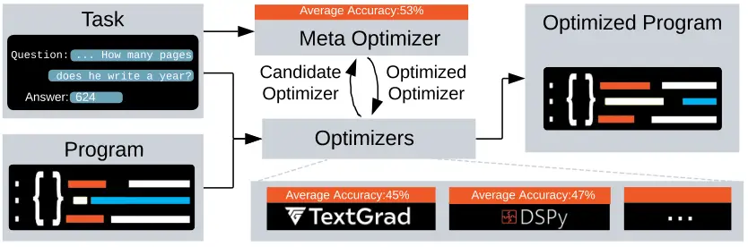
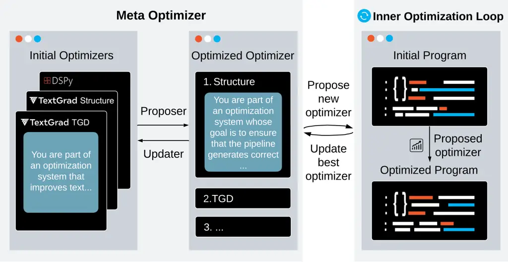

# metaTextGrad: Automatically optimizing language model optimizers

Guowei Xu Affiliation: Tsinghua University    Mert Yuksekgonul
Affiliation: Stanford University    Carlos Guestrin
Affiliation: Stanford University    James Zou Affiliation: Stanford
University

###### Abstract

Large language models (LLMs) are increasingly used in learning
algorithms, evaluations, and optimization tasks. Recent studies have
shown that using LLM-based optimizers to automatically optimize model
prompts, demonstrations, predictions themselves, or other components can
significantly enhance the performance of AI systems, as demonstrated by
frameworks such as DSPy and TextGrad. However, optimizers built on
language models themselves are usually designed by humans with manual
design choices; optimizers themselves are not optimized. Moreover, these
optimizers are general purpose by design, to be useful to a broad
audience, and are not tailored for specific tasks. To address these
challenges, we propose metaTextGrad, which focuses on designing a
meta-optimizer to further enhance existing optimizers and align them to
be good optimizers for a given task. Our approach consists of two key
components: a meta prompt optimizer and a meta structure optimizer. The
combination of these two significantly improves performance across
multiple benchmarks, achieving an average absolute performance
improvement of up to 6% compared to the best baseline.

## 1 Introduction

Large language models (LLMs) are increasingly used in learning
algorithms, optimization, and evaluation tasks (1, 2, 3, 4, 5). However,
algorithms that incorporate LLMs often face significant challenges.
Firstly, many of these algorithms are still hand-crafted to a
considerable extent, requiring substantial human expertise and effort to
design and implement effectively. Second, LLMs are notably sensitive to
the specific wording and structure of their instructions (6), making it
tedious to improve them effectively to be used in learning algorithms.



Figure 1: Illustration of the meta-optimization process. A
meta-optimizer optimizes LLM optimizers by aligning them with specific
tasks through task interaction while leveraging the strengths of
different optimizers to propose a more effective optimizer.

Many studies have explored prompt optimization approaches to
automatically design better prompts and enhance the performance of LLMs.
For example, algorithms such as OPRO (3), MIPRO (7), and TextGrad (1)
have introduced optimizers based on LLMs that support automatic prompt
optimization. However, these optimizers are often fixed, applying the
same optimization strategies with the same optimizer prompts independent
of the task, lacking a process to align with the specific task.
Importantly, these optimizers are general purpose by design, to be
useful to many different downstream tasks and be used by large user
bases. Furthermore, different optimizers likely excel at different types
of optimization tasks; thus, achieving the best of all optimizers
introduces either a choice to be made among them or a strategy to
ensemble them. There is no method to automatically design and improve
the optimizers to call based on the characteristics of a task.

In this work, we explore how to automatically optimize both the
structure and the prompt of optimizers. Specifically, we assume that all
LLM calls are black-box calls, where the internal states of the LLM, as
well as any information such as model gradients, are inaccessible, and
only the inputs to and outputs of the LLM are observable. For the task
to be optimized, we require only a small training dataset containing
some input-output pairs and an evaluation metric the user wants to
improve upon.

We propose using a meta-optimizer to automatically optimize the
optimizer, with the objective of identifying improved optimizers such
that the program optimized by it achieves the best performance on the
given task. To this end, we introduce two types of meta-optimization
strategies: the meta prompt optimizer and the meta structure optimizer.
The meta prompt optimizer focuses on refining the prompts of the LLM
optimizers to enhance their effectiveness and better align them with
specific tasks. Meanwhile, the meta structure optimizer is designed to
automatically determine the optimal combination and sequence of
different optimizers or modules based on the characteristics of the
task.

By combining these two types of meta-optimizers, we propose
metaTextGrad, which integrates both components into a unified framework.
Specifically, given a set of input optimizers, metaTextGrad first
performs prompt optimization for each optimizer independently. Then, it
explores the combination and sequencing of these optimizers to construct
a more effective composite optimizer. We conducted experiments on
multiple benchmarks, and the results demonstrate that our meta-optimized
optimizers consistently outperform the existing ones.

Overall, we summarize our contributions as follows. First, we introduce
the concept of meta-optimization, highlighting that existing LLM
optimizers often require further task alignment and effective
combination through a meta-optimizer to maximize their potential.
Second, we develop two types of meta-optimizers: the meta prompt
optimizer and the meta structure optimizer. Building on these, we
propose metaTextGrad, which integrates both types of meta-optimizers
into a unified framework. Lastly, experimental results on multiple
benchmarks demonstrate that our method significantly outperforms
baseline approaches in both performance and generalization.

## 2 Problem Statement

Here, we will follow the notation from (7). Consider an LLM program
$`\Phi`$ that may contain multiple LLM calls forming a pipeline, with
each call using a different prompt. The pipeline structure of a program
and the prompt corresponding to each LLM call can be learnable and
optimized by an LLM optimizer.

The task of the LLM optimizer is to find the optimal program $`\Phi`$
given a training dataset $`\mathcal{D}`$ (with pairs of inputs $`x`$ and
outputs $`y`$), and an evaluation metric $`\mu`$.

```math
\Phi^{*}=\mathop{\mathrm{arg\,max}}\limits_{\Phi}\,\frac{1}{|\mathcal{D}|}\sum_{(x,y)\in\mathcal{D}}\mu(\Phi(x),y) \tag{1}
```

Existing methods attempt to approximate solutions to this optimization
problem from different perspectives. Optimizers such as MIPRO (7),
OPRO (8), and TGD (9) aim to find better prompts, while optimizers like
ADAS (10) focus on exploring structures. We unify the existing optimizer
algorithms into a general framework, as outlined in Algorithm 1.
Importantly, these optimizers are the same type as of $`M`$, are
designed by humans, and their structure and prompts are fixed.

Specifically, each optimizer should be capable of performing four
operations:

1\. Initialize: Given the training dataset and the program to be
optimized, prepare the training scheme.

2\. Propose: Suggest improvements to the program, which may involve
modifications to the pipeline structure, prompts, or other aspects.

3.Update: Update the current optimal program based on the evaluation
results of the improved program and determine the next proposal.

4\. ExtractOptimizedProgram: Return the best program found so far.

1:  Input: Optimizer $`M`$, Initial Program $`\Phi`$, Max Iterations
$`I`$

2:  Input: Training Data $`\mathcal{D}`$, Validation Data
$`\mathcal{D}_{val}`$, Metric $`\mu`$

3:  Output: $`\Phi^{*}`$, i.e., the optimized version of $`\Phi`$

4:  $`M.\text{Initialize}(\mathcal{D},\Phi)`$

5:  for $`k\leftarrow 1\textbf{ to }I`$ do

6:   $`\Phi_{k}\leftarrow M.\text{Propose}()`$

7:
  $`\sigma\leftarrow\frac{1}{|\mathcal{D}_{val}|}\sum_{(x,y)\in\mathcal{D}_{val}}\mu\!\bigl(\Phi_{k}(x),y\bigr)`$

8:   $`M.\text{Update}(\Phi_{k},\sigma)`$

9:  end for

10:
 $`(\Phi^{*},\sigma^{*}\bigr)\leftarrow M.\text{ExtractOptimizedProgram}()`$

11:  return $`\bigl(\Phi^{*},\sigma^{*}\bigr)`$

Algorithm 1 Inner Loop: Optimize $`\Phi`$ with Optimizer $`M`$

The problem we investigate is how to further enhance existing optimizers
and align them to be effective optimizers for a given task, instead of
relying on human-written optimizers. To this end, we introduce the
concept of a meta-optimizer. Let the optimized program obtained by an
optimizer $`M`$ be denoted as
$`\Phi^{*}=M.\text{optimize}(\mathcal{D},\Phi)`$. The optimization
objective of the meta-optimizer is to find improved optimizers such that
the program optimized by this optimizer performs better on the
corresponding task. In particular, the optimization problem is
formalized as:

```math
M^{*}=\mathop{\mathrm{arg\,max}}\limits_{M}\,\frac{1}{|\mathcal{D}|}\sum_{(x,y)\in\mathcal{D}}\mu(M.\mathrm{optimize}(\mathcal{D},\Phi)(x),y). \tag{2}
```

In optimization, good initializations often contribute to improved
performance, in continuous or discrete optimization alike (11, 12).
Ideally, the meta-optimization framework should leverage the existing,
manually designed optimizers and achieve further improvements.
Therefore, the input to the meta-optimizer can include one or more
existing optimizers as initialization, ultimately producing an optimized
optimizer. The detailed process is illustrated in Algorithm 2.

1:  Input: Meta-Optimizer $`\widehat{M}`$

2:  Input: Max Meta-Iterations $`J`$, Max Inner-Iterations $`I`$

3:  Input: Initial optimizers $`\{M^{(1)},M^{(2)},\dots,`$ $`M^{(r)}\}`$

4:  Input: Training Data $`\mathcal{D}`$, Validation Data
$`\mathcal{D}_{val}`$

5:  Input: Metric $`\mu`$, Initial Program $`\Phi`$

6:  Output: Optimized optimizer $`M^{*}`$

7:  $`\widehat{M}.\text{Initialize}(\mathcal{D},\{M^{(i)}\}_{i=1}^{r})`$

8:  for $`j\leftarrow 1\textbf{ to }J`$ do

9:   $`M_{j}\leftarrow\widehat{M}.\text{Propose}()`$

10:
  $`(\Phi^{*}_{j},\sigma_{j})\leftarrow\text{InnerLoop}\bigl(M_{j},\Phi,I,\mathcal{D},\mathcal{D}_{val},\mu)`$

11:   $`\widehat{M}.\text{Update}\bigl(M_{j},\sigma_{j}\bigr)`$

12:  end for

13:  $`M^{*}\leftarrow\widehat{M}.\text{ExtractOptimizedOptimizer}()`$

14:  return $`M^{*}`$

Algorithm 2 Meta-Optimization of Optimizers

Specifically, the meta-optimizer combines different input optimizers to
propose new optimizers. The newly proposed optimizers execute the
process described in Algorithm 1 to obtain the _inner loop_ optimization
results. Based on the performance of the newly designed optimizers, the
meta-optimizer updates the current best optimizer and determines the
proposal for the next iteration (_outer loop_).

However, similar to the problem of optimizing a program, finding an
optimal optimizer using a meta-optimizer is generally an intractable
optimization problem. Therefore, it is necessary to introduce
appropriate parameterizations and simplifications to the problem. In our
work, we primarily focus on two types of parameterizations for the
meta-optimizer:

1\. automatically optimizing the prompts in the optimizer to align it
with the given task (_Meta Prompt Optimizer_),

2\. automatically optimizing the combination of different optimizers
based on the characteristics of the task, forming a new composite
optimizer (_Meta Structure Optimizer_).

Collectively, we can meta-optimize using both parameterizations to
obtain better optimizers.

## 3 metaTextGrad: Automatically Optimizing Language Model Optimizers

In this section, we first introduce the theoretical insights behind the
meta optimizer. Next, we further analyze and illustrate our motivation
through concrete examples. Finally, we present the metaTextGrad
pipeline, which consists of the meta prompt optimizer and the meta
structure optimizer.

### 3.1 Theoretical Insight

We present the theoretical motivation for meta optimization,
highlighting the importance of aligning the optimizer with the target
task. In particular, it is shown that when both the training and test
sets are sampled from the same underlying data distribution, an
optimizer properly aligned via meta-learning on the training set will,
with high probability, produce programs on the test set whose accuracy
closely approaches that of the optimal optimizer. In contrast, an
optimizer that has not been optimized on the training set lacks such
theoretical guarantee.

We begin by introducing the necessary notation. Let
$`\mu:\mathcal{X}\to[0,1]`$ denote the accuracy metric, where
$`\mathcal{X}`$ is the space of natural language outputs. Let $`D`$ be a
distribution over natural language inputs $`x`$. Let $`\Phi_{\theta}`$
be an optimizer parameterized by $`\theta\in\Theta`$. Given input $`x`$
and access to $`\mu`$, $`\Phi_{\theta}`$ makes $`T`$ zeroth-order
queries and returns an optimized output $`x_{T}`$.

Define the loss of the optimizer on input $`x`$ as
$`L(\theta,x)=1-\mu(x_{T})=1-\mu(\Phi_{\theta}(x,T)).`$ The population
loss is given by $`R(\theta)=\mathbb{E}_{x\sim D}[L(\theta,x)].`$ Let
$`S=\{x_{1},\dots,x_{n}\}\sim D^{n}`$ denote a dataset sampled from
$`D`$, and define the empirical loss on $`S`$ as
$`R_{S}(\theta)=\frac{1}{n}\sum_{i=1}^{n}L(\theta,x_{i}).`$

Let $`\widehat{\theta}_{S}=\arg\min_{\theta\in\Theta}R_{S}(\theta)`$ be
the optimizer parameters obtained via meta-learning on the training set
$`S`$, and let $`\theta^{\ast}=\arg\min_{\theta\in\Theta}R(\theta)`$ be
the globally optimal optimizer under distribution $`D`$. We can now
state the following theorem:

###### Theorem 1.

Let $`S_{1}`$ and $`S_{2}`$ be two datasets sampled independently from
distribution $`D`$, with sizes $`n`$ and $`m`$, respectively. Then, with
probability at least $`1-\delta`$, the optimizer
$`\widehat{\theta}_{S_{1}}`$ trained on $`S_{1}`$ satisfies:

```math
R_{S_{2}}(\widehat{\theta})\leq R(\theta^{\ast})+\sqrt{\tfrac{2\log(6/\delta)}{n}}+\sqrt{\tfrac{\log(6/\delta)}{2m}}. \tag{3}
```

The proof of Theorem 1 is based on Hoeffding’s inequality, and the full
derivation is provided in Appendix B. The theorem highlights the
necessity of performing meta-optimization.

In contrast, an optimizer $`\theta_{0}`$ that hasn’t been optimized on
the training dataset has no theoretical guarantee. We can still
guarantee that $`R_{S_{2}}(\theta_{0})`$ is similar to
$`R(\theta_{0})`$, but the guarantee says nothing about how large
$`R(\theta_{0})`$ is. If the optimizer is bad on average for this task,
it will still be bad on $`S_{2}`$ with high probability. This provides a
theoretical foundation for the design of metaTextGrad.



Figure 2: Illustration of metaTextGrad. metaTextGrad combines a meta
prompt optimizer and a meta structure optimizer. Given a set of
optimizers, metaTextGrad performs optimization in two steps. First, it
individually refines each optimizer by optimizing its prompts to better
align with the task. Then, it combines the different prompt-optimized
optimizers to construct the final optimizer.

### 3.2 Motivating Example

Existing optimizers such as TextGrad and DSPy are manually designed by
humans with the goal of performing well across a broad distribution of
tasks, and they indeed demonstrate strong average performance.

For example, the prompt used by the TextGrad TGD optimizer is as
follows:


As can be seen, this prompt is indeed highly general, with phrasing such
as ‘improve prompts, solutions to problems, code, or any other
text-based variable’.

However, in some cases, such general-purpose prompt fails to effectively
optimize model performance. While the optimizers in both TextGrad and
DSPy can obtain learning signals from task-specific evaluators, these
signals tend to be noisy and sparse.

First, when feedback is provided solely in the form of scalar scores
rather than textual guidance, it becomes sparse, making optimization
substantially more challenging. Second, although optimizers such as
TextGrad’s TGD can accept textual gradient feedback, such feedback is
often highly noisy, making it difficult for the optimizer to learn
effectively. For example, the evaluator feedback received by the TGD
optimizer may look like the following:


Here, the evaluator feedback includes suggestions such as ‘List the
criteria for optical activity before analyzing each compound’, which are
specific to a single problem instance. Such feedback is clearly noisy.
Since a generic optimizer relies solely on feedback to guide its
updates, it is likely to incorporate such suggestions into the optimized
LLM program prompt, which can be detrimental to the overall performance
of the program.

Yet, in reality, we can choose to let the LLM optimizer adapt to a
specific task distribution in order to achieve better performance. This
is because if the distribution of programs generated by the
task-specific optimizer is more aligned with the task requirements, the
difficulty of finding the optimal program will be significantly reduced,
and the impact of noise in the evaluator’s signal will be greatly
mitigated, even when the feedback is noisy.

We illustrate this using the BBH Dyck Languages task as an example,
showing that aligning the LLM optimizer to a specific task distribution
can lead to improved performance. For instance, consider the following
task-specific optimizer prompt:


It can be observed that the task-specific optimizer leads to a shift in
the distribution of LLM programs it tends to optimize, making it more
likely to generate content that aligns with key task requirements, such
as producing programs that satisfy the requirement of preserving the
LIFO (Last In First Out) order, etc. As a result, even if the evaluator
feedback is somewhat noisy or sparse, the LLM program optimized by the
optimizer can still perform well, and is more likely to generate
critical statements such as: Explicitly push each opening symbol onto
the stack and pop it when a corresponding closing symbol is encountered.
After processing each symbol, describe the current state of the stack,
focusing on unmatched opening symbols. In contrast, if a generic
optimizer is used, it becomes difficult to generate effective prompts
under noisy or sparse feedback conditions.

This demonstrates that adapting to a new task distribution is
meaningful. To avoid adapting to each new task distribution by hand, we
meta-learn how to adapt, which is the core motivation of metaTextGrad.

### 3.3 Pipeline

#### 3.3.1 Meta Prompt Optimizer

LLM optimizers are usually designed by humans with manual design
choices. As a result, the optimizers themselves are not optimized or
aligned with a given task. We aim to optimize the prompts of LLM
optimizers to further enhance their effectiveness and align them with
tasks.

Below is a brief introduction to the implementation method of the meta
prompt optimizer. The detailed pseudocode can be found in Appendix A.1.
To Initialize, the meta prompt optimizer runs a round of optimization on
the validation dataset to evaluate and record the initial performance of
the optimizer. To Propose, the meta prompt optimizer randomly samples
data examples from the training dataset and analyzes the general
characteristics of the task type. Based on the current best optimizer
prompt, it proposes an improved prompt that is more aligned with the
task. To Update, the optimized optimizer undergoes an inner loop
optimization test on the validation dataset. If the test results
outperform those of the previously best optimizer, the optimizer is
updated. To ExtractOptimizedOptimizer, the meta prompt optimizer returns
the best optimizer learned so far. Among these steps, Propose is the
core of the meta prompt optimizer and the only stage where LLM calls are
invoked. For detailed prompts, refer to Appendix D.1.

#### 3.3.2 Meta Structure Optimizer

A variety of LLM optimizers have been proposed to optimize program
structures, prompts, and other components. The meta structure optimizer
is designed to automatically optimize the combination and ordering of
different optimizers based on the characteristics of the task.

Below, we briefly introduce the working principles of the meta structure
optimizer. The detailed pseudocode implementation can be found in
Appendix A.2. To Initialize, the meta structure optimizer runs one round
of optimization for each input optimizer on the validation dataset,
selects the highest score and the corresponding optimizer as the initial
best value. To Propose, we provide the meta structure optimizer with a
set of reference optimizers. If previously optimized, better-performing
optimizers exist, they are also included. Based on this, the meta
structure optimizer integrates and proposes an improved optimizer. To
Update, the meta structure optimizer evaluates whether the proposed
optimizer shows improved performance on the validation dataset and
updates the current best optimizer and score. To
ExtractOptimizedOptimizer, the meta structure optimizer returns the best
optimizer learned so far. The Propose stage is the only stage with LLM
calls. For detailed prompts, please refer to Appendix D.2.

#### 3.3.3 metaTextGrad

In the previous two sections, we introduced the meta prompt optimizer
and the meta structure optimizer. metaTextGrad is composed of these two
components. Specifically, after receiving a set of input optimizers,
metaTextGrad first performs prompt optimization for each optimizer
individually and then explores the combination of different optimizers
to form a better composite optimizer.

## 4 Experiment

### 4.1 Experimental Setup

In this section, we use the existing optimizers from DSPy and TextGrad
as baseline methods. We evaluate our approach and the baselines on
multiple benchmarks, including BBH (13, 14), MMLU (15), and GPQA (16).
To ensure reproducibility, we provide the prompts and structures of the
learned programs in Appendix E.

Baselines. We used zero-shot CoT, few-shot CoT (17),
self-consistency (18), best-of-N (19, 20), MIPROv2  (7), TextGrad
TGD (1) and ADAS-TG (10) as baselines. Zero-shot CoT relies on direct
chain-of-thought reasoning, whereas MIPRO and TextGrad’s TGD optimizer
refine the program’s prompt. ADAS is an algorithm for automatically
searching and optimizing the program’s structure. We implemented this
algorithm within TextGrad as a baseline, referred to as ADAS-TG.

Benchmarks. We evaluate our method on four widely used, challenging, and
diverse benchmarks: BBH Word Sorting, BBH Dyck Languages (13, 14), MMLU
Abstract Algebra (15), and GPQA Diamond (16). For detailed settings,
please refer to Appendix C. Due to the non-determinism of LLM APIs (21),
the test accuracy for each benchmark is averaged over five random seeds.

In our experiments, we consider three different levels of LLM calls: (1)
LLM calls within the program itself, (2) LLM calls made by the optimizer
while refining the program, and (3) LLM calls made by the meta-optimizer
when optimizing the optimizer. As shown in Section 4.3, the frequency of
these calls decreases significantly across these levels. This
hierarchical structure allows for cost-effective resource allocation:
the program should use a relatively economical model, the optimizer can
leverage a more capable model, and the meta-optimizer should employ the
best available model. Consequently, in our experiments, we use
GPT-4o-mini for LLM calls within the program, GPT-4o for the MIPROv2 and
TGD optimizers, and the o1 model for the structure optimizer and the
meta-optimizers.

### 4.2 Main Results

|                           |              |      |                |      |              |      |                  |      |         |      |
| ------------------------- | ------------ | ---- | -------------- | ---- | ------------ | ---- | ---------------- | ---- | ------- | ---- |
| Method                    | Word Sorting |      | Dyck Languages |      | GPQA Diamond |      | Abstract Algebra |      | Average |      |
|                           | Val          | Test | Val            | Test | Val          | Test | Val              | Test | Val     | Test |
| Vanilla prompting methods |              |      |                |      |              |      |                  |      |         |      |
| Zero-shot CoT             | 0.46         | 0.55 | 0.06           | 0.05 | 0.32         | 0.34 | 0.74             | 0.70 | 0.40    | 0.41 |
| 8-shot CoT                | 0.50         | 0.52 | 0.14           | 0.19 | 0.32         | 0.35 | 0.65             | 0.71 | 0.40    | 0.44 |
| Self-consistency (8)      | 0.47         | 0.52 | 0.10           | 0.12 | 0.40         | 0.42 | 0.76             | 0.70 | 0.43    | 0.44 |
| Best of N (8)             | 0.48         | 0.52 | 0.14           | 0.17 | 0.37         | 0.40 | 0.77             | 0.74 | 0.44    | 0.46 |
| TextGrad optimizers       |              |      |                |      |              |      |                  |      |         |      |
| TGD Optimizer             | 0.54         | 0.55 | 0.10           | 0.10 | 0.34         | 0.35 | 0.76             | 0.71 | 0.44    | 0.43 |
| ADAS-TG                   | 0.58         | 0.58 | 0.21           | 0.16 | 0.36         | 0.37 | 0.75             | 0.70 | 0.48    | 0.45 |
| DSPy optimizers           |              |      |                |      |              |      |                  |      |         |      |
| Zero-shot MIPROv2         | 0.57         | 0.55 | 0.19           | 0.16 | 0.43         | 0.38 | 0.76             | 0.77 | 0.49    | 0.47 |
| 8-shot MIPROv2            | 0.52         | 0.57 | 0.33           | 0.26 | 0.37         | 0.34 | 0.74             | 0.65 | 0.49    | 0.46 |
| Meta-optimized optimizers |              |      |                |      |              |      |                  |      |         |      |
| metaTextGrad              | 0.60         | 0.65 | 0.42           | 0.37 | 0.45         | 0.40 | 0.78             | 0.71 | 0.56    | 0.53 |

Table 1: Accuracy (%) of GPT-4o-mini on benchmarks. Bold indicates the
best result, and underlined text represents the second-best.

As shown in Table 1, we achieve up to an 11% absolute performance
improvement across these datasets, with an average performance
significantly surpassing existing optimizers. Our method outperforms
both TGD and ADAS-TG, which serve as the base candidates for
metaTextGrad, across all benchmarks and achieves the best performance on
most of them. It’s worth noting that the programs optimized by the
meta-optimized optimizers also exhibit interesting properties.

\(1\) The optimized optimizer is more aligned with specific tasks. For
example, in the BBH Dyck Languages task, the generated program includes
components such as n type analyzer, and a stack validator, which closely
match the nature of the task. In contrast, an unaligned optimizer tends
to propose more generic and broadly applicable structures.

\(2\) The optimized optimizer is more effective in handling finer
details. For instance, in multi-step LLM calls, passing both the overall
problem and subproblems to each LLM call helps maintain a global
understanding throughout the process. This behavior is more frequently
observed in the optimized optimizer, whereas the initial optimizer tends
to pass only the subproblems to each subpart.

\(3\) The meta-optimized optimizer generally improves efficiency.
Although we allocate six optimization steps per training epoch, we
observe that meta-optimized optimizers, due to their stronger task
alignment, often achieve significant improvements within the first 1-2
steps. In contrast, other optimizers show more gradual improvements.

Please refer to Appendix E for the optimized programs and Appendix  F
for the optimized optimizers.

### 4.3 Cost analysis

In this section, we examine the trade-off between effectiveness and
computational cost.

First, we analyze the token usage at different levels within a single
epoch of meta optimization. This analysis supports our design choice of
using models with different capabilities at different levels. As shown
in Table 3, the token usage per optimization epoch on the MMLU Abstract
Algebra dataset reveals that higher-level components require
significantly fewer tokens than lower-level ones. This justifies our
hierarchical design. For comparison, a single round of zero-shot CoT
requires approximately 140k tokens, indicating that the overall token
consumption of our optimization pipeline remains within a reasonable and
practical range.

| Level                | Tokens        |
| -------------------- | ------------- |
| Program level        | $`\sim`$ 400k |
| Optimizer level      | $`\sim`$ 100k |
| Meta-optimizer level | $`\sim`$ 2.5k |

Table 2: Token analysis on Abstract Algebra.

| Model                | Performance | Cost   |
| -------------------- | ----------- | ------ |
| 0-shot CoT (4o-mini) | 0.05        | 0.14\$ |
| Ours (4o-mini)       | 0.37        | 0.44\$ |
| 0-shot CoT (4o)      | 0.18        | 0.52\$ |

Table 3: Cost analysis on Dyck Languages.

In addition, we evaluate the cost and performance of the zero-shot CoT
approach using both GPT-4o-mini and GPT-4o on the BBH Dyck Languages
dataset, and compare them to our optimized approach applied to
GPT-4o-mini. As shown in Table 3, our method achieves the best
performance on BBH Dyck Languages while incurring a lower cost than
GPT-4o. This demonstrates that with effective prompt and structure
optimization, a smaller model can outperform the zero-shot performance
of a larger model. These findings highlight the practical applicability
and scalability of our approach.

### 4.4 Transferability of the optimized optimizer across models and datasets

In this section, we evaluate the transferability of our optimized
optimizer across different language models and datasets. As shown in
Table 5, our method trained on GPT-4o-mini achieves superior performance
compared to unoptimized baselines when evaluated on Claude 3 Haiku.
Furthermore, as illustrated in Table 5, our optimizer trained on the
GPQA diamond dataset also transfers effectively to the Abstract Algebra
dataset. These results demonstrate that our meta-optimized optimizer
exhibits strong transferability across models and datasets.

|                                     |                |      |
| ----------------------------------- | -------------- | ---- |
| Method (Claude 3 Haiku)             | Dyck Languages |      |
|                                     | Val            | Test |
| Zero-shot CoT                       | 0.07           | 0.10 |
| TextGrad optimizers                 |                |      |
| TGD Optimizer                       | 0.10           | 0.04 |
| ADAS-TG                             | 0.35           | 0.34 |
| Optimizers optimized on GPT-4o-mini |                |      |
| metaTextGrad                        | 0.32           | 0.35 |

Table 4: Transferability of the optimized optimizer across models.

|                                      |                  |      |
| ------------------------------------ | ---------------- | ---- |
| Method                               | Abstract Algebra |      |
|                                      | Val              | Test |
| Zero-shot CoT                        | 0.74             | 0.70 |
| TextGrad optimizers                  |                  |      |
| TGD Optimizer                        | 0.76             | 0.71 |
| ADAS-TG                              | 0.75             | 0.70 |
| Optimizers optimized on GPQA diamond |                  |      |
| metaTextGrad                         | 0.78             | 0.77 |

Table 5: Transferability of the optimized optimizer across datasets.

### 4.5 Analysis of the effectiveness of each meta optimizer

In this section, we analyze the contributions of different components of
the proposed meta optimizer. As shown in Table 6, we find that all meta
optimizers improve performance on the BBH Dyck Languages benchmark.
Optimizers optimized using either method outperform the original
optimizer. Among them, the meta prompt optimizer achieves the best
improvement when applied to ADAS-TG.

| Split | 0-shot CoT | TGD  | ADAS-TG | TGD (O) | ADAS-TG (O) | Struct (O) | metaTextGrad |
| ----- | ---------- | ---- | ------- | ------- | ----------- | ---------- | ------------ |
| Val   | 0.06       | 0.10 | 0.21    | 0.21    | 0.42        | 0.24       | 0.42         |
| Test  | 0.05       | 0.10 | 0.16    | 0.24    | 0.37        | 0.16       | 0.37         |

Table 6: Analysis of the effectiveness of each meta optimizer on Dyck
Languages. TGD (O), ADAS-TG (O), and Struct (O) respectively denote the
TGD and ADAS-TG optimizers enhanced by the meta prompt optimizer, and
the optimizers enhanced by the meta structure optimizer.

Here, metaTextGrad produces the same results as the optimized ADAS-TG
because the meta optimizer did not find a better option during the meta
structure optimization. So, the optimized ADAS-TG was selected as the
best result. Notably, the best meta optimizer varies across benchmarks
due to task-specific differences. Despite this, all meta optimizers can
effectively enhance the performance of a given optimizer.

## 5 Related Work

### 5.1 Prompt optimization

Prompt optimization has proven crucial for improving LLM performance.
Initial strategies, such as few-shot learning and in-context learning,
demonstrated careful prompt design could significantly boost LLM
performance (22). Techniques like chain-of-thought reasoning  (17) and
ensemble methods  (23) also emerged as popular ways to structure prompts
for effective problem-solving. However, hand-crafted approaches are
limited in their utility. Efforts to automate prompt optimization have
led to the development of gradient-based approaches (24, 25). These
methods, however, require access to model parameters, which limits their
application to open-source models.

To address these constraints, alternative approaches have been proposed
that leverage LLMs themselves as prompt optimizers. APE (26) was among
the first to introduce the concept of automatic instruction generation
and selection. (27) introduced the concept of meta prompt, demonstrating
systematically designing meta-prompts can improve prompt quality.
DSPy (4) proposed a systematic approach for optimizing LLM programs,
integrating structured optimization techniques.

Another line of research explores optimization methods based on textual
feedback. ProTeGi (28) first introduced the concept of textual
gradients, highlighting that LLMs themselves can serve as a form of a
loss function to guide the improvement of LLM programs. Building on this
idea, TextGrad (1) developed a structured textual gradient descent
framework, demonstrating its applicability and effectiveness across
multiple disciplines and domains. Concurrently, OPTO \[29\] proposed a
related approach in which the optimizer receives an execution trace
alongside feedback on the generated output. Semantic gradient
descent (30) refines textual gradient descent by enhancing feedback
signals.

However, the LLM optimizers proposed in these methods remain fixed
during the optimization process, limiting their effectiveness and
adaptability. Our approach addresses this limitation by leveraging a
meta-optimizer to align LLM optimizers with the task.

### 5.2 Classical meta-learning

Gradient-based meta-learning algorithms such as Model-Agnostic
Meta-Learning (MAML) (31), First-Order MAML, Reptile (32), and ANIL (33)
cast _learning to learn_ as finding a good initialization that can be
fine-tuned with only a handful of gradient steps. MAML jointly optimizes
across tasks through a bi-level procedure, explicitly encouraging large
improvements after one or two inner-loop updates. Reptile shows that a
simpler first-order update suffices, while ANIL’s ablation studies
reveal that the bulk of MAML’s gains stem from feature reuse rather than
rapid weight adaptation, allowing the inner loop to be removed for all
but the task-specific head. Despite their successes, these methods
utilize fixed optimizers. In contrast, we focus on optimizing LLM-based
optimizers rather than classical ones, and we meta-learn the optimizer
so that the optimization strategy is aligned with each new task, rather
than merely learning a good initialization.

## 6 Conclusion

In this paper, we propose metaTextGrad, a meta-optimization framework
that enhances existing LLM optimizers by aligning them more effectively
with tasks. Our method introduces two key components: the meta prompt
optimizer, which refines optimizer prompts for better task adaptation,
and the meta structure optimizer, which determines the optimal
combination of different optimizers. By integrating these two
components, metaTextGrad improves the efficiency of LLM optimizers,
leading to better performance across a diverse range of benchmarks.

Looking ahead, there are several promising directions for future
research. First, even the meta optimizer we proposed can be optimized.
In particular, our meta optimizer is designed by ourselves, instead of
learned by data, and there are techniques in the meta learning
literature that could be adapted to allow this (34, 35). Second, future
work can explore different ways to parameterize the optimizers. This
study primarily focuses on refining optimizer prompts and their
composition, but meta-optimizers could also be leveraged to
automatically enhance the optimization algorithms employed by existing
optimizers. We believe that optimizing LLM optimizers is a crucial step
toward further improving the performance and task alignment capabilities
of LLM-driven systems and has the potential to provide valuable insights
to the research community.

## References

- \[1\] Mert Yuksekgonul, Federico Bianchi, Joseph Boen, Sheng Liu, Zhi
  Huang, Carlos Guestrin, and James Zou. Textgrad: Automatic"
  differentiation" via text. arXiv preprint arXiv:2406.07496, 2024.
- \[2\] Lianmin Zheng, Wei-Lin Chiang, Ying Sheng, Siyuan Zhuang,
  Zhanghao Wu, Yonghao Zhuang, Zi Lin, Zhuohan Li, Dacheng Li, Eric
  Xing, et al. Judging llm-as-a-judge with mt-bench and chatbot arena.
  Advances in Neural Information Processing Systems, 36, 2024.
- \[3\] Chengrun Yang, Xuezhi Wang, Yifeng Lu, Hanxiao Liu, Quoc V Le,
  Denny Zhou, and Xinyun Chen. Large language models as optimizers. In
  The Twelfth International Conference on Learning
  Representations, 2024.
- \[4\] Omar Khattab, Arnav Singhvi, Paridhi Maheshwari, Zhiyuan Zhang,
  Keshav Santhanam, Sri Vardhamanan A, Saiful Haq, Ashutosh Sharma,
  Thomas T. Joshi, Hanna Moazam, Heather Miller, Matei Zaharia, and
  Christopher Potts. DSPy: Compiling declarative language model calls
  into state-of-the-art pipelines. In The Twelfth International
  Conference on Learning Representations, 2024.
- \[5\] Aman Madaan, Niket Tandon, Prakhar Gupta, Skyler Hallinan, Luyu
  Gao, Sarah Wiegreffe, Uri Alon, Nouha Dziri, Shrimai Prabhumoye,
  Yiming Yang, et al. Self-refine: Iterative refinement with
  self-feedback. Advances in Neural Information Processing Systems,
  36, 2024.
- \[6\] Steffi Chern, Ethan Chern, Graham Neubig, and Pengfei Liu. Can
  large language models be trusted for evaluation? scalable
  meta-evaluation of llms as evaluators via agent debate. arXiv preprint
  arXiv:2401.16788, 2024.
- \[7\] Krista Opsahl-Ong, Michael J Ryan, Josh Purtell, David Broman,
  Christopher Potts, Matei Zaharia, and Omar Khattab. Optimizing
  instructions and demonstrations for multi-stage language model
  programs, 2024.
- \[8\] Kevin Yang, Yuandong Tian, Nanyun Peng, and Dan Klein. Re3:
  Generating longer stories with recursive reprompting and revision. In
  Proceedings of the 2022 Conference on Empirical Methods in Natural
  Language Processing. Association for Computational Linguistics,
  December 2022.
- \[9\] Mert Yuksekgonul, Varun Chandrasekaran, Erik Jones, Suriya
  Gunasekar, Ranjita Naik, Hamid Palangi, Ece Kamar, and Besmira Nushi.
  Attention satisfies: A constraint-satisfaction lens on factual errors
  of language models. In The Twelfth International Conference on
  Learning Representations, 2024.
- \[10\] Shengran Hu, Cong Lu, and Jeff Clune. Automated design of
  agentic systems. arXiv preprint arXiv:2408.08435, 2024.
- \[11\] Qian Li, San-Yang Liu, and Xin-She Yang. Influence of
  initialization on the performance of metaheuristic optimizers. Applied
  Soft Computing, 91:106193, 2020.
- \[12\] Ilya Sutskever, James Martens, George Dahl, and Geoffrey
  Hinton. On the importance of initialization and momentum in deep
  learning. In International conference on machine learning, pages
  1139–1147. PMLR, 2013.
- \[13\] Mirac Suzgun, Nathan Scales, Nathanael Schärli, Sebastian
  Gehrmann, Yi Tay, Hyung Won Chung, Aakanksha Chowdhery, Quoc Le,
  Ed Chi, Denny Zhou, and Jason Wei. Challenging BIG-bench tasks and
  whether chain-of-thought can solve them. In Findings of the
  Association for Computational Linguistics: ACL 2023, Toronto, Canada,
  July 2023. Association for Computational Linguistics.
- \[14\] Aarohi Srivastava, Abhinav Rastogi, and Abhishek Rao et al.
  Beyond the imitation game: Quantifying and extrapolating the
  capabilities of language models. Transactions on Machine Learning
  Research, 2023.
- \[15\] Dan Hendrycks, Collin Burns, Steven Basart, Andy Zou, Mantas
  Mazeika, Dawn Song, and Jacob Steinhardt. Measuring massive multitask
  language understanding. In International Conference on Learning
  Representations, 2021.
- \[16\] David Rein, Betty Li Hou, Asa Cooper Stickland, Jackson Petty,
  Richard Yuanzhe Pang, Julien Dirani, Julian Michael, and Samuel R.
  Bowman. GPQA: A graduate-level google-proof q&a benchmark. In First
  Conference on Language Modeling, 2024.
- \[17\] Jason Wei, Xuezhi Wang, Dale Schuurmans, Maarten Bosma, Fei
  Xia, Ed Chi, Quoc V Le, Denny Zhou, et al. Chain-of-thought prompting
  elicits reasoning in large language models. Advances in neural
  information processing systems, 35:24824–24837, 2022.
- \[18\] Xuezhi Wang, Jason Wei, Dale Schuurmans, Quoc V Le, Ed H. Chi,
  Sharan Narang, Aakanksha Chowdhery, and Denny Zhou. Self-consistency
  improves chain of thought reasoning in language models. In The
  Eleventh International Conference on Learning Representations, 2023.
- \[19\] Nisan Stiennon, Long Ouyang, Jeff Wu, Daniel M. Ziegler, Ryan
  Lowe, Chelsea Voss, Alec Radford, Dario Amodei, and Paul Christiano.
  Learning to summarize from human feedback. In Proceedings of the 34th
  International Conference on Neural Information Processing Systems,
  NIPS ’20, Red Hook, NY, USA, 2020. Curran Associates Inc.
- \[20\] Steve Webb. The physical basis of imrt and inverse planning.
  The British journal of radiology, 76(910):678–689, 2003.
- \[21\] Sherman Chann. Non-determinism in gpt-4 is caused by sparse
  moe.
  [https://152334h.github.io/blog/non-determinism-in-gpt-4/](https://152334h.github.io/blog/non-determinism-in-gpt-4/),
  8 2023.
- \[22\] Harsha Nori, Yin Tat Lee, Sheng Zhang, Dean Carignan, Richard
  Edgar, Nicolo Fusi, Nicholas King, Jonathan Larson, Yuanzhi Li,
  Weishung Liu, et al. Can generalist foundation models outcompete
  special-purpose tuning? case study in medicine. arXiv preprint
  arXiv:2311.16452, 2023.
- \[23\] Jinliang Lu, Ziliang Pang, Min Xiao, Yaochen Zhu, Rui Xia, and
  Jiajun Zhang. Merge, ensemble, and cooperate! a survey on
  collaborative strategies in the era of large language models, 2024.
- \[24\] Taylor Shin, Yasaman Razeghi, Robert L. Logan IV, Eric Wallace,
  and Sameer Singh. AutoPrompt: Eliciting Knowledge from Language Models
  with Automatically Generated Prompts. In Proceedings of the 2020
  Conference on Empirical Methods in Natural Language Processing
  (EMNLP), pages 4222–4235, Online, November 2020. Association for
  Computational Linguistics.
- \[25\] Xiang Chen, Ningyu Zhang, Xin Xie, Shumin Deng, Yunzhi Yao,
  Chuanqi Tan, Fei Huang, Luo Si, and Huajun Chen. Knowprompt:
  Knowledge-aware prompt-tuning with synergistic optimization for
  relation extraction. In Proceedings of the ACM Web conference 2022,
  pages 2778–2788, 2022.
- \[26\] Yongchao Zhou, Andrei Ioan Muresanu, Ziwen Han, Keiran Paster,
  Silviu Pitis, Harris Chan, and Jimmy Ba. Large language models are
  human-level prompt engineers. In The Eleventh International Conference
  on Learning Representations, 2023.
- \[27\] Qinyuan Ye, Maxamed Axmed, Reid Pryzant, and Fereshte Khani.
  Prompt engineering a prompt engineer. arXiv preprint
  arXiv:2311.05661, 2023.
- \[28\] Reid Pryzant, Dan Iter, Jerry Li, Yin Lee, Chenguang Zhu, and
  Michael Zeng. Automatic prompt optimization with “gradient descent”
  and beam search. In Houda Bouamor, Juan Pino, and Kalika Bali,
  editors, Proceedings of the 2023 Conference on Empirical Methods in
  Natural Language Processing, pages 7957–7968, Singapore,
  December 2023. Association for Computational Linguistics.
- \[29\] Ching-An Cheng, Allen Nie, and Adith Swaminathan. Trace is the
  next autodiff: Generative optimization with rich feedback, execution
  traces, and llms. In A. Globerson, L. Mackey, D. Belgrave, A. Fan,
  U. Paquet, J. Tomczak, and C. Zhang, editors, Advances in Neural
  Information Processing Systems, volume 37, pages 71596–71642. Curran
  Associates, Inc., 2024.
- \[30\] Wenyi Wang, Hisham A. Alyahya, Dylan R. Ashley, Oleg Serikov,
  Dmitrii Khizbullin, Francesco Faccio, and Jürgen Schmidhuber. How to
  correctly do semantic backpropagation on language-based agentic
  systems, 2024.
- \[31\] Chelsea Finn, Pieter Abbeel, and Sergey Levine. Model-agnostic
  meta-learning for fast adaptation of deep networks. In Proceedings of
  the 34th International Conference on Machine Learning - Volume 70,
  ICML’17, page 1126–1135. JMLR.org, 2017.
- \[32\] Alex Nichol, Joshua Achiam, and John Schulman. On first-order
  meta-learning algorithms, 2018.
- \[33\] Aniruddh Raghu, Maithra Raghu, Samy Bengio, and Oriol Vinyals.
  Rapid learning or feature reuse? towards understanding the
  effectiveness of maml. In International Conference on Learning
  Representations, 2020.
- \[34\] Chelsea Finn, Pieter Abbeel, and Sergey Levine. Model-agnostic
  meta-learning for fast adaptation of deep networks. In Proceedings of
  the 34th International Conference on Machine Learning, 2017.
- \[35\] Jürgen Schmidhuber. Evolutionary Principles in Self-Referential
  Learning. PhD thesis, Technical University of Munich, 1987.

## Appendix A Implementation Details

In this section, we provide the implementation of the meta optimizers.
The LLMCall component generates responses based on the meta optimizer’s
prompt. The detailed prompts will be provided in the next section of the
appendix.

### A.1 Meta Prompt Optimizer

1:  function $`\widehat{M}.\text{Initialize}(\mathcal{D},M)`$

2:   store$`(\mathcal{D})`$

3:   $`M^{*}\leftarrow M`$

4:   $`\sigma^{*}\leftarrow 0`$

5:   return

6:  end function

7:  function $`\widehat{M}.\text{Propose()}`$

8:   question, answer $`\sim\mathcal{D}`$

9:   proposedOptimizer
$`\leftarrow\text{LLMCall}(\text{prompt},M^{*},\text{question},\text{answer})`$

10:   return proposedOptimizer

11:  end function

12:  function $`\widehat{M}.\text{Update}(M,\sigma)`$

13:   if $`\sigma>\sigma^{*}`$ then

14:    $`M^{*}\leftarrow M`$

15:    $`\sigma^{*}\leftarrow\sigma`$

16:   end if

17:   return

18:  end function

19:  function $`\widehat{M}.\text{ExtractOptimizedOptimizer}(\text{})`$

20:   return $`M^{*}`$

21:  end function

Algorithm 3 Meta Prompt Optimizer

### A.2 Meta Structure Optimizer

1:  function
$`\widehat{M}.\text{Initialize}(\mathcal{D},\{M^{(i)}\}_{i=1}^{r})`$

2:   store$`(\mathcal{D},\{M^{(i)}\}_{i=1}^{r})`$

3:   $`M^{*}\leftarrow\text{None}`$

4:   $`\sigma^{*}\leftarrow 0`$

5:   return

6:  end function

7:  function $`\widehat{M}.\text{Propose()}`$

8:   proposedOptimizer
$`\leftarrow\text{LLMCall}(\text{prompt},M^{*},\{M^{(i)}\}_{i=1}^{r})`$

9:   return proposedOptimizer

10:  end function

11:  function $`\widehat{M}.\text{Update}(M,\sigma)`$

12:   if $`\sigma>\sigma^{*}`$ then

13:    $`M^{*}\leftarrow M`$

14:    $`\sigma^{*}\leftarrow\sigma`$

15:   end if

16:   return

17:  end function

18:  function $`\widehat{M}.\text{ExtractOptimizedOptimizer}(\text{})`$

19:   return $`M^{*}`$

20:  end function

Algorithm 4 Meta Structure Optimizer

### A.3 Meta Optimizer

For the meta optimizer, the execution process consists of two steps: (1)
Each optimizer is individually optimized using the meta prompt
optimizer. (2) The optimized optimizers are further refined using the
meta structure optimizer.

## Appendix B Proof of Theorem 1

###### Theorem (Restatement of Theorem 1).

Let $`S_{1}`$ and $`S_{2}`$ be two datasets sampled independently from
distribution $`D`$, with sizes $`n`$ and $`m`$, respectively. Then, with
probability at least $`1-\delta`$, the optimizer
$`\widehat{\theta}_{S_{1}}`$ trained on $`S_{1}`$ satisfies:

```math
R_{S_{2}}(\widehat{\theta})\leq R(\theta^{\ast})+\sqrt{\tfrac{2\log(6/\delta)}{n}}+\sqrt{\tfrac{\log(6/\delta)}{2m}}.
```

###### Proof.

According to Hoeffding’s inequality, for any $`0<\delta<1`$:

```math
\Pr_{S_{1}\sim D^{n}}\Bigl[|R(\theta)-R_{S_{1}}(\theta)|>\varepsilon_{n}(\delta)\Bigr]\leq\delta, \tag{4}
```

where:

```math
\varepsilon_{n}(\delta)=\sqrt{\tfrac{\log(2/\delta)}{2n}} \tag{5}
```

Using inequality 4, we can bound the population risk of the learned
optimizer. With probability at least $`1-\frac{2\delta}{3}`$:

```math
R(\widehat{\theta})\leq R_{S_{1}}(\widehat{\theta})+\varepsilon_{n}(\frac{\delta}{3})\leq R_{S_{1}}(\theta^{\ast})+\varepsilon_{n}(\frac{\delta}{3})\leq R(\theta^{\ast})+2\,\varepsilon_{n}(\frac{\delta}{3}), \tag{6}
```

where $`\theta^{\ast}=\arg\min_{\theta}R(\theta)`$.

With a union bound, with probability at least $`1-\delta`$:

```math
R_{S_{2}}(\widehat{\theta})\leq R(\widehat{\theta})+\varepsilon_{m}(\frac{\delta}{3})\leq R(\theta^{\ast})+2\,\varepsilon_{n}(\frac{\delta}{3})+\varepsilon_{m}(\frac{\delta}{3}) \tag{7}
```

In conclusion, with probability at least $`1-\delta`$ over the draws of
$`S_{1}`$ and $`S_{2}`$:

```math
R_{S_{2}}(\widehat{\theta})\leq R(\theta^{\ast})+\sqrt{\tfrac{2\log(6/\delta)}{n}}+\sqrt{\tfrac{\log(6/\delta)}{2m}} \tag{8}
```

∎

## Appendix C Details on Experimental Benchmark Setup

##### BBH.

The BBH task \[13, 14\] is a challenging benchmark that requires precise
reasoning across various tasks. We select two subsets from the BBH
benchmark: BBH Word Sorting and BBH Dyck Languages. The BBH Word Sorting
task requires the language model to sort a given set of words in order,
while the BBH Dyck Languages task involves providing a string composed
of various types of brackets and asking the model to determine the
characters needed to complete the bracket pairing. We use the same
train/validation/test splits as in TextGrad \[1\] (i.e., 50, 100, and
100 instances for training, validation, and testing) and follow the
TextGrad approach by using GPT-4o to evaluate whether the model’s output
is correct, based on the predicted and ground truth answers.

##### MMLU.

The MMLU benchmark \[15\] evaluates a model’s ability to answer
questions across a wide range of scientific disciplines. We selected the
MMLU Abstract Algebra dataset and created training, validation, and test
sets consisting of 10, 50, and 40 questions, respectively. We assess
model accuracy using exact matching, determining correctness by applying
a regular expression to check whether the model’s response contains
"Answer: \[A-D\]" and matches the ground truth. However, we observed
that the DSPy baselines struggle to adhere to this output format. To
accommodate this, we use GPT-4o to evaluate the correctness of responses
generated by DSPy-based methods.

##### GPQA Diamond.

The GPQA Diamond benchmark \[16\] evaluates the model’s ability to solve
graduate-level, Google-proof questions. The benchmark consists of 198
questions, which we split into training, validation, and test datasets
containing 30, 100, and 68 questions. Similar to MMLU, we use exact
matching to determine response accuracy by applying a regular expression
to check whether the model’s answer follows the format "Answer: \[A-D\]"
and matches the correct answer. For the DSPy baselines, we use GPT-4o to
evaluate the correctness of DSPy-generated responses.

## Appendix D Prompts of Meta Optimizers

In this section, we provide the prompts used in the propose stage of the
meta prompt optimizer and the meta structure optimizer. The propose
stage is the only part of the meta optimizer that involves an LLM call;
all other functions consist of direct numerical updates or result
retrieval, as explained in pseudocode in Appendix A.

### D.1 Meta Prompt Optimizer

Below, we present the prompt used for the meta prompt optimizer.


### D.2 Meta Structure Optimizer


## Appendix E Optimized Programs

To facilitate the reproducibility of our work, we provide the program
generated by the optimizer optimized with metaTextGrad.

### E.1 BBH Word Sorting Benchmark


### E.2 BBH Dyck Languages Benchmark


### E.3 GPQA Diamond Benchmark


### E.4 MMLU Abstract Algebra Benchmark


## Appendix F Optimized Optimizers

### F.1 Optimized TGD Optimizer Demo

The TGD optimizer is generic, so its optimized program offers only
general guidance like “ensuring that every opening bracket has a
corresponding closing bracket,” without task-specific strategies. In
contrast, the optimized TGD aligns closely with the task, emphasizing
ideas like “preserving the LIFO (Last In First Out) order of nested
structures.” Since the optimized TGD optimizer is better aligned with
the task, its optimized program also effectively implements the LIFO
principle, making it more effective. This is why a task-specific prompt
optimizer is necessary.


### F.2 Optimized ADAS-TG Optimizer Demo

The original program contains generic components like a planner,
reasoner, and synthesizer, lacking task-specific focus. In contrast, the
optimized version adds tailored modules such as a type analyzer, stack
validator, and nesting analyzer, aligning closely with BBH Dyck
Languages. This illustrates the necessity of a task-specific prompt
optimizer.


## Appendix G Performance When Using an Open-source Model as the Optimizer

We further evaluate the generality of our framework by adopting fully
open-source models. Specifically, we employ the non-thinking variant of
Qwen3-8B as the program model and Qwen3-235B-A22B as both the optimizer
and meta-optimizer. The experiments are conducted on the BBH Dyck
Languages benchmark. As shown in Table 7, metaTextGrad continues to
deliver strong performance.

## Appendix H Performance When Applying to a Challenging Benchmark

To further assess the adaptability of our approach, we evaluate
metaTextGrad on the ARC-AGI benchmark, a task family known for requiring
abstract reasoning and compositional generalization. Following common
ADAS practice, we sample ARC-AGI instances with grid sizes
$`\leq 5\times 5`$, comprising 20 training, 30 validation, and 30 test
examples. The evaluation reports one-shot success rates, using Claude 3
Haiku as the program model and Claude 3.5 Sonnet as both optimizer and
meta-optimizer. As presented in Table 7, the results demonstrate that
metaTextGrad remains highly competitive in this more demanding setting.

|                           |                              |      |                                 |      |
| ------------------------- | ---------------------------- | ---- | ------------------------------- | ---- |
| Method                    | Dyck Languages (Qwen models) |      | ARC-AGI (Challenging Benchmark) |      |
|                           | Val                          | Test | Val                             | Test |
| Vanilla prompting methods |                              |      |                                 |      |
| Zero-shot CoT             | 0.27                         | 0.27 | 0.27                            | 0.23 |
| 8-shot CoT                | 0.37                         | 0.40 | 0.03                            | 0.00 |
| Self-consistency (8)      | 0.31                         | 0.32 | 0.30                            | 0.23 |
| Best of N (8)             | 0.39                         | 0.41 | 0.27                            | 0.20 |
| TextGrad optimizers       |                              |      |                                 |      |
| TGD Optimizer             | 0.69                         | 0.68 | 0.33                            | 0.33 |
| ADAS-TG                   | 0.32                         | 0.34 | 0.28                            | 0.26 |
| DSPy optimizers           |                              |      |                                 |      |
| Zero-shot MIPROv2         | 0.59                         | 0.50 | 0.30                            | 0.23 |
| 8-shot MIPROv2            | 0.57                         | 0.51 | 0.33                            | 0.03 |
| Meta-optimized optimizers |                              |      |                                 |      |
| metaTextGrad              | 0.82                         | 0.77 | 0.37                            | 0.40 |

Table 7: Validation and test accuracy when using open-source models
(Qwen models, Dyck Languages) and evaluating on a challenging benchmark
(ARC-AGI). Bold entries denote the best-performing method within each
benchmark.

## Appendix I Potential Limitations, Societal Consequences, and Broader Impacts

Limitations. While metaTextGrad demonstrates stable performance across
various models and benchmarks, we acknowledge the following limitations:

\(1\) Although metaTextGrad improves performance on many benchmarks, it
may not be effective in scenarios where the base model lacks sufficient
task-relevant knowledge or reasoning capabilities. For example,
GPT-4o-mini struggles on math competition benchmarks such as AIME 2024,
where metaTextGrad alone cannot yield significant performance gains.

\(2\) The meta-optimizer relies on strong instruction-following and
problem analysis capabilities. As a result, it currently requires
advanced models such as o1 or Claude-3.5-Sonnet. Models like Gemini 1.5
Pro do not yet perform adequately. However, given the rapid progress in
model development, we expect that more models will become suitable for
the framework in the near future.

Societal Consequences. metaTextGrad can have meaningful societal
consequences.

- •
  Acceleration of domain-specific AI applications. By making it easier
  to adapt LLMs to specific tasks, metaTextGrad may accelerate the
  deployment of more reliable AI solutions in other domains.
- •
  Risk of automation bias or over-reliance. As optimizers become more
  autonomous, users might rely on them without fully understanding their
  behavior or limitations.
- •
  Potential misuse for persuasive or manipulative systems. metaTextGrad
  could be exploited to generate more persuasive outputs.

Impact Statement. This paper presents work whose goal is to advance the
field of Machine Learning. The paper is solely centered on the
methodology itself. How it is applied and for what purpose is entirely
up to the users. There are many potential societal consequences of our
work, none which we feel must be specifically highlighted here.

## NeurIPS Paper Checklist

1.  1.  Claims
2.  Question: Do the main claims made in the abstract and introduction
    accurately reflect the paper’s contributions and scope?
3.  Answer: \[Yes\]
4.  Justification: We clearly state our claims in the abstract and the
    introduction section. They accurately reflect the methods in Section
    3 and the experiments in Section 4.
5.  Guidelines:
    - •
      The answer NA means that the abstract and introduction do not
      include the claims made in the paper.
    - •
      The abstract and/or introduction should clearly state the claims
      made, including the contributions made in the paper and important
      assumptions and limitations. A No or NA answer to this question
      will not be perceived well by the reviewers.
    - •
      The claims made should match theoretical and experimental results,
      and reflect how much the results can be expected to generalize to
      other settings.
    - •
      It is fine to include aspirational goals as motivation as long as
      it is clear that these goals are not attained by the paper.

6.  2.  Limitations
7.  Question: Does the paper discuss the limitations of the work
    performed by the authors?
8.  Answer: \[Yes\]
9.  Justification: We mentioned potential limitations in Appendix I.
10. Guidelines:
    - •
      The answer NA means that the paper has no limitation while the
      answer No means that the paper has limitations, but those are not
      discussed in the paper.
    - •
      The authors are encouraged to create a separate "Limitations"
      section in their paper.
    - •
      The paper should point out any strong assumptions and how robust
      the results are to violations of these assumptions (e.g.,
      independence assumptions, noiseless settings, model
      well-specification, asymptotic approximations only holding
      locally). The authors should reflect on how these assumptions
      might be violated in practice and what the implications would be.
    - •
      The authors should reflect on the scope of the claims made, e.g.,
      if the approach was only tested on a few datasets or with a few
      runs. In general, empirical results often depend on implicit
      assumptions, which should be articulated.
    - •
      The authors should reflect on the factors that influence the
      performance of the approach. For example, a facial recognition
      algorithm may perform poorly when image resolution is low or
      images are taken in low lighting. Or a speech-to-text system might
      not be used reliably to provide closed captions for online
      lectures because it fails to handle technical jargon.
    - •
      The authors should discuss the computational efficiency of the
      proposed algorithms and how they scale with dataset size.
    - •
      If applicable, the authors should discuss possible limitations of
      their approach to address problems of privacy and fairness.
    - •
      While the authors might fear that complete honesty about
      limitations might be used by reviewers as grounds for rejection, a
      worse outcome might be that reviewers discover limitations that
      aren’t acknowledged in the paper. The authors should use their
      best judgment and recognize that individual actions in favor of
      transparency play an important role in developing norms that
      preserve the integrity of the community. Reviewers will be
      specifically instructed to not penalize honesty concerning
      limitations.

11. 3.  Theory assumptions and proofs
12. Question: For each theoretical result, does the paper provide the
    full set of assumptions and a complete (and correct) proof?
13. Answer: \[Yes\]
14. Justification: We provide the full set of assumptions in Section 3.1
    and a complete proof in Appendix B.
15. Guidelines:
    - •
      The answer NA means that the paper does not include theoretical
      results.
    - •
      All the theorems, formulas, and proofs in the paper should be
      numbered and cross-referenced.
    - •
      All assumptions should be clearly stated or referenced in the
      statement of any theorems.
    - •
      The proofs can either appear in the main paper or the supplemental
      material, but if they appear in the supplemental material, the
      authors are encouraged to provide a short proof sketch to provide
      intuition.
    - •
      Inversely, any informal proof provided in the core of the paper
      should be complemented by formal proofs provided in appendix or
      supplemental material.
    - •
      Theorems and Lemmas that the proof relies upon should be properly
      referenced.

16. 4.  Experimental result reproducibility
17. Question: Does the paper fully disclose all the information needed
    to reproduce the main experimental results of the paper to the
    extent that it affects the main claims and/or conclusions of the
    paper (regardless of whether the code and data are provided or not)?
18. Answer: \[Yes\]
19. Justification: We clearly describe our methods in Section 3 and
    Appendix A. The experimental settings are provided in Section 4 and
    Appendix C.
20. Guidelines:
    - •
      The answer NA means that the paper does not include experiments.
    - •
      If the paper includes experiments, a No answer to this question
      will not be perceived well by the reviewers: Making the paper
      reproducible is important, regardless of whether the code and data
      are provided or not.
    - •
      If the contribution is a dataset and/or model, the authors should
      describe the steps taken to make their results reproducible or
      verifiable.
    - •
      Depending on the contribution, reproducibility can be accomplished
      in various ways. For example, if the contribution is a novel
      architecture, describing the architecture fully might suffice, or
      if the contribution is a specific model and empirical evaluation,
      it may be necessary to either make it possible for others to
      replicate the model with the same dataset, or provide access to
      the model. In general. releasing code and data is often one good
      way to accomplish this, but reproducibility can also be provided
      via detailed instructions for how to replicate the results, access
      to a hosted model (e.g., in the case of a large language model),
      releasing of a model checkpoint, or other means that are
      appropriate to the research performed.
    - •
      While NeurIPS does not require releasing code, the conference does
      require all submissions to provide some reasonable avenue for
      reproducibility, which may depend on the nature of the
      contribution. For example
      1.  (a)
          If the contribution is primarily a new algorithm, the paper
          should make it clear how to reproduce that algorithm.
      2.  (b)
          If the contribution is primarily a new model architecture, the
          paper should describe the architecture clearly and fully.
      3.  (c)
          If the contribution is a new model (e.g., a large language
          model), then there should either be a way to access this model
          for reproducing the results or a way to reproduce the model
          (e.g., with an open-source dataset or instructions for how to
          construct the dataset).
      4.  (d)
          We recognize that reproducibility may be tricky in some cases,
          in which case authors are welcome to describe the particular
          way they provide for reproducibility. In the case of
          closed-source models, it may be that access to the model is
          limited in some way (e.g., to registered users), but it should
          be possible for other researchers to have some path to
          reproducing or verifying the results.

21. 5.  Open access to data and code
22. Question: Does the paper provide open access to the data and code,
    with sufficient instructions to faithfully reproduce the main
    experimental results, as described in supplemental material?
23. Answer: \[Yes\]
24. Justification: We provide open code access.
25. Guidelines:
    - •
      The answer NA means that paper does not include experiments
      requiring code.
    - •
      Please see the NeurIPS code and data submission guidelines
      ([https://nips.cc/public/guides/CodeSubmissionPolicy](https://nips.cc/public/guides/CodeSubmissionPolicy))
      for more details.
    - •
      While we encourage the release of code and data, we understand
      that this might not be possible, so “No” is an acceptable answer.
      Papers cannot be rejected simply for not including code, unless
      this is central to the contribution (e.g., for a new open-source
      benchmark).
    - •
      The instructions should contain the exact command and environment
      needed to run to reproduce the results. See the NeurIPS code and
      data submission guidelines
      ([https://nips.cc/public/guides/CodeSubmissionPolicy](https://nips.cc/public/guides/CodeSubmissionPolicy))
      for more details.
    - •
      The authors should provide instructions on data access and
      preparation, including how to access the raw data, preprocessed
      data, intermediate data, and generated data, etc.
    - •
      The authors should provide scripts to reproduce all experimental
      results for the new proposed method and baselines. If only a
      subset of experiments are reproducible, they should state which
      ones are omitted from the script and why.
    - •
      At submission time, to preserve anonymity, the authors should
      release anonymized versions (if applicable).
    - •
      Providing as much information as possible in supplemental material
      (appended to the paper) is recommended, but including URLs to data
      and code is permitted.

26. 6.  Experimental setting/details
27. Question: Does the paper specify all the training and test details
    (e.g., data splits, hyperparameters, how they were chosen, type of
    optimizer, etc.) necessary to understand the results?
28. Answer: \[Yes\]
29. Justification: The experimental settings are provided in Section 4
    and Appendix C.
30. Guidelines:
    - •
      The answer NA means that the paper does not include experiments.
    - •
      The experimental setting should be presented in the core of the
      paper to a level of detail that is necessary to appreciate the
      results and make sense of them.
    - •
      The full details can be provided either with the code, in
      appendix, or as supplemental material.

31. 7.  Experiment statistical significance
32. Question: Does the paper report error bars suitably and correctly
    defined or other appropriate information about the statistical
    significance of the experiments?
33. Answer: \[Yes\]
34. Justification: Results shown in the experiment section are repeated
    for 5 times, using different random seeds.
35. Guidelines:
    - •
      The answer NA means that the paper does not include experiments.
    - •
      The authors should answer "Yes" if the results are accompanied by
      error bars, confidence intervals, or statistical significance
      tests, at least for the experiments that support the main claims
      of the paper.
    - •
      The factors of variability that the error bars are capturing
      should be clearly stated (for example, train/test split,
      initialization, random drawing of some parameter, or overall run
      with given experimental conditions).
    - •
      The method for calculating the error bars should be explained
      (closed form formula, call to a library function, bootstrap, etc.)
    - •
      The assumptions made should be given (e.g., Normally distributed
      errors).
    - •
      It should be clear whether the error bar is the standard deviation
      or the standard error of the mean.
    - •
      It is OK to report 1-sigma error bars, but one should state it.
      The authors should preferably report a 2-sigma error bar than
      state that they have a 96% CI, if the hypothesis of Normality of
      errors is not verified.
    - •
      For asymmetric distributions, the authors should be careful not to
      show in tables or figures symmetric error bars that would yield
      results that are out of range (e.g. negative error rates).
    - •
      If error bars are reported in tables or plots, The authors should
      explain in the text how they were calculated and reference the
      corresponding figures or tables in the text.

36. 8.  Experiments compute resources
37. Question: For each experiment, does the paper provide sufficient
    information on the computer resources (type of compute workers,
    memory, time of execution) needed to reproduce the experiments?
38. Answer: \[Yes\]
39. Justification: The API is the only compute resource we used. We
    report the details of API usage in Section 4.
40. Guidelines:
    - •
      The answer NA means that the paper does not include experiments.
    - •
      The paper should indicate the type of compute workers CPU or GPU,
      internal cluster, or cloud provider, including relevant memory and
      storage.
    - •
      The paper should provide the amount of compute required for each
      of the individual experimental runs as well as estimate the total
      compute.
    - •
      The paper should disclose whether the full research project
      required more compute than the experiments reported in the paper
      (e.g., preliminary or failed experiments that didn’t make it into
      the paper).

41. 9.  Code of ethics
42. Question: Does the research conducted in the paper conform, in every
    respect, with the NeurIPS Code of Ethics
    [https://neurips.cc/public/EthicsGuidelines](https://neurips.cc/public/EthicsGuidelines)?
43. Answer: \[Yes\]
44. Justification: The paper conforms with the NeurIPS code of ethics.
45. Guidelines:
    - •
      The answer NA means that the authors have not reviewed the NeurIPS
      Code of Ethics.
    - •
      If the authors answer No, they should explain the special
      circumstances that require a deviation from the Code of Ethics.
    - •
      The authors should make sure to preserve anonymity (e.g., if there
      is a special consideration due to laws or regulations in their
      jurisdiction).

46. 10. Broader impacts
47. Question: Does the paper discuss both potential positive societal
    impacts and negative societal impacts of the work performed?
48. Answer: \[Yes\]
49. Justification: We discuss the broader impacts in Appendix I. The
    paper is solely centered on the methodology itself. How it is
    applied and for what purpose is entirely up to the users.
50. Guidelines:
    - •
      The answer NA means that there is no societal impact of the work
      performed.
    - •
      If the authors answer NA or No, they should explain why their work
      has no societal impact or why the paper does not address societal
      impact.
    - •
      Examples of negative societal impacts include potential malicious
      or unintended uses (e.g., disinformation, generating fake
      profiles, surveillance), fairness considerations (e.g., deployment
      of technologies that could make decisions that unfairly impact
      specific groups), privacy considerations, and security
      considerations.
    - •
      The conference expects that many papers will be foundational
      research and not tied to particular applications, let alone
      deployments. However, if there is a direct path to any negative
      applications, the authors should point it out. For example, it is
      legitimate to point out that an improvement in the quality of
      generative models could be used to generate deepfakes for
      disinformation. On the other hand, it is not needed to point out
      that a generic algorithm for optimizing neural networks could
      enable people to train models that generate Deepfakes faster.
    - •
      The authors should consider possible harms that could arise when
      the technology is being used as intended and functioning
      correctly, harms that could arise when the technology is being
      used as intended but gives incorrect results, and harms following
      from (intentional or unintentional) misuse of the technology.
    - •
      If there are negative societal impacts, the authors could also
      discuss possible mitigation strategies (e.g., gated release of
      models, providing defenses in addition to attacks, mechanisms for
      monitoring misuse, mechanisms to monitor how a system learns from
      feedback over time, improving the efficiency and accessibility of
      ML).

51. 11. Safeguards
52. Question: Does the paper describe safeguards that have been put in
    place for responsible release of data or models that have a high
    risk for misuse (e.g., pretrained language models, image generators,
    or scraped datasets)?
53. Answer: \[N/A\]
54. Justification: The paper poses no such risks.
55. Guidelines:
    - •
      The answer NA means that the paper poses no such risks.
    - •
      Released models that have a high risk for misuse or dual-use
      should be released with necessary safeguards to allow for
      controlled use of the model, for example by requiring that users
      adhere to usage guidelines or restrictions to access the model or
      implementing safety filters.
    - •
      Datasets that have been scraped from the Internet could pose
      safety risks. The authors should describe how they avoided
      releasing unsafe images.
    - •
      We recognize that providing effective safeguards is challenging,
      and many papers do not require this, but we encourage authors to
      take this into account and make a best faith effort.

56. 12. Licenses for existing assets
57. Question: Are the creators or original owners of assets (e.g., code,
    data, models), used in the paper, properly credited and are the
    license and terms of use explicitly mentioned and properly
    respected?
58. Answer: \[Yes\]
59. Justification: They are properly credited, mentioned and respected.
60. Guidelines:
    - •
      The answer NA means that the paper does not use existing assets.
    - •
      The authors should cite the original paper that produced the code
      package or dataset.
    - •
      The authors should state which version of the asset is used and,
      if possible, include a URL.
    - •
      The name of the license (e.g., CC-BY 4.0) should be included for
      each asset.
    - •
      For scraped data from a particular source (e.g., website), the
      copyright and terms of service of that source should be provided.
    - •
      If assets are released, the license, copyright information, and
      terms of use in the package should be provided. For popular
      datasets,
      [paperswithcode.com/datasets](https://paperswithcode.com/datasets)
      has curated licenses for some datasets. Their licensing guide can
      help determine the license of a dataset.
    - •
      For existing datasets that are re-packaged, both the original
      license and the license of the derived asset (if it has changed)
      should be provided.
    - •
      If this information is not available online, the authors are
      encouraged to reach out to the asset’s creators.

61. 13. New assets
62. Question: Are new assets introduced in the paper well documented and
    is the documentation provided alongside the assets?
63. Answer: \[Yes\]
64. Justification: Yes, code is the only new asset. It is well
    documented and the documentation is provided alongside the code.
65. Guidelines:
    - •
      The answer NA means that the paper does not release new assets.
    - •
      Researchers should communicate the details of the
      dataset/code/model as part of their submissions via structured
      templates. This includes details about training, license,
      limitations, etc.
    - •
      The paper should discuss whether and how consent was obtained from
      people whose asset is used.
    - •
      At submission time, remember to anonymize your assets (if
      applicable). You can either create an anonymized URL or include an
      anonymized zip file.

66. 14. Crowdsourcing and research with human subjects
67. Question: For crowdsourcing experiments and research with human
    subjects, does the paper include the full text of instructions given
    to participants and screenshots, if applicable, as well as details
    about compensation (if any)?
68. Answer: \[N/A\]
69. Justification: The paper does not involve crowdsourcing nor research
    with human subjects.
70. Guidelines:
    - •
      The answer NA means that the paper does not involve crowdsourcing
      nor research with human subjects.
    - •
      Including this information in the supplemental material is fine,
      but if the main contribution of the paper involves human subjects,
      then as much detail as possible should be included in the main
      paper.
    - •
      According to the NeurIPS Code of Ethics, workers involved in data
      collection, curation, or other labor should be paid at least the
      minimum wage in the country of the data collector.

71. 15. Institutional review board (IRB) approvals or equivalent for
        research with human subjects
72. Question: Does the paper describe potential risks incurred by study
    participants, whether such risks were disclosed to the subjects, and
    whether Institutional Review Board (IRB) approvals (or an equivalent
    approval/review based on the requirements of your country or
    institution) were obtained?
73. Answer: \[N/A\]
74. Justification: The paper does not involve crowdsourcing nor research
    with human subjects.
75. Guidelines:
    - •
      The answer NA means that the paper does not involve crowdsourcing
      nor research with human subjects.
    - •
      Depending on the country in which research is conducted, IRB
      approval (or equivalent) may be required for any human subjects
      research. If you obtained IRB approval, you should clearly state
      this in the paper.
    - •
      We recognize that the procedures for this may vary significantly
      between institutions and locations, and we expect authors to
      adhere to the NeurIPS Code of Ethics and the guidelines for their
      institution.
    - •
      For initial submissions, do not include any information that would
      break anonymity (if applicable), such as the institution
      conducting the review.

76. 16. Declaration of LLM usage
77. Question: Does the paper describe the usage of LLMs if it is an
    important, original, or non-standard component of the core methods
    in this research? Note that if the LLM is used only for writing,
    editing, or formatting purposes and does not impact the core
    methodology, scientific rigorousness, or originality of the
    research, declaration is not required.
78. Answer: \[Yes\]
79. Justification: The LLM program, optimizer, and meta-optimizer are
    the core components of the proposed method and are thoroughly
    discussed in the paper.
80. Guidelines:
    - •
      The answer NA means that the core method development in this
      research does not involve LLMs as any important, original, or
      non-standard components.
    - •
      Please refer to our LLM policy
      ([https://neurips.cc/Conferences/2025/LLM](https://neurips.cc/Conferences/2025/LLM))
      for what should or should not be described.
