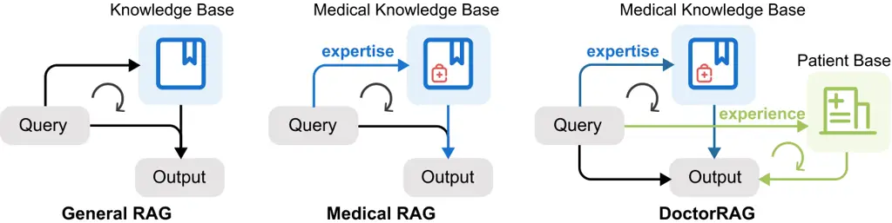
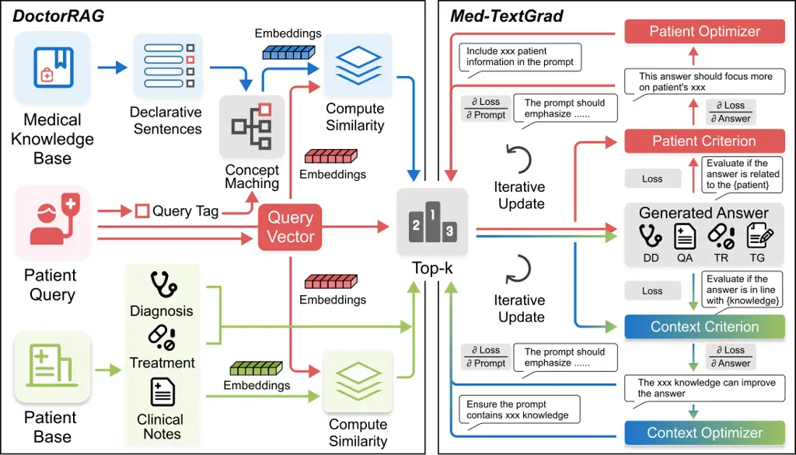
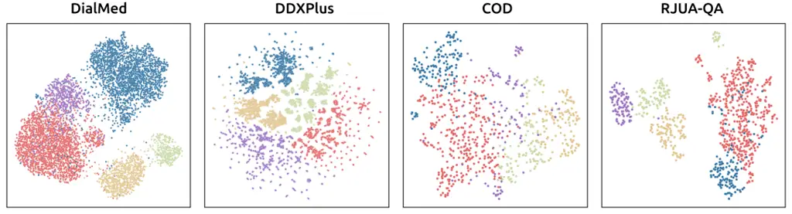

# DoctorRAG: Medical RAG Fusing Knowledge with Patient Analogy through Textual Gradients

Yuxing Lu^(†)    Wei Wu    Jinzhuo Wang^(‡) Affiliation: Department of
Big Data and Biomedical AI Affiliation: Peking University
Email: [yxlu0613@gmail.com](mailto:) Email: [ww20ya@163.com](mailto:)
Email: [wangjinzhuo@pku.edu.com](mailto:)    Gecheng Fu^(†)    Goi Sin
Yee Affiliation: School of Life Science Affiliation: Peking University
Email: [2200012176@stu.pku.edu.cn](mailto:)
Email: [2200091101@stu.pku.edu.cn](mailto:)    Xukai Zhao
Affiliation: School of Architecture Affiliation: Tsinghua University
Email: [zhaoxukai0208@163.com](mailto:)

###### Abstract

Existing medical RAG systems mainly leverage knowledge from medical
knowledge bases, neglecting the crucial role of experiential knowledge
derived from similar patient cases – a key component of human clinical
reasoning. To bridge this gap, we propose DoctorRAG, a RAG framework
that emulates doctor-like reasoning by integrating both explicit
clinical knowledge and implicit case-based experience. DoctorRAG
enhances retrieval precision by first allocating conceptual tags for
queries and knowledge sources, together with a hybrid retrieval
mechanism from both relevant knowledge and patient. In addition, a
Med-TextGrad module using multi-agent textual gradients is integrated to
ensure that the final output adheres to the retrieved knowledge and
patient query. Comprehensive experiments on multilingual, multitask
datasets demonstrate that DoctorRAG significantly outperforms strong
baseline RAG models and gains improvements from iterative refinements.
Our approach generates more accurate, relevant, and comprehensive
responses, taking a step towards more doctor-like medical reasoning
systems.

^(\$\dagger\$)^(\$\dagger\$)footnotetext: These authors contributed
equally to this work.^(\$\ddagger\$)^(\$\ddagger\$)footnotetext:
Corresponding author.

## 1 Introduction

Large Language Models (LLMs) hold considerable promise for transforming
healthcare, offering capabilities to assist medical professionals,
enhance patient care, and accelerate biomedical research \[11\]. Within
this landscape, Retrieval-Augmented Generation (RAG) has emerged as a
pivotal technique, grounding LLM outputs in factual knowledge to
mitigate hallucinations and bolster reliability – qualities paramount in
the high-stakes medical domain \[30\]. Existing medical RAG systems
commonly incorporate extensive external knowledge bases containing
clinical guidelines, evidence-based medicine, and research
literature \[46, 41, 42\]. This approach, while valuable, overlooks a
critical dimension of expert medical reasoning: the application of
experience gained from encountering numerous patient cases over time.

Human clinicians routinely integrate formal medical knowledge
(Expertise) with experiential insights gleaned from similar past
situations (Experience, i.e., case-based reasoning) iteratively to make
diagnoses, formulate treatment plans, and answer patient queries \[10\].
Existing medical RAG frameworks fail to capture the information from
similar patients, limiting their ability to truly emulate doctor-like
reasoning (Figure 1). This deficiency can hinder their overall
performance in complex, context-dependent tasks such as differential
diagnosis or the formulation of personalized treatment recommendations.
Furthermore, standard retrieval methods (e.g., dense vector search)
often struggle to capture the fine-grained semantic distinctions crucial
for medical relevance \[33\]. Compounding this, the outputs of
generative models require rigorous validation to ensure they are not
only relevant but also faithfully aligned with the retrieved medical
context, a challenge that necessitates a dedicated mechanism for
iterative refinement and grounding \[18\].

To address these limitations, we propose DoctorRAG, a novel RAG
framework designed to bridge the gap between current systems and human
clinical practices. The core innovation of DoctorRAG lies in its ability
to emulate doctor-like reasoning by integrating both explicit clinical
knowledge from KBs with implicit experiential knowledge derived from
analogous patient cases. To effectively retrieve proper information from
these heterogeneous sources, DoctorRAG first decomposes complex queries
and knowledge chunks into declarative statements and conceptual tags.
This structured representation enables a more precise hybrid retrieval
mechanism that combines semantic vector similarity with targeted
conceptual matching. The generated answer is then refined and validated
by Med-TextGrad, a multi-agent textual gradient process that iteratively
ensures the output adheres to the retrieved context and patient query,
effectively grounding the response and ensuring the system’s accuracy
and reliability. Comprehensive experiments conducted on diverse
multilingual and multitask datasets—encompassing disease diagnosis,
question answering, treatment recommendation, and text generation
demonstrate that DoctorRAG significantly outperforms strong RAG
baselines in terms of accuracy, relevance, and faithfulness. Pairwise
comparison between answers of different iteration further demonstrate
Med-TextGrad paves the way for medical AI systems capable of more
comprehensive, reliable, and clinically-informed reasoning.



Figure 1: General and Medical RAGs retrieve solely from knowledge bases,
whereas DoctorRAG enhance responses by integrating both knowledge-based
expertise and case-based experience, mirroring clinical practice.

## 2 Methodology

We propose the DoctorRAG framework for clinical decision support,
designed to integrate domain-specific medical knowledge with
patient-specific clinical data, and to refine the generated response
through a multi-agent, iterative optimization process. This framework,
illustrated in Figure 2, leverages concept matching and vectorized
embeddings for retrieval, and a Med-TextGrad optimization strategy to
iteratively refine generated answers through back propagation. The
pipeline consists of two primary stages: (1) Expertise-Experience
retrieval and aggregation, and (2) Iterative answer optimization using
multi-agent textual gradients.



Figure 2: Overview of the proposed DoctorRAG & Med-TextGrad framework.
Medical knowledge is transformed into declarative statements and tagged
to match the patient’s query. Dual-database retrieval generates a
response incorporating both clinical expertise and experience. A two-way
multi-agent Med-TextGrad optimization process refines the answer through
an iterative computation graph involving textual gradient
backpropagation.

### 2.1 Expertise-Experience retrieval and aggregation

The retrieval and aggregation module (prompts in D.1, examples in E.1)
operates on two primary data sources: a Knowledge Base ($`\mathcal{K}`$)
and a Patient Base ($`\mathcal{P}`$).

The Knowledge Base is constructed from several medical knowledge
sources. These sources are first segmented into textual chunks. Each
chunk is then transformed into a declarative sentence (details in B.3),
denoted $`d_{i}`$, using a Declarative Statement Agent
$`\text{Dec}_{\phi}`$. Subsequently, each sentence $`d_{i}`$ is
annotated with a set of medical concept identifiers
$`c_{i}=\text{Tag}_{\phi}(d_{i})`$, where $`c_{i}\subseteq\mathcal{C}`$
(details in B.4). The function $`\text{Tag}_{\phi}`$ represents a Query
Tagging Agent, and $`\mathcal{C}`$ is a predefined controlled vocabulary
of medical concepts (e.g., ICD-10 codes). The Knowledge Base is thus
defined as the set of pairs
$`\mathcal{K}=\{(d_{i},c_{i})\mid i=1,\dots,N_{\mathcal{K}}\}`$, where
$`N_{\mathcal{K}}`$ is the total number of processed declarative
sentences. Each sentence $`d_{i}`$ is encoded into a $`D`$-dimensional
dense vector representation
$`v_{d_{i}}=\text{E}_{\text{emb}}(d_{i})\in\mathbb{R}^{D}`$. Here,
$`\text{E}_{\text{emb}}`$ denotes the embedding function of an LLM.

The Patient Base comprises de-identified patient records, formally
defined as
$`\mathcal{P}=\{(p_{j},s_{j},a_{j})\mid j=1,\dots,N_{\mathcal{P}}\}`$,
where $`N_{\mathcal{P}}`$ is the count of patient records. For each
record $`j`$, $`p_{j}`$ represents the patient’s chief complaint or
clinical conversation, $`s_{j}`$ denotes structured clinical data (e.g.,
diagnoses, treatments), and $`a_{j}`$ encompasses auxiliary metadata
(e.g., demographics). The primary textual component $`p_{j}`$ is encoded
into a vector
$`v_{p_{j}}=\text{E}_{\text{emb}}(p_{j})\in\mathbb{R}^{D}`$ using the
identical embedding function $`\text{E}_{\text{emb}}`$. The remaining
data $`s_{j}`$ and $`a_{j}`$ are preserved for contextual augmentation.

Given a user query $`q`$, it is processed through two concurrent
pathways. Firstly, the Query Tagging Agent $`\text{Tag}_{\phi}`$,
annotates the query with a set of relevant medical concept identifiers
$`c_{q}=\text{Tag}_{\phi}(q)`$, where $`c_{q}\subseteq\mathcal{C}`$.
Secondly, the query $`q`$ is embedded into the same $`D`$-dimensional
latent space, yielding
$`v_{q}=\text{E}_{\text{emb}}(q)\in\mathbb{R}^{D}`$. Retrieval from both
databases proceeds as follows:

Knowledge Retrieval: To retrieve relevant declarative sentences from
$`\mathcal{K}`$, a concept-constrained semantic similarity score
$`s_{\mathcal{K}}(q,d_{i})`$ is computed between the query $`q`$ and
each sentence $`d_{i}`$ (associated with concepts $`c_{i}`$):

```math
s_{\mathcal{K}}(q,d_{i})=\begin{cases}\frac{v_{q}^{\top}v_{d_{i}}}{\|v_{q}\|\|v_{d_{i}}\|}&\text{if }c_{q}\cap c_{i}\neq\emptyset,\\
-\infty&\text{otherwise},\end{cases} \tag{1}
```

where the fraction denotes the cosine similarity. This formulation
prioritizes semantic relevance for sentences sharing common concept
identifiers with the query. The $`k`$ knowledge entries
$`(d_{i},c_{i})`$ achieving the highest non-negative similarity scores
constitute the set $`\mathcal{K}_{\text{top-}k}`$.

Patient Retrieval: Concurrently, to retrieve relevant patient records
from $`\mathcal{P}`$, the cosine similarity $`s_{\mathcal{P}}(q,p_{j})`$
between $`v_{q}`$ and the embedding of each patient’s textual data
$`v_{p_{j}}`$ is computed:

```math
s_{\mathcal{P}}(q,p_{j})=\frac{v_{q}^{\top}v_{p_{j}}}{\|v_{q}\|\|v_{p_{j}}\|}. \tag{2}
```

The $`k`$ patient records $`(p_{j},s_{j},a_{j})`$ yielding the highest
similarity scores constitute the set $`\mathcal{P}_{\text{top-}k}`$.

Finally, the retrieved information is aggregated to construct a unified
context $`C`$ for the answer generation module. This context is formed
by concatenating the textual content from the top-$`k`$ declarative
sentences and formatted textual representations of the top-$`k`$ patient
records:

```math
C=\text{Concat}\left(\bigcup_{(d_{i},c_{i})\in\mathcal{K}_{\text{top-}k}}d_{i},\bigcup_{(p_{j},s_{j},a_{j})\in\mathcal{P}_{\text{top-}k}}\text{Format}(p_{j},s_{j},a_{j})\right), \tag{3}
```

where $`\text{Concat}(\cdot,\cdot)`$ joins all textual elements, and
$`\text{Format}(\cdot)`$ converts a patient record tuple into a
structured textual representation. This context $`C`$ concatenates both
general medical knowledge (expertise) and patient-derived clinical
evidence (experience), serving as input for generation.

### 2.2 Iterative answer optimization with multi-agent Med-TextGrad

To generate and refine answers, we propose Med-TextGrad, a multi-agent
optimization framework adapted for the medical domain (Algorithm in B.2,
prompts in D.2, examples in E.2). This framework leverages principles of
TextGrad \[43\] for textual gradient-based optimization. The system
architecture comprises a Generator, a Context Criterion, a Patient
Criterion, and conceptually distinct Context Optimizer and Patient
Optimizer roles guiding iterative refinement. The process uses a
computation graph where textual gradients update the prompt and,
consequently, the answer.

The fundamental goal of the Med-TextGrad framework is to identify an
optimal prompt $`P_{\text{opt}}^{\star}`$ that, given a query $`q`$ and
its retrieved initial context $`C`$, generates the best possible answer
$`A_{\text{opt}}^{\star}=\text{Gen}_{\psi}(P_{\text{opt}})`$. ’Best’ is
defined in terms of minimizing a textual loss function $`\mathcal{L}`$,
which incorporates critiques regarding medical context consistency and
patient-specific relevance. This objective is analogous to finding the
optimal parameters $`\theta^{*}`$ for a neural network by minimizing a
loss function. Formally, the target optimal prompt $`P_{\text{opt}}`$ is
defined as:

```math
P_{\text{opt}}^{\star}(q,C)=\operatorname*{arg\,min}_{P}\mathcal{L}(A\mid q,C)\quad\text{s.t.}\quad P\in\mathcal{P},\ A=\text{Gen}_{\psi}(P) \tag{4}
```

where $`\mathcal{P}`$ represents the space of possible prompt space. The
textual loss $`\mathcal{L}(A\mid q,C)`$ is associated with the answer
generated from prompt $`P`$; it is explicitly defined in Equation 8 as
the sum of critiques from different criteria. The Med-TextGrad iterative
procedure, starting from an initial prompt and applying textual gradient
descent steps (Equation 14), is designed to find a refined prompt
$`P_{T}`$ that serves as an approximation to $`P_{\text{opt}}^{\star}`$.

#### 2.2.1 Computation graph with gradient backpropagation

The answer generation and iterative refinement process is modeled as a
directed computation graph. The forward pass generates an answer from a
prompt and evaluates it against specified criteria, yielding textual
critiques that serve as a proxy for loss. The backward pass computes and
propagates textual gradients from these critiques to guide prompt
refinement. This is conceptualized as:

```math
\text{Prompt}\xrightarrow{\text{Generator}}\text{Answer}\xrightarrow{\text{Criterion}}\text{Critiques (Loss Proxy)} \tag{5}
```

```math
\text{Prompt}\xleftarrow{\nabla_{\text{Prompt}}}\text{Answer}\xleftarrow{\nabla_{\text{Answer}}}\text{Critiques (Loss Proxy)} \tag{6}
```

Here, $`\nabla_{\text{Answer}}`$ and $`\nabla_{\text{Prompt}}`$
represent the textual gradient computation steps. The input prompt
$`P_{t}`$ at iteration $`t`$ is formulated as the concatenation of the
initial query $`q`$ and the aggregated context $`C`$. An answer
$`A_{t}`$ is produced by the Generator, and is assessed by the Context
Criterion and Patient Criterion to produce textual critiques. The
Generator, denoted $`\text{Gen}_{\psi}`$, generates the answer $`A_{t}`$
based on the current prompt $`P_{t}`$:

```math
A_{t}=\text{Gen}_{\psi}(P_{t})=\text{Gen}_{\psi}(\text{Concat}(q,C)). \tag{7}
```

The Context Criterion ($`\text{KC}_{\psi}`$) and Patient Criterion
($`\text{PC}_{\psi}`$) evaluate $`A_{t}`$. $`\text{KC}_{\psi}`$ assesses
factual alignment and consistency of $`A_{t}`$ with context $`C`$.
$`\text{PC}_{\psi}`$ evaluates relevance, appropriateness, and
patient-specificity of $`A_{t}`$ to query $`q`$. The aggregated textual
critique, representing the overall “loss”, is given directly by
$`\mathcal{L}(A_{t})`$:

```math
\mathcal{L}(A_{t})=\mathcal{L}(A\mid q,C)=C_{\text{KC}}(A_{t})+C_{\text{PC}}(A_{t})=\text{KC}_{\psi}(A_{t},C)+\text{PC}_{\psi}(A_{t},q). \tag{8}
```

Ideally, this loss can also inform an early stopping strategy in
Med-TextGrad.

#### 2.2.2 Textual gradient computation and backpropagation

Gradients of the critiques with respect to the answer $`A_{t}`$ are
computed independently. These gradients,
$`\frac{\partial{\text{KC}}(A_{t})}{\partial A_{t}}`$ and
$`\frac{\partial{\text{PC}}(A_{t})}{\partial A_{t}}`$, provide
instructive feedback from each perspective. They are generated by a LLM
$`\mathcal{G}_{\text{grad\_A}}`$ prompted by $`\psi_{\text{grad\_A}}`$
specific to each criterion:

```math
\displaystyle\frac{\partial{\text{KC}}(A_{t})}{\partial A_{t}}=\mathcal{G}_{\text{grad\_A}}(A_{t},C,{\text{KC}}(A_{t});\psi_{\text{grad\_A\_KC}}), \tag{9}
```

```math
\displaystyle\frac{\partial{\text{PC}}(A_{t})}{\partial A_{t}}=\mathcal{G}_{\text{grad\_A}}(A_{t},q,{\text{PC}}(A_{t});\psi_{\text{grad\_A\_PC}}). \tag{10}
```

Here, $`\mathcal{G}_{\text{grad\_A}}`$ takes the current answer, the
relevant content (either context $`C`$ or patient query $`q`$), and the
critique itself to produce a textual gradient aimed at improving the
answer.

These answer-level textual gradients are natural language descriptions
suggesting specific improvements for $`A_{t}`$ from the viewpoint of
respective criterion. Subsequently, they are utilized to compute
distinct textual gradients with respect to the prompt $`P_{t}`$. These
prompt-directed gradients,
$`\frac{\partial{\text{KC}}(A_{t})}{\partial P_{t}}`$ and
$`\frac{\partial{\text{PC}}(A_{t})}{\partial P_{t}}`$, articulate how
$`P_{t}`$ should be modified to elicit an improved $`A_{t}`$ that
addresses the critiques from each specific criterion. These are
generated by a LLM $`\mathcal{G}_{\text{grad\_P}}`$ prompted by
$`\psi_{\text{grad\_P}}`$:

```math
\displaystyle\frac{\partial{\text{KC}}(A_{t})}{\partial P_{t}}=\mathcal{G}_{\text{grad\_P}}\left(P_{t},A_{t},\frac{\partial{\text{KC}}(A_{t})}{\partial A_{t}};\psi_{\text{grad\_P\_KC}}\right). \tag{11}
```

```math
\displaystyle\frac{\partial{\text{PC}}(A_{t})}{\partial P_{t}}=\mathcal{G}_{\text{grad\_P}}\left(P_{t},A_{t},\frac{\partial{\text{PC}}(A_{t})}{\partial A_{t}};\psi_{\text{grad\_P\_PC}}\right). \tag{12}
```

In these equations, $`\mathcal{G}_{\text{grad\_P}}`$ uses the current
prompt, the generated answer, and the corresponding answer-level
gradient to compute the prompt-level textual gradient.

The computed prompt gradients,
$`\frac{\partial{\text{KC}}(A_{t})}{\partial P_{t}}`$ and
$`\frac{\partial{\text{PC}}(A_{t})}{\partial P_{t}}`$, provide
pathway-specific textual feedback for refining the prompt $`P_{t}`$.
Conceptually, an overall textual gradient
$`\frac{\partial\mathcal{L}(A_{t})}{\partial P_{t}}`$ for the combined
critique with respect to the prompt $`P_{t}`$ arises from the
application of the chain rule. This can be expressed as:

```math
\frac{\partial\mathcal{L}(A_{t})}{\partial P_{t}}=\nabla_{\text{Gen}}\left(P_{t},A_{t},\text{Aggregate}\left(\frac{\partial{\text{KC}}(A_{t})}{\partial A_{t}},\frac{\partial{\text{PC}}(A_{t})}{\partial A_{t}}\right)\right). \tag{13}
```

Here, $`\text{Aggregate}(\cdot,\cdot)`$ denotes the textual combination
of the individual answer-level gradients, and $`\nabla_{\text{Gen}}`$ is
the TextGrad operator that performs the backpropagation through the
Generator $`\text{Gen}_{\psi}`$. This overall gradient illustrates how
combined feedback theoretically propagates to the prompt.

#### 2.2.3 Iterative optimization with context and patient optimizers

The iterative refinement of the prompt $`P_{t}`$ is guided by the
distinct textual gradients computed in the previous step: the
context-focused prompt gradient
$`\frac{\partial{\text{KC}}(A_{t})}{\partial P_{t}}`$ and the
patient-focused prompt gradient
$`\frac{\partial{\text{PC}}(A_{t})}{\partial P_{t}}`$. The Context
Optimizer and Patient Optimizer roles leverage these respective
gradients to ensure the prompt evolves in a manner that addresses both
alignment with medical context and relevance to the specific patient.

This is achieved through a Textual Gradient Descent (TGD) step, where
the current prompt $`P_{t}`$ is updated. This update is performed by
another LLM $`\mathcal{G}_{\text{TGD}}`$, which synthesizes the
improvement suggestions from both prompt gradients to produce the
refined prompt $`P_{t+1}`$:

```math
P_{t+1}=\text{TGD.step}\left(P_{t},\frac{\partial\mathcal{L}(A_{t})}{\partial P_{t}}\right)=\text{TGD.step}\left(P_{t},\frac{\partial{\text{KC}}(A_{t})}{\partial P_{t}},\frac{\partial{\text{PC}}(A_{t})}{\partial P_{t}}\right). \tag{14}
```

The updated prompt $`P_{t+1}`$ is then fed back to the generator to
produce a new answer $`A_{t+1}`$:

```math
A_{t+1}=\text{Gen}_{\psi}(P_{t+1}). \tag{15}
```

This iterative cycle continues for a predetermined number of iterations
$`T`$ ($`3`$ in our implementation), or until a suitable convergence
criterion (e.g., minimal changes in critiques or the answer) is met. The
final output of Med-TextGrad is the refined answer $`A_{T}`$.

## 3 Experimental Setup

### 3.1 Datasets

To comprehensively evaluate DoctorRAG, we utilized a diverse collection
of datasets spanning multiple languages and covering key medical tasks:
disease diagnosis (DD), question answering (QA), treatment
recommendation (TR), and text generation (TG). Further details on each
dataset are provided in Appendix B.1. An overview of the datasets,
including their respective languages, medical fields, and sample counts
for each task, is presented in Table 1.

For Chinese-language tasks, we incorporated three datasets.
DialMed \[17\], a general medicine dataset featuring structured
dialogues, is employed for disease diagnosis and drug recommendation
tasks. RJUA \[27\] focuses on urology and is used to assess DoctorRAG’s
capabilities in disease diagnosis, treatment recommendation, and the
generation of informative responses. Muzhi \[38\] centered on pediatric
care, comprises dialogues with symptom descriptions and diagnostic
recommendations.

For English-language evaluations, we employed DDXPlus \[14\], which is a
large-scale general medicine dataset that includes socio-demographic
data, multi-format symptoms/antecedents, and differential diagnoses. The
NEJM-QA \[5\], specializing in nephrology, provides 656 multiple-choice
questions to evaluate question answering abilities. Additionally,
COD \[6\], a general medicine dataset, is used to assess performance on
disease diagnosis and medical text generation.

We included the French version of DDXPlus \[14\] to assess DoctorRAG’s
multilingual performance.

|         |                |            |           |     |        |        |
| ------- | -------------- | ---------- | --------- | --- | ------ | ------ |
|         | Dataset        | Domain     | DD        | QA  | TR     | TG     |
| Chinese | DialMed \[17\] | General    | 11,996    | –   | 11,996 | –      |
|         | RJUA \[27\]    | Urology    | 2,340     | –   | 2,340  | 2,340  |
|         | MuZhi \[38\]   | Pediatrics | 527       | –   | –      | –      |
| English | DDXPlus \[14\] | General    | 1,292,579 | –   | –      | –      |
|         | NEJM-QA \[5\]  | Nephrology | –         | 655 | –      | –      |
|         | COD \[6\]      | General    | 39,149    | –   | –      | 39,149 |
| French  | DDXPlus \[14\] | General    | 1,292,579 | –   | –      | –      |

Table 1: Datasets for evaluation. DD: Disease Diagnosis, QA: Question
Answering, TR: Treatment Recommendation, TG: Text Generation. Numerical
values indicate sample counts.

We constructed the external knowledge base for DoctorRAG using
MedQA \[20\] datasets. MedQA encompasses bilingual Chinese-English
medical question-answering pairs and medical textbooks, providing a
foundation for cross-lingual knowledge retrieval. We also translated a
subset of MedQA to French for the French version of DDXPlus \[14\]. Each
knowledge entry is pre-segmented, transformed into declarative
statements using the DeepSeek-V3 model \[24\], and annotated with
corresponding concept labels to optimize DoctorRAG’s medical knowledge
retrieval capabilities.

For each dataset, we established a clear partitioning: approximately 80%
of the patient records from each dataset were allocated for constructing
DoctorRAG’s patient base, while the remaining were held out as a
distinct evaluation set. To ensure an unbiased assessment and prevent
data leakage, we guarantee that for any given sample within this
evaluation set, its corresponding full patient record and extreme
similar ones (similarity \> 0.99) were strictly excluded from
DoctorRAG’s patient base during evaluation of that specific sample. All
samples are treated as independent clinical encounters.

### 3.2 LLM backbones

We employed a selection of advanced LLM backbones for comprehensive and
balanced comparison. The primary aims were to assess the multilingual
and multitask capabilities of these foundational models and to evaluate
the robustness of DoctorRAG when integrated with different LLMs. The
models selected include DeepSeek-V3\[24\], Qwen-3 \[2\],
GLM-4-Plus \[16\], and GPT-4.1 \[1\]. To ensure consistency across all
experimental procedures, DeepSeek-V3 was specifically assigned to data
preprocessing tasks, such as declarative sentence transformations and
concept labeling. Furthermore, all embedding conversions were performed
using OpenAI’s text-embedding-3-large model.

| Backbone              | DD (Acc) |       |       |         |         | QA (Acc) | TR (Acc) |       | TG        |           |          |           |
| --------------------- | -------- | ----- | ----- | ------- | ------- | -------- | -------- | ----- | --------- | --------- | -------- | --------- |
|                       | DialMed  | RJUA  | MuZhi | DDXPlus | DDXPlus | NEJM-QA  | DialMed  | RJUA  | RJUA (CN) |           | COD (EN) |           |
|                       | CN       | CN    | CN    | EN      | FR      | EN       | CN       | CN    | Rouge-L   | BERTScore | Rouge-L  | BERTScore |
| Direct Generation     |          |       |       |         |         |          |          |       |           |           |          |           |
| GLM-4-Plus            | 91.97    | 73.35 | 70.75 | 82.07   | 84.87   | 60.79    | 45.10    | 60.05 | 20.58     | 90.20     | 19.59    | 92.50     |
| Qwen-3-32B            | 88.80    | 68.16 | 71.70 | 84.13   | 84.80   | 60.32    | 53.98    | 70.75 | 19.95     | 91.29     | 16.28    | 87.76     |
| DeepSeek-V3           | 91.32    | 80.19 | 72.64 | 87.60   | 85.16   | 68.69    | 58.33    | 73.58 | 21.38     | 92.41     | 18.18    | 92.26     |
| GPT-4.1-mini          | 91.39    | 73.11 | 72.64 | 89.60   | 85.33   | 67.17    | 56.14    | 72.41 | 22.17     | 95.49     | 19.09    | 97.02     |
| Vanilla RAG \[22\]    |          |       |       |         |         |          |          |       |           |           |          |           |
| GLM-4-Plus            | 92.08    | 81.73 | 72.81 | 82.19   | 84.92   | 60.93    | 50.27    | 60.71 | 22.36     | 91.54     | 20.13    | 94.37     |
| Qwen-3-32B            | 91.47    | 81.42 | 72.06 | 84.18   | 82.33   | 62.59    | 55.76    | 70.91 | 20.14     | 91.37     | 17.03    | 94.92     |
| DeepSeek-V3           | 90.78    | 83.12 | 73.46 | 87.83   | 85.74   | 69.58    | 63.14    | 73.79 | 22.53     | 92.44     | 18.76    | 95.41     |
| GPT-4.1-mini          | 91.97    | 82.76 | 73.09 | 89.78   | 86.13   | 68.54    | 57.08    | 72.87 | 23.06     | 95.52     | 19.51    | 97.04     |
| Proposition RAG \[8\] |          |       |       |         |         |          |          |       |           |           |          |           |
| GLM-4-Plus            | 92.31    | 85.34 | 73.58 | 82.27   | 85.06   | 61.09    | 53.49    | 61.32 | 24.01     | 92.93     | 21.60    | 96.24     |
| Qwen-3-32B            | 92.31    | 82.78 | 72.64 | 84.27   | 85.02   | 64.98    | 55.33    | 71.05 | 20.32     | 90.98     | 17.59    | 96.70     |
| DeepSeek-V3           | 92.11    | 86.32 | 74.53 | 88.06   | 86.49   | 70.89    | 60.71    | 74.06 | 23.71     | 92.48     | 19.35    | 96.62     |
| GPT-4.1-mini          | 92.59    | 84.92 | 73.58 | 90.20   | 87.93   | 70.82    | 57.49    | 73.41 | 23.98     | 92.96     | 20.28    | 96.50     |
| Graph RAG \[13\]      |          |       |       |         |         |          |          |       |           |           |          |           |
| GLM-4-Plus            | 91.28    | 86.21 | 73.48 | 85.50   | 87.53   | 62.77    | 57.23    | 62.01 | 27.52     | 92.90     | 21.48    | 94.32     |
| Qwen-3-32B            | 92.09    | 84.07 | 72.97 | 87.82   | 90.08   | 66.92    | 59.58    | 72.23 | 24.48     | 92.73     | 18.40    | 95.63     |
| DeepSeek-V3           | 92.87    | 85.33 | 76.59 | 88.93   | 92.37   | 70.95    | 63.22    | 75.30 | 25.97     | 93.01     | 19.47    | 95.88     |
| GPT-4.1-mini          | 91.02    | 85.28 | 76.11 | 92.37   | 93.14   | 70.95    | 61.70    | 74.88 | 25.86     | 91.98     | 20.95    | 96.28     |
| DoctorRAG             |          |       |       |         |         |          |          |       |           |           |          |           |
| GLM-4-Plus            | 93.09    | 86.70 | 74.53 | 98.27   | 98.53   | 62.92    | 56.40    | 63.83 | 31.98     | 93.97     | 21.66    | 92.80     |
| Qwen-3-32B            | 94.49    | 83.96 | 73.58 | 94.80   | 98.27   | 69.60    | 57.80    | 75.24 | 26.22     | 92.25     | 19.16    | 96.79     |
| DeepSeek-V3           | 93.56    | 86.79 | 80.19 | 96.87   | 96.93   | 71.73    | 63.49    | 77.83 | 30.50     | 93.56     | 20.01    | 96.61     |
| GPT-4.1-mini          | 94.96    | 85.61 | 75.47 | 97.67   | 98.73   | 72.64    | 58.82    | 76.89 | 26.73     | 93.29     | 22.31    | 96.81     |

Table 2: Comparison of RAG methods and LLM backbones across medical
tasks, with results highlighted as follows: pink for the overall top
score per task, and green for the top score within each RAG method group
for that task.

## 4 Results

In this section, we present the experimental results to address the
following research questions (RQs):

- •
  RQ.1 (4.1): How does DoctorRAG’s performance compare to other RAG
  methods across tasks?
- •
  RQ.2 (4.2): Does integrating patient case data improve DoctorRAG’s
  relevance and utility?
- •
  RQ.3 (4.3): To what extent does Med-TextGrad iteratively refine answer
  quality?
- •
  RQ.4 (4.4): How do different backbone LLMs affect DoctorRAG’s
  performance?
- •
  RQ.5 (4.5): How does each component in DoctorRAG contribute to its
  effectiveness?

### 4.1 DoctorRAG vs other RAG (RQ.1)

We compared DoctorRAG with several strong RAG baselines, including
Proposition RAG \[8\] and Graph RAG \[13\]. We also compared it with
Vanilla RAG \[22\] and direct generation using LLMs. For disease
diagnosis (DD), question answering (QA), treatment recommendation (TR)
tasks, we used prediction accuracy for evaluation. For text generation
(TG) tasks, we used Rouge-L \[23\], BERTScore \[45\], BLEU \[31\] and
METEOR \[3\] scores as metrics. The main results are shown in Table 2
and B.5.

DoctorRAG consistently achieves leading scores, denoted by pink
highlights, across a diverse spectrum of tasks including disease
diagnosis, question answering, treatment recommendation, and text
generation. This dominance is often marked by substantial quantitative
improvements; for instance, in DDXPlus (EN) diagnosis, DoctorRAG
(GLM-4-Plus) reached 98.27% accuracy, significantly outperforming the
strongest Graph RAG baseline (92.37%) and Proposition RAG (90.20%).
Similarly, its Rouge-L score of 31.98 on RJUA text generation far
surpasses its peers, illustrating a consistent and impactful enhancement
across varied medical challenges. Crucially, the superior capabilities
of DoctorRAG are not language-bound, demonstrating remarkable efficacy
across datasets in Chinese, English, and French. This cross-lingual
robustness is evidenced by its top-ranking accuracies on Chinese tasks
like DialMed (94.96%), English datasets such as NEJM-QA (72.64%), and
the French DDXPlus task (98.73%).

While DoctorRAG leads in most metrics, Vanilla RAG (when paired with
GPT-4.1-mini) secured the highest BERTScore on RJUA (95.52) and COD
(97.04). After investigation, we note that DoctorRAG’s outputs tend
towards greater in length compared to the ground truth answers. While
this comprehensiveness may benefit recall-oriented metrics like Rouge-L,
it is a factor for consideration in contexts prioritizing brevity and
might influence certain evaluation scores.

### 4.2 Utility of patient case information (RQ.2)

To evaluate the rationale and utility of integrating patient case
information in DoctorRAG, we conducted a visualization analysis (details
in B.6). We hypothesized that leveraging this data, much like a
physician utilizes clinical experience, enhances diagnostic precision by
capturing patterns from similar patient profiles alongside medical
knowledge.



Figure 3: UMAP visualizations of patient embeddings on four distinct
medical datasets. Each point corresponds to a patient embedding, and
different colors represent different diagnosed diseases.

We applied UMAP \[29\] to visualize patient embeddings from multiple
datasets (Appendix B.6), including DialMed, DDXPlus, COD and RJUA, as
shown in Figure 3. The visualizations clearly demonstrate that
embeddings of patients diagnosed with the same disease form distinct
clusters. This clustering mirrors clinical observations where patients
with a shared condition often present comparable symptoms and medical
complaints, thereby validating the rationality of incorporating patient
case information. The tight grouping within these clusters also
underscores DoctorRAG’s ability to effectively encode and utilize
patient similarities, enhancing its contextual understanding.

Furthermore, a complementary ablation study (Table 3) quantitatively
confirmed the contribution of retrieving similar patient cases, showing
question answering accuracy improved from 70.21 to 71.73 on NEJM-QA.
These findings affirm that integrating patient case information is both
conceptually sound and practically beneficial, empowering DoctorRAG to
deliver more accurate and clinically relevant diagnoses by leveraging
these observed patterns.

### 4.3 Impact of Med-TextGrad’s iterative refinement (RQ.3)

We evaluated generation quality on 50 COD dataset samples, comparing
ground truth (GT), DoctorRAG’s initial answer (OA), and Med-TextGrad’s
iterated answers (T1-T3) using DeepSeek-V3 \[24\] to vote on
comprehensiveness, relevance, and safety, with verification from 2 human
experts (details in B.7, prompts in D.3, examples in E.3). Figure 4
shows win counts, where cell (Y,X) in the lower-left indicates Y’s
preference over X. Interestingly, both DoctorRAG’s initial answers (OA)
and all Med-TextGrad iterations (T1-T3) consistently outperformed the
ground truth (GT) answers in over 90% of overall comparisons. While GT
represents real clinical interactions, these conversations are often
context-specific. Consequently, they may not always reflect the most
comprehensively structured or optimally informative medical advice that
a system like DoctorRAG.

Figure 4: Pairwise comparison scores for ground truth (GT), original
answer (OA), refined answers of iteration 1-3 (T1-T3) on (a)
Comprehensiveness, (b) Relevance, (c) Safety, and (d) Overall. The
lower-left triangle of each matrix represents the Y-axis outputs perform
better than X-axis output.

Med-TextGrad effectively navigates the "answer space" through iterative
refinement, mirroring the optimization journey of gradient descent in
deep learning. The initial answer (OA) serves as a starting point, and
each Med-TextGrad iteration attempts to "descend" towards a higher
quality answer. As shown in Figure 4d, the first iteration (T1) provided
a significant improvement, being preferred over OA in 70% (35/50) of
cases. The second iteration (T2) often approached an optimal state, much
like reaching a favorable point in a loss landscape, by winning against
OA in 84% (42/50) of comparisons and against T1 in 60% (30/50) of cases.
However, similar to gradient descent nearing convergence or even
overfitting, the gains from T2 to T3 were less distinct. Overall, T2 was
preferred over T3 in 23/50 cases. This plateau or slight decline was
also observed in specific dimensions: for comprehensiveness (Figure 4a),
T2 maintained a slight edge over T3 (26 vs. 24 wins in their mutual
comparison). This suggests that, like over-training a model, excessive
iterations might not always yield better results across all facets.

### 4.4 Different LLM backbone (RQ.4)

The selection of LLM backbone is a critical factor in shaping
DoctorRAG’s performance capabilities across diverse medical tasks
(Table 2). Performance exhibited distinct patterns on language and task
within the DoctorRAG framework.

On Chinese datasets, DeepSeek-V3 demonstrated particular strengths in DD
(RJUA 86.79, MuZhi 80.19) and showed a prominent lead in TR (DialMed
63.49, RJUA 77.83). GPT-4.1-mini secured the leading position on the
DialMed DD task (94.96), while GLM-4-Plus achieved the most favorable
results in Chinese TG (RJUA 93.97 BS). In English/French contexts,
GPT-4.1-mini frequently emerged as the top performer, especially in QA
(NEJM-QA 72.64), French DD (DDXPlus 98.73), and English TG (COD 96.81
BS). GLM-4-Plus attained the highest accuracy in English DD (DDXPlus
98.27). Overall, DeepSeek-V3 demonstrated strong and consistent
performance across all evaluated tasks. A closer examination of
task-specific capabilities within DoctorRAG highlighted specialized
model aptitudes. In Disease Diagnosis, performance leadership was
multifaceted: GPT-4.1-mini demonstrated an edge on DialMed and DDXPlus
(FR), DeepSeek-V3 on RJUA and MuZhi, and GLM-4-Plus on DDXPlus (EN). For
Question Answering (NEJM-QA), GPT-4.1-mini stood out as the leading
model. DeepSeek-V3 was the frontrunner in Treatment Recommendation
across both datasets. Regarding Text Generation, model efficacy was
closely tied to linguistic context, with GLM-4-Plus excelling in Chinese
(RJUA) and GPT-4.1-mini in English (COD).

While these performance characteristics can be attributed to differences
in model training corpora and strategies, the collective results
underscore the resilience and broad applicability of the DoctorRAG
methodology across varied linguistic and task environments.

### 4.5 Ablation Study and Token Analysis (RQ.5)

We assessed the individual contributions of DoctorRAG’s components and
its RAG computational cost-performance profile through ablation and
token analysis (Table 3, Figure 5, details in B.8).

| Ablation Configuration      | DialMed | NEJM-QA |
| --------------------------- | ------- | ------- |
| DoctorRAG (Full Model)      | 93.56   | 71.73   |
| \- Patient Base Retrieval   | 92.20   | 70.21   |
| \- Knowledge Base Retrieval | 91.34   | 70.52   |
| \- Concept Tagging          | 91.65   | 70.52   |
| \- Declarative Statement    | 92.23   | 71.12   |
| Vanilla RAG                 | 90.78   | 69.58   |

Table 3: Ablation study of DoctorRAG.

Figure 5: Performance v.s. Token consumption.

The ablation study (Table 3) demonstrates the value of DoctorRAG’s
architecture. Removing any key component - Patient Base (experience),
Knowledge Base (expertise), Concept Tagging, or Declarative Statement
transformation - degraded performance on both two tasks, confirming the
crucial role of fusing structured knowledge with case-based experience
via precise retrieval.

The token-performance analysis (Figure 5) highlights a distinct
trade-off. While increasing the contextual information (which includes
both clinical knowledge and patient cases, controlled by the variable
$`k`$) enhances DoctorRAG’s performance on the Muzhi dataset, it also
leads to a linear increase of tokens processed per sample. Notably, this
performance improvement appears to converge after $`k`$ exceeds 4,
indicating potentially diminishing returns for context added beyond this
threshold.

## 5 Conclusion

This paper introduces DoctorRAG, a medical RAG framework that emulates
doctor-like reasoning by fusing explicit medical knowledge with
experiential insights from analogous patient cases. DoctorRAG employs a
dual-retrieval mechanism enhanced by conceptual tagging and declarative
statement transformation, and uniquely integrates Med-TextGrad, a
multi-agent textual gradient-based optimization process, to iteratively
refine outputs for accuracy, relevance, and faithfulness to retrieved
context and patient queries. Comprehensive multilingual, multitask
experiments demonstrate DoctorRAG’s outperformance of strong RAG
baselines, generating more accurate, relevant, comprehensive and safe
responses, thereby marking a crucial step towards more robust and
clinically astute medical reasoning systems.

## References

- \[1\] Josh Achiam, Steven Adler, Sandhini Agarwal, Lama Ahmad, Ilge
  Akkaya, Florencia Leoni Aleman, Diogo Almeida, Janko Altenschmidt, Sam
  Altman, Shyamal Anadkat, et al. Gpt-4 technical report. arXiv preprint
  arXiv:2303.08774, 2023.
- \[2\] Jinze Bai, Shuai Bai, Yunfei Chu, Zeyu Cui, Kai Dang, Xiaodong
  Deng, Yang Fan, Wenbin Ge, Yu Han, Fei Huang, et al. Qwen technical
  report. arXiv preprint arXiv:2309.16609, 2023.
- \[3\] Satanjeev Banerjee and Alon Lavie. Meteor: An automatic metric
  for mt evaluation with improved correlation with human judgments. In
  Proceedings of the acl workshop on intrinsic and extrinsic evaluation
  measures for machine translation and/or summarization, pages
  65–72, 2005.
- \[4\] Yoshua Bengio. Practical recommendations for gradient-based
  training of deep architectures. In Neural networks: Tricks of the
  trade: Second edition, pages 437–478. Springer, 2012.
- \[5\] Carol H Cain, Anna C Davis, Benjamin Broder, Eugene Chu,
  Amanda Hauser DeHaven, Anthony Domenigoni, Nancy Gin, Anuj Kapoor,
  Vincent Liu, Ainsley MacLean, et al. Quality assurance during the
  rapid implementation of an ai-assisted clinical documentation support
  tool. NEJM AI, 2(4):AIcs2400977, 2025.
- \[6\] Junying Chen, Chi Gui, Anningzhe Gao, Ke Ji, Xidong Wang, Xiang
  Wan, and Benyou Wang. Cod, towards an interpretable medical agent
  using chain of diagnosis, 2024.
- \[7\] Minghui Chen, Ruinan Jin, Wenlong Deng, Yuanyuan Chen, Zhi
  Huang, Han Yu, and Xiaoxiao Li. Can textual gradient work in federated
  learning? arXiv preprint arXiv:2502.19980, 2025.
- \[8\] Tong Chen, Hongwei Wang, Sihao Chen, Wenhao Yu, Kaixin Ma,
  Xinran Zhao, Hongming Zhang, and Dong Yu. Dense x retrieval: What
  retrieval granularity should we use?, 2024.
- \[9\] Yixiang Chen, Penglei Sun, Xiang Li, and Xiaowen Chu. Mrd-rag:
  Enhancing medical diagnosis with multi-round retrieval-augmented
  generation. arXiv preprint arXiv:2504.07724, 2025.
- \[10\] Nabanita Choudhury and Shahin Ara Begum. A survey on case-based
  reasoning in medicine. International Journal of Advanced Computer
  Science and Applications, 7(8):136–144, 2016.
- \[11\] Jan Clusmann, Fiona R Kolbinger, Hannah Sophie Muti, Zunamys I
  Carrero, Jan-Niklas Eckardt, Narmin Ghaffari Laleh, Chiara
  Maria Lavinia Löffler, Sophie-Caroline Schwarzkopf, Michaela Unger,
  Gregory P Veldhuizen, et al. The future landscape of large language
  models in medicine. Communications medicine, 3(1):141, 2023.
- \[12\] Sudeshna Das, Yao Ge, Yuting Guo, Swati Rajwal, JaMor Hairston,
  Jeanne Powell, Drew Walker, Snigdha Peddireddy, Sahithi Lakamana,
  Selen Bozkurt, et al. Two-layer retrieval-augmented generation
  framework for low-resource medical question answering using reddit
  data: Proof-of-concept study. Journal of Medical Internet Research,
  27:e66220, 2025.
- \[13\] Darren Edge, Ha Trinh, Newman Cheng, Joshua Bradley, Alex Chao,
  Apurva Mody, Steven Truitt, Dasha Metropolitansky, Robert Osazuwa
  Ness, and Jonathan Larson. From local to global: A graph rag approach
  to query-focused summarization, 2025.
- \[14\] Arsene Fansi Tchango, Rishab Goel, Zhi Wen, Julien Martel, and
  Joumana Ghosn. Ddxplus: A new dataset for automatic medical diagnosis.
  Advances in neural information processing systems,
  35:31306–31318, 2022.
- \[15\] Yunfan Gao, Yun Xiong, Xinyu Gao, Kangxiang Jia, Jinliu Pan,
  Yuxi Bi, Yixin Dai, Jiawei Sun, Haofen Wang, and Haofen Wang.
  Retrieval-augmented generation for large language models: A survey.
  arXiv preprint arXiv:2312.10997, 2:1, 2023.
- \[16\] Team GLM, Aohan Zeng, Bin Xu, Bowen Wang, Chenhui Zhang,
  Da Yin, Dan Zhang, Diego Rojas, Guanyu Feng, Hanlin Zhao, et al.
  Chatglm: A family of large language models from glm-130b to glm-4 all
  tools. arXiv preprint arXiv:2406.12793, 2024.
- \[17\] Zhenfeng He, Yuqiang Han, Zhenqiu Ouyang, Wei Gao, Hongxu Chen,
  Guandong Xu, and Jian Wu. Dialmed: A dataset for dialogue-based
  medication recommendation. arXiv preprint arXiv:2203.07094, 2022.
- \[18\] Yucheng Hu and Yuxing Lu. Rag and rau: A survey on
  retrieval-augmented language model in natural language processing.
  arXiv preprint arXiv:2404.19543, 2024.
- \[19\] Xinke Jiang, Yue Fang, Rihong Qiu, Haoyu Zhang, Yongxin Xu, Hao
  Chen, Wentao Zhang, Ruizhe Zhang, Yuchen Fang, Xu Chu, et al. Tc-rag:
  Turing-complete rag’s case study on medical llm systems. arXiv
  preprint arXiv:2408.09199, 2024.
- \[20\] Di Jin, Eileen Pan, Nassim Oufattole, Wei-Hung Weng, Hanyi
  Fang, and Peter Szolovits. What disease does this patient have? a
  large-scale open domain question answering dataset from medical exams.
  Applied Sciences, 11(14):6421, 2021.
- \[21\] Harrison Lee, Samrat Phatale, Hassan Mansoor, Thomas Mesnard,
  Johan Ferret, Kellie Lu, Colton Bishop, Ethan Hall, Victor Carbune,
  Abhinav Rastogi, et al. Rlaif vs. rlhf: Scaling reinforcement learning
  from human feedback with ai feedback. arXiv preprint
  arXiv:2309.00267, 2023.
- \[22\] Patrick Lewis, Ethan Perez, Aleksandra Piktus, Fabio Petroni,
  Vladimir Karpukhin, Naman Goyal, Heinrich Küttler, Mike Lewis, Wen-tau
  Yih, Tim Rocktäschel, et al. Retrieval-augmented generation for
  knowledge-intensive nlp tasks. Advances in neural information
  processing systems, 33:9459–9474, 2020.
- \[23\] Chin-Yew Lin. Rouge: A package for automatic evaluation of
  summaries. In Text summarization branches out, pages 74–81, 2004.
- \[24\] Aixin Liu, Bei Feng, Bing Xue, Bingxuan Wang, Bochao Wu,
  Chengda Lu, Chenggang Zhao, Chengqi Deng, Chenyu Zhang, Chong Ruan,
  et al. Deepseek-v3 technical report. arXiv preprint
  arXiv:2412.19437, 2024.
- \[25\] Yuxing Lu, Sin Yee Goi, Xukai Zhao, and Jinzhuo Wang.
  Biomedical knowledge graph: A survey of domains, tasks, and real-world
  applications. arXiv preprint arXiv:2501.11632, 2025.
- \[26\] Yuxing Lu, Xukai Zhao, and Jinzhuo Wang. Clinicalrag: Enhancing
  clinical decision support through heterogeneous knowledge retrieval.
  In Proceedings of the 1st Workshop on Towards Knowledgeable Language
  Models (KnowLLM 2024), pages 64–68, 2024.
- \[27\] Shiwei Lyu, Chenfei Chi, Hongbo Cai, Lei Shi, Xiaoyan Yang, Lei
  Liu, Xiang Chen, Deng Zhao, Zhiqiang Zhang, Xianguo Lyu, Ming Zhang,
  Fangzhou Li, Xiaowei Ma, Yue Shen, Jinjie Gu, Wei Xue, and Yiran
  Huang. Rjua-qa: A comprehensive qa dataset for urology, 2023.
- \[28\] Potsawee Manakul, Adian Liusie, and Mark JF Gales.
  Selfcheckgpt: Zero-resource black-box hallucination detection for
  generative large language models. arXiv preprint
  arXiv:2303.08896, 2023.
- \[29\] Leland McInnes, John Healy, and James Melville. Umap: Uniform
  manifold approximation and projection for dimension reduction. arXiv
  preprint arXiv:1802.03426, 2018.
- \[30\] Karen Ka Yan Ng, Izuki Matsuba, and Peter Chengming Zhang. Rag
  in health care: a novel framework for improving communication and
  decision-making by addressing llm limitations. NEJM AI,
  2(1):AIra2400380, 2025.
- \[31\] Kishore Papineni, Salim Roukos, Todd Ward, and Wei-Jing Zhu.
  Bleu: a method for automatic evaluation of machine translation. In
  Proceedings of the 40th annual meeting of the Association for
  Computational Linguistics, pages 311–318, 2002.
- \[32\] Rafael Rafailov, Archit Sharma, Eric Mitchell, Christopher D
  Manning, Stefano Ermon, and Chelsea Finn. Direct preference
  optimization: Your language model is secretly a reward model. Advances
  in Neural Information Processing Systems, 36:53728–53741, 2023.
- \[33\] Mahimai Raja, E Yuvaraajan, et al. A rag-based medical
  assistant especially for infectious diseases. In 2024 International
  Conference on Inventive Computation Technologies (ICICT), pages
  1128–1133. IEEE, 2024.
- \[34\] Mohamed Rashad, Ahmed Zahran, Abanoub Amin, Amr Abdelaal, and
  Mohamed AlTantawy. Factalign: Fact-level hallucination detection and
  classification through knowledge graph alignment. In Proceedings of
  the 4th Workshop on Trustworthy Natural Language Processing (TrustNLP
  2024), pages 79–84, 2024.
- \[35\] Xiaoshuai Song, Zhengyang Wang, Keqing He, Guanting Dong, Yutao
  Mou, Jinxu Zhao, and Weiran Xu. Knowledge editing on black-box large
  language models. arXiv preprint arXiv:2402.08631, 2024.
- \[36\] Chengrui Wang, Qingqing Long, Meng Xiao, Xunxin Cai, Chengjun
  Wu, Zhen Meng, Xuezhi Wang, and Yuanchun Zhou. Biorag: A rag-llm
  framework for biological question reasoning. arXiv preprint
  arXiv:2408.01107, 2024.
- \[37\] Jason Wei, Xuezhi Wang, Dale Schuurmans, Maarten Bosma, Fei
  Xia, Ed Chi, Quoc V Le, Denny Zhou, et al. Chain-of-thought prompting
  elicits reasoning in large language models. Advances in neural
  information processing systems, 35:24824–24837, 2022.
- \[38\] Zhongyu Wei, Qianlong Liu, Baolin Peng, Huaixiao Tou, Ting
  Chen, Xuan-Jing Huang, Kam-Fai Wong, and Xiang Dai. Task-oriented
  dialogue system for automatic diagnosis. In Proceedings of the 56th
  Annual Meeting of the Association for Computational Linguistics
  (Volume 2: Short Papers), pages 201–207, 2018.
- \[39\] Junde Wu, Jiayuan Zhu, Yunli Qi, Jingkun Chen, Min Xu, Filippo
  Menolascina, and Vicente Grau. Medical graph rag: Towards safe medical
  large language model via graph retrieval-augmented generation. arXiv
  preprint arXiv:2408.04187, 2024.
- \[40\] Sean Wu, Michael Koo, Fabien Scalzo, and Ira Kurtz.
  Automedprompt: A new framework for optimizing llm medical prompts
  using textual gradients. arXiv preprint arXiv:2502.15944, 2025.
- \[41\] Guangzhi Xiong, Qiao Jin, Zhiyong Lu, and Aidong Zhang.
  Benchmarking retrieval-augmented generation for medicine. In Findings
  of the Association for Computational Linguistics ACL 2024, pages
  6233–6251, 2024.
- \[42\] Guangzhi Xiong, Qiao Jin, Xiao Wang, Minjia Zhang, Zhiyong Lu,
  and Aidong Zhang. Improving retrieval-augmented generation in medicine
  with iterative follow-up questions. In Biocomputing 2025: Proceedings
  of the Pacific Symposium, pages 199–214. World Scientific, 2024.
- \[43\] Mert Yuksekgonul, Federico Bianchi, Joseph Boen, Sheng Liu, Pan
  Lu, Zhi Huang, Carlos Guestrin, and James Zou. Optimizing generative
  ai by backpropagating language model feedback. Nature,
  639(8055):609–616, 2025.
- \[44\] Cyril Zakka, Rohan Shad, Akash Chaurasia, Alex R Dalal,
  Jennifer L Kim, Michael Moor, Robyn Fong, Curran Phillips, Kevin
  Alexander, Euan Ashley, et al. Almanac—retrieval-augmented language
  models for clinical medicine. Nejm ai, 1(2):AIoa2300068, 2024.
- \[45\] Tianyi Zhang, Varsha Kishore, Felix Wu, Kilian Q Weinberger,
  and Yoav Artzi. Bertscore: Evaluating text generation with bert. arXiv
  preprint arXiv:1904.09675, 2019.
- \[46\] Xuejiao Zhao, Siyan Liu, Su-Yin Yang, and Chunyan Miao. Medrag:
  Enhancing retrieval-augmented generation with knowledge graph-elicited
  reasoning for healthcare copilot. In Proceedings of the ACM on Web
  Conference 2025, pages 4442–4457, 2025.
- \[47\] Yinghao Zhu, Changyu Ren, Shiyun Xie, Shukai Liu, Hangyuan Ji,
  Zixiang Wang, Tao Sun, Long He, Zhoujun Li, Xi Zhu, et al. Realm:
  Rag-driven enhancement of multimodal electronic health records
  analysis via large language models. arXiv preprint
  arXiv:2402.07016, 2024.

## Appendix A Related Work

### A.1 Medical RAG systems

Retrieval-Augmented Generation (RAG) enhances large language models
(LLMs) by integrating external knowledge sources, which is essential in
the medical domain where precision and timeliness are critical \[18,
15\]. By combining retrieval and generative AI, RAG mitigates LLM
limitations such as hallucinations and outdated data, supporting tasks
such as clinical decision making, medical question answering, and
electronic health record (EHR) summarization using sources such as
clinical guidelines, knowledge graph, academic literature, and
EHRs \[39, 9, 19, 25\].

Several RAG frameworks have been tailored for medical applications. For
example, Almanac integrates a curated medical database and advanced
reasoning to improve factuality in clinical question answering \[44\].
Das et al. proposed a two-layer RAG framework leveraging social media
data for low-resource medical question-answering, effective in
constrained settings \[12\]. MedRAG improves diagnostic accuracy and
personalized decision-making using a RAG model augmented by knowledge
graphs \[46\]. Clinical RAG accesses heterogeneous medical knowledge to
perform multi-agent medical reasoning \[26\]. i-MedRAG refines medical
answers through iterative retrieval and follow-up queries for more
accurate, personalized care \[42\]. BioRAG \[36\] and REALM \[47\] also
use biomedical domain knowledge to enhance biological question reasoning
and personalized decision making.

Despite these advances, existing RAG frameworks rely on static knowledge
bases, such as guidelines or the literature, and under-utilize
historical patient data. Our DoctorRAG framework addresses this by
integrating external expert knowledge databases with patient outcome
repositories, enabling personalized, contextually grounded clinical
recommendations, distinct from prior approaches and better suited for
real-world medical practice.

### A.2 Post-generation processes

While RAG significantly improves the quality of LLM outputs by grounding
them in retrieved documents, the generated text may still exhibit issues
such as factual inaccuracies, incoherence, or misalignment with user
intent. To address these limitations, post-generation processes are
applied to refine and optimize the outputs produced by RAG systems.

Hallucination detection and mitigation are critical, with methods like
SelfCheckGPT \[28\] and Chain-of-Verification \[28\] enabling LLMs to
self-evaluate and verify claims against retrieved documents, while
FACTALIGN \[34\] improves factuality in long-form responses. Coherence
and style are enhanced through techniques like Chain of Thought
prompting \[37\], while alignment methods, including Direct Preference
Optimization (DPO) \[32\] and Reinforcement Learning with AI Feedback
(RLAIF) \[21\], ensure outputs align with user preferences and ethical
standards. Knowledge editing frameworks like postEdit \[35\] enable
targeted factual updates, maintaining consistency with evolving
information.

DoctorRAG introduces an advanced post-generation framework by leveraging
a multi-agent, iterative optimization approach tailored for medical
reasoning. It addresses limitations in factual accuracy and contextual
relevance through its Med-TextGrad optimization, inspired by
TextGrad \[43, 40, 7\]. This method refines outputs via dual feedback
loops incorporating clinical knowledge and patient-specific criteria,
ensuring alignment with medical evidence and enabling doctor-like
reasoning for complex tasks such as differential diagnosis and treatment
planning.

## Appendix B Technical Appendices and Supplementary Material

### B.1 Datasets and source code

In our experiments, we utilize seven diverse datasets to ensure a
comprehensive evaluation of our methodologies across multiple languages
and medical tasks (Table 1). These datasets, spanning Chinese, English,
and French, encompass a range of applications critical to medical
informatics, including disease diagnosis (DD), medical question
answering (QA), treatment recommendation (TR), and text generation (TG).
An overview of these datasets, along with direct links to their
corresponding research papers and data repositories, is presented in
Table 4.

|          |         |                                                                                                      |                                                                                                                                                        |
| -------- | ------- | ---------------------------------------------------------------------------------------------------- | ------------------------------------------------------------------------------------------------------------------------------------------------------ |
| Language | Dataset | Paper                                                                                                | Dataset                                                                                                                                                |
| Chinese  | DialMed | [https://arxiv.org/abs/2203.07094](https://arxiv.org/abs/2203.07094)                                 | [https://github.com/f-window/DialMed](https://github.com/f-window/DialMed)                                                                             |
|          | RJUA    | [https://arxiv.org/abs/2312.09785](https://arxiv.org/abs/2312.09785)                                 | [https://github.com/alipay/RJU_Ant_QA](https://github.com/alipay/RJU_Ant_QA)                                                                           |
|          | Muzhi   | [https://arxiv.org/abs/1901.10623](https://arxiv.org/abs/1901.10623)                                 | [https://github.com/HCPLab-SYSU/Medical_DS](https://github.com/HCPLab-SYSU/Medical_DS)                                                                 |
| English  | DDXPlus | [https://arxiv.org/abs/2205.09148](https://arxiv.org/abs/2205.09148)                                 | [https://github.com/mila-iqia/ddxplus](https://github.com/mila-iqia/ddxplus)                                                                           |
|          | NEJM QA | [https://ai.nejm.org/doi/full/10.1056/AIcs2400977](https://ai.nejm.org/doi/full/10.1056/AIcs2400977) | [https://huggingface.co/datasets/nejm-ai-qa/exams/](https://huggingface.co/datasets/nejm-ai-qa/exams/)                                                 |
|          | COD     | [https://arxiv.org/abs/2407.13301](https://arxiv.org/abs/2407.13301)                                 | [https://huggingface.co/datasets/FreedomIntelligence/CoD-PatientSymDisease](https://huggingface.co/datasets/FreedomIntelligence/CoD-PatientSymDisease) |
| French   | DDXPlus | [https://arxiv.org/abs/2205.09148](https://arxiv.org/abs/2205.09148)                                 | [https://github.com/mila-iqia/ddxplus](https://github.com/mila-iqia/ddxplus)                                                                           |

Table 4: Overview of Datasets Utilized in Experiments. All linked
resources were last accessed on May 16, 2025.

These selected datasets provide a robust foundation for assessing the
multilingual and multitask capabilities of DoctorRAG. They represent a
variety of real-world and benchmark scenarios in the medical domain.

The source code for our proposed models, DoctorRAG, Med-TextGrad, along
with pairwise comparison evaluations is available in the Supplementary
Materials.

### B.2 Med-TextGrad algorithm

Algorithm 1 outlines the Med-TextGrad iterative answer refinement
process. The primary goal is to enhance an initial answer,
$`A_{\text{stage1}}`$ (generated by the DoctorRAG), by leveraging both
domain-specific knowledge and patient-specific data. The process takes
the user’s query $`q`$, an aggregated context $`\mathcal{C}`$
(comprising general medical knowledge from $`\mathcal{K}`$ and relevant
patient case experiences from $`\mathcal{P}`$), the initial answer
$`A_{\text{stage1}}`$, and a predefined number of iterations $`T`$ as
input. This iterative cycle of answer refinement, multi-faceted
critique, and gradient-guided prompt optimization continues for $`T`$
iterations. The specific instructions and templates used for each LLM
call (e.g., $`\text{Generator}_{\psi}`$,
$`\text{KnowledgeCriterion}_{\psi}`$,
$`\text{LLM}_{\text{ans\_grad\_kc}}`$, $`\text{LLM}_{\text{tgd}}`$,
etc.) are detailed in Appendix D.2.

1: Initial User Query $`q`$

2: Aggregated Context $`\mathcal{C}`$ (derived from Knowledge Base
$`\mathcal{K}`$ and Patient Base $`\mathcal{P}`$)

3: Original Answer $`A_{\text{stage1}}`$

4: Number of iterations $`T`$

5: Final Refined Answer $`A^{\prime}_{\text{final}}`$

6:

7: function Med-TextGrad($`q,\mathcal{C},A_{\text{stage1}},T`$)

8:
  $`P_{\text{current}}\leftarrow\text{ConstructInitialRefinementPrompt}(q,\mathcal{C},A_{\text{stage1}})`$

9:   $`A^{\prime}_{\text{current}}\leftarrow\text{null}`$

10:
  $`A^{\prime}_{\text{initial\_refined\_by\_MedTextGrad}}\leftarrow\text{null}`$

11:   for $`t=0\to T-1`$ do

12:    $`\triangleright`$ Step (a): Answer Generation/Refinement

13:
   $`A^{\prime}_{\text{current}}\leftarrow\text{Generator}_{\psi}(P_{\text{current}})`$

14:    $`\triangleright`$ Step (b): Critique Generation

15:
   $`C_{\text{KC}}\leftarrow\text{KnowledgeCriterion}_{\psi}(A^{\prime}_{\text{current}},\mathcal{C})`$

16:
   $`C_{\text{PC}}\leftarrow\text{PatientCriterion}_{\psi}(A^{\prime}_{\text{current}},q)`$

17:    $`\triangleright`$ Step (c): Answer-Level Textual Gradient
Computation

18:
   $`\nabla_{A^{\prime}}C_{\text{KC}}\leftarrow\text{LLM}_{\text{ans\_grad\_kc}}(A^{\prime}_{\text{current}},\mathcal{C},C_{\text{KC}})`$

19:
   $`\nabla_{A^{\prime}}C_{\text{PC}}\leftarrow\text{LLM}_{\text{ans\_grad\_pc}}(A^{\prime}_{\text{current}},q,C_{\text{PC}})`$

20:    $`\triangleright`$ Step (d): Prompt-Level Textual Gradient
Computation

21:
   $`\nabla_{P}C_{\text{KC}}\leftarrow\text{LLM}_{\text{prompt\_grad\_kc}}(P_{\text{current}},A^{\prime}_{\text{current}},\nabla_{A^{\prime}}C_{\text{KC}})`$

22:
   $`\nabla_{P}C_{\text{PC}}\leftarrow\text{LLM}_{\text{prompt\_grad\_pc}}(P_{\text{current}},A^{\prime}_{\text{current}},\nabla_{A^{\prime}}C_{\text{PC}})`$

23:    if $`t<T-1`$ then

24:      $`\triangleright`$ Step (e): Prompt Update (Textual Gradient
Descent)

25:
     $`P_{\text{next}}\leftarrow\text{LLM}_{\text{tgd}}(P_{\text{current}},\nabla_{P}C_{\text{KC}},\nabla_{P}C_{\text{PC}})`$

26:      $`P_{\text{current}}\leftarrow P_{\text{next}}`$      

27:
  $`A^{\prime}_{\text{final}}\leftarrow A^{\prime}_{\text{current}}`$

28:   return $`A^{\prime}_{\text{final}}`$

Algorithm 1 Med-TextGrad Iterative Answer Refinement

### B.3 Declarative Sentence Transformation

A key step in our experimental setup involved transforming the bilingual
(Chinese and English) knowledge contained within the MedQA dataset. The
original multiple-choice question format was converted into declarative
sentences. This process aimed to distill the essential information by
integrating the question with its correct answer, while explicitly
excluding the incorrect options. To achieve this transformation, we
utilized the following specific prompt:

> I have a medical multiple choice question. Please convert it into a
> statement that includes only the question and the correct answer,
> without the incorrect options.
>
> Question: {question}  
> Options: {formatted_options}  
> Correct answer: {answer_key}. {answer_text}
>
> Please output only the converted statement without any additional
> explanation.

This declarative sentence transformation offers several benefits for our
experimental objectives. Firstly, it standardizes the knowledge
representation, converting varied question structures into a uniform,
factual format that is more amenable to computational processing. By
directly asserting the relationship between the question’s premise and
the correct answer, this method provides a clear and unambiguous factual
input to our models, free from the potential noise or misdirection of
incorrect options. Such a direct factual representation is advantageous
for downstream tasks, including knowledge retrieval and model training,
as it simplifies the interpretation and utilization of the core
information. Furthermore, transforming diverse knowledge types into
declarative statements facilitates more effective integration and
reasoning across different sources.

Beyond the multiple-choice questions, we also leveraged knowledge from
medical textbooks in MedQA. This textbook-derived information was
segmented into appropriately sized chunks and, similar to the MedQA
questions, transformed into declarative statements to ensure
consistency. This formed an additional distinct knowledge source for our
experiments, benefiting from the same advantages of a standardized and
direct factual representation.

### B.4 Concept tagging

To enhance the precision of knowledge matching between our information
corpus and user queries, we implemented a concept tagging system. This
system assigns relevant concept tags to each piece of knowledge and
every incoming user query. In our approach, we selected the
International Classification of Diseases, Tenth Revision (ICD-10) codes
as the foundational basis for these concept tags.

ICD-10 is a globally recognized medical classification system published
by the World Health Organization (WHO). It provides a standardized
nomenclature for diseases, signs, symptoms, abnormal findings,
complaints, social circumstances, and external causes of injury or
diseases, assigning unique alphanumeric codes to each. Its hierarchical
structure and comprehensive coverage make it an invaluable tool for
organizing and retrieving health-related information.

To maintain a manageable and effective tagging framework, and to
simplify the matching process, we chose to utilize only the first-level
categories of ICD-10 (e.g., "A00-B99 Certain infectious and parasitic
diseases," "C00-D48 Neoplasms"). This decision prevents the tagging
system from becoming overly granular and complex, which could hinder
efficient matching.

The process of assigning these first-level ICD-10 categories was
automated using the following prompt directed at a LLM:

> As a medical expert, determine the most likely ICD-10 category (first
> level only) for a patient with the following symptoms:
>
> Symptoms: {all_symptoms}
>
> Please select the most appropriate ICD-10 category from the following
> list: {ICD10_CATEGORIES_JSON_STRING}
>
> Return only the category code (e.g., ’A00-B99’) without any additional
> text or explanation.

This concept tagging approach offers several key benefits, significantly
enhancing our system’s capabilities. It improves matching accuracy by
focusing on underlying medical concepts rather than mere keyword
overlap, thereby increasing semantic relevance and reducing ambiguity.
The use of ICD-10 ensures a standardized representation, providing a
consistent and universally understood framework for categorizing medical
information. Consequently, this leads to more efficient information
retrieval, as tags enable structured and effective access, connecting
user queries to conceptually related knowledge.

### B.5 Rest metrics of generative tasks

Here we present another two metrics (BLEU-4 and METEOR) for evaluating
DoctorRAG’s capability in text generation tasks. The full result table
can refer to Table 2.

| Metric | Dataset   | Backbone     | Direct Gen. | Vanilla RAG | Prop. RAG | Graph RAG | DoctorRAG |
| ------ | --------- | ------------ | ----------- | ----------- | --------- | --------- | --------- |
| BLEU-4 | RJUA (CN) | GLM-4-Plus   | 5.56        | 5.98        | 6.45      | 10.75     | 13.24     |
|        |           | Qwen-3-32B   | 5.01        | 5.03        | 5.05      | 7.15      | 9.39      |
|        |           | DeepSeek-V3  | 5.52        | 5.81        | 6.16      | 8.92      | 11.00     |
|        |           | GPT-4.1-mini | 6.28        | 6.37        | 6.45      | 7.48      | 8.53      |
|        | COD (EN)  | GLM-4-Plus   | 17.39       | 18.21       | 18.94     | 19.65     | 20.44     |
|        |           | Qwen-3-32B   | 15.78       | 16.15       | 16.62     | 16.83     | 17.09     |
|        |           | DeepSeek-V3  | 15.78       | 16.18       | 16.62     | 16.87     | 17.09     |
|        |           | GPT-4.1-mini | 18.16       | 17.98       | 17.77     | 18.54     | 19.33     |
| METEOR | RJUA (CN) | GLM-4-Plus   | 24.42       | 24.12       | 23.86     | 28.37     | 33.56     |
|        |           | Qwen-3-32B   | 19.39       | 19.40       | 19.41     | 22.93     | 26.55     |
|        |           | DeepSeek-V3  | 20.91       | 21.19       | 21.52     | 24.08     | 29.23     |
|        |           | GPT-4.1-mini | 24.98       | 25.83       | 26.77     | 27.95     | 29.19     |
|        | COD (EN)  | GLM-4-Plus   | 30.46       | 30.88       | 31.35     | 33.71     | 36.22     |
|        |           | Qwen-3-32B   | 32.70       | 32.81       | 32.91     | 32.97     | 33.02     |
|        |           | DeepSeek-V3  | 30.76       | 31.07       | 31.40     | 31.49     | 31.58     |
|        |           | GPT-4.1-mini | 29.75       | 30.52       | 31.33     | 30.81     | 30.32     |

Table 5: BLEU and METEOR metrics for generative tasks across different
datasets, with results highlighted as follows: pink for the overall top
score per task, and green for the top score within each RAG method group
for that task.

### B.6 Umap visualization

To visualize the distribution and clustering of disease-related
embeddings across multiple datasets, we employed UMAP \[29\] for
dimensionality reduction. Vector representations were extracted from the
FAISS index constructed from patient databases of various datasets, with
labels sourced from the original task files of each dataset. We focused
on the five most frequent diseases per dataset, sampling up to 1000
instances per disease to ensure balanced representation. The
high-dimensional embeddings were projected into two dimensions using the
Euclidean metric, with UMAP parameters was set to $`n\_neighbors=20`$
and $`min\_dist=0.1`$. Disease labels were integer-encoded for
visualization.

### B.7 Pairwise comparison of RAG methods

To evaluate DoctorRAG against other RAG methods on comprehensiveness,
relevance, and safety, we performed pairwise comparisons of their
generated responses. We used DeepSeek-V3 \[24\] as the evaluator to
determine which method’s response was superior in each dimension. The
overall score was computed as the average of the three dimension scores.
This prompt was applied uniformly, with the query and responses tailored
to each evaluation instance. The structured format ensured clear,
reasoned judgments, enabling robust comparisons between DoctorRAG and
other RAG methods. The overall score, derived from the average of the
three dimensions, provided a comprehensive measure of performance.

### B.8 Ablation study

Our ablation studies were conducted from three perspectives.

Firstly, we performed an ablation study on the doctorRAG by
systematically removing individual modules and evaluating the model’s
performance on two datasets: Muzhi and NEJM-QA. The results, presented
in Table 3, demonstrate that each component of doctorRAG significantly
contributes to the overall performance.

Secondly, we conducted an ablation study targeting Med-TextGrad. This
involved pairwise comparisons of answers generated by Med-TextGrad
across varying numbers of iterations. As detailed in Section 4.3, the
findings indicate that Med-TextGrad enhances the comprehensiveness,
relevance, and safety of the generated answers. However, it also
exhibited a tendency to converge after a few iterations.

Thirdly, our ablation experiments examined the impact of the volume of
indexed knowledge and the quantity of patient information on the
outcomes. These results, illustrated in Figure 5, show that as the
amount of knowledge and patient information increased, token consumption
rose linearly, accompanied by an improvement in the model’s output
quality. Nevertheless, a similar convergence phenomenon was observed in
this aspect as well.

## Appendix C Discussion

Our work introduces DoctorRAG, a framework designed to emulate
doctor-like reasoning by fusing explicit medical knowledge with implicit
experiential knowledge from patient cases, and refining outputs via the
Med-TextGrad process. The promising results across diverse multilingual
and multitask datasets demonstrate the potential of this approach.
However, it is important to discuss several aspects, including the
nature of textual gradients, inference strategies of Med-TextGrad, and
the inherent limitations of our current work.

### C.1 Generalizability and nature of "Textual Gradients"

The Med-TextGrad process introduces "textual gradients" as a mechanism
for iterative refinement \[43\]. It’s important to clarify that this
term is used conceptually to describe LLM-generated textual feedback
that guides the optimization of prompts and answers, akin to how
numerical gradients guide parameter updates in neural networks \[4\].
These are not mathematical gradients in the traditional sense but rather
structured, actionable critiques and suggestions generated by LLM
agents.

The generalizability of this textual gradient approach hinges on several
factors. Firstly, LLM capabilities are paramount; the effectiveness of
the Context Criterion, Patient Criterion, and the Optimizer agents in
generating high-quality, actionable "gradients" is directly tied to the
underlying reasoning and language understanding capabilities of the LLMs
used. As LLMs continue to advance, the precision and utility of these
textual gradients are expected to improve. Secondly, prompt engineering
plays a critical role; the design of the prompts (detailed in D.2) for
each agent is critical, and while we provide robust prompts, their
optimal formulation might vary across different LLM backbones or
specific medical sub-domains. Thirdly, domain adaptability is a
consideration; while developed for the medical domain, the core concept
of multi-agent iterative refinement using textual feedback could be
generalizable to other domains requiring high-faithfulness,
context-adherent, and nuanced text generation, such as legal document
drafting or technical writing.

### C.2 Automated metrics for iterative refinement

Our current evaluation of the Med-TextGrad iterative refinement process
(Section 2.2) relies on pairwise comparisons using LLM-based voting with
human expert verification. While insightful, this method can be
resource-intensive for large-scale experimentation. Future work will
focus on developing and incorporating a more diverse set of automated
metrics to rigorously evaluate the iterative refinement process and its
impact on answer quality. Potential directions include developing
faithfulness metrics to quantify the factual consistency of the
generated answer against retrieved knowledge, which could involve
natural language inference (NLI) models fine-tuned on medical text or
knowledge graph alignment techniques.

Designing convergence and improvement trajectory metrics that can track
the answer’s evolution across Med-TextGrad iterations will help
determine optimal stopping points automatically. Also, developing
aspect-specific evaluation metrics for qualities such as empathy,
clarity for patients, and comprehensiveness in addressing all parts of a
patient’s query will be beneficial. These automated metrics would allow
for more scalable and nuanced analysis of the Med-TextGrad process and
facilitate faster experimentation with different configurations and LLM
agents.

### C.3 Limitations

Despite its promising performance, DoctorRAG has several limitations
that warrant discussion. The performance is heavily dependent on the
quality, currency, and comprehensiveness of the medical knowledge in the
KB and the Patient Base; maintaining these sources is a significant
undertaking. Also, the entire framework relies fundamentally on the
capabilities of the chosen LLM backbones, and any inherent limitations
or biases in these LLMs can directly impact performance, especially the
quality of generated "textual gradients."

It must be emphasized that DoctorRAG is intended as a clinical decision
support tool, not a replacement for human medical professionals; ethical
considerations and human oversight are paramount, and the risk of
over-reliance on AI-generated advice must be actively mitigated.
Addressing these limitations will be central to our future research
efforts as we work towards developing more robust, reliable, and
ethically sound AI systems for healthcare.

## Appendix D Prompts of different tasks

### D.1 Prompts for DoctorRAG

This section provides the detailed prompt used for the DoctorRAG
framework (use the DialMed disease diagnosis task as an example). This
prompt is designed to guide the LLM in its role as a medical diagnostic
expert, leveraging patient information, knowledge context, and similar
patient cases to predict the most likely disease. The overall behavior
of the LLM is first set by a system message.


The prompt for DoctorRAG combines patient-specific information with
contextual knowledge and examples to guide the diagnostic prediction.


### D.2 Prompts for Med-TextGrad

This section provides the detailed prompts used for the different LLM
agents within the Med-TextGrad framework. Each prompt is designed to
guide the LLM in its specific role, from answer generation and critique
to textual gradient computation and prompt refinement. The overall
behavior of the LLM is first set by a system message, which varies
depending on the task.

The "Default" system message, detailed below, is prepended for most
critique and gradient computation tasks, instructing the LLM to be a
specialized medical text refiner.


For tasks involving the generation or direct update of answers and
prompts, a slightly different system message is employed to focus the
LLM on generation and adherence to instructions.


The Med-TextGrad process begins with an initial prompt designed for the
Generator agent ($`\text{Gen}_{\psi}`$). This prompt, $`P_{0}`$,
combines the patient’s query, supporting context, and the current answer
to be refined.


Once an answer $`A_{t}`$ is generated, it is evaluated by two criterion
agents. The first is the Context Criterion Agent ($`\text{KC}_{\psi}`$),
which assesses the answer’s alignment with the provided medical
knowledge.


Concurrently, the Patient Criterion Agent ($`\text{PC}_{\psi}`$)
evaluates the same answer $`A_{t}`$ for its relevance and
appropriateness concerning the original patient query.


The critiques from the Context Criterion Agent are then used to compute
textual gradients for the answer ($`\mathcal{G}_{\text{grad\_A\_KC}}`$).
This gradient provides actionable instructions on how to revise the
answer to address knowledge-related shortcomings.


Similarly, textual gradients for the answer are computed based on the
Patient Criterion Agent’s critiques
($`\mathcal{G}_{\text{grad\_A\_PC}}`$), focusing on improving
patient-specific relevance.


These answer-level gradients are then used to compute gradients for the
prompt itself. The ($`\mathcal{G}_{\text{grad\_P\_KC}}`$) agent refines
the original prompt $`P_{t}`$ based on the knowledge-focused answer
gradient.


In parallel, the ($`\mathcal{G}_{\text{grad\_P\_PC}}`$) agent refines
the prompt $`P_{t}`$ based on the patient-focused answer gradient,
aiming to improve the prompt’s ability to elicit patient-relevant
answers.


Finally, the distinct prompt gradients (context and patient-focused) are
synthesized by the ($`\mathcal{G}_{\text{TGD}}`$) agent to perform a
textual gradient descent step. This step generates an updated prompt
$`P_{t+1}`$ for the next iteration.


This iterative process of generation, critique, gradient computation,
and prompt update allows Med-TextGrad to progressively refine the
medical consultation provided.

### D.3 Prompts for pairwise comparison

This section provides the detailed prompts used for pairwise comparison
of different answers.


## Appendix E Examples of outputs

### E.1 Examples for DoctorRAG

This section presents an example of DoctorRAG’s output using the COD
dataset. We include the initial medical query, the relevant knowledge
and similar patient cases retrieved by the system, and the final
generated response in comparison to a reference answer.


### E.2 Examples for Med-TextGrad

Here we present the first iteration of Med-TextGrad’s output for a given
medical query. This includes the initial patient query, the reference
answer for context, the prompt used to guide the model, the initial
generated answer, the refined answer after evaluation, and the critiques
and gradient instructions for further improvement based on knowledge and
patient-centric perspectives.


### E.3 Examples for pairwise comparison

This section presents pairwise comparisons of different answers. These
answers were evaluated from three perspectives: Comprehensiveness,
Relevance, and Safety. Additionally, two human evaluators reviewed the
final answers to verify their correctness.


