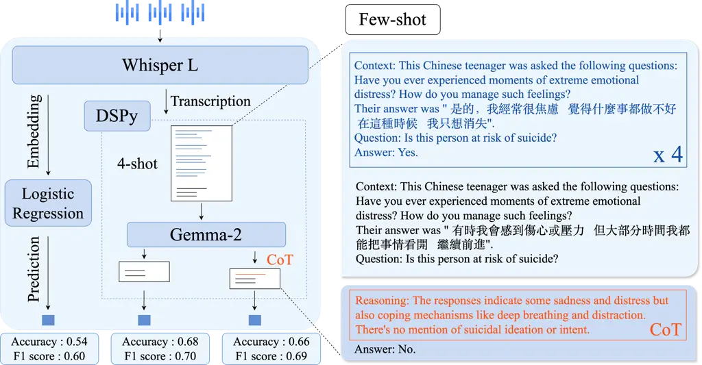
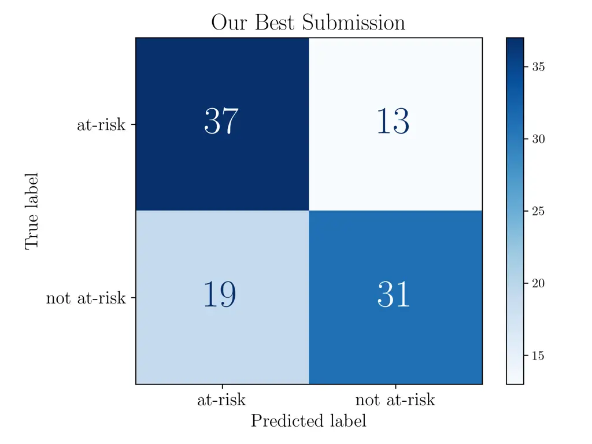

Roquefort Ducorroy Riad CallyopeFrance

# In-context learning capabilities of Large Language Models to detect suicide risk among adolescents from speech transcripts

Filomene    Alexandre    Rachid Affiliation: 

###### Abstract

Early suicide risk detection in adolescents is critical yet hindered by
scalability challenges of current assessments. This paper presents our
approach to the first SpeechWellness Challenge (SW1), which aims to
assess suicide risk in Chinese adolescents through speech analysis. Due
to speech anonymization constraints, we focused on linguistic features,
leveraging Large Language Models (LLMs) for transcript-based
classification. Using DSPy for systematic prompt engineering, we
developed a robust in-context learning approach that outperformed
traditional fine-tuning on both linguistic and acoustic markers. Our
systems achieved third and fourth places among 180+ submissions, with
0.68 accuracy (F1=0.7) using only transcripts. Ablation analyses showed
that increasing prompt example improved performance ($`p`$=0.003), with
varying effects across model types and sizes. These findings advance
automated suicide risk assessment and demonstrate LLMs’ value in mental
health applications.

###### keywords

Speech wellness, Suicidal risk detection, Large Language model,
In-context learning

^(†)^(†)email: rachid@callyope.com

## 1 Introduction

Suicide represents one of the most pressing global public health
challenges, ranking as the fourth leading cause of death among
adolescents aged 15-19 years \[1\]. The COVID-19 pandemic has further
intensified this crisis, with studies reporting significant increases in
suicidal ideation among young people \[2\]. Despite substantial efforts
in suicide prevention, current assessment methods face critical
limitations: psychological self-reports and professional evaluations
often fail to capture the full extent of suicidal ideation and attempts,
as individuals may be reluctant to disclose completely their thoughts
before transitioning to a suicide attempt \[3\].

The early detection of suicide risk is paramount for effective
intervention and resource allocation. However, traditional assessment
approaches, such as clinical interviews and psychological evaluations,
face significant scalability challenges due to the global shortage of
mental health professionals \[4\]. This scarcity is particularly acute
in low- and middle-income countries \[5\], where the ratio of mental
health workers to population can be as low as 1 per 100,000 people
\[6\]. These constraints underscore the urgent need for objective,
scalable, and automated methods to detect suicide risk efficiently and
reliably.



Figure 1: (Left) Overview of the three methods used for our submissions
to the Speech Wellness Challenge. The first method employs direct audio
processing using a pretrained audio encoder paired with a classifier.
The second method uses a Large Language Model with a 4-shot
classification approach. The third method extends this approach by
adding chain-of-thought instruction. (Right) Illustration of the
few-shot prompting technique and the chain-of-thought reasoning. The
transcriptions are fake for privacy reasons, but the reasoning path is
extracted from a successful prediction of the LLM on the dev set.

Speech markers have emerged as a promising avenue for identifying
various mental health conditions \[7\], including depression \[8\],
anxiety \[9\], and suicidal ideation \[10, 11\]. Both acoustic \[12,
13\] and linguistic representations \[14\] have been explored for
speech-based suicide risk assessments. However, the widespread adoption
of these automatic assessments in clinical practice has been hindered by
several factors: the scarcity of publicly available datasets to develop
robust methods, the absence of standardized benchmarks for system
evaluation, and challenges in comparing different techniques \[15\].

The first SpeechWellness Challenge (SW1) \[15\] was established to
address these limitations by advancing speech techniques for detecting
suicide risk through a mutual open benchmark. The challenge provides a
unique dataset of 600 Chinese adolescents aged 10-18 years, with
balanced representation of individuals identified as having suicide risk
based on psychological scales. Participants were tasked with developing
models that utilize both spontaneous and reading speech as digital
biomarkers for binary suicide risk classification. In this paper, we
present our approach to the SW1 challenge, focusing primarily on Large
Language Models (LLMs). Even though there are identified risk factors
such as rumination correlated linked to suicide risk\[16\], there is no
clear and established way how to capture it automatically from speech
content. Our additional decision to concentrate on linguistic features
was motivated by our empirical findings that acoustic methods showed
poor generalization, likely due to the challenge’s speech anonymization
requirements. These requirements particularly impacted speaker
representations like deep speaker embeddings, which have previously
shown promise in mental health and suicide risk assessment \[17, 18\].
By leveraging only speech transcripts, our systems achieved third and
fourth places among over 180 submissions, with an accuracy of 0.68, and
surpassing the classic and challenging baselines from the challenge
organizers.

Central to our methodology is the application of Large Language Models
(LLMs) as few-shot learners \[19\]. Rather than relying on manual prompt
engineering, we employed a ’programming’ approach to employ LLMs and
their configuring by using the DSPy framework \[20\] to systematically
develop and optimize our prompting strategy. This automated approach not
only enhanced the robustness of our experiments but also ensured their
reproducibility (a crucial consideration for clinical applications).
Besides, we conducted extensive analysis and statistical experiments
across multiple LLM architectures, number of in-context examples and
model sizes to examine main contributing factors for suicide risk
detection. Finally, we investigated Chain-of-Thought (CoT) reasoning
approaches, performing qualitative analyses of the reasoning traces to
understand how models interpret and process speech transcripts for
suicide risk assessment.

Previous research by \[10, 11, 18\] has greatly advanced speech-based
approaches for suicide risk assessment, yet there remains no clear
consensus on optimal detection methods from speech content across
languages, particularly for adolescent populations. Besides, the
reliability of acoustic markers can be compromised by recording devices
\[21\] and environmental factors like reverberation \[22\].

On the other hand, automatic speech recognition has made great strides
in terms of performance, enabling reliable use of speech content \[23\].
Simultaneously, the progress of LLMs in numerous linguistic tasks opens
new opportunities in mental health applications. \[24\] and \[25\]
demonstrated that programmatic prompt engineering with DSPy outperformed
manual prompt optimization for detecting mental health issues in social
media content. Similarly, LLM applications have proven effective for
PTSD detection \[26\] and identifying OCD patterns \[27\]. Particularly
relevant to our work, \[17\] achieved strong performance using both
audio and language modalities on a non-anonymized version of the
SpeechWellness Challenge dataset.

## 2 Speech wellness challenge

The SW1 challenge consists of a suicidal risk detection task, where
participants are required to produce a model to predict the label (has
suicidal risk or not) for a subject. The training and testing datasets
comprise speech recordings from 600 Chinese teenagers aged 10-18 years,
with 50% identified as having suicidal risk based on psychological
scales \[28\]. All subjects (speakers) have been anonymized to make the
dataset available to participants of the SW1 challenge. This provides a
unique opportunity to apply and refine advanced speech technologies for
public health while preserving the privacy of all subjects.

Each speaker completed three audio tasks: two spontaneous responses and
one reading task. The first spontaneous task required answering the
question: ”Have you ever experienced moments of extreme emotional
distress? How do you manage such feelings?”. The second open-ended task
involved describing an image of a face expressing negative emotions. The
reading task consisted of reading a passage from Aesop’s Fables untitled
The North Wind and The Sun. For our first approach using audio
processing, we used all three audio tasks. But when focusing on speech
transcripts, we only used the spontaneous tasks.

The speech recordings were preprocessed by the challenge organizers with
neural voice conversion techniques to alter the voice’s timbre and to
anonymize the speakers with x-vector. The dataset is split in two
classes according to a binary label ”at risk” or ”not at risk”. We
reported the accuracy on the Dev set, and also the ranks of the
participants and accuracy on the testing set for our 3 submissions. For
more analysis, the challenge organizers provided the confusion matrix
for our best system.

|            | All data   | Train      | Dev        | Test       |
| ---------- | ---------- | ---------- | ---------- | ---------- |
| N          | 600        | 400        | 100        | 100        |
| Sex(F/M)   | 420/180    | 280/120    | 66/34      | 74/26      |
| Age        | 13.8 (2.4) | 13.8 (2.4) | 13.8 (2.4) | 13.8 (2.5) |
| Suic. risk | 300/300    | 200/200    | 50/50      | 50/50      |

Table 1: Characteristics of the SW1 dataset for train, development (dev)
and test sets.

## 3 Methods

### 3.1 Baselines

First, we tested if the audio modality is capable of detecting suicide
risk. We compared classic signal processing, eGeMAPS features \[29\],
and pretrained speech foundation models Whisper \[23\] and Hubert
\[30\]. These speech foundation models are repurposed to provide a
fixed-size embedding and provided to a classifier (Left part in Figure
1). The three audio tasks were segmented into 10-second slices. These
slices were processed by each pretrained speech foundation model and
labelled with the suicide risk label. A trained Logistic Regression
classifier generated a prediction probability for each audio slice. We
experimented with using each vocal task separately as well as in
combination, applying different pooling techniques (mean, max and
various mellowmax poolings \[31\]).

As we observed poor generalization of participants on the global
ranking, to ensure the capability of generalization of our methods, we
reshuffled the training and development sets using stratified splitting.
The folds remain balanced and with a similar distribution of age and
sex. We reported the two baselines provided by the challenge organizers:
one classic (1) using eGeMAPS followed by a Support Vector Machine (SVM)
classifier to perform the classification task, and a (2) multimodal
approach combining wav2vec 2.0 as audio encoder and BERT-BaseChinese
model as text encoder (see \[15\] for more details). For the ablation
study (Table 3), we ran our experiments with different seeds for example
selection and LLM inference.

### 3.2 LLM as classification module

Our approach leveraged LLMs as binary suicide risk classifiers from
speech transcripts obtained with Whisper \[23\] through in-context
learning. Following \[32, 19\], we prompted each LLM to perform
classification without any fine-tuning, by providing task descriptions
and examples within the context window. We explored both standard
zero-short inference \[32\], few-short inference \[19\] and
chain-of-Thought (CoT) reasoning \[33\] as illustrated in Figure 1. The
main hypothesis is that examples can help LLMs find patterns and improve
probability distribution for language modeling. The main idead behind
CoT, it encourages models to make intermediate reasoning steps before
making a final prediction.

The classification pipeline was developed with the DSPy framework
\[20\], which enabled programmatic prompt construction, ensured
experimental reproducibility and allowed easy inspection of outputs. Our
prompt template that structured the input with specific contextual
framing is displayed in Figure 2.

1 \[\[ \## context \## \]\] 2 A Chinese teenager was given 2 tasks. 3

1.  They had to answer to the 4 following question 5 ’Have you ever
    experienced moments of 6 extreme emotional distress? 7 How do you manage
    such feelings?’ 8 Their answer: {first speech transcript} 9 2. They were
    shown an image of a face 10 displaying negative emotions, and asked 11
    to describe it. 12 Their answer: {second speech transcript} 13 14 \[\[
    \## question \## \]\] 15 Is this patient at risk of suicide?

Figure 2: Prompt template for our submission to define the DSPY program
to tackle suicide risk detection based on speech transcripts.

We compared two LLM models that showed great performance in multiple
benchmarks: Gemma2 \[34\] with 9 billions of parameters and Qwen2.5 with
7 billions of parameters \[35\]. We chose the models versions that were
fine-tuned with instructions. For ablation analysis, we also studied a
smaller and larger version of Gemma2 with 2 and 27 billions of
parameters.

#### 3.2.1 Statistical analysis of in-context learning

After the SW1 challenge, to analyze the relationship between
classification accuracy and the number of examples provided in the LLM
prompt, we performed a large scale experiments with multiple models
version and size. We computed the accuracy as a function of the number
of examples. We ran a multiple linear regression with interaction terms.
The model was specified as:

```math
\displaystyle\sim\text{example\_count}+C(\text{model\_type})+\text{model\_size}
```

```math
\displaystyle\quad+\text{example\_count}\times C(\text{model\_type})
```

```math
\displaystyle\quad+\text{example\_count}\times\text{model\_size}
```

Here are the definitions of each term: example_count represents the
number of examples included in the prompt. $`C(\text{model\_type})`$ is
a categorical variable representing different LLM models, and model_size
denotes the size of the model. We also included interaction terms to
examine whether the effect of increasing the number of examples varies
across different models. Specifically,
$`\text{example\_count}:C(\text{model\_type})`$ captures the interaction
between the number of examples and model type, while
$`\text{example\_count}:\text{model\_size}`$ examines how the effect of
additional examples changes with model size.

We used Ordinary Least Squares (OLS) regression to estimate coefficients
and test their significance. We ran 3 times the experiments with
different seeds to ensure reliability of our ablation analysis, and
reported each coefficient ($`\beta`$) and its associated $`p-`$value.

## 4 Results

Our experiments with classic acoustic features showed limited success
(See Table 2). The baseline OpenSMILE features \[29\] performed poorly,
which our replication confirmed. This underperformance likely stems from
the anonymization process applied to the audio data. We achieved optimal
acoustic model performance by applying a mellowmax(1.0) pooling to
slice-level predictions using Whisper L features. This approach yielded
an accuracy of 0.63 on the Dev\* set and 0.54 on the Test set. Compared
to the original SW1 authors’ work \[17\], the audio modality seem
compromised by anonymization.

Zero-shot approaches with LLMs showed modest results, with both Qwen2.5
and Gemma2-9b achieving only 0.52 accuracy on the Dev set. However,
in-context learning demonstrated promising results both for Qwen2.5 and
Gemma2, with a potential positive link between performance and the
number of examples included in the prompt. Gemma2-9b particularly stood
out with superior performance compared to other models. Our
best-performing submission leveraged Gemma2-9b with 4-shot prompting,
achieving 0.67 accuracy on the development set and 0.68 on the test set,
securing 3rd place in the challenge. Finally, Chain-of-Thought (CoT)
reasoning did not significantly improve performance, yet still achieved
4th place overall.

We also reported the confusion errors on the test set for our best
system (Figure 3) and found that our method prioritizes detecting
at-risk individuals. This bias reduces false negatives — critical in
suicide risk detection — while increasing false positives, a less
harmful trade-off in this situation.

In Table 3, we reported the results of few-shot classification across
different model architectures and sizes. When performing few-shot
classification, LLMs selects examples from the training set —we used
random sampling— and applies the same examples for all predictions on
the development set. To evaluate the impact of examples selection, we
varied DSPy’s random seed and observed performance variation due to
example selection. For instance, our submission configuration (4-shot
with Gemma-2-9b) shows now a standard deviation of 0.7 in accuracy when
evaluated with three different seeds, while default seed got 0.67
accuracy. This variability highlights the significant influence of
example selection on model performance. Example selection in the prompt
seem to play therefore a critical part for generalization as reported by
the authors of DSPy framework on other benchmarks \[20\].

|                                 |       |      |         |
| ------------------------------- | ----- | ---- | ------- |
|                                 | Dev\* | Test | Rank    |
| Baselines                       |       |      |         |
| eGeMAPS + SVM \[17\]            | /     | 0.51 | 130/188 |
| Wav2Vec 2.0 + BERT \[15\]       | /     | 0.61 | 15/188  |
| Audio representations           |       |      |         |
| eGeMAPS + Logistic Regression   | 0.51  | /    | /       |
| Hubert L + Logistic Regression  | 0.53  | /    | /       |
| Whisper L + Logistic Regression | 0.63  | 0.54 | 82/188  |
| LLM approaches                  |       |      |         |
| Qwen2.5-7b Zero-shot            | 0.52  | /    | /       |
| Qwen2.5-7b 1-shot               | 0.55  | /    | /       |
| Qwen2.5-7b 4-shot               | 0.59  | /    | /       |
| Gemma2-9b Zero-shot             | 0.52  | /    | /       |
| Gemma2-9b 1-shot                | 0.55  | /    | /       |
| Gemma2-9b 4-shot                | 0.67  | 0.68 | 3/188   |
| Gemma2-9b 4shot — CoT           | 0.67  | 0.66 | 4/188   |
| First place of the challenge    | /     | 0.74 | 1/188   |

Table 2: Final Accuracy results for the SW1 challenge on the different
sets. Not all approaches could be evaluated on the held out Test set
during the SW1 challenge period. LLMs experiments realized with DSPy on
a single seed.



Figure 3: Confusion matrix for our best system on the test set.

| k    | Gem.2b     | Gem.9b     | Gem.27b    | Qwen7b     | Avg.       |
| ---- | ---------- | ---------- | ---------- | ---------- | ---------- |
| 0    | 0.52 (.00) | 0.52 (.00) | 0.53 (.00) | 0.52 (.00) | 0.52 (.00) |
| 1    | 0.55 (.01) | 0.57 (.04) | 0.57 (.03) | 0.55 (.02) | 0.56 (.01) |
| 2    | 0.52 (.02) | 0.57 (.05) | 0.56 (.01) | 0.57 (.03) | 0.55 (.02) |
| 4    | 0.54 (.06) | 0.60 (.07) | 0.58 (.02) | 0.60 (.05) | 0.58 (.02) |
| 8    | 0.53 (.03) | 0.60 (.06) | 0.58 (.02) | 0.61 (.03) | 0.58 (.03) |
| 16   | 0.57 (.03) | 0.59 (.04) | 0.61 (.04) | 0.59 (.01) | 0.59 (.01) |
| 32   | 0.57 (.04) | 0.64 (.01) | 0.61 (.04) | 0.58 (.03) | 0.60 (.03) |
| 64   | N/A        | N/A        | 0.62 (.00) | 0.57 (.05) | 0.60 (.03) |
| 128  | N/A        | N/A        | 0.53 (.03) | 0.56 (.04) | 0.55 (.02) |
| Avg. | 0.54 (.02) | 0.58 (.03) | 0.58 (.03) | 0.57 (.03) |            |

Table 3: Results of classification experiments with varying model
architectures and sizes (Gemma-2 2b/9b/27b Instruct, Qwen2.5 7b
Instruct), and few-shot settings, k being the number of examples
provided to the model. Mean Accuracy and standard deviation are computed
over three runs with different random seeds. 64 and 128 examples could
not compute for Gemma2 2b and 9b.

The results from the OLS regression indicate that increasing the number
of examples in the prompt significantly improves classification accuracy
(example_count $`\beta=0.0023`$, $`p=0.003`$), supporting the hypothesis
that in-context learning enhances model performance. However, the
interaction terms reveal that this effect is not uniform across models.
The Qwen model shows a smaller benefit from additional examples compared
to the baseline, as indicated by the negative interaction term
(example_count:C(model_type)\[T.qwen\] $`\beta=-0.0017`$, $`p=0.005`$),
suggesting that Qwen may rely less on in-context learning. Additionally,
larger models tend to achieve higher accuracy (model_size
$`\beta=0.0018`$, $`p=0.003`$), but their benefit from additional
examples is reduced, as shown by the negative interaction between
example count and model size (example_count:model_size
$`\beta=-8.7e-05`$, $`p=0.002`$). However, the effect size for this
interaction is very small, suggesting that while significant, this
interaction may not have a meaningful impact in practical settings. The
overall model explained a modest portion of the variance
($`R^{2}=0.134`$), this suggests that these factors influence accuracy
but there are other factors explaining the full accuracy.

The findings presented in this study are based on the scoring framework
of the MINI-KID scale \[28\], which assesses current suicide risk as at
risk or no risk. This classification reflects participants’ immediate
responses to the MINI-KID assessment and should not be interpreted as a
prediction of future suicidal behavior. Although the MINI-KID suicide
module is widely recognized as a gold standard for assessing current
suicide risk among adolescents, it has limitations. It relies heavily on
self-reported data, which may lead to underreporting or
misinterpretation of symptoms, and its fixed set of items may not fully
capture the complex and dynamic nature of suicidal ideation and
behavior. Accordingly, the results reported herein are strictly confined
to the context of this assessment.

## 5 Conclusions

Our work on the SW1 demonstrated the effectiveness of LLM-based
approaches for suicide risk detection despite speech anonymization
constraints. By leveraging in-context learning with DSPy, our system
achieved competitive results using only speech transcripts data,
securing third place in the challenge. Statistical analysis confirmed
that increasing example count significantly improves classification
accuracy, though this effect varies across model types and sizes. In
future work, we aim to examine CoT reasoning paths more deeply to
extract linguistic patterns used in accurate predictions. This analysis
could provide valuable insights to mental health practitioners by
revealing data-driven indicators of suicide risk in adolescents. By
making these linguistic patterns interpretable to clinicians, our
approach could bridge the gap between computational methods and
practical clinical applications, potentially enhancing early
intervention strategies for at-risk adolescents.

## References

- \[1\] J. L. Ward, P. S. Azzopardi, K. L. Francis, J. S. Santelli,
  V. Skirbekk, S. M. Sawyer, N. J. Kassebaum, A. H. Mokdad, S. I. Hay,
  F. Abd-Allah _et al._, “Global, regional, and national mortality among
  young people aged 10–24 years, 1950–2019: a systematic analysis for
  the global burden of disease study 2019,” _The Lancet_, 2021.
- \[2\] M. Bersia, E. Koumantakis, P. Berchialla, L. Charrier,
  A. Ricotti, P. Grimaldi, P. Dalmasso, and R. I. Comoretto, “Suicide
  spectrum among young people during the covid-19 pandemic: A systematic
  review and meta-analysis,” _EClinicalMedicine_, 2022.
- \[3\] M. K. Nock, G. Borges, E. J. Bromet, J. Alonso _et al._,
  “Cross-national prevalence and risk factors for suicidal ideation,
  plans and attempts,” _The British journal of psychiatry_, 2008.
- \[4\] T. F. Bishop, J. K. Seirup, H. A. Pincus, and J. S. Ross,
  “Population of us practicing psychiatrists declined, 2003–13, which
  may help explain poor access to mental health care,” _Health
  Affairs_, 2016.
- \[5\] R. M. Scheffler, W. H. Organization _et al._, “Human resources
  for mental health: workforce shortages in low-and middle-income
  countries,” 2011.
- \[6\] R. Kakuma, H. Minas, N. Van Ginneken, M. R. Dal Poz,
  K. Desiraju, J. E. Morris, S. Saxena, and R. M. Scheffler, “Human
  resources for mental health care: current situation and strategies for
  action,” _The Lancet_, 2011.
- \[7\] N. Cummins, S. Scherer, J. Krajewski, S. Schnieder, J. Epps, and
  T. F. Quatieri, “A review of depression and suicide risk assessment
  using speech analysis,” _Speech communication_, 2015.
- \[8\] J. R. Williamson, T. F. Quatieri, B. S. Helfer, R. Horwitz,
  B. Yu, and D. D. Mehta, “Vocal biomarkers of depression based on motor
  incoordination,” in _AVEC_, 2013.
- \[9\] B. G. Teferra, S. Borwein, D. D. DeSouza, and J. Rose,
  “Screening for generalized anxiety disorder from acoustic and
  linguistic features of impromptu speech: prediction model evaluation
  study,” _JMIR formative research_, 2022.
- \[10\] N. W. Hashim, M. Wilkes, R. Salomon, and J. Meggs, “Analysis of
  timing pattern of speech as possible indicator for near-term suicidal
  risk and depression in male patients,” _International Proceedings of
  Computer Science and Information Technology_, 2012.
- \[11\] Z. Ding, Y. Zhou, A.-J. Dai, C. Qian, B.-L. Zhong, C.-L. Liu,
  and Z.-T. Liu, “Speech based suicide risk recognition for crisis
  intervention hotlines using explainable multi-task learning,” _Journal
  of Affective Disorders_, 2025.
- \[12\] S. Scherer, J. Pestian, and L.-P. Morency, “Investigating the
  speech characteristics of suicidal adolescents,” in _ICASSP_, 2013.
- \[13\] B. Stasak, J. Epps, H. T. Schatten, I. W. Miller, E. M.
  Provost, and M. F. Armey, “Read speech voice quality and disfluency in
  individuals with recent suicidal ideation or suicide attempt,” _Speech
  Communication_, 2021.
- \[14\] S. Homan, M. Gabi, N. Klee, S. Bachmann, A.-M. Moser,
  S. Michel, A.-M. Bertram, A. Maatz, G. Seiler, E. Stark _et al._,
  “Linguistic features of suicidal thoughts and behaviors: A systematic
  review,” _Clinical psychology review_, 2022.
- \[15\] W. Wu, Z. Cui, C. Lei, Y. Duan, D. Qu, J. Wu, B. Zhou, R. Chen,
  and C. Zhang, “The 1st speechwellness challenge: Detecting suicidal
  risk among adolescents,” _arXiv preprint arXiv:2501.06474_, 2025.
- \[16\] M. L. Rogers and T. E. Joiner, “Rumination, suicidal ideation,
  and suicide attempts: A meta-analytic review,” _Review of General
  Psychology_, 2017.
- \[17\] Z. Cui, C. Lei, W. Wu, Y. Duan, D. Qu, J. Wu, R. Chen, and
  C. Zhang, “Spontaneous speech-based suicide risk detection using
  whisper and large language models,” in _Interspeech 2024_, 2024.
- \[18\] M. Gerczuk, S. Amiriparian, J. Lutz, W. Strube, I. Papazova,
  A. Hasan, and B. W. Schuller, “Exploring gender-specific speech
  patterns in automatic suicide risk assessment,” in _Interspeech 2024_.
- \[19\] T. Brown, B. Mann, N. Ryder, M. Subbiah, J. D. Kaplan,
  P. Dhariwal, A. Neelakantan, P. Shyam, G. Sastry, A. Askell _et al._,
  “Language models are few-shot learners,” _NeurIPS_, 2020.
- \[20\] O. Khattab, A. Singhvi, P. Maheshwari, Z. Zhang, K. Santhanam,
  S. V. A, S. Haq, A. Sharma, T. T. Joshi, H. Moazam, H. Miller,
  M. Zaharia, and C. Potts, “DSPy: Compiling declarative language model
  calls into state-of-the-art pipelines,” in _ICLR_, 2024.
- \[21\] S. Jannetts, F. Schaeffler, J. Beck, and S. Cowen, “Assessing
  voice health using smartphones: bias and random error of acoustic
  voice parameters captured by different smartphone types,”
  _International journal of language & communication disorders_, 2019.
- \[22\] J. Dineley, E. Carr, F. Matcham, J. Downs, R. J. B. Dobson,
  T. F. Quatieri, and N. Cummins, “Towards robust paralinguistic
  assessment for real-world mobile health (mhealth) monitoring: an
  initial study of reverberation effects on speech,” in
  _Interspeech_, 2023.
- \[23\] A. Radford, J. W. Kim, T. Xu, G. Brockman, C. McLeavey, and
  I. Sutskever, “Robust speech recognition via large-scale weak
  supervision,” in _ICML_, 2023.
- \[24\] S. Schulhoff, M. Ilie, N. Balepur, K. Kahadze, A. Liu, C. Si,
  Y. Li, A. Gupta, H. Han, S. Schulhoff, P. S. Dulepet, S. Vidyadhara,
  D. Ki, S. Agrawal, C. Pham, G. Kroiz, F. Li, H. Tao, A. Srivastava,
  H. D. Costa, S. Gupta, M. L. Rogers, I. Goncearenco, G. Sarli,
  I. Galynker, D. Peskoff, M. Carpuat, J. White, S. Anadkat, A. Hoyle,
  and P. Resnik, “The prompt report: A systematic survey of prompting
  techniques,” 2024.
- \[25\] K. Skianis, A. S. Doğruöz, and J. Pavlopoulos, “Leveraging LLMs
  for translating and classifying mental health data,” in _Proceedings
  of the Fourth Workshop on Multilingual Representation Learning (MRL 2024)_, 2024.
- \[26\] R. Quillivic, F. Gayraud, Y. Auxéméry, L. Vanni, D. Peschanski,
  F. Eustache, J. Dayan, and S. Mesmoudi, “Interdisciplinary approach to
  identify language markers for post-traumatic stress disorder using
  machine learning and deep learning,” _Scientific reports_, 2024.
- \[27\] J. Kim, K. G. Leonte, M. L. Chen, J. B. Torous, E. Linos,
  A. Pinto, and C. I. Rodriguez, “Large language models outperform
  mental and medical health care professionals in identifying
  obsessive-compulsive disorder,” _NPJ Digital Medicine_, 2024.
- \[28\] D. V. Sheehan, K. H. Sheehan, R. D. Shytle, J. Janavs,
  Y. Bannon, J. E. Rogers, K. M. Milo, S. L. Stock, and B. Wilkinson,
  “Reliability and validity of the mini international neuropsychiatric
  interview for children and adolescents (mini-kid),” _The Journal of
  clinical psychiatry_, vol. 71, no. 3, p. 17393, 2010.
- \[29\] F. Eyben, M. Wöllmer, and B. Schuller, “Opensmile: the munich
  versatile and fast open-source audio feature extractor,” in _ACM
  international conference on Multimedia_, 2010.
- \[30\] W.-N. Hsu, B. Bolte, Y.-H. H. Tsai, K. Lakhotia,
  R. Salakhutdinov, and A. Mohamed, “Hubert: Self-supervised speech
  representation learning by masked prediction of hidden units,”
  _IEEE/ACM TASLP_, 2021.
- \[31\] K. Asadi and M. L. Littman, “An alternative softmax operator
  for reinforcement learning,” in _ICML_, 2017.
- \[32\] A. Radford, J. Wu, R. Child, D. Luan, D. Amodei, I. Sutskever
  _et al._, “Language models are unsupervised multitask learners,”
  _OpenAI blog_, 2019.
- \[33\] J. Wei, X. Wang, D. Schuurmans, M. Bosma, F. Xia, E. Chi, Q. V.
  Le, D. Zhou _et al._, “Chain-of-thought prompting elicits reasoning in
  large language models,” _NeurIPS_, 2022.
- \[34\] G. Team, M. Riviere, S. Pathak, P. G. Sessa, C. Hardin,
  S. Bhupatiraju, L. Hussenot, T. Mesnard, B. Shahriari, A. Ramé
  _et al._, “Gemma 2: Improving open language models at a practical
  size,” _arXiv preprint arXiv:2408.00118_, 2024.
- \[35\] A. Yang, B. Yang, B. Zhang, B. Hui, B. Zheng, B. Yu, C. Li,
  D. Liu, F. Huang, H. Wei _et al._, “Qwen2. 5 technical report,” _arXiv
  preprint arXiv:2412.15115_, 2024.
