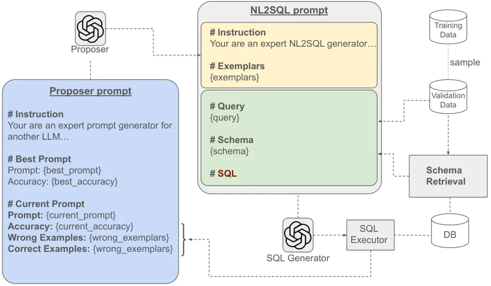

# Effectiveness of Prompt Optimization in NL2SQL Systems

DOI: [XXXXXXX.XXXXXXX](https://doi.org/XXXXXXX.XXXXXXX)Conference: Make
sure to enter the correct conference title from your rights confirmation
email; June 03–05, 2018; Woodstock,
NYISBN: 978-1-4503-XXXX-X/2018/06Conference: Novel Optimizations for
Visionary AI Systems; June 22–27, 2025; Berlin, GermanyNovel
Optimizations for Visionary AI Systems (NOVAS ’25), June 22–27, 2025,
Berlin,
GermanyDOI: [10.1145/3735079.3735325](https://doi.org/10.1145/3735079.3735325)ISBN: 979-8-4007-1917-2/2025/06

Sairam Gurajada Note: Work done while at Megagon Labs email:
<sairam@megagon.ai> Affiliation: Megagon Labs, Mountain View,
California, USA , Eser Kandogan email: <eser@megagon.ai>
Affiliation: Megagon Labs, Mountain View, California, USA and Sajjadur
Rahman email: <sajjadurr@adobe.com> Affiliation: Adobe, San Jose,
California, USA

© acmlicensed

###### Abstract.

NL2SQL approaches have greatly benefited from the impressive
capabilities of large language models (LLMs). In particular,
bootstrapping an NL2SQL system for a specific domain can be as simple as
instructing an LLM with sufficient contextual information, such as
schema details and translation demonstrations. However, building an
accurate system still requires the rigorous task of selecting the right
context for each query—including identifying relevant schema elements,
cell values, and suitable exemplars that help the LLM understand
domain-specific nuances. Retrieval-based methods have become the go-to
approach for identifying such context. While effective, these methods
introduce additional inference-time costs due to the retrieval process.

In this paper, we argue that production scenarios demand high-precision,
high-performance NL2SQL systems, rather than simply high-quality SQL
generation, which is the focus of most current NL2SQL approaches. In
such scenarios, the careful selection of a static set of
exemplars—capturing the intricacies of the query log, target database,
SQL constructs, and execution latencies—plays a more crucial role than
exemplar selection based solely on similarity. The key challenge,
however, lies in identifying a representative set of exemplars for a
given production setting. To this end, we propose a prompt optimization
framework that not only addresses the high-precision requirement but
also optimizes the performance of the generated SQL through
multi-objective optimization. Preliminary empirical analysis
demonstrates the effectiveness of the proposed framework.

## 1. Introduction

The rapid progress in LLM capabilities—specifically their ability to
follow instructions and maintain large contexts—has made them a natural
choice in many applications. Natural Language to SQL (NL2SQL) is a
long-standing and important task in many business-critical scenarios,
requiring a deep understanding of user queries and the underlying
databases for effective translation. Recent years have witnessed
significant progress in NL2SQL, fueled by advancements in
LLMs (Caferoğlu and Özgür Ulusoy, 2025; Gao et al., 2025; Maamari
et al., 2024; Chung et al., 2025). However, building an effective NL2SQL
system goes beyond simply leveraging LLMs—it requires the careful
selection of instructions, exemplars, and schema, making it a
challenging task despite recent breakthroughs (Floratou et al., 2024).

Recent works (Shen et al., 2025; Chung et al., 2025) emphasize that
exemplar selection is crucial for building effective NL2SQL systems.
Retrieval-based exemplar selection—i.e., identifying exemplars similar
to the user query—has become the de facto method. However,
studies (Pourreza et al., 2025; Chung et al., 2025) highlight
inefficiencies and overfitting issues with similarity-based retrieval
methods, and argue that synthetic exemplars can yield better
performance. While each approach has its advantages—retrieval-based
methods are cheaper due to index-based lookups without LLM calls, and
synthetic exemplars may be more accurate—they both require exemplar
selection at inference time, which can become a bottleneck in
business-critical applications (Tang et al., 2024).

Prompt Optimization. To address the limitations of current NL2SQL
systems, we argue that for effective SQL generation, all an LLM needs is
a static set of exemplars that capture the intricacies of the
domain—offering performance comparable to retrieval-based approaches,
while eliminating the need for inference-time retrieval. The key
challenge lies in identifying this representative set of exemplars. To
tackle this, we leverage prompt optimization techniques for exemplar
selection in NL2SQL and demonstrate their effectiveness.

Multi-Objective Optimization. Most existing NL2SQL approaches focus
solely on accuracy. However, accuracy is only one dimension in deploying
practical NL2SQL systems. In real-world settings, systems must also
understand query efficiency and the characteristics of target SQL
engines, generating queries that are efficient to execute (i.e., with
lower latency). In this work, we propose a way to extend prompt
optimization to multi-objective settings. To support this, we introduce
an augmented benchmark based on BIRD that includes query latency
measurements.

To summarize, our contributions are as follows:

- •
  To the best of our knowledge, this is the first work to study the
  effectiveness of prompt optimization in NL2SQL systems.
- •
  We propose an iterative prompt optimization (IPO) framework that
  jointly optimizes instructions and exemplar selection through two
  agents Proposer and SQL Generator. Additionally, the framework
  implicitly performs schema pruning, reducing prompt size and thereby
  lowering inference costs.
- •
  We introduce the aspect of generating efficient SQL translations in
  NL2SQL systems, and introduce an augmented benchmark BIRD-MULTI (based
  on BIRD dataset) that incorporates query latency information.

## 2. Related Work

Exemplar Selection. With the advent of powerful API-based LLMs such as
ChatGPT (Team, 2024b) and Gemini (Team, 2024a), in-context learning
(ICL)–based approaches (Dong et al., 2023; Gao et al., 2023; Pourreza
et al., 2025; Pourreza and Rafiei, 2023; Chung et al., 2025; Shen
et al., 2025; Nan et al., 2023) have become the dominant strategy for
building high-performing NL2SQL systems. Specifically, retrieval-based
exemplar selection (Shen et al., 2025), where examples are selected from
a training set based on text or structural similarity, has proven
sufficient to improve NL2SQL performance without expensive fine-tuning.
However, such systems introduce inference-time costs and may overfit to
specific queries due to the retrieval of overly similar examples (Chung
et al., 2025).

To address this, recent approaches (Pourreza et al., 2025; Chung et al., 2025) employ (online) synthetic exemplar generation rather than relying
on training data selection. While this mitigates overfitting, it
requires learning exemplar generators, which incurs additional costs and
presents challenges in domain transfer. In this work, we explore
optimization-based methods for exemplar selection that avoid both the
expense of retrieval indexes and the complexity of online synthetic
generation.

Prompt Optimization. Optimizing LLM prompts has been a focus for several
years (Shin et al., 2020; Wen et al., 2023), showing effectiveness
across a multitude of applications. More recently, DSPy (Khattab et al., 2024) introduced a declarative framework for expressing and optimizing
prompts for NLP tasks. Foundational work by (Yang et al., 2024)
demonstrated the inherent capability of LLMs to act as optimizers,
particularly for instruction tuning across various tasks. Building on
this,(Opsahl-Ong et al., 2024) proposed MIPRO, a non-iterative technique
for joint optimization of instructions and exemplar selection in
multi-stage pipelines. Furthermore,(Liu et al., 2024b) introduced a
declarative framework focused on BI workloads, combining hybrid database
systems with AutoML-style optimization for pipeline tuning. While these
works introduced key optimization techniques, their applicability and
effectiveness in the NL2SQL setting remain unexplored—a gap that our
work seeks to address.

## 3. Prompt Optimization for NL2SQL

To demonstrate the effectiveness of optimization in NL2SQL, we adopt a
simple in-context learning (ICL)(Brown et al., 2020) pipeline, as
illustrated in Figure1, which uses a single LLM to generate the SQL
query. The prompt provided to the LLM consists of: a) \#Instruction – a
guiding instruction for the task, b) \#Exemplars – examples selected
from the training data via an Exemplar Selection component, c) \#Query –
the user query to be translated, d) \#Schema – the relevant schema
retrieved using a Schema Retrieval module, and e)#SQL – a prefix to
trigger SQL generation by the LLM.

To apply to production use-case, we use exact proprietary schema, and
focus our efforts on optimizing exemplar selection.

Figure 1. NL2SQL Pipeline

### 3.1. Exemplar Selection and Optimization

As previously mentioned, exemplar selection is a crucial step in NL2SQL
generation, particularly when using ICL-based approaches (Gao et al.,
2025). This involves identifying an appropriate set of exemplars—each
consisting of a natural language (NL) query, database schema,
corresponding SQL query, and optionally hints or cell values—that help
the LLM understand the domain, the target SQL engine, and data-specific
nuances. Below, we discuss various exemplar selection strategies and how
optimization can enhance the selection process.

Random. A straightforward approach to exemplar selection is random
sampling. For a predefined value of $`k`$ (the number of exemplars),
this strategy randomly samples $`k`$ exemplars from the training data to
include in the prompt. More sophisticated sampling techniques, such as
stratified sampling, can also be used to account for the distribution of
query types. For example, queries in the BIRD (Li et al., 2024) dataset
are categorized into three groups: simple, moderate, and challenging.

Optimizing Random Exemplar Selection. A key challenge with random
selection is choosing an appropriate value for $`k`$. A small $`k`$ may
fail to capture the diversity of the NL and SQL constructs, while a
large $`k`$ can lead to lost-in-the-middle issues with LLMs (Liu et al.,
2024a) and increase generation costs due to the larger prompt size. A
simple yet effective approach is to treat $`k`$ as a hyperparameter and
optimize it using AutoML-style techniques, as illustrated in
Algorithm 1. Inspired by DSPy’s BootStrap with FewShot Example
Selection (Khattab et al., 2024), this method optimizes the number of
demonstrations by randomly sampling exemplars (with replacement), rather
than bootstrapping, using a performance metric $`\mu`$.

Input: $`\mathcal{D}`$, $`numTrials`$, $`\mathcal{P}_{base}`$, LLM

Output: $`\mathcal{P}_{opt}`$

1 $`\mathcal{D}_{train},\mathcal{D}_{valid}\leftarrow`$
Split(_$`\mathcal{D}`$_)

2 $`best\_score\leftarrow 0`$

3 $`{P}_{opt}\leftarrow\mathcal{P}_{base}`$

4 while _$`i\leq numTrials`$_ do

    5 $`k\leftarrow`$
$`trial.{\tt suggest\_int(^{\prime}k^{\prime},0,K)}`$ /\* choose $`k`$
\*/

    6 $`E_{i}\leftarrow`$ Random(_$`\mathcal{D}_{train},k`$_) /\* $`k`$
exemplars \*/

    7 $`\mathcal{P}_{i}\leftarrow\mathcal{P}_{base}+Ex_{i}`$

    8 $`score\leftarrow`$ Evaluate(_$`{\tt LLM}`$, $`\mathcal{P}_{i}`$,
$`\mathcal{D}_{valid}`$_)

    9 if _$`score>best\_score`$_ then

       10 $`{P}_{opt}\leftarrow\mathcal{P}_{i}`$

       11 $`best\_score\leftarrow score`$

Algorithm 1 Optimization of Random Exemplar Selection

In addition to optimizing exemplar selection, joint optimization of
instruction and exemplar selection can lead to improved performance.
MIPRO (Opsahl-Ong et al., 2024) leverages an LLM to generate $`N`$
instruction–exemplar pairs
$`{(I_{1},E_{1}),(I_{2},E_{2}),\ldots,(I_{N},E_{N})}`$, where $`I_{i}`$
is an instruction generated from a set of randomly bootstrapped
exemplars $`E_{i}`$. A hyperparameter optimization algorithm such as
TPE (Bergstra et al., 2011) is then used to identify the optimal pair
$`(I_{i},E_{i})`$ based on an objective function, such as validation
accuracy.

Figure 2. Iterative Prompt Optimization

### 3.2. Iterative Prompt Optimization

One of the key limitations of the exemplar selection strategies
discussed earlier is their ad hoc nature—exemplars are either randomly
sampled or bootstrapped using heuristics (as in (Opsahl-Ong et al.,
2024)), which may lead to suboptimal performance. Long-context LLMs
(LCMs) aim to overcome this by fitting a larger number of exemplars
(100–200) into their context window. However, recent work (Chung et al., 2025) has shown that relying on LCMs to implicitly perform exemplar
selection does not improve performance and can, in fact, be detrimental,
as LCMs often struggle with effective in-context learning (Li et al.,
2025).

To address this, we extend the work of (Yang et al., 2024), which uses
an LLM as an optimizer to find an optimal prompt instruction, by
enabling it to perform both instruction generation and exemplar
selection through two cooperating agents: the Proposer and the SQL
Generator. Specifically, we introduce an Iterative Prompt Optimization
(IPO) approach (illustrated in Figure 2) in which the two agents work
together to discover optimal NL2SQL prompts for a given training corpus.

The Proposer agent takes a Proposer prompt as input and generates an
NL2SQL prompt comprising an instruction and a set of exemplars. The SQL
Generator agent then evaluates the generated prompt on a validation set
(sampled iteratively from the training data) and collects performance
metrics including accuracy, as well as the correct and incorrect
examples. This feedback is used to update the Proposer prompt. In
subsequent iterations, the Proposer is guided to refine the NL2SQL
prompt based on past performance, aiming to produce more informative
exemplars and a better-suited instruction for improved SQL generation.

Figure 3. IPO generated exemplar with automatic schema pruning

In contrast to MIPRO, which bootstraps exemplars randomly, IPO uses an
LLM as an optimizer to jointly refine both the instruction and exemplar
selection. Additionally, we observed that IPO often generates more
concise NL2SQL prompts by pruning irrelevant schema information from the
exemplars. For example, Figure 3 shows an exemplar whose schema includes
only the table film and the columns film_id, title, and rating from the
database movie_3. Although schema pruning was not an explicit design
goal of IPO, this behavior highlights the strength of LLMs as optimizers
in complex tasks such as NL2SQL.

## 4. Extending to Multi-Objective

Motivation. Thus far, NL2SQL systems have focused mainly on improving
execution accuracy while ignoring a critical dimension: generating
efficient SQL queries. Consider the example of SQL translations: ground
truth (GT) and generated SQL (Gen) for the query NLQ. Executing the GT
SQL query on a SQLite3 database took around 10.2 seconds (due to the
sub-query), while the Gen query (which uses an inner join) took only
0.03 seconds. This example demonstrates that the generated query (in
this case, ground truth) may not always be the most efficient SQL
translation.

Benchmark Creation. To build NL2SQL systems capable of generating
efficient SQL queries, it is essential to have information about the
efficiency of a SQL query—such as its wall-clock execution
time—alongside the SQL translation itself. This efficiency information
enables SQL generators (LLMs) to better understand the nuances and
computational complexity of various SQL constructs, ultimately guiding
them toward generating more optimized queries. However, existing
benchmarks such as BIRD(Li et al., 2024) and SPIDER(Lei et al., 2024)
lack this critical execution-time data. To address this gap, we
developed a new augmented benchmark built on top of BIRD, which includes
each natural language query (NLQ) paired with two different SQL variants
(generated using reasoning models OpenAI O3 (OpenAI, 2025)) along with
their measured execution times.

Generating Efficient SQL Queries. With the augmented benchmark
containing SQL variants and their corresponding execution times, it
becomes feasible to design LLM prompts specifically aimed at generating
efficient SQL queries. Furthermore, by leveraging the optimization
techniques described in Section 3, it is possible to jointly optimize
for both SQL efficiency and generation accuracy, leading to more
practical and performant NL2SQL systems.

## 5. Preliminary Results

Here, we present preliminary results demonstrating the effectiveness of
prompt optimization in NL2SQL systems. As described earlier, we consider
a simple NL2SQL pipeline consisting of a single LLM (illustrated in
Figure 1) and evaluate the following prompt optimization strategies
discussed in Section 3. For all experiments, we use GPT-4o as the LLM.

- •
  RES. Random Exemplar Selection (RES) is the baseline approach, where
  $`k=10`$ exemplars are randomly sampled from the training data. We run
  RES over 10 random samples and report the best accuracy.
- •
  ORES. Optimized Random Exemplar Selection (ORES) uses Bayesian
  Optimization to tune the hyperparameter $`k`$ in the RES method. We
  limit the number of trials to 20 and note that increasing trials does
  not necessarily correlate with improved performance.
- •
  MIPROv2. Multiprompt Instruction PRoposal Optimizer (MIPROv2) is the
  DSPy (Khattab et al., 2024) recommended optimizer that jointly
  optimizes instruction and exemplar selection. Similar to ORES, we set
  the number of trials to 20, and the maximum number of labeled
  demonstrations to 10.
- •
  IPO. Iterative Prompt Optimization (IPO) is a bi-agent,
  LLM-as-optimizer approach that iteratively refines the NL2SQL prompt
  using feedback on SQL generation quality. For IPO, we set the number
  of iterations to 5 and instruct the LLM to generate at least 5 diverse
  exemplars per iteration.

### 5.1. Effectiveness of Optimization

Performance. Table 1 highlights the effectiveness of different
optimization strategies on the BIRD dataset. The naive RES approach
underperforms due to its inability to select informative exemplars for
SQL generation. The ORES approach, which applies a simple AutoML-based
optimization, performs better than RES but falls short compared to more
advanced strategies like MIPROv2 and IPO. IPO achieves the best
performance, benefiting from iterative refinement using feedback from
the SQL Generator agent, which leads to more relevant exemplar
selection. The absence of this feedback loop in MIPROv2 makes it less
effective than IPO. However, we emphasize that these observations are
specific to the NL2SQL task.

| Approach | Simple | Moderate | Challenging | Total |
| -------- | ------ | -------- | ----------- | ----- |
| RES      | 52.32  | 48.17    | 43.35       | 50.74 |
| ORES     | 58.27  | 51.29    | 46.21       | 55.02 |
| MIPROv2  | 64.86  | 48.28    | 44.14       | 57.89 |
| IPO      | 63.57  | 52.28    | 45.52       | 59.24 |

Table 1. Ex. Accuracies of Prompt optimization Methods on BIRD (dev)
dataset

Quantitative Analysis. Table 2 presents a quantitative analysis of the
different optimization techniques, measured across two dimensions:
prompt length and optimization time. RES (with 10 exemplars) results in
a prompt length of approximately 23k tokens, while ORES (with 75
exemplars) leads to a significantly larger prompt of around 84k tokens.
MIPROv2 (with 10 exemplars) produces a prompt length of about 26k
tokens, similar to RES. IPO yields the shortest prompt length, as it
prunes a substantial portion of schema information from each exemplar,
while also delivering the best performance.

In terms of optimization time, MIPROv2 takes the longest, as it involves
both data analysis and joint optimization, whereas IPO and ORES are
comparatively faster.

| Approach | Prompt Length (#tokens) | Optimization Time |
| -------- | ----------------------- | ----------------- |
| RES      | 23,749                  | -                 |
| ORES     | 84,519                  | 5m26s             |
| MIPROv2  | 26,352                  | 13m16s            |
| IPO      | 6,495                   | 8m53s             |

Table 2. Quantitative analysis of PO on BIRD (dev) dataset

### 5.2. Multi-Objective Optimization

Table 3 demonstrates the effectiveness of multi-objective optimization
using the IPO approach. For this, we consider both accuracy and latency
on the BIRD (dev) dataset. When compared to the ground truth (GT),
accuracy-only IPO optimization (Section 3.2) results in the generation
of SQL queries that are less efficient, with a maximum latency of
approximately 18 seconds (vs. 8.7 seconds for GT) and a standard
deviation ($`\sigma`$) that is almost 1.8 times larger. In contrast,
joint optimization of both accuracy and latency leads to only a marginal
increase in the maximum latency of queries, while maintaining a standard
deviation similar to that observed in GT.

|          |                   |        |            |         |       |           |
| -------- | ----------------- | ------ | ---------- | ------- | ----- | --------- |
| Approach | Execution Time(s) |        |            |         | Acc.  | Gen. Time |
|          | Min               | Max    | $`\sigma`$ | $`\mu`$ | (Ex)  | QPS       |
| GT       | 1e-5              | 8.761  | 0.352      | 0.0026  | -     | -         |
| Acc.Opt  | 9e-5              | 18.512 | 0.635      | 0.0051  | 59.24 | 1.56      |
| + Lat.   | 7e-5              | 10.156 | 0.383      | 0.0028  | 58.98 | 1.72      |

Table 3. Effectiveness of multi-objective optimization on BIRD (dev)
dataset

## 6. Conclusions

In this paper, we propose a novel approach for building NL2SQL systems
by leveraging prompt optimization as a key strategy. Specifically, we
optimize both instruction and exemplar selection for LLM-based SQL
generation. Furthermore, through prompt optimization, we demonstrate
that schema pruning and concise prompt generation can be achieved
without negatively impacting accuracy. Additionally, we highlight the
importance of generating efficient SQL queries and show that prompt
optimization can effectively achieve the dual objectives of accuracy and
efficiency. Finally, we introduce an augmented benchmark designed for
the multi-objective optimization of NL2SQL systems.

## References

- Bergstra et al. (2011) James Bergstra, Rémi Bardenet, Yoshua Bengio,
  and Balázs Kégl. 2011. Algorithms for Hyper-Parameter Optimization. In
  _Advances in Neural Information Processing Systems_, J. Shawe-Taylor,
  R. Zemel, P. Bartlett, F. Pereira, and K.Q. Weinberger (Eds.),
  Vol. 24. Curran Associates, Inc.
  [https://proceedings.neurips.cc/paper_files/paper/2011/file/86e8f7ab32cfd12577bc2619bc635690-Paper.pdf](https://proceedings.neurips.cc/paper_files/paper/2011/file/86e8f7ab32cfd12577bc2619bc635690-Paper.pdf)
- Brown et al. (2020) Tom Brown, Benjamin Mann, Nick Ryder, Melanie
  Subbiah, Jared D Kaplan, Prafulla Dhariwal, Arvind Neelakantan, Pranav
  Shyam, Girish Sastry, Amanda Askell, Sandhini Agarwal, Ariel
  Herbert-Voss, Gretchen Krueger, Tom Henighan, Rewon Child, Aditya
  Ramesh, Daniel Ziegler, Jeffrey Wu, Clemens Winter, Chris Hesse, Mark
  Chen, Eric Sigler, Mateusz Litwin, Scott Gray, Benjamin Chess, Jack
  Clark, Christopher Berner, Sam McCandlish, Alec Radford, Ilya
  Sutskever, and Dario Amodei. 2020. Language Models are Few-Shot
  Learners. In _Advances in Neural Information Processing Systems_,
  H. Larochelle, M. Ranzato, R. Hadsell, M.F. Balcan, and H. Lin (Eds.),
  Vol. 33. Curran Associates, Inc., 1877–1901.
  [https://proceedings.neurips.cc/paper_files/paper/2020/file/1457c0d6bfcb4967418bfb8ac142f64a-Paper.pdf](https://proceedings.neurips.cc/paper_files/paper/2020/file/1457c0d6bfcb4967418bfb8ac142f64a-Paper.pdf)
- Caferoğlu and Özgür Ulusoy (2025) Hasan Alp Caferoğlu and Özgür
  Ulusoy. 2025. E-SQL: Direct Schema Linking via Question Enrichment in
  Text-to-SQL. arXiv:2409.16751 \[cs.CL\]
  [https://arxiv.org/abs/2409.16751](https://arxiv.org/abs/2409.16751)
- Chung et al. (2025) Yeounoh Chung, Gaurav T. Kakkar, Yu Gan, Brenton
  Milne, and Fatma Ozcan. 2025. Is Long Context All You Need? Leveraging
  LLM’s Extended Context for NL2SQL. arXiv:2501.12372 \[cs.DB\]
  [https://arxiv.org/abs/2501.12372](https://arxiv.org/abs/2501.12372)
- Dong et al. (2023) Xuemei Dong, Chao Zhang, Yuhang Ge, Yuren Mao,
  Yunjun Gao, lu Chen, Jinshu Lin, and Dongfang Lou. 2023. C3: Zero-shot
  Text-to-SQL with ChatGPT. arXiv:2307.07306 \[cs.CL\]
  [https://arxiv.org/abs/2307.07306](https://arxiv.org/abs/2307.07306)
- Floratou et al. (2024) Avrilia Floratou, Fotis Psallidas, Fuheng Zhao,
  Shaleen Deep, Gunther Hagleither, Wangda Tan, Joyce Cahoon, Rana
  Alotaibi, Jordan Henkel, Abhik Singla, Alex Van Grootel, Brandon Chow,
  Kai Deng, Katherine Lin, Marcos Campos, K. Venkatesh Emani, Vivek
  Pandit, Victor Shnayder, Wenjing Wang, and Carlo Curino. 2024. NL2SQL
  is a solved problem… Not!. In _CIDR_.
  [https://www.cidrdb.org/cidr2024/papers/p74-floratou.pdf](https://www.cidrdb.org/cidr2024/papers/p74-floratou.pdf)
- Gao et al. (2023) Dawei Gao, Haibin Wang, Yaliang Li, Xiuyu Sun,
  Yichen Qian, Bolin Ding, and Jingren Zhou. 2023. Text-to-SQL Empowered
  by Large Language Models: A Benchmark Evaluation.
  arXiv:2308.15363 \[cs.DB\]
  [https://arxiv.org/abs/2308.15363](https://arxiv.org/abs/2308.15363)
- Gao et al. (2025) Yingqi Gao, Yifu Liu, Xiaoxia Li, Xiaorong Shi, Yin
  Zhu, Yiming Wang, Shiqi Li, Wei Li, Yuntao Hong, Zhiling Luo, Jinyang
  Gao, Liyu Mou, and Yu Li. 2025. A Preview of XiYan-SQL: A
  Multi-Generator Ensemble Framework for Text-to-SQL.
  arXiv:2411.08599 \[cs.AI\]
  [https://arxiv.org/abs/2411.08599](https://arxiv.org/abs/2411.08599)
- Khattab et al. (2024) Omar Khattab, Arnav Singhvi, Paridhi Maheshwari,
  Zhiyuan Zhang, Keshav Santhanam, Sri Vardhamanan A, Saiful Haq,
  Ashutosh Sharma, Thomas T. Joshi, Hanna Moazam, Heather Miller, Matei
  Zaharia, and Christopher Potts. 2024. DSPy: Compiling Declarative
  Language Model Calls into State-of-the-Art Pipelines. In _The Twelfth
  International Conference on Learning Representations_.
  [https://openreview.net/forum?id=sY5N0zY5Od](https://openreview.net/forum?id=sY5N0zY5Od)
- Lei et al. (2024) Fangyu Lei, Jixuan Chen, Yuxiao Ye, Ruisheng Cao,
  Dongchan Shin, Hongjin Su, Zhaoqing Suo, Hongcheng Gao, Wenjing Hu,
  Pengcheng Yin, et al. 2024. Spider 2.0: Evaluating language models on
  real-world enterprise text-to-sql workflows. _arXiv preprint
  arXiv:2411.07763_ (2024).
- Li et al. (2024) Jinyang Li, Binyuan Hui, Ge Qu, Jiaxi Yang, Binhua
  Li, Bowen Li, Bailin Wang, Bowen Qin, Ruiying Geng, Nan Huo,
  et al. 2024. Can llm already serve as a database interface? a big
  bench for large-scale database grounded text-to-sqls. _Advances in
  Neural Information Processing Systems_ 36 (2024).
- Li et al. (2025) Tianle Li, Ge Zhang, Quy Duc Do, Xiang Yue, and Wenhu
  Chen. 2025. Long-context LLMs Struggle with Long In-context Learning.
  _Transactions on Machine Learning Research_ (2025).
  [https://openreview.net/forum?id=Cw2xlg0e46](https://openreview.net/forum?id=Cw2xlg0e46)
- Liu et al. (2024b) Chunwei Liu, Matthew Russo, Michael Cafarella, Lei
  Cao, Peter Baille Chen, Zui Chen, Michael Franklin, Tim Kraska, Samuel
  Madden, and Gerardo Vitagliano. 2024b. A Declarative System for
  Optimizing AI Workloads. arXiv:2405.14696 \[cs.CL\]
  [https://arxiv.org/abs/2405.14696](https://arxiv.org/abs/2405.14696)
- Liu et al. (2024a) Nelson F. Liu, Kevin Lin, John Hewitt, Ashwin
  Paranjape, Michele Bevilacqua, Fabio Petroni, and Percy Liang. 2024a.
  Lost in the Middle: How Language Models Use Long Contexts.
  _Transactions of the Association for Computational Linguistics_ 12
  (2024), 157–173.
  [doi:10.1162/tacl_a_00638](https://doi.org/10.1162/tacl_a_00638)
- Maamari et al. (2024) Karime Maamari, Fadhil Abubaker, Daniel
  Jaroslawicz, and Amine Mhedhbi. 2024. The Death of Schema Linking?
  Text-to-SQL in the Age of Well-Reasoned Language Models.
  arXiv:2408.07702 \[cs.CL\]
  [https://arxiv.org/abs/2408.07702](https://arxiv.org/abs/2408.07702)
- Nan et al. (2023) Linyong Nan, Yilun Zhao, Weijin Zou, Narutatsu Ri,
  Jaesung Tae, Ellen Zhang, Arman Cohan, and Dragomir Radev. 2023.
  Enhancing Text-to-SQL Capabilities of Large Language Models: A Study
  on Prompt Design Strategies. In _Findings of the Association for
  Computational Linguistics: EMNLP 2023_, Houda Bouamor, Juan Pino, and
  Kalika Bali (Eds.). Association for Computational Linguistics,
  Singapore, 14935–14956.
  [doi:10.18653/v1/2023.findings-emnlp.996](https://doi.org/10.18653/v1/2023.findings-emnlp.996)
- OpenAI (2025) OpenAI. 2025. Introducing o3 and o4-mini.
  [https://openai.com/index/introducing-o3-and-o4-mini/](https://openai.com/index/introducing-o3-and-o4-mini/)
  Accessed: 2025-05-07.
- Opsahl-Ong et al. (2024) Krista Opsahl-Ong, Michael J Ryan, Josh
  Purtell, David Broman, Christopher Potts, Matei Zaharia, and Omar
  Khattab. 2024. Optimizing Instructions and Demonstrations for
  Multi-Stage Language Model Programs. In _Proceedings of the 2024
  Conference on Empirical Methods in Natural Language Processing_, Yaser
  Al-Onaizan, Mohit Bansal, and Yun-Nung Chen (Eds.). Association for
  Computational Linguistics, Miami, Florida, USA, 9340–9366.
  [doi:10.18653/v1/2024.emnlp-main.525](https://doi.org/10.18653/v1/2024.emnlp-main.525)
- Pourreza et al. (2025) Mohammadreza Pourreza, Hailong Li, Ruoxi Sun,
  Yeounoh Chung, Shayan Talaei, Gaurav Tarlok Kakkar, Yu Gan, Amin
  Saberi, Fatma Ozcan, and Sercan O Arik. 2025. CHASE-SQL: Multi-Path
  Reasoning and Preference Optimized Candidate Selection in Text-to-SQL.
  In _The Thirteenth International Conference on Learning
  Representations_.
  [https://openreview.net/forum?id=CvGqMD5OtX](https://openreview.net/forum?id=CvGqMD5OtX)
- Pourreza and Rafiei (2023) Mohammadreza Pourreza and Davood
  Rafiei. 2023. DIN-SQL: Decomposed In-Context Learning of Text-to-SQL
  with Self-Correction. In _Thirty-seventh Conference on Neural
  Information Processing Systems_.
  [https://openreview.net/forum?id=p53QDxSIc5](https://openreview.net/forum?id=p53QDxSIc5)
- Shen et al. (2025) Chen Shen, Jin Wang, Sajjadur Rahman, and Eser
  Kandogan. 2025. MageSQL: Enhancing In-context Learning for Text-to-SQL
  Applications with Large Language Models. arXiv:2504.02055 \[cs.DB\]
  [https://arxiv.org/abs/2504.02055](https://arxiv.org/abs/2504.02055)
- Shin et al. (2020) Taylor Shin, Yasaman Razeghi, Robert L. Logan IV,
  Eric Wallace, and Sameer Singh. 2020. AutoPrompt: Eliciting Knowledge
  from Language Models with Automatically Generated Prompts. In
  _Proceedings of the 2020 Conference on Empirical Methods in Natural
  Language Processing (EMNLP)_, Bonnie Webber, Trevor Cohn, Yulan He,
  and Yang Liu (Eds.). Association for Computational Linguistics,
  Online, 4222–4235.
  [doi:10.18653/v1/2020.emnlp-main.346](https://doi.org/10.18653/v1/2020.emnlp-main.346)
- Tang et al. (2024) Nan Tang, Chenyu Yang, Ju Fan, Lei Cao, Yuyu Luo,
  and Alon Y. Halevy. 2024. VerifAI: Verified Generative AI. In _CIDR_.
  [https://www.cidrdb.org/cidr2024/papers/p5-tang.pdf](https://www.cidrdb.org/cidr2024/papers/p5-tang.pdf)
- Team (2024a) Gemini Team. 2024a. Gemini: A Family of Highly Capable
  Multimodal Models. arXiv:2312.11805 \[cs.CL\]
  [https://arxiv.org/abs/2312.11805](https://arxiv.org/abs/2312.11805)
- Team (2024b) OpenAI Team. 2024b. GPT-4o System Card.
  arXiv:2410.21276 \[cs.CL\]
  [https://arxiv.org/abs/2410.21276](https://arxiv.org/abs/2410.21276)
- Wen et al. (2023) Yuxin Wen, Neel Jain, John Kirchenbauer, Micah
  Goldblum, Jonas Geiping, and Tom Goldstein. 2023. Hard Prompts Made
  Easy: Gradient-Based Discrete Optimization for Prompt Tuning and
  Discovery. In _Thirty-seventh Conference on Neural Information
  Processing Systems_.
  [https://openreview.net/forum?id=VOstHxDdsN](https://openreview.net/forum?id=VOstHxDdsN)
- Yang et al. (2024) Chengrun Yang, Xuezhi Wang, Yifeng Lu, Hanxiao Liu,
  Quoc V Le, Denny Zhou, and Xinyun Chen. 2024. Large Language Models as
  Optimizers. In _The Twelfth International Conference on Learning
  Representations_.
  [https://openreview.net/forum?id=Bb4VGOWELI](https://openreview.net/forum?id=Bb4VGOWELI)

## Appendix A Appendix

### A.1. Prompt Templates

- •
  Random and Optimizes Exemplar Search (RES & ORES)

  

- •
  Proposer Agent

  

- •
  Proposed Prompt: Example

  

- •
  Variant Generator for Multi-Objective Benchmark

  
