# Resilient LLM-Empowered Semantic MAC Protocols via Zero-Shot Adaptation and Knowledge Distillation

Yongjun Kim    ^(†)Jihong Park    ^(‡)Mehdi Bennis    and Junil Choi
^(†)^(†)thanks: Y. Kim and J. Choi are with the School of Electrical
Engineering, KAIST, Daejeon 34141, Korea (email: yongjunkim,
junil@kaist.ac.kr).^(†)^(†)thanks: ^(†)J. Park is with the Information
Systems Technology and Design Pillar, Singapore University of Technology
and Design, Singapore 487372 (email:
jihong_park@sutd.edu.sg).^(†)^(†)thanks: ^(‡)M. Bennis is with the
Centre for Wireless Communications, University of Oulu, Oulu 90570,
Finland (email: mehdi.bennis@oulu.fi). ^(†)^(†)thanks: J. Choi and J.
Park are corresponding authors.

###### Abstract

Neural network-based medium access control (MAC) protocol models (NPMs)
improve goodput through site-specific operations but are vulnerable to
shifts from their training network environments, such as changes in the
number of user equipments (UEs) severely degrade goodput. To enhance
resilience against such environmental shifts, we propose three novel
semantic MAC protocol frameworks empowered by large language models
(LLMs). First, we introduce a token-based protocol model (TPM), where an
LLM generates MAC signaling messages. By editing LLM instruction
prompts, TPM enables instant adaptation, which can be further enhanced
by TextGrad, an LLM-based automated prompt optimizer. TPM inference is
fast but coarse due to the lack of real interactions with the changed
environment, and computationally intensive due to the large size of the
LLM. To improve goodput and computation efficiency, we develop T2NPM,
which transfers and augments TPM knowledge into an NPM via knowledge
distillation (KD). Integrating TPM and T2NPM, we propose T3NPM, which
employs TPM in the early phase and switches to T2NPM later. To optimize
this phase switching, we design a novel metric of meta-resilience, which
quantifies resilience to unknown target goodput after environmental
shifts. Simulations corroborate that T3NPM achieves 20.56% higher
meta-resilience than NPM with 19.8$`\times`$ lower computation cost than
TPM in FLOPS.

###### Index Terms: 

Semantic MAC protocol, token-based communication, protocol learning,
resilience, large language model.

## I Introduction

In traditional communication systems, control messages for medium access
control (MAC) protocols have been standardized and remain unchanged
across diverse environments. This approach ensures compatibility but
limits adaptability to varying traffic patterns and application
requirements. As 6G takes shape with unforeseen and complex use cases,
there is growing interest in tailoring MAC control messages to
accommodate site-specific traffic patterns and applications. For
instance, in low-traffic sites, uplink latency can be significantly
reduced by eliminating unnecessary information in control messages, such
as buffer status reports (BSRs) within protocol data units (PDUs) \[1\].

To enable site-specific MAC operations, data-driven MAC protocols have
emerged as a promising solution. One notable framework is the protocol
learning framework, also known as the neural protocol model (NPM) \[2\].
NPM is built on multi-agent deep reinforcement learning (MADRL), wherein
user equipments (UEs) are mapped into multiple agents that communicate
control messages through a set of shared neural network (NN) layers
associated with their base station (BS). By training the MADRL in
specific environments and applications, NPM dynamically learns efficient
control messages, leading to significant improvements in communication
efficiency, such as higher goodputs and lower collision rates compared
to traditional MAC protocols \[3\].

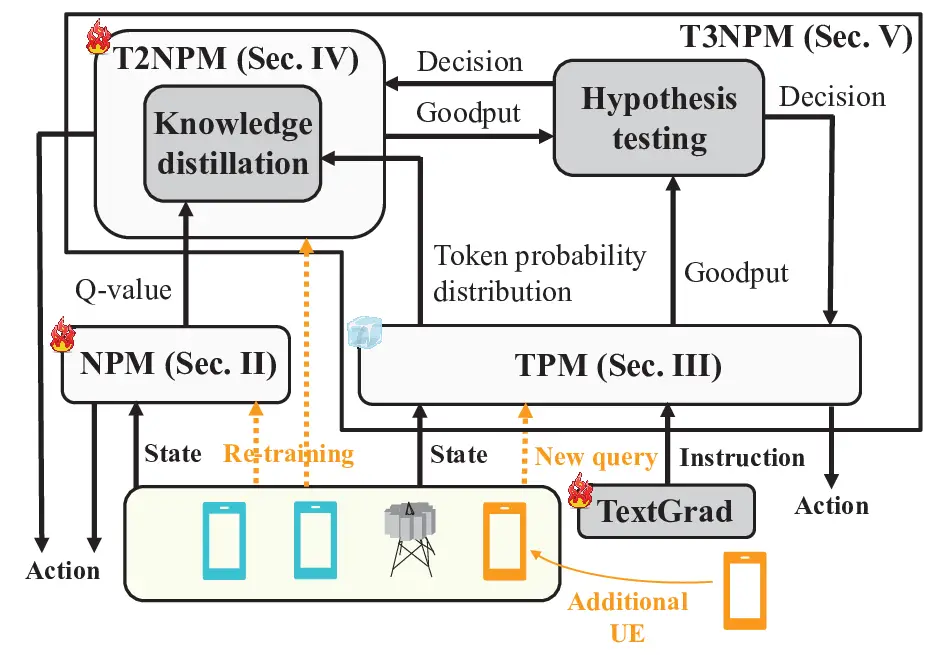

Fig. 1: LLM-empowered semantic MAC protocols.

Despite its promise, NPM faces significant challenges, especially from
network environmental shifts between training and actual testing due to
volatile factors like node mobility, node density, and more \[4\]. For
example, a critical issue arises when the number of UEs exceeds the
original training scenario. Since UEs share BS NN layers in NPM,
increase in UE numbers requires an expansion of BS NN dimensions,
introducing untrained parameters. This necessitates frequent re-training
using MADRL, thereby reducing NPM resilience.

To address the compromised resilience of NPM, as illustrated in Fig. 1,
we first introduce a semantic MAC protocol framework leveraging large
language models (LLMs), referred to as the token-based protocol model
(TPM). In TPM, UE exchanges control messages using natural language
tokens, with the LLM serving as the BS. Unlike NPM, which depends on an
NN architecture trained via MADRL, TPM generates decisions through LLM
inference based on its general knowledge, allowing for immediate
responses without the need for re-training. However, since this general
knowledge is not tailored to actual environments, TPM’s responses are
typically less accurate than those of a re-trained NPM. Additionally,
the substantial size of the LLM results in significantly higher
computational costs for TPM compared to a re-trained NPM.

Considering these trade-offs between TPM and NPM, we highlight a bifold
role for LLMs in data-driven MAC: 1) a first responder, providing
immediate responses via TPM while awaiting NPM re-training; and 2) a
teacher, guiding the re-training process through knowledge distillation
(KD) from TPM-to-NPM (T2NPM). Accordingly, we integrate these two roles
in the TPM-after-T2NPM (T3NPM) framework, wherein TPM is used initially
and switches to T2NPM for enhanced performance. This new paradigm
underscores the transformative potential of combining neural and
semantic approaches to MAC protocols, paving the way for more adaptive
and efficient communication systems in the 6G era.

### I-A Related Works: Protocol Learning and LLM for Commun.

Data-driven MAC protocol design, particularly through reinforcement
learning (RL), has enabled site-specific protocol optimization in
complex network environments, which is difficult to achieve with
traditional hand-crafted and standardized MAC protocols. For instance,
prior studies have demonstrated the joint optimization of channel
access, rate adaptation, and channel switching \[5\], as well as the
optimization of backoff types and modulation and coding schemes (MCS)
\[6\]. Beyond these efforts focused on RL-based MAC configuration and
policy optimization with fixed control signaling messages, recent
advances on data-driven MAC protocols have further enabled site-specific
and goal-oriented control signaling messages by learning them through
MADRL \[2, 7\], often referred to as MAC protocol learning or NPM. In
NPM, control messages are initialized as arbitrary representations
within the NN layers of MADRL architecture, and gradually evolve into
meaningful forms through the MADRL training process. These learned
control messages can be extracted and structured using probabilistic
logic in symbolic MAC, enhancing interpretability and computational
efficiency \[3\]. However, existing MADRL-based MAC protocols typically
assume stationary network environments so are vulnerable to
environmental shifts such as changes in the number of UEs. These shifts
necessitate re-training, revealing a critical resilience issue that, to
our knowledge, has not yet been addressed.

On the other hand, recent advances in LLMs have led to their adoption to
various layers in wireless communication systems. In the physical (PHY)
layer, the frameworks proposed in \[8, 9\] transform multimodal data
into textual forms to enhance personalization and beamforming
performance. In addition, LLM’s prediction capability has been utilized
to predict future channels and mobility to proactively optimize transmit
beams \[10\] and movable antenna configurations \[11\]. In the network
and application layers, LLM’s rich knowledge and general inference
capability have been leveraged for flexible optimization of network
slicing \[12, 13\] and service management and orchestration (SMO) with
broadest network control \[14\]. However, LLM applications to the MAC
layer remain limited. One notable study \[15\] fine-tunes an LLM-based
MAC protocol via RL to address environmental shifts, but at the cost of
thousands of training steps due to the large LLM model size. By
contrast, in this paper, we explore the role of LLMs to accelerate the
fine-tuning of MADRL-based MAC protocols and to enable switching from
LLM-based to MADRL-based MAC protocols, thereby enhancing resilience in
real-time MAC protocol operations.

### I-B Contributions and Paper organization

The main contributions of this paper are summarized below:

1.  1.  We propose TPM, which leverages an LLM to immediately adapt to
        environmental shifts, unlike NPM that requires re-training. To
        enhance TPM’s understanding of shifted environments, we employ
        TextGrad, which automatically fine-tunes instruction prompts through
        iterative LLM self-reflection.
2.  2.  To provide more precise adaptation with reduced re-training and
        computational costs, we introduce T2NPM, which utilizes TPM to
        accelerate NPM re-training via KD. As the re-trained NPM is much
        smaller than the LLM-based TPM, T2NPM improves memory and
        computation efficiency.
3.  3.  To combine the respective benefits of TPM and T2NPM, we propose
        T3NPM, which initially applies TPM, and then switches to T2NPM once
        it surpasses TPM. Accurate switching requires multiple performance
        measurements. To reduce additional measurement costs, we develop
        MixSwitch, which determines switching based on a mixture of new and
        previous measurements.
4.  4.  Finally, we design a new metric, meta-resilience, which measures
        average resilience across all target performance levels, unlike
        existing resilience metrics tied to a fixed target level. This
        allows resilience to be quantified under environmental shifts where
        target levels are unknown, enabling optimization of T3NPM and
        comparison across our proposed semantic MAC protocols as well as
        with other baselines. Simulations show that T3NPM achieves highest
        meta-resilience, outperforming slotted ALOHA (S-ALOHA) by
        $`23.53\%`$ and NPM by $`20.56\%`$, while reducing computation cost
        by 19.8$`\times`$ compared to TPM in floating-point operations per
        second (FLOPS).

The rest of the paper is organized as follows. Sec. II introduces the
system model, including NPM, which serves as a baseline. Sec. III
presents TPM, especially using TextGrad for automatic instruction
design. Sec. IV describes T2NPM, which employs TPM as a teacher model
and NPM as a student model during the training phase. Sec. V introduces
T3NPM, which integrates TPM and T2NPM, and presents the proposed
meta-resilience metric. Sec. VI provides simulation results for the
proposed methods using the meta-resilience metric, and Sec. VII
concludes the paper.

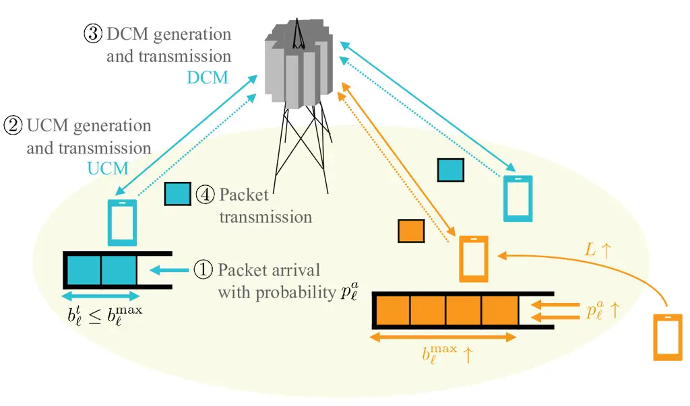

Fig. 2: Network model under environmental shifts.

## II System Model

### II-A Multiple Access Network Channel

Consider an uplink multiple access network consisting of a single BS and
$`L`$ UEs. The network operates in discrete time slots $`t=0,1,\cdots`$
with a constant interval defined by a transmission time interval (TTI).
At the beginning of time slot $`t`$, each UE $`\ell`$, where
$`\ell\in[1,L]`$, has a buffer $`\mathcal{B}_{\ell}^{t}`$ that stores
incoming packets. Following the first-in-first-out (FIFO) rule, each UE
independently decides whether to transmit a packet from
$`\mathcal{B}_{\ell}^{t}`$ over the uplink shared channel (UL-SCH),
discard the packet, or remain silent. The BS successfully receives a
transmitted packet if 1) there is no collision among UEs and 2) the
packet is successfully decoded, where the UL-SCH is modeled as a packet
erasure channel with a block error rate (BLER) $`p_{\ell}^{e}`$. To
avoid collisions, UEs and the BS exchange control messages over a
separate control channel prior to packet transmissions, as illustrated
in Fig. 2.

Specifically, at the beginning of time slot $`t`$, a packet arrives at
$`\mathcal{B}_{\ell}^{t}`$ according to a Bernoulli process with arrival
probability $`p_{\ell}^{a}`$. The buffer of UE $`\ell`$ can hold up to
$`b_{\ell}^{\max}`$ packets. Defining the current number of packets in
the UE $`\ell`$’s buffer as $`b_{\ell}^{t}`$, when the buffer overflows,
i.e., $`b_{\ell}^{t}>b_{\ell}^{\max}`$, the oldest packet is discarded
based on the FIFO rule. Each UE observes its $`b_{\ell}^{t}`$ and
constructs an uplink control message (UCM). The BS receives the UCMs
from all UEs and additionally observes the UL-SCH state $`b_{0}^{t}`$,
which is defined as follows: the BS successfully receives a packet from
UE $`\ell`$ ($`b_{0}^{t}=\ell`$); the BS receives no packets because all
UEs are silent (i.e., idle UL-SCH, $`b_{0}^{t}=0`$); or the BS fails to
receive any packets due to packet erasure and/or collision events
($`b_{0}^{t}=L+1`$). Based on the received UCMs and the UL-SCH
observation, the BS constructs and transmits downlink control messages
(DCMs) to individual UEs. Consequently, each UE $`\ell`$ receives its
DCM and takes an action $`a_{\ell}^{t}\in\mathcal{A}`$, where
$`\mathcal{A}=\{0,1,2\}`$ denotes the three possible actions: being
silent ($`a_{\ell}^{t}=0`$), transmitting a packet ($`a_{\ell}^{t}=1`$),
or discarding a packet ($`a_{\ell}^{t}=2`$).

To model network environmental shifts, we consider sudden changes in the
environment parameters $`p_{\ell}^{a}`$, $`b_{\ell}^{\max}`$, and/or
$`L`$, as illustrated in Fig. 2. Unless otherwise stated, we hereafter
focus solely on the shift caused by an increase in $`L`$. In NN-based
protocol learning, such a shift results in an increased NN model size,
thereby requiring re-training and significantly reducing system
resiliency. To isolate the impact of this resiliency issue on UCMs and
DCMs, we assume, for simplicity and without loss of generality, that the
control channels for UCMs and DCMs are error-free.

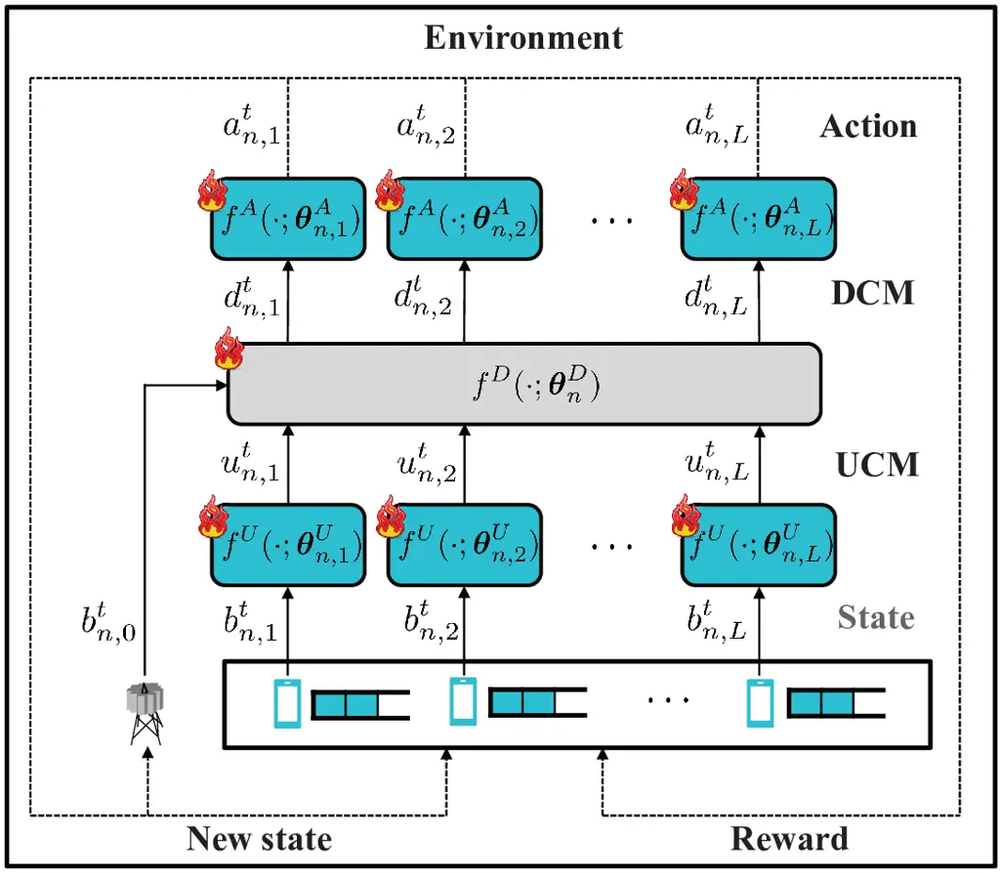

Fig. 3: A schematic illustration of NPM.

### II-B NPM Operation

We first introduce NPM as a baseline protocol learning framework.
Following \[2\], NPM jointly trains UCMs, DCMs, and UE actions using
MADRL. For simplicity, instead of employing multi-agent deep
deterministic policy gradient (MADDPG) in \[2\], we follow \[3\] and
adopt independent deep Q-learning (IDQN) \[16\] as the MADRL method.
After training the model for $`T`$ TTIs, the trained model is deployed
during the testing phase. We denote this interval as a single episode
$`n\in\mathcal{N}`$ consisting of $`T`$ TTIs, where
$`\mathcal{N}=\{n_{0},n_{0}+1,\ldots,\hat{n}\}`$ represents the set of
episode indices. Each episode $`n`$ is associated with its initial and
terminal states, as defined in \[17\]. At the initial state, the UL-SCH
is idle, and both BS and UE buffers are empty. The terminal state
corresponds to the buffer and channel observations at time $`T`$.
Hereafter, the subscript $`n`$ denotes values corresponding to episode
$`n`$.

The architecture of NPM is visually summarized in Fig. 3. The functions
$`f^{U}`$, $`f^{D}`$, and $`f^{A}`$ in NPM represent NNs used to
construct UCMs, DCMs, and Q-values of actions, respectively. For UE
$`\ell`$, the UCM and Q-values are generated using $`f^{U}`$ and
$`f^{A}`$, parameterized by $`\boldsymbol{\theta}_{n,\ell}^{U}`$ and
$`\boldsymbol{\theta}_{n,\ell}^{A}`$, respectively. For constructing
DCMs at the BS, $`f^{D}`$ is parameterized by
$`\boldsymbol{\theta}_{n}^{D}`$. Aggregating these parameters across all
UEs and the BS, we define the NPM parameter set at episode $`n`$ as
$`\boldsymbol{\Theta}_{n}=\left\{\bigcup_{\ell=1}^{L}\boldsymbol{\theta}_{n,\ell}^{U},\ \boldsymbol{\theta}_{n}^{D},\ \bigcup_{\ell=1}^{L}\boldsymbol{\theta}_{n,\ell}^{A}\right\}.`$
At episode $`n`$ and time slot $`t`$, each UE $`\ell`$ constructs its
UCM as
$`u_{n,\ell}^{t}=f^{U}\left(b_{n,\ell}^{t};\boldsymbol{\theta}_{n,\ell}^{U}\right),`$
based on its buffer observation $`b_{n,\ell}^{t}`$. The BS then
constructs DCMs for all UEs using its UL-SCH state $`b_{n,0}^{t}`$ and
the received UCMs as
$`\bigcup_{\ell=1}^{L}d_{n,\ell}^{t}=f^{D}\left(\bigcup_{\ell=1}^{L}u_{n,\ell}^{t},b_{n,0}^{t};\boldsymbol{\theta}_{n}^{D}\right)`$,
where $`d_{n,\ell}^{t}`$ is the DCM intended for UE $`\ell`$. After
receiving its DCM, each UE $`\ell`$ selects an action $`a_{n,\ell}^{t}`$
by choosing the one with the highest Q-value:
$`a_{n,\ell}^{t}=\arg\max_{a\in\mathcal{A}}f^{A}\left(d_{n,\ell}^{t};\boldsymbol{\theta}_{n,\ell}^{A}\right).`$
The pre-trained parameter set before the environmental shift is denoted
by $`\boldsymbol{\Theta}_{0}`$, which is subsequently re-trained over
episodes until $`\hat{n}`$.

Given $`\boldsymbol{\Theta}_{n}`$, the goodput is evaluated as the
performance during the testing phase. Goodput is defined as the average
rate of successful packet reception over $`T`$, i.e.,

```math
G_{n}=\frac{\sum_{t=0}^{T-1}c_{n}^{t}}{T}\quad\text{(packets/TTIs)}, \tag{1}
```

where $`c_{n}^{t}=1`$ if the BS successfully decodes the arrived packet
at time $`t`$, and $`c_{n}^{t}=0`$ otherwise. The latter includes cases
of collision, packet erasure, idle UL-SCH, or duplicated packet decoding
(i.e., when the BS decodes the packet that has already been successfully
decoded in previous time slots).

### II-C NPM Training

While a trained NPM operates at the single TTI during the testing phase,
the unit time interval during training is defined as $`B\gg 1`$ TTIs,
since training computations typically incur significantly larger delays
than communication operations. Let the discrete training time slot be
denoted by $`t^{\prime}=0,1,\cdots`$, with each step corresponding to an
interval of $`B`$ TTIs. During training, the NPM parameter set is
denoted by
$`\boldsymbol{\Theta}_{n}^{t^{\prime}}=\left\{\bigcup_{\ell=1}^{L}\boldsymbol{\theta}_{n,\ell}^{U,t^{\prime}},\ \boldsymbol{\theta}_{n}^{D,t^{\prime}},\ \bigcup_{\ell=1}^{L}\boldsymbol{\theta}_{n,\ell}^{A,t^{\prime}}\right\},`$
which is optimized over $`t^{\prime}`$ and $`n`$ to maximize the goodput
while avoiding collisions and unintended packet discards.

At UE $`\ell`$, the action $`a_{n,\ell}^{t^{\prime}}`$ is selected using
an $`\epsilon`$-greedy policy to balance exploration and exploitation
\[17\] as

```math
\displaystyle a_{n,\ell}^{t^{\prime}}=\arg\max_{a\in\mathcal{A}}f^{A}\left(d_{n,\ell}^{t^{\prime}};\boldsymbol{\theta}_{n,\ell}^{A,t^{\prime}}\right)\cdot\mathbf{1}_{\eta_{\ell}^{A}=0}+\tilde{a}\cdot\mathbf{1}_{\eta_{\ell}^{A}=1}, \tag{2}
```

where $`\tilde{a}\sim\text{Unif}\left(\mathcal{A}\right)`$ is an action
sampled uniformly at random from the action space $`\mathcal{A}`$, and
$`\mathbf{1}_{\delta}`$ is an indicator function that returns $`1`$ if
the condition $`\delta`$ is true, and $`0`$ otherwise. According to the
$`\epsilon`$-greedy policy, $`\eta_{\ell}^{A}=0`$ with probability
$`1-\epsilon`$, in which case the greedy action is selected. Conversely,
with probability $`\epsilon`$, we have $`\eta_{\ell}^{A}=1`$, and a
random action $`\tilde{a}`$ is selected to encourage exploration.

After executing all UEs’ actions, the reward that UE $`\ell`$ receives
is defined as

```math
\displaystyle r_{n,\ell}^{t^{\prime}}=\begin{cases}+\rho_{1},&\text{if }c_{n}^{t^{\prime}}=1,\\
+\rho_{2},&\text{if }a_{n,\ell}^{t^{\prime}}=2\text{ and }\mathcal{B}_{n,\ell}^{t^{\prime}}\backslash\mathcal{B}_{n,\ell}^{t^{\prime}+1}\in\mathcal{B}_{n,0}^{t^{\prime}},\\
-\rho_{3},&\text{if }a_{n,\ell}^{t^{\prime}}=2\text{ and }\mathcal{B}_{n,\ell}^{t^{\prime}}\backslash\mathcal{B}_{n,\ell}^{t^{\prime}+1}\notin\mathcal{B}_{n,0}^{t^{\prime}},\\
-\rho_{4},&\text{if }\sum_{\ell^{\prime}=1}^{L}\mathbf{1}_{\eta_{\ell^{\prime}}^{e}=0}\cdot\mathbf{1}_{a_{n,\ell^{\prime}}^{t^{\prime}}=1}>1,\\
-\rho_{5},&\text{otherwise},\\
\end{cases} \tag{3}
```

where $`\mathcal{B}_{n,0}^{t^{\prime}}`$ denotes the set of packets
decoded at the BS, and $`\eta_{\ell}^{e}`$ expresses whether the packet
that UE $`\ell`$ transmitted is erased ($`\eta_{\ell}^{e}=1`$), or not
($`\eta_{\ell}^{e}=0`$) in UL-SCH modeled as packet erasure channel.
When the BS successfully decodes a new packet, directly contributing to
goodput, a reward of $`+\rho_{1}`$ is given to the UE that transmitted
the packet. Other reward terms influence goodput indirectly. If UE
$`\ell`$ discards a packet that has already been decoded at the BS, the
UE receives a reward of $`+\rho_{2}`$, as this action helps the UE free
buffer and enables reception of new packets in subsequent time slots.
Conversely, if UE $`\ell`$ discards a packet that has not yet been
decoded at the BS, a penalty of $`-\rho_{3}`$ is given due to the
resulting packet loss and the missed transmission opportunity. In the
event of a collision, i.e., when more than one UE transmits
simultaneously, UE $`\ell`$ receives a penalty of $`-\rho_{4}`$ if it
participates in such a collision. Finally, a penalty of $`-\rho_{5}`$ is
applied in all other cases, such as when the UL-SCH is idle (given to
all UEs) or when a duplicate packet is decoded at the BS (given to the
UE that transmitted the packet).

To train NPM using the reward function in (3), we adopt a batch training
method based on experience replay memory, which has been widely used to
improve training stability \[18\]. The experience tuple at training time
slot $`t^{\prime}`$ in episode $`n`$ is defined as
$`e_{n}^{t^{\prime}}=\left(s_{n}^{t^{\prime}},a_{n}^{t^{\prime}},r_{n}^{t^{\prime}},s_{n}^{t^{\prime}+1}\right)`$,
where the state, action, and reward are given by
$`s_{n}^{t^{\prime}}=\bigcup_{\ell=0}^{L}b_{n,\ell}^{t^{\prime}},\text{ }a_{n}^{t^{\prime}}=\bigcup_{\ell=1}^{L}a_{n,\ell}^{t^{\prime}},\text{ and }r_{n}^{t^{\prime}}=\bigcup_{\ell=1}^{L}r_{n,\ell}^{t^{\prime}}.`$
The replay memory at training time slot $`t^{\prime}`$ in episode $`n`$
is denoted by $`\mathcal{D}_{n}^{t^{\prime}}`$, which stores all
experience tuples until episodes $`n-1`$, i.e.,
$`\bigcup_{\nu=1}^{n-1}\bigcup_{\tau=0}^{\lfloor T/B\rfloor-1}e_{\nu}^{\tau}`$,
as well as those up to time $`t^{\prime}`$ in episode $`n`$, i.e.,
$`\bigcup_{\tau=0}^{t^{\prime}}e_{n}^{\tau}`$, where
$`\lfloor\cdot\rfloor`$ is the floor function.

At each training time slot $`t^{\prime}`$, a fixed-size batch of
experience tuple $`e_{\nu}^{\tau}`$ is sampled from
$`\mathcal{D}_{n}^{t^{\prime}}`$ and used to train
$`\boldsymbol{\Theta}_{n}^{t^{\prime}}`$ by minimizing the average
temporal-difference (TD) loss \[19\]:

```math
\displaystyle\mathcal{L}^{\text{TD}}\!\!=\!\!\frac{1}{L}\!\sum_{\ell=1}^{L}\!\mathbb{E}\!\Big[\!\bigg\{\!r_{\nu,\ell}^{\tau}\!+\!\gamma Q^{{}^{\prime}}\!\!\left(\!s_{\nu,\ell}^{\tau+1}\!,a_{\nu,\ell}^{\tau+1}\!;\!\boldsymbol{\hat{\Theta}}_{n}^{t^{\prime}}\!\right)\!\!
```

```math
\displaystyle-\!Q\!\left(\!s_{\nu,\ell}^{\tau},a_{\nu,\ell}^{\tau};\!\boldsymbol{\Theta}_{n}^{t^{\prime}}\!\right)\!\!\bigg\}^{2}\Big], \tag{4}
```

where the expectation is taken over
$`(s_{\nu,\ell}^{\tau},a_{\nu,\ell}^{\tau},r_{\nu,\ell}^{\tau},s_{\nu,\ell}^{\tau+1})\in e_{\nu}^{\tau}`$,
and $`\gamma<1`$ is the discount factor. The functions
$`Q\left(\cdot;\boldsymbol{\Theta}\right)`$ and
$`Q^{{}^{\prime}}\left(\cdot;\boldsymbol{\hat{\Theta}}\right)`$
represent the current and target Q-value networks, respectively. The
target network shares the same architecture as the current network but
uses frozen parameters that are updated less frequently to ensure
training stability. The target network parameters are updated using a
soft update mechanism \[20\]:
$`\boldsymbol{\hat{\Theta}}_{n}^{t^{\prime}}\leftarrow\left(1-\sigma\right)\boldsymbol{\hat{\Theta}}_{n}^{t^{\prime}-1}+\sigma\boldsymbol{\Theta}_{n}^{t^{\prime}},`$
where $`\sigma`$ is a hyperparameter that controls the update speed. We
consider a system where $`\boldsymbol{\Theta}_{n}`$ is updated every
$`T`$ TTIs, such that
$`\boldsymbol{\Theta}_{n}^{\lfloor T/B\rfloor}=\boldsymbol{\Theta}_{n+1}`$
for the testing phase of episode $`n+1`$. The same parameter set is also
used for the initial training phase of episode $`n+1`$ as
$`\boldsymbol{\Theta}_{n}^{\lfloor T/B\rfloor}=\boldsymbol{\Theta}_{n+1}^{0}`$.

## III TPM: Token-based Protocol Model

In NPM, when $`L`$ increases, the BS fails to construct DCMs since the
input-output dimension of the function
$`f^{D}\left(\cdot;\boldsymbol{\theta}_{n}^{D}\right)`$ varies,
requiring re-training. To address this limitation, we propose a TPM that
enables immediate action decisions without re-training, leveraging the
flexibility of LLMs in handling variable-length input and output
sentences, along with their ability to comprehend task instructions
embedded in natural language. In TPM, increased $`L`$ merely lengthens
the input prompt, which the LLM can process without any additional
training or fine-tuning, as long as the prompt remains within its
context window size.

The main problem of TPM is that its performance is sensitive to how the
task is described in the instruction prompt \[21\], necessitating prompt
engineering. Prompt engineering involves designing task instructions
either heuristically or automatically. In this paper, we adopt TextGrad
\[22\] to automatically generate the instruction. Once designed, the
same instruction can be reused across different environments, as it
describes the task itself rather than the environment-specific
parameters.

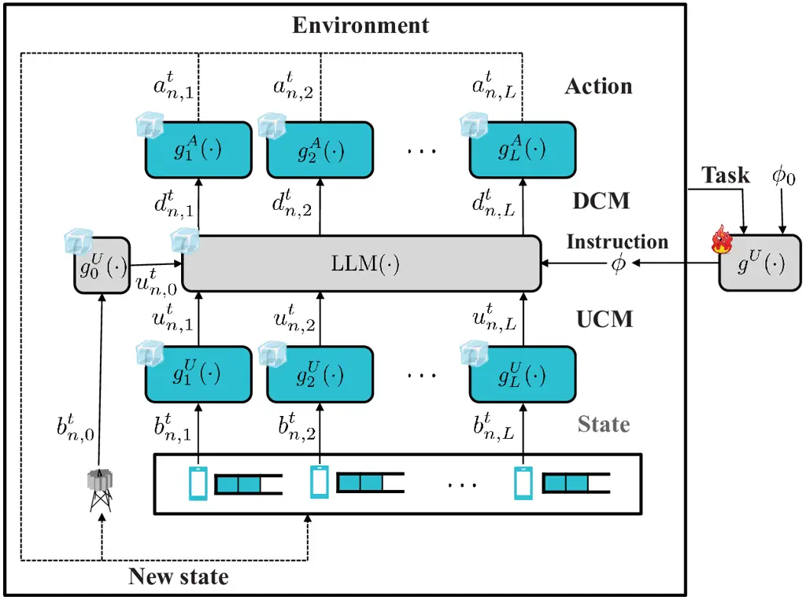

Fig. 4: A schematic illustration of TPM.

### III-A TPM Construction and Operation

Unlike the uninterpretable control messages in NPM, the UCMs and DCMs in
TPM are expressed in natural language, based on the architecture
depicted in Fig. 4. Precisely, each UE $`\ell`$ constructs and transmits
its UCM as $`u_{n,\ell}^{t}=g_{\ell}^{U}\left(b_{n,\ell}^{t}\right),`$
where $`g_{\ell}^{U}\left(\cdot\right)`$ is a function that converts UE
$`\ell`$’s observation into a natural language query. The structure of
the query is fixed, and the observation $`b_{n,\ell}^{t}`$ is inserted
into a designated placeholder within this predefined format, as
illustrated in the \# Query section of Fig. 5. As the space for
expression in the query is constrained, for consistency, we
heuristically design the query format rather than automatically
optimizing it.

The BS constructs and transmits the DCMs, the response generated by the
LLM, to indicate the actions for all UEs as

```math
\displaystyle\bigcup_{\ell=1}^{L}d_{n,\ell}^{t}=\text{LLM}\left(\phi,\bigcup_{\ell=0}^{L}u_{n,\ell}^{t}\right), \tag{5}
```

where the function $`\text{LLM}\left(\cdot\right)`$ denotes the response
of the LLM given a set of inputs. In addition to the UCMs received from
all UEs, the LLM also requires an instruction prompt $`\phi`$ and a
query representing the BS observation $`u_{n,0}^{t}`$. The BS query is
generated as $`u_{n,0}^{t}=g_{0}^{U}\left(b_{n,0}^{t}\right)`$, where
$`g_{0}^{U}\left(\cdot\right)`$ is a function that converts the BS
observation into a natural language query. The instruction $`\phi`$ is
predefined before TPM operation begins and is constructed using the
prompt engineering function $`g^{U}\left(\cdot\right)`$, which describes
the task. Unlike $`\boldsymbol{\Theta}_{n}`$ in NPM, which is updated in
every episode to adapt to the task and environment through re-training,
the LLM parameters remain fixed throughout all episodes.

After receiving the DCM $`d_{n,\ell}^{t}`$, each UE determines its
action, which is explicitly indicated in the DCM, as
$`a_{n,\ell}^{t}=g_{\ell}^{A}\left(d_{n,\ell}^{t}\right),`$ where
$`g_{\ell}^{A}\left(\cdot\right)`$ is a function that converts the
natural language response into a discrete action. Since the LLM output
includes both natural language and the action tokens, a fixed response
format for $`d_{n,\ell}^{t}`$ is necessary to enable correct parsing by
$`g_{\ell}^{A}`$. For example, as shown in the \# Answer section of
Fig. 5, the fixed format ensures that the token ‘1’ in the action field
is not confused with ‘Agent 1:’ in the natural language, by defining the
expected position of the action token within the response. If the LLM
generates a response that violates the fixed format due to
hallucination, the action becomes unidentifiable. In such cases, to
prevent potential collisions, the action is set as $`a_{n,\ell}^{t}=0`$
(i.e., silent). To reduce the hallucinations, the instruction $`\phi`$
includes not only a task description but also a specification of the
response format for UE actions. An example of such an instruction is
shown in the \# Instruction section of Fig. 5.


Fig. 5: TPM example.

### III-B TextGrad-aided TPM

The goodput of TPM depends heavily on the LLM’s ability to understand
the context of the provided instruction and queries. However, since LLMs
are typically trained for general purposes using large-scale datasets,
they often lack domain-specific knowledge required for communication
tasks \[23\]. Therefore, domain adaptation is necessary to align the LLM
with the specific requirements of the MAC protocol task. Three common
approaches are used to tailor LLMs to specific tasks: fine-tuning,
in-context learning (ICL), and prompt engineering \[24\]. Fine-tuning
involves adjusting model parameters, which incurs substantial
computational overhead and is not feasible in real time, making it
unsuitable for resilient protocol operations. Without adjusting model
parameters, ICL adapts the LLM by updating its context using exemplary
few-shot queries. However, such queries are often unavailable
immediately after environmental shifts. This makes ICL unsuitable as
well, as we will elaborate further through simulation in Sec. VI-G.

Prompt engineering, by contrast, steers the LLM’s responses by refining
its input prompts, and thus remains applicable regardless of
environmental shifts without requiring model parameter updates. It is
particularly effective for refining instructions that remain valid even
after environmental shifts. While prior work in prompt engineering has
focused largely on heuristic, handcrafted instruction design \[21\],
TextGrad \[22\] enables automatic prompt refinement using an LLM. The
instruction is iteratively refined by reflecting the produced feedback
via the LLM, i.e.,
$`g^{U}\left(\cdot\right)=\text{LLM}\left(\cdot\right)`$. In the
TextGrad-aided TPM, only the prompt generation function
$`g^{U}\left(\cdot\right)`$, which designs the task instruction, is
trainable. This function offers the largest flexibility in expression,
and even minor modifications to its output significantly influence TPM’s
performance.


Fig. 6: TextGrad example at epoch $`m`$.

In TextGrad, the processes of conventional NN training: feed-forward,
backpropagation, and gradient descent, are mapped to response generation
(textual feed-forward), feedback acquisition (textual backpropagation),
and instruction update (textual gradient descent) at each training epoch
$`m`$, starting from an initial hand-crafted instruction $`\phi_{0}`$.
The textual feed-forward step generates a response $`s_{m}`$ using the
current instruction $`\phi_{m}`$ and the query input $`x`$, as

```math
\displaystyle s_{m}=\text{LLM}\left(\phi_{m},x\right). \tag{6}
```

The training data $`x`$ is acquired by
$`x=\bigcup_{\ell=0}^{L}g_{\ell}^{U}\left(b_{\ell}\right),`$ where
$`b_{\ell}`$ is a hand-crafted observation value used for TextGrad
training. If the current instruction $`\phi_{m}`$ is suboptimal,
feedback is generated in the textual backpropagation step as

```math
\displaystyle\frac{\partial\mathcal{L}^{\text{TG}}}{\partial\phi_{m}}=\text{LLM}\left(\phi_{m},x,s_{m},\mathcal{L}^{\text{TG}}\right), \tag{7}
```

where $`\mathcal{L}^{\text{TG}}`$ is the textual objective function,
defined as
$`\mathcal{L}^{\text{TG}}=g_{r}^{U}\left(C\left(r_{n,\ell}^{t^{\prime}}\right)\right),`$
where $`C\left(\cdot\right)`$ produces all the conditions required to
earn a different reward $`r_{n,\ell}^{t^{\prime}}`$, and
$`g_{r}^{U}\left(\cdot\right)`$ converts these conditions into natural
language. Unlike gradients in conventional NN training, the feedback in
TextGrad is in natural language, providing interpretability for both
humans and the LLM itself. Note that the partial derivative here is not
a numerical gradient, but a symbolic representation of the feedback
process. The instruction is then updated during the textual gradient
descent step using this feedback as

```math
\displaystyle\phi_{m+1}=\text{LLM}\left(\phi_{m},\frac{\partial\mathcal{L}^{\text{TG}}}{\partial\phi_{m}}\right). \tag{8}
```

An example of instruction update at epoch $`m`$ is illustrated in
Fig. 6, in which the updated instruction is exploited in Fig. 5.

The optimization process terminates when the feedback indicates that the
instruction aligns with the objective function, i.e., when
$`\partial\mathcal{L}^{\text{TG}}/\partial\phi_{m}\approx 0`$, or when a
predefined maximum number of epochs is reached. The final instruction
$`\phi`$ is selected to be the instruction $`\phi_{m}`$ that achieves
the highest goodput across TPM operations as
$`\phi=\arg\max_{\phi_{m}}G^{\phi_{m}}`$, where $`G^{\phi_{m}}`$ is the
goodput obtained by instruction $`\phi_{m}`$. The episode index $`n`$ is
omitted since TPM’s LLM parameter set remains constant across episodes.
Once $`\phi`$ is optimized, it is applied consistently across all
environments, as it includes only the task description and is
independent of specific environment parameters.

## IV T2NPM: TPM-to-NPM

TPM enables immediate action decisions after an environmental shift
without requiring re-training. However, despite the benefits of
automatic instruction design, TPM remains only partially grounded in the
environment, as it is not fine-tuned to a task-specific environment.
Consequently, if the environment remains stationary after the
environmental shift, TPM may select suboptimal actions compared to a
re-trained NPM. To address this limitation, we introduce T2NPM, a method
that accelerates the re-training of NPM using KD under a stationary
environment. This approach leverages KD’s advantage that can
significantly accelerate NN training \[25\]. In T2NPM, the student model
(NPM) is trained with guidance from the teacher model, the
TextGrad-aided TPM.

### IV-A Teacher Knowledge Construction

In the original TextGrad-aided TPM, the function
$`g_{\ell}^{A}\left(\cdot\right)`$ returns only the selected action
$`a_{n,\ell}^{t}`$. However, KD requires that the teacher and student
models produce outputs within the same domain. Specifically, both models
must output logits corresponding to all possible actions in
$`\mathcal{A}`$. To satisfy this requirement, we modify the teacher
model’s output to include logits only over $`\mathcal{A}`$ rather than
the token vocabulary space $`\mathcal{T}`$, using the result that token
generation probabilities in LLMs are correlated with prediction
correctness \[26\].

From the LLM output, the token generation probabilities for the action
tokens ‘1,’ ‘2,’ and ‘0’ (as shown in the \# Answer of Fig. 5) are
extracted from $`\mathcal{T}`$ and then restricted to $`\mathcal{A}`$.
The LLM output $`d_{n,\ell}^{t^{\prime}}`$ contains the token
$`y_{n,\ell}^{t^{\prime}}`$ that determines the action for UE $`\ell`$.
If $`d_{n,\ell}^{t^{\prime}}`$ follows the answer format defined by the
instruction $`\phi`$, this action token $`y_{n,\ell}^{t^{\prime}}`$ is
identifiable. Let LLM response $`d_{n,\ell}^{t^{\prime}}`$ be a sequence
of tokens
$`d_{n,\ell}^{t^{\prime}}=\left(y_{1},y_{2},\ldots,y_{J}\right),`$ where
$`y_{j}`$ denotes the $`j`$-th token, and $`J`$ is the total number of
tokens in the response. Among these, let $`j^{*}`$-th token correspond
to the action indicator, i.e., $`y_{n,\ell}^{t^{\prime}}=y_{j^{*}}`$.
For instance, $`y_{n,1}^{t^{\prime}}=y_{j^{*}}=\text{`2'},`$ if the
response is ‘UE 1 action: 2.’ The token generation probability of the
entire response given the instruction and UCMs
$`\mathrm{Pr}\left(d_{n,\ell}^{t^{\prime}}\mid\phi,\bigcup_{\ell=0}^{L}u_{n,\ell}^{t^{\prime}}\right)\in\mathbb{R}^{|\mathcal{T}|}`$,
is expressed as

```math
\displaystyle\hskip-5.0pt\mathrm{Pr}\!\left(d_{n,\ell}^{t^{\prime}}\mid\phi,\bigcup_{\ell=0}^{L}u_{n,\ell}^{t^{\prime}}\right)=\prod_{j=1}^{J}\mathrm{Pr}\!\left(y_{j}\mid\phi,\bigcup_{\ell=0}^{L}u_{n,\ell}^{t^{\prime}},y_{<j}\right), \tag{9}
```

where $`y_{<j}`$ denotes all tokens preceding position $`j`$. Focusing
at position $`j^{*}`$, the LLM computes a conditional distribution over
$`\mathcal{T}`$ as
$`\mathrm{Pr}\left(y_{j^{*}}\mid\phi,\bigcup_{\ell=0}^{L}u_{n,\ell}^{t^{\prime}},y_{<j^{*}}\right)\in\mathbb{R}^{|\mathcal{T}|}`$.
To align with the output space of the student model, the dimension of
this distribution is restricted to $`\mathbb{R}^{|\mathcal{A}|}`$.

To extract the action probabilities at $`j^{*}`$, the logits
corresponding to tokens in $`\mathcal{A}`$ are isolated. A masked
softmax is then applied over $`\mathcal{A}`$ as

```math
\displaystyle\mathrm{Pr}\bigg(y_{j^{*}}=\text{`$a$'}\mid\phi,\bigcup_{\ell=0}^{L}u_{n,\ell}^{t^{\prime}},y_{<j^{*}}\bigg)
```

```math
\displaystyle\hskip-10.0pt=\frac{\exp\left(\mathrm{Pr}\!\left(y_{j^{*}}=\text{`$a$'}\mid\phi,\bigcup_{\ell=0}^{L}u_{n,\ell}^{t^{\prime}},y_{<j^{*}}\right)/\kappa\right)}{\sum\limits_{w\in\mathcal{A}}\exp\left(\mathrm{Pr}\!\left(y_{j^{*}}=\text{`$w$'}\mid\phi,\bigcup_{\ell=0}^{L}u_{n,\ell}^{t^{\prime}},y_{<j^{*}}\right)/\kappa\right)}, \tag{10}
```

where $`\kappa`$ is the temperature parameter, and
$`\text{`$a$'},\text{`$w$'}\in\{\text{`0',`1',`2'}\}`$ is a character
representation of an integer element in $`\mathcal{A}`$. A higher
temperature $`\kappa`$ produces a softer probability distribution, which
helps retain more information about the relative information across
classes, at the expense of reduced prediction confidence. For
simplicity, we denote
$`\mathrm{Pr}\left(y_{j^{*}}=\text{`$a$'}\mid\phi,\bigcup_{\ell=0}^{L}u_{n,\ell}^{t^{\prime}},y_{<j^{*}}\right)`$
as $`\mathrm{Pr}\left(y_{n,\ell}^{t^{\prime}}=\text{`$a$'}\right)`$.
This masked softmax ensures that the output probabilities are normalized
exclusively over $`\mathcal{A}`$, thereby eliminating the influence of
irrelevant tokens from $`\mathcal{T}`$.

The teacher logits for UE $`\ell`$, denoted by
$`\mu_{n,\ell}^{t^{\prime}}`$, are extracted by concatenating the token
generation probabilities corresponding to all actions in
$`\mathcal{A}`$. Specifically,
$`\mu_{n,\ell}^{t^{\prime}}=\left[\mathrm{Pr}\left(y_{n,\ell}^{t^{\prime}}=\text{`$0$'}\right),\,\mathrm{Pr}\left(y*{n,\ell}^{t^{\prime}}=\text{`$1$'}\right),\,\mathrm{Pr}\left(y*{n,\ell}^{t^{\prime}}=\text{`$2$'}\right)\right].`$
If the action token $`y_{n,\ell}^{t^{\prime}}`$ is unidentifiable, i.e.,
when $`d_{n,\ell}^{t^{\prime}}`$ deviates from the answer format
specified in $`\phi`$, we default to a uniform distribution as
$`\mu_{n,\ell}^{t^{\prime}}=[1/3,\,1/3,\,1/3].`$ The aggregated teacher
knowledge from all $`L`$ UEs is represented by
$`M_{n}^{t^{\prime}}=\bigcup_{\ell=1}^{L}\mu_{n,\ell}^{t^{\prime}}.`$ It
is important to note that the teacher model in T2NPM is primarily used
to guide and regularize the early stages of student training, rather
than to transfer optimal action policies. As such, the teacher model is
not required to generate optimal decisions. Self-distillation \[27\],
where the same NN can act as both teacher and student, is a supporting
example since it still benefits from KD, even when the teacher model is
not optimal.

### IV-B T2NPM Construction via Knowledge Distillation

T2NPM is trained using a composite loss function that combines the TD
loss defined in (4) with a KD loss $`\mathcal{L}^{\text{KD}}`$. To
compute the KD loss, we introduce a teacher replay memory
$`\tilde{\mathcal{D}}_{n}^{t^{\prime}}=\left\{s_{\nu}^{\tau}\mid s_{\nu}^{\tau}\in\bigcup_{e_{\nu}^{\tau}\in\mathcal{D}_{n}^{t^{\prime}}}e_{\nu}^{\tau},\;1\leq\nu\leq n,\;0\leq\tau\leq t^{\prime}\right\},`$
which stores only the states of experience tuples from
$`\mathcal{D}_{n}^{t^{\prime}}`$. At each student update step, a
training batch of states is sampled from
$`\tilde{\mathcal{D}}_{n}^{t^{\prime}}`$, denoted as
$`\tilde{s}_{n}^{t^{\prime}}`$. For each sampled state
$`\tilde{s}_{n}^{t^{\prime}}`$, UE $`\ell`$ generates a corresponding
DCM, $`\tilde{d}_{n,\ell}^{t^{\prime}}`$. The student model then
computes its logits using
$`\tilde{\pi}_{n,\ell}^{t^{\prime}}=f^{A}\left(\tilde{d}_{n,\ell}^{t^{\prime}};\boldsymbol{\theta}_{n,\ell}^{A,t^{\prime}}\right)\in\mathbb{R}^{|\mathcal{A}|},`$
which represents the Q-values across all actions in $`\mathcal{A}`$. To
obtain soft logits, a temperature-scaled softmax is applied as
$`\mathrm{Pr}\left(a_{n,\ell}^{t^{\prime}}=w\right)=\frac{\exp\left(\tilde{\pi}_{n,\ell}^{t^{\prime}}[w]/\kappa\right)}{\sum_{w^{\prime}=0}^{2}\exp\left(\tilde{\pi}_{n,\ell}^{t^{\prime}}[w^{\prime}]/\kappa\right)},`$
where $`\kappa`$ is the temperature parameter, and
$`\tilde{\pi}_{n,\ell}^{t^{\prime}}[w]`$ denotes the logit corresponding
to a class $`w\in\mathcal{A}`$. The resulting soft logits for UE
$`\ell`$ are then concatenated into
$`\pi_{n,\ell}^{t^{\prime}}=\left[\mathrm{Pr}\left(a_{n,\ell}^{t^{\prime}}=0\right),\,\mathrm{Pr}\left(a_{n,\ell}^{t^{\prime}}=1\right),\,\mathrm{Pr}\left(a_{n,\ell}^{t^{\prime}}=2\right)\right].`$
The aggregated student knowledge across all UEs is denoted as
$`\Pi_{n}^{t^{\prime}}=\bigcup_{\ell=1}^{L}\pi_{n,\ell}^{t^{\prime}}.`$
Since both the teacher’s and student’s knowledge, $`M_{n}^{t^{\prime}}`$
and $`\Pi_{n}^{t^{\prime}}`$, are constructed using the same sampled
state $`\tilde{s}_{n}^{t^{\prime}}`$, a direct comparison of soft logits
is enabled during training.

The KD loss is computed using the Kullback–Leibler divergence (KLD)
between the teacher knowledge $`M_{n}^{t^{\prime}}`$ and the student
knowledge $`\Pi_{n}^{t^{\prime}}`$, as

```math
\displaystyle\mathcal{L}^{\text{KD}}=\mathbb{E}_{s_{n}^{t^{\prime}}\sim\tilde{\mathcal{D}}_{n}^{t^{\prime}}}\left[D_{\mathrm{KL}}\left(M_{n}^{t^{\prime}}\,\|\,\Pi_{n}^{t^{\prime}}\right)\right], \tag{11}
```

where the KLD is calculated by

```math
\displaystyle D_{\mathrm{KL}}\left(M_{n}^{t^{\prime}}\,\|\,\Pi_{n}^{t^{\prime}}\right)
```

```math
\displaystyle=\sum_{\ell=1}^{L}\sum_{w=0}^{2}\mathrm{Pr}\left(y_{n,\ell}^{t^{\prime}}=\text{`$w$'}\right)\log\frac{\mathrm{Pr}\left(y_{n,\ell}^{t^{\prime}}=\text{`$w$'}\right)}{\mathrm{Pr}\left(a_{n,\ell}^{t^{\prime}}=w\right)}. \tag{12}
```

The final loss function used to train T2NPM is a weighted combination of
the TD loss and KD loss

```math
\displaystyle\mathcal{L}=\lambda_{1}\mathcal{L}^{\text{TD}}+\lambda_{2}\mathcal{L}^{\text{KD}}, \tag{13}
```

where $`\lambda_{1},\lambda_{2}>0`$ are hyperparameters that balance the
contributions of the TD loss and the KD loss. The proposed
regularization term $`\mathcal{L}^{\text{KD}}`$ accelerates convergence
in the early stages of NN training, as will be demonstrated in the
simulation results in Sec. VI.

## V T3NPM: TPM-after-T2NPM

TPM enables immediate action decisions under environmental shifts,
whereas the re-trained T2NPM demonstrates superior long-term
performance. To leverage the strengths of both approaches, we propose
T3NPM, a hybrid protocol model that employs TPM during the early stage
of T2NPM re-training and transitions to T2NPM once sufficient training
has been conducted. The transition timing from TPM to T2NPM is
determined via hypothesis testing based on multiple goodput measurements
from the ongoing T2NPM re-training, which reduces the available
re-training time due to the fixed single episode duration and the
separation between the re-training and measurement phases. We exploit
the proposed novel meta-resilience metric to effectively balance this
trade-off, where longer measurement allows for more reliable comparison
but shortens re-training time, which is crucial for goodput improvement.
Unlike conventional resilience metrics designed for environments with
known target performance \[28\], meta-resilience quantifies the system’s
resilience under environmental shifts, where the target performance is
unknown. As we elaborate in the following subsections, this metric
enables both fair performance comparisons across various protocol models
and optimization of T3NPM’s transition timing.

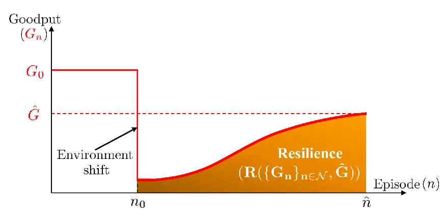

(a) Resilience (AUC of goodput).

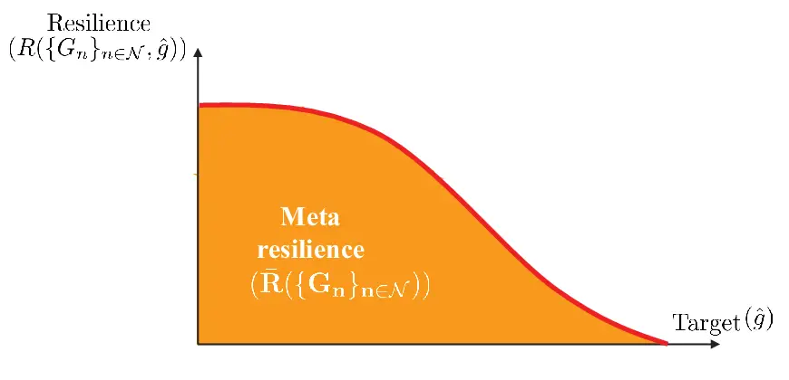

(b) Meta-resilience (AUC of resilience).

Fig. 7: Resilience vs. meta-resilience.

### V-A Meta-resilience

Since our proposed methods focus on environmental shifts, resilience is
used as an evaluation metric. In \[29\], resilience is defined as the
ability of a network to maintain acceptable service levels, reflecting a
similar perspective of \[30\]. Quantitative definition is proposed at
\[31\], which is the combined metrics of resilience and mixed
criticality, building on the framework of \[28\]. Among the proposed
definitions in \[28\], the metric adapted from \[32\], which uses the
area under the curve (AUC), is particularly suited for wireless
communication systems due to its simplicity and general applicability.
As illustrated in Fig. 7(a), we define resilience as

```math
\displaystyle R\left(\{G_{n}\}_{n\in\mathcal{N}},\hat{G}\right)=\frac{1}{|\mathcal{N}|}\sum_{n\in\mathcal{N}}\min\left\{\frac{G_{n}}{\hat{G}},\,1\right\}, \tag{14}
```

where $`G_{n}`$ denotes the system goodput at episode $`n`$, and
$`\hat{G}`$ is a constant representing the target goodput. This
normalization reflects the ratio between the AUC of a
constant-performance rectangle at height $`\hat{G}`$ and the actual AUC
of the observed performance trajectory. The $`\min\{\cdot\}`$ operator
ensures that instances where $`G_{n}>\hat{G}`$ do not dominantly affect
the metric, thereby preventing divergence.

If the environmental shift does not occur, $`\hat{G}`$ in (14) can be
set as $`G_{0}`$, representing the pre-environmental shift performance
baseline, as illustrated in Fig. 7(a). This corresponds to a typical
disaster-recovery scenario where the system attempts to return to a
known target performance level. However, a key limitation of (14) arises
when $`\hat{G}`$ is undefined, which is often the case under
environmental shifts, especially when the post-shift performance is
unpredictable. To address this, we propose a novel meta-resilience
metric that evaluates system resilience in the absence of a fixed target
performance. The term ‘meta’ reflects a holistic view of system
performance across a range of operating conditions, analogous to the use
in other research domains. Notable examples include meta-learning
\[33\], which leverages knowledge from multiple tasks to enable rapid
adaptation to new tasks, and meta-distribution, which captures
variability or uncertainty across probability distributions \[34\].

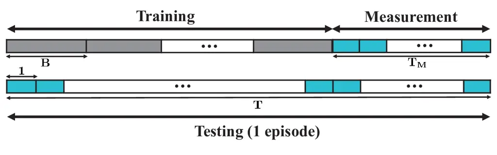

Fig. 8: Episode temporal structure, comprising measurement time
$`T_{M}`$ and training time $`T-T_{M}`$.

In the context of this work, we focus on the scenario of an increasing
number of UEs. While this increase incurs significant environmental
shift from the perspective of NN, it is a common situation in practical
systems, rather than a malfunction requiring repair. A fixed $`\hat{G}`$
cannot be defined in such cases, as the oracle policy in the shifted
environment is unknown. To address this, we introduce the concept of
meta-resilience $`\bar{R}\left(\{G_{n}\}_{n\in\mathcal{N}}\right)`$,
which evaluates the resilience of the system across a predetermined
feasible range of target performances $`\hat{g}`$ instead of a fixed
$`\hat{G}`$, defined as

```math
\displaystyle\bar{R}\left(\{G_{n}\}_{n\in\mathcal{N}}\right) \displaystyle=\frac{1}{|\mathcal{N}|}\int\sum_{n\in\mathcal{N}}\min\left(\frac{G_{n}}{\hat{g}},\,1\right)d\hat{g}
```

```math
\displaystyle=\mathbb{E}_{\hat{g}}\left[R\left(\{G_{n}\}_{n\in\mathcal{N}},\hat{g}\right)\right]. \tag{15}
```

In practice, $`\hat{g}`$ represents possible levels of
Quality-of-Service such as goodput, bit errors, or latency expected
under varying network environments. The relationship between resilience
and meta-resilience is illustrated in Fig. 7(b). By integrating over a
range of possible $`\hat{g}`$ values, meta-resilience offers a holistic
measure of system adaptability under uncertain performance targets. In
this paper, we use multiple goodput levels as realizations of
$`\hat{g}`$, and hereafter treat $`\hat{g}`$ specifically as goodput.

### V-B T3NPM Operation

T3NPM aims to maximize meta-resilience by initially leveraging TPM’s
coarse-yet-immediate responses to environmental shifts, and then
switching to T2NPM for its fine-tuned, environment-specific operations.
The main challenge lies in determining when to switch. To support this
decision-making, we employ the one-sided Mann-Whitney U test \[35\], a
non-parametric statistical hypothesis test that does not assume Gaussian
distributions, making it well-suited for NN-based hypothesis testing.

Precisely, TPM initially operates from episode $`n_{0}`$. For episodes
$`n>n_{0}`$, we define null and alternative hypotheses as:

```math
\displaystyle H_{0}: \displaystyle\quad\mathrm{median}\left(\mathcal{V}^{\text{TPM}}\right)\,\geq\,\mathrm{median}\left(\mathcal{V}_{n}^{\text{T2NPM}}\right), \tag{16}
```

```math
\displaystyle H_{A}: \displaystyle\quad\mathrm{median}\left(\mathcal{V}^{\text{TPM}}\right)\,<\,\mathrm{median}\left(\mathcal{V}_{n}^{\text{T2NPM}}\right), \tag{17}
```

where $`\mathcal{V}^{\text{TPM}}`$ and
$`\mathcal{V}_{n}^{\text{T2NPM}}`$ denote the TPM and T2NPM goodput
measurements at episode $`n`$, respectively. Given a threshold
$`\alpha>0`$, if the U test returns a $`p`$-value, following the
procedure in \[36\], , such that $`p\geq\alpha`$, the null hypothesis
$`H_{0}`$ is accepted, and the protocol continues with TPM. If
$`p<\alpha`$, $`H_{0}`$ is rejected, and the protocol switches to T2NPM
that statistically outperforms TPM; specifically,
$`\mathrm{Pr}\left(v_{1}>v_{2}\right)>0.5`$ for
$`v_{1}\in\mathcal{V}_{n}^{\text{T2NPM}}`$ and
$`v_{2}\in\mathcal{V}^{\text{TPM}}`$. As the goodput of T2NPM is
statistically monotonically increasing with $`n`$, the switching
decision remains fixed once made.

Input: Episode index set $`\mathcal{N}`$, MixSwitch parameters
$`T_{M}`$, $`k`$.  
Output: Goodput set $`\{G_{n}\}_{n\in\mathcal{N}}`$.

1: Initialize $`\text{T2NPM}_{\text{Ind}}\leftarrow 0`$.

2: Initialize model parameters $`\boldsymbol{\Theta}_{0}`$.

3: for $`n\in\mathcal{N}`$ do $`\triangleright`$ Run training and
testing phases in parallel

4:   Training Phase:

5:   Train $`\boldsymbol{\Theta}_{n}`$ using (13).

6:   if $`n-k\geq n_{0}`$ and $`\text{T2NPM}_{\text{Ind}}=0`$

7:    Generate $`\tilde{\mathcal{V}}_{n}^{\text{T2NPM}}`$ through
$`\boldsymbol{\Theta}_{n}`$ within $`T_{M}`$ TTIs.

8:    Construct
$`\mathcal{V}_{n}^{\text{T2NPM}}=\bigcup_{k^{\prime}=0}^{k}\tilde{\mathcal{V}}_{n-k^{\prime}}^{\text{T2NPM}}`$.

9:    Perform Mann-Whitney U test by setting null and alternative
hypotheses as equations (16) and (17).

10:    if (17) is accepted

11:       $`\text{T2NPM}_{\text{Ind}}\leftarrow 1`$.

12:    end if

13:   end if

14:   Testing Phase:

15:   if $`n=n_{0}`$ or $`\text{T2NPM}_{\text{Ind}}=0`$

16:    Operate TPM as described in Section III-A.

17:   else

18:    Operate T2NPM as described in Section II-B.

19:   end if

20:   Calculate $`G_{n}`$ using equation (1).

21: end for

Algorithm 1 T3NPM

In this statistical hypothesis testing, decision accuracy improves with
the number of goodput measurements, i.e., $`|\mathcal{V}^{\text{TPM}}|`$
and $`|\mathcal{V}_{n}^{\text{T2NPM}}|`$. Since TPM goodput remains
statistically constant, $`\mathcal{V}^{\text{TPM}}`$ can be
pre-computed, yielding a fixed $`\phi=\arg\max_{\phi_{m}}G^{\phi_{m}}`$
in Sec. III-B for all episodes. In contrast, T2NPM goodput evolves over
re-training episodes, requiring measurement computation
$`\mathcal{V}_{n}^{\text{T2NPM}}`$ at each episode. This leads to a time
allocation trade-off between measurement and training phases. As
illustrated in Fig. 8, given the total $`T`$ TTIs per episode,
allocating more $`T_{M}`$ TTIs to measurement improves switching
decision accuracy but reduced the remaining training time to $`T-T_{M}`$
TTIs, potentially degrading T2NPM goodput.

To alleviate this measurement-training trade-off, we propose MixSwitch,
which reuses a fraction of past measurements. To reduce $`T_{M}`$
without significantly compromising T2NPM goodput, MixSwitch incorporates
measurements from the past $`k=\lceil\hat{T}_{M}/T_{M}\rceil-1`$
episodes, where $`\hat{T}_{M}`$ is the total TTIs required to construct
$`\mathcal{V}_{n}^{\text{T2NPM}}`$ and $`\lceil\cdot\rceil`$ is the
ceiling function. Accordingly, the measurement set is given by
$`\mathcal{V}_{n}^{\text{T2NPM}}=\bigcup_{k^{\prime}=0}^{k}\tilde{\mathcal{V}}_{n-k^{\prime}}^{\text{T2NPM}}`$,
where $`k^{\prime}\in[0,k]`$ is the index over a window of size $`k`$,
counting backwards from $`n`$, and
$`\tilde{\mathcal{V}}_{n}^{\text{T2NPM}}`$ denotes the actual
measurements collected during $`T_{M}`$ at episode $`n`$. The full
operation of T3NPM with MixSwitch is summarized in Algorithm 1, with
$`\text{T2NPM}_{\text{Ind}}=1`$ marking the switching event from TPM to
T2NPM. Given a fixed $`k`$, we aim to find an optimal $`T_{M}`$ that
maximizes meta-resilience through the following optimization problem:

```math
\begin{array}[]{ll}\displaystyle\max_{T_{M}}&\bar{R}\left(\{G_{n}\}_{n\in\mathcal{N}}\mid T_{M},k\right)\\
\text{subject to}&0\leq T_{M}\leq T,\\
&k=\left\lceil\frac{\hat{T}_{M}}{T_{M}}\right\rceil-1.\end{array} \tag{18}
```

When $`T_{M}=0`$ (i.e., no measurement) or $`T_{M}=T`$ (i.e., no
re-training), T3NPM becomes equivalent to T2NPM or TPM, respectively. A
heuristic solution $`\hat{T}_{M}`$ to (18) and its effectiveness in
improving meta-resilience will be presented in Sec. VI.

## VI Numerical Results

### VI-A Simulation Settings

We consider a simulation scenario where training begins at $`n_{0}=0`$,
and $`L`$ increases from $`2`$ to $`3`$, representing an environmental
shift. The remaining simulation parameters are set as
$`p_{\ell}^{a}=0.3`$, $`b_{\ell}^{\max}=3`$, and $`p_{\ell}^{e}=0.01`$
for all $`\ell`$. Upon detecting the increase in $`L`$ at episode
$`n_{0}`$, all UEs and the BS initiate re-training, which continues
until $`\hat{n}=150`$. The model update period during the testing phase
is $`T=144`$ TTIs, and the time interval between training updates, i.e.,
between $`t^{\prime}`$ and $`t^{\prime}+1`$, is $`B=4`$ TTIs. To
stabilize the goodput calculation at the testing phase, we define a
single goodput value within a single episode by averaging the number of
successfully decoded packets over every $`12`$ TTIs. This process is
repeated $`12`$ times within the episode, and the final reported goodput
is obtained by averaging these $`12`$ goodput values. During NPM
training, $`\epsilon`$ is initialized at $`1`$ and decayed exponentially
at a rate of $`0.9`$ per episode, with a lower bound of $`0.1`$. The
reward values are configured as $`\rho_{1}=10`$, $`\rho_{2}=8`$,
$`\rho_{3}=\rho_{4}=4`$, and $`\rho_{5}=1`$. The discount factor and the
soft-update parameter for the target network are set to $`\gamma=0.99`$
and $`\sigma=10^{-3}`$, respectively. For TPM, T2NPM, and T3NPM, we
utilize the lightweight open-source SOLAR-10.7B LLM \[37\]. In T2NPM,
$`\kappa=2`$ to compare soft logits between TPM and NPM, and the
composite loss function uses weights $`\lambda_{1}=0.1`$ and
$`\lambda_{2}=0.9`$ for the TD and KD losses, respectively. In T3NPM,
$`k=5`$ for MixSwitch, and hypothesis testing is performed using the
one-sided Mann–Whitney U test with $`\alpha=0.05`$. As a classical
benchmark, S-ALOHA is included with a fixed transmission probability
of $`0.33`$.

|                                                 |                                    |                                    |                                    |                                    |                                    |                                    |                                    |                                    |
| ----------------------------------------------- | ---------------------------------- | ---------------------------------- | ---------------------------------- | ---------------------------------- | ---------------------------------- | ---------------------------------- | ---------------------------------- | ---------------------------------- |
|                                                 | Environmental Shift                |                                    |                                    |                                    |                                    |                                    |                                    |                                    |
| Scheme                                          | $`p_{\ell}^{a}\uparrow`$           | $`p_{\ell}^{a}\downarrow`$         | $`b_{\ell}^{\max}\uparrow`$        | $`b_{\ell}^{\max}\downarrow`$      | $`p_{\ell}^{e}\uparrow`$           | $`p_{\ell}^{e}\downarrow`$         | $`L\uparrow`$                      | $`L\downarrow`$                    |
| S-ALOHA                                         | $`{\color[rgb]{0.5,0.5,0.5}0.46}`$ | $`{\color[rgb]{0.5,0.5,0.5}0.28}`$ | $`{\color[rgb]{0.5,0.5,0.5}0.37}`$ | $`{\color[rgb]{0.5,0.5,0.5}0.37}`$ | $`{\color[rgb]{0.5,0.5,0.5}0.33}`$ | $`{\color[rgb]{0.5,0.5,0.5}0.37}`$ | $`{\color[rgb]{0.5,0.5,0.5}0.37}`$ | $`{\color[rgb]{0.5,0.5,0.5}0.30}`$ |
| \raisebox{-0.85pt}{1}⃝ NPM                      | $`0.65`$                           | $`0.32`$                           | $`0.43`$                           | $`0.45`$                           | $`0.41`$                           | $`0.45`$                           | $`0.08`$                           | $`0.06`$                           |
| \raisebox{-0.85pt}{2}⃝ Re-trained NPM           | $`0.76`$                           | $`0.42`$                           | $`0.58`$                           | $`0.55`$                           | $`0.54`$                           | $`0.58`$                           | $`0.51`$                           | $`0.09`$                           |
| \raisebox{-0.85pt}{2}⃝ - \raisebox{-0.85pt}{1}⃝ | $`0.11`$                           | $`0.10`$                           | $`0.15`$                           | $`0.10`$                           | $`0.13`$                           | $`0.13`$                           | $`\mathbf{0.43}`$                  | $`0.03`$                           |

TABLE I: Goodput comparison under environmental shifts.

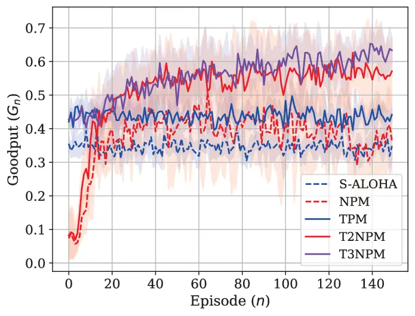

(a) Goodput during re-training under $`L\uparrow`$.

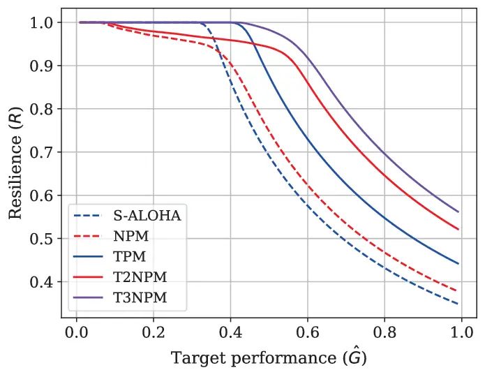

(b) Resilience w.r.t. a target goodput level $`\hat{G}`$.

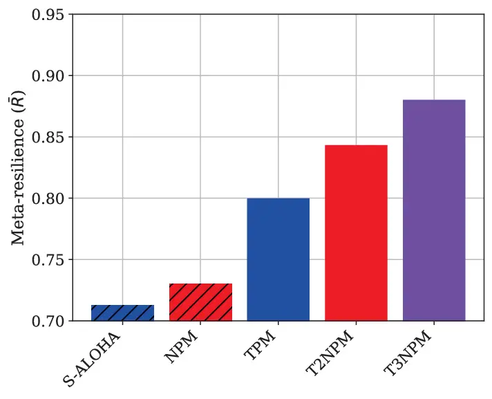

(c) Meta-resilience comparison.

Fig. 9: Goodput, resilience, and meta-resilience of semantic MAC
protocols under the environmental shift $`L\uparrow`$.

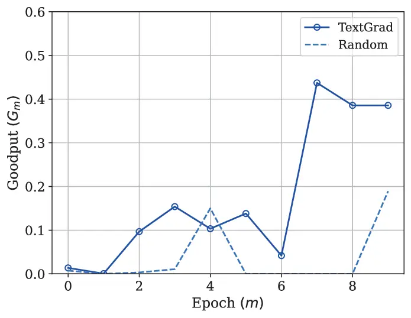

(a) TPM w. TextGrad vs. random instructions.

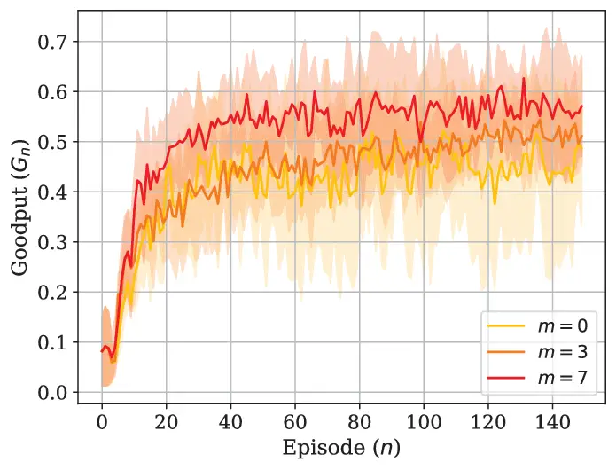

(b) Goodput during re-training of T2NPM.

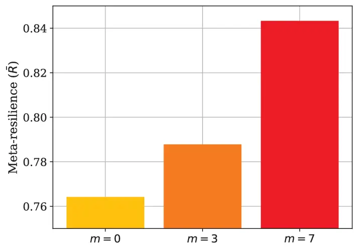

(c) Meta-resilience of T2NPM.

Fig. 10: Impact of TextGrad on TPM and T2NPM with respect to the number
$`m`$ of TextGrad epochs increases.

### VI-B Impact of Environmental Shifts

Table I presents the goodput of NPM under various types of environmental
shifts, where the NPM parameter set $`\boldsymbol{\Theta}_{0}`$ is
pre-trained under the conditions $`p_{\ell}^{a}=0.3`$,
$`b_{\ell}^{\max}=3`$, and $`L=2`$. We then evaluate the following
individual environmental shifts, with increases and decreases marked in
red and blue, respectively:
$`p_{\ell}^{a}\in\{{\color[rgb]{1,0,0}0.5},\,{\color[rgb]{0,0,1}0.1}\}`$,
$`b_{\ell}^{\max}\in\{{\color[rgb]{1,0,0}5},\,{\color[rgb]{0,0,1}2}\}`$,
$`L\in\{{\color[rgb]{1,0,0}3},\,{\color[rgb]{0,0,1}1}\}`$, and
$`p_{\ell}^{e}\in\{{\color[rgb]{1,0,0}0.1},\,{\color[rgb]{0,0,1}0.001}\}`$.
Two cases are considered, \raisebox{-0.85pt}{1}⃝: goodput is evaluated
using $`\boldsymbol{\Theta}_{0}`$, without any adaptation to a new
environment, \raisebox{-0.85pt}{2}⃝: $`\boldsymbol{\Theta}_{0}`$ is
re-trained to adapt to a new environment. When $`L\uparrow`$, the fixed
$`\boldsymbol{\Theta}_{0}`$ cannot accommodate the increased
input/output dimension, requiring a randomly initialized NN to support
the new UE. Among all evaluated environmental shifts, this scenario
yields the largest performance gap between the original and re-trained
NPMs. Therefore, we hereafter focus only on $`L\uparrow`$.

### VI-C Meta-resilience Analysis on TPM, T2NPM, and T3NPM

Fig. 9 illustrates the derivation from goodput to meta-resilience,
highlighting the superior performance of T3NPM in terms of
meta-resilience across all evaluated methods. The goodput $`G_{n}`$ over
episodes is shown in Fig. 9(a). At the environmental shift episode
$`n_{0}`$, both NPM (dotted red) and T2NPM (solid red) exhibit a
significant drop in goodput since they cannot adapt to the sudden change
in input-output dimensions caused by fixed NN architectures. In
contrast, TPM (solid blue) maintains stable goodput, as it relies on
natural language-based inference and remains independent of NN
structural constraints. While NPM and T2NPM eventually recover from the
performance drop, T2NPM trains faster and shows better goodput than NPM,
benefiting from the proposed KD regularization. To guarantee that the
T2NPM goodput set satisfies $`|\mathcal{V}_{n}^{\text{T2NPM}}|=12`$,
goodput is measured every 12 TTIs during the measurement phase, as in
the testing phase. Since each goodput value requires 12 TTIs and we aim
to collect 12 such samples, the total required measurement duration
becomes $`\hat{T}_{M}=144`$ TTIs. Given that each episode allocates
$`T_{M}=24`$ TTIs for measurement, only two goodput values can be
obtained per episode. Therefore, $`k=\lceil\hat{T}_{M}/T_{M}\rceil-1=5`$
previous episodes are utilized to construct
$`\mathcal{V}_{n}^{\text{T2NPM}}`$. With this configuration, T3NPM
avoids the severe performance degradation observed in NPM and T2NPM by
initially operating as TPM. As training advances and T2NPM begins to
outperform TPM, the protocol switches dynamically, enabling further
learning and sustained long-term performance enhancement.

Since Fig. 9(a) includes the effects of initial performance degradation,
gradual recovery, and final convergence, it is difficult to directly
evaluate the resilience of each method. Therefore,
$`R\left(\{G_{n}\}_{n\in\mathcal{N}},\hat{G}\right)`$ across various
target goodput levels $`\hat{G}\in[0.01,1]`$ is illustrated in
Fig. 9(b). When $`\hat{G}`$ is close to zero, the environmental shift
does not cause any performance degradation in terms of resilience,
resulting in all methods achieving
$`R\left(\{G_{n}\}_{n\in\mathcal{N}},\hat{G}\right)=1`$. At low values
of $`\hat{G}`$, both NPM and T2NPM exhibit lower resilience than TPM and
S-ALOHA, primarily due to their significant performance degradation
immediately following the environmental shift. However, as $`\hat{G}`$
increases beyond the goodput of TPM and S-ALOHA, their resilience
sharply declines. T2NPM consistently outperforms NPM in resilience
across all $`\hat{G}`$ values. T3NPM achieves the highest resilience
over the entire range of $`\hat{G}`$, as it avoids the initial
degradation through early-stage TPM deployment and then transitions to
T2NPM for long-term performance gains. Because comparisons based on
specific $`\hat{G}`$ values can fluctuate, often resulting in crossing
points among the resilience curves, Fig. 9(c) summarizes the overall
results using $`\bar{R}\left(\{G_{n}\}_{n\in\mathcal{N}}\right)`$,
defined in (15). For T3NPM meta-resilience calculation,
$`\bar{R}\left(\{G_{n}\}_{n\in\mathcal{N}}\mid T_{M},k\right)`$ in (18)
is used. Among the methods, T3NPM’s
$`\bar{R}\left(\{G_{n}\}_{n\in\mathcal{N}}\mid 24,5\right)`$ achieves
the highest meta-resilience, outperforming T2NPM, TPM, NPM, and S-ALOHA
by $`4.37\%`$, $`10.05\%`$, $`20.56\%`$, and $`23.53\%`$, respectively.
The rationale of deciding $`T_{M}=24`$ and $`k=5`$ is explained in
Sec. VI-F. Since meta-resilience accounts for performance across a broad
spectrum of target levels, we conclude that T3NPM provides the most
resilient performance among all proposed methods.

### VI-D Impact of TextGrad

The impact of TextGrad on both TPM and T2NPM, specifically on their
goodput and meta-resilience, is illustrated in Fig. 10, highlighting the
effect of instruction quality. Fig. 10(a) compares TPM performance under
different instruction acquisition methods across training epochs
$`m\in[0,9]`$. In the ‘random’, instructions are generated without any
feedback. In contrast, the ‘TextGrad’ approach iteratively refines
instructions using LLM-generated feedback based on the objective
function. At each epoch $`m`$, $`G^{\phi_{m}}`$ is evaluated using TPM
with instruction $`\phi=\phi_{m}`$. The results demonstrate that
instructions generated via TextGrad significantly outperform those
acquired randomly. This improvement stems from the LLM’s capacity to
comprehend the natural language expression of the task objective,
generate meaningful feedback, and update the instruction accordingly.
Due to the stochastic nature of LLM-generated feedback and updates,
increasing the number of epochs does not always consistently improve
instruction performance. Therefore, the highest TPM goodput is achieved
among all evaluated instructions using $`\phi=\phi_{7}`$.

Since TPM is also utilized as the teacher model in T2NPM, the influence
of instruction quality on T2NPM performance is illustrated in
Fig. 10(b). Here, instructions $`\phi_{0}`$, $`\phi_{3}`$, and
$`\phi_{7}`$, obtained from Fig. 10(a), are applied to the teacher model
while training the student model. For clearer comparison, Fig. 10(c)
presents the corresponding meta-resilience results. As expected,
instruction quality directly affects T2NPM performance. The
meta-resilience
$`\bar{R}\left(\{G_{n}^{\phi_{7}}\}_{n\in\mathcal{N}}\right)`$ exceeds
$`\bar{R}\left(\{G_{n}^{\phi_{0}}\}_{n\in\mathcal{N}}\right)`$ and
$`\bar{R}\left(\{G_{n}^{\phi_{3}}\}_{n\in\mathcal{N}}\right)`$ by
$`10.35\%`$ and $`7.04\%`$, respectively. Although KD does not require
an optimal teacher model, these results emphasize the critical role of
instruction quality in enhancing the student model’s goodput. Based on
these findings, instruction $`\phi=\phi_{7}`$ is adopted for all
simulations, including those in Fig. 9.

|                        |                    |            |         |
| ---------------------- | ------------------ | ---------- | ------- |
|                        | Computational cost |            |         |
| Scheme                 | Avg. FLOPS         | Parameters | Memory  |
| TPM                    | 7.13T              | 10.7B      | 41.1GiB |
| T3NPM, $`T_{M}={120}`$ | 6.05T              | 10.7B      | 41.3GiB |
| T3NPM, $`T_{M}={96}`$  | 1.43T              | 10.7B      | 41.3GiB |
| T3NPM, $`T_{M}={72}`$  | 0.90T              | 10.7B      | 41.3GiB |
| T3NPM, $`T_{M}={48}`$  | 0.56T              | 10.7B      | 41.3GiB |
| T3NPM, $`T_{M}={24}`$  | 0.36T              | 10.7B      | 41.3GiB |
| T2NPM                  | 0.11M              | 50.83K     | 190MiB  |
| NPM                    | 0.11M              | 50.83K     | 190MiB  |

TABLE II: Computational cost at testing phase.

### VI-E Impact of KD

KD enables T2NPM to achieve both faster convergence and higher
convergence goodput than NPM, while maintaining significantly lower
computational complexity than TPM, as illustrated in Fig. 9(a) and the
first three rows in Table II. As shown in Fig. 9(a), T2NPM demonstrates
a steeper increase in goodput during early episodes compared to NPM.
This improvement results from the KD regularization term, which guides
the student model to imitate the teacher model’s actions, thereby
simplifying the training process, particularly in the early stages where
learning from scratch is challenging. Over time, T2NPM surpasses both
NPM and TPM in terms of convergence goodput. This performance gain stems
from the combined effect of the KD loss, which promotes policy alignment
with TPM, and the TD loss, which allows the model to interact with the
environment and refine its policy. In terms of computational cost,
Table II confirms that T2NPM and NPM incur equivalent costs, which are
significantly lower than that of TPM. Average FLOPS is obtained by
dividing the total FLOPs across all episodes by $`|\mathcal{N}|`$. Due
to their lightweight architectures with fewer parameters and lower
memory requirements, both NPM and T2NPM exhibit minimal FLOPs per
episode. In contrast, TPM incurs the highest computational cost, as it
requires inference using an LLM for all episodes, resulting in
substantially greater FLOPs.

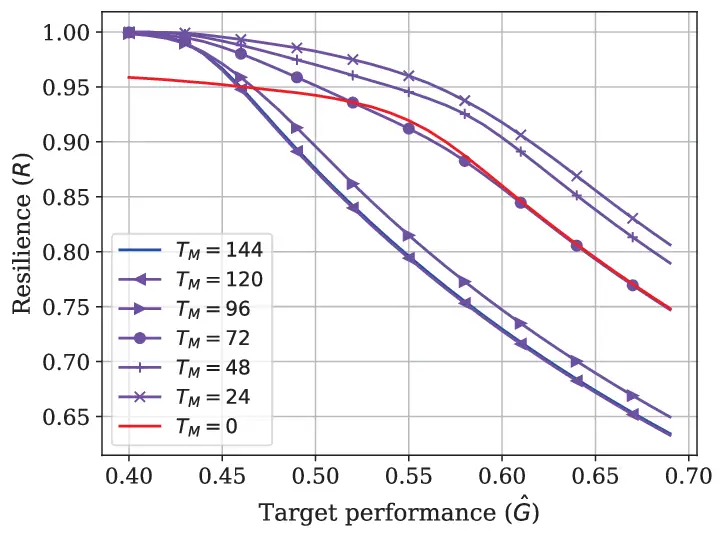

(a) Resilience.

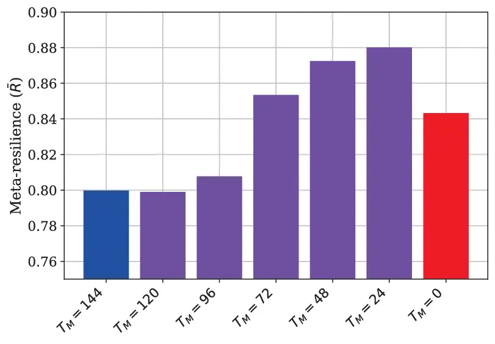

(b) Meta-resilience.

Fig. 11: Resilience and meta-resilience for different $`T_{M}`$’s.

### VI-F Impact of MixSwitch

The meta-resilience of T3NPM varies with the choice of measurement phase
duration $`T_{M}`$, as it simultaneously determines the training time
($`T-T_{M}`$) and the number of past episodes $`k`$ used in the
MixSwitch. Therefore, solving the optimization problem in (18) is
required to identify the optimal $`\hat{T}_{M}`$. Fig. 11 compares
T3NPM’s resilience and meta-resilience across multiple values of
$`T_{M}`$. To ensure a consistent sample size
$`|\mathcal{V}_{n}^{\text{T2NPM}}|=12`$, the feasible set of $`T_{M}`$
is constrained to values divisible by $`12`$ TTIs as
$`T_{M}\in\{0,24,48,72,96,120,144\}`$, and T3NPM with each configuration
is denoted as $`\text{T3NPM}_{T_{M}}`$. Resilience for each
configuration is illustrated in Fig. 11(a), while Fig. 11(b) presents
the corresponding meta-resilience values. Notably, $`T_{M}=144`$ and
$`T_{M}=0`$ correspond to TPM and T2NPM, respectively. As $`T_{M}`$
decreases from $`144`$ to $`24`$, more training time is allocated per
episode, improving long-term performance. However, when $`T_{M}=0`$, no
measurement phase is performed, requiring the system to operate as T2NPM
from the beginning, which limits adaptability and reduces
meta-resilience. According to Fig. 11(b), the configuration $`T_{M}=24`$
achieves the highest meta-resilience, with gains of $`10.16\%`$,
$`8.96\%`$, $`3.13\%`$, and $`0.87\%`$ over $`T_{M}=120`$, $`T_{M}=96`$,
$`T_{M}=72`$, and $`T_{M}=48`$, respectively. Consequently, $`T_{M}=24`$
is selected as the optimal solution to (18), and this configuration is
adopted for all simulations, including Fig. 9. Additionally, a smaller
$`T_{M}`$ results in rapid goodput improvement, thus an earlier
switching point from TPM to T2NPM. It further reduces average FLOPS
during the testing phase, as shown in Table II.

|                                                  |                             |      |      |      |      |        |
| ------------------------------------------------ | --------------------------- | ---- | ---- | ---- | ---- | ------ |
| Environmental                                    | Number of few-shot examples |      |      |      |      |        |
| Shift                                            | 0                           | 2    | 4    | 6    | 8    | AGR    |
| $`L\uparrow`$                                    | 0.44                        | 0.61 | 0.57 | 0.61 | 0.60 | 9.36%  |
| $`p_{\ell}^{a}\uparrow`$                         | 0.41                        | 0.58 | 0.62 | 0.68 | 0.73 | 16.35% |
| $`b_{\ell}^{\max}\uparrow`$                      | 0.21                        | 0.44 | 0.41 | 0.45 | 0.45 | 28.12% |
| $`p_{\ell}^{a}\uparrow,b_{\ell}^{\max}\uparrow`$ | 0.28                        | 0.57 | 0.61 | 0.67 | 0.71 | 31.60% |

TABLE III: Impact of ICL under environmental shifts.

### VI-G Ablation Studies: Impact of ICL and SNR

As discussed in Sec. III-B, ICL and prompt engineering via TextGrad are
two promising LLM adaptation methods for TPM construction. However, ICL
is effective only under mild environmental shifts, as it relies on
exemplary queries that become irrelevant under sever shifts. To
illustrate, Tab. III reports the average goodput of TPM with ICL using
$`m=2`$ examples across four types of environmental shifts: 1)
$`L\uparrow`$, 2) $`p_{\ell}^{a}\uparrow`$, 3)
$`b_{\ell}^{\max}\uparrow`$, and 4) joint shift in
$`p_{\ell}^{a}\uparrow`$ and $`b_{\ell}^{\max}\uparrow`$. In this
setting, only pre-shift data are available for constructing ICL
examples. The results show that ICL remains effective under mild
environmental shifts involving 2)-4), where pre-shift examples are still
relevant. In contrast, under the severe shift 1), ICL yields little
performance gain, in terms of the average growth rate (AGR) of goodput.
Based on these findings, we recommend using TextGrad alone when adapting
to severe environmental shifts like $`L\uparrow`$, while combining ICL
with TextGrad is effective for mild shifts such as $`p_{\ell}^{a}`$
and/or $`b_{\ell}^{\max}`$.

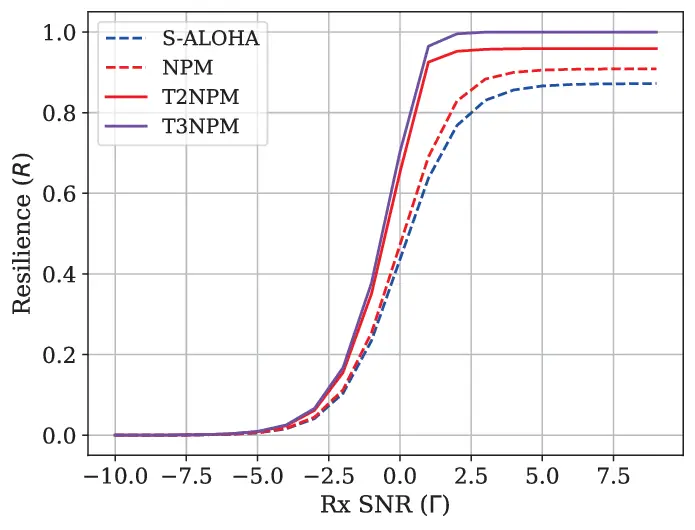

Fig. 12: Impact of SNR on resilience.

Next, we examine the case of reduced BLER $`p_{\ell}^{e}\downarrow`$,
under the concurrent $`L\uparrow`$ shift. The resulting loss in
resilience can be compensated by re-training as shown in Tab. I, or
alternatively by increasing transmit power or equivalently
signal-to-noise ratio (SNR). To illustrate the latter, for a fixed
target goodput level $`\hat{G}=0.4`$, Fig. 12 depicts resilience as SNR
increases, where BLER is modeled as a sigmoid function of SNR \[38\].
T3NPM consistently achieves the highest resilience and gains the most
from increasing SNR. Consequently, to reach a resilience of $`R=0.8`$,
T3NPM requires $`2\,\mathrm{dB}`$ and $`0.7\,\mathrm{dB}`$ lower SNR
compared to S-ALOHA and NPM, respectively. Nevertheless, resilience
saturates at high SNR in all methods, leaving non-negliglble resilience
gaps that highlight the need for improved protocol designs. Notably,
T3NPM only achieves the maximum $`R=1`$, owing to its ability to meet
$`\hat{g}`$ using TPM immediately after the shift, underscoring the
important role of LLMs in resilient protocol designs.

## VII Conclusion

In this paper, we addressed the challenges posed by environmental shifts
in NPM, which require re-training and thus compromise resilience. To
overcome this, we proposed LLM-based semantic MAC protocols: TPM, T2NPM,
and T3NPM. Leveraging LLM-based inference, TPM immediately enables
coarse-yet-acceptable MAC operations under environmental shifts,
facilitated by LLM-based instruction fine-tuning through TextGrad,
without the need for re-training. By utilizing TPM as a coarse teacher,
T2NPM not only transfers the knowledge of its LLM into a small NN but
also accelerates the NN’s re-training via KD, thereby reducing inference
costs and improving goodput. Finally, T3NPM combines TPM for immediate
responses and T2NPM for reduced computation and enhanced goodput, using
MixSwitch to optimize the TPM-to-T2NPM transition point. To define the
objective for this transition optimization and enable fair comparison
across different methods, we introduced a novel metric, meta-resilience,
which quantifies resilience when target performance is undefined, a
crucial aspect for capturing the unknown impacts of environmental
shifts. Simulations demonstrated that T3NPM outperforms NPM, TPM, T2NPM,
and S-ALOHA in meta-resilience, under environmental shifts caused by
variations in the number of UEs and SNR. Building on this, a promising
direction for future study is to evaluate the effectiveness of LLM-based
semantic MAC protocols in more realistic MAC scenarios. Furthermore,
exploring the additional role of LLM’s reasoning capabilities during
test-time compute could be an interesting future topic.

## References

- \[1\] A. Valcarce, P. Kela, S. Mandelli, and H. Viswanathan, “The Role
  of AI in 6G MAC,” in _2024 Joint European Conference on Networks and
  Communications & 6G Summit (EuCNC/6G Summit)_. IEEE, Jul 2024, pp.
  723–728.
- \[2\] M. Mota, A. Valcarce, J. Gorce, and J. Hoydis, “The Emergence of
  Wireless MAC Protocols with Multi-Agent Reinforcement Learning,” _IEEE
  Globecom Workshops (GC Wkshps)_, Jan 2021.
- \[3\] S. Seo, J. Park, S. Ko, J. Choi, M. Bennis, and S. Kim, “Toward
  Semantic Communication Protocols: A Probabilistic Logic Perspective,”
  _IEEE Journal on Selected Areas in Communications_, vol. 41, pp. 2670
  – 2686, Jun 2023.
- \[4\] M. Hussien _et al._, “Evolution of MAC Protocols in the Machine
  Learning Decade: A Comprehensive Survey,” _arXiv preprint
  arXiv:2302.13876_, Jan 2023.
- \[5\] J. Xin, W. Xu, B. Cao, T. Wang, and S. Zhang, “A
  Deep-Learning-based MAC for Integrating Channel Access, Rate
  Adaptation, and Channel Switch,” _Digital Communications and
  Networks_, Oct 2024.
- \[6\] N. Keshtiarast, O. Renaldi, and M. Petrova, “Wireless MAC
  Protocol Synthesis and Optimization with Multi-Agent Distributed
  Reinforcement Learning,” _IEEE Networking Letters_, Nov 2024.
- \[7\] F. Naeem, N. Adam, G. Kaddoum, and O. Waqar, “Learning MAC
  Protocols in HetNets: A Cooperative Multi-Agent Deep Reinforcement
  Learning Approach,” in _2024 IEEE Wireless Communications and
  Networking Conference (WCNC)_. IEEE, Jul 2024, pp. 1–6.
- \[8\] F. Jiang _et al._, “Large AI Model Empowered Multimodal Semantic
  Communications,” _IEEE Communications Magazine_, Sep 2024.
- \[9\] L. Bariah, Q. Zhao, H. Zou, Y. Tian, F. Bader, and M. Debbah,
  “Large Language Models for Telecom: The Next Big Thing?” _arXiv
  preprint arXiv:2306.10249_, 2023.
- \[10\] Y. Sheng _et al._, “Beam Prediction based on Large Language
  Models,” _IEEE Wireless Communications Letters_, Feb 2025.
- \[11\] Y. Zhang, H. Yin, W. Li, E. Bjornson, and M. Debbah, “Port-LLM:
  A Port Prediction Method for Fluid Antenna based on Large Language
  Models,” _arXiv preprint arXiv:2502.09857_, Feb 2025.
- \[12\] F. Lotfi, H. Rajoli, and F. Afghah, “LLM-Augmented Deep
  Reinforcement Learning for Dynamic O-RAN Network Slicing,”
  _environments_, vol. 2, p. 4.
- \[13\] X. Wu, J. Farooq, Y. Wang, and J. Chen, “LLM-xApp: A Large
  Language Model Empowered Radio Resource Management xApp for 5G O-RAN,”
  in _Symposium on Networks and Distributed Systems Security (NDSS),
  Workshop on Security and Privacy of Next-Generation Networks (FutureG
  2025), San Diego, CA_, Feb 2025.
- \[14\] M. K. Motalleb _et al._, “Towards Secure Intelligent O-RAN
  Architecture: Vulnerabilities, Threats and Promising Technical
  Solutions using LLMs,” _arXiv preprint arXiv:2411.08640_, Nov 2024.
- \[15\] R. Tan, R. Li, and Z. Zhao, “LLM4MAC: An LLM-Driven
  Reinforcement Learning Framework for MAC Protocol Emergence,” _arXiv
  preprint arXiv:2503.08123_, Mar 2025.
- \[16\] A. Tampuu _et al._, “Multiagent Cooperation and Competition
  with Deep Reinforcement Learning,” _PLOS ONE 12 (4):e0172395._,
  Apr 2017.
- \[17\] R. S. Sutton, A. G. Barto _et al._, _Reinforcement Learning: An
  Introduction_. MIT press Cambridge, Mar 1999, vol. 1, no. 1.
- \[18\] V. Mnih, “Playing Atari with Deep Reinforcement Learning,”
  _arXiv preprint arXiv:1312.5602_, Dec 2013.
- \[19\] R. S. Sutton, “Learning to Predict by the Methods of Temporal
  Differences,” _Machine learning_, vol. 3, pp. 9–44, Aug 1988.
- \[20\] T. Lillicrap, “Continuous Control with Deep Reinforcement
  Learning,” _arXiv preprint arXiv:1509.02971_, Jul 2019.
- \[21\] Y. Liu, J. Singh, G. Liu, A. Payani, and L. Zheng, “Towards
  Hierarchical Multi-Agent Workflows for Zero-Shot Prompt Optimization,”
  _arXiv preprint arXiv:2405.20252_, Apr 2025.
- \[22\] M. Yuksekgonul _et al._, “TextGrad: Automatic “Differentiation”
  via Text,” _arXiv preprint arXiv:2406.07496_, Jun 2024.
- \[23\] L. Bariah, H. Zou, Q. Zhao, B. Mouhouche, F. Bader, and
  M. Debbah, “Understanding Telecom Language Through Large Language
  Models,” in _2023 IEEE Global Communications Conference_. IEEE, Feb
  2023, pp. 6542–6547.
- \[24\] J. Shin _et al._, “Prompt Engineering or Fine Tuning: An
  Empirical Assessment of Large Language Models in Automated Software
  Engineering Tasks,” _arXiv preprint arXiv:2310.10508_, Feb 2025.
- \[25\] M. Phuong and C. Lampert, “Towards Understanding Knowledge
  Distillation,” _International conference on machine learning_, pp.
  5142–5151, Jun 2019.
- \[26\] B. Plaut, K. Nguyen, and T. Trinh, “Softmax Probabilities
  (Mostly) Predict Large Language Model Correctness on Multiple-Choice
  Q&A,” _arXiv:2402.13213_, Feb 2024.
- \[27\] T. Furlanello _et al._, “Born Again Neural Networks,” in
  _International conference on machine learning_. PMLR, Jul 2018, pp.
  1607–1616.
- \[28\] M. Najarian and G. J. Lim, “Design and Assessment Methodology
  for System Resilience Metrics,” _Risk Analysis_, vol. 39, no. 9, pp.
  1885–1898, Feb 2019.
- \[29\] E. K. Cetinkaya _et al._, “Modelling Communication Network
  Challenges for Future Internet Resilience, Survivability, and
  Disruption Tolerance: a Simulation-based Approach,” _Telecommunication
  Systems_, vol. 52, pp. 751–766, Sep 2013.
- \[30\] D. A. Reed, K. C. Kapur, and R. D. Christie, “Methodology for
  Assessing the Resilience of Networked Infrastructure,” _IEEE Systems
  Journal_, vol. 3, pp. 174 – 180, May 2009.
- \[31\] R.-J. Reifert, S. Roth, A. A. Ahmad, and A. Sezgin, “Comeback
  Kid: Resilience for Mixed-Critical Wireless Network Resource
  Management,” _IEEE Transactions on Vehicular Technology_, Jul 2023.
- \[32\] M. Bruneau _et al._, “A Framework to Quantitatively Assess and
  Enhance the Seismic Resilience of Communities,” _Earthquake spectra_,
  vol. 19, no. 4, pp. 733–752, Nov 2003.
- \[33\] C. Finn, P. Abbeel, and S. Levine, “Model-Agnostic
  Meta-Learning for Fast Adaptation of Deep Networks,” in _International
  conference on machine learning_. PMLR, Aug 2017, pp. 1126–1135.
- \[34\] M. Haenggi, “The Meta Distribution of the SIR in Poisson
  Bipolar and Cellular Networks,” _IEEE Transactions on Wireless
  Communications_, vol. 15, no. 4, pp. 2577–2589, Dec 2015.
- \[35\] N. Reimers and I. Gurevych, “Why Comparing Single Performance
  Scores Does Not Allow to Draw Conclusions About Machine Learning
  Approaches,” _arXiv preprint arXiv:1803.09578_, Mar 2018.
- \[36\] N. Nachar _et al._, “The Mann‐Whitney U: A Test for Assessing
  Whether Two Independent Samples Come from the Same Distribution,”
  _Tutorials in quantitative Methods for Psychology_, vol. 4, no. 1, pp.
  13–20, Mar 2008.
- \[37\] D. Kim _et al._, “SOLAR 10.7B: Scaling Large Language Models
  with Simple yet Effective Depth Up-Scaling,” _arXiv preprint
  arXiv:2312.15166_, Apr 2024.
- \[38\] C. Mesa _et al._, “Link Abstraction Models for Multicarrier
  Systems: A Logistic Regression Approach,” _International Journal of
  Communication Systems_, vol. 31, no. 1, p. e3436, Sep 2017.
