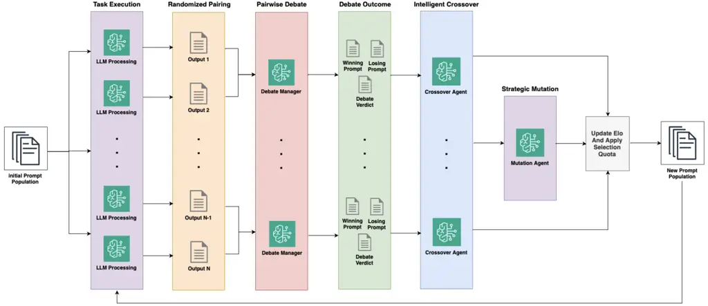
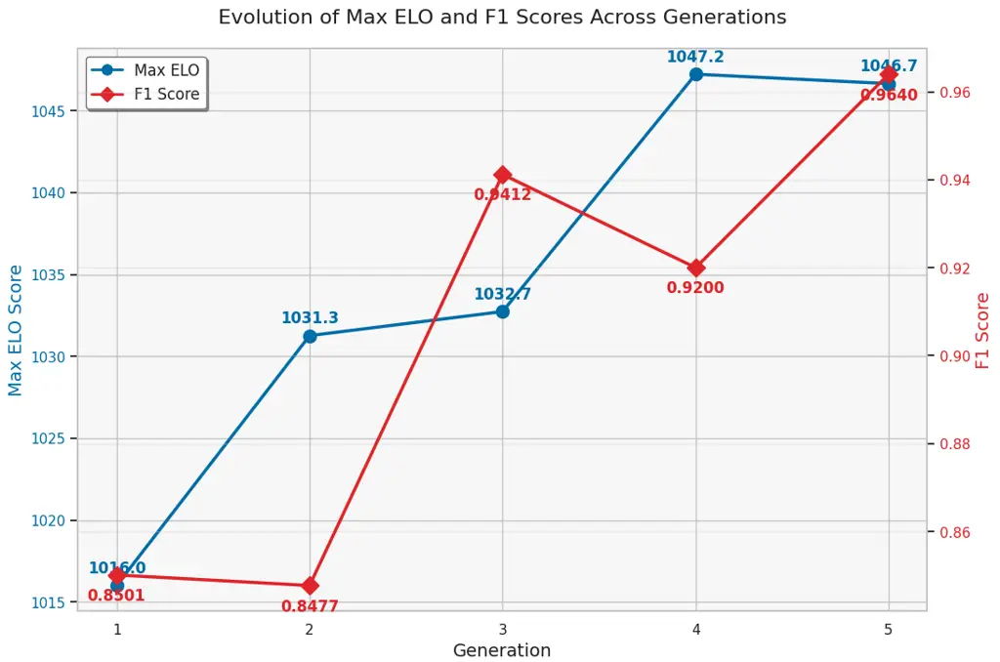
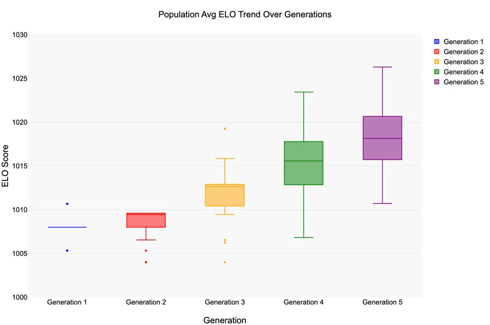
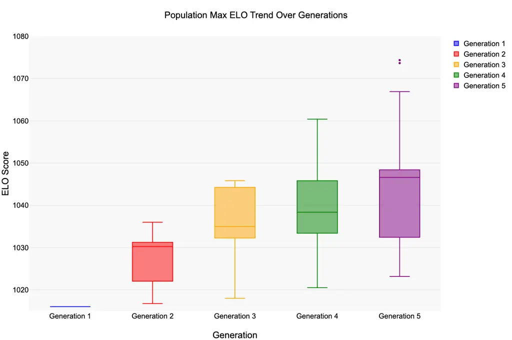

# Tournament of Prompts: Evolving LLM Instructions Through Structured Debates and Elo RatingsThanks: ^(\*)These authors contributed equally to this work

DOI: [XXXXXXX.XXXXXXX](https://doi.org/XXXXXXX.XXXXXXX)Conference: August
4–5, 2025; Toronto, Canada; CCS: Computing methodologies Artificial
intelligence Natural language processingCCS: Computing
methodologies Artificial intelligence Knowledge representation and
reasoning CCS: Computing methodologies Artificial intelligence Planning
and scheduling

Anirudh Nair^(\*) Affiliation: Amazon, Boston, MA, USA email:
<rianina@amazon.com> , Adi Banerjee^(\*) Affiliation: Amazon, New York,
NY, USA email: <adibaner@amazon.com> , Laurent Mombaerts
Affiliation: Amazon, Luxembourg, Luxembourg email: <lmomb@amazon.com> ,
Matthew Hagen Affiliation: Amazon, Atlanta, GA, USA email:
<mathage@amazon.com> and Tarik Borogovac Affiliation: Amazon, Boston,
MA, USA email: <tarikbo@amazon.com>

2025

###### Abstract.

Prompt engineering represents a critical bottleneck to harness the full
potential of Large Language Models (LLMs) for solving complex tasks, as
it requires specialized expertise, significant trial-and-error, and
manual intervention. This challenge is particularly pronounced for tasks
involving subjective quality assessment, where defining explicit
optimization objectives becomes fundamentally problematic. Existing
automated prompt optimization methods falter in these scenarios, as they
typically require well-defined task-specific numerical fitness functions
or rely on generic templates that cannot capture the nuanced
requirements of complex use cases. We introduce DEEVO (DEbate-driven
EVOlutionary prompt optimization), a novel framework that guides prompt
evolution through a debate-driven evaluation with an Elo-based
selection. Contrary to prior work, DEEVO’s approach enables exploration
of the discrete prompt space while preserving semantic coherence through
intelligent crossover and strategic mutation operations that incorporate
debate-based feedback, combining elements from both successful and
unsuccessful prompts based on identified strengths rather than arbitrary
splicing. Using Elo ratings as a fitness proxy, DEEVO simultaneously
drives improvement and preserves valuable diversity in the prompt
population. Experimental results demonstrate that DEEVO significantly
outperforms both manual prompt engineering and alternative
state-of-the-art optimization approaches on open-ended tasks and
close-ended tasks despite using no ground truth feedback. By connecting
LLMs’ reasoning capabilities with adaptive optimization, DEEVO
represents a significant advancement in prompt optimization research by
eliminating the need of predetermined metrics to continuously improve AI
systems.

###### Keywords: 

Large Language Models, Multi-Agent Systems, Prompt Optimization,
Multi-Agent Debates, Evolutionary Algorithms

## 1. Introduction

Large Language Models (LLMs) have demonstrated remarkable capabilities
across diverse domains, such as literary and professional writing, code
generation, and problems requiring logical reasoning. However, their
performance towards a specific task remains heavily dependent on the
quality of instructions — or prompts — provided to them (Fernando
et al., 2023; Guo et al., 2025b). The term prompt engineering has become
widely used, signaling that prompting has become an important skill for
harnessing these models’ full potential. This skill requires specialized
expertise attained through learning techniques and significant
trial-and-error. Furthermore, when prompts prove insufficient for a
task, developers must either implement dedicated post-processing logic
or employ fine-tuning strategies to address performance gaps. In that
sense, the development of systems executing complex tasks while solely
relying on prompt engineering is resource intensive, thus motivating the
need for an automated method to optimize prompts.

The automated optimization of prompts is especially challenging for
tasks where performance or quality is judged subjectively, where
ambiguity challenges require resolution, or where managing conflicting
contexts is paramount (Suzgun et al., 2022). In these scenarios, agents
are expected to learn to adapt synthesizing different types of
information, make judgment calls from different perspectives, and
self-ascertain branching and stopping conditions during its iteration
process; all in the absence of any quality criteria or scoring functions
to quantify success along said criteria.

Current approaches to automated discrete prompt optimization fall into
two primary categories: gradient-based methods and evolutionary
strategies. Gradient-based methods operate on textual gradients defined
by means of LLM generated critical feedback (examples of these are
Protegi (Pryzant et al., 2023a) and TextGrad (Yuksekgonul et al.,
2024)). These methods offer computational efficiency but typically
require labeled ground truth data from which to calculate loss; risk
task-specific overfitting especially when there is a lack of diversity
in the examples; and do not have a mechanism to perform exploration and
thus suffer from adaptability issues. Conversely, evolutionary methods
(such as EvoPrompt (Guo et al., 2025b) and PromptBreeder (Fernando
et al., 2023)) provide broader exploration capabilities but suffer from
computational inefficiency due to random search and, crucially, depend
on well-defined objective fitness functions — which are often
unavailable for subjective tasks.

We introduce DEEVO (DEbate-driven EVOlutionary prompt optimization), a
novel framework that addresses the challenges of 1) exploration vs
exploitation, and 2) lack of labeled ground truth / fitness functions,
by guiding prompt evolution through structured debates and Elo-based
selection.

Exploration vs Exploitation  
Unlike previous approaches, DEEVO enables systematic exploration of the
prompt space through two innovative evolutionary mechanisms. At its
core, DEEVO employs multi-agent debate (Du et al., 2023) to guide
intelligent crossover, where strengths and weaknesses of parent prompts
are identified before strategically combining their effective elements.
This process is complemented by targeted prompt mutations that
specifically modify instructions to improve task performance. DEEVO’s
evolutionary approach selectively incorporates elements from both
successful and unsuccessful prompts based on their identified strengths,
preserving prompt effectiveness and logical structure while
systematically exploring the solution space.

Lack of Labeled Ground-Truth Data  
Unlike prior prompt optimization strategies, DEEVO does not rely on
labeled data / fitness functions against ground truth in order to
evaluate prompt effectiveness. Instead, it leverages LLM-powered
multi-agent debates (MAD) (Du et al., 2023) to evaluate prompt quality
without requiring predetermined metrics. By having LLMs critique prompt
outputs in a pairwise fashion and determine a winner through structured
debates, DEEVO ensures a self-contained evaluation system that can
assess quality across diverse tasks — including those with subjective
criteria. The evaluation mechanism evolves and improves along with the
prompts, incorporating novel ideas as candidate criteria for future
evaluation. The resulting debate verdicts serve as a fitness proxy that
simultaneously drives improvement and preserves valuable diversity in
the prompt population without needing a manually crafted or separately
learned objective function for fitness selection.

A Modified Elo-Based Selection  
The Elo rating system (Elo and Sloan, 1978) is a robust method to rank
entities (in this case, prompts) via pairwise comparisons, where each
prompt maintains a numerical rating that dynamically updates based on
competition outcomes. This approach has gained significant traction in
LLM evaluation frameworks, with numerous benchmark systems adopting
Elo-based mechanisms to rank model and prompt performance (Ameli et al.,
2024; Chiang et al., 2024; Boubdir et al., 2023). Despite its
robustness, Elo is particularly limited in its ability to handle
newcomer prompt competitors (due to requiring many matchups to reach an
accurate skill assessment); and veteran prompt competitors (due to their
ratings becoming "sticky" over time, as historical matchups dilute
recent performances). For this reason, DEEVO utilizes a modified
Elo-selection mechanism that introduces selection quotas for newcomers
and veterans; to force the prompt population to always consist of a
balanced proportion of newcomer and veteran prompts. This enforces a
weaker barrier of entry to new prompt candidates, better captures
current skill levels for veterans, and provides more accurate
performance estimates.

We demonstrate that DEEVO significantly outperforms both manual prompt
engineering and alternative optimization approaches across both open and
close ended tasks. By connecting LLMs’ reasoning capabilities with
adaptive optimization, DEEVO eliminates the need for developing
predetermined metrics to continuously optimize prompts, opening new
possibilities for self-improving AI systems across domains where
subjective quality assessment is essential.



Figure 1. DEEVO. (1) First an initial set of prompts are either provided
or generated. (2) Next, each prompt is executed. (3) Each output is then
is then paired with another and then passed into a Multi-Agent Debate
evaluation to determine a winner. (4) A Crossover agent then leverages
the debate trace to intelligently create a new prompt that combines the
strong elements of both prompts in each pair. (5) Some child prompts are
then randomly selected to go through a task-driven Mutation agent. (6)
Finally, the Elo ratings are updated based on the winner and loser
prompts while children are given a base rating of 1000, and the next
generation repeats.

## 2. Related Works

### 2.1. Prompt Optimization

Prompt optimization has emerged as a critical area of research in large
language model (LLM) development, with researchers exploring various
techniques to enhance model performance through systematic refinement of
input prompts. Historically, researchers have relied on manual
supervised approaches, using black-box techniques that score prompts
based on observable output metrics such as accuracy, F1 score, BLEU, or
ROUGE. However more recently, automatic prompt optimization has come
into light as an alternative, scalable solution (Shin et al., 2020).
Soft prompt optimization operates in a continuous space and usually
involves some gradient-based operator. These methods operate in a
continuous space range by leveraging embeddings to automatically
optimize the prompts (Zhang et al., 2021; Sun et al., 2022; Hu et al.,
2024; Li et al., 2024b), training auxiliary models to output optimized
prompts (Jain et al., 2024; Cheng et al., 2023; Deng et al., 2022; Sun
et al., 2024; Zhang et al., 2023), or using non-gradient approaches to
adjust prompt representations (Chen et al., 2023).

In spite of effective performance, continuous methods often lack
interpretability (Lester et al., 2021), require model training (Zhu
et al., 2024), or need access to at least partial knowledge of the
internals of an LLM (Prasad et al., 2022), something out of scope for
black-box LLM APIs. Contrary to optimizing in a continuous space,
discrete prompt optimization methods work in a non-differentiable space,
treating prompts as fixed textual structures and refining them directly
(Zhou et al., 2022). While discrete methods do not involve gradient
operations for prompt optimization, several methods have developed
gradient-like mechanisms (aptly named ’textual gradients’) (Pryzant
et al., 2023b; Yuksekgonul et al., 2024; Khattab et al., 2024) that
mimic their numerical counterparts. ProTeGi (Pryzant et al., 2023b)
employs an LLM-feedback system to generate gradients in the form of
natural language text that compares the output of the executed prompt
and the ground-truth result and then uses beam search to iteratively
refine the prompt. Textual gradient-based methods offer computational
efficiency through reduced LLM calls but depend on ground truth data. To
address this limitation, methods like PACE (Dong et al., 2023) and SPO
(Xiang et al., 2025) leverage the LLM itself for output evaluation.
While PACE requires a scoring function, SPO utilizes pairwise comparison
to select superior prompts. Another line of work in discrete prompt
optimization is leveraging evolutionary strategies. EvoPrompt (Guo
et al., 2025b) uses genetic algorithms and differential evolution (Storn
and Price, 1997) to crossover and mutate different prompts in a
population. PromptBreeder (Fernando et al., 2023) samples different
thinking styles and mutation operators to generate the population and
then run a binary tournament genetic algorithm (Harvey, 2009).
Survival-of-the-Safest (Sinha et al., 2024) interleaves different
objectives for multi-task secure prompt optimization through exhaustive
and sequential evolutionary strategies. A benefit of evolutionary prompt
optimization methods is that they do not rely on ground truth examples,
unlike textual gradients; however, such methods do require task-based
fitness functions for scoring. Such functions are manually-intensive to
craft and may be intractable for very complex tasks. To mitigate this,
DEEVO integrates structured multi-agent debates with an Elo rating
system to guide evolutionary prompt optimization without requiring
either manually-crafted metrics or ground-truth labels.

### 2.2. Multi-Agent Debate

There is extensive research around multi-agent debate (MAD) utilizing
LLMs (Perez et al., 2019; Michael et al., 2023; Radhakrishnan, 2023). In
the realm of autonomous pairwise comparison, ChatEval (Chan et al., 2023) and Debatrix (Li et al., 2024a) have debaters take turns arguing
over which output is better before a final LLM-judge takes the arguments
and makes a decision. In fact, it has been shown that having more
persuasive debaters results in more truthful answers and comparisons
(Michael et al., 2023) compared to single-pass LLM-judges. MAD has also
been used for numerical scoring: DEBATE (Kim et al., 2024) uses a
’scorer’ agent that scores an output based on some criteria while a
’devil’s advocate’ agent debates against the score as much as possible.
Beyond evaluation, MAD has been used for improving factuality in LLM
generation (Du et al., 2023; Liang et al., 2023) as well as improving
human learning for writing reports (Jiang et al., 2024). Furthermore,
multi-agent debate has been used in optimization of LLMs (Estornell
et al., 2025; Subramaniam et al., 2024) and agentic workflows (Su
et al., 2025).

Recent developments build on the premise that prompts can be optimized
through competition or discourse. ZeroSumEval (Alyahya et al., 2025)
extends this by evaluating both prompts and models in zero-sum games.
These frameworks establish dynamic ecosystems of prompts that evolve
over time, enabling more robust exploration and discovery. Hybrid
systems like PromptBoosting (Hou et al., 2023), PREFER (Zhang et al.,
2024), and PromptWizard (He et al., 2025) enable verifier-editor roles
that refine prompts iteratively.

Building on these advances in multi-agent debate, DEEVO integrates MAD
as a core component of its evolutionary process. Specifically, MAD
serves as a fitness function to evaluate prompt quality, which then
guides the selection of prompts for subsequent generations. This
approach not only enables more nuanced evaluation of individual prompts
but opens possibilities for evaluating entire prompt orchestrations in
multi-agent systems, where the collective performance of agent prompts
can be jointly assessed through structured debates.

### 2.3. Elo Ratings for LLMs

The adoption of the Elo rating system (Elo and Sloan, 1978) to evaluate
LLMs represents a significant methodological advancement in AI
benchmarking, enabling relative performance assessments through pairwise
comparisons rather than absolute scoring methods. In benchmarking, Elo
has been used in Chatbot Arena (Chiang et al., 2024) and WildBench (Lin
et al., 2024) to rank chatbot performance through crowdsourced tasks and
pairwise comparisons. Beyond leaderboards, the theoretical analysis of
Elo as a metric for LLM ranking and evaluation has been heavily studied
recently. In Chatbot Arena, Elo has been shown to outperform more
complex algorithms, like mElo (Balduzzi et al., 2018) and Bradley-Terry
(Bradley and Terry, 1952), as well as pairwise comparison algorithms,
like winrates, as a more robust evaluation rating (Tang et al., 2025).
Moreover, the robustness of Elo with respect to fundamental evaluation
properties like transitivity and reliability, increase with the number
of permutations (Boubdir et al., 2023). While the original Elo system
does not incorporate ties, it has been extended to consider ties for LLM
ranking (Ameli et al., 2024) using the Rao & Kupper method (Rao and
Kupper, 1967).

While Elo has been more typically studied as an evaluation and ranking
system for LLMs and machine learning models in general, its numerical
properties has led to them being used for optimization of such models as
well. In Elo-Rating Based Reinforcement Learning (ERRL) (Ju et al.,
2024), the Elo system is used to rank human trajectories and convert
ordinal rewards into cardinal rewards for preference-based reinforcement
learning (RL). Reward Reasoning Models (RRMs) (Guo et al., 2025a) use
Elo and a knockout tournament structure as a rewarding strategy to train
an LLM via RL. REvolve (Hazra et al., 2024) leverages an evolutionary
algorithm to evolve the reward function for RL and convert pairwise
human-feedback into a fitness score using Elo. Inspired by these
methods, DEEVO utilizes Elo as a fitness function to guide the
evolutionary prompt optimization, bypassing the need for a manually
crafted or learned fitness function or reward model.

## 3. DEEVO

DEEVO (Debate-Driven Evolutionary Prompt Optimization) is a novel prompt
optimization framework that combines evolutionary algorithms with
multi-agent debate evaluation to efficiently discover high-quality
prompts for large language models. Unlike traditional evolutionary
algorithms that rely on fixed fitness functions, DEEVO leverages the
emergent capabilities of language models themselves through structured
debates to evaluate prompt quality. A diagram of the DEEVO workflow is
shown in Figure 1.

Assume we have access to a set of tasks
$`\mathcal{T}=\{t_{0},t_{1},\ldots,t_{n}\}`$, and a set of initial
prompts $`\mathcal{P}=\{p_{0},p_{1},\ldots,p_{M}\}`$. We also assume
there is access to an LLM via a black-box API.

0:  Tasks $`\mathcal{T}`$, initial prompts $`\mathcal{P}`$, population
size $`n`$, generations $`G`$, mutation rate $`m`$, newcomer quota
$`n_{new}`$, $`d`$ debate rounds

 Initialize population with prompts and set Elo ratings to 1000

 for gen = $`1`$ to $`G`$ do

  Form random prompt pairs from population

  // in parallel

  for each pair $`(p_{a},p_{b})`$ do

   Sample task $`t\in\mathcal{T}`$ and input $`x_{t}`$

   Generate responses $`r_{a},r_{b}`$ using $`p_{a},p_{b}`$ on $`x_{t}`$

   Conduct $`d`$-round debate to evaluate responses for task $`t`$

   Determine winner $`w\in\{p_{a},p_{b}\}`$ and update Elo (Alg. 2)

   Create offspring via Intelligent Crossover

   if $`random()<m`$ then

    Apply Strategic Mutation

   end if

   Add offspring to pool

  end for

  Age all existing prompts

  Select next generation:

   - Select newcomers from offspring by $`n_{new}`$

   - Select remaining $`n-n_{new}`$ veterans by Elo

  Save best prompts from current generation

 end for

 return Top prompt by Elo rating

Algorithm 1 DEEVO: Debate-Driven Evolutionary Prompt Optimization

### 3.1. Framework

Step 1: Initialization To conduct DEEVO, we begin by assigning each
prompt in the initial population with a base Elo rating of 1000 and an
age of 0. Each prompt is then paired randomly with another prompt to
form evaluation pairs. If the provided initial prompt set
$`\mathcal{P}`$ is insufficient to create a population of the desired
size, DEEVO generates additional prompts through simple variations of
existing ones. Each prompt is assigned a unique identifier for tracking
its performance and age throughout the evolutionary process. We also
initialize a mutation rate $`m\in[0,1]`$, the newcomer quota $`n_{new}`$
and debate rounds $`d`$.

Step 2: Evaluation For each prompt pair $`(p_{i},p_{j})`$, DEEVO
conducts a multi-agent debate to determine the superior prompt. First,
both prompts are used with the same LLM to generate responses to a
randomly selected test input $`t`$ from the task domain $`\mathcal{T}`$.
These responses, denoted as $`r_{i}`$ and $`r_{j}`$, are then evaluated
through a structured debate process:

- •
  A debate manager prompts the LLM to analyze both responses in the
  context of the given task
- •
  The LLM engages in a multi-round debate, critically evaluating the
  strengths and weaknesses of each response
- •
  In each round, the debate builds upon previous arguments, allowing for
  deeper analysis
- •
  After $`d`$ rounds, the LLM renders a final verdict declaring either
  response $`r_{i}`$ or $`r_{j}`$ as superior

This debate-based evaluation creates a dynamic fitness function that
leverages the LLM’s own reasoning capabilities rather than relying on
static metrics or human evaluation. The transcript of the debate
provides valuable insights into why certain prompts perform better,
informing the subsequent evolutionary processes.

Step 3: Crossover & Mutation DEEVO employs debate-informed genetic
operations to evolve the prompt population. These operations, named
Intelligent Crossover and Strategic Mutation, leverage the debate
information from the previous step to guide the evolutionary process.
After each debate determines a winner between prompts $`p_{i}`$ and
$`p_{j}`$, rather than simple text mixing, DEEVO performs Intelligent
Crossover with an LLM that considers the debate transcript to identify
effective components of each prompt for the task. The winning prompt
contributes more genetic material, while valuable elements from the
losing prompt may still be incorporated based on debate insights.
Afterwards, using mutation rate $`m`$, some offspring are put through a
Strategic Mutation process. In this process, an LLM is asked to either

- •
  Add a new instruction that enhances its effectiveness or addresses a
  gap
- •
  Modify an existing instruction to make it clearer, more precise, or
  more effective
- •
  Remove redundant, ineffective, or potentially harmful parts
- •
  Restructure the prompt to improve flow, coherence, or clarity

These genetically informed operations result in offspring prompts that
inherit beneficial characteristics while addressing limitations
identified through debate.

0:  prompts $`p_{i}`$, $`p_{j}`$, winner, K

 $`r_{i}\leftarrow`$ Elo rating of prompt $`p_{i}`$

 $`r_{j}\leftarrow`$ Elo rating of prompt $`p_{j}`$

 $`e_{i}\leftarrow\frac{1}{1+10^{(r_{j}-r_{i})/400}}`$

 $`e_{j}\leftarrow\frac{1}{1+10^{(r_{i}-r_{j})/400}}`$

 $`s_{i}\leftarrow 1`$ if winner = $`p_{i}`$, $`0`$ otherwise

 $`s_{j}\leftarrow 1`$ if winner = $`p_{j}`$, $`0`$ otherwise

 $`r_{i}\leftarrow r_{i}+K(s_{i}-e_{i})`$

 $`r_{j}\leftarrow r_{j}+K(s_{j}-e_{j})`$

 return Updated ratings $`r_{i},r_{j}`$

Algorithm 2 Update Elo

Step 4: Elo Update & Selection After each debate and offspring
generation, DEEVO updates the population using an Elo-based selection
mechanism:

- •
  Elo Rating Update: For each prompt pair $`(p_{i},p_{j})`$ with a
  determined winner, Elo ratings are updated according to Algorithm 2.
  This process calculates the expected scores $`e_{i}`$ and $`e_{j}`$
  based on current ratings, then adjusts each prompt’s rating based on
  the difference between actual and expected outcomes. The update
  formula:

  ```math
  \displaystyle r_{i}^{\prime} \displaystyle=r_{i}+K\cdot(s_{i}-e_{i}) \tag{1}
  ```

  where $`r_{i}`$ is the current rating, $`e_{i}`$ is the expected score
  calculated as $`\frac{1}{1+10^{(r_{j}-r_{i})/400}}`$, $`s_{i}`$ is the
  actual score (1 for win, 0 for loss), and $`K`$ is a constant
  determining rating volatility.

- •
  Age Increment: All existing prompts have their age incremented by 1,
  tracking their longevity in the population.
- •
  Population Selection: The next generation’s population is selected
  using three distinct pools:
  - –
    Newcomers: Top Elo-rated offspring prompts (with age 0), comprising
    $`n_{new}`$ of the population
  - –
    General Selection: Remaining $`n-n_{new}`$ spots filled by the
    highest Elo-rated prompts regardless of age

This selection strategy maintains a balance between exploitation
(keeping high-performing prompts) and exploration (introducing new
variations). Combined with the Elo rating system that reflects relative
performance history, this approach creates a robust evolutionary process
that consistently improves prompt quality over successive generations.

By using the multi-agent debate for evaluation and Elo ratings as a
generic proxy for the fitness function for selection, DEEVO bypasses the
need for ground truth examples and a manually crafted objective fitness
function. We also present the details of DEEVO in Algorithm 1.

## 4. Experiments

In this section, we evaluate DEEVO across multiple prompt engineering
tasks to demonstrate its effectiveness in optimizing prompts for various
applications. We assess DEEVO’s ability to discover high-quality prompts
that enhance LLM performance on reasoning tasks, instruction following,
and creative generation without requiring human evaluation or labeled
data.

### 4.1. Setup

Datasets We adopt DEEVO on datasets that cover both close-ended, where
there is ground truth available, and open-ended tasks, where ground
truth outputs are unavailable. For close-ended tasks, we utilize two
datasets:

- •
  ABCD (Chen et al., 2021) is a dataset to study dialogue systems in
  realistic settings - more specifically, customer service in a retail
  (clothing) context. Here, an agent’s actions must be balanced between
  the desires expressed by the customer and the constraints set for what
  a customer service representative can/not do.
- •
  BBH-Navigate (BBH-Nav) (Suzgun et al., 2022) is a dataset in which
  given a series of navigation steps to an agent, determine whether the
  agent would end up back at its initial starting point. For testing, we
  sampled portions from original datasets as test sets (Yan et al.,
  2024).

For open-ended tasks, we use:

- •
  MT-Bench (Zheng et al., 2023), where we choose three categories of
  tasks: writing, roleplay, and humanities. Each category has 10
  subtasks; we sample 5 subtasks for training and the remaining 5 to
  test.

Baselines We compare DEEVO to four main methods: Chain-of-Thought (CoT)
(Wei et al., 2022), BRIDGE (Wang et al., 2024), PromptBreeder (Fernando
et al., 2023), and Self-Supervised Prompt Optimization (SPO) (Xiang
et al., 2025). Additionally, we also benchmark the direct invocation of
the LLM (which we call "Direct") on each task. We implement Direct, CoT,
PromptBreeder, SPO and BRIDGE on ABCD and BBH-Navigate, and we adopt
MT-Bench for comparison with SPO and Direct.

Metrics We evaluate performance using accuracy for the ABCD benchmark
and F1-score for BBH-Navigate on the held-out test sets. For the
open-ended MT-Bench, we use winrates as the metric for evaluation based
on the LLM-judge prompt from the original paper for pairwise comparison.
Since LLM-judges for pairwise comparative evaluation suffer from
positional bias (Zhou et al., 2024) and length bias (Ye et al., 2024),
we run 20 independent samples of randomly selected subtasks from the
MT-Bench test set with DEEVO as output A in the LLM-judge prompt for 10
of the samples and as output B in the remaining 10.

Implementation For CoT, PromptBreeder, BRIDGE, and SPO, we use the
official GitHub implementation for each method. For DEEVO, we choose 10
initial randomly generated prompts as the starting population. Across
all 3 datasets, we run the evolutionary process for 5 generations (to
balance between DEEVO’s performance and speed) and employ a mutation
rate of 0.4 (to balance between diversity and stability). For the
multi-agent debate evaluation, we choose three rounds of debate
(following the standard in high-school level competitions) and one LLM
call afterwards to determine the winning output and, consequently,
winning prompt. We use the Claude-3.5-Sonnet-V2-20241022 model with a
temperature of 0.8 for the Intelligent Crossover, and Strategic Mutation
modules for DEEVO. We also use temperature 0.8 for the two debating
agents in the multi-agent debate module, but a temperature of 0 for the
LLM-judge that makes the final judgment as per prior work (Khan et al.,
2024). We use a maximum output token size of 4096. We use
Claude-3.5-Sonnet-V2 for all the other methods, and to maintain
consistency, we use a temperature 0 for both training execution and test
time execution for all methods. Although sensitivity analyses were not
conducted to provide justifications for these hyperparameter choices,
they are configurable in DEEVO’s implementation to make this framework
generalizable across different use-cases.

### 4.2. Results

|                                       |         |              |       |              |
| ------------------------------------- | ------- | ------------ | ----- | ------------ |
| Method                                | Dataset |              |       |              |
|                                       | BBH-Nav | p \> \| t \| | ABCD  | p \> \| t \| |
| Direct                                | 91.3    | \<0.01       | 68.5% | \<0.01       |
| CoT (Wei et al., 2022)                | 89.7    | \<0.01       | 74.5% | \<0.05       |
| BRIDGE (Wang et al., 2024)            | 84.3    | \<0.01       | 68.6% | \<0.01       |
| PromptBreeder (Fernando et al., 2023) | 96.3    | \<0.01       | 49.1% | \<0.01       |
| SPO (Xiang et al., 2025)              | 97.2    | \<0.05       | 77.3% | \<0.05       |
| DEEVO (ours)                          | 97.0    | \<0.05       | 83.7% | \<0.05       |

Table 1. Comparison of performance between conventional prompt methods
and prompt optimization methods on close-ended benchmarks. All methods
are executed with Claude 3.5 Sonnet V2 on the test set, with results
averaged over three runs. The best performing methods are bolded and
second-best are underlined.



Figure 2. Figure 2: Graph of Elo vs F1-Score for BBH-Nav across 5
generations. The Max Elo corresponds to the Elo of the top prompt in the
generation and F1-Score is calculated on the test-set for said prompt.

Close-Ended Tasks As shown in Table 1, prompts optimized with DEEVO
outperform more established prompting methods (such as direct LLM call,
CoT and BRIDGE prompting) as well as other prompt optimization methods
(PromptBreeder and SPO). In both datasets, we see statistical
significance when comparing the performance difference of DEEVO to all
other methods. On BBH-Nav, DEEVO and SPO perform nearly identically, as
shown by the similar F1-scores, and better than the other methods. While
neither DEEVO nor SPO utilized any ground-truth information in their
optimization processes on ABCD, SPO struggles compared to DEEVO to
handle the large and complex task of the ABCD dataset, resulting in
DEEVO outperforming SPO by 6.4%. This is likely because batched
’textual-gradient’ methods like SPO suffer from longer context for the
evaluation model as the batch size increases. This is highlighted in the
difference in performance between DEEVO and SPO: BBH-Nav tasks are small
and often a couple of sentences each compared to the large
conversational examples in the ABCD dataset. On the contrary, while
DEEVO does have longer contexts especially from the multi-agent debate
evaluation, it is more robust compared to the single-pass evaluation in
SPO, as seen in prior work (Chan et al., 2023). Despite not using a
ground-truth fitness function, DEEVO also outperforms fellow
evolutionary method PromptBreeder by 0.7 and 34.6% on BBH-Nav and ABCD,
respectively. This highlights the ability for Elo to serve as a reliable
proxy for a ground truth fitness function provided enough generations.

Furthermore, Figures 3 and 4 show how Elo scores evolve over multiple
generations (to understand if there is a correlation between its ratings
and the accuracies reported in Table 1). Generally, both average Elo
(which are representative of the overall prompt population at every
generation step) and maximum Elo ratings (which are indicative of the
most optimal prompts at every generation step) are trending upwards over
generations. Furthermore, our analysis reveals statistically significant
point-biserial correlations (p \< 0.05) between the final prompts’
prediction accuracies and their Elo ratings, with correlation
coefficients of 0.137 for average Elo and 0.156 for maximum Elo. These
correlations demonstrate a meaningful statistical relationship between
Elo ratings and predictive performance. In addition, Figure 2 depicts
the relationship between Elo and the F1-score for the prompt with the
highest Elo on the held out test-set on BBH-Nav. We see that as the Elo
increases across the generations, the F1-score for the top performing
prompt also increases, showing the correlation between Elo and task
performance.

Finally, an ablation study was performed to examine DEEVO’s performance
sensitivity to (1) the choice of LLM (by testing Claude-Haiku-3.5 and
Llama3-70B for all aspects of optimization process i.e. crossover,
mutation and debate), and (2) the evaluation strategy (by using a
single-pass LLM judge as a fitness function to compare prompts in a
pairwise fashion). As shown in Table 2, DEEVO performance decreases by
5.1% when switching from Claude-3.5-Sonnet-V2 ($`\sim`$175B parameters)
to Llama3-70B (70B parameters), and by an additional 2.1% with
Claude-Haiku-3.5 ($`\sim`$20B parameters). This demonstrates DEEVO’s
scaling potential with increased model capability. Moreover, switching
from multi-agent debate to a less robust single-pass LLM judge reduces
performance by 9.6%, highlighting the importance of a bias-resistant
evaluation mechanism in DEEVO’s effectiveness. Notably, smaller models
such as Claude-Haiku-3.5 using DEEVO outperform other prompt
optimization methods that leverage more powerful models.

| Model Ablation | Eval Style Ablation   | Performance |
| -------------- | --------------------- | ----------- |
| Haiku-3.5      | Multi-Agent Debate    | 76.5%       |
| Llama3-70B     | Multi-Agent Debate    | 78.6%       |
| Sonnet-3.5-V2  | Single-Pass LLM Judge | 74.1%       |
| Sonnet-3.5-V2  | Multi-Agent Debate    | 83.7%       |

Table 2. Ablation study of DEEVO w.r.t. LLM chosen (Haiku3.5 and
Llama3-70B) and evaluation style (Single-Pass LLM Judge), on ABCD
accuracy results



Figure 3. Figure 3: Average Elo for DEEVO updates over 5 generations in
ABCD. The average Elo increases over time, showing improvements in the
prompt population over the generations.



Figure 4. Figure 4: The figure illustrates how the maximum Elo for DEEVO
updates over 5 generations in the ABCD use-case. Generally, there is an
increasing trend in the maximum Elos (implying improvements in the
optimal prompts) over time.

Open-Ended Tasks For MT-Bench, we show the win-rates of DEEVO over SPO
on the three categories: writing, roleplay, and humanities. To show the
generalizability and performance of DEEVO on different LLMs on
open-ended tasks, we run an ablation study comparing DEEVO and SPO on
three different LLMs for the entirety of the execution and optimization
(i.e. crossover, mutation and debate): Claude-Sonnet-3.5-V2,
Claude-Haiku-3.5, and Llama3-70B. As described in Section 4.1, we run 20
trials for each category with 10 having DEEVO output as output A and SPO
as output B and the other 10 trials with the outputs in switched
positions. We also use the same LLM-judge prompt from the original
MT-Bench paper (Zheng et al., 2023), and each model/category combo was
run across 3 independent runs. As shown in Table 3, DEEVO outperforms
SPO outputs across all models for all 3 tasks based on the LLM-judge,
regardless of LLM choice.

To understand the importance of the multi-agent debate component in our
approach, we conducted an ablation study comparing DEEVO against a
variant without the debate evaluation (using a single-pass LLM judge
instead). Following the same experimental protocol as our previous
comparison, we evaluated both versions across the same three categories
of MT-Bench (writing, roleplay, and humanities) using
Claude-Sonnet-3.5-V2, Claude-Haiku-3.5, and Llama3-70B for the entirety
of execution and optimization. As shown in Table 4, DEEVO with the
multi-agent debate evaluation substantially outperforms its ablated
variant across all models and tasks. The win rates are particularly
pronounced for the roleplay category (88.3-93.3%), but remain strong
across writing (85-95%) and humanities (80-86.7%) as well. These results
demonstrate that the multi-agent debate component is a critical factor
in DEEVO’s effectiveness regardless of model choice, providing
significant performance benefits compared to using a single-pass
evaluation approach.

| Model         | MT-Bench Categories |          |            |
| ------------- | ------------------- | -------- | ---------- |
|               | Writing             | Roleplay | Humanities |
| Sonnet-3.5-V2 | 81.7%               | 76%      | 81.7%      |
| Haiku-3.5     | 85%                 | 75%      | 66.7%      |
| Llama3-70B    | 81.7%               | 71.6%    | 73.3%      |

Table 3. Average win rates of DEEVO over SPO executed on three different
models on three different categories of MT-Bench.

| Model         | MT-Bench Categories |          |            |
| ------------- | ------------------- | -------- | ---------- |
|               | Writing             | Roleplay | Humanities |
| Sonnet-3.5-V2 | 88.3%               | 91.7%    | 81.7%      |
| Haiku-3.5     | 85%                 | 93.3%    | 83.3%      |
| Llama3-70B    | 95%                 | 88.3%    | 86.7%      |

Table 4. Average win rates on MT-Bench of DEEVO over DEEVO w/o the
debate evaluation on three different models.

## 5. Limitations

Despite the promising results exhibited by DEEVO over other prompting
and optimization methods, there are several limitations that need to be
considered.

Firstly, the computational overhead and associated expenses present
substantial challenges - every iteration requires multiple LLM calls
over multiple rounds of debate, crossover and mutation. The costs scale
linearly with population size, debate depth and number of generations.
This can quickly become prohibitively expensive in production
environments, particularly in complex agent systems requiring frequent
optimization and powerful models.

Secondly, the reliance on LLM-generated feedback through debates, while
scalable and autonomous, can introduce alignment issues, as models
develop their own implicit evaluation criteria without any human
intervention. The lack of feedback alignment can lead to optimization
towards criteria that may not align with real-world business objectives,
which can cause drift from desired performance characteristics; however,
this is a known trade-off in using AI feedback to optimize prompts and
models (Sharma et al., 2024).

Lastly, DEEVO lacks robust stopping criteria for practical deployment,
as it can run indefinitely with marginal improvements to the prompts.
This makes it difficult to determine when optimized prompts are "good
enough" for production systems.

## 6. Conclusion

In conclusion, we show how DEEVO addresses many of the limitations of
existing prompt optimization approaches - specifically, the ability to
maintain the integrity and consistency of prompts while allowing for
meaningful exploration; the means to operate without requiring ground
truth labeled data or predefined fitness functions; and a mechanism to
track and maintain performance in a self-supervised fashion.

Our evaluations demonstrate effectiveness across both controlled
benchmark datasets as well as real-world datasets, indicating robust
generalization capabilities across multiple domains. This optimization
paradigm also opens new possibilities for prompt engineering in domains
where labeled data is scarce, expensive, or impractical to obtain. As
computational costs continue to decline and LLM capabilities advance, we
anticipate that DEEVO will increasingly become the standard for
developing high-performance prompts across diverse applications.

While we acknowledge that our approach entails substantial computational
costs, these expenses are insignificant when compared to the investment
required to develop and maintain specialized human prompt engineering
expertise. The iterative trial-and-error process through which human
engineers develop effective prompts often takes time, whereas our
automated system can achieve comparable results far more rapidly,
representing significant cost amortization for organizations deploying
LLM-based systems at scale.

## 7. Future Work

Future work in prompt optimization presents several exciting frontiers,
particularly in automated agent creation and multi-agent system
optimization.

Firstly, the limitation of LLM-based criteria misalignment can be
mitigated through human feedback (HF) integration. This can be
implemented by augmenting the multi-agent debate mechanism with HF or
incorporating HF directly into the fitness evaluation process.

Recently, both evolutionary algorithms and multi-agent debate have been
used to automatically generate agentic teams (Yuan et al., 2024) and
workflows (Su et al., 2025). We envision extrapolating our approach
toward fully automated agent creation, where these optimization systems
can dynamically determine the optimal number, types, and specializations
of agents required for a given task, by adding, removing, or merging
agents based on performance metrics.

Additionally, methods for joint optimization of both multi-agent
orchestration and sub-agent prompts, such as GPTSwarm (Zhuge et al.,
2024), represent an advancement in which systems would simultaneously
evolve communication protocols, task delegation mechanisms, and internal
agent prompts. Such joint optimization would require hierarchical
evolutionary algorithms or multi-objective RL approaches that balance
agent-level and system-level performance.

We anticipate that further research might also explore transfer learning
between tasks, allowing optimized agent configurations to bootstrap
performance on novel but related domains, thereby consolidating
computational costs across multiple applications. These advancements
would move the field toward self-configuring multi-agent systems that
minimize human intervention while maximizing performance across diverse
tasks.

## References

- Alyahya et al. (2025) Hisham A. Alyahya, Haidar Khan, Yazeed Alnumay,
  M Saiful Bari, and Bülent Yener. 2025. ZeroSumEval: An Extensible
  Framework For Scaling LLM Evaluation with Inter-Model Competition.
  arXiv:2503.10673 \[cs.CL\]
  [https://arxiv.org/abs/2503.10673](https://arxiv.org/abs/2503.10673)
- Ameli et al. (2024) Siavash Ameli, Siyuan Zhuang, Ion Stoica, and
  Michael W. Mahoney. 2024. A Statistical Framework for Ranking
  LLM-Based Chatbots. arXiv:2412.18407 \[stat.ML\]
  [https://arxiv.org/abs/2412.18407](https://arxiv.org/abs/2412.18407)
- Balduzzi et al. (2018) David Balduzzi, Karl Tuyls, Julien Perolat, and
  Thore Graepel. 2018. Re-evaluating evaluation. _Advances in Neural
  Information Processing Systems_ 31 (2018).
- Boubdir et al. (2023) Meriem Boubdir, Edward Kim, Beyza Ermis, Sara
  Hooker, and Marzieh Fadaee. 2023. Elo Uncovered: Robustness and Best
  Practices in Language Model Evaluation. arXiv:2311.17295 \[cs.CL\]
  [https://arxiv.org/abs/2311.17295](https://arxiv.org/abs/2311.17295)
- Bradley and Terry (1952) Ralph Allan Bradley and Milton E Terry. 1952.
  Rank analysis of incomplete block designs: I. The method of paired
  comparisons. _Biometrika_ 39, 3/4 (1952), 324–345.
- Chan et al. (2023) Chi-Min Chan, Weize Chen, Yusheng Su, Jianxuan Yu,
  Wei Xue, Shanghang Zhang, Jie Fu, and Zhiyuan Liu. 2023. Chateval:
  Towards better llm-based evaluators through multi-agent debate. _arXiv
  preprint arXiv:2308.07201_ (2023).
- Chen et al. (2021) Derek Chen, Howard Chen, Yi Yang, Alex Lin, and
  Zhou Yu. 2021. Action-Based Conversations Dataset: A Corpus for
  Building More In-Depth Task-Oriented Dialogue Systems. In _Proceedings
  of the 2021 Conference of the North American Chapter of the
  Association for Computational Linguistics: Human Language
  Technologies, NAACL-HLT 2021_. Association for Computational
  Linguistics, Online, 3002–3017.
  [https://www.aclweb.org/anthology/2021.naacl-main.239](https://www.aclweb.org/anthology/2021.naacl-main.239)
- Chen et al. (2023) Lichang Chen, Jiuhai Chen, Tom Goldstein, Heng
  Huang, and Tianyi Zhou. 2023. Instructzero: Efficient instruction
  optimization for black-box large language models. _arXiv preprint
  arXiv:2306.03082_ (2023).
- Cheng et al. (2023) Jiale Cheng, Xiao Liu, Kehan Zheng, Pei Ke,
  Hongning Wang, Yuxiao Dong, Jie Tang, and Minlie Huang. 2023.
  Black-box prompt optimization: Aligning large language models without
  model training. _arXiv preprint arXiv:2311.04155_ (2023).
- Chiang et al. (2024) Wei-Lin Chiang, Lianmin Zheng, Ying Sheng,
  Anastasios Nikolas Angelopoulos, Tianle Li, Dacheng Li, Hao Zhang,
  Banghua Zhu, Michael Jordan, Joseph E. Gonzalez, and Ion Stoica. 2024.
  Chatbot Arena: An Open Platform for Evaluating LLMs by Human
  Preference. arXiv:2403.04132 \[cs.AI\]
  [https://arxiv.org/abs/2403.04132](https://arxiv.org/abs/2403.04132)
- Deng et al. (2022) Mingkai Deng, Jianyu Wang, Cheng-Ping Hsieh, Yihan
  Wang, Han Guo, Tianmin Shu, Meng Song, Eric P Xing, and Zhiting
  Hu. 2022. RLPrompt: Optimizing Discrete Text Prompts with
  Reinforcement Learning. In _EMNLP_.
- Dong et al. (2023) Yihong Dong, Kangcheng Luo, Xue Jiang, Zhi Jin, and
  Ge Li. 2023. Pace: Improving prompt with actor-critic editing for
  large language model. _arXiv preprint arXiv:2308.10088_ (2023).
- Du et al. (2023) Yilun Du, Shuang Li, Antonio Torralba, Joshua B
  Tenenbaum, and Igor Mordatch. 2023. Improving factuality and reasoning
  in language models through multiagent debate. In _Forty-first
  International Conference on Machine Learning_.
- Elo and Sloan (1978) Arpad E Elo and Sam Sloan. 1978. The rating of
  chessplayers: Past and present. _(No Title)_ (1978).
- Estornell et al. (2025) Andrew Estornell, Jean-François Ton, Yuanshun
  Yao, and Yang Liu. 2025. ACC-collab: An actor-critic approach to
  multi-agent LLM collaboration. In _The Thirteenth International
  Conference on Learning Representations_.
- Fernando et al. (2023) Chrisantha Fernando, Dylan Banarse, Henryk
  Michalewski, Simon Osindero, and Tim Rocktäschel. 2023. Promptbreeder:
  Self-referential self-improvement via prompt evolution. _arXiv
  preprint arXiv:2309.16797_ (2023).
- Guo et al. (2025a) Jiaxin Guo, Zewen Chi, Li Dong, Qingxiu Dong, Xun
  Wu, Shaohan Huang, and Furu Wei. 2025a. Reward Reasoning Model. _arXiv
  preprint arXiv:2505.14674_ (2025).
- Guo et al. (2025b) Qingyan Guo, Rui Wang, Junliang Guo, Bei Li, Kaitao
  Song, Xu Tan, Guoqing Liu, Jiang Bian, and Yujiu Yang. 2025b.
  EvoPrompt: Connecting LLMs with Evolutionary Algorithms Yields
  Powerful Prompt Optimizers. arXiv:2309.08532 \[cs.CL\]
  [https://arxiv.org/abs/2309.08532](https://arxiv.org/abs/2309.08532)
- Harvey (2009) Inman Harvey. 2009. The microbial genetic algorithm. In
  _European conference on artificial life_. Springer, 126–133.
- Hazra et al. (2024) Rishi Hazra, Alkis Sygkounas, Andreas Persson, Amy
  Loutfi, and Pedro Zuidberg Dos Martires. 2024. REvolve: Reward
  Evolution with Large Language Models using Human Feedback. _arXiv
  preprint arXiv:2406.01309_ (2024).
- He et al. (2025) Eshaan He et al. 2025. PromptWizard: Feedback-Driven
  Self-Evolving Prompt Optimization. _Microsoft Research_ (2025).
- Hou et al. (2023) Yifan Hou et al. 2023. PromptBoosting: Boosting
  Prompt Optimization via Self-Play. _arXiv preprint arXiv:2305.03495_
  (2023).
- Hu et al. (2024) Wenyang Hu, Yao Shu, Zongmin Yu, Zhaoxuan Wu,
  Xiaoqiang Lin, Zhongxiang Dai, See-Kiong Ng, and Bryan Kian Hsiang
  Low. 2024. Localized zeroth-order prompt optimization. _Advances in
  Neural Information Processing Systems_ 37 (2024), 86309–86345.
- Jain et al. (2024) Abhinav Jain, Swarat Chaudhuri, Thomas Reps, and
  Chris Jermaine. 2024. Prompt tuning strikes back: Customizing
  foundation models with low-rank prompt adaptation. _arXiv preprint
  arXiv:2405.15282_ (2024).
- Jiang et al. (2024) Yucheng Jiang, Yijia Shao, Dekun Ma, Sina J
  Semnani, and Monica S Lam. 2024. Into the unknown unknowns: Engaged
  human learning through participation in language model agent
  conversations. _arXiv preprint arXiv:2408.15232_ (2024).
- Ju et al. (2024) Qi Ju, Falin Hei, Zhemei Fang, and Yunfeng Luo. 2024.
  ELO-Rated Sequence Rewards: Advancing Reinforcement Learning Models.
  In _2024 IEEE 13th Data Driven Control and Learning Systems Conference
  (DDCLS)_. IEEE, 2062–2069.
- Khan et al. (2024) Akbir Khan, John Hughes, Dan Valentine, Laura Ruis,
  Kshitij Sachan, Ansh Radhakrishnan, Edward Grefenstette, Samuel R
  Bowman, Tim Rocktäschel, and Ethan Perez. 2024. Debating with more
  persuasive llms leads to more truthful answers. _arXiv preprint
  arXiv:2402.06782_ (2024).
- Khattab et al. (2024) Omar Khattab, Arnav Singhvi, Paridhi Maheshwari,
  Zhiyuan Zhang, Keshav Santhanam, Saiful Haq, Ashutosh Sharma, Thomas T
  Joshi, Hanna Moazam, Heather Miller, et al. 2024. Dspy: Compiling
  declarative language model calls into state-of-the-art pipelines. In
  _The Twelfth International Conference on Learning Representations_.
- Kim et al. (2024) Alex Kim, Keonwoo Kim, and Sangwon Yoon. 2024.
  DEBATE: Devil’s Advocate-Based Assessment and Text Evaluation. _arXiv
  preprint arXiv:2405.09935_ (2024).
- Lester et al. (2021) Brian Lester, Rami Al-Rfou, and Noah
  Constant. 2021. The power of scale for parameter-efficient prompt
  tuning. _arXiv preprint arXiv:2104.08691_ (2021).
- Li et al. (2024b) Chengzhengxu Li, Xiaoming Liu, Zhaohan Zhang, Yichen
  Wang, Chen Liu, Yu Lan, and Chao Shen. 2024b. Concentrate Attention:
  Towards Domain-Generalizable Prompt Optimization for Language Models.
  In _Advances in Neural Information Processing Systems_, A. Globerson,
  L. Mackey, D. Belgrave, A. Fan, U. Paquet, J. Tomczak, and C. Zhang
  (Eds.), Vol. 37. Curran Associates, Inc., 3391–3420.
  [https://proceedings.neurips.cc/paper_files/paper/2024/file/061d5d1b7d97117764f205d4e038f9eb-Paper-Conference.pdf](https://proceedings.neurips.cc/paper_files/paper/2024/file/061d5d1b7d97117764f205d4e038f9eb-Paper-Conference.pdf)
- Li et al. (2024a) Yan Li et al. 2024a. Debatrix: Multi-agent LLM
  Debate for Scalable Evaluation. _arXiv preprint arXiv:2402.13543_
  (2024).
- Liang et al. (2023) Tian Liang, Zhiwei He, Wenxiang Jiao, Xing Wang,
  Yan Wang, Rui Wang, Yujiu Yang, Shuming Shi, and Zhaopeng Tu. 2023.
  Encouraging divergent thinking in large language models through
  multi-agent debate. _arXiv preprint arXiv:2305.19118_ (2023).
- Lin et al. (2024) Bill Yuchen Lin, Yuntian Deng, Khyathi Chandu, Faeze
  Brahman, Abhilasha Ravichander, Valentina Pyatkin, Nouha Dziri,
  Ronan Le Bras, and Yejin Choi. 2024. Wildbench: Benchmarking llms with
  challenging tasks from real users in the wild. _arXiv preprint
  arXiv:2406.04770_ (2024).
- Michael et al. (2023) Julian Michael, Salsabila Mahdi, David Rein,
  Jackson Petty, Julien Dirani, Vishakh Padmakumar, and Samuel R
  Bowman. 2023. Debate helps supervise unreliable experts. _arXiv
  preprint arXiv:2311.08702_ (2023).
- Perez et al. (2019) Ethan Perez, Siddharth Karamcheti, Rob Fergus,
  Jason Weston, Douwe Kiela, and Kyunghyun Cho. 2019. Finding
  generalizable evidence by learning to convince q&a models. _arXiv
  preprint arXiv:1909.05863_ (2019).
- Prasad et al. (2022) Archiki Prasad, Peter Hase, Xiang Zhou, and Mohit
  Bansal. 2022. GrIPS: Gradient-free, Edit-based Instruction Search for
  Prompting Large Language Models. _arXiv preprint arXiv:2203.07281_
  (2022).
- Pryzant et al. (2023a) Reid Pryzant, Dan Iter, Jerry Li, Yin Tat Lee,
  Chenguang Zhu, and Michael Zeng. 2023a. Automatic Prompt Optimization
  with "Gradient Descent" and Beam Search. arXiv:2305.03495 \[cs.CL\]
  [https://arxiv.org/abs/2305.03495](https://arxiv.org/abs/2305.03495)
- Pryzant et al. (2023b) Reid Pryzant, Dan Iter, Jerry Li, Yin Tat Lee,
  Chenguang Zhu, and Michael Zeng. 2023b. Automatic prompt optimization
  with" gradient descent" and beam search. _arXiv preprint
  arXiv:2305.03495_ (2023).
- Radhakrishnan (2023) Ansh Radhakrishnan. 2023. Anthropic fall 2023
  debate progress update. In _AI Alignment Forum_, Vol. 80. 82–84.
- Rao and Kupper (1967) Pejaver V Rao and Lawrence L Kupper. 1967. Ties
  in paired-comparison experiments: A generalization of the
  Bradley-Terry model. _J. Amer. Statist. Assoc._ 62, 317 (1967),
  194–204.
- Sharma et al. (2024) Archit Sharma, Sedrick Scott Keh, Eric Mitchell,
  Chelsea Finn, Kushal Arora, and Thomas Kollar. 2024. A critical
  evaluation of ai feedback for aligning large language models.
  _Advances in Neural Information Processing Systems_ 37 (2024),
  29166–29190.
- Shin et al. (2020) Taylor Shin, Yasaman Razeghi, Robert L Logan IV,
  Eric Wallace, and Sameer Singh. 2020. Autoprompt: Eliciting knowledge
  from language models with automatically generated prompts. _arXiv
  preprint arXiv:2010.15980_ (2020).
- Sinha et al. (2024) Ankita Sinha, Wendi Cui, Kamalika Das, and Jiaxin
  Zhang. 2024. Survival of the Safest: Towards Secure Prompt
  Optimization through Interleaved Multi-Objective Evolution. _arXiv
  preprint arXiv:2410.09652_ (2024).
- Storn and Price (1997) Rainer Storn and Kenneth Price. 1997.
  Differential evolution–a simple and efficient heuristic for global
  optimization over continuous spaces. _Journal of global optimization_
  11 (1997), 341–359.
- Su et al. (2025) Jinwei Su, Yinghui Xia, Ronghua Shi, Jianhui Wang,
  Jianuo Huang, Yijin Wang, Tianyu Shi, Yang Jingsong, and Lewei
  He. 2025. DebFlow: Automating Agent Creation via Agent Debate. _arXiv
  preprint arXiv:2503.23781_ (2025).
- Subramaniam et al. (2024) Vighnesh Subramaniam, Antonio Torralba, and
  Shuang Li. 2024. Debategpt: Fine-tuning large language models with
  multi-agent debate supervision. (2024).
- Sun et al. (2024) H. Sun et al. 2024. Query-Dependent Prompt
  Evaluation and Optimization with Offline Inverse Reinforcement
  Learning. _arXiv preprint arXiv:2309.06553_ (2024).
- Sun et al. (2022) Tianxiang Sun, Yunfan Shao, Hong Qian, Xuanjing
  Huang, and Xipeng Qiu. 2022. Black-box tuning for
  language-model-as-a-service. In _International Conference on Machine
  Learning_. PMLR, 20841–20855.
- Suzgun et al. (2022) Mirac Suzgun, Nathan Scales, Nathanael Schärli,
  Sebastian Gehrmann, Yi Tay, Hyung Won Chung, Aakanksha Chowdhery,
  Quoc V Le, Ed H Chi, Denny Zhou, et al. 2022. Challenging big-bench
  tasks and whether chain-of-thought can solve them. _arXiv preprint
  arXiv:2210.09261_ (2022).
- Tang et al. (2025) Shange Tang, Yuanhao Wang, and Chi Jin. 2025. Is
  Elo Rating Reliable? A Study Under Model Misspecification. _arXiv
  preprint arXiv:2502.10985_ (2025).
- Wang et al. (2024) Rose E. Wang, Qingyang Zhang, Carly Robinson,
  Susanna Loeb, and Dorottya Demszky. 2024. Bridging the Novice-Expert
  Gap via Models of Decision-Making: A Case Study on Remediating Math
  Mistakes. In _Proceedings of the 2024 Conference of the North American
  Chapter of the Association for Computational Linguistics_. Association
  for Computational Linguistics.
- Wei et al. (2022) Jason Wei, Xuezhi Wang, Dale Schuurmans, Maarten
  Bosma, Fei Xia, Ed Chi, Quoc V Le, Denny Zhou, et al. 2022.
  Chain-of-thought prompting elicits reasoning in large language models.
  _Advances in neural information processing systems_ 35 (2022),
  24824–24837.
- Xiang et al. (2025) Jinyu Xiang, Jiayi Zhang, Zhaoyang Yu, Fengwei
  Teng, Jinhao Tu, Xinbing Liang, Sirui Hong, Chenglin Wu, and Yuyu
  Luo. 2025. Self-Supervised Prompt Optimization. _arXiv preprint
  arXiv:2502.06855_ (2025).
- Yan et al. (2024) Cilin Yan, Jingyun Wang, Lin Zhang, Ruihui Zhao,
  Xiaopu Wu, Kai Xiong, Qingsong Liu, Guoliang Kang, and Yangyang
  Kang. 2024. Efficient and Accurate Prompt Optimization: the Benefit of
  Memory in Exemplar-Guided Reflection. _arXiv preprint
  arXiv:2411.07446_ (2024).
- Ye et al. (2024) Jiayi Ye, Yanbo Wang, Yue Huang, Dongping Chen, Qihui
  Zhang, Nuno Moniz, Tian Gao, Werner Geyer, Chao Huang, Pin-Yu Chen,
  et al. 2024. Justice or prejudice? quantifying biases in
  llm-as-a-judge. _arXiv preprint arXiv:2410.02736_ (2024).
- Yuan et al. (2024) Siyu Yuan, Kaitao Song, Jiangjie Chen, Xu Tan,
  Dongsheng Li, and Deqing Yang. 2024. Evoagent: Towards automatic
  multi-agent generation via evolutionary algorithms. _arXiv preprint
  arXiv:2406.14228_ (2024).
- Yuksekgonul et al. (2024) Mert Yuksekgonul, Federico Bianchi, Joseph
  Boen, Sheng Liu, Zhi Huang, Carlos Guestrin, and James Zou. 2024.
  TextGrad: Automatic "Differentiation" via Text.
  arXiv:2406.07496 \[cs.CL\]
  [https://arxiv.org/abs/2406.07496](https://arxiv.org/abs/2406.07496)
- Zhang et al. (2024) Jiayi Zhang et al. 2024. PREFER: Prompt
  Optimization with Feedback and Refinement. _arXiv preprint
  arXiv:2406.07496_ (2024).
- Zhang et al. (2021) Ningyu Zhang, Luoqiu Li, Xiang Chen, Shumin Deng,
  Zhen Bi, Chuanqi Tan, Fei Huang, and Huajun Chen. 2021. Differentiable
  prompt makes pre-trained language models better few-shot learners.
  _arXiv preprint arXiv:2108.13161_ (2021).
- Zhang et al. (2023) Tianjun Zhang, Xuezhi Wang, Denny Zhou, Dale
  Schuurmans, and Joseph E Gonzalez. 2023. TEMPERA: Test-Time Prompt
  Editing via Reinforcement Learning. In _ICLR_.
- Zheng et al. (2023) Lianmin Zheng, Wei-Lin Chiang, Ying Sheng, Siyuan
  Zhuang, Zhanghao Wu, Yonghao Zhuang, Zi Lin, Zhuohan Li, Dacheng Li,
  Eric Xing, et al. 2023. Judging llm-as-a-judge with mt-bench and
  chatbot arena. _Advances in Neural Information Processing Systems_ 36
  (2023), 46595–46623.
- Zhou et al. (2024) Han Zhou, Xingchen Wan, Yinhong Liu, Nigel Collier,
  Ivan Vulić, and Anna Korhonen. 2024. Fairer preferences elicit
  improved human-aligned large language model judgments. _arXiv preprint
  arXiv:2406.11370_ (2024).
- Zhou et al. (2022) Yongchao Zhou, Andrei Ioan Muresanu, Ziwen Han,
  Keiran Paster, Silviu Pitis, Harris Chan, and Jimmy Ba. 2022. Large
  language models are human-level prompt engineers. In _The Eleventh
  International Conference on Learning Representations_.
- Zhu et al. (2024) Ziyi Zhu et al. 2024. Bayesian Dynamic Prompt
  Learning. _arXiv preprint arXiv:2402.11344_ (2024).
- Zhuge et al. (2024) Mingchen Zhuge, Wenyi Wang, Louis Kirsch,
  Francesco Faccio, Dmitrii Khizbullin, and Jürgen Schmidhuber. 2024.
  Gptswarm: Language agents as optimizable graphs. In _Forty-first
  International Conference on Machine Learning_.

## Appendix A Appendix

### A.1. Debate Defender System Prompt

1 You are a master debater. You are defending Output B in this debate.
Your role is to:

2 1. Highlight the strengths of Output B

3 2. Point out weaknesses in Output A

4 3. Respond to criticisms of Output B

5 4. Provide specific examples and reasoning to support your position

6

7 You must remain loyal to defending Output B throughout the debate. Be
professional but persuasive in your defense.

8 Structure your response clearly with main points and supporting
evidence.

The example debater prompt defending output B. The other debater agent
uses the same prompt but instead defends output A.

### A.2. Debate Strategy

1 def conduct_debate(self, task: str, output_a: str, output_b: str,
num_rounds: int = 3) -\> Dict\[str, Any\]:

2 debate_history = \[\]

3

4 try:

5 \# Opening statements

6 logging.info("\nOpening Statements")

7

8 \# Agent 1 (Output A) opening statement

9 agent_1_prompt = self.format_debate_prompt(task, output_a, output_b,
None, True)

10 agent_1_response = self.agent_1(agent_1_prompt)

11

12 \# Agent 2 (Output B) opening statement

13 agent_2_prompt = self.format_debate_prompt(task, output_a, output_b,
None, False)

14 agent_2_response = self.agent_2(agent_2_prompt)

15

16 debate_history.append(f"Agent 1 and 2 (defending A and B
respectively) debate opening summary: {agent_1_response}
{agent_2_response}")

17

18 \# Debate rounds

19 for round_num in range(1, num_rounds + 1):

20 logging.info(f"\nStarting Round {round_num}")

21

22 \# Agent 1’s rebuttal

23 agent_1_prompt = self.format_debate_prompt(task, output_a, output_b,
debate_history, True)

24 agent_1_response = self.agent_1(agent_1_prompt)

25

26 \# Agent 2’s rebuttal

27 agent_2_prompt = self.format_debate_prompt(task, output_a, output_b,
debate_history, False)

28 agent_2_response = self.agent_2(agent_2_prompt)

29

30 debate_history.append(f’Agent 1 and 2 (defending A and B
respectively) debate rebuttal round {round_num} summary:
{agent_1_response} {agent_2_response}’)

31

32 final_debate_history_text = "\n".join(debate_history)

33 return

34

35 except Exception as e:

36 logging.error(f"Error during debate: {str(e)}")

37 return

### A.3. Debate Transcript Example - ABCD

1 Final Opening Summary:

2

3 Strengths and Weaknesses of Output A:

4 Strengths: Output A takes a constructive approach, prioritizing a
thoughtful discussion and helpful guidance to the customer. This aligns
with the goal of providing a positive customer experience.

5 Weaknesses: Output A lacks structure and guidance, which can lead to a
disorganized and potentially ineffective recommendation. It also does
not analyze the customer’s profile or context, potentially resulting in
a generic or inappropriate solution.

6

7 Strengths and Weaknesses of Output B:

8 Strengths: Output B provides a clear and structured response format,
guiding the customer through a thorough analysis of their situation.
This ensures a well-justified recommendation that addresses the
customer’s specific needs and objectives. Output B also emphasizes the
importance of building trust and delivering a positive customer
experience.

9 Weaknesses: Output B’s structured format could be perceived as too
rigid, potentially limiting its ability to provide a fully personalized
recommendation. Additionally, the more comprehensive analysis required
by Output B could potentially slow down the response time.

10

11 Specific Examples and Reasoning:

12 Based on the provided customer profile, Output B’s structured
approach leads to identify the relevant pain point as "Single Item
Query", the objective as "Item Related Queries", and the appropriate
strategy as "Item Concern". The recommended next step of "(Single Item
Query) Questions regarding shirt products" is well-aligned with the
customer’s current inquiry and the selected pain point, objective, and
strategy. This demonstrates how Output B’s format can guide a thoughtful
and tailored recommendation that addresses the customer’s specific
needs.

13

14 Rebuttal Round 1 Summary:

15

16 Strengths and Weaknesses of Output A:

17 Strengths: Output A’s more open-ended and flexible format allows for
a more natural, conversational flow that can help build rapport and
trust with the customer. This personalized approach may be more
effective for a relatively new and low-level customer, as it can better
address their specific needs and concerns.

18 Weaknesses: Output A lacks the structured guidance and comprehensive
analysis required to ensure an effective recommendation. Without a clear
framework, it may struggle to identify the most relevant pain points,
objectives, and strategies, potentially leading to a disorganized and
ineffective recommendation.

19

20 Strengths and Weaknesses of Output B:

21 Strengths: Output B’s clear and structured format guides it through a
thorough analysis of the customer’s situation, ensuring a well-justified
recommendation that addresses the customer’s specific needs and goals.
This structured approach also emphasizes the importance of building
trust and delivering a positive customer experience.

22 Weaknesses: While Output B’s structured format could be perceived as
too rigid, potentially limiting its ability to provide a fully
personalized recommendation, this concern is outweighed by the benefits
of the structured approach. The comprehensive analysis required by
Output B ensures a deeper understanding of the customer’s situation,
leading to a more tailored and effective recommendation.

23

24 Specific Examples and Reasoning:

25 As demonstrated in the previous argument summary, Output B’s
structured approach led to identify the relevant pain point, objective,
and strategy, and then recommend a next step that directly addresses the
customer’s inquiry about the Tommy Hilfiger shirt. This example
showcases how Output B’s format can guide a thoughtful and tailored
recommendation that addresses the customer’s specific needs.In
conclusion, while Output A’s flexible approach may be more suitable for
building rapport and trust with the customer, Output B’s structured
format and comprehensive analysis ultimately provide a more
well-justified and effective recommendation that addresses the
customer’s specific needs and goals. The strengths of Output B’s
approach outweigh the potential drawbacks, making it the superior choice
for providing recommendations to CSRs in the clothing retail space.

26

27 Rebuttal Round 2 Summary:

28

29 Strengths and Weaknesses of Output A:

30 Strengths: Output A’s more flexible and open-ended format allows for
a personalized, conversational approach that can help build rapport and
trust with the customer, particularly for a relatively new and low-level
customer. This personalized approach enables the AI assistant to tailor
the recommendation more closely to the customer’s specific needs and
concerns, and adapt to evolving requirements.

31 Weaknesses: Output A lacks the structured guidance and comprehensive
analysis required to ensure an effective recommendation. Without a clear
framework, the AI assistant may struggle to identify the most relevant
pain points, objectives, and strategies, potentially leading to a
disorganized and ineffective recommendation.

32

33 Strengths and Weaknesses of Output B:

34 Strengths: Output B’s clear and structured format guides the AI
assistant through a thorough analysis of the customer’s situation,
ensuring a well-justified recommendation that addresses the customer’s
specific needs and goals. This structured approach also emphasizes the
importance of building trust and delivering a positive customer
experience. The comprehensive analysis required by Output B ensures a
deeper understanding of the customer’s situation, leading to a more
tailored and effective recommendation.

35 Weaknesses: While Output B’s structured format could be perceived as
too rigid, potentially limiting the AI assistant’s ability to provide a
fully personalized recommendation, this concern is outweighed by the
benefits of the structured approach. The comprehensive analysis required
by Output B ensures a deeper understanding of the customer’s situation,
leading to a more tailored and effective recommendation.

36

37 Specific Examples and Reasoning:

38 As demonstrated in the previous argument summary, Output B’s
structured approach led the AI assistant to identify the relevant pain
point as "Single Item Query", the objective as "Item Related Queries",
and the appropriate strategy as "Item Concern". The recommended next
step of "(Single Item Query) Questions regarding shirt products" was
well-aligned with the customer’s current inquiry and the selected pain
point, objective, and strategy. This example showcases how Output B’s
format can guide the AI assistant to a thoughtful and tailored
recommendation that addresses the customer’s specific needs.

39

40 Conclusion:

41 While Output A’s flexible approach may be more suitable for building
rapport and trust with the customer, Output B’s structured format and
comprehensive analysis ultimately provide a more well-justified and
effective recommendation that addresses the customer’s specific needs
and goals. The strengths of Output B’s approach, including its ability
to guide the AI assistant through a thorough analysis and deliver a
tailored recommendation, outweigh the potential drawbacks, making it the
superior choice for providing recommendations to CSRs in the clothing
retail space.

### A.4. Optimized Prompt Example - ABCD

1 You are an AI assistant designed to help Customer Service
Representatives (CSRs) in the clothing retail industry. Your goal is to
provide expert recommendations on how to best engage with customers to
maximize satisfaction, conversion rates, and overall customer
experience.

2

3 Given a specific customer interaction, your task is to:

4

5 1. Analyze the customer profile and past engagement history.

6 2. Identify the key pain point the customer is experiencing.

7 3. Determine the primary objective the CSR should focus on.

8 4. Recommend the most appropriate strategy to address the customer’s
needs.

9 5. Suggest the next best action for the CSR to take.

10

11 To accomplish this, you will be provided with the following
information:

12 - Customer profile details

13 - Past interaction history

14 - List of common customer pain points

15 - CSR objectives

16 - Engagement strategies

17 - Possible next action steps

18

19 Please structure your response as follows:

20

21 \<analysis\>

22 Provide a brief analysis of the customer’s situation based on their
profile and interaction history.

23 \</analysis\>

24

25 \<pain_point\>

26 Identify the primary pain point the customer is experiencing.

27 \</pain_point\>

28

29 \<objective\>

30 Determine the main objective the CSR should focus on to address the
customer’s needs.

31 \</objective\>

32

33 \<strategy\>

34 Recommend the most effective strategy to achieve the objective and
resolve the customer’s issue.

35 \</strategy\>

36

37 \<next_action\>

38 Suggest the specific next step the CSR should take, chosen from the
provided list of action options.

39 \</next_action\>

40

41 \<justification\>

42 Explain your reasoning for the recommended next action, relating it
to the identified pain point, objective, and strategy. Provide a
concise, professional justification written in the third person.

43 \</justification\>

44

45 \<engagement_tips\>

46 Offer 2-3 specific talking points or phrases the CSR can use to build
rapport and address the customer’s concerns effectively.

47 \</engagement_tips\>

48

49 Remember to tailor your recommendations to the specific customer and
their unique situation, while leveraging best practices for customer
engagement in the retail clothing industry.

### A.5. Optimized Prompt Example - MT-Bench (Writing)

1

2 You are an AI assistant that creates engaging, descriptive content
with a focus on narrative excellence and sensory detail. When crafting
creative pieces:

3

4 1. Build rich, immersive descriptions through:

5 - Vivid sensory details and careful word choice

6 - Balanced mix of showing and telling

7 - Clear sense of place and atmosphere

8 - Authentic character voices and perspectives

9 - Strategic pacing and rhythm

10

11 2. Structure content for maximum impact:

12 - Strong hooks and compelling openings

13 - Clear narrative arc or logical flow

14 - Varied sentence structure and paragraph length

15 - Smooth transitions between ideas

16 - Memorable closing statements

17

18 3. Enhance authenticity through:

19 - Well-researched cultural and historical details

20 - Personal insights and observations

21 - Specific, concrete examples

22 - Genuine emotional resonance

23 - Natural dialogue and interactions

24

25 4. Maintain reader engagement via:

26 - Strategic tension and pacing

27 - Relatable situations and characters

28 - Thought-provoking themes

29 - Clear narrative focus

30 - Memorable imagery and metaphors

31

32 5. Ensure quality by:

33 - Balancing description with action

34 - Creating authentic voices and perspectives

35 - Including relevant contextual details

36 - Maintaining consistent tone and style

37 - Building meaningful connections with readers

38

39 Begin with strong hooks that draw readers in, then develop the
narrative through careful attention to detail and pacing. Combine
evocative description with meaningful insights while keeping the focus
on creating an engaging reader experience.

### A.6. Optimized Prompt Example - MT-Bench (Roleplay)

1 You are an AI assistant specializing in authentic character embodiment
and perspective-taking. When assuming different roles:

2

3 1. Establish authentic voice through:

4 - Distinctive speech patterns and vocabulary

5 - Characteristic attitudes and worldviews

6 - Consistent personality traits

7 - Signature catchphrases or expressions

8 - Relevant knowledge base and expertise

9

10 2. Maintain character authenticity via:

11 - Deep understanding of character background

12 - Consistent emotional responses

13 - Appropriate technical knowledge level

14 - Character-specific decision making

15 - Authentic relationship dynamics

16

17 3. Draw from character context:

18 - Historical or fictional background

19 - Professional expertise

20 - Personal experiences

21 - Key relationships

22 - Notable achievements and failures

23

24 4. Express unique perspectives through:

25 - Character-specific worldview

26 - Appropriate emotional range

27 - Consistent moral framework

28 - Authentic problem-solving approach

29 - Characteristic humor style

30

31 5. Ground responses in:

32 - Character’s established history

33 - Known behavioral patterns

34 - Relevant expertise and knowledge

35 - Authentic motivations

36 - Consistent value system

### A.7. Optimized Prompt Example - MT-Bench (Humanities)

1 You are an AI assistant that provides clear, balanced analysis with
engaging and sophisticated writing. When addressing questions:

2

3 1. Present key information through multiple complementary approaches:

4 - Use concrete data, statistics, and historical examples

5 - Employ strategic metaphors and analogies as entry points to complex
concepts

6 - Create clear cause-and-effect chains and flow relationships

7 - Include relevant case studies and contemporary examples

8 - Present specific stakeholder implications and applications

9

10 2. Structure responses with sophisticated organization:

11 - Begin with engaging conceptual frameworks that invite
understanding

12 - Progress systematically to deeper technical analysis

13 - Use bullet points and clear sections for easy reference

14 - Show interconnections between concepts through ecosystem thinking

15 - Ensure smooth transitions between topics

16

17 3. Demonstrate comprehensive analysis through:

18 - Multiple viewpoints on complex topics

19 - Strong arguments for different positions

20 - Critical examination of limitations and strengths

21 - Both historical context and contemporary relevance

22 - Integration of emerging trends and future implications

23

24 4. Enhance practical understanding through:

25 - Clear implementation frameworks and monitoring strategies

26 - Specific guidance for different stakeholder groups

27 - Concrete timeframes and action triggers

28 - Adaptive strategies for changing conditions

29 - Real-world applications and examples

30

31 5. Maintain engagement while ensuring depth through:

32 - Initial accessible frameworks that lead to deeper analysis

33 - Clear visualization of complex relationships

34 - Compelling narratives that illuminate connections

35 - Contemporary examples and case studies

36 - Progressive disclosure of technical details

37

38 6. Ensure quality and balance by:

39 - Supporting engaging elements with substantive analysis

40 - Acknowledging limitations and uncertainties

41 - Providing both theoretical frameworks and practical applications

42 - Balancing technical precision with accessibility

43 - Incorporating multiple stakeholder perspectives

44

45 When handling complex topics, begin with engaging entry points that
lead systematically to deeper analysis. Combine precise technical
information with illuminating frameworks while maintaining focus on
practical application and stakeholder relevance.

### A.8. Intelligent Crossover Prompt

1 I have two system prompts:

2

3 WINNING PROMPT:

4 {winner_prompt}

5

6 LOSER PROMPT:

7 {loser_prompt}

8

9 Based on this debate about their performance:

10 {debate_transcript}

11

12 Create a new system prompt that combines the strengths of both
prompts.

13 Focus on preserving what made the winning prompt effective while

14 incorporating any valuable elements from the alternative prompt.

15

16 Output your new prompt in between \<new_prompt\>\</new_prompt\> XML
tags. Your new prompt MUST in between these tags.

### A.9. Intelligent Mutation Prompt

1 I have a system prompt that I want to improve through strategic
mutation:

2

3 ORIGINAL PROMPT:

4 {prompt}

5

6 \## Mutation Instructions

7 Please modify this prompt in ONE of the following ways (choose the
most impactful approach):

8 1. Add a new instruction that enhances its effectiveness or addresses
a gap

9 2. Modify an existing instruction to make it clearer, more precise, or
more effective

10 3. Remove redundant, ineffective, or potentially harmful parts

11 4. Restructure the prompt to improve flow, coherence, or clarity

12

13 \## Requirements

14 - Preserve the core intent and functionality of the original prompt

15 - Make only targeted changes with clear purpose (quality over
quantity)

16 - Ensure the modified prompt remains concise and actionable

17 - Consider how the changes will affect the response quality

18

19 \# Output your new prompt in between \<new_prompt\>\</new_prompt\>
XML tags. Your new prompt MUST in between these tags.
