# _Beyond In-Context Learning:_ Aligning Long-form Generation of Large Language Models via Task-Inherent Attribute Guidelines

Do Xuan Long Affiliation: National University of Singapore
Email: [xuanlong.do@u.nus.edu](mailto:)    Duong Ngoc Yen
Affiliation: Nanyang Technological University, Singapore
Affiliation: Institute for Infocomm Research (IR), A\*STAR    Do Xuan
Trong ^(†)^(†)thanks: Works done during the internship at WING, NUS.
Affiliation: National University of Singapore    Luu Anh Tuan
Affiliation: Nanyang Technological University, Singapore
Affiliation: Institute for Infocomm Research (IR), A\*STAR    Kenji
Kawaguchi Affiliation: National University of Singapore    Shafiq Joty
Affiliation: Salesforce AI Research    Min-Yen Kan Affiliation: National
University of Singapore    Nancy F. Chen

###### Abstract

In-context learning (ICL) is an important yet not fully understood
ability of large language models (LLMs). It can greatly enhance task
performance using a few examples, termed _demonstrations_, without
fine-tuning. Although effective in question answering, ICL often
underperforms in long-form generation tasks such as summarization. Under
appropriately realistic assumptions, we empirically and theoretically
show that ICL demonstrations alone are insufficient to teach LLMs the
task’s language and format distributions for generation. We argue for
explicit exposure to the task distributions and hypothesize that
defining them by prompting enhances model performance. To this end, we
present LongGuide, which efficiently generates two parallel streams of
guidelines capturing task language and format properties: _(i) Metric
Guidelines_ (MGs) that instruct models to optimize self-evaluated
metrics; and _(ii) Output Constraint Guidelines_ (OCGs) that constrain
generation at both token and sentence levels. LongGuide automatically
selects the best combination of guidelines, improving both strong open-
and closed-source LLMs by over 5% in both zero- and few-shot settings.
LongGuide is generalizable, learnable by weak models to enhance strong
ones, and integrates synergistically with automatic prompt optimizers¹¹
1 Our codes and data will be made available at
[here](https://github.com/dxlong2000/LongGuide)..

## 1 Introduction

In recent years, pre-trained large language models (LLMs) have
demonstrated impressive instruction-based performance through zero- and
few-shot learning capabilities (Brown et al., 2020; Chowdhery et al.,
2022; OpenAI, 2022; Touvron et al., 2023; Jiang et al., 2023; Team
et al., 2023). Notably, few-shot learning, termed as in-context learning
(ICL), has proven highly effective and widely used to calibrate LLMs for
applications (Dong et al., 2022). Formally, let $`\mathcal{V}`$ be the
vocabulary of the LM. For a test-time task $`T`$, the goal is to
generate a token sequence $`y\in\mathcal{Y}\subseteq\mathcal{V}^{*}`$,
given input token sequence $`x\in\mathcal{X}\subseteq\mathcal{V}^{*}`$.
Then, ICL generation using an LLM $`\mathcal{M}`$ is the generation
conditioned on $`x`$ with $`k`$ task demonstrations
$`\{(x_{1},y_{1}),...,(x_{k},y_{k})\}`$ concatenated into
$`d_{f}=[x_{1},y_{1},...,x_{k},y_{k}]\in\mathcal{D}\subseteq\mathcal{V}^{*}`$.
The probability distribution induced from
$`\mathcal{M}:\mathcal{V^{*}}\rightarrow\mathbb{R}`$ is:

```math
\displaystyle P_{\mathcal{M}}(y|d_{f},x):= \displaystyle\prod_{t=1}^{|y|}\mathcal{M}_{y^{t}}([x_{1},y_{1},\dots, \tag{1}
```

```math
\displaystyle x_{k},y_{k},x,y^{<t}])
```

Figure 1: ChatGPT results on a SAMSum example (Gliwa et al., 2019). With
LongGuide, the generated output aligns better with ground truth, and the
quality is also improved by removing verbose details: “The dialogue…”
(ZS), “…discuss their day” (FS). See Appx.-Figure 14 for full texts.

where $`y=[y^{1},\dots,y^{|y|}]`$ with $`y^{t}\in\mathcal{V}`$. Several
prior studies attempt to explain the ICL capabilities of LLMs,
advocating for the sufficiency of well-chosen $`d_{f}`$ as implicitly
teaching the $`\mathcal{M}`$ to perform the tasks, especially
classification ones (Saunshi et al., 2020; Xie et al., 2021; Wang
et al., 2024). Central to their theoretical analyses is a strong
assumption that the language model $`\mathcal{M}`$ fully captures the
underlying distribution of the task’s language; i.e.,
$`P_{\mathcal{M}}(X)=P_{T}(X)`$ where $`P_{T}`$ is the task-specific
data distribution. However, this assumption is often not met, especially
with domain-specific terminologies (Cheng et al., 2024) (also see
Section C.1 for a case study), raising concerns about the actual
sufficiency of ICL. Moreover, recent studies empirically show that ICL
underperforms in long-form generation tasks involving multi-sentence or
-paragraph answers (Sun et al., 2023a; Huang et al., 2024), highlighting
significant gaps in our understandings of the causes of these
limitations and how to effectively instruct LLMs for these tasks. These
challenges remain unsolved to date.

In this work, we first study the proficiency of ICL for long-form
generation tasks. We empirically and theoretically highlight that if a
language model fails to capture the task’s _text properties (language
and format)_, providing demonstrations alone with such properties cannot
entirely resolve this (Section 2). This is because the model does not
consistently apply them to all generated responses. Maintaining such
properties in responses is crucial for accurately solving the task.
Therefore, we argue that providing explicit task guidelines that capture
these text properties is essential for improving LLM performance.
Figure 1 illustrates such an example where instructing LLMs explicitly
by guidelines carrying certain properties (e.g., conciseness,
\#sentences) of the task output distribution improves both alignment
with ground truth and generation quality.

We then propose LongGuide (Section 3), a guideline-learning algorithm
that efficiently²² 2 The prompts and cost analysis are discussed in
Appendix G. generates two types of guidelines concurrently from limited
task training data as supplementary instructions to enhance LLMs: (i)
Metric Guidelines (MGs) that steer models to optimize self-evaluation
guided metrics, inspired by prior studies in machine translation
(Ranzato et al., 2015) and LLM self-evaluation (Ren et al., 2023); and
(ii) Output Constraint Guidelines (OCGs) that impose constraints on
generated outputs at the sentence and token levels, drawing on
controllable generation research (Fan et al., 2018a). LongGuide is
related to previous studies in task instruction construction (Wang
et al., 2022b) and task understanding through task definitions (Yin
et al., 2023). However, it differs by offering “post-hoc” instructions
that guide LLMs to enhance responses based on learned quality and
quantitative criteria.

LongGuide automatically identifies optimal guidelines, significantly
enhancing distribution alignment and generation quality across seven
generation tasks and one real-life chat LLM benchmark, including
summarization, text simplification, translation, dialogue generation,
and table-to-text generation. Its guidelines can enhance ICL performance
through demonstrations (Section 5.2), improve non-instruct LLMs
(Section D.1), boost stronger models when learned by weaker ones
(Section D.2), and can be further optimized for usage using prompt
optimization algorithms (Section D.3). Notably, LongGuide is
approximately at least 3.75 times more cost-efficient than prompt
optimization algorithms (Section G.3-Table 20) as it requires only four
prompt variants to verify on the validation set while delivering
superior performance.

## 2 ICL Alone Is Insufficient for Long-form Generation

A long-form generation task $`T`$ with $`n`$ samples is defined as
$`D=\{(x^{t}_{i},y^{t}_{i})\}_{i=1}^{n}`$ where $`x^{t}_{i}`$ and
$`y^{t}_{i}`$ are input contexts and ground-truth sentence- or
paragraph-long responses (Fan et al., 2019). For such tasks, preserving
language and format properties of task-specific data during generation
is essential for aligning outputs with ground truth. This is unlike
classification, where outputs are predefined. We demonstrate that ICL
fails to enable LLMs to maintain these properties during generation.

| ICL w/ 5 demos     | (1) COV | (2) FAC | (3) CON | (4) INF | (5) COH | (6) REL | (7) NT (mean) | (7) NT (std) |
| ------------------ | ------- | ------- | ------- | ------- | ------- | ------- | ------------- | ------------ |
| _Expected outcome_ | _100%_  | _100%_  | _100%_  | _100%_  | _100%_  | _100%_  | _17.00_       | _0.00_       |
| Mistral-7B-v0.3    | 12%     | 27%     | 28%     | 8%      | 20%     | 35%     | 87.74         | 144.91       |
| Llama-3.1-8B       | 12%     | 42%     | 50%     | 4%      | 32%     | 47%     | 271.81        | 379.48       |
| Qwen2.5-7B         | 43%     | 90%     | 85%     | 40%     | 78%     | 96%     | 281.38        | 264.59       |
| Mistral-7B-it-v0.2 | 38%     | 80%     | 78%     | 17%     | 75%     | 88%     | 50.25         | 55.54        |
| Llama-3.1-8B-it    | 44%     | 86%     | 82%     | 26%     | 81%     | 87%     | 34.72         | 45.29        |

Table 1: % of responses scored $`5`$ on the (1)-(6) metrics, and the
(mean, std) of the (7) \#tokens of the responses. Qwen scored high on
metrics (1)–(6) because it copies the input dialogue as the
summarization outcome.

#### Setups.

We first select metrics as properties commonly used for dialogue
summarization. We follow Fu et al. (2023) to choose six: (1) Semantic
Coverage (COV); (2) Factuality (FAC); (3) Consistency (CON); (4)
Informativeness (INF); (5) Coherence (COH); (6) Relevance (REL). We also
measure (7) \# tokens (NT) and (8) \# sentences (NS) of ICL responses,
as these format metrics can significantly impact model performance (Fan
et al., 2018a). _For each metric, we select the demonstrations having
the same score and evaluate whether the ICL-generated responses maintain
that score_.

Our experiments are performed on 100 random SAMSum samples (Gliwa
et al., 2019) for each metric. We use ChatGPT (gpt-3.5-turbo-1106)
(OpenAI, 2022) with Self-consistency (Wang et al., 2022a) to evaluate
metrics (1)–(6) on a scale of 1–5, as it is an effective evaluator (Wang
et al., 2023a). NLTK (Bird and Loper, 2004) assesses metrics (7)–(8).
For ICL experiments, we examine five instruct and non-instruct models:
Mistral-7B-v0.3 (Jiang et al., 2023), Llama-3.1-8B (Dubey et al., 2024),
Qwen-2.5-7B (Qwen Team, 2024), ans Mistral-7B-it-v.02 (Jiang et al., 2023) and Llama-3.1-8B-it (Dubey et al., 2024). For metrics (1)–(6), we
select demonstrations having a perfect score of 5, and for metrics
(7)–(8) having 17 response tokens, spanning 2 sentences. For each
metric, we further examine whether a simple guideline: “The output must
maintain…{property}.” (w/ guideline) can help instruct models (Mistral)
maintain that property better during generation.

#### Findings.

We present the $`k=5`$ demonstration results in Table 1 and the case of
Mistral-7B-it-v.02 in Figure 7 with metrics (1)--(7)³³ 3 We also tested
demonstration counts of $`k={3,10}`$, all follow similar trends, see
Appendix C.3’s Figure 8.. We derive three surprising findings. Firstly,
the ICL models do not achieve a 100% score of $`5`$ on any metric and
instruct models generally outperform non-instruct models. The highest
percentage of score $`5`$ on average is on COH and REL, where ICL models
already excel while for critical summarization metrics such as INF and
COV, they achieve only up to 20% to 40%. Notably, although all
demonstrations contain 17 output tokens, fewer than 5% answers achieve
this property. Secondly, increasing \# demonstrations does not rectify
this issue; the same trends persist across 3, 5, and 10. Finally, by
adding a simple guideline shown in Appx.Figure 7, the percentages of
answers maintaining the metrics are mostly improved, especially (7) and
(8), verifying that adding guidelines is indeed helpful for instruct
models to maintain these properties. Without ICL (and without
instruction in our consideration), the model is entirely unable to solve
the task.

#### Theoretical intuitions.

Our theoretical intuitions explaining the above observations are
provided in Appendix B. In summary, we prove that when an LLM does not
fully capture the true task distribution
($`P_{\mathcal{M}}\neq P_{T}`$), demonstrations cannot recover the true
task distribution in the limit, causing certain task-specific language
and format properties may not be preserved in generation. We term this
as the text property transfer (PT) problem. To address this, we define a
_text property task_ as a reformulation of the original task, where
responses are mapped via a property-specific metric. We hypothesize that
the original task can be approximated by optimizing a set of well-chosen
text property tasks, allowing the model to better align with desired
text characteristics and improve generation quality.

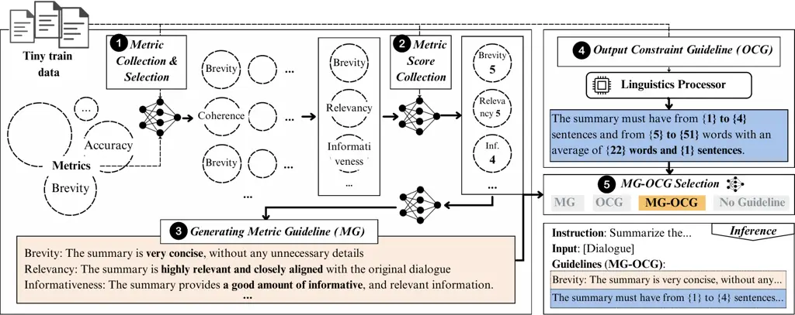

Figure 2: Overview of LongGuide. Orange and blue boxes denote the
learned metric guideline and output constraint guideline.

## 3 LongGuide: An Efficient Guideline Generation Algorithm

#### Motivations.

As we have seen, providing textual guidelines instructing LLMs to
optimize certain text property metrics can enhance them on responses,
possibly because LLMs are optimizers (Yang et al., 2024). We propose
LongGuide (Figure 2 and Algorithm 1), an algorithm that efficiently
generates guidelines for LLMs to optimize self-evaluated text properties
during generation. Specifically, Steps 1–3 focus on generating the
Metric Guideline (MG) capturing the intrinsic language properties of the
task via reference-free metrics. In parallel, Step 4 analyzes the answer
format of the task and translates it to Output Constraint Guideline
(OCG). The best combination of MG and OCG is selected for inference
(Step 5). To ensure LongGuide’s generalizability to new tasks, we assume
access to at most $`50`$ training samples:
$`D^{train}=\{(x^{t}_{i},y^{t}_{i})\}_{i=1}^{n}`$.

#### Step 1: Metric Collection & Selection.

To learn a task’s language properties, this step reasons to select
appropriate language evaluation metrics for self-evaluation. For this
purpose, we first construct a pool of evaluation metrics, $`S`$,
applicable to any text generation task. $`S`$ consists of $`27`$
distinct metrics from $`4`$ main sources (Appx.-Table 13 for details).
Specifically, we collect $`3`$ metrics from ABC’s of Communication
(Wagner, 1963), $`12`$ metrics from (Fu et al., 2023) for dialogue
generation, summarization, data2text generation, and machine
translation, and propose $`12`$ more metrics for a broader evaluation
coverage. We do not collect LM-based metrics, such as FactScore (Min
et al., 2023), because it is challenging for LLMs to define and
self-evaluate them. Additionally, we do not gather definitions of
collected metrics, as their interpretations may vary across different
tasks.

With $`D^{train}`$ and $`S`$, we then perform $`K`$ iterations to select
the metrics. At each iteration, we randomly sample a batch of data from
$`D^{train}`$ and instruct $`\mathcal{M}`$ to generate the top-5 most
important metrics in $`S`$ for evaluating batch data properties via
Chain-of-Thought prompting (Wei et al., 2022). We implement the top-5
constraint to avoid excessive metrics being selected. The final set of
selected metrics, denoted by $`M`$, consists of the metrics chosen
across all iterations _sorted in alphabetic order_.

#### Step 2: Metric Score Collection via Self-evaluation.

This step focuses on evaluating the selected metrics from $`M`$ on
$`D^{train}`$ to capture the task properties. Motivated by prior studies
(Wang et al., 2023a; Ren et al., 2023), we utilize $`\mathcal{M}`$ to
score the metrics on a scale of 1–5. Specifically, for each train
sample, $`\mathcal{M}`$ scores its ground-truth answer on all
$`\mathcal{M}`$’s metrics via Self-Consistency (Wang et al., 2022a). The
final metrics’ scores, denoted as $`scores_{M}`$, are the average of
scores over all train samples. Note that we separate this step from Step
1’s metric selection because we want to evaluate each chosen metric on
$`D^{train}`$ instead of the samples that led $`\mathcal{M}`$ to select
it.

|                |                 | SAMSum          |                |                      |                 | CNN             |                |                      |                 | SWiPE           |                |                      |
| -------------- | --------------- | --------------- | -------------- | -------------------- | --------------- | --------------- | -------------- | -------------------- | --------------- | --------------- | -------------- | -------------------- |
| Method         | R-L$`\uparrow`$ | B-1$`\uparrow`$ | BS$`\uparrow`$ | Avg.JS$`\downarrow`$ | R-L$`\uparrow`$ | B-1$`\uparrow`$ | BS$`\uparrow`$ | Avg.JS$`\downarrow`$ | R-L$`\uparrow`$ | B-1$`\uparrow`$ | BS$`\uparrow`$ | Avg.JS$`\downarrow`$ |
| Zero-shot (ZS) | 22.20           | 20.05           | 58.98          | 0.1014               | 19.23           | 20.43           | 60.59          | 0.1262               | 36.60           | 39.01           | 71.18          | 0.0565               |
| _+ OCG_        | 27.55           | 28.64           | 60.38          | 0.0402               | 22.46           | 27.82           | 61.37          | 0.0718               | 32.48           | 32.88           | 67.32          | 0.0650               |
| _+ MG_         | 27.81           | 28.81           | 60.06          | 0.0388               | 18.35           | 19.66           | 59.79          | 0.1413               | 38.21           | 40.83           | 70.87          | 0.0550               |
| _+ MG-OCG_     | 28.35           | 28.79           | 60.66          | 0.0375               | 22.05           | 26.97           | 61.18          | 0.0789               | 35.47           | 36.95           | 68.77          | 0.0554               |
| _+ LongGuide_  | 28.35           | 28.79           | 60.66          | 0.0375               | 22.46           | 27.82           | 61.37          | 0.0718               | 38.21           | 40.83           | 70.87          | 0.0550               |
| Few-shot (FS)  | 27.13           | 27.21           | 61.70          | 0.0502               | 17.56           | 20.55           | 57.74          | 0.0844               | 39.47           | 39.76           | 70.56          | 0.0469               |
| _+ OCG_        | 27.84           | 29.91           | 61.08          | 0.0336               | 15.20           | 17.58           | 58.12          | 0.0922               | 29.54           | 30.32           | 68.82          | 0.0596               |
| _+ MG_         | 27.50           | 30.15           | 62.24          | 0.0352               | 18.13           | 20.94           | 57.89          | 0.0830               | 41.36           | 41.22           | 71.14          | 0.0450               |
| _+ MG-OCG_     | 30.65           | 31.72           | 62.73          | 0.0318               | 19.19           | 22.30           | 57.95          | 0.0814               | 38.56           | 37.87           | 68.54          | 0.0529               |
| _+ LongGuide_  | 30.65           | 31.72           | 62.73          | 0.0318               | 19.19           | 22.30           | 57.95          | 0.0814               | 41.36           | 41.22           | 71.14          | 0.0450               |

Table 2: Mistral performance verifying LongGuide mitigates the text
property transfer (PT) problem (Section 2): (1) the trends of ROUGE-L
(R-L), BLEU-1 (B-1), BERTScore (BS), and Jensen–Shannon divergence (Avg.
JS) show strong correlations, supporting our hypothesis; (2) LongGuide
substantially enhances Avg. JS scores, thereby mitigating the PT
problem.

#### Step 3: Generating Metric Guideline (MG).

This step aims to generate a textual metric guideline (MG) that guides
$`\mathcal{M}`$ to align generation outputs with task-specific
properties from $`scores_{M}`$. MG is formed by concatenating metrics’
definitions generated by $`\mathcal{M}`$ and tailored by $`scores_{M}`$
via the LLM instruction “Based on these scores on a scale of 5…define
the expected quality of the output for each metric in natural language”.
We use these moderated definitions instead of raw $`scores_{M}`$ because
LLMs better capture contextual nuances through descriptions rather than
numerical scores (Singh and Strouse, 2024). Figure 2 illustrates an
instance where “Informativeness” in the task “dialogue sum.” achieving
$`4/5`$ score from Step 2 is defined as “…good amt. of informative…”.

#### Step 4: Output Constraint Guideline (OCG).

Research on controllable generation has extensively proposed constraints
including ones on the length, which are broadly applicable, as well as
linguistic or keyword, which are more task-specific (Fan et al., 2018a;
He et al., 2022). In this step, we aim to establish a robust set of
output constraints that apply universally to long-form generation tasks.
We focus on six key constraints related to two distributions: the number
of sentences and tokens in ground-truth answers. These constraints
include minimum, maximum, and average counts, serving as basic
statistics for length and expected values. The Output Constraint
Guideline (OCG) instructs $`\mathcal{M}`$ to adhere to these statistics
during generation.

#### Step 5: MG–OCG selection.

Models have varying inherent knowledge per task, resulting in different
improvements gained by using MG and OCG (Table 4). This step determines
the optimal MG and OCG combination by evaluating model performance on
$`D^{train}`$ across configurations. The best-performing guideline
configuration is then selected as the final output of LongGuide.

## 4 Experiments

#### Benchmarks.

We benchmark LongGuide on seven widely evaluated long-form generation
tasks from four main categories, _summarization, text simplification,
machine translation and generation_, and one real-life chat LLM
benchmark. These tasks are SAMSum (Gliwa et al., 2019), CNN/Daily Mail
(3.0.0) (See et al., 2017) and XL-SUM (Hasan et al., 2021) for
summarization, SWiPE (Laban et al., 2023) for text simplification,
IWSLT-2017 en-ja (Cettolo et al., 2017) for machine translation,
Synthetic-Persona-Chat (Jandaghi et al., 2023) for dialogue generation,
CommonGen-Challenge (Lin et al., 2020) for data-to-text generation, and
(a subset of) AlpacaEval2 (Dubois et al., 2024). We also benchmark the
reasoning tasks in Section E.3. See Appendix F for details.

#### Baselines and evaluations.

Since LongGuide is the first method to self-learn guidelines as
additional instructions for generation, we compare it with the
zero-/few-shot prompting baselines in this section, and many-shot
prompting in Section E.1. We also evaluate it against three of the
strongest prompt optimization algorithms to date: APO (Pryzant et al., 2023) in this section, and EvolPrompt (Guo et al., 2024) and adv-ICL (Do
et al., 2024) in Section D.3, both of which optimize the input prompt on
the $`D^{train}`$. We also compare LongGuide with “General Guidelines”
in Section 5.2 where we ask the models to reason over demonstrations to
generate task guidelines. For models, we empirically examine both strong
open- and closed-source LLMs: Mistral-7B-it v0.2 (Jiang et al., 2023) as
an open-source model and ChatGPT (gpt-3.5-turbo-1106) (OpenAI, 2022) as
a closed-source model. For evaluations, we use ROUGE-L (Lin, 2004)
(recall-based) following Bai et al. (2024) (also for LongGuide’s Step
5), and GPT-4o-Judge (OpenAI, 2024) as our main evaluation metrics. For
GPT-4o-Judge, we evaluate how aligned the generated answer is with the
reference answer and its quality on five criteria: _(i) Format
consistency_; _(ii) Content completeness_; _(iii) Factuality_; _(iv)
Style adherence_; _(v) Generation quality_ on a scale of 1–10, following
Zheng et al. (2023) (see Section G.1 for full prompt). We also report
BLEU-1 (Papineni et al., 2002) (precision-based), BERTScore (Zhang
et al., 2020) (meaning-based), and Human evaluation verifying the metric
optimization and generation quality in Section 5.1. The results are
averaged over three runs, with 95% CI of the t-test.

### 4.1 Findings

|                  |                |                     |                     |                      |                     |                     |                     |                      |
| ---------------- | -------------- | ------------------- | ------------------- | -------------------- | ------------------- | ------------------- | ------------------- | -------------------- |
|                  |                |                     | Sum.                |                      | Simplification      | Translation         | Dialogue Gen.       | Table2Text           |
|                  | Method         | SAMSum              | CNN (3.0.0)         | XL-Sum               | SWiPE               | IWSLT17 en-ja       | Syn. Persona        | Comm.-Chall.         |
|                  | \#shots (ran.) | 3                   | 3                   | 5                    | 3                   | 3                   | 5                   | 5                    |
| Mistral-it (0.2) | Zero-shot      | 22.20 / 7.43        | 19.23 / 7.38        | 9.19 / 5.96          | 36.60 / 7.21        | 13.12 / 2.82        | 12.76 / 2.68        | 10.12 / 5.14         |
|                  | \+ APO         | 23.77 / 7.31        | 19.53 / 7.40        | 12.06 / 5.85         | 36.92 / 7.21        | 14.45 / 2.91        | 10.66 / 2.41        | 11.21 / 4.68         |
|                  | _+ LongGuide_  | 28.35 / 7.73        | 22.46 / 7.45        | 14.38 / 6.29         | 38.21 / 7.32        | 16.53 / 3.45        | 14.69 / 4.45        | 25.20 / 6.81         |
|                  | _% gain (+)_   | $`6.15`$ / $`0.30`$ | $`3.23`$ / $`0.07`$ | $`5.19`$ / $`0.33`$  | $`1.61`$ / $`0.11`$ | $`3.41`$ / $`0.63`$ | $`1.93`$ / $`1.77`$ | $`15.08`$ / $`1.67`$ |
|                  | Few-shot       | 27.13 / 7.66        | 17.56 / 5.84        | 9.79 / 4.46          | 39.47 / 7.12        | 12.69 / 2.66        | 3.56 / 1.00         | 3.98 / 1.34          |
|                  | \+ APO         | 26.23 / 7.44        | 18.18 / 5.89        | 11.99 / 4.55         | 39.55 / 7.11        | 14.08 / 2.92        | 4.26 / 1.05         | 5.45 / 2.05          |
|                  | _+ LongGuide_  | 30.65 / 7.72        | 19.19 / 5.99        | 15.23 / 5.06         | 41.36 / 7.24        | 16.62 / 3.40        | 5.25 / 3.93         | 25.05 / 6.65         |
|                  | _% gain (+)_   | $`3.52`$ / $`0.06`$ | $`1.63`$ / $`0.15`$ | $`5.44`$ / $`0.40`$  | $`1.89`$ / $`0.12`$ | $`3.66`$ / $`0.74`$ | $`1.69`$ / $`2.93`$ | $`21.07`$ / $`5.31`$ |
| ChatGPT          | Zero-shot      | 23.83 / 7.43        | 20.12 / 7.44        | 10.80 / 5.96         | 45.09 / 7.28        | 36.13 / 7.62        | 19.46 / 6.04        | 24.21 / 6.53         |
|                  | \+ APO         | 25.05 / 7.45        | 20.34 / 7.39        | 12.19 / 6.07         | 46.32 / 7.51        | 37.74 / 7.44        | 19.91 / 6.12        | 23.63 / 6.53         |
|                  | _+ LongGuide_  | 30.47 / 7.59        | 22.19 / 7.67        | 20.93 / 6.36         | 45.09 / 7.28        | 41.22 / 8.11        | 22.98 / 6.41        | 34.41 / 7.23         |
|                  | _% gain (+)_   | $`6.64`$ / $`0.16`$ | $`2.07`$ / $`0.23`$ | $`10.13`$ / $`0.40`$ | $`0.00`$ / $`0.00`$ | $`5.09`$ / $`0.49`$ | $`3.52`$ / $`0.37`$ | $`10.20`$ / $`0.70`$ |
|                  | Few-shot       | 22.21 / 7.32        | 14.51 / 4.38        | 11.42 / 5.95         | 33.72 / 5.07        | 31.93 / 7.25        | 16.10 / 4.67        | 22.08 / 4.19         |
|                  | \+ APO         | 24.22 / 7.28        | 15.20 / 4.01        | 14.07 / 6.19         | 34.46 / 5.13        | 33.72 / 7.31        | 17.68 / 4.55        | 25.09 / 6.12         |
|                  | _+ LongGuide_  | 31.46 / 7.72        | 18.17 / 4.42        | 19.95 / 6.36         | 37.60 / 5.25        | 38.43 / 7.91        | 22.36 / 5.26        | 38.21 / 7.21         |
|                  | _% gain (+)_   | $`9.25`$ / $`0.40`$ | $`3.66`$ / $`0.04`$ | $`8.53`$ / $`0.41`$  | $`3.88`$ / $`0.18`$ | $`6.50`$ / $`0.66`$ | $`6.53`$ / $`0.59`$ | $`16.13`$ / $`3.02`$ |

Table 3: ROUGE-L / GPT-4o-Judge results on seven long-form generation
tasks. LongGuide remarkably outperforms baselines on most tasks and
substantially enhances LLMs. BLUE-1 scores are reported in Appx.-10.

#### LongGuide enhances PT which correlates with improved performance.

LongGuide effectively addresses the PT problem identified in Section 2.
Our experiments are conducted on $`3`$ benchmarks SAMSum, CNN, and SWiPE
with Mistral under the zero-shot and few-shot settings. For each task,
we first obtain the set of selected text properties from LongGuide that
the model needs to optimize. We then measure the average of
Jensen-Shannon divergence (Lin, 1991) between their score distributions
(judged by ChatGPT) between the generated answers and the ground truth
answers, across all selected properties, denoted as $`Avg.JS`$.

The results are presented in Table 2. LongGuide significantly lowers the
$`Avg.JS`$ scores compared to the baselines, demonstrating the
effectiveness of guidelines for enhancing property transfer.
Furthermore, our findings corroborate our hypothesis: across benchmarks,
$`Avg.JS`$ exhibits moderate to strong positive correlations with the
performance metrics (ROUGE-L, BLEU-1, BERTScore) measured by the Pearson
correlation coefficient (Pearson, 1895) (Appx.-Figure 9). In
Section E.7, we present the density plots for all metrics measured on
the results with and without LongGuide.

Table 3 details our main experiment results on downstream tasks.
Firstly, for baselines, zero-shot performance is interestingly higher
than the few-shot for both models, and the gaps are huge for Synthetic
Persona and CommonGen-Challenge. We hypothesize that models were partly
exposed to task data during training, causing few-shot demonstrations to
push the prompts out of distribution, leading to frequent refusals to
answer. Meanwhile, LongGuide helps models overcome this issue. Secondly,
LongGuide substantially improves zero- and few-shot baselines by 6% on
ROUGE-L and 0.8 on GPT-4o-Judge on average: improvement for few-shot
prompting is surprisingly higher than in zero-shot, possibly because
improving a stronger baseline is harder than a weaker one. Notably,
LongGuide outperforms APO in most benchmarks, especially under the
zero-shot setting, demonstrating that our strategy of optimizing text
property tasks is markedly more effective than APO optimizing only
ROUGE-L on limited data. Thirdly, we observe that LongGuide achieves the
highest improvements on CommonGen-Challenge with $`15.62\%`$ and lowest
on SWiPE with $`1.85\%`$ on ROUGE-L. These improvements are mainly
because the answers generated by the baselines are often far longer than
the ground truth. LongGuide rectifies this issue by controlling the
output length and quality, leading to substantial performance gains.
Fourthly, among the two models, LongGuide interestingly improves Mistral
by $`5.39\%`$, while ChatGPT, regarded as stronger, improves by a larger
margin, $`6.58\%`$. This suggests that LongGuide has the potential to
benefit stronger models in the future. Among five GPT-4o-Judge criteria
in Figure 3, LongGuide notably improves Format, Style, and Factuality,
confirming its effectiveness in aligning model generation with
ground-truth distributions. Finally, the significant gains in Quality,
together with the ROUGE-L scores from Table 3 further verify that
LongGuide also strongly enhances the generation quality.

Figure 3: GPT-4-Judge scores over criteria.

|                     |                            |                              |                            |                              |                              |                              |                            |                            |
| ------------------- | -------------------------- | ---------------------------- | -------------------------- | ---------------------------- | ---------------------------- | ---------------------------- | -------------------------- | -------------------------- |
|                     | Method                     | SAMSum                       | CNN (3.0.0)                | XL-Sum                       | SWiPE                        | IWSLT17 en-ja                | Synthetic Persona          | CommGen-Chall.             |
| Mistral-7B-it (0.2) | Zero-shot (ZS)             | 22.20\_(±0.43)               | 19.23\_(±0.34)             | 9.19\_(±0.03)                | 36.60\_(±0.59)               | 13.12\_(±1.39)               | 12.76\_(±1.54)             | 10.12\_(±0.02)             |
| _+ OCG_             | 27.55\_(±0.98)$`\uparrow`$ | 22.46\_(±0.64)$`\uparrow`$   | 14.38\_(±0.15)$`\uparrow`$ | 32.48\_(±1.91)$`\downarrow`$ | 16.53\_(±0.59)$`\uparrow`$   | 14.35\_(±0.47)$`\uparrow`$   | 24.16\_(±0.11)$`\uparrow`$ |                            |
| _+ MG_              | 27.81\_(±1.17)$`\uparrow`$ | 18.35\_(±0.60)$`\downarrow`$ | 9.37\_(±0.25)$`\uparrow`$  | 38.21\_(±1.72)$`\uparrow`$   | 8.71\_(±0.53)$`\downarrow`$  | 12.53\_(±0.58)$`\downarrow`$ | 21.54\_(±7.50)$`\uparrow`$ |                            |
| _+ MG-OCG_          | 28.35\_(±1.66)$`\uparrow`$ | 22.05\_(±0.84)$`\uparrow`$   | 13.64\_(±0.38)$`\uparrow`$ | 35.47\_(±2.89)$`\downarrow`$ | 15.76\_(±1.85)$`\uparrow`$   | 14.69\_(±1.08)$`\uparrow`$   | 25.20\_(±1.89)$`\uparrow`$ |                            |
| _MG-OCG sel._       | _MG-OCG_                   | _OCG_                        | _OCG_                      | _MG_                         | _OCG_                        | _MG-OCG_                     | _MG-OCG_                   |                            |
| Few-shot (FS)       | 27.13\_(±0.26)             | 17.56\_(±0.63)               | 9.79\_(±0.18)              | 39.47\_(±0.45)               | 12.69\_(±1.82)               | 3.56\_(±0.36)                | 3.98\_(±0.17)              |                            |
| _+ OCG_             | 27.84\_(±0.88)$`\uparrow`$ | 15.20\_(±5.28)$`\downarrow`$ | 12.22\_(±1.19)$`\uparrow`$ | 29.54\_(±1.90)$`\downarrow`$ | 16.62\_(±0.81)$`\uparrow`$   | 5.06\_(±1.05)$`\uparrow`$    | 25.05\_(±0.76)$`\uparrow`$ |                            |
| _+ MG_              | 27.50\_(±2.08)$`\uparrow`$ | 18.13\_(±5.28)$`\uparrow`$   | 11.80\_(±2.06)$`\uparrow`$ | 41.36\_(±1.37)$`\uparrow`$   | 8.67\_(±0.62)$`\downarrow`$  | 4.32\_(±0.39)$`\uparrow`$    | 14.58\_(±2.24)$`\uparrow`$ |                            |
| _+ MG-OCG_          | 30.65\_(±0.88)$`\uparrow`$ | 19.19\_(±0.49)$`\uparrow`$   | 15.23\_(±0.33)$`\uparrow`$ | 38.56\_(±1.39)$`\downarrow`$ | 15.83\_(±0.95)$`\uparrow`$   | 5.25\_(±0.94)$`\uparrow`$    | 5.94\_(±1.00)$`\uparrow`$  |                            |
| _MG-OCG Sel._       | _MG-OCG_                   | _MG-OCG_                     | _MG-OCG_                   | _MG_                         | _OCG_                        | _MG-OCG_                     | _OCG_                      |                            |
| ChatGPT (1106)      | Zero-shot (ZS)             | 23.83\_(±0.54)               | 20.12\_(±0.27)             | 10.80\_(±0.18)               | 45.09\_(±1.45)               | 36.13\_(±0.87)               | 19.46\_(±0.40)             | 24.21\_(±0.37)             |
|                     | _+ OCG_                    | 29.19\_(±0.77)$`\uparrow`$   | 22.39\_(±0.82)$`\uparrow`$ | 20.93\_(±0.52)$`\uparrow`$   | 37.76\_(±1.44)$`\downarrow`$ | 38.86\_(±1.11)$`\uparrow`$   | 22.98\_(±2.65)$`\uparrow`$ | 34.41\_(±1.01)$`\uparrow`$ |
|                     | _+ MG_                     | 25.38\_(±0.79)$`\uparrow`$   | 20.37\_(±0.41)$`\uparrow`$ | 10.42\_(±1.15)$`\downarrow`$ | 45.06\_(±2.96)$`\downarrow`$ | 37.88\_(±2.42)$`\uparrow`$   | 19.91\_(±0.59)$`\uparrow`$ | 17.23\_(±2.57)             |
|                     | _+ MG-OCG_                 | 30.47\_(±1.57)$`\uparrow`$   | 22.19\_(±0.65)$`\uparrow`$ | 20.02\_(±0.89)$`\uparrow`$   | 41.38\_(±4.91)$`\downarrow`$ | 41.22\_(±0.46)$`\uparrow`$   | 20.95\_(±1.91)$`\uparrow`$ | 31.57\_(±0.99)$`\uparrow`$ |
|                     | _MG-OCG Sel._              | _MG-OCG_                     | _MG-OCG_                   | _OCG_                        | _ZS_                         | _MG-OCG_                     | _MG-OCG_                   | _OCG_                      |
|                     | Few-shot (FS)              | 22.21\_(±2.35)               | 14.51\_(±0.80)             | 11.42\_(±0.13)               | 33.72\_(±2.61)               | 31.93\_(±1.88)               | 16.10\_(±2.61)             | 22.08\_(±0.63)             |
|                     | _+ OCG_                    | 30.00\_(±1.07)$`\uparrow`$   | 18.17\_(±1.32)$`\uparrow`$ | 19.95\_(±1.38)$`\uparrow`$   | 16.68\_(±1.29)$`\downarrow`$ | 38.57\_(±1.81)$`\uparrow`$   | 22.36\_(±0.89)$`\uparrow`$ | 38.12\_(±1.99)$`\uparrow`$ |
|                     | _+ MG_                     | 29.43\_(±0.83)$`\uparrow`$   | 15.45\_(±2.16)$`\uparrow`$ | 12.49\_(±0.59)$`\uparrow`$   | 19.36\_(±1.40)$`\downarrow`$ | 39.45\_(±3.55)$`\uparrow`$   | 18.64\_(±0.49)$`\uparrow`$ | 22.18\_(±7.50)$`\uparrow`$ |
|                     | _+ MG-OCG_                 | 31.46\_(±1.34)$`\uparrow`$   | 14.84\_(±2.58)$`\uparrow`$ | 18.58\_(±0.44)$`\uparrow`$   | 37.60\_(±2.85)$`\uparrow`$   | 38.43\_(±2.37)$`\uparrow`$   | 19.47\_(±1.20)$`\uparrow`$ | 38.21\_(±3.70)$`\uparrow`$ |
|                     | _MG-OCG Sel._              | _MG-OCG_                     | _OCG_                      | _OCG_                        | _MG-OCG_                     | _MG-OCG_                     | _OCG_                      | _MG-OCG_                   |

Table 4: ROUGE-L results with 95% CI from t-test. The gains of
LongGuide’s components vary across different models and tasks. The
“MG-OCG selection” results are reported in Appx.-Table 14.

#### Where do the enhancements come from?

To identify the primary source of performance gains, we present the
results of LLMs with LongGuide’s components in Table 4. Firstly, MG-OCG
combination (w/ MG-OCG) is the most useful for LLMs, observed to be the
best $`15`$ times, followed by OCG (w/ OCG) with $`10`$, and MG (w/ MG)
twice. While these statistics underscore the effectiveness of MG-OCG,
OCG particularly proves itself highly effective in tasks such as
summarization, translation, and table-to-text generation. Secondly,
individual MG or OCG strengthens the prompting baselines, with OCG
showing a slight edge. This is because while MG focuses on the language
properties of answers, it does not directly control the output format,
sometimes causing longer/shorter answers than the ground truths.
Exceptionally, on SWiPE, OCG harms all models, whereas MG shows notably
strong effectiveness with Mistral. Manual investigations reveal that
ground-truth answers in SWiPE exhibit high variances in \#sentences and
\#tokens which explains why OCG may not be effective for this benchmark.
Thirdly, an interesting case is ChatGPT with few-shot prompting on
SWiPE, where individual MG and OCG impair performance but their
combination enhances it. This shows evidence that MG and OCG complement
each other. As discussed above, due to the uneven nature of answers in
SWiPE, using MG or OCG alone may not work well for multiple samples, as
MG and OCG only provide expected statistics. However, combining them
could enhance performance by allowing them to complement each other. A
such complement SWiPE example is outlined in Appx.-Figure 16.

## 5 Discussion

We address several key questions about the usefulness, applicability,
and generalizability of LongGuide. Additional properties are provided in
Appendix D and more method and attention analyses in Appendix E.

### 5.1 Human Evaluation: Does LongGuide Enhance Generation Quality?

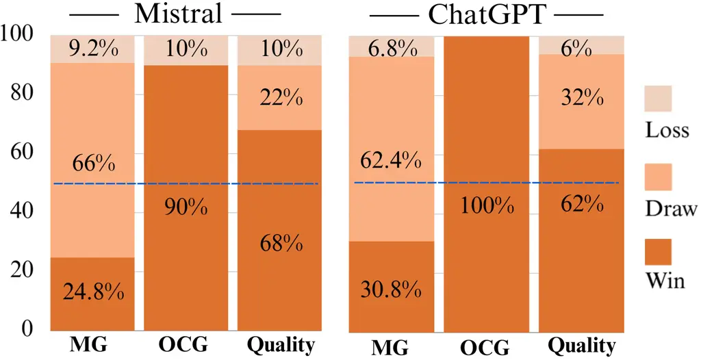

Figure 4: Win/Draw/Loss rates of w/ versus w/o LongGuide.

We perform a human evaluation to quantify whether LongGuide helps LLMs
optimize the selected metrics and enhance generation quality, as no
automatic methods can address this need to date. For this purpose, we
randomly select 50 zero-shot generated samples from the SAMSum and Syn.
Persona (since MG-OCG is the best for these datasets, Table 4). Three
excellent English-native undergrads are hired to rate whether ZS +
LongGuide improves ZS on each of the selected MG and OCG metrics. Due to
limited resources, we evaluate $`5`$ random MG metrics.

As shown in Figure 4, we notice that ZS + LongGuide outperforms ZS on
27.8% MG metrics on average, draws on 64.2%, and loses on only 8%.
Specifically, among the MG metrics, “Brevity” shows the highest winning
rate of $`73\%`$ while “Relevance” obtains the lowest winning rate of
$`12\%`$, possibly because ZS models can already generate highly
relevant outcomes. Meanwhile, on the OCG metrics, LongGuide achieves a
superior win of $`95\%`$ on average. Finally, regarding the generation
quality, our annotators prefer LongGuide output by up to $`92\%`$. These
indicate that LongGuide not only aligns the outputs with the ground
truths but also enhances the generation quality. The fine-grained scores
of MG metrics are provided in Section E.10, and annotator agreement
(Krippendorff’s alpha (Krippendorff, 2022)) is $`\alpha`$=68.9%.

### 5.2 LongGuide Learns From Demonstrations To Boost ICL Performance

Figure 5: LongGuide learned from demonstrations substantially enhances
Mistral performance (ROUGE-L).

Here, we revisit the question posed in Section 2 and verify that
LongGuide learned from demonstrations substantially increases ICL
performance. Our experiments using Mistral cover CNN, IWSLT17 en-ja, and
CommGen-Chall datasets. Our experiments involve averaging the
performance under zero- and few-shot settings. For Baseline, no
guideline is utilized. For LongGuide on Demos, we train LongGuide on
demonstrations used in Table 3, in contrast to the $`D^{train}`$ for the
case of LongGuide. We add one more baseline, General Guidelines (Gen.
Gui.) on Demos, where we ask the models to generate general task
guidelines from demonstrations.

The results are summarized in Figure 5, with details in Appx.-Table 15.
Specifically, LongGuide trained on $`D^{train}`$ outperforms it on
demonstrations, suggesting its possible scalability with more training
data. Moreover, while Gen. Gui. slightly worsens the Baseline on CNN,
both LongGuide and LongGuide on Demos notably surpass the Baseline, and
Gen. Gui., highlighting the effectiveness of LongGuide in capturing
task-specific properties, thereby boosting ICL performance.

### 5.3 Ablation Studies of LongGuide’s Steps

|                         |              |              |                |
| ----------------------- | ------------ | ------------ | -------------- |
| Methods                 | SAMSum       | SWiPE        | CommGen-Chall. |
| Zero-shot (ZS)          | 22.20 / 7.43 | 36.60 / 7.21 | 10.12 / 5.14   |
| _+ LongGuide_           | 28.35 / 7.73 | 38.21 / 7.32 | 25.20 / 6.81   |
| \+ LongGuide w/o step 2 | 26.99 / 7.49 | 36.90 / 7.22 | 25.03 / 6.66   |
| Few-shot (FS)           | 27.13 / 7.66 | 39.47 / 7.12 | 3.98 / 1.34    |
| _+ LongGuide_           | 30.65 / 7.72 | 41.36 / 7.24 | 25.05 / 6.65   |
| \+ LongGuide w/o step 2 | 30.37 / 7.70 | 35.54 / 6.28 | 24.15 / 5.82   |

Table 5: Mistral ROUGE-L / GPT-4o-Judge main ablation study with
LongGuide when Step 2 is skipped.

From Table 4, we identify the unique contributions of each step within
LongGuide. Specifically, omitting Step 1 transforms it into OCG, whereas
excluding Step 3 yields MG, and skipping Step 4 becomes MG-OCG. Here, we
investigate LongGuide effectiveness when skipping Step 2, Metrics’
scores collection: for selected metrics from Step 1, we directly task
the models to optimize them for the generated answers. We experiment
with Mistral on SAMSum, SWiPE, and CommGen-Chall. datasets because for
these datasets, the best guideline combination includes MG.

The results in Table 5 verify that without Step 2, the model performs
worse, particularly for SAMSum and SWiPE in the zero-shot setting. We
attribute these drops to the incorrect task properties captured and
metric conflicts. A case study is provided in Appx.-Figure 18.

### 5.4 LongGuide on Real-Life Chat LLM Benchmark

| Methods        | LC Win Rate | Win Rate |
| -------------- | ----------- | -------- |
| Zero-shot (ZS) | 11.08%      | 3.17%    |
| \+ OCG         | 4.73%       | 2.44%    |
| \+ MG          | 19.13%      | 7.07%    |
| \+ MG-OCG      | 8.42%       | 3.90%    |
| + LongGuide    | 19.13%      | 7.07%    |
| Few-shot (FS)  | 8.08%       | 2.68%    |
| \+ OCG         | 7.73%       | 3.45%    |
| \+ MG          | 12.65%      | 4.88%    |
| \+ MG-OCG      | 12.63%      | 4.88%    |
| + LongGuide    | 12.65%      | 4.88%    |

Table 6: AlpacaEval2 experiments.

We evaluate the effectiveness of LongGuide in aligning LLMs with desired
real-world chats. Our experiments are conducted on a subset of 203
random samples from the AlpacaEval2 benchmark (Dubois et al., 2024) with
ChatGPT (1106). Since AlpacaEval2 lacks training data, we select 5
random samples from the public Alpaca-GPT4 instruction-tuning dataset
([alpaca-gpt4](https://huggingface.co/datasets/vicgalle/alpaca-gpt4?row=4)),
despite it being relatively out-of-distribution (OOD) compared to
AlpacaEval2.

Table 6 presents our findings. Few-shot demonstrations and OCG
negatively impact performance, likely due to the OOD nature of
Alpaca-GPT4 compared to AlpacaEval2. In contrast, with just $`5`$
Alpaca-GPT4 samples, MG metrics, and LongGuide enhance performance by
capturing certain response properties from GPT-4 (OpenAI, 2023), nearly
doubling the zero-shot points.

## 6 Related Work

#### Automatic prompt design for long-form generation.

Long-form generation tasks are essential and have been studied
extensively (Li et al., 2024). With LLM advancements, adapting these
models for such tasks using prompt-based methods is critical yet
challenging. Previous studies (Bang et al., 2023; Yang et al., 2023a;
Hadi et al., 2023; Zhou et al., 2023b; Pan et al., 2024) highlight the
limited efficacy of LLMs in producing outputs that resemble ground
truths, as evaluated by ROUGE-L (Lin, 2004). Our approach autonomously
composes supplementary contexts, integrating text evaluation metrics and
format constraints. In addition, studies regarding enhancing
instructions for LLMs (Wang et al., 2022b; Yin et al., 2023; Long
et al., 2024; Wang et al., 2023b), automatic prompt optimization (Zhou
et al., 2023a; Pryzant et al., 2023), and demonstration selection (Yang
et al., 2023b; Qin et al., 2023) are also related areas that can be
developed in parallel and combined with our work (Section D.3).

#### Controllable generation with LLMs.

Controllable generation during fine-tuning has been studied extensively
(Fan et al., 2018a; Lakew et al., 2019; Martin et al., 2020; He et al.,
2022). More recently, researchers have explored prompting methods to
control LLM generation. For instance, Sun et al. (2023b) found that LLMs
struggle to meet fine-grained hard constraints, while Fonseca and Cohen
(2024) proposed controlling stylistic features like keywords and
narrative during generation, leading to improved LLM summarization
outcomes. Although (Lu et al., 2023; Fonseca and Cohen, 2024) are
closely related to our OCG, our approach goes beyond summarization and
open-ended only features, as discussed in Section 3. We focus on
universally applicable features.

## 7 Conclusion

In this paper, we demonstrate that in-context learning (ICL) falls short
in implicitly ensuring that large language models (LLMs) consistently
preserve essential language and format properties in long-form
generation tasks. To address this challenge, we introduce LongGuide, an
efficient algorithm that automatically learns the critical language and
format properties from task-specific data, converting them into textual
guidelines for LLMs. Our results show that LongGuide significantly
improves LLM performance across seven generation tasks and is highly
generalizable, offering strong potential for various downstream
applications with minimal data. This work paves the way for adaptive,
task-specific prompt generation, advancing LLM adaptation.

## Generalizability and Customization of LongGuide

LongGuide facilitates flexible generalization that allows customization
and extension of guidelines MG and OCG for specific tasks, which we
strongly recommend. For instance, in summarization, MG can focus on only
4-5 standard metrics from $`S`$ while integrating summary-specific
metrics like “Summary Structure” and “Retention of Core Supporting
Evidence.” Simultaneously, OCG can impose stricter constraints on
topics, keywords, grammar, or tones (Fan et al., 2018a; Lakew et al.,
2019; Martin et al., 2020). Although LongGuide is primarily presented
for general long-form generation, we strongly advise for these
customizations to enhance its effectiveness.

## Limitations

Our study has several limitations. Firstly, our theoretical analysis
focuses solely on the task language distribution which is
$`P_{\mathcal{M}}(X)`$ or $`P_{\mathcal{M}}(X|D_{f})`$ instead of the
actual output distribution, which is
$`\arg\max_{y\in\mathcal{Y}}P_{\mathcal{M}}(Y=y\mid X)`$ or
$`\arg\max_{y\in\mathcal{Y}}P_{\mathcal{M}}(Y=y\mid D_{f},X)`$. In our
study, while leveraging the task language distribution allows us to
hypothesize and highlight the limitations of demonstrations, shifting
focus to the actual output distribution could yield more insights.

Secondly, LongGuide’s learned guidelines are based on task-level and
average statistics rather than sample-based details. We designed our
framework at the task level to address limited data constraints, as we
found that sample-based learning under these conditions leads to high
errors. While task-level guidelines already demonstrate significant
improvements for LLMs, sample-based guidelines could offer more tailored
guidance, potentially leading to optimal results. Moreover, this average
guidance approach may be ineffective for tasks with high variance in the
statistics that LongGuide learns. In such cases, the final step of
LongGuide can prevent performance decline by likely choosing no
guideline. For example, we found this applies to Code2Text (Richardson
et al., 2017) & StoryGeneration (Fan et al., 2018b).

Thirdly, LongGuide relies on models having a certain level of task
knowledge to perform self-evaluation effectively, and LongGuide
necessitates LLMs with strong instruction-following capabilities.
However, we anticipate that cutting-edge AI language models will
overcome this limitation both now and in the near future.

Lastly, the guidelines learned by LongGuide may not be useful for the
tasks the models are trained on. This is because these guidelines might
introduce out-of-distribution context relative to the training data,
thereby reducing the effectiveness of the testing inference. For
instance, while we see notable enhancements on the CommonGen-Challenge
dataset (Lin et al., 2020), it’s intriguing that we don’t observe any
improvements on the WebNLG (Gardent et al., 2017) and E2E NLG (Puzikov
and Gurevych, 2018) datasets, despite their expected similarity. Given
the popularity of these datasets, we suspect the models we tested may
have been previously trained on them.

## Ethical Considerations

This method could be misused to optimize prompts for harmful purposes
such as generating misinformation, hate speech, or privacy violations.
While our method is not intended for such uses, it is impossible to
completely prevent misuse. Although our method could enhance the
efficiency and efficacy of bad actors, we do not anticipate that
LongGuide is inherently more effective in these negative contexts than
in positive applications. Finally, we employ annotators at an hourly
rate of \$20, which exceeds the local minimum wage requirements.

## Acknowledgement

This research is supported by the National Research Foundation Singapore
under the AI Singapore Programme (AISG Award No: AISG2-GC-2022-005, AISG
Award No: AISG2-TC2023-010-SGIL) and the Singapore Ministry of Education
Academic Research Fund Tier 1 (Award No: T1 251RES2207). DXL is
supported by the A\*STAR Computing and Information Science (ACIS)
scholarship. We thank members of WING and Deep Learning Lab at NUS and
the ACL RR anonymous reviewers for the constructive feedback.

## References

- Bai et al. (2024) Yushi Bai, Xin Lv, Jiajie Zhang, Hongchang Lyu,
  Jiankai Tang, Zhidian Huang, Zhengxiao Du, Xiao Liu, Aohan Zeng, Lei
  Hou, Yuxiao Dong, Jie Tang, and Juanzi Li. 2024. [LongBench: A
  bilingual, multitask benchmark for long context
  understanding](https://doi.org/10.18653/v1/2024.acl-long.172). In
  _Proceedings of the 62nd Annual Meeting of the Association for
  Computational Linguistics (Volume 1: Long Papers)_, pages 3119–3137,
  Bangkok, Thailand. Association for Computational Linguistics.
- Bang et al. (2023) Yejin Bang, Samuel Cahyawijaya, Nayeon Lee,
  Wenliang Dai, Dan Su, Bryan Wilie, Holy Lovenia, Ziwei Ji, Tiezheng
  Yu, Willy Chung, Quyet V. Do, Yan Xu, and Pascale Fung. 2023. [A
  multitask, multilingual, multimodal evaluation of ChatGPT on
  reasoning, hallucination, and
  interactivity](https://doi.org/10.18653/v1/2023.ijcnlp-main.45). In
  _Proceedings of the 13th International Joint Conference on Natural
  Language Processing and the 3rd Conference of the Asia-Pacific Chapter
  of the Association for Computational Linguistics (Volume 1: Long
  Papers)_, pages 675–718, Nusa Dua, Bali. Association for Computational
  Linguistics.
- Bird and Loper (2004) Steven Bird and Edward Loper. 2004. [NLTK: The
  natural language toolkit](https://aclanthology.org/P04-3031). In
  _Proceedings of the ACL Interactive Poster and Demonstration
  Sessions_, pages 214–217, Barcelona, Spain. Association for
  Computational Linguistics.
- Brown et al. (2020) Tom Brown, Benjamin Mann, Nick Ryder, Melanie
  Subbiah, Jared D Kaplan, Prafulla Dhariwal, Arvind Neelakantan, Pranav
  Shyam, Girish Sastry, Amanda Askell, et al. 2020. Language models are
  few-shot learners. _Advances in neural information processing
  systems_, 33:1877–1901.
- Cettolo et al. (2017) Mauro Cettolo, Marcello Federico, Luisa
  Bentivogli, Jan Niehues, Sebastian Stüker, Katsuhito Sudoh, Koichiro
  Yoshino, and Christian Federmann. 2017. [Overview of the IWSLT 2017
  evaluation campaign](https://aclanthology.org/2017.iwslt-1.1). In
  _Proceedings of the 14th International Conference on Spoken Language
  Translation_, pages 2–14, Tokyo, Japan. International Workshop on
  Spoken Language Translation.
- Cheng et al. (2024) Daixuan Cheng, Shaohan Huang, and Furu Wei. 2024.
  [Adapting large language models via reading
  comprehension](https://openreview.net/forum?id=y886UXPEZ0). In _The
  Twelfth International Conference on Learning Representations_.
- Chowdhery et al. (2022) Aakanksha Chowdhery, Sharan Narang, Jacob
  Devlin, Maarten Bosma, Gaurav Mishra, Adam Roberts, Paul Barham,
  Hyung Won Chung, Charles Sutton, Sebastian Gehrmann, Parker Schuh,
  Kensen Shi, Sasha Tsvyashchenko, Joshua Maynez, Abhishek Rao, Parker
  Barnes, Yi Tay, Noam M. Shazeer, Vinodkumar Prabhakaran, Emily Reif,
  Nan Du, Benton C. Hutchinson, Reiner Pope, James Bradbury, Jacob
  Austin, Michael Isard, Guy Gur-Ari, Pengcheng Yin, Toju Duke, Anselm
  Levskaya, Sanjay Ghemawat, Sunipa Dev, Henryk Michalewski, Xavier
  García, Vedant Misra, Kevin Robinson, Liam Fedus, Denny Zhou, Daphne
  Ippolito, David Luan, Hyeontaek Lim, Barret Zoph, Alexander
  Spiridonov, Ryan Sepassi, David Dohan, Shivani Agrawal, Mark Omernick,
  Andrew M. Dai, Thanumalayan Sankaranarayana Pillai, Marie Pellat,
  Aitor Lewkowycz, Erica Moreira, Rewon Child, Oleksandr Polozov,
  Katherine Lee, Zongwei Zhou, Xuezhi Wang, Brennan Saeta, Mark Díaz,
  Orhan Firat, Michele Catasta, Jason Wei, Kathleen S. Meier-Hellstern,
  Douglas Eck, Jeff Dean, Slav Petrov, and Noah Fiedel. 2022. [Palm:
  Scaling language modeling with
  pathways](https://api.semanticscholar.org/CorpusID:247951931). _J.
  Mach. Learn. Res._, 24:240:1–240:113.
- Cobbe et al. (2021) Karl Cobbe, Vineet Kosaraju, Mohammad Bavarian,
  Mark Chen, Heewoo Jun, Lukasz Kaiser, Matthias Plappert, Jerry Tworek,
  Jacob Hilton, Reiichiro Nakano, et al. 2021. Training verifiers to
  solve math word problems. _arXiv preprint arXiv:2110.14168_.
- Do et al. (2024) Xuan Long Do, Yiran Zhao, Hannah Brown, Yuxi Xie,
  James Xu Zhao, Nancy F. Chen, Kenji Kawaguchi, Michael Shieh, and
  Junxian He. 2024. [Prompt optimization via adversarial in-context
  learning](https://doi.org/10.18653/v1/2024.acl-long.395). In
  _Proceedings of the 62nd Annual Meeting of the Association for
  Computational Linguistics (Volume 1: Long Papers)_, pages 7308–7327,
  Bangkok, Thailand. Association for Computational Linguistics.
- Dong et al. (2022) Qingxiu Dong, Lei Li, Damai Dai, Ce Zheng, Zhiyong
  Wu, Baobao Chang, Xu Sun, Jingjing Xu, and Zhifang Sui. 2022. A survey
  on in-context learning. _arXiv preprint arXiv:2301.00234_.
- Dubey et al. (2024) Abhimanyu Dubey, Abhinav Jauhri, Abhinav Pandey,
  Abhishek Kadian, Ahmad Al-Dahle, Aiesha Letman, Akhil Mathur, Alan
  Schelten, Amy Yang, Angela Fan, Anirudh Goyal, Anthony S. Hartshorn,
  Aobo Yang, Archi Mitra, Archie Sravankumar, Artem Korenev, Arthur
  Hinsvark, Arun Rao, Aston Zhang, Aurelien Rodriguez, Austen Gregerson,
  Ava Spataru, Baptiste Rozière, Bethany Biron, Binh Tang, Bobbie Chern,
  Charlotte Caucheteux, Chaya Nayak, Chloe Bi, Chris Marra, Chris
  McConnell, Christian Keller, Christophe Touret, Chunyang Wu, Corinne
  Wong, Cristian Cantón Ferrer, Cyrus Nikolaidis, Damien Allonsius,
  Daniel Song, Danielle Pintz, Danny Livshits, David Esiobu, Dhruv
  Choudhary, Dhruv Mahajan, Diego Garcia-Olano, Diego Perino, Dieuwke
  Hupkes, Egor Lakomkin, Ehab A. AlBadawy, Elina Lobanova, Emily Dinan,
  Eric Michael Smith, Filip Radenovic, Frank Zhang, Gabriele Synnaeve,
  Gabrielle Lee, Georgia Lewis Anderson, Graeme Nail, Grégoire Mialon,
  Guanglong Pang, Guillem Cucurell, Hailey Nguyen, Hannah Korevaar,
  Hu Xu, Hugo Touvron, Iliyan Zarov, Imanol Arrieta Ibarra, Isabel M.
  Kloumann, Ishan Misra, Ivan Evtimov, Jade Copet, Jaewon Lee,
  Jan Laurens Geffert, Jana Vranes, Jason Park, Jay Mahadeokar, Jeet
  Shah, Jelmer van der Linde, Jennifer Billock, Jenny Hong, Jenya Lee,
  Jeremy Fu, Jianfeng Chi, Jianyu Huang, Jiawen Liu, Jie Wang, Jiecao
  Yu, Joanna Bitton, Joe Spisak, Jongsoo Park, Joseph Rocca, Joshua
  Johnstun, Joshua Saxe, Ju-Qing Jia, Kalyan Vasuden Alwala, K. Upasani,
  Kate Plawiak, Keqian Li, Ken-591 neth Heafield, Kevin Stone, Khalid
  El-Arini, Krithika Iyer, Kshitiz Malik, Kuenley Chiu, Kunal Bhalla,
  Lauren Rantala-Yeary, Laurens van der Maaten, Lawrence Chen, Liang
  Tan, Liz Jenkins, Louis Martin, Lovish Madaan, Lubo Malo, Lukas
  Blecher, Lukas Landzaat, Luke de Oliveira, Madeline C. Muzzi,
  Mahesh Babu Pasupuleti, Mannat Singh, Manohar Paluri, Marcin Kardas,
  Mathew Oldham, Mathieu Rita, Maya Pavlova, Melissa Hall Melanie
  Kambadur, Mike Lewis, Min Si, Mitesh Kumar Singh, Mona Hassan, Naman
  Goyal, Narjes Torabi, Nikolay Bashlykov, Nikolay Bogoychev, Niladri S.
  Chatterji, Olivier Duchenne, Onur cCelebi, Patrick Alrassy, Pengchuan
  Zhang, Pengwei Li, Petar Vasić, Peter Weng, Prajjwal Bhargava, Pratik
  Dubal, Praveen Krishnan, Punit Singh Koura, Puxin Xu, Qing He,
  Qingxiao Dong, Ragavan Srinivasan, Raj Ganapathy, Ramon Calderer,
  Ricardo Silveira Cabral, Robert Stojnic, Roberta Raileanu, Rohit
  Girdhar, Rohit Patel, Romain Sauvestre, Ronnie Polidoro, Roshan
  Sumbaly, Ross Taylor, Ruan Silva, Rui Hou, Rui Wang, Saghar Hosseini,
  Sahana Chennabasappa, Sanjay Singh, Sean Bell, Seohyun Sonia Kim,
  Sergey Edunov, Shaoliang Nie, Sharan Narang, Sharath Chandra Raparthy,
  Sheng Shen, Shengye Wan, Shruti Bhosale, Shun Zhang, Simon
  Vandenhende, Soumya Batra, Spencer Whitman, Sten Sootla, Stephane
  Collot, Suchin Gururangan, Sydney Borodinsky, Tamar Herman, Tara
  Fowler, Tarek Sheasha, Thomas Georgiou, Thomas Scialom, Tobias
  Speckbacher, Todor Mihaylov, Tong Xiao, Ujjwal Karn, Vedanuj Goswami,
  Vibhor Gupta, Vignesh Ramanathan, Viktor Kerkez, Vincent Gonguet,
  Virginie Do, Vish Vogeti, Vladan Petrovic, Weiwei Chu, Wenhan Xiong,
  Wenyin Fu, Whitney Meers, Xavier Martinet, Xiaodong Wang,
  Xiaoqing Ellen Tan, Xinfeng Xie, Xuchao Jia, Xuewei Wang, Yaelle
  Goldschlag, Yashesh Gaur, Yasmine Babaei, Yiqian Wen, Yiwen Song,
  Yuchen Zhang, Yue Li, Yuning Mao, Zacharie Delpierre Coudert, Zhengxu
  Yan, Zhengxing Chen, Zoe Papakipos, Aaditya K. Singh, Aaron
  Grattafiori, Abha Jain, Adam Kelsey, Adam Shajnfeld, Adi Gangidi,
  Adolfo Victoria, Ahuva Goldstand, Ajay Menon, Ajay Sharma, Alex
  Boesenberg, Alex Vaughan, Alexei Baevski, Allie Feinstein, Amanda
  Kallet, Amit Sangani, Anam Yunus, Andrei Lupu, Andres Alvarado, Andrew
  Caples, Andrew Gu, Andrew Ho, Andrew Poulton, Andrew Ryan, Ankit
  Ramchandani, Annie Franco, Aparajita Saraf, Arkabandhu Chowdhury,
  Ashley Gabriel, Ashwin Bharambe, Assaf Eisenman, Azadeh Yazdan, Beau
  James, Ben Maurer, Ben Leonhardi, Bernie Huang, Beth Loyd, Beto De
  Paola, Bhargavi Paranjape, Bing Liu, Bo Wu, Boyu Ni, Braden Hancock,
  Bram Wasti, Brandon Spence, Brani Stojkovic, Brian Gamido, Britt
  Montalvo, Carl Parker, Carly Burton, Catalina Mejia, Changhan Wang,
  Changkyu Kim, Chao Zhou, Chester Hu, Ching-Hsiang Chu, Chris Cai,
  Chris Tindal, Christoph Feichtenhofer, Damon Civin, Dana Beaty, Daniel
  Kreymer, Shang-Wen Li, Danny Wyatt, David Adkins, David Xu, Davide
  Testuggine, Delia David, Devi Parikh, Diana Liskovich, Didem Foss,
  Dingkang Wang, Duc Le, Dustin Holland, Edward Dowling, Eissa Jamil,
  Elaine Montgomery, Eleonora Presani, Emily Hahn, Emily Wood, Erik
  Brinkman, Esteban Arcaute, Evan Dunbar, Evan Smothers, Fei Sun, Felix
  Kreuk, Feng Tian, Firat Ozgenel, Francesco Caggioni, Francisco
  Guzm’an, Frank J. Kanayet, Frank Seide, Gabriela Medina Florez,
  Gabriella Schwarz, Gada Badeer, Georgia Swee, Gil Halpern, Govind
  Thattai, Grant Herman, Grigory G. Sizov, Guangyi Zhang, Guna
  Lakshminarayanan, Hamid Shojanazeri, Han Zou, Hannah Wang, Han Zha,
  Haroun Habeeb, Harrison Rudolph, Helen Suk, Henry Aspegren, Hunter
  Goldman, Igor Molybog, Igor Tufanov, Irina-Elena Veliche, Itai Gat,
  Jake Weissman, James Geboski, James Kohli, Japhet Asher, Jean-Baptiste
  Gaya, Jeff Marcus, Jeff Tang, Jennifer Chan, Jenny Zhen, Jeremy
  Reizenstein, Jeremy Teboul, Jessica Zhong, Jian Jin, Jingyi Yang, Joe
  Cummings, Jon Carvill, Jon Shepard, Jonathan McPhie, Jonathan Torres,
  Josh Ginsburg, Junjie Wang, Kaixing(Kai) Wu, U KamHou, Karan Saxena,
  Karthik Prasad, Kartikay Khandelwal, Katayoun Zand, Kathy Matosich,
  Kaushik Veeraraghavan, Kelly Michelena, Keqian Li, Kun Huang, Kunal
  Chawla, Kushal Lakhotia, Kyle Huang, Lailin Chen, Lakshya Garg,
  A Lavender, Leandro Silva, Lee Bell, Lei Zhang, Liangpeng Guo, Licheng
  Yu, Liron Moshkovich, Luca Wehrstedt, Madian Khabsa, Manav Avalani,
  Manish Bhatt, Maria Tsimpoukelli, Martynas Mankus, Matan Hasson,
  Matthew Lennie, Matthias Reso, Maxim Groshev, Maxim Naumov, Maya
  Lathi, Meghan Keneally, Michael L. Seltzer, Michal Valko, Michelle
  Restrepo, Mihir Patel, Mik Vyatskov, Mikayel Samvelyan, Mike Clark,
  Mike Macey, Mike Wang, Miquel Jubert Hermoso, Mo Metanat, Mohammad
  Rastegari, Munish Bansal, Nandhini Santhanam, Natascha Parks, Natasha
  White, Navyata Bawa, Nayan Singhal, Nick Egebo, Nicolas Usunier,
  Nikolay Pavlovich Laptev, Ning Dong, Ning Zhang, Norman Cheng, Oleg
  Chernoguz, Olivia Hart, Omkar Salpekar, Ozlem Kalinli, Parkin Kent,
  Parth Parekh, Paul Saab, Pavan Balaji, Pedro Rittner, Philip
  Bontrager, Pierre Roux, Piotr Dollár, Polina Zvyagina, Prashant
  Ratanchandani, Pritish Yuvraj, Qian Liang, Rachad Alao, Rachel
  Rodriguez, Rafi Ayub, Raghotham Murthy, Raghu Nayani, Rahul Mitra,
  Raymond Li, Rebekkah Hogan, Robin Battey, Rocky Wang, Rohan Maheswari,
  Russ Howes, Ruty Rinott, Sai Jayesh Bondu, Samyak Datta, Sara Chugh,
  Sara Hunt, Sargun Dhillon, Sasha Sidorov, Satadru Pan, Saurabh Verma,
  Seiji Yamamoto, Sharadh Ramaswamy, Shaun Lindsay, Sheng Feng, Shenghao
  Lin, Shengxin Cindy Zha, Shiva Shankar, Shuqiang Zhang, Sinong Wang,
  Sneha Agarwal, Soji Sajuyigbe, Soumith Chintala, Stephanie Max,
  Stephen Chen, Steve Kehoe, Steve Satterfield, Sudarshan Govindaprasad,
  Sumit Gupta, Sung-Bae Cho, Sunny Virk, Suraj Subramanian,
  Sy Choudhury, Sydney Goldman, Tal Remez, Tamar Glaser, Tamara Best,
  Thilo Kohler, Thomas Robinson, Tianhe Li, Tianjun Zhang, Tim Matthews,
  Timothy Chou, Tzook Shaked, Varun Vontimitta, Victoria Ajayi, Victoria
  Montanez, Vijai Mohan, Vinay Satish Kumar, Vishal Mangla, Vlad
  Ionescu, Vlad Andrei Poenaru, Vlad T. Mihailescu, Vladimir Ivanov, Wei
  Li, Wenchen Wang, Wenwen Jiang, Wes Bouaziz, Will Constable, Xia Tang,
  Xiaofang Wang, Xiaojian Wu, Xiaolan Wang, Xide Xia, Xilun Wu, Xinbo
  Gao, Yanjun Chen, Ye Hu, Ye Jia, Ye Qi, Yenda Li, Yilin Zhang, Ying
  Zhang, Yossi Adi, Youngjin Nam, Yu Wang, Yuchen Hao, Yundi Qian, Yuzi
  He, Zach Rait, Zachary DeVito, Zef Rosnbrick, Zhaoduo Wen, Zhenyu
  Yang, and Zhiwei Zhao. 2024. [The llama 3 herd of
  models](https://api.semanticscholar.org/CorpusID:271571434). _arXiv
  preprint arXiv:2407.21783_.
- Dubois et al. (2024) Yann Dubois, Percy Liang, and Tatsunori
  Hashimoto. 2024. [Length-controlled alpacaeval: A simple debiasing of
  automatic evaluators](https://openreview.net/forum?id=CybBmzWBX0). In
  _First Conference on Language Modeling_.
- Fan et al. (2018a) Angela Fan, David Grangier, and Michael Auli.
  2018a. [Controllable abstractive
  summarization](https://doi.org/10.18653/v1/W18-2706). In _Proceedings
  of the 2nd Workshop on Neural Machine Translation and Generation_,
  pages 45–54, Melbourne, Australia. Association for Computational
  Linguistics.
- Fan et al. (2019) Angela Fan, Yacine Jernite, Ethan Perez, David
  Grangier, Jason Weston, and Michael Auli. 2019. [ELI5: Long form
  question answering](https://doi.org/10.18653/v1/P19-1346). In
  _Proceedings of the 57th Annual Meeting of the Association for
  Computational Linguistics_, pages 3558–3567, Florence, Italy.
  Association for Computational Linguistics.
- Fan et al. (2018b) Angela Fan, Mike Lewis, and Yann Dauphin. 2018b.
  [Hierarchical neural story
  generation](https://doi.org/10.18653/v1/P18-1082). In _Proceedings of
  the 56th Annual Meeting of the Association for Computational
  Linguistics (Volume 1: Long Papers)_, pages 889–898, Melbourne,
  Australia. Association for Computational Linguistics.
- Fonseca and Cohen (2024) Marcio Fonseca and Shay B Cohen. 2024. Can
  large language model summarizers adapt to diverse scientific
  communication goals? _arXiv preprint arXiv:2401.10415_.
- Fu et al. (2023) Jinlan Fu, See-Kiong Ng, Zhengbao Jiang, and Pengfei
  Liu. 2023. Gptscore: Evaluate as you desire. _arXiv preprint
  arXiv:2302.04166_.
- Gardent et al. (2017) Claire Gardent, Anastasia Shimorina, Shashi
  Narayan, and Laura Perez-Beltrachini. 2017. [The WebNLG challenge:
  Generating text from RDF data](https://doi.org/10.18653/v1/W17-3518).
  In _Proceedings of the 10th International Conference on Natural
  Language Generation_, pages 124–133, Santiago de Compostela, Spain.
  Association for Computational Linguistics.
- Gliwa et al. (2019) Bogdan Gliwa, Iwona Mochol, Maciej Biesek, and
  Aleksander Wawer. 2019. [SAMSum corpus: A human-annotated dialogue
  dataset for abstractive
  summarization](https://doi.org/10.18653/v1/D19-5409). In _Proceedings
  of the 2nd Workshop on New Frontiers in Summarization_, pages 70–79,
  Hong Kong, China. Association for Computational Linguistics.
- Guo et al. (2024) Qingyan Guo, Rui Wang, Junliang Guo, Bei Li, Kaitao
  Song, Xu Tan, Guoqing Liu, Jiang Bian, and Yujiu Yang. 2024.
  [Connecting large language models with evolutionary algorithms yields
  powerful prompt
  optimizers](https://openreview.net/forum?id=ZG3RaNIsO8). In _The
  Twelfth International Conference on Learning Representations_.
- Hadi et al. (2023) Muhammad Usman Hadi, Rizwan Qureshi, Abbas Shah,
  Muhammad Irfan, Anas Zafar, Muhammad Bilal Shaikh, Naveed Akhtar, Jia
  Wu, Seyedali Mirjalili, et al. 2023. A survey on large language
  models: Applications, challenges, limitations, and practical usage.
  _Authorea Preprints_.
- Hasan et al. (2021) Tahmid Hasan, Abhik Bhattacharjee, Md. Saiful
  Islam, Kazi Mubasshir, Yuan-Fang Li, Yong-Bin Kang, M. Sohel Rahman,
  and Rifat Shahriyar. 2021. [XL-sum: Large-scale multilingual
  abstractive summarization for 44
  languages](https://doi.org/10.18653/v1/2021.findings-acl.413). In
  _Findings of the Association for Computational Linguistics: ACL-IJCNLP
  2021_, pages 4693–4703, Online. Association for Computational
  Linguistics.
- He et al. (2022) Junxian He, Wojciech Kryscinski, Bryan McCann,
  Nazneen Rajani, and Caiming Xiong. 2022. [CTRLsum: Towards generic
  controllable text
  summarization](https://doi.org/10.18653/v1/2022.emnlp-main.396). In
  _Proceedings of the 2022 Conference on Empirical Methods in Natural
  Language Processing_, pages 5879–5915, Abu Dhabi, United Arab
  Emirates. Association for Computational Linguistics.
- Holtzman et al. (2019) Ari Holtzman, Jan Buys, Li Du, Maxwell Forbes,
  and Yejin Choi. 2019. The curious case of neural text degeneration. In
  _International Conference on Learning Representations_.
- Huang et al. (2024) Yukun Huang, Yixin Liu, Raghuveer Thirukovalluru,
  Arman Cohan, and Bhuwan Dhingra. 2024. Calibrating long-form
  generations from large language models. _arXiv preprint
  arXiv:2402.06544_.
- Jandaghi et al. (2023) Pegah Jandaghi, XiangHai Sheng, Xinyi Bai, Jay
  Pujara, and Hakim Sidahmed. 2023. Faithful persona-based
  conversational dataset generation with large language models. _arXiv
  preprint arXiv:2312.10007_.
- Jiang et al. (2023) Albert Q Jiang, Alexandre Sablayrolles, Arthur
  Mensch, Chris Bamford, Devendra Singh Chaplot, Diego de las Casas,
  Florian Bressand, Gianna Lengyel, Guillaume Lample, Lucile Saulnier,
  et al. 2023. Mistral 7b. _arXiv preprint arXiv:2310.06825_.
- Krippendorff (2022) Klaus Krippendorff. 2022. _The reliability of
  generating data_. Chapman and Hall/CRC.
- Laban et al. (2023) Philippe Laban, Jesse Vig, Wojciech Kryscinski,
  Shafiq Joty, Caiming Xiong, and Chien-Sheng Wu. 2023. [SWiPE: A
  dataset for document-level simplification of Wikipedia
  pages](https://doi.org/10.18653/v1/2023.acl-long.596). In _Proceedings
  of the 61st Annual Meeting of the Association for Computational
  Linguistics (Volume 1: Long Papers)_, pages 10674–10695, Toronto,
  Canada. Association for Computational Linguistics.
- Lakew et al. (2019) Surafel Melaku Lakew, Mattia Di Gangi, and
  Marcello Federico. 2019. [Controlling the output length of neural
  machine translation](https://aclanthology.org/2019.iwslt-1.31). In
  _Proceedings of the 16th International Conference on Spoken Language
  Translation_, Hong Kong. Association for Computational Linguistics.
- Li et al. (2024) Junyi Li, Tianyi Tang, Wayne Xin Zhao, Jian-Yun Nie,
  and Ji-Rong Wen. 2024. Pre-trained language models for text
  generation: A survey. _ACM Computing Surveys_, 56(9):1–39.
- Lin et al. (2020) Bill Yuchen Lin, Wangchunshu Zhou, Ming Shen, Pei
  Zhou, Chandra Bhagavatula, Yejin Choi, and Xiang Ren. 2020.
  [CommonGen: A constrained text generation challenge for generative
  commonsense
  reasoning](https://doi.org/10.18653/v1/2020.findings-emnlp.165). In
  _Findings of the Association for Computational Linguistics: EMNLP
  2020_, pages 1823–1840, Online. Association for Computational
  Linguistics.
- Lin (2004) Chin-Yew Lin. 2004. [ROUGE: A package for automatic
  evaluation of summaries](https://aclanthology.org/W04-1013). In _Text
  Summarization Branches Out_, pages 74–81, Barcelona, Spain.
  Association for Computational Linguistics.
- Lin (1991) Jianhua Lin. 1991. Divergence measures based on the shannon
  entropy. _IEEE Transactions on Information theory_, 37(1):145–151.
- Long et al. (2024) Do Xuan Long, Duong Ngoc Yen, Anh Tuan Luu, Kenji
  Kawaguchi, Min-Yen Kan, and Nancy F. Chen. 2024. [Multi-expert
  prompting improves reliability, safety and usefulness of large
  language models](https://doi.org/10.18653/v1/2024.emnlp-main.1135). In
  _Proceedings of the 2024 Conference on Empirical Methods in Natural
  Language Processing_, pages 20370–20401, Miami, Florida, USA.
  Association for Computational Linguistics.
- Lu et al. (2023) Albert Lu, Hongxin Zhang, Yanzhe Zhang, Xuezhi Wang,
  and Diyi Yang. 2023. [Bounding the capabilities of large language
  models in open text generation with prompt
  constraints](https://doi.org/10.18653/v1/2023.findings-eacl.148). In
  _Findings of the Association for Computational Linguistics: EACL
  2023_, pages 1982–2008, Dubrovnik, Croatia. Association for
  Computational Linguistics.
- Martin et al. (2020) Louis Martin, Éric de la Clergerie, Benoît Sagot,
  and Antoine Bordes. 2020. [Controllable sentence
  simplification](https://aclanthology.org/2020.lrec-1.577). In
  _Proceedings of the Twelfth Language Resources and Evaluation
  Conference_, pages 4689–4698, Marseille, France. European Language
  Resources Association.
- Min et al. (2023) Sewon Min, Kalpesh Krishna, Xinxi Lyu, Mike Lewis,
  Wen-tau Yih, Pang Koh, Mohit Iyyer, Luke Zettlemoyer, and Hannaneh
  Hajishirzi. 2023. [FActScore: Fine-grained atomic evaluation of
  factual precision in long form text
  generation](https://doi.org/10.18653/v1/2023.emnlp-main.741). In
  _Proceedings of the 2023 Conference on Empirical Methods in Natural
  Language Processing_, pages 12076–12100, Singapore. Association for
  Computational Linguistics.
- OpenAI (2022) OpenAI. 2022. [Introducing
  chatgpt](https://openai.com/blog/chatgpt).
- OpenAI (2023) OpenAI. 2023. [Gpt-4 is openai’s most advanced system,
  producing safer and more useful
  responses](https://openai.com/index/gpt-4/).
- OpenAI (2024) OpenAI. 2024. [Hello
  gpt-4o](https://openai.com/index/hello-gpt-4o/).
- Pan et al. (2024) Rangeet Pan, Ali Reza Ibrahimzada, Rahul Krishna,
  Divya Sankar, Lambert Pouguem Wassi, Michele Merler, Boris Sobolev,
  Raju Pavuluri, Saurabh Sinha, and Reyhaneh Jabbarvand. 2024. Lost in
  translation: A study of bugs introduced by large language models while
  translating code. In _Proceedings of the IEEE/ACM 46th International
  Conference on Software Engineering_, pages 1–13.
- Papineni et al. (2002) Kishore Papineni, Salim Roukos, Todd Ward, and
  Wei-Jing Zhu. 2002. [Bleu: a method for automatic evaluation of
  machine translation](https://doi.org/10.3115/1073083.1073135). In
  _Proceedings of the 40th Annual Meeting of the Association for
  Computational Linguistics_, pages 311–318, Philadelphia, Pennsylvania,
  USA. Association for Computational Linguistics.
- Patel et al. (2021) Arkil Patel, Satwik Bhattamishra, and Navin
  Goyal. 2021. [Are NLP models really able to solve simple math word
  problems?](https://doi.org/10.18653/v1/2021.naacl-main.168) In
  _Proceedings of the 2021 Conference of the North American Chapter of
  the Association for Computational Linguistics: Human Language
  Technologies_, pages 2080–2094, Online. Association for Computational
  Linguistics.
- Pearson (1895) Karl Pearson. 1895. Vii. note on regression and
  inheritance in the case of two parents. _proceedings of the royal
  society of London_, 58(347-352):240–242.
- Pryzant et al. (2023) Reid Pryzant, Dan Iter, Jerry Li, Yin Lee,
  Chenguang Zhu, and Michael Zeng. 2023. [Automatic prompt optimization
  with “gradient descent” and beam
  search](https://doi.org/10.18653/v1/2023.emnlp-main.494). In
  _Proceedings of the 2023 Conference on Empirical Methods in Natural
  Language Processing_, pages 7957–7968, Singapore. Association for
  Computational Linguistics.
- Puzikov and Gurevych (2018) Yevgeniy Puzikov and Iryna Gurevych. 2018.
  [E2E NLG challenge: Neural models vs.
  templates](https://doi.org/10.18653/v1/W18-6557). In _Proceedings of
  the 11th International Conference on Natural Language Generation_,
  pages 463–471, Tilburg University, The Netherlands. Association for
  Computational Linguistics.
- Qin et al. (2023) Chengwei Qin, Aston Zhang, Anirudh Dagar, and
  Wenming Ye. 2023. In-context learning with iterative demonstration
  selection. _arXiv preprint arXiv:2310.09881_.
- Qwen Team (2024) Qwen Team. 2024. [Qwen2.5: A party of foundation
  models](https://qwenlm.github.io/blog/qwen2.5/).
- Ranzato et al. (2015) Marc’Aurelio Ranzato, Sumit Chopra, Michael
  Auli, and Wojciech Zaremba. 2015. Sequence level training with
  recurrent neural networks. _arXiv preprint arXiv:1511.06732_.
- Ren et al. (2023) Jie Ren, Yao Zhao, Tu Vu, Peter J Liu, and Balaji
  Lakshminarayanan. 2023. Self-evaluation improves selective generation
  in large language models. In _Proceedings on_, pages 49–64. PMLR.
- Richardson et al. (2017) Kyle Richardson, Sina Zarrieß, and Jonas
  Kuhn. 2017. [The Code2Text challenge: Text generation in source
  libraries](https://doi.org/10.18653/v1/W17-3516). In _Proceedings of
  the 10th International Conference on Natural Language Generation_,
  pages 115–119, Santiago de Compostela, Spain. Association for
  Computational Linguistics.
- Saunshi et al. (2020) Nikunj Saunshi, Sadhika Malladi, and Sanjeev
  Arora. 2020. A mathematical exploration of why language models help
  solve downstream tasks. _arXiv preprint arXiv:2010.03648_.
- See et al. (2017) Abigail See, Peter J. Liu, and Christopher D.
  Manning. 2017. [Get to the point: Summarization with pointer-generator
  networks](https://doi.org/10.18653/v1/P17-1099). In _Proceedings of
  the 55th Annual Meeting of the Association for Computational
  Linguistics (Volume 1: Long Papers)_, pages 1073–1083, Vancouver,
  Canada. Association for Computational Linguistics.
- Singh and Strouse (2024) Aaditya K Singh and DJ Strouse. 2024.
  Tokenization counts: the impact of tokenization on arithmetic in
  frontier llms. _arXiv preprint arXiv:2402.14903_.
- Sun et al. (2023a) Jiao Sun, Yufei Tian, Wangchunshu Zhou, Nan Xu,
  Qian Hu, Rahul Gupta, John Wieting, Nanyun Peng, and Xuezhe Ma. 2023a.
  [Evaluating large language models on controlled generation
  tasks](https://doi.org/10.18653/v1/2023.emnlp-main.190). In
  _Proceedings of the 2023 Conference on Empirical Methods in Natural
  Language Processing_, pages 3155–3168, Singapore. Association for
  Computational Linguistics.
- Sun et al. (2023b) Jiao Sun, Yufei Tian, Wangchunshu Zhou, Nan Xu,
  Qian Hu, Rahul Gupta, John Frederick Wieting, Nanyun Peng, and Xuezhe
  Ma. 2023b. Evaluating large language models on controlled generation
  tasks. _arXiv preprint arXiv:2310.14542_.
- Team et al. (2023) Gemini Team, Rohan Anil, Sebastian Borgeaud,
  Yonghui Wu, Jean-Baptiste Alayrac, Jiahui Yu, Radu Soricut, Johan
  Schalkwyk, Andrew M Dai, Anja Hauth, et al. 2023. Gemini: a family of
  highly capable multimodal models. _arXiv preprint arXiv:2312.11805_.
- Touvron et al. (2023) Hugo Touvron, Thibaut Lavril, Gautier Izacard,
  Xavier Martinet, Marie-Anne Lachaux, Timothée Lacroix, Baptiste
  Rozière, Naman Goyal, Eric Hambro, Faisal Azhar, Aurelien Rodriguez,
  Armand Joulin, Edouard Grave, and Guillaume Lample. 2023. [Llama: Open
  and efficient foundation language
  models](https://api.semanticscholar.org/CorpusID:257219404). _ArXiv_,
  abs/2302.13971.
- Wagner (1963) Sara P Wagner. 1963. The abc’s of communication.
  _American Association of Industrial Nurses Journal_, 11(8):8–11.
- Wang et al. (2023a) Jiaan Wang, Yunlong Liang, Fandong Meng, Zengkui
  Sun, Haoxiang Shi, Zhixu Li, Jinan Xu, Jianfeng Qu, and Jie Zhou.
  2023a. [Is ChatGPT a good NLG evaluator? a preliminary
  study](https://doi.org/10.18653/v1/2023.newsum-1.1). In _Proceedings
  of the 4th New Frontiers in Summarization Workshop_, pages 1–11,
  Singapore. Association for Computational Linguistics.
- Wang et al. (2023b) Rui Wang, Hongru Wang, Fei Mi, Yi Chen, Ruifeng
  Xu, and Kam-Fai Wong. 2023b. Self-critique prompting with large
  language models for inductive instructions. _arXiv preprint
  arXiv:2305.13733_.
- Wang et al. (2024) Xinyi Wang, Wanrong Zhu, Michael Saxon, Mark
  Steyvers, and William Yang Wang. 2024. Large language models are
  latent variable models: Explaining and finding good demonstrations for
  in-context learning. _Advances in Neural Information Processing
  Systems_, 36.
- Wang et al. (2022a) Xuezhi Wang, Jason Wei, Dale Schuurmans, Quoc V
  Le, Ed H Chi, Sharan Narang, Aakanksha Chowdhery, and Denny Zhou.
  2022a. Self-consistency improves chain of thought reasoning in
  language models. In _The Eleventh International Conference on Learning
  Representations_.
- Wang et al. (2022b) Yizhong Wang, Swaroop Mishra, Pegah
  Alipoormolabashi, Yeganeh Kordi, Amirreza Mirzaei, Atharva Naik, Arjun
  Ashok, Arut Selvan Dhanasekaran, Anjana Arunkumar, David Stap, Eshaan
  Pathak, Giannis Karamanolakis, Haizhi Lai, Ishan Purohit, Ishani
  Mondal, Jacob Anderson, Kirby Kuznia, Krima Doshi, Kuntal Kumar Pal,
  Maitreya Patel, Mehrad Moradshahi, Mihir Parmar, Mirali Purohit,
  Neeraj Varshney, Phani Rohitha Kaza, Pulkit Verma, Ravsehaj Singh
  Puri, Rushang Karia, Savan Doshi, Shailaja Keyur Sampat, Siddhartha
  Mishra, Sujan Reddy A, Sumanta Patro, Tanay Dixit, and Xudong Shen.
  2022b. [Super-NaturalInstructions: Generalization via declarative
  instructions on 1600+ NLP
  tasks](https://doi.org/10.18653/v1/2022.emnlp-main.340). In
  _Proceedings of the 2022 Conference on Empirical Methods in Natural
  Language Processing_, pages 5085–5109, Abu Dhabi, United Arab
  Emirates. Association for Computational Linguistics.
- Wei et al. (2022) Jason Wei, Xuezhi Wang, Dale Schuurmans, Maarten
  Bosma, Fei Xia, Ed Chi, Quoc V Le, Denny Zhou, et al. 2022.
  Chain-of-thought prompting elicits reasoning in large language models.
  _Advances in neural information processing systems_, 35:24824–24837.
- Wolf et al. (2020) Thomas Wolf, Lysandre Debut, Victor Sanh, Julien
  Chaumond, Clement Delangue, Anthony Moi, Pierric Cistac, Tim Rault,
  Remi Louf, Morgan Funtowicz, Joe Davison, Sam Shleifer, Patrick von
  Platen, Clara Ma, Yacine Jernite, Julien Plu, Canwen Xu, Teven
  Le Scao, Sylvain Gugger, Mariama Drame, Quentin Lhoest, and Alexander
  Rush. 2020. [Transformers: State-of-the-art natural language
  processing](https://doi.org/10.18653/v1/2020.emnlp-demos.6). In
  _Proceedings of the 2020 Conference on Empirical Methods in Natural
  Language Processing: System Demonstrations_, pages 38–45, Online.
  Association for Computational Linguistics.
- Xie et al. (2021) Sang Michael Xie, Aditi Raghunathan, Percy Liang,
  and Tengyu Ma. 2021. An explanation of in-context learning as implicit
  bayesian inference. In _International Conference on Learning
  Representations_.
- Yang et al. (2024) Chengrun Yang, Xuezhi Wang, Yifeng Lu, Hanxiao Liu,
  Quoc V Le, Denny Zhou, and Xinyun Chen. 2024. [Large language models
  as optimizers](https://openreview.net/forum?id=Bb4VGOWELI). In _The
  Twelfth International Conference on Learning Representations_.
- Yang et al. (2023a) Xianjun Yang, Yan Li, Xinlu Zhang, Haifeng Chen,
  and Wei Cheng. 2023a. Exploring the limits of chatgpt for query or
  aspect-based text summarization. _arXiv preprint arXiv:2302.08081_.
- Yang et al. (2023b) Zhao Yang, Yuanzhe Zhang, Dianbo Sui, Cao Liu, Jun
  Zhao, and Kang Liu. 2023b. [Representative demonstration selection for
  in-context learning with two-stage determinantal point
  process](https://doi.org/10.18653/v1/2023.emnlp-main.331). In
  _Proceedings of the 2023 Conference on Empirical Methods in Natural
  Language Processing_, pages 5443–5456, Singapore. Association for
  Computational Linguistics.
- Yin et al. (2023) Fan Yin, Jesse Vig, Philippe Laban, Shafiq Joty,
  Caiming Xiong, and Chien-Sheng Wu. 2023. [Did you read the
  instructions? rethinking the effectiveness of task definitions in
  instruction learning](https://doi.org/10.18653/v1/2023.acl-long.172).
  In _Proceedings of the 61st Annual Meeting of the Association for
  Computational Linguistics (Volume 1: Long Papers)_, pages 3063–3079,
  Toronto, Canada. Association for Computational Linguistics.
- Yuan et al. (2021) Weizhe Yuan, Graham Neubig, and Pengfei Liu. 2021.
  [BARTScore: Evaluating generated text as text
  generation](https://openreview.net/forum?id=5Ya8PbvpZ9). In _Advances
  in Neural Information Processing Systems_.
- Zhang et al. (2020) Tianyi Zhang, Varsha Kishore, Felix Wu\*,
  Kilian Q. Weinberger, and Yoav Artzi. 2020. [Bertscore: Evaluating
  text generation with
  bert](https://openreview.net/forum?id=SkeHuCVFDr). In _International
  Conference on Learning Representations_.
- Zheng et al. (2023) Lianmin Zheng, Wei-Lin Chiang, Ying Sheng, Siyuan
  Zhuang, Zhanghao Wu, Yonghao Zhuang, Zi Lin, Zhuohan Li, Dacheng Li,
  Eric Xing, Hao Zhang, Joseph E. Gonzalez, and Ion Stoica. 2023.
  [Judging LLM-as-a-judge with MT-bench and chatbot
  arena](https://openreview.net/forum?id=uccHPGDlao). In _Thirty-seventh
  Conference on Neural Information Processing Systems Datasets and
  Benchmarks Track_.
- Zhou et al. (2023a) Yongchao Zhou, Andrei Ioan Muresanu, Ziwen Han,
  Keiran Paster, Silviu Pitis, Harris Chan, and Jimmy Ba. 2023a. [Large
  language models are human-level prompt
  engineers](https://openreview.net/forum?id=92gvk82DE-). In _The
  Eleventh International Conference on Learning Representations_.
- Zhou et al. (2023b) Yongxin Zhou, Fabien Ringeval, and François
  Portet. 2023b. Can gpt models follow human summarization guidelines?
  evaluating chatgpt and gpt-4 for dialogue summarization. _arXiv
  preprint arXiv:2310.16810_.

## Appendix A LongGuide Algorithm

Algorithm 1 outlines the LongGuide algorithm, which generates
task-specific guidelines to enhance LLM performance. It selects relevant
evaluation metrics, computes self-evaluated scores, formulates
metric-based and structural constraints, and automatically chooses the
most effective guideline. For detailed step descriptions, see Section 3.

0:  $`\mathcal{M}`$ and its generation func. $`G_{\mathcal{M}}`$, train
data $`D^{train}=\{(x^{t}_{i},y^{t}_{i})\}_{i=1}^{n}`$, linguistic
processor $`L`$.

0:  Task instruction $`I`$, instruction to select metrics $`I_{M}`$,
score metrics $`I_{score}`$, generate MG $`I_{MG}`$. $`\bullet`$ Step 1:
Metric Collection & Selection

1:  Collect the set of widely-used evaluation metrics $`S`$

2:  $`M`$ = \[\] $`\triangleright`$ the set of selected metrics

3:  for $`K`$ training iterations do

4:   Sample a batch $`B`$ from $`D^{train}`$

5:   $`S_{sub}:=G_{\mathcal{M}}([I_{M},B,S])`$ $`\triangleright`$ top-5
metrics selected from $`S`$ for best evaluating $`B`$

6:   $`M=M\cup S_{sub}`$

7:  end for

8:  $`M=M.sort()`$ $`\bullet`$ Step 2: Metric Score Collection via
Self-evaluation

9:  $`s_{M_{1}}=\cdots=s_{M_{m}}=0`$ $`\triangleright`$ the
self-evaluated average scores of selected metrics

10:  for i, $`(x,y)`$ in enumerate($`D^{train})`$ do

11:
  $`\{s^{i}_{{M_{1}}},...,s^{i}_{{M_{m}}}\}:=G_{\mathcal{M}}([I_{score},x,y,M])`$
$`\triangleright`$ self-evaluation

12:   Update $`s_{M_{j}}=s_{M_{j}}+(s^{i}_{{M_{j}}}-s_{M_{j}})/(i+1)`$
for all j in range(m)

13:  end for

14:  $`score_{M}=[s_{M_{1}},\cdots,s_{M_{m}}]`$ $`\bullet`$ Step 3:
Generating Metric Guideline

15:
 $`\{d_{M_{1}},...,d_{M_{m}}\}:=G_{\mathcal{M}}([I_{MG},scores_{M},M])`$
$`\triangleright`$ generate metrics’ definitions w.r.t scores

16:  MG = joined with newline ($`\{d_{M_{1}},...,d_{M_{m}}\}`$)
$`\bullet`$ Step 4: Output Constraint Guideline

17:  Using $`L`$ to compute $`(min_{s},max_{s},avg_{s})`$ of \#sentences
in $`y^{t}_{i}`$, and $`(min_{t},max_{t},avg_{t})`$ of \#tokens

18:  OCG = “The response must have from {$`min_{s}`$} to {$`max_{s}`$}
sentences and from {$`min_{t}`$} to {$`max_{t}`$} words with an average
of {$`avg_{t}`$} words and {$`avg_{s}`$} sentences.”$`\bullet`$ Step 5:
MG–OCG selection

19:  $`G=\{`$w/o guideline, $`MG,OCG,MG`$ & $`OCG\}`$

20:
 $`LongGuide{}=\arg\max_{g\in G}(performance(\mathcal{M}|I,g,D^{train}))`$$`\triangleright`$
automatic guideline selection

20:  LongGuide

Algorithm 1 LongGuide

## Appendix B Theoretical Intuitions

We now present a theoretical analysis to explain the observed phenomena.

#### Task formulation.

A long-form generation train dataset for a task $`T`$ with $`n`$ samples
is defined as $`D=\{(x^{t}_{i},y^{t}_{i})\}_{i=1}^{n}`$, where
$`x^{t}_{i}`$ and $`y^{t}_{i}`$ are the input context and ground-truth
sentence- or paragraph-long responses. In the instruction-based setting,
an LLM $`\mathcal{M}`$ is expected to generate $`y`$ given $`x`$ and an
input instruction $`I`$. Recall that $`P_{\mathcal{M}}`$ and $`P_{T}`$
are the probability functions of $`\mathcal{M}`$’s generation and the
task data distribution, then:

###### Remark B.1.

Under mild assumptions and $`P_{\mathcal{M}}\neq P_{T}`$, there exists
$`x\in\mathcal{X}`$ such that
$`P_{\mathcal{M}}(X=x|D_{f})\neq P_{T}(X=x)`$.

The proof is provided in Section B.1. In essence, Remark B.1 asserts
that when $`\mathcal{M}`$ fails to capture the true task data
distribution, $`d_{f}`$ cannot recover the desired alignment in the
limit. As a result, certain task language and format properties, even
when well-presented in demonstrations, may not be implicitly captured
and preserved during LLM generation. We term this unsolved issue the
text property transfer (PT) challenge: ensuring that $`\mathcal{M}`$
captures and preserves specific desired text properties observed in a
limited set of labeled data to responses. _We hypothesize that
explicitly guiding the model with essential text property criteria
mitigates the mismatch identified in Remark B.1 between the induced and
task-specific language distributions, leading to improved performance._

###### Definition B.1.

For the task
$`T\stackrel{{\scriptstyle\triangle}}{{=}}\{D,\mathcal{L}\}`$, a text
property $`T_{1}`$ of task $`T`$ is defined as the task
$`T_{1}\stackrel{{\scriptstyle\triangle}}{{=}}\{D_{1},\mathcal{L}_{1}\}`$,
where $`D_{1}=\{(x^{t}_{i},f_{1}(y^{t}_{i}))\}_{i=1}^{n}`$ is the train
data of $`T_{1}`$ mapped from $`D`$ by a text property metric (_feature
map_) $`f_{1}:\mathcal{Y}\to\mathbb{R}`$, with $`\mathcal{L}`$ and
$`\mathcal{L}_{1}`$ being the objectives of $`T`$ and $`T_{1}`$.

Suppose that the objective is
$`\textit{minimize}_{\theta\in\Theta}{\mathcal{L}(\theta,T)}`$ with
$`\theta`$ being a tunable factor of $`\mathcal{M}`$, which can be its
parameters or input instruction, and $`\Theta`$ being its space. We
propose the following hypothesis verified in Section 4.1:

###### Hypothesis B.1.

$`T`$ can be approximated by $`r`$ well-chosen text property tasks
$`T_{1},...,T_{r}`$ ($`T\approx T_{1}\oplus...\oplus T_{r}`$) with
corresponding objectives $`\mathcal{L}_{1},..,\mathcal{L}_{r}`$ such
that by jointly optimizing them during the generation process, we can
approximately optimize $`T`$’s objective, i.e.,
$`\arg\min_{\theta\in\Theta}\mathcal{L}\approx\arg\min_{\theta\in\Theta}\sum_{i=1}^{r}\mathcal{L}_{i}`$.

### B.1 Proof of Remark B.1

###### Assumption B.1.

There exists $`x\in\mathcal{X}`$ for which
$`P_{\mathcal{M}}(X=x)\neq P_{T}(X=x)`$.

This assumption is intuitive and realistic, recognizing that LLMs cannot
fully capture the vast and nuanced complexity of real-world language
beyond their training data. It contradicts the common assumption
$`P_{\mathcal{M}}(X)=P_{T}(X)`$ made by prior studies (Xie et al., 2021;
Wang et al., 2024). A simple empirical evidence is provided in
Section C.1. We also assume:

###### Assumption B.2.

Two probability functions are functionally zero equivalent if they act
on the same input space and any arbitrary event causes both functions to
be zero or non-zero. We assume that $`P_{T}`$ and $`P_{\mathcal{M}}`$
are functionally zero equivalent, i.e.,
$`P_{\mathcal{M}}(X=x)=0\Leftrightarrow P_{T}(X=x)=0`$
$`\forall x\in\mathcal{X}`$.

Note that Assumption B.2 is a relaxed version of the common assumption
$`P_{\mathcal{M}}(X)=P_{T}(X)`$, and does not conflict with
Assumption B.1.

###### Proof of Remark B.1.

We prove this theorem by contradiction. Suppose the negation of
Remark B.1 is true, i.e., there exists a $`D_{1}\in\mathcal{D}`$ such
that $`\forall X\in\mathcal{X}`$, $`P_{\mathcal{M}}(X|D_{1})=P_{T}(X)`$
(_S1_).

Now, let us consider the event $`X\cap D_{1}^{c}`$ where $`D_{1}^{c}`$
is the conjugate of event $`D_{1}`$, or
$`D_{1}^{c}=\mathcal{D}\backslash{D_{1}}`$. We have
$`P_{\mathcal{M}}(X\cap D_{1}^{c}|D_{1})=0`$. From the assumption
_(S1)_, we derive $`P_{T}(X\cap D_{1}^{c})=0`$. From the Assumption B.2,
since $`P_{\mathcal{M}}`$ and $`P_{T}`$ are functionally zero
equivalent, we have $`P_{\mathcal{M}}(X\cap D_{1}^{c})=0`$.

Similarly, we can consider the event $`X^{c}\cap D^{c}`$ where $`X^{c}`$
is the conjugate of $`X`$, we arrive at
$`P_{\mathcal{M}}(X^{c}\cap D_{1}^{c})=0`$.

Since the two $`X\cap D_{1}^{c}`$ and $`X^{c}\cap D_{1}^{c}`$ form a
disjoint union of $`D_{1}^{c}`$, we derive
$`P_{\mathcal{M}}(D_{1}^{c})=P_{\mathcal{M}}(X\cap D_{1}^{c})+P_{\mathcal{M}}(X^{c}\cap D_{1}^{c})=0+0=0`$.
Since $`D_{1}`$ and $`D_{1}^{c}`$ form a disjoint union of
$`\mathcal{D}`$, we have $`P_{\mathcal{M}}(D_{1})=1`$.

From the negation statement _(S1)_, we have
$`P_{\mathcal{M}}(X|D_{1})=P_{T}(X)`$ $`\forall X\in\mathcal{X}`$. Since
$`X\cap D_{1}`$ and $`X\cap D_{1}^{c}`$ form a disjoint union of $`X`$,
we have
$`P_{\mathcal{M}}(X)=P_{\mathcal{M}}(X\cap D_{1})+P_{\mathcal{M}}(X\cap D_{1}^{c})=P_{\mathcal{M}}(X\cap D_{1})+0=P_{\mathcal{M}}(X\cap D_{1})`$.
We also have
$`P_{\mathcal{M}}(X|D_{1})=\frac{P_{\mathcal{M}}(X\cap D_{1})}{P_{\mathcal{M}}(D_{1})}`$
from Bayes’s theorem, meaning that
$`P_{\mathcal{M}}(X|D_{1})=P_{\mathcal{M}}(X\cap D_{1})=P_{\mathcal{M}}(X)`$
(since $`P_{\mathcal{M}}(D_{1})=1`$). Meanwhile, from the negation
statement _(S1)_, we have $`P_{\mathcal{M}}(X|D_{1})=P_{T}(X)`$, thus
$`P_{\mathcal{M}}(X)=P_{T}(X)`$ for all $`X\in\mathcal{X}`$, which
contradicts to our Assumption B.1. Therefore, our negation statement
_(S1)_ is false, leading to Remark B.1 is true. ∎

## Appendix C Empirical Case Studies Supporting Section 2

### C.1 Empirical Case Study for Assumption B.1

Here, we provide empirical evidence for Assumption B.1. It posits that
for a given long-form generation test task $`T`$, the language model
$`\mathcal{M}`$ does not entirely encapsulate $`T`$’s true language
distribution. This assumption aligns with real-world scenarios since
LLMs are not infinitely powerful: there exist task instances where they
are out-of-distribution (OOD) for $`\mathcal{M}`$.

For example, let us consider Remark B.1 as the task $`T`$ and
$`\mathcal{M}`$ be ChatGPT OpenAI (2022). The true language distribution
is the specific vocabulary, technical jargon, and nuanced writing style
typically found in mathematics. The full dialogue can be found at
[https://chatgpt.com/share/0189761f-202b-46e6-bab0-39a80bd5340e](https://chatgpt.com/share/0189761f-202b-46e6-bab0-39a80bd5340e).


Based on the above example, we can see that ChatGPT does not focus on
proving $`P_{1}(X^{\prime}|D)\neq P_{2}(X^{\prime})`$. Instead, it
misunderstood as proving
$`P_{1}(X^{\prime}|D)\neq P_{2}(X^{\prime}|D)`$, showing that the
ChatGPT’s language distribution when solving the task is different from
the true task language distribution.

### C.2 Empirical Case Study for Remark B.1

Empirical evidence supporting Remark B.1 is not possible to establish
since it is an extremal result concerning existence and non-existence.
Essentially, Remark B.1 says that if at the beginning, the two
distributions of the task and language model are not the same (“first
not the same”) but functionally zero equivalent, then for any
demonstrations, the two distributions of the task and language model
conditioned on those demonstrations are not the same (“second not the
same”).

It’s important to note that the data point causing the “first not the
same" can differ from the data point causing the “second not the sam”,
and this “second not the same” data point needs to be examined by all
possible demonstrations. This makes it difficult to empirically verify
the theorem since the demonstration space is vast.

## Appendix D LongGuide’s Extra Preliminary Properties

### D.1 LongGuide can Improve Non-instruct Models

Using guidelines learned by LongGuide, we add more instructions to
models. Therefore, we aim to examine whether non-instruct models can
benefit from these guidelines. Our final conclusion is yes, LongGuide
has strong potential to enhance non-instruct models.

|                |                             |                           |                              |
| -------------- | --------------------------- | ------------------------- | ---------------------------- |
| Methods        | CNN (3.0.0)                 | IWSLT17                   | CommGen-Chall.               |
| Zero-shot (ZS) | 7.60\_(±0.58)               | 2.99\_(±0.83)             | 10.96\_(±0.36)               |
| \+ OCG         | 6.60\_(±0.74)$`\downarrow`$ | 3.70\_(±0.29)$`\uparrow`$ | 10.12\_(±0.56)$`\downarrow`$ |
| \+ MG          | 9.04\_(±1.02)$`\uparrow`$   | 5.39\_(±0.93)$`\uparrow`$ | 8.55\_(±0.74)$`\downarrow`$  |
| \+ MG-OCG      | 8.38\_(±0.91)$`\uparrow`$   | 4.59\_(±0.97)$`\uparrow`$ | 7.99\_(±0.70)$`\downarrow`$  |
| \+ LongGuide   | 9.04\_(±1.02)$`\uparrow`$   | 5.39\_(±0.93)$`\uparrow`$ | 10.96\_(±0.36)               |
| Few-shot (FS)  | 3.14\_(±0.32)               | 3.44\_(±0.83)             | 4.67\_(±0.33)                |
| \+ OCG         | 2.24\_(±0.21)$`\downarrow`$ | 3.86\_(±0.61)$`\uparrow`$ | 8.11\_(±0.63)$`\uparrow`$    |
| \+ MG          | 3.24\_(±0.26)$`\uparrow`$   | 6.65\_(±0.97)$`\uparrow`$ | 10.71\_(±0.80)$`\uparrow`$   |
| \+ MG-OCG      | 2.99\_(±0.29)$`\downarrow`$ | 7.88\_(±0.91)$`\uparrow`$ | 9.39\_(±0.89)$`\uparrow`$    |
| \+ LongGuide   | 2.24\_(±0.21)$`\downarrow`$ | 7.88\_(±0.91)$`\uparrow`$ | 10.71\_(±0.80)$`\uparrow`$   |

Table 7: ROUGE-L performance of Mistral-7B-v0.1 using LongGuide learned
by Mistral-7B-Instruct-v0.2. We observe that LongGuide improves more
than half of the experiments, showing its potential effectiveness in
enhancing even non-instruct models, especially for the translation task.

#### Setups.

Since non-instruct models might struggle to follow our instructions to
generate the guidelines Limitations, we utilize the guidelines learned
by an instruct model instead. We run our experiments with
Mistral-7B-v0.1⁴⁴ 4
[https://huggingface.co/mistralai/Mistral-7B-v0.1](https://huggingface.co/mistralai/Mistral-7B-v0.1)(Jiang
et al., 2023) using the guidelines learned by Mistral-7B-Instruct-v0.2.

#### Findings.

The results are provided in Table 7. We observe that LongGuide improves
more than half of the experiments, showing its potential effectiveness
in enhancing even non-instruct models, especially for the translation
task.

### D.2 LongGuide can be Transferable from Weaker to Stronger Models

| Methods                    | CNN (3.0.0)                   | IWSLT17 en-ja                | CommGen-Chall.              |
| -------------------------- | ----------------------------- | ---------------------------- | --------------------------- |
| ChatGPT Zero-shot (ZS)     | 20.12\_(±0.27)                | 36.13\_(±0.87)               | 24.21\_(±0.37)              |
| ChatGPT ZS w/ Mistral’s MG | 21.41\_(±0.62)$`\uparrow`$    | 39.66\_(±2.47)$`\uparrow`$   | 29.95\_(±23.66)$`\uparrow`$ |
| ChatGPT Few-shot (FS)      | 14.51\_(±0.80)                | 31.93\_(±1.88)               | 22.08\_(±0.63)              |
| ChatGPT FS w/ Mistral’s MG | 13.96\_(±11.50)$`\downarrow`$ | 32.34\_(±13.79)$`\uparrow`$  | 33.34\_(±13.56)$`\uparrow`$ |
| Mistral Zero-shot (ZS)     | 19.23\_(±0.34)                | 13.12\_(±1.39)               | 10.12\_(±0.02)              |
| Mistral w/ ChatGPT’s MG    | 19.67\_(±0.71)$`\uparrow`$    | 7.98\_(±1.49)$`\downarrow`$  | 6.29\_(±1.06)$`\downarrow`$ |
| Mistral Few-shot (FS)      | 17.56\_(±0.63)                | 12.69\_(±1.82)               | 3.89\_(±0.17)               |
| Mistral FS w/ ChatGPT’s MG | 19.00\_(±7.82)$`\uparrow`$    | 11.86\_(±2.79)$`\downarrow`$ | 3.61\_(±0.38)$`\downarrow`$ |

Table 8: LongGuide can be transferable from weaker to stronger models,
evaluated by ROUGE-L.

We find that the guidelines learned by LongGuide are transferable from
weaker to stronger models. A weaker model can learn the guidelines at a
low cost, which can then be used to enhance the performance of stronger
models. This is particularly advantageous because powerful models are
often closed-source and expensive to query, whereas open-source models
are weaker but free to use.

#### Setups.

We demonstrate this through experiments on CNN (3.0.0), IWSLT17 en-ja,
and CommGen-Chall, representing all the tasks. We used the MG generated
by Mistral for experiments on ChatGPT and vice versa under both
zero-shot and few-shot settings.

#### Findings.

Table 8 outlines the results. We observe that Mistral’s MG generally
improves ChatGPT performance, but not vice versa. Explaining these
phenomena, firstly, the OCG is transferable across models because it is
independent of any specific model. Secondly, the MG, while it helps
models capture task distributions, an MG learned from a stronger model
may not benefit a weaker model, as the weaker model may misinterpret it.
In contrast, the stronger model, with better text comprehension, can
generalize task distributions from MG even when MG is poor and/or not
well expressive generated by the weaker model.

### D.3 LongGuide can be Compared and Combined with Automatic Prompt Optimization Algorithms

The MG and OCG learned by LongGuide may not be fully optimized for LLMs.
Hence, it’s intuitive to suggest that LLMs could achieve even greater
performance by adopting optimal guidelines. In this section, we
illustrate that the guidelines learned by LongGuide can be further
refined through discrete prompt optimization algorithms. This capability
is advantageous for LongGuide, enabling its concurrent development and
integration with automatic prompt optimization algorithms.

#### Setup.

We employ two strong prompt optimizers, APO (Pryzant et al., 2023) and
adv-ICL (Do et al., 2024), in our experiments. We also compare LongGuide
with EvolPrompt (Guo et al., 2024) in this section. Here is our
methodology: we integrated the guidelines generated by LongGuide into
the prompt, including the input instruction and demonstrations.
Subsequently, we applied the prompt optimizers to refine the input
instruction, demonstrations, and guidelines. Our experiments were
conducted using Mistral on datasets including CNN, IWSLT 2017 en-ja, and
CommonGen-Challenge. Following our findings in Table 4, the guideline
being optimized for CNN and IWSLT 2017 en-ja is OCG, while for
CommonGen-Challenge is MG-OCG.

|                        |                              |                            |                            |
| ---------------------- | ---------------------------- | -------------------------- | -------------------------- |
| Methods                | CNN (3.0.0)                  | IWSLT17                    | CommGen-Chall.             |
| Zero-shot (ZS)         | 19.23\_(±0.34)               | 13.12\_(±1.39)             | 10.12\_(±0.02)             |
| \+ APO                 | 19.53$`\pm_{2.08}`$          | 14.45$`\pm_{1.84}`$        | 11.21$`\pm_{2.02}`$        |
| + EvolPrompt           | 20.16$`\pm_{3.44}`$          | 15.04$`\pm_{2.12}`$        | 14.06$`\pm_{3.02}`$        |
| \+ adv-ICL             | 18.87$`\pm_{2.69}`$          | 15.01$`\pm_{1.72}`$        | 13.12$`\pm_{2.21}`$        |
| \+ LongGuide           | 22.46\_(±0.64)               | 16.53\_(±0.59)             | 25.20\_(±1.89)             |
| \+ LongGuide + APO     | 22.76\_(±1.04)$`\uparrow`$   | 17.13\_(±1.05)$`\uparrow`$ | 27.01\_(±1.01)$`\uparrow`$ |
| \+ LongGuide + adv-ICL | 21.97\_(±3.21)$`\downarrow`$ | 16.90\_(±2.15)$`\uparrow`$ | 26.18\_(±3.47)$`\uparrow`$ |

Table 9: Guidelines learned by LongGuide are further optimized by
discrete prompt optimization frameworks bringing even better
performance, with Mistral, evaluated by ROUGE-L.

#### Findings.

Our results are detailed in Table 9. In summary, when further optimizing
the OCG using APO and adv-ICL for CNN and IWSLT 2017, we observed a
slight improvement. This could be attributed to the OCG already being
concise and straightforward, making it easier for models to grasp.
However, for the CommonGen-Challenge dataset, which utilizes the MG-OCG
guideline with more detail, APO and adv-ICL have a greater amount of
material to optimize within the prompts. This led to a substantial
improvement in performance compared to the other datasets.

## Appendix E Supplementary Results and Discussions

|                  |                |                     |                     |                       |                     |                      |                     |                       |         |
| ---------------- | -------------- | ------------------- | ------------------- | --------------------- | ------------------- | -------------------- | ------------------- | --------------------- | ------- |
|                  |                |                     | Sum.                |                       | Simplification      | Translation          | Dialogue Gen.       | Table2Text            |         |
|                  | Method         | SAMSum              | CNN (3.0.0)         | XL-Sum                | SWiPE               | IWSLT17 en-ja        | Syn. Persona        | Comm.-Chall.          | _Avg._  |
|                  | \#shots (ran.) | 3                   | 3                   | 5                     | 3                   | 3                    | 5                   | 5                     |         |
| Mistral-it (0.2) | Zero-shot (ZS) | 22.20 / 20.05       | 19.23 / 20.43       | 9.19 / 8.82           | 36.60 / 39.01       | 13.12 / 13.72        | 12.76 / 11.79       | 10.12 / 6.19          | _17.38_ |
|                  | \+ APO         | 23.77 / 22.02       | 19.53 / 21.46       | 12.06 / 11.50         | 36.92 / 39.41       | 14.45 / 15.49        | 10.66 / 10.05       | 11.21 / 7.12          | _18.26_ |
|                  | _+ LongGuide_  | 28.35 / 28.79       | 22.46 / 27.82       | 14.38 / 14.13         | 38.21 / 40.83       | 16.53 / 18.81        | 14.69 / 12.86       | 25.20 / 24.03         | _23.37_ |
|                  | _% gain (+)_   | $`6.15`$ / $`8.74`$ | $`3.23`$ / $`7.39`$ | $`5.19`$ / $`5.31`$   | $`1.61`$ / $`1.82`$ | $`3.41`$ / $`5.09`$  | $`1.93`$ / $`1.07`$ | $`15.08`$ / $`17.84`$ | _5.99_  |
|                  | Few-shot (FS)  | 27.13 / 27.21       | 17.56 / 20.55       | 9.79 / 8.32           | 39.47 / 39.76       | 12.69 / 13.78        | 3.56 / 2.67         | 3.98 / 1.94           | _16.32_ |
|                  | \+ APO         | 26.23 / 25.88       | 18.18 / 21.32       | 11.99 / 11.71         | 39.55 / 39.56       | 14.08 / 14.70        | 4.26 / 2.91         | 5.45 / 3.76           | _17.12_ |
|                  | _+ LongGuide_  | 30.65 / 31.72       | 19.19 / 22.30       | 15.23 / 14.02         | 41.36 / 41.22       | 16.62 / 17.92        | 5.25 / 4.46         | 25.05 / 21.90         | _21.92_ |
|                  | _% gain (+)_   | $`3.52`$ / $`4.51`$ | $`1.63`$ / $`1.75`$ | $`5.44`$ / $`5.70`$   | $`1.89`$ / $`1.46`$ | $`3.66`$ / $`4.14`$  | $`1.69`$ / $`1.79`$ | $`21.07`$ / $`19.96`$ | _5.61_  |
| ChatGPT          | Zero-shot (ZS) | 23.83 / 20.23       | 20.12 / 24.11       | 10.80 / 11.46         | 45.09 / 43.28       | 36.13 / 38.32        | 19.46 / 19.75       | 24.21 / 24.04         | _25.77_ |
|                  | \+ APO         | 25.05 / 22.90       | 20.34 / 21.88       | 12.19 / 12.52         | 46.32 / 44.89       | 37.74 / 39.01        | 19.91 / 19.80       | 23.63 / 24.18         | _26.45_ |
|                  | _+ LongGuide_  | 30.47 / 28.37       | 22.19 / 30.79       | 20.93 / 22.61         | 45.09 / 43.28       | 41.22 / 43.79        | 22.98 / 23.79       | 34.41 / 36.84         | _31.91_ |
|                  | _% gain (+)_   | $`6.64`$ / $`8.14`$ | $`2.07`$ / $`6.68`$ | $`10.13`$ / $`11.15`$ | $`0.00`$ / $`0.00`$ | $`5.09`$ / $`5.47`$  | $`3.52`$ / $`4.04`$ | $`10.20`$ / $`12.80`$ | _6.13_  |
|                  | Few-shot (FS)  | 22.21 / 25.37       | 14.51 / 17.52       | 11.42 / 10.83         | 33.72 / 32.69       | 31.93 / 32.68        | 16.10 / 18.10       | 22.08 / 23.52         | _22.34_ |
|                  | \+ APO         | 24.22 / 22.77       | 15.20 / 17.04       | 14.07 / 15.69         | 34.46 / 33.18       | 33.72 / 35.50        | 17.68 / 17.77       | 25.09 / 24.70         | _23.65_ |
|                  | _+ LongGuide_  | 31.46 / 30.04       | 18.17 / 18.52       | 19.95 / 22.49         | 37.60 / 35.66       | 38.43 / 42.84        | 22.36 / 20.31       | 38.21 / 37.64         | _29.55_ |
|                  | _% gain (+)_   | $`9.25`$ / $`4.67`$ | $`3.66`$ / $`1.00`$ | $`8.53`$ / $`11.66`$  | $`3.88`$ / $`2.97`$ | $`6.50`$ / $`10.16`$ | $`6.53`$ / $`2.21`$ | $`16.13`$ / $`14.12`$ | _7.21_  |

Table 10: Supplemetary ROUGE-L / BLEU-1 results on seven long-form
generation tasks showing that the trends of ROUGE-L and BLEU-1 scores
are nearly identical.

### E.1 Additional Baselines: Using more Shots for ICL

| \#shot       | CNN (3.0.0)  | SWiPE        | Comm.-Chall. |
| ------------ | ------------ | ------------ | ------------ |
| 3-5 shots    | 14.51 / 4.38 | 33.72 / 5.07 | 22.08 / 4.19 |
| \+ LongGuide | 18.17 / 4.42 | 37.60 / 5.25 | 38.21 / 7.21 |
| 10-50 shots  | 20.55 / 6.67 | 44.04 / 6.07 | 28.18 / 4.85 |
| \+ LongGuide | 21.69 / 6.82 | 46.17 / 6.67 | 42.55 / 7.72 |

Table 11: Performance comparison of models with and without LongGuide
across different datasets and shot settings.

We supplement the results for CNN (3.0.0), SWiPE, and Comm.-Chall. in
Table 11 where we use 10 shots for CNN, 50 shots for SWiPE, and
Comm.-Chall up to the window size limit of gpt-3.5-turbo-1106 evaluated
by ROUGE-L / GPT-4o-Judge scores.

We observe that while supplementing more shots to ChatGPT improves
model’s performance, LongGuide further boosts the ICL performance
significantly for all three benchmarks.

### E.2 How Does LLM Handle LongGuide, and Context Given LongGuide?

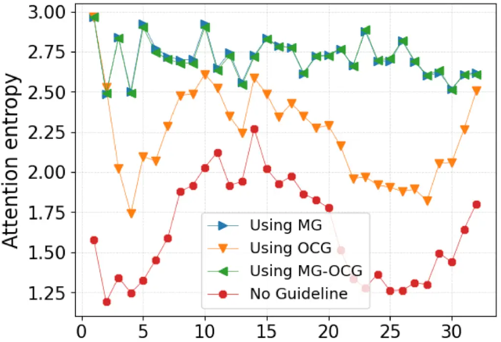

Figure 6: Entropy of attention over the input context across 32 Mistral
layers.

To analyze LongGuide’s impact on LLMs, we perform a simple attention
analysis to investigate (1) how LLMs attend to LongGuide and (2) utilize
the input context when conditioning on LongGuide. Specifically, for (1),
we calculate the average attention scores across all heads and layers
for each guideline token. For (2), we evaluate the entropy of the
attention scores overall context tokens. We experiment with Mistral on
100 SAMSum random samples. We learn two key findings.

Firstly, Mistral shows substantial attention to the guidelines. By using
MG, 37.81% of attention is on guideline tokens. For OCG, it is 22.56%,
and MG-OCG, 37.87%. Notably, the average attention on OCG tokens is
higher than on context, while MG and MG-OCG receive a fair amount,
confirming mode attention on guidelines (Appx.-Table 16).

Secondly, from Figure 6, Mistral exhibits more selective context
attention when conditioned on guidelines. The largest entropy gap occurs
in the first layer, where with guidelines, the model sparsely processes
the context but, without them, is biased towards focusing narrowly on
specific context parts. In the final layer, the model distributes
attention more evenly with guidelines than without. Generally, MG
stabilizes context use across layers, while OCG shows greater variance,
likely because it does not directly control generation quality,
therefore, the model bias almost exists as origin, as we can see the
trends of using OCG and no guidelines are relatively similar. These
findings indicate that guidelines potentially improve context
utilization and mitigate token bias.

### E.3 LongGuide on Reasoning Tasks

| Methods        | GSM8k | SVAMP |
| -------------- | ----- | ----- |
| Zero-shot (ZS) | 39.66 | 60.33 |
| \+ APO         | 41.83 | 62.33 |
| \+ adv-ICL     | 42.66 | 62.83 |
| \+ LongGuide   | 40.83 | 63.33 |
| Few-shot (FS)  | 32.33 | 61.66 |
| \+ APO         | 34.33 | 63.00 |
| \+ adv-ICL     | 35.00 | 62.66 |
| \+ LongGuide   | 34.83 | 62.83 |

Table 12: Performance of LongGuide with Mistral on reasoning tasks.

We conduct experiments comparing LongGuide to various baselines on
reasoning tasks. We select Mistral as our LLM, and GSM8K (Cobbe et al., 2021) and SVAMP (Patel et al., 2021) as benchmarks for evaluation. For
each benchmark, we randomly sampled 200 instances from the test set for
assessment and 50 instances from the train set to train the prompt
optimizers and LongGuide.

The results are averaged over three runs, and outlined in Table 12.
LongGuide slightly outperforms the Zero-shot and Few-shot baselines but
falls short compared to prompt optimizers. Nonetheless, the findings
confirm that additional instructions for LLMs can potentially improve
the init model, leading to further enhanced reasoning performance with
prompt optimization.

### E.4 Supplementary Results for Section 2

Figure 7: Property maintenance experiments with ICL. See Appx.-Figure 19
for a full example.

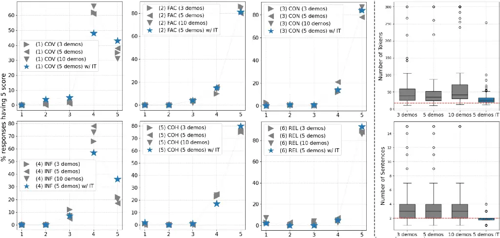

Figure 8: Property maintenance experiments with ICL full results. IT is
the adding a simple guideline baseline.

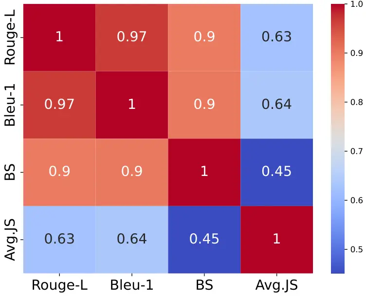

Figure 9: Pairwise Pearson correlation coefficient of metrics.

### E.5 Understanding MG and OCG: How Do They Work (Together)?

#### Metric Guideline (MG) (Step 1-3).

To understand how models select and evaluate metrics, we analyze the
specific metrics chosen for each task, their selection frequencies, and
their average scores (Appx.-Tables 17, 12 and 13 respectively). Overall,
each of the 27 metrics is selected and evaluated in at least one task.
Among them, common linguistic metrics such as “Clarity” are frequently
selected, while task-specific metrics like “Creativity” are less
frequently chosen. By examining the scores of selected metrics, we find
that common linguistic metrics generally achieve high scores, as
anticipated. However, task-specific metrics like “Creativity” exhibit
varying scores across tasks, indicating their differing importance and
relevance. Additionally, we also find that within MG can conflict with
each other, such as “Conciseness” and “Informativeness” (see
Appx.-Figure 17 for an example). This underscores the importance of
LongGuide’s Step 2 in weighting the metrics.

#### Output Constraint Guideline (OCG) (Step 4).

We find that both the token and sentence constraints are crucial for
LLMs (Appx.-E.13), with the sentence being more beneficial. We
hypothesize that LLMs have better control over the number of sentences
than tokens, as counting sentences is intuitively simpler than tokens.
This can be observed in our experiment in Section 2.

#### MG and OCG are complementary and non-interchangeable.

MG and OCG complement each other rather than conflict, as partially
discussed in Section 4.1. This is because MG language metrics primarily
concern the characteristics of responses rather than their structural
aspects such as sentence and token count, which is the main focus of the
OCG. In addition, the MG and OCG are not interchangeable. One might
question whether adopting conciseness and brevity metrics could
sufficiently alter the OCG, or if the OCG could effectively encompass
the MG guideline. Our answer is no. While MG can steer LLMs towards
brevity in responses, it lacks precise quantification for conciseness.
Modern LLMs, often trained to generate verbose responses, may struggle
to meet human conciseness without explicit statistics. Meanwhile, the
OCG supplies them in the form of bins and means, yet these statistics
alone do not directly address linguistic qualities. We provide examples
as evidence supporting our arguments in Appx.-Figures 15 and 16.

### E.6 Collected Metrics in LongGuide’s Step 1 (Section 3)

Table 13 presents our $`27`$ metrics collected for LongGuide’s Step 1.

|                                           |                                                                              |     |
| ----------------------------------------- | ---------------------------------------------------------------------------- | --- |
| Source                                    | Metrics                                                                      | \#  |
| The ABC’s of Communication (Wagner, 1963) | Accuracy, Brevity, Clarity                                                   | 3   |
| BARTScore (Yuan et al., 2021)             | Relevance, Coherence                                                         | 2   |
| GPTScore (Fu et al., 2023)                | Semantic Coverage, Factuality, Fluency, Informativeness,                     | 10  |
|                                           | Consistency, Engagement, Specificity, Correctness,                           |     |
|                                           | Understandability, Diversity                                                 |     |
| We propose                                | Completeness, Conciseness, Neutrality, Naturalness, Readability, Creativity, | 12  |
|                                           | Rationalness, Truthfulness, Respect of Chronology,                           |     |
|                                           | Non-repetitiveness, Indicativeness, Resolution                               |     |
| Total                                     | 27                                                                           | 27  |

Table 13: Metrics collected for LongGuide’s metric guideline (MG).

### E.7 JS Divergence over all LongGuide Metrics with SAMSum (Section 4.1)

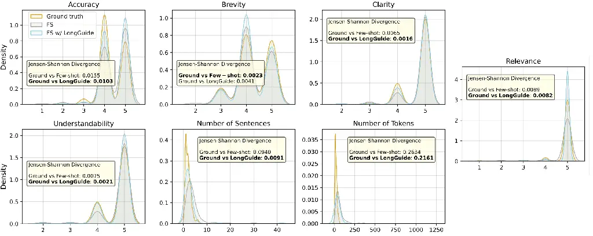

Figure 10: Density plots of MG and OCG metrics selected by Mistral under
the few-shot (FS) setting, measured on ground-truth, FS, and FS w/
LongGuide answers. For Jensen–Shannon divergence, lower is better.

Figure 10 presents density plots of MG and OCG metrics selected by
Mistral under the few-shot (FS) setting, measured on ground-truth, FS,
and FS w/ LongGuide answers. For Jensen–Shannon divergence, the lower is
better.

### E.8 Step 5 CD-MG Selection Results of LongGuide (Section 4.1)

|               |                  |          |               |          |                |               |                     |                |
| ------------- | ---------------- | -------- | ------------- | -------- | -------------- | ------------- | ------------------- | -------------- |
|               |                  |          | Summarization |          | Simplification | Translation   | Dialogue Generation | Table2Text     |
|               | Method           | SAMSum   | CNN (3.0.0)   | XL-Sum   | SWiPE          | IWSLT17 en-ja | Synthetic Persona   | CommGen-Chall. |
|               | \#shots (random) | 3        | 3             | 5        | 3              | 5             | 5                   | 5              |
| Mistral-7B-it | Zero-shot (ZS)   | 21.25    | 18.96         | 8.88     | 36.21          | 14.05         | 12.93               | 9.12           |
|               | _+ OCG_          | 27.43    | 21.92         | 14.22    | 31.19          | 16.93         | 12.99               | 20.67          |
|               | _+ MG_           | 27.68    | 18.02         | 10.26    | 36.74          | 11.06         | 13.74               | 19.98          |
|               | _+ MG-OCG_       | 28.34    | 21.63         | 13.90    | 35.12          | 15.49         | 14.14               | 20.87          |
|               | _MG-OCG Sel._    | _MG-OCG_ | _OCG_         | _OCG_    | _MG_           | _OCG_         | _MG-OCG_            | _MG-OCG_       |
|               | Few-shot (FS)    | 25.55    | 17.30         | 9.85     | 39.29          | 13.52         | 6.19                | 4.01           |
|               | _+ OCG_          | 27.31    | 16.45         | 12.47    | 29.85          | 17.58         | 6.45                | 20.50          |
|               | _+ MG_           | 27.88    | 18.47         | 12.01    | 41.07          | 14.09         | 6.47                | 11.16          |
|               | _+ MG-OCG_       | 30.01    | 19.87         | 14.89    | 39.40          | 17.02         | 8.06                | 5.18           |
|               | _MG-OCG Sel._    | _MG-OCG_ | _MG-OCG_      | _MG-OCG_ | _MG_           | _OCG_         | _MG-OCG_            | _OCG_          |
| ChatGPT       | Zero-shot (ZS)   | 24.21    | 19.54         | 10.78    | 45.11          | 36.22         | 19.68               | 24.23          |
|               | _+ OCG_          | 28.81    | 21.88         | 20.66    | 37.58          | 38.45         | 23.09               | 35.04          |
|               | _+ MG_           | 25.12    | 20.02         | 10.42    | 45.09          | 37.72         | 19.81               | 18.50          |
|               | _+ MG-OCG_       | 29.79    | 21.99         | 19.91    | 42.72          | 41.50         | 20.82               | 30.09          |
|               | _MG-OCG Sel._    | _MG-OCG_ | _MG-OCG_      | _OCG_    | _ZS_           | _MG-OCG_      | _MG-OCG_            | _OCG_          |
|               | Few-shot (FS)    | 27.44    | 13.77         | 12.11    | 33.30          | 28.76         | 17.12               | 24.12          |
|               | _+ OCG_          | 29.98    | 17.55         | 19.26    | 16.22          | 35.73         | 21.50               | 36.51          |
|               | _+ MG_           | 28.89    | 14.03         | 12.75    | 19.14          | 36.09         | 19.12               | 21.99          |
|               | _+ MG-OCG_       | 30.65    | 13.12         | 18.64    | 37.24          | 36.22         | 18.99               | 38.33          |
|               | _MG-OCG Sel._    | _MG-OCG_ | _OCG_         | _OCG_    | _MG-OCG_       | _MG-OCG_      | _OCG_               | _MG-OCG_       |

Table 14: MG-OCG selection results on $`D^{train}`$ set for the main
experiments in Table 3, evaluated by ROUGE-L.

The numerical MG-OCG selection results on $`D^{train}`$ are presented in
Table 14, as also noted in Table 4. Overall, the performance of
LongGuide on $`D^{train}`$ closely mirrors its performance on the
testing tasks in Table 4. The only discrepancy is for the IWSLT17 en-ja
task with ChatGPT using few-shot prompting: the optimal guideline
combination on $`D^{train}`$ is MG-OCG (see Table 14), whereas the best
on the testing set is MG (see Table 4).

### E.9 LongGuide can Generalize from Demonstrations (Section 5.2)

|                                       |                |                 |                |
| ------------------------------------- | -------------- | --------------- | -------------- |
| Methods                               | CNN (3.0.0)    | IWSLT17 en-ja   | CommGen-Chall. |
| Zero-shot (ZS)                        | 19.23\_(±0.34) | 13.12\_(±1.39)  | 10.12\_(±0.02) |
| \+ OCG trained on $`D^{train}`$       | 22.46\_(±0.64) | 16.53\_(±0.59)  | 24.16\_(±0.11) |
| \+ MG trained on $`D^{train}`$        | 18.35\_(±0.60) | 8.71\_(±0.53)   | 21.54\_(±7.50) |
| \+ MG-OCG trained on $`D^{train}`$    | 22.05\_(±0.84) | 15.76\_(±1.85)  | 25.20\_(±1.89) |
| \+ LongGuide trained on $`D^{train}`$ | 22.46\_(±0.64) | 16.53\_(±0.59)  | 25.20\_(±1.89) |
| \+ OCG trained on Demos               | 20.46\_(±0.10) | 17.27\_(±1.83)  | 23.97\_(±0.47) |
| \+ MG trained on Demos                | 18.33\_(±0.25) | 8.63\_(±1.08)   | 18.98\_(±0.52) |
| \+ MG-OCG trained on Demos            | 19.16\_(±0.37) | 14.00\_(±3.42)  | 24.46\_(±2.43) |
| \+ LongGuide trained on Demos         | 20.46\_(±0.10) | 14.00\_(±2.42)  | 24.46\_(±2.43) |
| Few-shot (FS)                         | 17.56\_(±0.63) | 12.69\_(±1.82)  | 3.98\_(±0.17)  |
| \+ OCG trained on $`D^{train}`$       | 19.17\_(±1.27) | 19.86\_(±2.93)  | 25.05\_(±0.76) |
| \+ MG trained on $`D^{train}`$        | 17.18\_(±2.01) | 12.82\_(±0.15)  | 21.79\_(±5.20) |
| \+ MG-OCG trained on $`D^{train}`$    | 21.18\_(±1.07) | 18.70\_(±0.73)  | 25.43\_(±5.28) |
| \+ LongGuide trained on $`D^{train}`$ | 21.18\_(±1.07) | 19.86\_(±2.93)  | 25.05\_(±0.76) |
| \+ OCG trained on Demos               | 16.88\_(±1.44) | 19.40\_(±1.39)  | 28.28\_(±0.69) |
| \+ MG trained on Demos                | 15.59\_(±0.59) | 12.07\_(±2.68)  | 23.99\_(±4.66) |
| \+ MG-OCG trained on Demos            | 19.89\_(±0.39) | 17.78\_(±3.23)  | 27.41\_(±0.87) |
| \+ LongGuide trained on Demos         | 19.89\_(±0.39) | 17.78\_(±18.43) | 23.99\_(±4.66) |

Table 15: LongGuide learns the guidelines from only demonstrations with
Mistral, evaluated by ROUGE-L.

Table 15 presents the numerical results of Figure 5 in Section 5.2. Even
with only 3-5 exemplars as demonstrations, LongGuide effectively derives
MG and OCG guidelines, benefiting the model. In this case, $`D^{train}`$
is the set of demonstrations, and the rest of LongGuide’s steps remain
unchanged.

### E.10 Human Evaluation Fine-grained Results (Section 5.1)

Figure 11: Fine-grained human evaluation results on evaluated MG
metrics.

Figure 11 presents our fine-grained human evaluation results. Overall,
LongGuide shows the best in terms of “Accuracy” and “Clarity”, with a
significant number of winning ratings. This suggests that the generated
text is factually correct and easy to understand. Meanwhile, LongGuide
shows more mixed results in terms of “Clarity” and “Coherence”. While
there is still a high winning rating, the proportion of draw and loss
ratings is also relatively high, possibly because improving “Brevity”
can somehow reduce the “Clarity”.

### E.11 Attention Analysis for Guideline Tokens (Section E.2)

|           | MG     | Context (MG) | OCG    | Context (OCG) | MG-OCG | Context (MG-OCG) |
| --------- | ------ | ------------ | ------ | ------------- | ------ | ---------------- |
| Per token | 0.0019 | 0.0064       | 0.0133 | 0.0077        | 0.0017 | 0.0064           |
| All       | 37.81% | 62.19%       | 22.56% | 77.44%        | 37.87% | 62.13%           |

Table 16: Attention score over guideline and context tokens of Mistral.

Table 16 shows our simple attention analysis.

| Task              | Model   | Selected Metrics                                                                                                                                                                                                                                                                                                                                      |
| ----------------- | ------- | ----------------------------------------------------------------------------------------------------------------------------------------------------------------------------------------------------------------------------------------------------------------------------------------------------------------------------------------------------- |
| SAMSum            | Mistral | \[’Accuracy’, ’Brevity’, ’Clarity’, ’Relevance’, ’Understandability’\]                                                                                                                                                                                                                                                                                |
|                   | ChatGPT | \[’Accuracy’, ’Brevity’, ’Clarity’, ’Relevance’, ’Understandability’\]                                                                                                                                                                                                                                                                                |
| CNN               | Mistral | \[’Accuracy’, ’Brevity’, ’Clarity’, ’Coherence’, ’Completeness’, ’Engagement’, ’Readability’, ’Relevance’, ’Truthfulness’, ’Understandability’\]                                                                                                                                                                                                      |
|                   | ChatGPT | \[’Accuracy’, ’Brevity’, ’Clarity’, ’Coherence’, ’Completeness’, ’Conciseness’, ’Engagement’, ’Neutrality’, ’Readability’, ’Relevance’, ’Specificity’\]                                                                                                                                                                                               |
| XLSum             | Mistral | \[’Accuracy’, ’Brevity’, ’Clarity’, ’Coherence’, ’Completeness’, ’Consistency’, ’Correctness’, ’Diversity’, ’Engagement’, ’Factuality’, ’Fluency’, ’Indicative’, ’Informativeness’, ’Neutrality’, ’Non-repetitiveness’, ’Relevance’, ’Resolution’, ’Respect of Chronology’, ’Semantic Coverage’, ’Specificity’, ’Understandability’\]                 |
|                   | ChatGPT | \[’Accuracy’, ’Brevity’, ’Clarity’, ’Coherence’, ’Completeness’, ’Consistency’, ’Correctness’, ’Diversity’, ’Engagement’, ’Factuality’, ’Fluency’, ’Indicative’, ’Informativeness’, ’Neutrality’, ’Non-repetitiveness’, ’Rationalness’, ’Relevance’, ’Resolution’, ’Respect of Chronology’, ’Semantic Coverage’, ’Specificity’, ’Understandability’\] |
| SWiPE             | Mistral | \[’Accuracy’, ’Brevity’, ’Clarity’, ’Relevance’, ’Understandability’\]                                                                                                                                                                                                                                                                                |
|                   | ChatGPT | \[’Accuracy’, ’Brevity’, ’Clarity’, ’Coherence’, ’Conciseness’, ’Consistency’, ’Correctness’, ’Readability’, ’Understandability’\]                                                                                                                                                                                                                    |
| IWSLT17 en-ja     | Mistral | \[’Accuracy’, ’Clarity’, ’Coherence’, ’Consistency’, ’Correctness’, ’Factuality’, ’Fluency’, ’Relevance’, ’Understandability’\]                                                                                                                                                                                                                       |
|                   | ChatGPT | \[’Accuracy’, ’Clarity’, ’Coherence’, ’Consistency’, ’Correctness’, ’Factuality’, ’Fluency’, ’Relevance’, ’Understandability’\]                                                                                                                                                                                                                       |
| Synthetic Persona | Mistral | \[’Accuracy’, ’Brevity’, ’Clarity’, ’Coherence’, ’Completeness’, ’Consistency’, ’Correctness’, ’Diversity’, ’Engagement’, ’Factuality’, ’Fluency’, ’Indicative’, ’Informativeness’, ’Neutrality’, ’Non-repetitiveness’, ’Relevance’, ’Resolution’, ’Respect of Chronology’, ’Semantic Coverage’, ’Specificity’, ’Understandability’\]                 |
|                   | ChatGPT | \[’Accuracy’, ’Clarity’, ’Coherence’, ’Consistency’, ’Correctness’, ’Diversity’, ’Engagement’, ’Fluency’, ’Indicative’, ’Informativeness’, ’Neutrality’, ’Non-repetitiveness’, ’Relevance’, ’Resolution’, ’Respect of Chronology’, ’Specificity’, ’Understandability’\]                                                                               |
| CommGen-Chall.    | Mistral | \[’Coherence’, ’Conciseness’, ’Fluency’, ’Relevance’, ’Understandability’\]                                                                                                                                                                                                                                                                           |
|                   | ChatGPT | \[’Clarity’, ’Coherence’, ’Completeness’, ’Conciseness’, ’Consistency’, ’Creativity’, ’Engagement’, ’Fluency’, ’Naturalness’, ’Relevance’\]                                                                                                                                                                                                           |

Table 17: Selected metrics by tasks by Mistral and ChatGPT.

### E.12 Which Metrics Were Selected the Most for MG? (Section E.5)

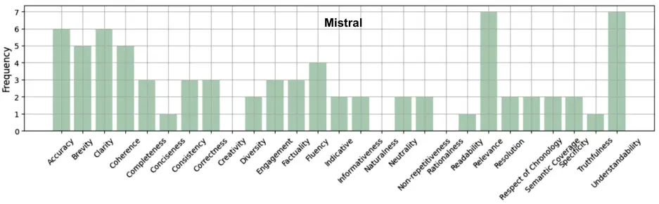

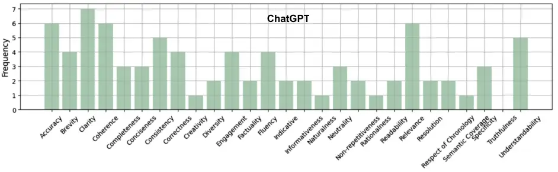

Figure 12: Frequency of metrics selected as the metric guideline.

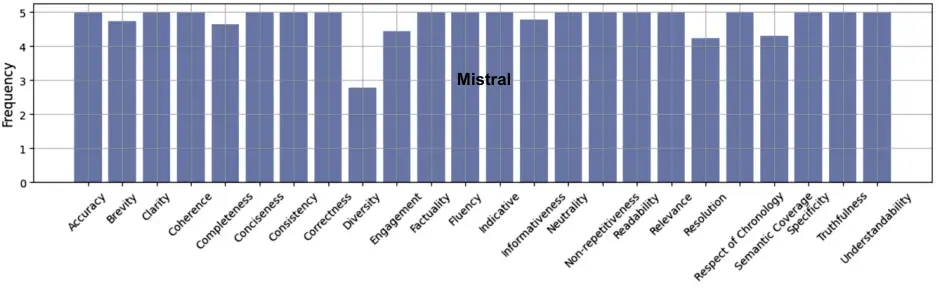

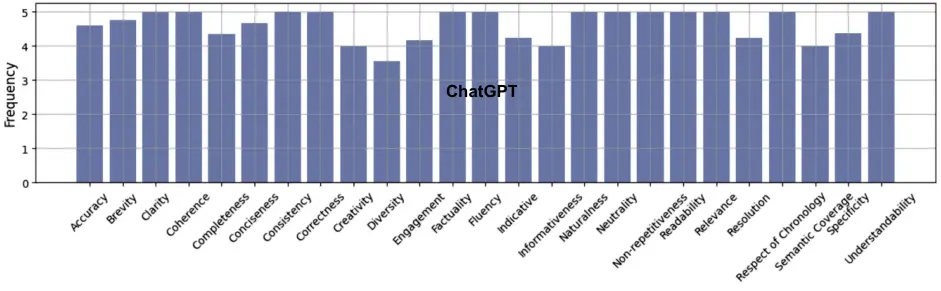

Figure 13: Average scores of metrics as the metric guideline.

To better understand how models select and evaluate metrics, we analyze
the specific metrics chosen for each task (Table 17), their selection
frequencies (Figure 12), and their average scores (Figure 13).

### E.13 Extra Ablation Studies: without OCG’s Token or Sentence Constraint (Section E.5)

|                                      |                              |                              |                              |
| ------------------------------------ | ---------------------------- | ---------------------------- | ---------------------------- |
| Methods                              | CNN (3.0.0)                  | IWSLT17 en-ja                | CommGen-Chall.               |
| Zero-shot (ZS)                       | 19.23\_(±0.34)               | 13.12\_(±1.39)               | 10.12\_(±0.02)               |
| \+ LongGuide                         | 22.46\_(±0.64)               | 16.53\_(±0.59)               | 25.20\_(±1.89)               |
| \+ LongGuide w/o Token Constraint    | 21.54\_(±0.52)$`\downarrow`$ | 14.09\_(±1.07)$`\downarrow`$ | 21.49\_(±2.15)$`\downarrow`$ |
| \+ LongGuide w/o Sentence Constraint | 20.92\_(±0.23)$`\downarrow`$ | 10.02\_(±4.17)$`\downarrow`$ | 13.32\_(±0.73)$`\downarrow`$ |
| Few-shot (FS)                        | 17.56\_(±0.63)               | 12.69\_(±1.82)               | 3.98\_(±0.17)                |
| \+ LongGuide                         | 21.18\_(±1.07)               | 19.86\_(±2.93)               | 25.05\_(±0.76)               |
| \+ LongGuide w/o Token Constraint    | 20.30\_(±1.46)$`\downarrow`$ | 19.75\_(±1.47)$`\downarrow`$ | 20.30\_(±1.46)$`\downarrow`$ |
| \+ LongGuide w/o Sentence Constraint | 15.89\_(±2.26)$`\downarrow`$ | 12.57\_(±2.99)$`\downarrow`$ | 12.20\_(±3.91)$`\downarrow`$ |

Table 18: Mistral results when omitting OCG’s Token or Sentence
Information, showing the importance of OCG’s Token and Sentence
information, evaluated by ROUGE-L.

Since OCG’s token information and sentence information are the two types
of information emphasized in OCG, we further investigate the importance
of each type of information. The empirical experiments are conducted
with Mistral on CNN, IWSLT-2017 en-ja, and CommonGen-Challenge. We
present the results in Table 18. We observe that skipping OCG’s token
information or sentence information would hurt the performance.
Specifically, the results drop more significantly when sentence
information is omitted, and even fall below the Zero-shot score in CNN
Few-shot with LongGuide and IWSLT17 en-ja Few-shot with LongGuide. The
performance drops significantly in the CommonGen-Challenge Few-shot
case, with a fall of 55.20%. Due to the volatility of the token count in
a sentence, it is hard to estimate the other information with only one
type of information given. Therefore, both types of information should
be provided to better capture the text distribution.

## Appendix F Implementation Details

#### Task benchmark preprocessing.

We chose the newest versions of the above datasets. For each dataset
except Synthetic-Persona-Chat, we sample $`200`$ samples from the test
set for our evaluation, following Bai et al. (2024), and $`50`$ random
samples from the train set for $`D^{train}`$. For
Synthetic-Persona-Chat, we randomly sample $`25`$ dialogues from its
test set for our evaluation ($`678`$ utterances in total) and $`3`$
dialogues from its train set where $`50`$ random utterances are selected
for $`D^{train}`$.

#### Prompting baselines’ hyperparameters.

We present the implementation and hyperparameters’ details for our
proposed LongGuide as well as prompting baselines below.

- •
  LongGuide. We set the batch size is $`5`$ and number of iterations is
  also $`5`$ for LongGuide’s step 1. For steps 2, 3, and 4, no
  hyperparameter involves. For the evaluations by Self-consistency (Wang
  et al., 2022a), we sample $`3`$ results.
- •
  APO (Pryzant et al., 2023). We set the number of optimization
  iterations is $`5`$. We use $`1`$ sample with the lowest ROUGE-L score
  as the error sample for generating gradients, following Do et al.
  (2024). At each iteration, $`5`$ textual gradients are generated, and
  $`5`$ new prompts are sampled from textual gradients. Finally, $`1`$
  paraphrase of the input prompt is sampled at each optimization
  iteration.
- •
  adv-ICL (Do et al., 2024). We use $`3`$ iterations with a batch size
  of $`5`$ as suggested by Do et al. (2024). At each iteration, the
  number of new prompts sampled is $`5`$.

#### Models’ hyperparameters.

The models’ hyperparameters are presented below.

- •
  ChatGPT. We use _gpt-3.5-turbo-1106_ for our experiments. We use a
  window size of $`1500`$ and Nucleus Sampling (Holtzman et al., 2019)
  as our decoding strategy with a $`p`$ value of $`1`$. We use the
  system role as “You are a helpful assistant!”.
- •
  Mistral-7B-it-v0.2. We use a window size of $`1500`$, and Sampling
  decoding strategy (Holtzman et al., 2019) ($`do\_sampling=True`$). We
  load the model from Huggingface Transformers library (Wolf et al., 2020) with the model id is “mistralai/Mistral-7B-Instruct-v0.2”. We do
  not set any explicit system role.

## Appendix G Prompts and Prompting Analysis

### G.1 GPT-4o-Judge’s Prompt

Our GPT-4o-Judge prompt evaluating the generated response and the
reference is heavily motivated by Zheng et al. (2023).


### G.2 ChatGPT Property Scorer Prompt


### G.3 LongGuide’s Prompts

#### Prompting templates for LongGuide.

Let $`Q,C,I,D_{f}`$ be the input query, context, instruction, and
demonstration token sequence respectively (Section 1, Section 2), and
$`G^{best}`$ is the learned guideline(s), the prompt for $`\mathcal{M}`$
is formatted:
‘‘{$`I`$}\n{$`D_{f}`$}\n{$`C`$}\n{$`Q`$}\n{$`G^{best}`$}’’.

#### Prompting costs.

|         |                   |               |               |               |                |               |                     |                |
| ------- | ----------------- | ------------- | ------------- | ------------- | -------------- | ------------- | ------------------- | -------------- |
|         |                   |               | Summarization |               | Simplification | Translation   | Dialogue Generation | Table2Text     |
| Models  | Method            | SAMSum        | CNN (3.0.0)   | XL-Sum        | SWiPE          | IWSLT17 en-ja | Synthetic Persona   | CommGen-Chall. |
|         | \#shots (random)  | 3             | 3             | 5             | 3              | 5             | 5                   | 5              |
| Mistral |                   |               |               |               |                |               |                     |                |
|         | \#tokens consumed | 642           | 1110          | 811           | 1020           | 915           | 855                 | 939            |
|         | US\$ consumed     | 0             | 0             | 0             | 0              | 0             | 0                   | 0              |
| ChatGPT |                   |               |               |               |                |               |                     |                |
|         | \#tokens consumed | 1866          | 7683          | 4863          | 2380           | 1370          | 1344                | 1272           |
|         | US\$ consumed     | insignificant | insignificant | insignificant | insignificant  | insignificant | insignificant       | insignificant  |

Table 19: Total number of tokens consumed and US\$ consumed for models
to learn the metric guideline (MG) and output constraint guideline
(OCG).

|     |           |                                                                                              |                                       |
| --- | --------- | -------------------------------------------------------------------------------------------- | ------------------------------------- |
|     | Method    | \#Prompts Sampled                                                                            | Cost                                  |
| ZS  | adv-ICL   | (3 iterations) $`\times`$ (1 instruction) $`\times`$ (5 variants)                            | 15 $`\times`$ prompt validation cost  |
|     | APO       | (5 iterations) $`\times`$ (15 prompts sampled) $`\times`$ (1 instruction)                    | 75 $`\times`$ prompt validation cost  |
|     | LongGuide | 4 prompts (MG, OCG, MG-OCG, No guideline)                                                    | 4 $`\times`$ prompt validation cost   |
| FS  | adv-ICL   | (3 iterations) $`\times`$ (3 demonstrations + 1 instruction) $`\times`$ (5 variants)         | 60 $`\times`$ prompt validation cost  |
|     | APO       | (5 iterations) $`\times`$ (15 prompts sampled) $`\times`$ (3 demonstrations + 1 instruction) | 300 $`\times`$ prompt validation cost |
|     | LongGuide | 4 prompts (MG, OCG, MG-OCG, No guideline)                                                    | 4 $`\times`$ prompt validation cost   |

Table 20: Prompting cost comparison between PO methods and LongGuide
based on \# new prompts sampled to test over the validation set.

Table 19 presents the total number of tokens consumed for models to
learn the metric guidelines and output constraint guideline (OCG) for
both models with the hyperparameters of LongGuide specified in
Appendix F. We observe that the number of tokens needed to learn the
guidelines is insignificant, demonstrating that LongGuide is a
cost-effective solution and potentially beneficial for a wide range of
applications.

Table 20 presents the prompting cost comparision between LongGuide and
other PO algorithms. We compare the number of new prompts sampled by
each algorithm for validation set verification, as these prompts are the
primary cost bottleneck in PO algorithms. We observe that LongGuide is
approximately at least 3.75 times cheaper than adv-ICL in both settings
and 18.75 times cheaper than APO. For SAMSum, the validation of one
prompt using 50 samples involves approximately 22K tokens, which incurs
a cost of 0.02 USD as of November 19, 2024.

#### Prompt for step 1, metric selection.

Below is the prompt we use for step 1 selecting metrics for a given
task.


#### Prompt for step 2, metric score collection.

Below is the prompt we use for step 2 for evaluating selected metrics on
the task.


#### Prompt for step 2, collecting metrics’ definitions.

Below is the prompt we use for step 2 collecting METRICS_DEFINITIONS for
step 2.


#### Prompt for step 3, generating metric guideline (MG).

Below is the prompt we use for step 3, generating the metric guideline
(MG).


## Appendix H Examples

Figure 14: Full example of ChatGPT results on a SAMSum example (Gliwa
et al., 2019) w/ LongGuide guidelines (Zero-shot + LongGuide and
Few-shot + LongGuide) from Figure 1

Figure 15: A sample from SAMSum dataset where MG and OCG supplement each
other and are not interchangeable to increase the performance in final
answer.

Figure 16: An example of SWiPE (Laban et al., 2023) where the record
contains fewer tokens than the expected average. This reduces the
effectiveness of OCG and MG individually, but their combination could
enhance performance.

Figure 17: A CommonGen-Challenge example (Lin et al., 2020), where
output with high Conciseness score could have low Informativeness score
and vice versa

Figure 18: A SAMSum example, where skipping step 2 worsens the
performance due to lack of clarity in metrics

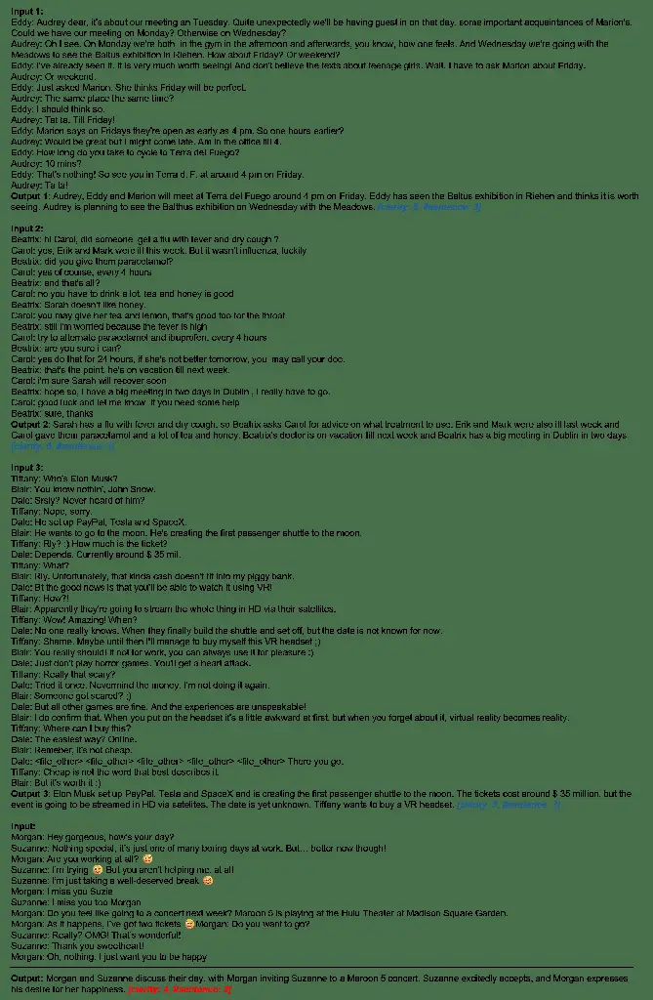

Figure 19: Full text for an example in Section 2.
