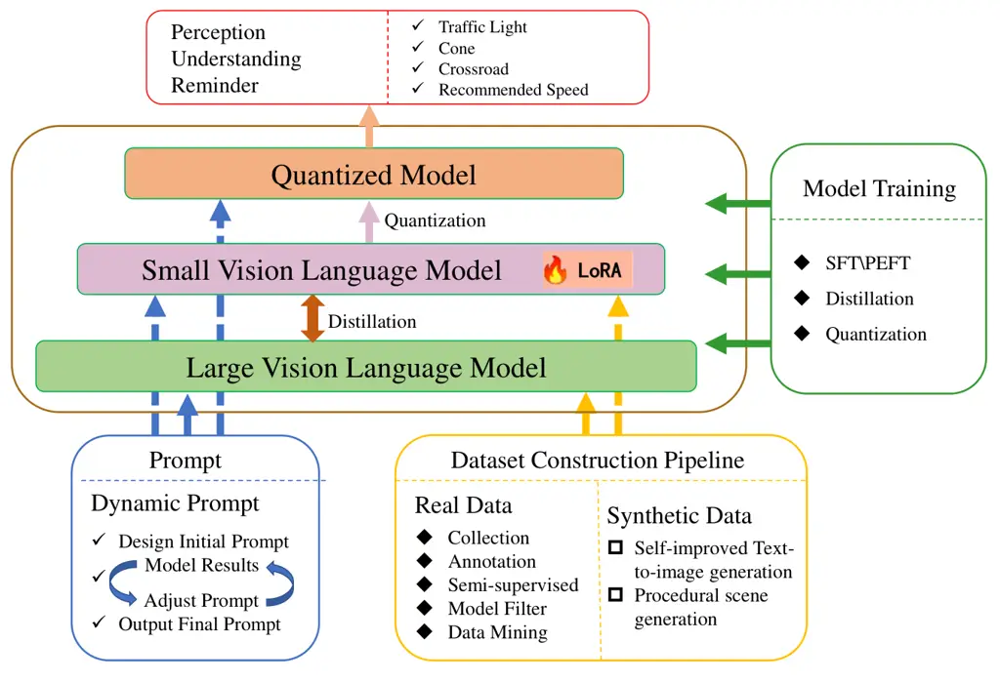
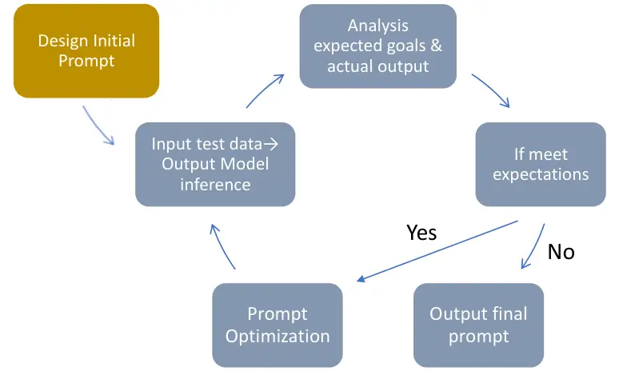
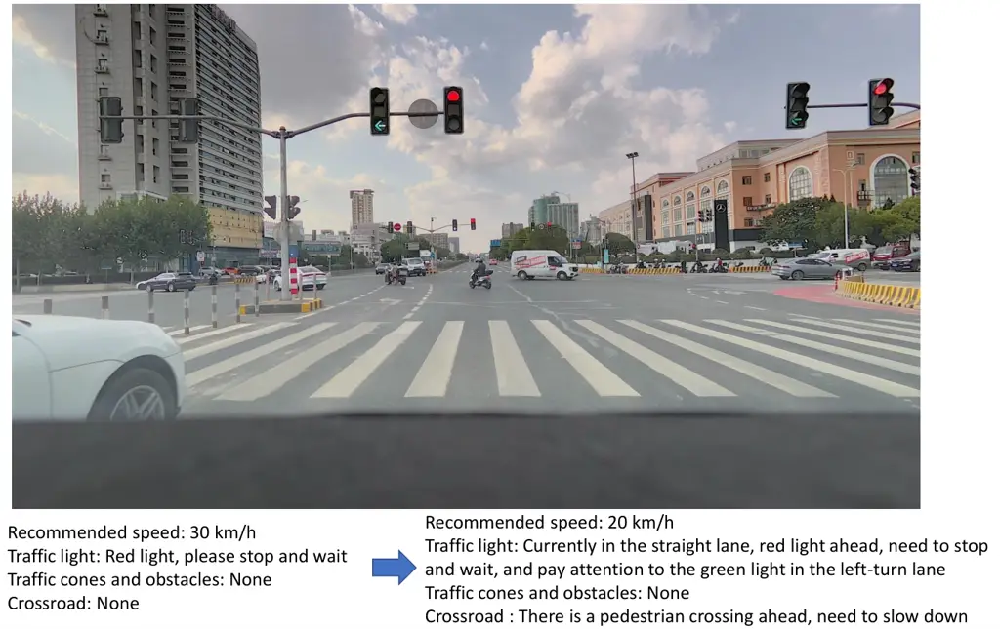
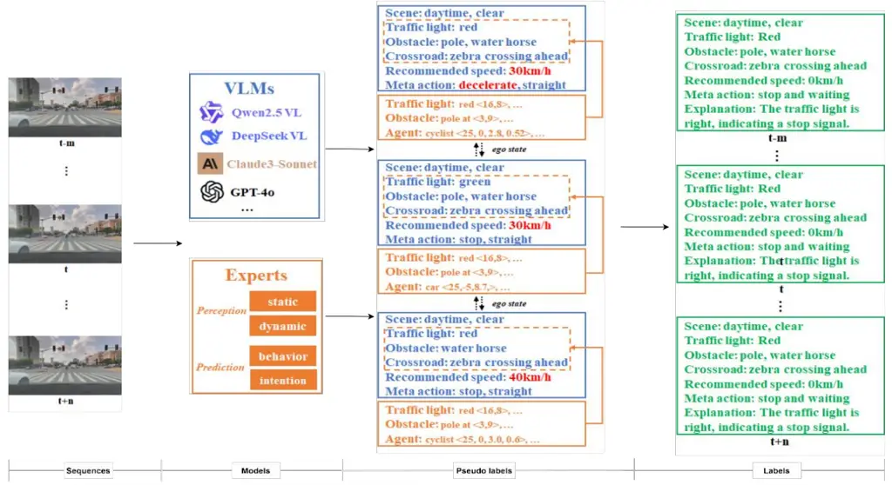
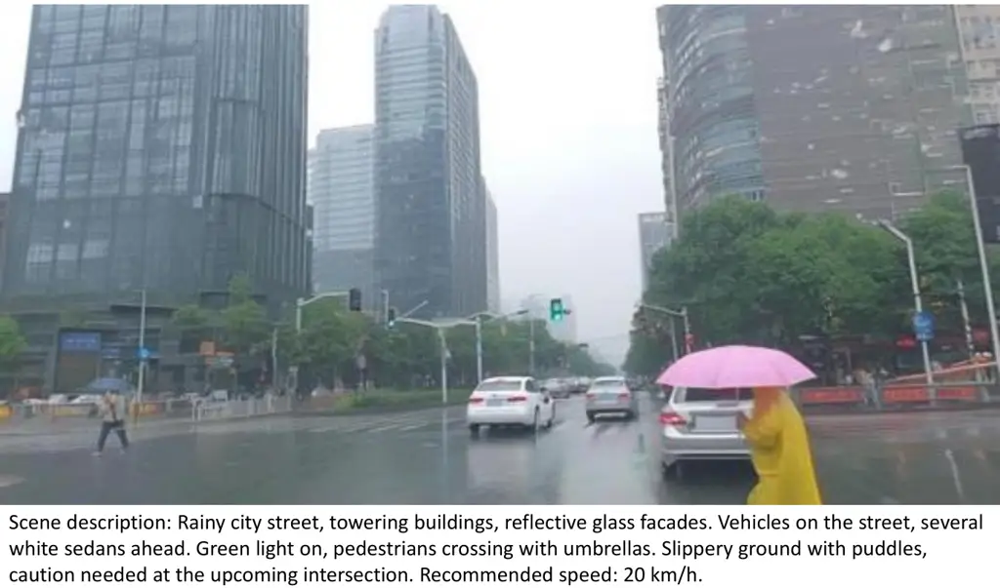
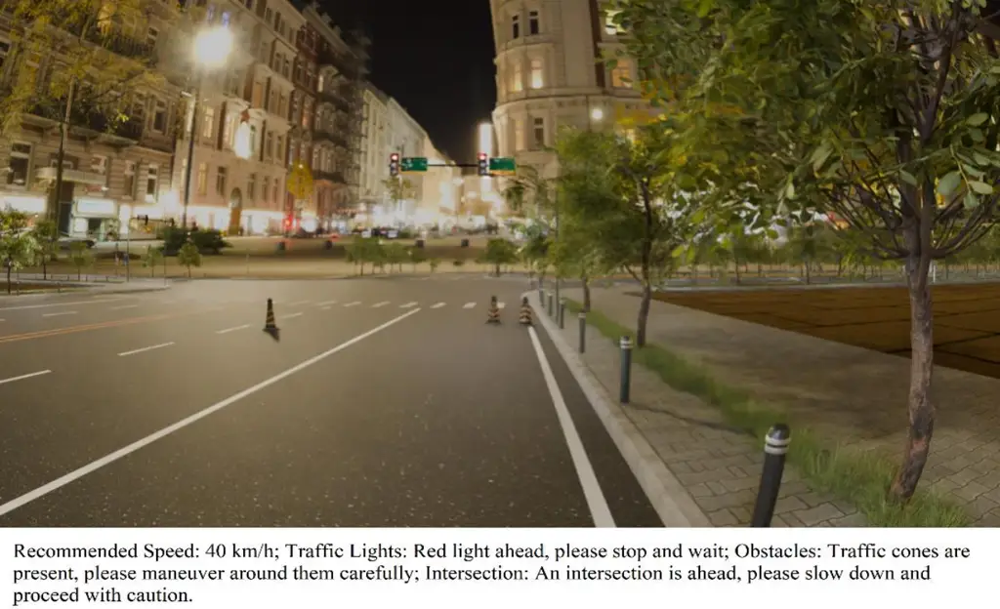
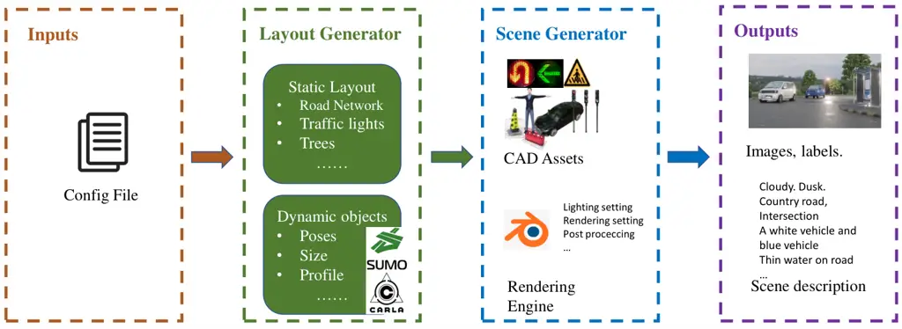
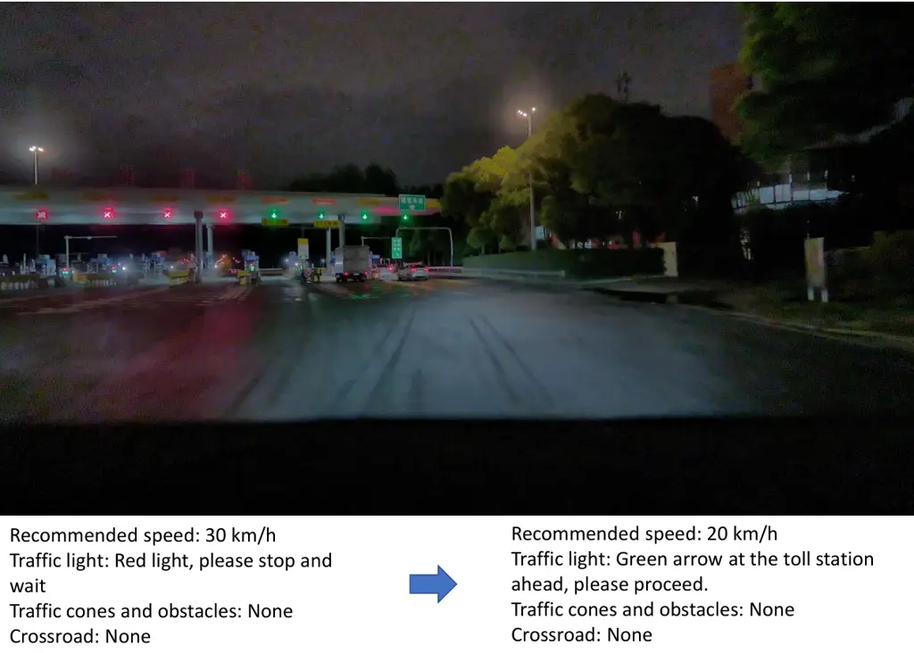

# Research on Driving Scenario Technology Based on Multimodal Large Lauguage Model Optimization

Wang Mengjie    Zhu Huiping    Li Jian    Shi Wenxiu    Zhang Song\*

May 2025

###### Abstract

With the advancement of autonomous and assisted driving technologies,
higher demands are placed on the ability to understand complex driving
scenarios. Multimodal general large models have emerged as a solution
for this challenge. However, applying these models in vertical domains
involves difficulties such as data collection, model training, and
deployment optimization. This paper proposes a comprehensive method for
optimizing multimodal models in driving scenarios, including cone
detection, traffic light recognition, speed limit recommendation, and
intersection alerts. The method covers key aspects such as dynamic
prompt optimization, dataset construction, model training, and
deployment. Specifically, the dynamic prompt optimization adjusts the
prompts based on the input image content to focus on objects affecting
the ego vehicle, enhancing the model’s task-specific focus and judgment
capabilities. The dataset is constructed by combining real and synthetic
data to create a high-quality and diverse multimodal training dataset,
improving the model’s generalization in complex driving environments. In
model training, advanced techniques like knowledge distillation, dynamic
fine-tuning, and quantization are integrated to reduce storage and
computational costs while boosting performance. Experimental results
show that this systematic optimization method not only significantly
improves the model’s accuracy in key tasks but also achieves efficient
resource utilization, providing strong support for the practical
application of driving scenario perception technologies.

Keywords: Multimodal Large Language Model; Text-to-image Generation;
Prompt Engineering; Model Distillation; Model Fine-tuning

## 1 Introduction

With the rapid development of autonomous driving technology, driving
scenario perception has become one of the core modules of intelligent
driving systems\[1, 2\]. In practical applications, driving scenario
perception needs to handle a variety of complex tasks, which often
involve the fusion and analysis of multimodal data (such as images and
text), placing extremely high demands on the model’s accuracy,
generalization ability, and real-time performance\[3\]. However,
although current mainstream large-scale multimodal models perform well,
their outputs rely on specific prompt designs for particular
scenarios\[4\]. How to build high-quality datasets and enhance the
model’s generalization ability under extreme conditions remains an
urgent issue. Additionally, its engineering application depends on
efficient training and deployment methods.

To address these challenges, this paper takes specific multimodal
scenario understanding tasks, such as ”cone detection, traffic light
status recognition, and speed limit recommendation,” as examples and
proposes a comprehensive optimization method for multimodal models. The
goal is to improve the model’s performance in driving scenario tasks
while reducing computational costs to meet deployment requirements.

Firstly, in terms of prompt design, this paper proposes a dynamic prompt
optimization strategy based on task scenarios and model inference
results. This strategy dynamically adjusts prompts according to the
content of the input images, enabling the model to focus more on
task-critical information, thereby significantly improving the model’s
task adaptability and inference accuracy. For example, if the image
contains ”traffic lights” or ”cones,” the strategy selects relevant
prompts from a predefined prompt library to provide targeted alerts for
the current scenario. Compared with traditional fixed prompt methods,
dynamic prompts are more flexible and targeted, especially in multitask
scenarios.

Secondly, in terms of dataset construction, we adopt a hybrid approach
using both real and synthetic datasets to address the high cost of data
annotation and the long-tail distribution of driving scenarios. We
leverage a VLM (Vision-Language Model) to mine and filter high-quality
real multimodal data from a large-scale self-collected dataset. We then
enrich the quantity and quality of the data using semi-supervised
learning. Additionally, we use self-improving generative models and
automated scene generation techniques to create diverse and realistic
training datasets that include long-tail scenarios and objects,
simulating different weather conditions, viewpoint changes, and obstacle
insertions. After further supervised cleaning, these real and synthetic
datasets are organized into high-quality datasets specifically for
fine-tuning the model to enhance its performance and generalization
ability.

Then, in terms of model training optimization, we propose a supervised
hybrid method combining knowledge distillation and fine-tuning to
efficiently improve model performance while reducing computational
costs. The core of this method is to use a pre-trained large teacher
model to transfer its knowledge to a smaller student model through
knowledge distillation, enabling the student model to inherit the
teacher model’s strong performance. Meanwhile, we use LoRA technology to
fine-tune key layers, further enhancing the student model’s adaptability
to specific tasks. This hybrid training approach not only improves model
performance but also reduces overfitting risks. Experimental results
show that this method performs well across multiple tasks, especially in
resource-constrained environments, where its efficiency and practicality
stand out. This hybrid training method provides an efficient and
effective solution for optimizing large models, particularly suitable
for scenarios requiring rapid deployment of lightweight models with
limited task data.

Finally, to further reduce the storage and computational complexity of
the optimized model, we employ advanced model quantization techniques to
convert model weights and activations from floating-point to
low-precision representations. This strategy is crucial for efficiently
deploying deep learning models on resource-constrained devices, as it
significantly speeds up model inference and improves overall system
throughput. In this study, we specifically use AWQ (Activation-aware
Weight Quantization). AWQ analyzes the distribution characteristics of
activations in each layer to intelligently adjust the weight
quantization strategy, effectively minimizing quantization errors and
ensuring that the model maintains excellent performance even with
reduced precision. Our experimental results show that the AWQ-quantized
model meets resource constraints with almost no loss of original
accuracy, demonstrating the method’s great potential and value in
practical applications. This approach not only improves computational
efficiency but also provides a new pathway for the widespread
application of large-scale deep learning models.

The optimization methods proposed in this paper address the shortcomings
of existing technologies in dataset construction, model efficiency, and
generalization ability, demonstrating the following innovative
advantages: 1) Scene-aware synthetic datasets provide high-quality and
diverse training data; 2) Dynamic prompt generation significantly
enhances model task adaptability; 3) Hybrid optimization strategies for
large models achieve a balance between high performance and low
computational costs. Experimental results show that the proposed methods
achieve significant performance improvements in tasks such as cone
detection, traffic light status recognition, and speed limit
recommendation, laying a solid foundation for the practical application
of driving scenario perception technologies.

## 2 Related Work

In the field of driving scenario perception, the optimization and
deployment of multimodal models have always been research hotspots. This
section will review the existing research progress from three aspects:
dataset construction (including data augmentation and synthetic data
generation), prompt optimization, and model optimization, and compare
the innovations of the methods proposed in this paper.

### 2.1 Semi-Supervised Learning for Real Data Mining

Semi-supervised learning leverages large amounts of unlabeled data to
generate pseudo-labels, thereby enhancing model performance and showing
significant potential in autonomous driving perception tasks. Early
work, such as that by Hu et al.\[5\], utilized motion consistency
constraints between consecutive frames and optical flow estimation to
generate cross-frame pseudo-labels, improving the model’s detection
performance for occluded and blurred objects. Additionally, methods that
use the geometric priors of LiDAR and 2D pseudo-labels from visual
detection models through multi-view projection have been employed to
enhance the quality of pseudo-label generation. Recently, with the
development of Vision-Language Models (VLMs), VLMs have demonstrated
potential in pseudo-label generation for autonomous driving. For
example, VLM-MPC\[6\] reduces spatiotemporal drift in cross-modal
pseudo-labels through temporal coherence constraints and spatial logic
validation. ContextVLM\[7\] generates zero-shot environment descriptions
via prompt engineering and directly outputs structured labels. However,
current research still faces challenges such as temporal drift of
pseudo-labels in dynamic scenes, cross-modal semantic conflicts (e.g.,
”sunny” in vision versus ”low light” in sensors), and the need for human
expert intervention to verify the reliability of pseudo-labels in
critical scenarios.

### 2.2 Text-to-Image

The development of Text-to-Image (T2I) models has gone through several
stages, from early Generative Adversarial Networks\[8\] to
autoregressive models\[9\], and then to diffusion models\[10\], each
bringing new breakthroughs to the T2I task. OpenAI’s DALL-E model\[9\],
based on the Transformer architecture, learns the joint distribution
between text and images. These models have made significant progress in
generation quality and controllability but still face challenges such as
content safety and consistency. In recent years, diffusion models have
become the mainstream technology in the T2I field, generating images
through a gradual denoising process\[11\]. Models like Imagen\[12\] and
Stable Diffusion\[13\] use diffusion models to create images comparable
to real photographs and human artworks. However, most of these methods
primarily generate images from English text and lack sufficient support
for Chinese. Kolors\[14\], based on a diffusion model architecture,
performs well in rendering both Chinese and English text, especially in
high-resolution image generation. This paper fine-tunes and upgrades the
open-source Kolors model to generate a diverse range of driving scenario
images.

### 2.3 Pure Rendering Data Synthesis

Rendering engines are increasingly being used in autonomous driving data
synthesis due to their realistic rendering effects and ease of scene
construction. Traditional graphics engines, such as Carla\[15\] and
AirSim\[16\], rely on pre-built scenes or third-party modeling software.
They excel in dynamics simulation but lack sufficient image realism and
require SIL interfaces to reuse control algorithms. Neural
rendering-based engines, such as MARS\[17\] and OISM\[18\], achieve
scene variations through data augmentation but are constrained by data
quality and environmental lighting conditions. Image generation methods
like BEVControl\[19\] support scene generation driven by control
signals, but they suffer from poor spatiotemporal consistency and high
training costs. Mainstream synthetic datasets, such as Synscapes\[20\]
and UrbanSyn\[21\], face issues of either being closed (no details on
generation) or having complex toolchains (requiring coordination of
multiple software). The procedural data synthesis based on Blender
proposed in this paper integrates all processes in a single tool, offers
high-quality rendering, has a rich ecosystem, and can achieve scene
diversity through parameterization.

### 2.4 Prompt Engineering

Prompt Engineering aims to guide Large Language Models (LLMs) to perform
specific tasks more accurately by designing and optimizing prompts,
without extensive adjustments to model parameters\[22, 23\]. The field
has evolved from initial zero-shot and few-shot prompting techniques to
more complex multimodal knowledge distillation and automatic prompt
generation. Pryzant et al.\[24\] proposed a method combining gradient
descent and beam search to systematically optimize prompts, further
enhancing model performance . In this study, we iteratively optimize
prompts based on specific task scenarios and model outputs, enabling
general LLMs to achieve superior performance in specific tasks. This
approach not only enhances the relevance and accuracy of model outputs
but also expands the application scope and possibilities of Prompt
Engineering.

### 2.5 Model Distillation and Fine-tuning

Model distillation and fine-tuning are common methods for enhancing
model performance\[25, 26\]. These techniques allow a well-trained,
complex, and large-parameter teacher model to guide and optimize the
learning of a simpler, smaller student model. Through fine-tuning, the
student model can closely approximate the teacher model’s performance,
achieving state-of-the-art (SOTA) results with minimal human
intervention and computational resources. For example, DistilBERT\[27\],
a lightweight model distilled from BERT, retains similar performance
while significantly reducing parameters and computational costs. Yang et
al.\[28\] detailed the application of knowledge distillation in LLMs,
including algorithm classifications, data augmentation techniques, and
future research directions. QLoRA\[29\], which modifies only a small
number of trainable parameters during fine-tuning while retaining most
of the model’s knowledge, achieves performance comparable to full
fine-tuning. However, these methods mostly rely on highly generalized
datasets, posing significant challenges for long-tail scenario
optimization in autonomous driving. To address this, this paper proposes
an innovative solution that combines synthetic data with a hybrid
distillation and fine-tuning approach. This not only significantly
reduces inference costs but also maintains high model performance,
especially in terms of stability and reliability in complex and rare
scenarios.

### 2.6 Model Quantization

Model quantization is a key technique for optimizing the efficiency of
deep learning models, aiming to reduce computational resource demands
and storage space. PTQ (Post Training Quantization)\[30\] directly
quantizes weights after training, which is simple but may affect
accuracy. QAT (Quantization Aware Training)\[31\] simulates quantization
effects during training to mitigate performance loss due to
quantization, thereby improving final model accuracy (Jain et al.,
2021). AWQ (Activation-aware Weight Quantization)\[32\], an emerging
method, is particularly suitable for large models. It guides weight
quantization by analyzing activation distributions to minimize
quantization errors. Compared to traditional quantization strategies,
AWQ not only considers the information of weights themselves but also
incorporates changes in activations, making the quantization process
more refined and accurate, and effectively maintaining model
performance. Additionally, studies have shown that AWQ can significantly
reduce model size and computational complexity while maintaining high
accuracy, especially in complex natural language processing or computer
vision tasks. This indicates that by choosing appropriate quantization
strategies, large deep learning models can be efficiently deployed in
resource-constrained environments.

## 3 Method

The overall architecture of this paper is shown in fig. 1.



Figure 1: The overall architecture diagram proposed in this paper.

### 3.1 Dynamic Prompt Optimization

The design of prompts directly affects the model’s ability to understand
tasks. First, it can significantly enhance the model’s performance on
specific tasks, transforming it from a ”generalist with broad
capabilities” to a ”task specialist.” Through carefully designed
prompts, the model can better understand and generate task-related
outputs without relying on large amounts of labeled data.

In this paper, for tasks such as cone detection, traffic light status
recognition, and speed limit recommendation, we adopt a dynamic prompt
optimization strategy. This involves a systematic, multi-round iterative
method to optimize model performance. We observe the model’s outputs and
adjust the prompts step by step until the desired effect is achieved.
Initially, based on the preliminary prompts, we input a series of test
data into the large language model and carefully observe the outputs. By
comparing the differences between the expected goals and actual outputs,
we make targeted adjustments to the prompts, such as clarifying task
requirements, refining descriptions, or adding example guidance. Then,
we conduct experiments with the updated prompts and repeat the process
until the model’s output meets the predetermined performance criteria.
The specific process is shown in fig. 2. Specifically, for tasks that
require precision, such as traffic light status recognition, we not only
adjust the text descriptions but also introduce visual elements or
multimodal information as auxiliary prompts to improve recognition
accuracy. For the speed limit recommendation task, we focus more on the
completeness and real-time requirements of contextual information to
ensure that the generated prompts accurately reflect the speed limit
rules in the current driving environment.

Through this continuous iterative optimization method, we have achieved
significant improvements in model performance across different
application scenarios. fig. 3 shows how dynamic prompt adjustment
significantly enhances the performance of large models in specific
tasks. In complex scenarios with multiple traffic lights at
intersections, the model optimized with dynamic prompts can provide
precise alerts based on the traffic light status of its own lane while
also paying attention to the status of other lanes, offering drivers
more comprehensive traffic information. Additionally, for zebra
crossings at intersections, the optimized model can more accurately
identify and remind drivers to be aware of pedestrians to ensure safe
passage.



Figure 2: Dynamic Prompt Iterative Optimization Process.



Figure 3: The model’s output results before and after dynamic Prompt
optimization.

### 3.2 Dataset Construction

Dataset construction is the foundation of model training and directly
affects the model’s performance and generalization ability. To address
the complex and diverse environmental conditions in driving scenario
perception tasks, we propose a novel dataset construction method with
the following core features: (1) Mining and labeling of real
self-collected datasets; (2) Synthesizing scene-generalized datasets
using text-to-image models and pure rendering techniques. We then filter
and clean the datasets constructed by the above methods to obtain
high-quality data to further enhance the model’s performance and
generalization ability.

#### 3.2.1 Self-Collected Real Data Mining

Self-collected data typically covers the entire dataset, not just random
samples. This comprehensiveness means that the data volume is much
larger, providing richer and more detailed information. However, it also
brings challenges, as self-collected data often contains various types
of errors and outliers, increasing the complexity of the data.
Therefore, when processing this type of data, extra caution is needed to
ensure the accuracy and reliability of the data. To address these
challenges, we propose an innovative data mining method using large
models for analysis and labeling.

This paper designs a multi-model joint pseudo-label generation framework
with spatiotemporal constraints. By using temporal coherence constraints
(label smoothness between adjacent frames) and spatial semantic
consistency (e.g., matching traffic light status with vehicle behavior
logic), we reduce pseudo-label noise and enhance the quality of
pseudo-label generation through cross-validation between expert model
and large model inference results. First, through prompt engineering, we
set prompts and use the visual-language understanding and reasoning
capabilities of Qwen2.5-VL to generate structured text labels for
driving scenario tasks such as cone detection, traffic light status
recognition, speed limit recommendation, and intersection alerts. Then,
we perform collaborative filtering on the pseudo-labels across frames,
applying temporal coherence and spatial consistency constraints.
Specifically, we dynamically set a sliding time window based on vehicle
speed (obtained from IMU). If the label of the current frame is
inconsistent with the majority of labels in the time window, the current
frame label is replaced with the majority label. Next, we correct
obviously inconsistent pseudo-labels by checking whether the
pseudo-labels for traffic lights, cones, and intersections match the
vehicle’s motion state. Finally, we use specialized perception models,
such as traffic light and cone detection models, to generate expert
pseudo-labels. By fusing the large model pseudo-labels with the expert
pseudo-labels, we further improve the quality of the labels. The
specific process is shown in fig. 4.



Figure 4: The flowchart of the self-Collected Real dataset construction
process.

#### 3.2.2 Data Synthesis

Data synthesis can generate diverse scenarios, including different
weather conditions, traffic situations, and geographical environments.
This diversity helps cover long-tail scenarios in autonomous driving
that are difficult to obtain, such as extreme weather or rare accident
scenes. Synthetic data is highly controllable, allowing for editing and
adjustment of elements in the scene, such as adding or removing objects
and changing lighting conditions.

Text-to-Image: In multimodal optimization tasks, Text-to-Image (T2I)
technology meets the strict demands for data diversity and balance in
autonomous driving scenarios by efficiently expanding special scenario
datasets and alleviating sample imbalance. fig. 5 shows an example
generated by this technology: a pedestrian crossing the street with an
umbrella in the rain. The self-improving image-to-text model training
method proposed in this paper is shown in fig. 6. First, initial
training image-text pairs are generated. A batch of multimodal data
containing special driving scenarios is systematically collected through
a self-collected data mining system, including autonomous driving images
and synchronized text descriptions. The text descriptions cover
comprehensive scene descriptions (e.g., urban street views, buildings,
weather, time), key elements (such as vehicle models, pedestrian
dynamics, traffic signs, obstacles like cones, traffic light status),
and road conditions (such as intersections, lane divisions). Then, the
collected image-text pairs are strictly filtered to remove similar,
repetitive, and misaligned data pairs, ensuring the data is
representative and diverse, covering various autonomous driving
scenarios and maintaining high quality. Next, an image-to-text large
model automatically generates text descriptions for the image data to
form an image-text pair dataset. Subsequently, the text-to-image model
is preliminarily fine-tuned using LoRA (Lora-Rank Adaptation)
technology. Finally, in the self-improving fine-tuning process, the
preliminarily fine-tuned text-to-image model and text descriptions are
used to generate multiple images for specific driving scenarios. The
generated images are scored based on image quality and consistency with
text descriptions, and the best N images are selected as new training
data for fine-tuning the text-to-image model. These generated images
greatly enrich the autonomous driving scenario dataset, effectively
addressing challenging samples and sample imbalance issues.



Figure 5: The images generated using text prompts by text-to-image
methods.

Figure 6: The text-to-image generation process employed in this paper.

Pure Rendering: In the process of data synthesis using rendering
engines, we leverage the Blender rendering engine to adjust scenes
according to specific task requirements, designing highly task-matched
scenarios to maximize the generation of positive sample data. For tasks
such as cone detection and traffic light recognition, we can add more
intersection samples during scene design, with results shown in fig. 7.
The key process of pure rendering data synthesis is shown in fig. 8.
Initially, a structured static layout, inclusive of a road network, is
generated based on configuration files. Simulators such as SUMO, CARLA,
or LimSim, along with predefined rules, are employed to create
trajectories or poses for dynamic objects. Given the task requirements,
the ego vehicle is strategically positioned at intersections whenever
possible, and obstacles like cones are randomly placed in front of the
vehicle using CAD models. Subsequently, in the scene generation phase, a
3D scene is constructed in Blender by integrating the static layout with
the dynamic trajectories and positional data, leveraging a 3D CAD asset
library. Rendering and camera parameters are meticulously set within
Blender to produce highly realistic image data, capitalizing on
Blender’s advanced rendering capabilities. Lastly, during the output
label and prompt generation stage, detailed image scene descriptions and
corresponding prompt information, tailored to our specific needs, are
generated based on the constructed scene and ego vehicle positioning.
For instance, for the sample image, the generated prompt reads:
”Recommended Speed: 40 km/h. Traffic Lights: Red light ahead, please
stop and wait. Obstacles: Traffic cones are present, please maneuver
around them carefully. Intersection: An intersection is ahead, please
slow down and proceed with caution.”



Figure 7: Images generated using pure rendering method.



Figure 8: The data synthesis process using pure rendering methods.

### 3.3 Model Distillation and Fine-tuning

Model distillation and fine-tuning are crucial steps for optimizing the
performance of multimodal models, especially when deploying
high-performance models on resource-constrained edge devices. To achieve
efficient and innovative goals, we employ a hybrid approach combining
distillation and fine-tuning. By leveraging the knowledge of a large
teacher model and optimizing with a combination of self-collected and
synthetic data, we significantly enhance the student model’s performance
in complex driving scenario tasks. Specifically, we first use knowledge
distillation to transfer the knowledge from the large teacher model to
the student model. The teacher model is typically a high-performance but
computationally complex model, while the student model is a less
computationally demanding one. For our task scenarios, we select
Qwen2.5-VL-72B-Instruct as the teacher model and Qwen2.5-VL-7B-Instruct
as the student model. We use the teacher model to predict the dataset,
obtaining the predicted probability distribution (soft labels) for each
sample. We employ a hybrid loss function that combines soft label loss
and hard label loss (both of which can be considered cross-entropy
losses). The soft label loss encourages the student model to match the
teacher model’s output probability distribution, measured using KL
divergence (Kullback-Leibler Divergence), as shown in eq. 1. The hard
label loss encourages the student model to correctly predict the true
labels. Subsequently, we adopt LoRA fine-tuning, which injects trainable
low-rank decomposition matrices into the key layers of the Transformer
to reduce the number of training parameters and approximate
full-parameter fine-tuning. Based on the distilled model weights
$`\Phi_{0}`$, we encode task-specific parameter increments
$`\Delta\Phi=\Delta\Phi(\Theta)`$ with a smaller set of parameters
$`\Phi`$, where $`|\Theta|<<|\Phi_{0}|`$. The task of updating
$`\Delta\Phi`$ becomes the optimization of $`\Phi`$, i.e., maximizing
the conditional model probability for parameter updates
$`\Theta_{0}+\Delta\Theta`$, as shown in eq. 2. Finally, in the
performance validation and optimization phase, we conduct a
comprehensive evaluation of the hybrid model, covering metrics such as
accuracy, recall, inference latency, and memory usage, to ensure its
efficiency and adaptability in practical applications. This hybrid
approach of distillation and fine-tuning is particularly suitable for
scenarios that require rapid deployment of lightweight models with
limited task data, especially in resource-constrained environments such
as edge devices and mobile platforms, where it enables high-performance
model deployment.

```math
D_{KL}(P||Q)=\sum_{i}P(i)log\frac{P(i)}{Q(i)} \tag{1}
```

```math
\max_{\Theta}\sum_{(x,y)\in Z}\sum_{t=1}^{|y|}log(P_{\Phi_{0}+\Delta\Phi(\Theta)}(y_{(}t)|x,y<t)) \tag{2}
```

### 3.4 Model Quantization

To further enhance computational efficiency, reduce storage
requirements, and lower power consumption, we employ a quantization
technique that converts high-precision parameters (e.g., 32-bit
floating-point) to low-precision representations (e.g., 8-bit integers).
This significantly reduces computational complexity and memory usage,
enabling large-scale models to run efficiently on mobile devices or
embedded systems. After in-depth analysis of various quantization
methods and extensive ablation studies, we selected the most suitable
approach for our needs. Specifically, we adopted the AWQ
(Activation-aware Weight Quantization)\[32\] method, which adjusts the
weight quantization strategy based on the distribution of activations to
minimize quantization error. AWQ first analyzes the distribution
characteristics of activations in each layer and selects the optimal
quantization levels for each weight based on this information. This
approach ensures that the model maintains high accuracy even with
low-bit representations. Experimental results show that after applying
AWQ to the optimized model, there is only a minimal performance drop
compared to the full-precision model in tasks such as cone detection,
traffic light alerts, and speed limit recommendations, while
computational efficiency is significantly improved. Moreover, AWQ
demonstrates better adaptability and accuracy than other quantization
methods in handling complex tasks due to its unique activation-aware
mechanism.

## 4 Experiments

To comprehensively evaluate the model’s performance, we conducted
extensive experiments on datasets that include both meticulously
collected real data and synthesized data generated through text-to-image
and pure rendering techniques. Initially, we trained the model using the
full set of real data to explore its capabilities in practical
application scenarios. Subsequently, to investigate the potential value
of synthetic data in the training process, we further compared the
model’s performance when incorporating synthetic data into the training
tasks versus using only synthetic data. Through this comparative
analysis, we can more clearly understand the specific contributions of
synthetic data to enhancing model performance.

### 4.1 Dataset and Experimental Setup

table 1 shows the distribution of the training and validation sets for
both self-collected and synthetic data. For real data, we used images
captured by the ego vehicle and pre-annotated them with a 2D object
detection model to select high-quality images relevant to the training
tasks. For synthetic data, we employed two methods: first, using a
text-to-image model to optimize scene-specific images based on optimized
prompts; second, employing pure rendering techniques to generate the
required multimodal datasets. We conducted experiments on eight NVIDIA
A100 GPUs with a batch size of 10 to balance memory usage and training
efficiency, ensuring efficient utilization of computational resources
while maintaining the stability and accuracy of model training.

|                | Train dataset | Test dataset |
| -------------- | ------------- | ------------ |
| Real data      | 19360         | 2885         |
| Text-to-image  | 11486         | 2332         |
| Pure Rendering | 11486         | 2332         |

Table 1: Data distribution

### 4.2 Main Results

First, we validated the effectiveness of our proposed system
architecture on real data. table 2 shows that through prompt
optimization, open-source model validation and deployment, model
distillation and fine-tuning, and the application of synthetic data, the
accuracy of cone detection, traffic light status alerts, and speed limit
recommendations was significantly improved. Specifically, using the
open-source 7B model and the quantized 7B model for inference, the
average accuracy values were 0.580 and 0.542, respectively. Quantization
led to a slight drop in model performance but a significant increase in
inference speed, which benefits end-side deployment. With our proposed
methods, without reducing the inference speed of the quantized model,
the average accuracy was significantly improved, with an increase of
0.322 compared to the open-source quantized model. Additionally, based
on the model trained on real data, we used synthetic data for
fine-tuning to enhance the model’s generalization ability by expanding
data quality and quantity. Table 4 shows the model’s performance on
various tasks after fine-tuning with synthetic data. Overall, the
average accuracy increased by about 0.022, with improved recognition
capabilities across all tasks.

These experimental results demonstrate that our proposed large model
optimization methods play a crucial role in accuracy and significantly
enhance overall performance and reliability when executing specific
tasks. Through optimization, the model can more accurately process
complex input data and generate outputs that better meet task
requirements. This not only improves task execution efficiency but also
enhances the model’s adaptability and stability in practical
applications.

|                   |       |                   |       |        |                       |              |
| ----------------- | ----- | ----------------- | ----- | ------ | --------------------- | ------------ |
|                   |       | 72B+Qua(official) | 7B    | 7B+Qua | our strategy$`\star`$ | our strategy |
| FPS               |       | 20                | 8     | 9      | 11                    | 11           |
| Memory            |       | 89                | 60    | 87     | 87                    | 87           |
| Recommended Speed | sMAPE | 0.092             | 0.186 | 0.226  | 0.101                 | 0.086        |
|                   | R2    | 0.818             | 0.578 | 0.41   | 0.763                 | 0.809        |
| Traffic Lights    | P     | 0.94              | 0.718 | 0.719  | 0.851                 | 0.889        |
|                   | R     | 0.943             | 0.688 | 0.683  | 0.885                 | 0.903        |
|                   | F1    | 0.941             | 0.703 | 0.701  | 0.868                 | 0.896        |
| Obstacles         | P     | 0.963             | 0.574 | 0.55   | 0.904                 | 0.926        |
|                   | R     | 0.992             | 0.624 | 0.584  | 0.904                 | 0.914        |
|                   | F1    | 0.977             | 0.598 | 0.566  | 0.904                 | 0.92         |
| Crossroad         | P     | 0.923             | 0.436 | 0.358  | 0.83                  | 0.893        |
|                   | R     | 0.906             | 0.439 | 0.361  | 0.809                 | 0.84         |
|                   | F1    | 0.914             | 0.437 | 0.359  | 0.819                 | 0.866        |
| Average           |       | 0.944             | 0.58  | 0.542  | 0.864                 | 0.894        |

- •
  $`\star`$ indicates that the training set contains only self-collected
  real data.

Table 2: Performance of the model optimized using real data.

### 4.3 Visualization Analysis of Model Results After Fine-tuning with Synthetic Data

We further analyzed the impact of synthetic data on model performance.
We tested long-tail scenarios that are prone to confusion. fig. 9 shows
a traffic light scene that requires semantic understanding. The prompts
below Figure 8 are the model outputs before and after fine-tuning with
synthetic data. The results indicate that the model fine-tuned with
synthetic data provides more accurate recognition of traffic lights. It
can not only distinguish between traffic lights at intersections and
those indicating whether a toll booth is open but also predict the
traffic light corresponding to the future lane based on the current
lane, thereby providing precise alerts.



Figure 9: Long-tail scenarios of traffic lights that are easily
confused.

### 4.4 Ablation Studies

#### 4.4.1 The Effect of Dynamic Prompt Optimization

To verify the effectiveness of our proposed dynamic prompt optimization
strategy, we used the official open-source Qwen2.5-VL-7B-Instruct model
to generate corresponding text. table 3 shows the experimental results
before and after applying the dynamic prompt optimization strategy. It
can be seen that after optimization, the model’s output is more
accurate, with an average precision increase of about 10%. Specifically,
for the tasks of speed limit recommendation and construction zone
detection, which require strong scene understanding capabilities and
consideration of current road conditions (including weather, traffic
flow, road type, obstacles, etc.), the model’s performance improved
significantly when using the optimized prompts. The R2 score for speed
limit recommendation increased by over 16%, while the precision, recall,
and F1 score for construction zone detection improved by 0.254, 0.171,
and 0.222, respectively. For more common objects like traffic lights and
intersections, which are relatively easier to recognize, the model’s
output also improved after prompt optimization, with F1 scores
increasing by 0.013 and 0.059, respectively.

|                   |       |                 |                           |
| ----------------- | ----- | --------------- | ------------------------- |
|                   |       | Original Prompt | After Prompt Optimization |
| Recommended Speed | sMAPE | 0.308           | 0.186                     |
|                   | R2    | 0.411           | 0.578                     |
| Traffic Lights    | P     | 0.687           | 0.718                     |
|                   | R     | 0.693           | 0.688                     |
|                   | F1    | 0.69            | 0.703                     |
| Obstacles         | P     | 0.321           | 0.574                     |
|                   | R     | 0.453           | 0.624                     |
|                   | F1    | 0.376           | 0.598                     |
| Crossroad         | P     | 0.366           | 0.436                     |
|                   | R     | 0.392           | 0.439                     |
|                   | F1    | 0.379           | 0.437                     |
| Average           |       | 0.484           | 0.58                      |

Table 3: Model performance before and after prompt optimization.

#### 4.4.2 The Impact of Different Synthetic Data Methods on Model Performance

To evaluate the impact of data synthesized by different methods on model
accuracy, we used two common approaches—text-to-image (T2I) and pure
rendering—to generate synthetic data for a more generalized training
dataset. We created an equal number of image-text pairs using each
method. table 4 compares the results of fine-tuning models trained on
real data with datasets generated by each synthetic method. Overall,
fine-tuning with either T2I or pure rendering data alone improved model
accuracy, with average increases of 1.16% and 2.23%, respectively.
However, when combining all synthetic data into the training set, the
average accuracy improvement was more significant, reaching 3.2%.
Specifically, since pure rendering can place the ego vehicle at
intersections as needed, the datasets for traffic lights and
intersections are more extensive and of higher text quality. As a
result, the model’s detection F1 scores for these tasks were 1.64% and
2.14% higher, respectively, compared to fine-tuning with T2I data alone.

|                   |       |                       |               |                |              |
| ----------------- | ----- | --------------------- | ------------- | -------------- | ------------ |
|                   |       | our strategy$`\star`$ | Text-to-image | Pure Renderinf | our strategy |
| Recommended Speed | sMAPE | 0.101                 | 0.098         | 0.1            | 0.086        |
|                   | R2    | 0.763                 | 0.773         | 0.77           | 0.809        |
| Traffic Lights    | P     | 0.851                 | 0.864         | 0.882          | 0.889        |
|                   | R     | 0.885                 | 0.889         | 0.904          | 0.903        |
|                   | F1    | 0.868                 | 0.877         | 0.893          | 0.896        |
| Obstacles         | P     | 0.904                 | 0.908         | 0.908          | 0.926        |
|                   | R     | 0.904                 | 0.911         | 0.909          | 0.914        |
|                   | F1    | 0.904                 | 0.91          | 0.909          | 0.92         |
| Crossroad         | P     | 0.83                  | 0.871         | 0.869          | 0.893        |
|                   | R     | 0.809                 | 0.81          | 0.835          | 0.84         |
|                   | F1    | 0.819                 | 0.84          | 0.861          | 0.866        |
| Average           |       | 0.864                 | 0.875         | 0.884          | 0.894        |

- •
  $`\star`$ indicates that the training set contains only self-collected
  real data.

Table 4: Impact of synthetic data on model performance.

## 5 Conclusion

This paper proposes a comprehensive system architecture for optimizing
large models for specific tasks, significantly enhancing their
performance and adaptability in the field of autonomous driving. The
dynamic prompt optimization strategy flexibly adjusts prompts based on
the content of input images, enabling the model to focus more on key
information, thereby greatly improving task adaptability and inference
accuracy. In terms of dataset construction, a scenario-aware enhancement
scheme combining real and synthetic data effectively addresses long-tail
distribution issues, enriches data diversity, and improves the model’s
understanding of complex scenarios. For model optimization, a hybrid
method combining knowledge distillation and fine-tuning efficiently
transfers knowledge from a large teacher model to a smaller student
model, while LoRA technology enhances task-specific adaptability and
reduces overfitting risks, particularly in resource-constrained
environments. Finally, the AWQ quantization technique, which
intelligently adjusts quantization strategies, effectively reduces model
storage and computational complexity while maintaining high performance
at low precision, providing strong support for the efficient deployment
of autonomous driving technologies. The integrated application of these
innovative methods offers new ideas and solutions for the development of
autonomous driving.

## References

- \[1\] E. Yurtsever, J. Lambert, A. Carballo, and K. Takeda, “A survey
  of autonomous driving: Common practices and emerging technologies,”
  _IEEE access_, vol. 8, pp. 58 443–58 469, 2020.
- \[2\] L. Chen, P. Wu, K. Chitta, B. Jaeger, A. Geiger, and H. Li,
  “End-to-end autonomous driving: Challenges and frontiers,” _IEEE
  Transactions on Pattern Analysis and Machine Intelligence_, 2024.
- \[3\] A. Prakash, K. Chitta, and A. Geiger, “Multi-modal fusion
  transformer for end-to-end autonomous driving,” in _Proceedings of the
  IEEE/CVF conference on computer vision and pattern recognition_, 2021,
  pp. 7077–7087.
- \[4\] X. Zhao, X. Liu, D. Wang, Y. Gao, and Z. Liu, “Scene-adaptive
  and region-aware multi-modal prompt for open vocabulary object
  detection,” in _Proceedings of the IEEE/CVF Conference on Computer
  Vision and Pattern Recognition_, 2024, pp. 16 741–16 750.
- \[5\] S. Hu, C.-H. Liu, J. Dutta, M.-C. Chang, S. Lyu, and
  N. Ramakrishnan, “Pseudoprop: Robust pseudo-label generation for
  semi-supervised object detection in autonomous driving systems,” in
  _Proceedings of the IEEE/CVF Conference on Computer Vision and Pattern
  Recognition (CVPR) Workshops_, June 2022, pp. 4390–4398.
- \[6\] K. Long, H. Shi, J. Liu, and X. Li, “Vlm-mpc: Vision language
  foundation model (vlm)-guided model predictive controller (mpc) for
  autonomous driving,” _arXiv preprint arXiv:2408.04821_, 2024.
- \[7\] S. Sural, R. R. Rajkumar _et al._, “Contextvlm: Zero-shot and
  few-shot context understanding for autonomous driving using vision
  language models,” in _2024 IEEE 27th International Conference on
  Intelligent Transportation Systems (ITSC)_. IEEE, 2024, pp. 468–475.
- \[8\] I. Goodfellow, J. Pouget-Abadie, M. Mirza, B. Xu,
  D. Warde-Farley, S. Ozair, A. Courville, and Y. Bengio, “Generative
  adversarial networks,” _Communications of the ACM_, vol. 63, no. 11,
  pp. 139–144, 2020.
- \[9\] M. D. M. Reddy, M. S. M. Basha, M. M. C. Hari, and M. N.
  Penchalaiah, “Dall-e: Creating images from text,” _UGC Care Group I
  Journal_, vol. 8, no. 14, pp. 71–75, 2021.
- \[10\] J. Ho, A. Jain, and P. Abbeel, “Denoising diffusion
  probabilistic models,” _Advances in neural information processing
  systems_, vol. 33, pp. 6840–6851, 2020.
- \[11\] P. Dhariwal and A. Nichol, “Diffusion models beat gans on image
  synthesis,” _Advances in neural information processing systems_,
  vol. 34, pp. 8780–8794, 2021.
- \[12\] C. Saharia, W. Chan, S. Saxena, L. Li, J. Whang, E. L. Denton,
  K. Ghasemipour, R. Gontijo Lopes, B. Karagol Ayan, T. Salimans
  _et al._, “Photorealistic text-to-image diffusion models with deep
  language understanding,” _Advances in neural information processing
  systems_, vol. 35, pp. 36 479–36 494, 2022.
- \[13\] R. Rombach, A. Blattmann, D. Lorenz, P. Esser, and B. Ommer,
  “High-resolution image synthesis with latent diffusion models,” in
  _Proceedings of the IEEE/CVF conference on computer vision and pattern
  recognition_, 2022, pp. 10 684–10 695.
- \[14\] K. Team, “Kolors: Effective training of diffusion model for
  photorealistic text-to-image synthesis,” _arXiv preprint_, 2024.
- \[15\] A. Dosovitskiy, G. Ros, F. Codevilla, A. Lopez, and V. Koltun,
  “Carla: An open urban driving simulator,” in _Conference on robot
  learning_. PMLR, 2017, pp. 1–16.
- \[16\] S. Shah, D. Dey, C. Lovett, and A. Kapoor, “Airsim:
  High-fidelity visual and physical simulation for autonomous vehicles,”
  in _Field and Service Robotics: Results of the 11th International
  Conference_. Springer, 2018, pp. 621–635.
- \[17\] Z. Wu, T. Liu, L. Luo, Z. Zhong, J. Chen, H. Xiao, C. Hou,
  H. Lou, Y. Chen, R. Yang _et al._, “Mars: An instance-aware, modular
  and realistic simulator for autonomous driving,” in _CAAI
  International Conference on Artificial Intelligence_. Springer, 2023,
  pp. 3–15.
- \[18\] Y. Wei, Z. Wang, Y. Lu, C. Xu, C. Liu, H. Zhao, S. Chen, and
  Y. Wang, “Editable scene simulation for autonomous driving via
  collaborative llm-agents,” in _Proceedings of the IEEE/CVF Conference
  on Computer Vision and Pattern Recognition_, 2024, pp. 15 077–15 087.
- \[19\] K. Yang, E. Ma, J. Peng, Q. Guo, D. Lin, and K. Yu,
  “Bevcontrol: Accurately controlling street-view elements with
  multi-perspective consistency via bev sketch layout,” _arXiv preprint
  arXiv:2308.01661_, 2023.
- \[20\] M. Wrenninge and J. Unger, “Synscapes: A photorealistic
  synthetic dataset for street scene parsing,” _arXiv preprint
  arXiv:1810.08705_, 2018.
- \[21\] J. L. Gómez, M. Silva, A. Seoane, A. Borrás, M. Noriega,
  G. Ros, J. A. Iglesias-Guitian, and A. M. López, “All for one, and one
  for all: Urbansyn dataset, the third musketeer of synthetic driving
  scenes,” _arXiv preprint arXiv:2312.12176_, 2023.
- \[22\] S. Ekin, “Prompt engineering for chatgpt: a quick guide to
  techniques, tips, and best practices,” _Authorea Preprints_, 2023.
- \[23\] P. Sahoo, A. K. Singh, S. Saha, V. Jain, S. Mondal, and
  A. Chadha, “A systematic survey of prompt engineering in large
  language models: Techniques and applications,” _arXiv preprint
  arXiv:2402.07927_, 2024.
- \[24\] R. Pryzant, D. Iter, J. Li, Y. T. Lee, C. Zhu, and M. Zeng,
  “Automatic prompt optimization with” gradient descent” and beam
  search,” _arXiv preprint arXiv:2305.03495_, 2023.
- \[25\] C.-Y. Hsieh, C.-L. Li, C.-K. Yeh, H. Nakhost, Y. Fujii,
  A. Ratner, R. Krishna, C.-Y. Lee, and T. Pfister, “Distilling
  step-by-step! outperforming larger language models with less training
  data and smaller model sizes,” _arXiv preprint
  arXiv:2305.02301_, 2023.
- \[26\] X. Zhou, J. He, Y. Ke, G. Zhu, V. Gutiérrez-Basulto, and J. Z.
  Pan, “An empirical study on parameter-efficient fine-tuning for
  multimodal large language models,” _arXiv preprint
  arXiv:2406.05130_, 2024.
- \[27\] V. Sanh, L. Debut, J. Chaumond, and T. Wolf, “Distilbert, a
  distilled version of bert: smaller, faster, cheaper and lighter,”
  _arXiv preprint arXiv:1910.01108_, 2019.
- \[28\] C. Yang, Y. Zhu, W. Lu, Y. Wang, Q. Chen, C. Gao, B. Yan, and
  Y. Chen, “Survey on knowledge distillation for large language models:
  methods, evaluation, and application,” _ACM Transactions on
  Intelligent Systems and Technology_, 2024.
- \[29\] T. Dettmers, A. Pagnoni, A. Holtzman, and L. Zettlemoyer,
  “Qlora: Efficient finetuning of quantized llms,” _Advances in neural
  information processing systems_, vol. 36, pp. 10 088–10 115, 2023.
- \[30\] E. Frantar, S. Ashkboos, T. Hoefler, and D. Alistarh, “Gptq:
  Accurate post-training quantization for generative pre-trained
  transformers,” _arXiv preprint arXiv:2210.17323_, 2022.
- \[31\] T.-A. Chen, D.-N. Yang, and M.-S. Chen, “Overcoming forgetting
  catastrophe in quantization-aware training,” in _Proceedings of the
  IEEE/CVF International Conference on Computer Vision_, 2023, pp.
  17 358–17 367.
- \[32\] J. Lin, J. Tang, H. Tang, S. Yang, W.-M. Chen, W.-C. Wang,
  G. Xiao, X. Dang, C. Gan, and S. Han, “Awq: Activation-aware weight
  quantization for on-device llm compression and acceleration,”
  _Proceedings of Machine Learning and Systems_, vol. 6, pp.
  87–100, 2024.
