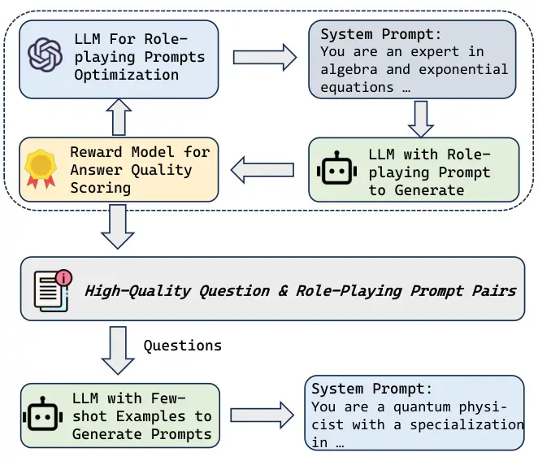
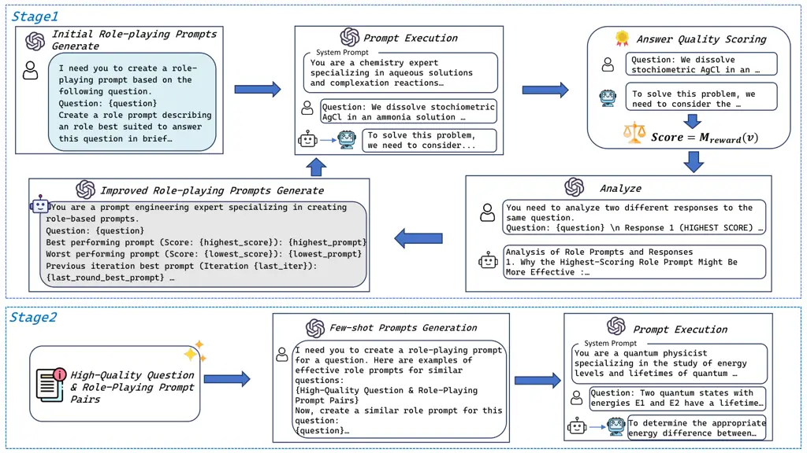

# ORPP: Self-Optimizing Role-playing Prompts to Enhance Language Model Capabilities

Yifan Duan    Yihong Tang Affiliation: Kehai Chen²²footnotemark: 2 ,
Liqiang Nie, Min Zhang Affiliation: Harbin Institute of Technology,
Shenzhen, China Affiliation: {ziye_0926@outlook.com,
chenkehai@hit.edu.cn}

###### Abstract

^(†)^(†)footnotetext: Corresponding author.

High-quality prompts are crucial for eliciting outstanding performance
from large language models (LLMs) on complex tasks. Existing research
has explored model-driven strategies for prompt optimization. However,
these methods often suffer from high computational overhead or require
strong optimization capabilities from the model itself, which limits
their broad applicability. To address these challenges, we propose ORPP
(Optimized Role-Playing Prompt),a framework that enhances model
performance by optimizing and generating role-playing prompts. The core
idea of ORPP is to confine the prompt search space to role-playing
scenarios, thereby fully activating the model’s intrinsic capabilities
through carefully crafted, high-quality role-playing prompts.
Specifically, ORPP first performs iterative optimization on a small
subset of training samples to generate high-quality role-playing
prompts. Then, leveraging the model’s few-shot learning capability, it
transfers the optimization experience to efficiently generate suitable
prompts for the remaining samples. Our experimental results show that
ORPP not only matches but in most cases surpasses existing mainstream
prompt optimization methods in terms of performance. Notably, ORPP
demonstrates superior “plug-and-play” capability. In most cases, it can
be integrated with various other prompt methods and further enhance
their effectiveness.

## 1 Introduction

Large language models (LLMs) have demonstrated outstanding performance
in handling various complex tasks Marco et al. (2024); Li and Lan
(2025); Son et al. (2024). To fully unleash the capabilities of these
models, carefully designed prompts have been extremely important Wu
et al. (2024). Research has shown that specific prompt strategies can
significantly influence the depth of reasoning and creativity of models
in particular tasks Xiang et al. (2025). However, manually designing
prompts is challenging and labor-intensive. As a result, researchers
have begun to explore leveraging the capabilities of LLMs themselves to
automatically generate prompts, opening up new avenues for the field of
prompt engineering.



Figure 1: ORPP: A two-stage framework for generating and optimizing
role-playing prompts, combining iterative optimization and few-shot
learning.

Although techniques such as iterative optimization, textual gradient,
and self-supervised prompt optimization have shown the potential of LLMs
to design high-quality prompts, these methods still face significant
challenges Yuksekgonul et al. (2024); Wang et al. (2024d); Xiang et al.
(2025). For example, iterative optimization methods often require large
amounts of data to evaluate prompt quality, resulting in high
computational costs. Self-supervised prompt optimization relies on the
intrinsic evaluation capabilities of LLMs, which significantly reduces
costs but places higher demands on the performance of the LLM
itself Xiang et al. (2025). In addition, searching within the vast
prompt space further increases the difficulty of discovering
high-quality prompts.

Previous studies have shown that by setting specific role-playing
prompts, the reasoning ability and creativity of LLMs can be enhanced,
thereby improving their performance in both closed and open-ended
tasks Chen et al. (2024b); Kong et al. (2024a); Lu et al. (2024b). For
example, guiding the model to play the role of an expert in a specific
professional field, or simulating a character with a particular way of
thinking, can prompt the model to examine problems from multiple
perspectives. This finding reveals a way for LLMs to further stimulate
their potential by simulating human roles. However, existing methods
mostly rely on manually preset role-playing prompts, making it difficult
to automatically generate high-quality corresponding role settings
according to specific task requirements, which limits the possibility of
further improving model performance through automatic role simulation.

Based on the above research insights, this paper proposes a novel
role-playing-based prompt optimization method. Unlike existing methods,
our approach focuses on role-playing prompts and aims to generate
high-quality role-playing prompts to enhance the reasoning ability of
large language models. This method can automatically generate optimized
role-playing prompts for specific tasks, effectively stimulating the
model’s potential in particular task scenarios through role-playing. In
addition, as a plug-and-play modular component, our method can be
combined with existing prompt engineering techniques to further improve
the performance of other methods.

Experimental results show that our method significantly enhances model
performance in closed tasks by generating high-quality role-playing
prompts. Furthermore, experiments verify the effectiveness of our method
as a plugin, demonstrating that it can work synergistically with various
existing methods and further improve their overall performance in most
cases. Our exploratory experiments reveal that role-playing prompts
generated by smaller-parameter models can be successfully transferred to
larger-parameter models and exhibit excellent performance, further
demonstrating the generalization potential of our prompt generation
method.

Our main contributions are as follows:

1.  1.  We propose a novel role-playing-based prompt optimization framework,
        which enhances the performance of large language models on specific
        tasks by automatically generating high-quality role-playing prompts.
2.  2.  We show that our method works as a plug-and-play module and can be
        combined with different prompt engineering techniques. In most
        cases, it helps these techniques achieve even better results.
3.  3.  By focusing on role-playing prompts, our approach reduces the
        difficulty of prompt optimization, and the generated prompts
        demonstrate strong transferability.

## 2 Related Work

#### Role-Playing

Large language models (LLMs) have demonstrated great potential in the
field of role-playing Lu et al. (2024a); Chuang et al. (2024); Tang
et al. (2024). Through carefully designed prompts or targeted
fine-tuning, LLMs can simulate the language style, personality traits,
and knowledge systems of specific characters, successfully portraying a
wide range of roles from historical figures to fictional literary
characters Chen et al. (2024a); Shao et al. (2023). Further research has
revealed that endowing LLMs with specific roles can unlock deeper
capabilities of the models. Appropriately designed role-playing prompts
have been proven to effectively enhance the model’s creativity in
open-ended tasks and improve its performance in closed tasks  Kong
et al. (2024b); Lu et al. (2024b); Kong et al. (2024c). However, current
approaches often rely on manually crafted role-playing prompts or use
fine-tuned models to generate prompts. The models themselves struggle to
autonomously generate high-quality role-playing prompts that can
significantly improve task performance. Our work employs automatic
prompt optimization techniques, enabling the model to generate
high-quality role-playing prompts for itself that are tailored to
specific tasks.

#### Prompt Optimization

Carefully crafted prompts are crucial for optimizing the performance of
large language models (LLMs) Wang et al. (2024b); Wei et al. (2022);
Wang et al. (2024d). However, creating effective prompts often requires
in-depth task-specific knowledge. In recent years, researchers have
begun to explore leveraging the capabilities of LLMs themselves to
automatically generate high-quality prompts Fernando et al. (2023); Wang
et al. (2024d); Gao et al. (2025). This strategy not only reduces
reliance on human expertise but also enables the dynamic generation of
more targeted prompts according to specific task requirements, with the
PO method demonstrating great potential in this process. However, when
dealing with complex tasks, relying on LLMs to generate high-quality
prompts usually requires the model to possess strong comprehension
abilities Wang et al. (2024c). At the same time, searching for
high-quality prompts within an unrestricted prompt space further
increases the difficulty and cost of optimization.Our work proposes
optimizing role-playing prompts to further unlock the potential of
LLMs Pryzant et al. (2023). By constraining the optimization space of
prompts, role-playing prompts reduce the difficulty of generating
high-quality prompts and can be flexibly integrated as plugin modules
into existing research frameworks.

## 3 Method

Our method is divided into two stages: First, through iterative
optimization, we find high-quality role-playing prompts for sample data
that can effectively elicit the model’s capabilities. Then, these
optimal prompts are used as few-shot examples to guide the model in
generating corresponding role prompts for other problems.



Figure 2: Illustration of ORPP: A two-stage role-playing prompt
generation and optimization framework that combines iterative
optimization and few-shot learning. Using a real example from GPQA, in
Stage One, high-quality role-playing prompts are identified for sample
data through an iterative optimization process. In Stage Two, these
optimized High-Quality Question & Role-Playing Prompt Pairs are used as
few-shot examples to guide the model in generating corresponding
role-playing prompts for new questions, thereby efficiently improving
the model’s performance on a wide range of questions.

### 3.1 Optimization Objective

Role-playing prompt optimization aims to automatically generate the
optimal role-playing prompt R for an input question Q. Its core
objective is to set the most effective role prompt for the model,
thereby maximizing the model’s performance on that question. This
optimization objective can be represented as:

```math
R^{*}=\underset{R\in\mathcal{R}}{\arg\max}\ \mathcal{S}(\mathcal{M}(Q|R))
```

where $`\mathcal{R}`$ represents the space of candidate role-playing
prompts, the scale of which is significantly reduced compared to
traditional prompt optimization. $`\mathcal{M}(Q|R)`$ denotes the output
generated by model M for question Q given the role-playing prompt R. And
$`\mathcal{S}`$ is the evaluation function used to quantify the quality
of the model’s output.

### 3.2 Optimization Process

The optimization process first generates role-playing prompts for the
extracted samples, and then iteratively refines them to ensure these
prompts meet high-quality standards. The resulting pairs of high-quality
samples and prompts will be used for subsequent few-shot transfer
learning.

As shown in Algorithm 1, the optimization process mainly relies on the
model’s own reasoning and generation capabilities to achieve automatic
iteration and improvement of prompts. Previous studies have shown that
the quality of prompts is reflected in the performance of the model’s
output Deng et al. (2023); Xiang et al. (2025). Based on this, our
method relies on evaluating the quality of the model’s output to
optimize the prompts.This is accomplished through using a reward model.

First, a small sample set $`Q`$ is selected from the dataset. For each
question $`q\in Q`$, the model $`\mathcal{M}`$ generates a baseline
answer $`A_{\text{base}}(q)=\mathcal{M}(q)`$ without any specific role
prompt. Then, the reward model $`\mathcal{M}_{\text{reward}}`$ evaluates
this baseline answer to obtain a baseline score
$`\mathcal{S}(q)=\mathcal{M}_{\text{reward}}(q,A_{\text{base}}(q))`$,
which serves as a reference standard for measuring the effectiveness of
subsequent role-playing prompts.

During the optimization phase, for each question $`q`$, the model first
generates $`k`$ initial candidate role-playing prompts to form the
initial prompt set $`R_{0}(q)`$. Then, $`N`$ rounds of iterative
optimization are performed. In each round $`i`$, the model uses each
prompt $`R\in R_{i-1}(q)`$ from the current prompt set to generate an
answer $`\mathcal{M}(q|R)`$. The reward model
$`\mathcal{M}_{\text{reward}}`$ then calculates the score
$`\mathcal{S}({M}(q|R))`$. Throughout all rounds, the system
continuously records the highest-scoring prompt found so far for
question $`q`$, denoted $`R_{\text{best}}(q)`$, and the lowest-scoring
prompt, $`R_{\text{worst}}(q)`$, updating them as better or worse
prompts are discovered in each round’s evaluations.

In the analysis and improvement phase of each iteration $`i`$, where the
goal is to generate the new prompt set $`R_{i}(q)`$ based on the
evaluation of $`R_{i-1}(q)`$: The model receives comprehensive feedback.
This includes the globally best-performing prompt $`R_{\text{best}}(q)`$
and globally worst-performing prompt $`R_{\text{worst}}(q)`$ identified
across all rounds up to and including the evaluation of the set
$`R_{i-1}(q)`$, along with their corresponding answers and scores.
Crucially, to avoid falling into cycles or local optima, the model also
considers the global best prompt from the end of the immediately
preceding iteration, $`R_{\text{best}}^{\text{prev\_iter}}(q)`$ .

Based on this rich feedback, the model analyzes the reasons for
performance differences. This analytical process can be conceptualized
as estimating the effective "text gradient" of the reward function
$`\mathcal{S}`$ with respect to the prompt $`R`$, denoted as
$`\mathcal{A}^{(i-1)}=\nabla_{R}\mathcal{S}(R_{\text{ref}}^{(i-1)};q)`$.
This gradient provides directional guidance for prompt optimization.
Here, $`R_{\text{ref}}^{(i-1)}`$ represents the reference prompt(s) from
the evaluation of $`R_{i-1}(q)`$. $`\mathcal{A}^{(i-1)}`$ contains the
full analytical context of the evaluation.

Based on this "gradient", the system formulates targeted improvement
suggestions. Following these suggestions, the model generates a new set
of $`k`$ candidate role-playing prompts,
$`\{R_{j}^{(i)}(q)|j=1,\dots,k\}`$, which collectively form the next
prompt set $`R_{i}(q)`$. The generation of each new candidate prompt
$`R_{j}^{(i)}(q)`$ can be described by the following transformation:

```math
R_{j}^{(i)}(q)=\mathcal{T}_{\text{gen}}\left(R_{\text{set}}^{(i-1)}(q),\nabla_{R}\mathcal{S},T\right)
```

where $`R_{\text{set}}^{(i-1)}(q)`$ is the prompt set, based on the
current global best prompt $`R_{\text{best}}(q)`$, the current global
worst prompt, and the previous round’s best
prompt;$`\mathcal{T}_{\text{gen}}`$ is a model-based generative function
used to generate new role-playing prompts. $`T`$ is the temperature set
during model generation.

After $`N`$ rounds of iteration, for each question $`q`$, the prompt
with the highest score recorded across all rounds,
$`R_{\text{best}}(q)`$, which is equivalent to
$`R_{\text{best}}^{(N)}(q)`$ at this stage, is selected as the final
optimized result $`R^{*}(q)`$ for that question.

1: for all $`q\in Q`$ do

2:   $`A_{base}(q)\leftarrow\mathcal{M}(q)`$;

3:
  $`\mathcal{S}_{base}(q)\leftarrow\mathcal{M}_{reward}(q,A_{base}(q))`$

4:   for $`i=0`$ to $`N-1`$ do

5:    $`R_{set}(q)\leftarrow\mathcal{G}(\mathcal{M},q)`$

6:    for all $`R\in R_{set}(q)`$ do

7:      $`A(q,R)\leftarrow\mathcal{M}(q|R)`$;

8:      $`S_{current}\leftarrow\mathcal{M}_{reward}(q,A(q,R))`$

9:      if $`S_{current}>\mathcal{S}_{best}(q)`$ then

10:       $`\mathcal{S}_{best}(q)\leftarrow S_{current}`$;
$`R_{best}(q)\leftarrow R`$

11:      end if

12:      if $`S_{current}<\mathcal{S}_{worst}(q)`$ then

13:       $`\mathcal{S}_{worst}(q)\leftarrow S_{current}`$;
$`R_{worst}(q)\leftarrow R`$

14:      end if

15:    end for

16:   end for

17:   $`R^{*}(q)\leftarrow R_{best}(q)`$

18: end for

Algorithm 1 Simplified Optimization Process Of ORPP

### 3.3 Prompts Generation

After identifying a high-quality role-playing prompt $`R^{*}(q)`$ for
each question $`q`$ in the randomly selected training subset during the
optimization phase, we adopt a few-shot approach to generalize this
optimization capability to test questions, as shown in Algorithm 2.

Specifically, we first select the top $`m`$ highest-quality "question
and optimal role-playing prompt" pairs $`(q_{train},R^{*}(q_{train}))`$
from the optimized samples to construct a few-shot example set
$`E_{fs}`$. The quality of each pair is evaluated based on the
improvement in answer score when using the role-playing prompt compared
to answering without one.

Next, for each new question $`q`$ in the test set $`Q_{test}`$, the
model $`\mathcal{M}`$ receives the new question $`q`$ along with the
few-shot example set $`E_{fs}`$ as input. Through few-shot learning, the
model can understand the association patterns between questions and
prompts in the examples, and based on this understanding, infer and
generate an appropriate role-playing prompt $`R_{fs}(q)`$ for the
current test question. This process leverages the strong in-context
learning ability of large language models, enabling them to mimic the
patterns in the examples and produce high-quality role-playing prompts.

Finally, the generated role-playing prompt $`R_{fs}(q)`$ is used as the
system prompt, and together with the test question $`q`$ to be inputed
into the model to obtain the final answer $`A_{final}`$ for the test
question. This method avoids time-consuming multi-round optimization for
each question, significantly improves efficiency, and effectively
transfers the optimization strategies learned from the training subset
to new questions.

1: Select $`m`$ pairs $`(q_{train},R^{*}(q_{train}))`$ where
$`q_{train}\in Q_{sub}`$ to form the few-shot example set
$`E_{fs}=\{(q_{1},R^{*}(q_{1})),\dots,(q_{m},R^{*}(q_{m}))\}`$.

2: for all $`q\in Q_{test}`$ do

3:   $`R_{fs}(q)\leftarrow\mathcal{G}_{fs}(\mathcal{M},q,E_{fs})`$

4:   $`A(q,R_{fs}(q))`$ $`\leftarrow`$ $`\mathcal{M}(q|R_{fs}(q))`$

5:   $`A_{final}\leftarrow A(q,R_{fs}(q))`$

6: end for

Algorithm 2 Few-Shot Role Prompt Generation and Final Answer Generation
for Test Set

## 4 Experiments

### 4.1 Experimental Setup

#### Benchmarks

We select a diverse set of tasks to evaluate the effectiveness of our
method in enhancing model capabilities and to verify its performance
when combined with other methods as a plugin. Specifically, we choose
several tasks that rely on model reasoning abilities, including
GPQA Rein et al. (2023), MMLU-CF Zhao et al. (2024), MMLU-Pro Wang
et al. (2024e), MATH Hendrycks et al. (2021), AGIEval-Math Zhong et al.
(2023), and Med QA Jin et al. (2021). For GPQA, we use the most
challenging GPQA-diamond subset as the test set, with the remaining
questions as the training set. In MMLU-CF and MMLU-Pro, we select tasks
from four categories: mathematics, physics, chemistry, and biology.
Specifically, we randomly sample 50 data points from each category as
the training set, and use the remaining data as the test set. For MATH,
we use the highest difficulty level, level 5, as the test set. In
AGIEval-Math, we use questions with difficulty levels 4 and 5 as the
test set, with the rest as the training set. For Med QA, we use the
entire test set for evaluation. In Table 1, we present the sizes of the
training and test sets for each dataset we used. Details of the dataset
construction are provided in Appendix A.2.

| Dataset      | Training Set | Test Set |
| ------------ | ------------ | -------- |
| GPQA         | 250          | 198      |
| MMLU-CF      | 150          | 2528     |
| MMLU-Pro     | 150          | 4299     |
| MATH         | 7500         | 1324     |
| AGIEval-Math | 512          | 488      |
| Med QA       | 10178        | 1273     |

Table 1: Training and Test Set Sizes of Datasets

#### Comparison Methods

To evaluate the effectiveness of our proposed role-playing-based prompt
optimization method in enhancing the reasoning capabilities of large
language models, we compare it with various advanced prompt engineering
techniques. In this study, direct question input was set as the
baseline. In the controlled experiments, we select several classic
prompting methods, including Chain-of-Thought  Wei et al. (2022),
Rephrase  Deng et al. (2023), and Step-Back  Zheng et al. (2024). In
addition, our method was also compared with current state-of-the-art
prompt optimization approaches such as OPRO Yang et al. (2024) and
SPO Xiang et al. (2025). Detailed experimental configurations for each
comparison method can be found in the Appendix B.2. To further confirm
the practical application potential of our method as a plugin, we also
explore its combination with the aforementioned techniques and conduct
relevant studies on these combinations.

#### Implementation Details

This study selects two models of different scales, Qwen2.5-14B and
Qwen2.5-32B Team (2024), for experimental validation. All models are
deployed using vLLM Kwon et al. (2023), and inference is performed on
NVIDIA L20 GPUs. To ensure the reproducibility of the experiments, we
set a fixed random seed of 42 and use it to sample initial instances
from the training set. During the prompt optimization phase, we randomly
select ten samples from the training set for optimization. In this
process, we employ ArmoRM-Llama3-8B-v0.1 Wang et al. (2024a) as the
reward model to evaluate the quality of the generated content. The model
is deployed using Hugging Face Transformers Wolf et al. (2019). During
the optimization phase, we will conduct ten rounds of iteration,
generating three role-playing prompts in each round. In the second
stage, we set the number of few-shot examples to 3 and further
investigate the impact of different numbers of examples on the final
model performance in subsequent experiments.

Regarding the temperature parameter, we set it to 0.2 only when
generating role-playing prompts to introduce moderate diversity. In all
other generation and evaluation steps, the temperature is set to 0 to
ensure deterministic outputs. In the subsequent transfer application
stage, in order to maintain consistency and reproducibility, the
temperature remains 0 for both generating role-playing prompts and
producing final answers with the model. Detailed experimental settings
for the comparative methods are presented in the appendix.

### 4.2 Experiments Results

#### Main Results

In Table 2, we present the performance of our method compared with other
approaches on various benchmark tests. It shows that our method achieves
outstanding results in most tasks, especially on multiple tasks such as
GPQA, AGIEval-Math, and MMLU-PRO, where it achieves the best performance
on its own. This fully demonstrates the effectiveness of high-quality
role-playing prompts in improving model performance and validates the
effectiveness of our approach. It is worth emphasizing that, before
being used as a plugin, our method alone can effectively enhance the
model’s performance and achieve results comparable to advanced
prompt-based methods.

|             |               |               |               |               |               |               |
| ----------- | ------------- | ------------- | ------------- | ------------- | ------------- | ------------- |
| Method      | GPQA          | AGIEval-MATH  | MATH          | MMLU-Pro      | MMLU-CF       | Med QA        |
| Qwen2.5-14B |               |               |               |               |               |               |
| base        | 43.43         | 67.21         | 59.29         | 71.27         | 70.02         | 63.63         |
| CoT         | 43.94 (+0.51) | 68.24 (+1.03) | 60.57 (+1.28) | 71.85 (+0.58) | 71.88 (+1.86) | 66.69 (+3.06) |
| Rephrase    | 40.40 (-3.03) | 68.24 (+1.03) | 58.01 (-1.28) | 72.27 (+1.00) | 72.47 (+2.45) | 66.06 (+2.43) |
| Step-back   | 43.43 (+0.00) | 70.08 (+2.87) | 57.85 (-1.44) | 72.18 (+0.91) | 72.19 (+2.17) | 65.83 (+2.20) |
| OPRO        | 43.94 (+0.51) | 68.85 (+1.64) | 61.78 (+2.49) | 70.99 (-0.28) | 71.24 (+1.22) | 65.20 (+1.57) |
| SPO         | 42.93 (-0.50) | 68.24 (+1.03) | 59.74 (+0.45) | 73.34 (+2.07) | 70.93 (+0.91) | 64.57 (+0.94) |
| ORPP        | 45.45 (+2.02) | 70.29 (+3.08) | 62.24 (+2.95) | 72.85 (+1.58) | 71.12 (+1.10) | 65.67 (+2.04) |
| Qwen2.5-32B |               |               |               |               |               |               |
| base        | 42.93         | 73.36         | 65.33         | 75.62         | 73.38         | 65.67         |
| CoT         | 46.46 (+3.53) | 74.59 (+1.23) | 65.94 (+0.61) | 75.53 (-0.09) | 76.48 (+3.10) | 69.21 (+3.54) |
| Rephrase    | 47.47 (+4.54) | 70.49 (-2.87) | 62.84 (-2.49) | 76.16 (+0.54) | 75.12 (+1.74) | 68.19 (+2.52) |
| Step-back   | 47.98 (+5.05) | 72.34 (-1.02) | 62.31 (-3.02) | 75.65 (+0.03) | 76.34 (+2.96) | 69.91 (+4.24) |
| OPRO        | 43.94 (+1.01) | 76.43 (+3.07) | 63.67 (-1.66) | 76.13 (+0.51) | 75.91 (+2.53) | 66.77 (+1.10) |
| SPO         | 43.43 (+0.50) | 71.93 (-1.43) | 62.92 (-2.41) | 76.51 (+0.89) | 75.71 (+2.33) | 69.44 (+3.77) |
| ORPP        | 49.49 (+6.56) | 75.20 (+1.84) | 67.45 (+2.12) | 76.86 (+1.24) | 74.33 (+0.95) | 67.40 (+1.73) |

Table 2: Comparison of test results on the six benchmarks between other
prompt methods and role-playing prompt optimization, using both
Qwen2.5-14B and Qwen2.5-32B models, with relative improvements shown.

#### Plugin Integration Effects

Our approach focuses on optimizing and generating the final system
prompt, rather than the user prompt, which allows it to be flexibly
integrated as a plugin with various existing prompt strategies. In a
series of comparative experiments (see Table X), we present a detailed
evaluation of our method when combined with other approaches. The
results show that, for most tasks such as MMLU-PRO, MMLU-CF, and MedQA,
our method can effectively enhance the performance of existing methods.
However, this performance improvement is not always consistently
reproducible. In certain cases, the final performance after integration
may be inferior to using our method (OPRR) alone. We also observed that,
for some specific tasks, our method could have a negative impact on
certain existing approaches, resulting in decreased performance. These
findings suggest the great potential of our method as a plugin. At the
same time, they indicate that achieving optimal results requires careful
consideration of the specific tasks and methods involved; simple
stacking or combination may not always yield the expected outcomes.

|             |               |               |               |               |               |               |
| ----------- | ------------- | ------------- | ------------- | ------------- | ------------- | ------------- |
| Method      | GPQA          | AGIEval-MATH  | MATH          | MMLU-Pro      | MMLU-CF       | Med QA        |
| Qwen2.5-14B |               |               |               |               |               |               |
| CoT⁺        | 42.93 (-1.01) | 71.52 (+3.28) | 61.93 (+1.36) | 74.02 (+2.17) | 72.78 (+0.90) | 66.85 (+0.16) |
| Rephrase⁺   | 42.93 (+2.53) | 70.49 (+2.25) | 61.40 (+3.39) | 72.62 (+0.35) | 72.71 (+0.24) | 67.95 (+1.89) |
| Step-back⁺  | 42.42 (-1.01) | 67.62 (-2.46) | 59.67 (+1.82) | 72.58 (+0.40) | 72.85 (+0.66) | 68.97 (+3.14) |
| OPRO⁺       | 40.40 (-3.54) | 69.47 (+0.62) | 61.10 (-0.68) | 73.53 (+2.54) | 72.15 (+0.91) | 65.91 (+0.71) |
| SPO⁺        | 40.40 (-2.53) | 70.08 (+1.84) | 61.63 (+1.89) | 73.25 (-0.09) | 70.73 (-0.20) | 66.06 (+1.49) |
| Qwen2.5-32B |               |               |               |               |               |               |
| CoT⁺        | 42.42 (-4.04) | 73.57 (-1.02) | 65.48 (-0.46) | 77.88 (+2.35) | 76.19 (-0.29) | 71.17 (+1.96) |
| Rephrase⁺   | 47.47 (+0.00) | 71.11 (+0.62) | 64.12 (+1.28) | 77.65 (+1.49) | 75.16 (+0.04) | 68.50 (+0.31) |
| Step-back⁺  | 44.95 (-3.03) | 72.54 (+0.20) | 62.76 (+0.45) | 77.58 (+1.93) | 76.34 (+0.00) | 72.11 (+2.20) |
| OPRO⁺       | 46.97 (+3.03) | 74.18 (-2.25) | 64.20 (+0.53) | 77.93 (+1.80) | 75.47 (-0.44) | 69.84 (+3.07) |
| SPO⁺        | 44.96 (+1.53) | 70.94 (-0.99) | 63.37 (+0.45) | 77.30 (+0.79) | 75.67 (-0.04) | 70.31 (+0.87) |

Table 3: Performance of ORPP combined with other methods on six
evaluation benchmarks. ⁺ indicates that the method is combined with
ORPP, and the number in parentheses represents the performance
difference compared to the original method.

Figure 3: The impact of the number of High-Quality Question &
Role-Playing Prompt Pairs in the few-shot examples on the final accuracy
of role-playing prompt generation in the second stage.

#### Effect of Number of Examples

Based on Qwen-14B, we further explore the impact of the number of
High-Quality Question & Role-Playing Prompt Pairs in the few-shot
examples on the final accuracy of role-playing prompt generation in the
second stage. The results are shown in Figure 3.In different task
scenarios, the relationship between model performance and the number of
examples exhibits significant fluctuations. Especially in test sets such
as GPQA and AGIEval-MATH, the model shows notable performance variations
as the number of examples changes. Experimental analysis reveals that
there is no specific number of examples that consistently yields
superior results across all tasks. This phenomenon suggests that the
optimal number of examples may be closely related to the characteristics
of each specific task, and dedicated tuning is required for different
application scenarios.

#### Prompt Transferability

We further explore the transferability of role-playing prompts.
Specifically, we apply the role-playing prompts generated by Qwen-14B to
the Qwen-32B and conduct performance tests. As shown in the figure, it
is noteworthy that, except for a performance drop on the GPQA dataset,
using the role-playing prompts generated by Qwen-14B actually improves
the performance of Qwen-32B on other tasks. This finding fully suggests
the excellent transferability of the role-playing prompts generated by
our proposed method and reveals the potential of optimizing smaller
models to generate high-quality role-playing prompts that can be
successfully transferred to larger models.

Figure 4: A comparison of the accuracy on different benchmarks under
three settings: using role-playing prompts generated by Qwen2.5-32B
itself, using role-playing prompts generated by Qwen2.5-14B, and without
using any role-playing prompts.

### 4.3 Influence of Role-playing Prompts

We apply t-SNE van der Maaten and Hinton (2008) to visualize the hidden
states of different layers of the model on GPQA data points in Figure 5
to investigate whether the model can spontaneously recognize changes in
reasoning patterns triggered by role-playing prompts.

In the shallow processing stage of the model, the states of role-playing
prompts and non-role-playing prompts gradually show a trend of
separation. By the middle layer, these two types of prompts are clearly
clustered into two distinct categories. This phenomenon indicates that
the model can effectively identify role-playing prompts and perform
discriminative analysis.

As information enters the deeper layers, interestingly, these two states
begin to gradually merge. At the deepest level, some representations are
completely intertwined, while others remain close but still form
separate clusters. This pattern reveals that the model can interpret
questions in different ways based on previously received role-playing
prompts, thereby generating innovative lines of thought.

Figure 5: t-SNE visualization of the hidden states of queries with and
without role-playing prompts.

### 4.4 Case Study

To further evaluate the effectiveness of our approach, we present case
studies in Appendix C. In these studies, we not only demonstrate
examples of iterative optimization of role-playing prompts, but also
illustrate the effectiveness of role-playing prompts generated by our
method in few-shot transfer scenarios. In addition, we provide concrete
examples to clearly compare the model’s performance with and without the
use of role-playing prompts.

## 5 Conclusion

We proposes an automated role-playing prompt optimization method. The
method iteratively optimizes role-playing prompts on a small number of
samples and leverages these optimized instances for few-shot learning,
enabling the model to autonomously generate high-quality role-playing
prompts and thus improve its performance on target tasks. ORPP not only
enhances model performance on tasks but can also serve as a
plug-and-play module that integrates with existing prompt engineering
techniques. Experimental results show that ORPP can effectively improve
the model’s task performance. Furthermore, when ORPP is combined with
other prompt engineering methods, model performance can be further
enhanced, demonstrating its strong compatibility. Overall, ORPP provides
an effective new approach for automated prompt engineering, namely by
automatically generating high-quality role-playing prompts to stimulate
model performance.

## Limitations

Overall, utilizing high-quality role-playing prompts generally enhances
the performance of the model. However, in certain specific tasks,
introducing role-playing prompts not only fails to improve performance
but also negatively impacts the model’s capabilities, thereby affecting
the accuracy of the final output. Future research will further explore
in which contexts role-playing prompts should be used in order to avoid
their potential negative effects.

When our method is used as a plugin in combination with other methods,
it can further improve the performance of those methods in most cases.
However, in some situations, it may still have a negative impact.
Additionally, when our method is used as a plugin, its performance may
sometimes be inferior to using our method alone. In the future, we will
further explore better ways of integration to fully realize the
potential of our method as a plugin.

## Ethics Statement

Our method improves model performance through high-quality role-playing
prompts. During the experiments, we select publicly available
closed-domain benchmarks for testing to minimize the risk of generating
harmful content. It should be noted that role-playing scenarios may
result in biased outputs or hallucinations from the model. Therefore,
potential ethical issues should be carefully considered in role-playing
settings to avoid generating inappropriate, biased, or misleading
content.

## References

- Chen et al. (2024a) Jiangjie Chen, Xintao Wang, Rui Xu, Siyu Yuan,
  Yikai Zhang, Wei Shi, Jian Xie, Shuang Li, Ruihan Yang, Tinghui Zhu,
  Aili Chen, Nianqi Li, Lida Chen, Caiyu Hu, Siye Wu, Scott Ren, Ziquan
  Fu, and Yanghua Xiao. 2024a. From persona to personalization: A survey
  on role-playing language agents. _ArXiv_, abs/2404.18231.
- Chen et al. (2024b) Jing Chen, Xinyu Zhu, Cheng Yang, Chufan Shi,
  Yadong Xi, Yuxiang Zhang, Junjie Wang, Jiashu Pu, Rongsheng Zhang,
  Yujiu Yang, and Tian Feng. 2024b. Hollmwood: Unleashing the creativity
  of large language models in screenwriting via role playing. In
  _Conference on Empirical Methods in Natural Language Processing_.
- Chuang et al. (2024) Yun-Shiuan Chuang, Zach Studdiford, Krirk
  Nirunwiroj, Agam Goyal, Vincent V. Frigo, Sijia Yang, Dhavan Shah,
  Junjie Hu, and Timothy T. Rogers. 2024. Beyond demographics: Aligning
  role-playing llm-based agents using human belief networks. _ArXiv_,
  abs/2406.17232.
- Deng et al. (2023) Yihe Deng, Weitong Zhang, Zixiang Chen, and
  Quanquan Gu. 2023. Rephrase and respond: Let large language models ask
  better questions for themselves. _ArXiv_, abs/2311.04205.
- Fernando et al. (2023) Chrisantha Fernando, Dylan Banarse, Henryk
  Michalewski, Simon Osindero, and Tim Rocktäschel. 2023. Promptbreeder:
  Self-referential self-improvement via prompt evolution. _ArXiv_,
  abs/2309.16797.
- Gao et al. (2025) Shuzheng Gao, Chaozheng Wang, Cuiyun Gao, Xiaoqian
  Jiao, Chun Yong Chong, Shan Gao, and Michael R. Lyu. 2025. The prompt
  alchemist: Automated llm-tailored prompt optimization for test case
  generation. _ArXiv_, abs/2501.01329.
- Hendrycks et al. (2021) Dan Hendrycks, Collin Burns, Saurav Kadavath,
  Akul Arora, Steven Basart, Eric Tang, Dawn Song, and Jacob
  Steinhardt. 2021. Measuring mathematical problem solving with the math
  dataset. _NeurIPS_.
- Jin et al. (2021) Di Jin, Eileen Pan, Nassim Oufattole, Wei-Hung Weng,
  Hanyi Fang, and Peter Szolovits. 2021. What disease does this patient
  have? a large-scale open domain question answering dataset from
  medical exams. _Applied Sciences_, 11(14):6421.
- Kong et al. (2024a) Aobo Kong, Shiwan Zhao, Hao Chen, Qicheng Li, Yong
  Qin, Ruiqi Sun, Xin Zhou, Enzhi Wang, and Xiaohang Dong. 2024a.
  [Better zero-shot reasoning with role-play
  prompting](https://doi.org/10.18653/v1/2024.naacl-long.228). In
  _Proceedings of the 2024 Conference of the North American Chapter of
  the Association for Computational Linguistics: Human Language
  Technologies (Volume 1: Long Papers)_, pages 4099–4113, Mexico City,
  Mexico. Association for Computational Linguistics.
- Kong et al. (2024b) Aobo Kong, Shiwan Zhao, Hao Chen, Qicheng Li, Yong
  Qin, Ruiqi Sun, Xin Zhou, Enzhi Wang, and Xiaohang Dong. 2024b.
  [Better zero-shot reasoning with role-play
  prompting](https://arxiv.org/abs/2308.07702). _Preprint_,
  arXiv:2308.07702.
- Kong et al. (2024c) Aobo Kong, Shiwan Zhao, Hao Chen, Qicheng Li, Yong
  Qin, Ruiqi Sun, Xin Zhou, Jiaming Zhou, and Haoqin Sun. 2024c.
  [Self-prompt tuning: Enable autonomous role-playing in
  llms](https://doi.org/10.48550/arXiv.2407.08995). _CoRR_,
  abs/2407.08995.
- Kwon et al. (2023) Woosuk Kwon, Zhuohan Li, Siyuan Zhuang, Ying Sheng,
  Lianmin Zheng, Cody Hao Yu, Joseph E. Gonzalez, Hao Zhang, and Ion
  Stoica. 2023. Efficient memory management for large language model
  serving with pagedattention. In _Proceedings of the ACM SIGOPS 29th
  Symposium on Operating Systems Principles_.
- Li and Lan (2025) Xinyuan Li and Yunshi Lan. 2025. Large language
  models are good annotators for type-aware data augmentation in
  grammatical error correction. In _Proceedings of the 31st
  International Conference on Computational Linguistics_, pages 199–213,
  Abu Dhabi, UAE. Association for Computational Linguistics.
- Lu et al. (2024a) Keming Lu, Bowen Yu, Chang Zhou, and Jingren Zhou.
  2024a. Large language models are superpositions of all characters:
  Attaining arbitrary role-play via self-alignment. _ArXiv_,
  abs/2401.12474.
- Lu et al. (2024b) Li-Chun Lu, Shou-Jen Chen, Tsung-Min Pai, Chan-Hung
  Yu, Hung yi Lee, and Shao-Hua Sun. 2024b. Llm discussion: Enhancing
  the creativity of large language models via discussion framework and
  role-play. _ArXiv_, abs/2405.06373.
- Marco et al. (2024) Guillermo Marco, Julio Gonzalo, Ram’on del
  Castillo, and Mar’ia Teresa Mateo Girona. 2024. Pron vs prompt: Can
  large language models already challenge a world-class fiction author
  at creative text writing? In _Conference on Empirical Methods in
  Natural Language Processing_.
- Pryzant et al. (2023) Reid Pryzant, Dan Iter, Jerry Li, Yin Tat Lee,
  Chenguang Zhu, and Michael Zeng. 2023. Automatic prompt optimization
  with "gradient descent" and beam search. In _Conference on Empirical
  Methods in Natural Language Processing_.
- Rein et al. (2023) David Rein, Betty Li Hou, Asa Cooper Stickland,
  Jackson Petty, Richard Yuanzhe Pang, Julien Dirani, Julian Michael,
  and Samuel R. Bowman. 2023. Gpqa: A graduate-level google-proof q&a
  benchmark. _ArXiv_, abs/2311.12022.
- Shao et al. (2023) Yunfan Shao, Linyang Li, Junqi Dai, and Xipeng
  Qiu. 2023. [Character-LLM: A trainable agent for
  role-playing](https://openreview.net/forum?id=AptTXihnhH). In _The
  2023 Conference on Empirical Methods in Natural Language Processing_.
- Son et al. (2024) Guijin Son, Sangwon Baek, Sangdae Nam, Ilgyun Jeong,
  and Seungone Kim. 2024. Multi-task inference: Can large language
  models follow multiple instructions at once? In _Annual Meeting of the
  Association for Computational Linguistics_.
- Tang et al. (2024) Yihong Tang, Bo Wang, Dongming Zhao, Jinxiaojia
  Jinxiaojia, Zhangjijun Zhangjijun, Ruifang He, and Yuexian Hou. 2024.
  [Morpheus: Modeling role from personalized dialogue history by
  exploring and utilizing latent
  space](https://aclanthology.org/2024.emnlp-main.437). In _EMNLP_,
  pages 7664–7676.
- Team (2024) Qwen Team. 2024. [Qwen2.5: A party of foundation
  models](https://qwenlm.github.io/blog/qwen2.5/).
- van der Maaten and Hinton (2008) Laurens van der Maaten and Geoffrey
  Hinton. 2008. [Visualizing data using
  t-sne](http://jmlr.org/papers/v9/vandermaaten08a.html). _Journal of
  Machine Learning Research_, 9(86):2579–2605.
- Wang et al. (2024a) Haoxiang Wang, Wei Xiong, Tengyang Xie, Han Zhao,
  and Tong Zhang. 2024a. Interpretable preferences via multi-objective
  reward modeling and mixture-of-experts. In _Conference on Empirical
  Methods in Natural Language Processing_.
- Wang et al. (2024b) Li Wang, Xi Chen, Xiangwen Deng, Hao Wen, Mi Hee
  You, Weizhi Liu, Qi Li, and Jian Li. 2024b. Prompt engineering in
  consistency and reliability with the evidence-based guideline for
  llms. _NPJ Digital Medicine_, 7.
- Wang et al. (2024c) Lili Wang, Ruiyuan Song, Weitong Guo, and Hongwu
  Yang. 2024c. Exploring prompt pattern for generative artificial
  intelligence in automatic question generation. _Interactive Learning
  Environments_, 33:2559 – 2584.
- Wang et al. (2024d) Xinyuan Wang, Chenxi Li, Zhen Wang, Fan Bai,
  Haotian Luo, Jiayou Zhang, Nebojsa Jojic, Eric Xing, and Zhiting Hu.
  2024d. [Promptagent: Strategic planning with language models enables
  expert-level prompt
  optimization](https://openreview.net/forum?id=22pyNMuIoa). In _The
  Twelfth International Conference on Learning Representations_.
- Wang et al. (2024e) Yubo Wang, Xueguang Ma, Ge Zhang, Yuansheng Ni,
  Abhranil Chandra, Shiguang Guo, Weiming Ren, Aaran Arulraj, Xuan He,
  Ziyan Jiang, Tianle Li, Max W.F. Ku, Kai Wang, Alex Zhuang,
  Rongqi "Richard" Fan, Xiang Yue, and Wenhu Chen. 2024e. Mmlu-pro: A
  more robust and challenging multi-task language understanding
  benchmark. _ArXiv_, abs/2406.01574.
- Wei et al. (2022) Jason Wei, Xuezhi Wang, Dale Schuurmans, Maarten
  Bosma, Ed H. Chi, F. Xia, Quoc Le, and Denny Zhou. 2022. Chain of
  thought prompting elicits reasoning in large language models. _ArXiv_,
  abs/2201.11903.
- Wolf et al. (2019) Thomas Wolf, Lysandre Debut, Victor Sanh, Julien
  Chaumond, Clement Delangue, Anthony Moi, Pierric Cistac, Tim Rault,
  Rémi Louf, Morgan Funtowicz, Joe Davison, Sam Shleifer, Patrick von
  Platen, Clara Ma, Yacine Jernite, Julien Plu, Canwen Xu, Teven Le
  Scao, Sylvain Gugger, and 3 others. 2019. Huggingface’s transformers:
  State-of-the-art natural language processing. _ArXiv_, abs/1910.03771.
- Wu et al. (2024) Yurong Wu, Yan Gao, Bin Benjamin Zhu, Zineng Zhou,
  Xiaodi Sun, Sheng Yang, Jian-Guang Lou, Zhiming Ding, and Linjun
  Yang. 2024. Strago: Harnessing strategic guidance for prompt
  optimization. In _Conference on Empirical Methods in Natural Language
  Processing_.
- Xiang et al. (2025) Jinyu Xiang, Jiayi Zhang, Zhaoyang Yu, Fengwei
  Teng, Jinhao Tu, Xinbing Liang, Sirui Hong, Chenglin Wu, and Yuyu
  Luo. 2025. Self-supervised prompt optimization. _ArXiv_,
  abs/2502.06855.
- Yang et al. (2024) Chengrun Yang, Xuezhi Wang, Yifeng Lu, Hanxiao Liu,
  Quoc V Le, Denny Zhou, and Xinyun Chen. 2024. [Large language models
  as optimizers](https://openreview.net/forum?id=Bb4VGOWELI). In _The
  Twelfth International Conference on Learning Representations_.
- Yuksekgonul et al. (2024) Mert Yuksekgonul, Federico Bianchi, Joseph
  Boen, Sheng Liu, Zhi Huang, Carlos Guestrin, and James Zou. 2024.
  Textgrad: Automatic "differentiation" via text. _ArXiv_,
  abs/2406.07496.
- Zhao et al. (2024) Qihao Zhao, Yangyu Huang, Tengchao Lv, Lei Cui,
  Qinzheng Sun, Shaoguang Mao, Xin Zhang, Ying Xin, Qiufeng Yin,
  Scarlett Li, and Furu Wei. 2024. Mmlu-cf: A contamination-free
  multi-task language understanding benchmark. _ArXiv_, abs/2412.15194.
- Zheng et al. (2024) Huaixiu Steven Zheng, Swaroop Mishra, Xinyun Chen,
  Heng-Tze Cheng, Ed H. Chi, Quoc V Le, and Denny Zhou. 2024. [Take a
  step back: Evoking reasoning via abstraction in large language
  models](https://openreview.net/forum?id=3bq3jsvcQ1). In _The Twelfth
  International Conference on Learning Representations_.
- Zhong et al. (2023) Wanjun Zhong, Ruixiang Cui, Yiduo Guo, Yaobo
  Liang, Shuai Lu, Yanlin Wang, Amin Saied Sanosi Saied, Weizhu Chen,
  and Nan Duan. 2023. Agieval: A human-centric benchmark for evaluating
  foundation models. In _NAACL-HLT_.

## Appendix A Prompt and Dataset

### A.1 The prompts of ORPP

In this section, we provide a detailed presentation of the prompts used
for iterative optimization in ORPP, as well as the final prompts
designed for generating role-playing scenarios in a few-shot manner.
During the analysis and optimization phases, to avoid redundant
optimization, we incorporate the best-performing role-playing prompt and
its corresponding evaluation score from the previous round. It is worth
emphasizing that we employ only direct and concise expressions in the
generation and optimization of the role-playing prompts. For specific
application domains, these prompts can be further refined to achieve
even better performance.

|                                          | PROMPT                                                                                                                                                                                                                                                                                                                                                                                                                                                                                                                                                                                                                                                                                                                                                                                                                                                                |
| ---------------------------------------- | --------------------------------------------------------------------------------------------------------------------------------------------------------------------------------------------------------------------------------------------------------------------------------------------------------------------------------------------------------------------------------------------------------------------------------------------------------------------------------------------------------------------------------------------------------------------------------------------------------------------------------------------------------------------------------------------------------------------------------------------------------------------------------------------------------------------------------------------------------------------- |
| Initial Role-playing Prompts Generation  | I need you to create a role-playing prompt based on the following question. Question: {question} Create a role prompt describing an role best suited to answer this question in brief. Important:The role prompt you generate must not include the specific text or details of the question provided above. Focus solely on defining the expert role. Only return the role prompt itself, without any additional explanation.                                                                                                                                                                                                                                                                                                                                                                                                                                         |
| The Prompt for Analyzing                 | You are an expert in evaluating AI responses to questions. You need to analyze different responses to the same question. Question: {question} Response 1 (HIGHEST SCORE, {score}): Role prompt: {Role-playing Prompt} Response: response Response 2 (LOWEST SCORE, {score}): Role prompt: {Role-playing Prompt} Response: response Additionally, consider the best role prompt from the previous iteration (Iteration {last_iter}, Score: {score}): {Role-playing Prompt} Please provide a detailed analysis of: 1. Why the highest-scoring role prompt might be more effective 2. What specific weaknesses are in the lowest-scoring role prompt 3. How the previous iteration’s best prompt influenced the results 4. What characteristics make an effective role prompt for this type of question Format your analysis as detailed paragraphs with clear insights. |
| Improved Role-playing Prompts Generation | You are a prompt engineering expert specializing in creating role-based prompts for AI. Question: {question} Best performing prompt (Score: {highest_score}): "{highest_prompt}" Worst performing prompt (Score: {lowest_score}): "{lowest_prompt}" Previous iteration best prompt (Iteration {last_iter}): "{last_round_best_prompt}" Analysis of previous role prompts: analysis Based on this analysis and the performance of previous prompts, create a new and improved role prompt that would be more effective than the best performing one. The prompt should describe a role, incorporating the strengths of the high-scoring prompt while avoiding the weaknesses of the low-scoring one. Only return the prompt itself, without any additional explanation.                                                                                                |

Table 4: Evaluation prompts for four different creativity metrics.

### A.2 Datasets

GPQA is a dataset designed to evaluate the question-answering abilities
of large language models in multidisciplinary and high-difficulty
professional domains Rein et al. (2023). Its license is CC BY 4.0. In
our experiments, following the approach of  Xiang et al. (2025), we use
GPQA-Diamond as the test set, while the remaining questions in GPQA,
excluding GPQA-Diamond, are used as the training set.

AGIEval-Math is the mathematics subset of the AGIEval dataset,
specifically designed to evaluate the reasoning and problem-solving
abilities of large language models in the field of mathematics Zhong
et al. (2023). It is licensed under the MIT License. In our experiments,
we use the more challenging ’Level 4’ and ’Level 5’ questions as the
test set, while questions of other difficulty levels are used as the
training set.

The MATH dataset is specifically designed to evaluate the mathematical
reasoning and problem-solving abilities of large language models, and is
widely used for testing and researching model performance in the field
of mathematics Hendrycks et al. (2021). It is licensed under the MIT
License. In our experiments, we retain only the "Level 5" problems in
the test set to more thoroughly assess the capabilities of the model.

The MMLU-Pro dataset is a more robust and challenging large-scale
multitask understanding benchmark that covers multiple domains, aiming
to provide a stricter evaluation of large language models Wang et al.
(2024e). It is licensed under the MIT License. We select four
domains—math, physics, chemistry, and biology—as our test set, and
sampled 50 questions from each domain to serve as the training set.

MMLU-CF is a multi-task language understanding dataset that covers a
wide range of disciplines. It is designed to address the issue of
benchmark contamination in open-source benchmark testing for large
language models, thereby providing more reliable evaluation results Zhao
et al. (2024). Its license is Community Data License Agreement –
Permissive, Version 2.0. Our processing method is the same as MMLU-Pro,
selecting only four fields for testing.The division of training and
testing sets is the same as above.

MedQA is a question answering dataset focused on the medical domain,
mainly used to evaluate the ability of artificial intelligence in
medical knowledge understanding and reasoning Jin et al. (2021). Its
license is CC BY 4.0. We choose this dataset to test the model’s
knowledge proficiency in the medical field. Since MedQA already provides
well-organized training and testing sets, we do not need to perform any
additional data processing.

## Appendix B Experiments Details

### B.1 Model Input Formulation

The model input is composed of the following components:


The model input mainly consists of two parts: the system level and the
user level. The core content at the system level is the “role-playing
prompt,” which is the main focus of our optimization efforts. At the
user level, it includes the specific “Question” of the task, as well as
optional components such as corresponding “Options,” a “Prompt”
generated by existing methods, and specific “Answer Format”
requirements.

### B.2 Implementations Configuration

Chain-of-Thought (CoT) significantly improves the performance of large
language models (LLMs) on complex tasks by guiding them to generate a
series of intermediate reasoning steps Wei et al. (2022).We use the
zero-shot CoT prompt.


Rephrase aims to improve the understanding and accuracy of responses by
large language models (LLMs) through restating and expanding on the
questions posed by users Deng et al. (2023).We refer to the work of
 Xiang et al. (2025) to set the prompts.


Step-Back Prompting is a prompting technique that guides large language
models (LLMs) to first engage in abstract thinking by extracting
high-level concepts and fundamental principles, and then proceed to
reason about specific problems Zheng et al. (2024).We refer to the work
of  Xiang et al. (2025) to set the prompts.


For the OPRO Yang et al. (2024), we set up a 10-round iterative
optimization process. In each round, the model generates 8 candidate
prompts. For each dataset, we first sample 200 examples from the
original training data to construct a new training subset. OPRO is then
comprehensively evaluated on this subset to screen for better-performing
prompts. It is worth noting that the entire process of prompt generation
and execution is performed by the evaluation model itself. As for the
temperature parameter, we follow the original OPRO settings: the
temperature is set to 1 during the prompt generation stage and adjusted
to 0 during the execution stage. Finally, we select the prompt with the
highest score on the training subset and apply it to the test set to
obtain the final results.

For SPO Xiang et al. (2025), we maintain the original configuration and
randomly select three questions from the training set for each
iteration. Each task undergoes 10 iterations. During the experiment, the
execution model and the optimization model both use the test model
itself. Other settings remain consistent with the official SPO program.
The initial prompt is set to "Let’s think step by step.+\<Answer
Format\>," where the format limitation is determined based on the task.

## Appendix C Case Study

In this section, we present case studies that illustrate the
optimization trajectory of role-playing prompts by ORPP on selected
samples from AGIEval-Math, as well as its performance in subsequent
few-shot prompt generalization tasks. In addition, we compare example
responses generated using our role-playing prompts with those generated
without such prompts.

| Iter | Score | Role-playing Prompt                                                                                                                                                                                                                                                                                                                                                                                                                                                                                                                                                                                                                                                                 |
| ---- | ----- | ----------------------------------------------------------------------------------------------------------------------------------------------------------------------------------------------------------------------------------------------------------------------------------------------------------------------------------------------------------------------------------------------------------------------------------------------------------------------------------------------------------------------------------------------------------------------------------------------------------------------------------------------------------------------------------- |
| 1    | 1.58  | You are a cellular biology expert specializing in mitochondrial function and metabolism. Your deep understanding of how environmental factors affect cellular processes, particularly in relation to ATP production, is unparalleled. Your role involves analyzing and explaining the impact of various conditions on mitochondrial activity.                                                                                                                                                                                                                                                                                                                                       |
| 2    | 1.61  | You are a cellular biology expert specializing in mitochondrial function and metabolism. Your unparalleled deep understanding of how environmental factors affect cellular processes, particularly in relation to ATP production, is essential for your role. You are tasked with analyzing and explaining the impact of various conditions on mitochondrial activity, ensuring your response is detailed, precise, and scientifically accurate.                                                                                                                                                                                                                                    |
| 3    | 1.65  | You are a cellular biology expert specializing in mitochondrial function and metabolism. Your unparalleled deep understanding of how environmental factors affect cellular processes, particularly in relation to ATP production, is essential for your role. You are tasked with providing a detailed, precise, and scientifically accurate explanation of the impact of various conditions on mitochondrial activity, ensuring that your response thoroughly explains the mechanism by which low external pH affects ATP production and why other potential explanations are incorrect.                                                                                           |
| 4    | 1.75  | You are a cellular biology expert specializing in mitochondrial function and metabolism. Your unparalleled deep understanding of how environmental factors affect cellular processes, particularly in relation to ATP production, is essential for your role. You are tasked with providing a detailed, precise, and scientifically accurate explanation of the impact of low external pH on ATP production by mitochondria. Ensure your response thoroughly explains the mechanism by which low external pH affects ATP production and explicitly addresses why other potential explanations are incorrect, thereby enhancing the educational value of your answer.                |
| 5    | 1.78  | You are a cellular biology expert specializing in mitochondrial function and metabolism. Your unparalleled deep understanding of how environmental factors affect cellular processes, particularly in relation to ATP production, is essential for your role. You are tasked with providing a detailed, precise, and scientifically accurate explanation of the impact of low external pH on ATP production by mitochondria. Your response must thoroughly explain the mechanism by which low external pH affects ATP production, explicitly address why other potential explanations are incorrect, and include specific examples to enhance the educational value of your answer. |

Table 5: An Example of Iterative Optimization of Role-Playing Prompts

|                                                                                                                                                                                                                                                                                                                                                                                                                                                                                                                                                                                                                                                                                                                                                                                                                                                                                                                                                                                                                                                                                                                                                                                                                                                                                                                                                                                                                                                                                                                                                                                                                                                                                                                                                                                                                                                                                                                             |
| --------------------------------------------------------------------------------------------------------------------------------------------------------------------------------------------------------------------------------------------------------------------------------------------------------------------------------------------------------------------------------------------------------------------------------------------------------------------------------------------------------------------------------------------------------------------------------------------------------------------------------------------------------------------------------------------------------------------------------------------------------------------------------------------------------------------------------------------------------------------------------------------------------------------------------------------------------------------------------------------------------------------------------------------------------------------------------------------------------------------------------------------------------------------------------------------------------------------------------------------------------------------------------------------------------------------------------------------------------------------------------------------------------------------------------------------------------------------------------------------------------------------------------------------------------------------------------------------------------------------------------------------------------------------------------------------------------------------------------------------------------------------------------------------------------------------------------------------------------------------------------------------------------------------------- |
| Base                                                                                                                                                                                                                                                                                                                                                                                                                                                                                                                                                                                                                                                                                                                                                                                                                                                                                                                                                                                                                                                                                                                                                                                                                                                                                                                                                                                                                                                                                                                                                                                                                                                                                                                                                                                                                                                                                                                        |
| User: trans-cinnamaldehyde was treated with methylmagnesium bromide, forming product 1.1 was treated with pyridinium chlorochromate, forming product 2.3 was treated with (dimethyl(oxo)-l6-sulfaneylidene)methane in DMSO at elevated temperature, forming product 3. how many carbon atoms are there in product 3?                                                                                                                                                                                                                                                                                                                                                                                                                                                                                                                                                                                                                                                                                                                                                                                                                                                                                                                                                                                                                                                                                                                                                                                                                                                                                                                                                                                                                                                                                                                                                                                                        |
| Assistant: To determine the number of carbon atoms in product 3, we need to follow the transformations step by step:1. \*\*Trans-cinnamaldehyde\*\* (C9H8O) reacts with \*\*methylmagnesium bromide\*\* (CH3MgBr) to form \*\*product 1\*\*. This reaction typically involves an addition of a methyl group to the aldehyde carbon, forming a tertiary alcohol. The structure of product 1 would be a substituted benzene ring with a methyl group and a hydroxyl group attached to the same carbon that was originally the aldehyde carbon. This product would have the formula C10H11O.2. \*\*Product 1\*\* (C10H11O) is then treated with \*\*pyridinium chlorochromate (PCC)\*\*, which is an oxidizing agent. This reaction would oxidize the hydroxyl group to a ketone, forming \*\*product 2\*\*. The structure of product 2 would be a substituted benzene ring with a methyl group and a ketone group attached to the same carbon. This product would also have the formula C10H10O.3. \*\*Product 2\*\* (C10H10O) is treated with \*\*(dimethyl(oxo)-16-sulfaneylidene)methane\*\* in DMSO at elevated temperature. This reagent is known to form a thioester, which involves the reaction of the ketone with the thioester reagent. The reaction would replace the ketone group with a thioester group, but the carbon count remains the same. Therefore, \*\*product 3\*\* would still have the formula C10H10O. Thus, the number of carbon atoms in product 3 is 10. The correct answer is \[3\]. ✖                                                                                                                                                                                                                                                                                                                                                                                                          |
| ORPP:                                                                                                                                                                                                                                                                                                                                                                                                                                                                                                                                                                                                                                                                                                                                                                                                                                                                                                                                                                                                                                                                                                                                                                                                                                                                                                                                                                                                                                                                                                                                                                                                                                                                                                                                                                                                                                                                                                                       |
| System: You are an organic chemist with extensive experience in organic synthesis and reaction mechanisms. Your expertise includes the ability to predict and analyze the outcomes of complex chemical reactions, particularly those involving Grignard reagents, oxidations, and thioacetal formations. Your task is to determine the number of carbon atoms in the final product of a series of chemical reactions based on your knowledge of reaction pathways and product structures.                                                                                                                                                                                                                                                                                                                                                                                                                                                                                                                                                                                                                                                                                                                                                                                                                                                                                                                                                                                                                                                                                                                                                                                                                                                                                                                                                                                                                                   |
| User: trans-cinnamaldehyde was treated with methylmagnesium bromide, forming product 1.1 was treated with pyridinium chlorochromate, forming product 2.3 was treated with (dimethyl(oxo)-l6-sulfaneylidene)methane in DMSO at elevated temperature, forming product 3. how many carbon atoms are there in product 3?                                                                                                                                                                                                                                                                                                                                                                                                                                                                                                                                                                                                                                                                                                                                                                                                                                                                                                                                                                                                                                                                                                                                                                                                                                                                                                                                                                                                                                                                                                                                                                                                        |
| Assistant: Let’s analyze the reactions step by step to determine the structure of product 3 and count the carbon atoms.1. \*\*trans-cinnamaldehyde treated with methylmagnesium bromide (Grignard reagent):\*\* - trans-cinnamaldehyde has the structure: $`\text{CH}_{3}-\text{CH}=\text{CH}-\text{CHO}`$ - Reaction with methylmagnesium bromide (MeMgBr) will add a methyl group to the aldehyde carbon, forming a tertiary alcohol: $`\text{CH}_{3}-\text{CH}=\text{CH}-\text{CH}_{2}\text{OH}`$ - This is product 1.2. \*\*Product 1 treated with pyridinium chlorochromate (PCC):\*\* - PCC is an oxidizing agent that can oxidize primary alcohols to aldehydes and secondary alcohols to ketones. - The tertiary alcohol in product 1 will be oxidized to a ketone: $`\text{CH}_{3}-\text{CH}=\text{CH}-\text{CH}_{2}\text{OH}\rightarrow\text{CH}_{3}-\text{CH}=\text{CH}-\text{CH}_{2}\text{O}`$ - This is product 2.3. \*\*Product 2 treated with (dimethyl(oxo)-l6-sulfaneylidene)methane in DMSO at elevated temperature:\*\* - (dimethyl(oxo)-l6-sulfaneylidene)methane is a thioacetal-forming reagent. - It will form a thioacetal with the carbonyl group in product 2: $`\text{CH}_{3}-\text{CH}=\text{CH}-\text{CH}_{2}\text{O}+\text{(dimethyl(oxo)-l6-sulfaneylidene)methane}\rightarrow\text{CH}_{3}-\text{CH}=\text{CH}-\text{CH}_{2}\text{SCH}_{3}`$ - This is product 3.Now, let’s count the carbon atoms in product 3:- The structure of product 3 is $`\text{CH}_{3}-\text{CH}=\text{CH}-\text{CH}_{2}\text{SCH}_{3}`$.- Counting the carbon atoms: 1 (from CH3), 1 (from CH=CH), 1 (from CH2), and 1 (from SCH3).- Total carbon atoms: 5 (from the original cinnamaldehyde) + 1 (from the methyl group added by the Grignard reagent) + 1 (from the thioacetal) = 7 carbons from the original structure + 4 carbons from the added groups = 11 carbon atoms.Thus, the correct answer is:\[2\] ✓ |

Table 6: Case study on GPQA
