# Gen-n-Val: Agentic Image Data Generation and Validation

Jing-En Huang    I-Sheng FangTzuhsuan Huang^(‡)Yu-Lun Liu^(†)Chih-Yu
Wang^(‡)Jun-Cheng Chen^(‡†) National Yang Ming Chiao Tung
University^(‡)Research Center for Information Technology Innovation,
Academia Sinica

###### Abstract

^(†)^(†) ^(∗) indicates equal contribution.

The data scarcity, label noise, and long-tailed category imbalance
remain important and unresolved challenges in many computer vision
tasks, such as object detection and instance segmentation, especially on
large-vocabulary benchmarks like LVIS, where most categories appear in
only a few images. Current synthetic data generation methods still
suffer from multiple objects per mask, inaccurate segmentation,
incorrect category labels, and other issues, limiting their
effectiveness. To address these issues, we introduce Gen-n-Val, a novel
agentic data generation framework that leverages Layer Diffusion (LD), a
Large Language Model (LLM), and a Vision Large Language Model (VLLM) to
produce high-quality and diverse instance masks and images for object
detection and instance segmentation. Gen-n-Val consists of two agents:
(1) the LD prompt agent, an LLM, optimizes prompts to encourage LD to
generate high-quality foreground single-object images and corresponding
segmentation masks; and (2) the data validation agent, a VLLM, filters
out low-quality synthetic instance images. The system prompts for both
agents are optimized by TextGrad. Compared to state-of-the-art synthetic
data approaches like MosaicFusion, our approach reduces invalid
synthetic data from 50% to 7% and improves performance by 7.6% on rare
classes in LVIS instance segmentation with Mask R-CNN, and by 3.6% mAP
on rare classes in COCO instance segmentation with YOLOv9c and YOLO11m.
Furthermore, Gen-n-Val shows significant improvements (7.1% mAP) over
YOLO-Worldv2-M in open-vocabulary object detection benchmarks with
YOLO11m. Moreover, Gen-n-Val has scalability in model capacity and
dataset size. The code is available at
[https://github.com/aiiu-lab/Gen-n-Val](https://github.com/aiiu-lab/Gen-n-Val).

| Our Synthetic Data                                                             | Original (a) & Balanced (b, c, d) LVIS Category Distribution (Log Scale) |
| ------------------------------------------------------------------------------ | ------------------------------------------------------------------------ |
| ![[Uncaptioned image]](arxiv-2506-04676v2--efea771f3f3e.figures/figure-1.webp) |                                                                          |

Figure 1: Gen-n-Val generates high-quality synthetic data to address
long-tailed distribution in instance segmentation. _(Left)_ Sample
synthetic data generated by Gen-n-Val with precise instance masks
(different colors indicate different object categories). _(Right)_
Log-scale category distribution of LVIS \[14\], a dataset known for its
severe long-tailed distribution where rare categories (orange) often
have fewer than 10 images. With Gen-n-Val, we inject 1,874, 60,306, and
727,393 additional instances for rarer categories, substantially
balancing the long-tailed distribution such that each category has at
least 10, 100, and 1,000 images. This redistribution leads to gains of
+0.8, +1.7, and +3.9 mask mAP overall and +0.9, +5.1, and +7.6 mask mAP
on rare categories with Mask R-CNN \[16\], demonstrating the
effectiveness of our agentic data generation and validation pipeline in
addressing data scarcity for underrepresented classes.

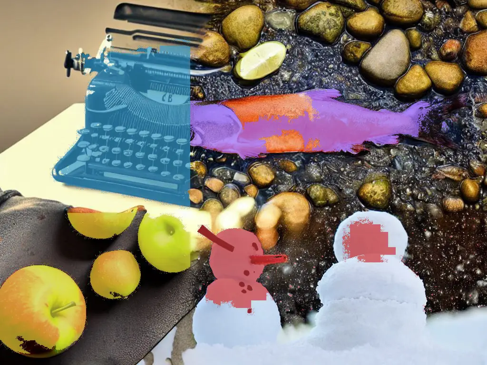

Figure 2: Common failures in MosaicFusion \[39\] synthetic data. Despite
using prompt “a photo of a single \<object\>”, the method produces: (1)
incomplete objects (blue: typewriter cut off), (2) incomplete
segmentation (purple: salmon; red: snowmen), (3) multiple objects with
single mask (red: two snowmen), and (4) wrong categories (yellow: whole
apples labeled “apple sauce”).

|                                                             |                                                             |                                                             |                                                             |                                                             |                                                             |
| ----------------------------------------------------------- | ----------------------------------------------------------- | ----------------------------------------------------------- | ----------------------------------------------------------- | ----------------------------------------------------------- | ----------------------------------------------------------- |
| 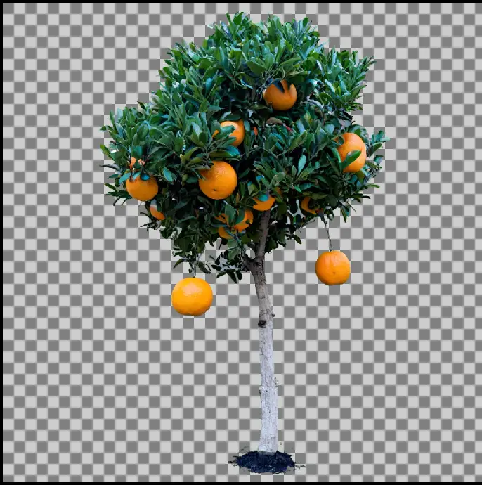 | 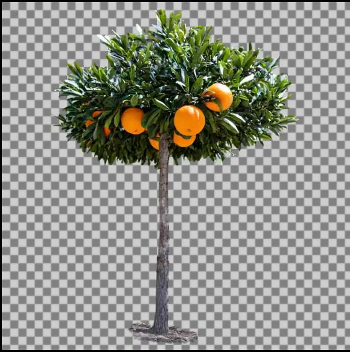 | 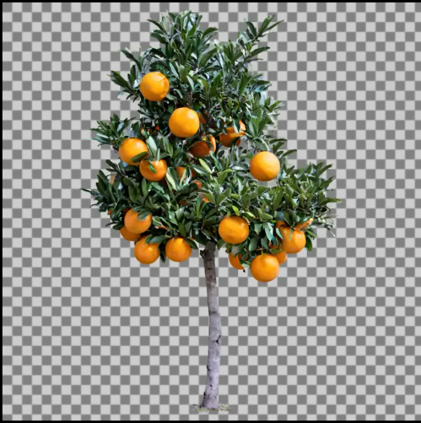 | 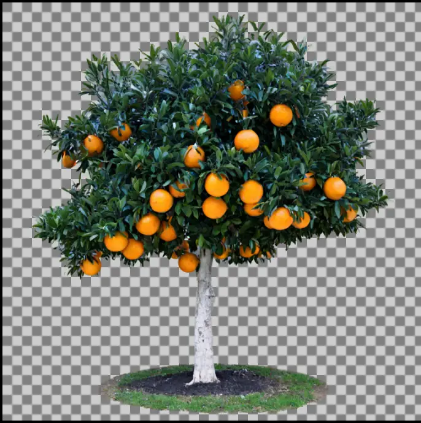 | 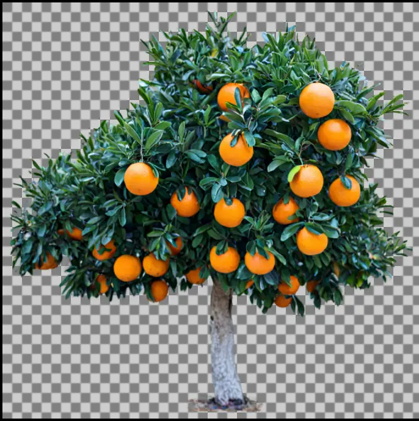 | 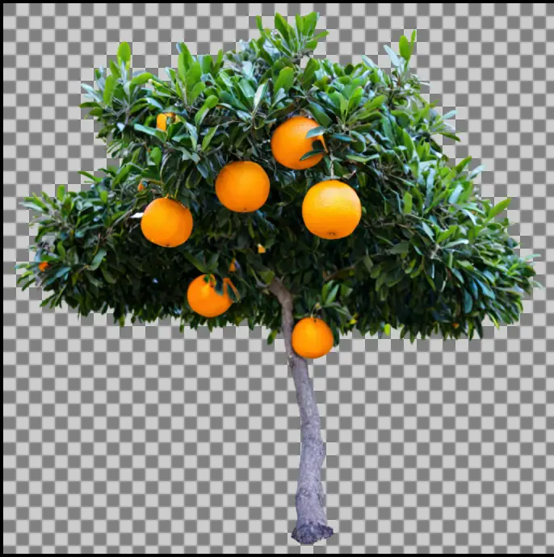 |

Figure 3: The samples generated by Layer Diffusion \[42\] with
_standard_ prompt. “An image of a single orange\_(fruit), orange (FRUIT
of an orange tree).”. These images, generated using standard prompts,
suffer from low diversity and often contain multiple unintended objects
due to their monotonous and ambiguous descriptions.

|                                                             |                                                              |                                                              |                                                              |                                                              |                                                              |
| ----------------------------------------------------------- | ------------------------------------------------------------ | ------------------------------------------------------------ | ------------------------------------------------------------ | ------------------------------------------------------------ | ------------------------------------------------------------ |
| 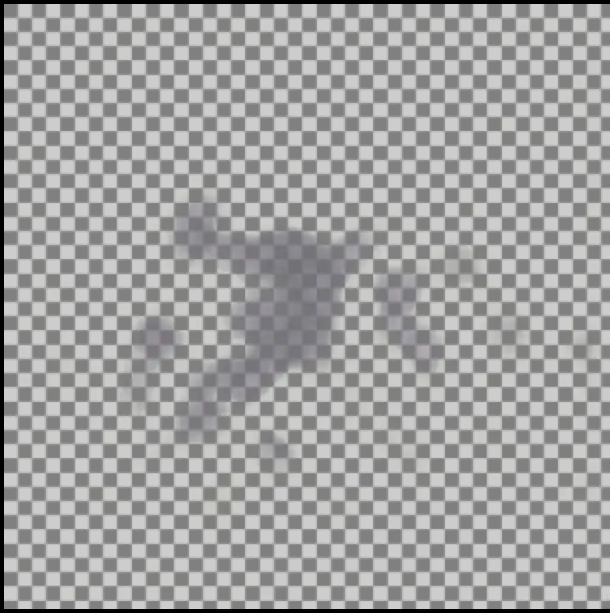 | 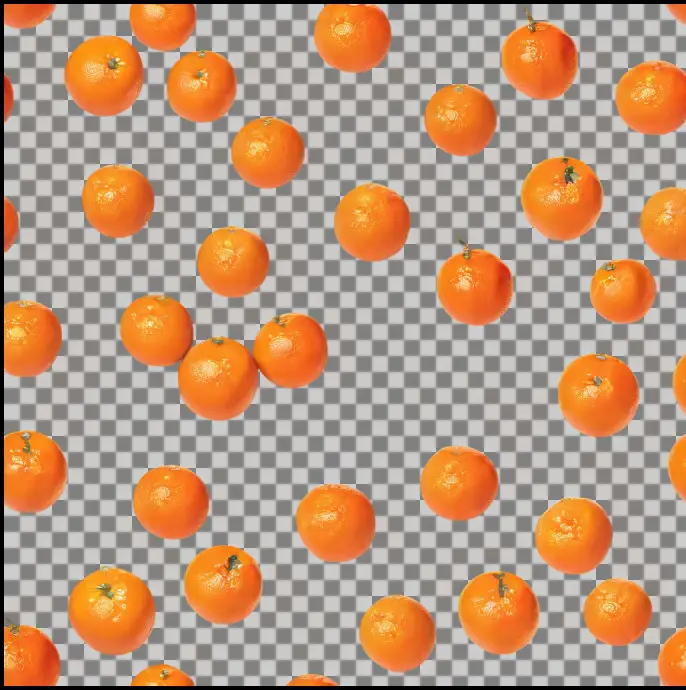 | 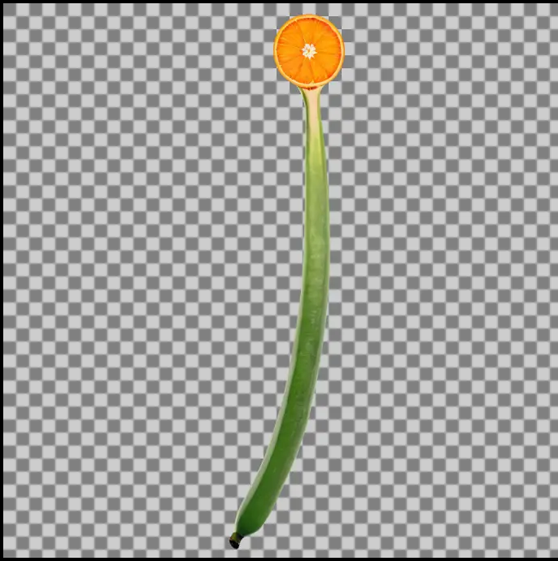 | 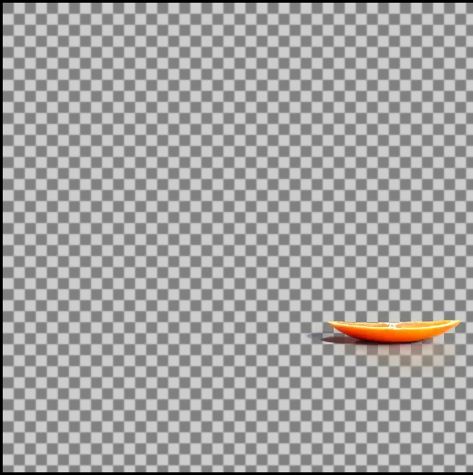 | 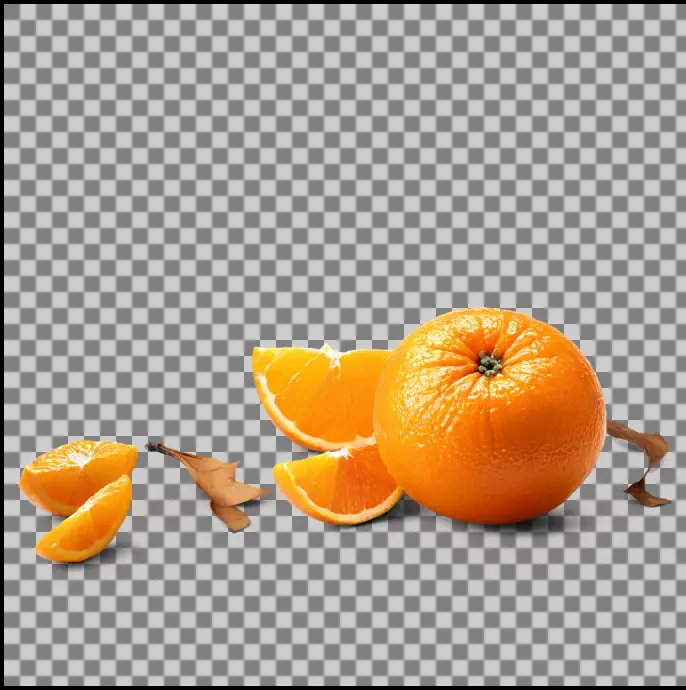 | 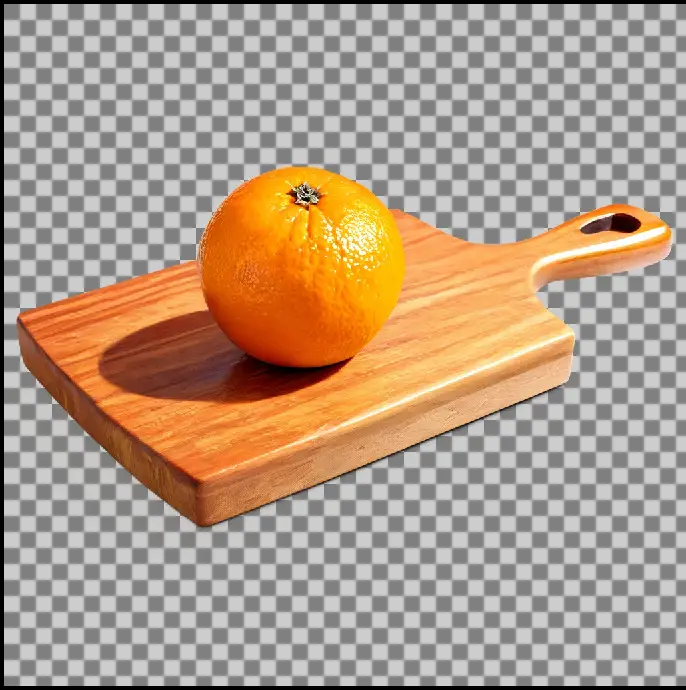 |
| w/o Object                                                  | Multiple Objects                                             | Wrong Category                                               | Incomplete                                                   | Multiple Conditions                                          | Multiple Categories                                          |

Figure 4: Failure samples generated by Layer Diffusion \[42\] with
_optimized_ prompt.

## 1 Introduction

High-quality data plays a crucial role in computer vision tasks, such as
instance segmentation and object detection. However, these tasks suffer
from insufficient data. This issue causes poor performance and class
imbalance, resulting in low Average Precision (AP) in rare classes. The
root of insufficient data is the cost of constructing the dataset.
Building large-scale datasets is extremely time-consuming and
labor-intensive, and the quality of labels could be unreliable due to
human errors, such as missing labels, wrong labels, and inaccurate masks
or bounding boxes.

The naive way to synthesize data could be copy-paste \[8\], which means
copying foreground objects from images and pasting them onto random
backgrounds, or generative models, such as generative adversarial
networks (GAN) \[43\] or diffusion models \[2\]. Because of recent
advances in text-to-image diffusion models \[29\], X-Paste \[44\] and
MosaicFusion \[39\] use diffusion models to generate images. However,
compared to image generation, obtaining labeled masks or bounding boxes
for synthetic data is more challenging. X-Paste uses an off-the-shelf
segmentation model to get the instance mask of an object. MosaicFusion
generates images and masks simultaneously by using a cross-attention
map. While MosaicFusion can produce a broad vocabulary of instances,
several challenges remain in creating high-quality synthetic data for
instance segmentation, causing MosaicFusion to discard $`\approx 50\%`$
of the generated images and masks. Moreover, as Figure 2 shows, another
$`\approx 50\%`$ of the filtered generated images and masks still suffer
from several issues. First, it may generate multiple objects within a
single mask. For example, it generates two snowmen and marks them with a
single mask (red region). Second, it could produce masks that do not
accurately capture individual instances. For example, not all objects
are properly marked. Third, it could occasionally generate an incorrect
category. For example, the yellow-masked area should be “apple sauce”,
but it generates “apples”.

To tackle these challenges, in this work, we introduce Gen-n-Val, a
novel agentic data generation and validation framework. Gen-n-Val
leverages Layer Diffusion (LD) \[42\] and large language model
(LLM)/vision large-language models (VLLM) agents \[7\] to generate
high-quality synthetic data. We leverage LD to generate foreground
images and masks without using the off-the-shelf segmentation model or
cross-attention. However, we observe that $`\approx 44\%`$ of the
synthetic data generated by LD with the standard prompt (_e.g_. “a photo
of a single \<object\>, \<description\>”) is invalid, as shown in
Figure 3. These images and masks generated by standard prompts not only
have low diversity but also have multiple objects due to monotonous and
ambiguous descriptions. Recently, LLMs and VLLMs as agents have gained
significant attention. LLMs/VLLMs provide a natural language interface
for interacting with other components. Therefore, we leverage an LLM as
the LD prompt agent and employ TextGrad \[41\] to refine the system
prompts of the LLM, enabling the LLM agent to produce optimized prompts
that guide LD to generate high-quality and diverse single-object image
instances along with their corresponding segmentation masks.

However, the data generated by these optimized prompts still contains
approximately $`7\%`$ invalid samples (_e.g_. samples without the target
object, with multiple objects, or with incorrect categories), as shown
in Figure 4. To filter out these failed cases, we use the VLLM as the
data validation agent. The data validation agent’s system prompt is also
optimized by TextGrad. Finally, we composite validated foreground
instances onto background images to produce diverse, high-quality
synthetic data for downstream tasks.

As demonstrated in Figure 1, Gen-n-Val allows us to generate
high-quality data for instance segmentation and object detection models,
effectively augmenting rare classes, systematically balancing the
category distribution, and consistently improving overall model
performance.

Our main contributions are summarized as follows.

- •
  We propose Gen-n-Val, an agentic framework for generating diverse
  high-quality data for instance segmentation and object detection with
  two agents, the LD prompt agent and the data validation agent.
- •
  We use TextGrad to refine the system prompts of the LD prompt agent to
  generate a high-quality image generation prompt for LD, allowing LD to
  generate a single foreground instance with a precise mask. We also use
  a VLLM as the data validation agent to validate generated data,
  improving the quality of synthetic data.
- •
  The dataset synthesized by Gen-n-Val significantly outperforms
  previous data synthesis methods in improving model performance.
  Moreover, Gen-n-Val also has scalability in model capacity and dataset
  size.

## 2 Related Work

### 2.1 Copy-Paste Augmentation

To automatically identify realistic locations for object pasting,
Dvornik *et al*. \[8\] introduce a context model that enables objects to
be seamlessly pasted into new scenes, significantly improving object
detection accuracy. In contrast, Fang *et al*. \[12\] jitter objects
that already exist within the image rather than directly pasting them
from other images. Additionally, Dwibedi *et al*. \[9\] propose a method
that cuts and blends instances onto random backgrounds to avoid
artifacts that can arise from direct pasting. In
Simple-Copy-Paste \[13\], Ghiasi *et al*. do not model the surrounding
visual context before placing copied instances, but demonstrate that
random object placement leads to notable improvements compared to
previous approaches. While these methods can enhance performance, they
may fall short in providing the diverse and high-quality masks and
images.

### 2.2 Generative-Based Augmentation

Leveraging generative adversarial networks (GANs), \[43\] utilize a
small set of labeled data to train a simple MLP classifier for
classifying pixel-wise feature vectors produced by StyleGAN \[17\]. This
classifier then serves as a label-generating branch within the StyleGAN
architecture. Consequently, data can be generated by sampling latent
codes and passing them through the StyleGAN. Following DatasetGAN,
\[20\] extend BigGAN \[3\] and VQGAN \[10\] with a segmentation branch,
scaling DatasetGAN to the ImageNet \[30\] level. Since DatasetGAN is
trained on synthetic images, it can only sample objects with limited
diversity and a less natural appearance. With the aid of powerful
diffusion models, Baranchuk *et al*. \[2\] propose a method trained on
labeled real images, exploring intermediate activations in pre-trained
diffusion models. These activations effectively capture semantic
information from input images, making them useful for segmentation
tasks. Although the quality of synthetic data is promising, previous
methods can generate only a limited range of object categories.

Recent advances in text-to-image models \[29, 26, 28\] can generate
diverse objects in images with natural language prompts. Therefore,
Zhao *et al*. \[44\] introduce X-Paste, which synthesizes images with
Stable Diffusion and segments these images with an off-the-shelf
segmentation model. However, generating data with X-Paste is
time-consuming, requiring 4.3 times more GPU hours than
MosaicFusion \[39\]. Gen2Det \[35\] uses an off-the-shelf
box-label-conditioned inpainting diffusion model and bounding-box masks
to generate data for object detection. Xie *et al*. \[39\] introduce a
training-free, diffusion-based data augmentation pipeline capable of
simultaneously producing image and mask pairs by leveraging
off-the-shelf text-to-image diffusion models \[29, 26\].

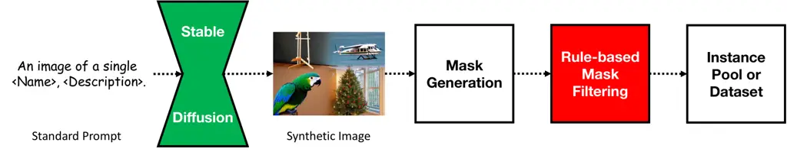

(a) Previous generative-based augmentation methods \[44, 39\].

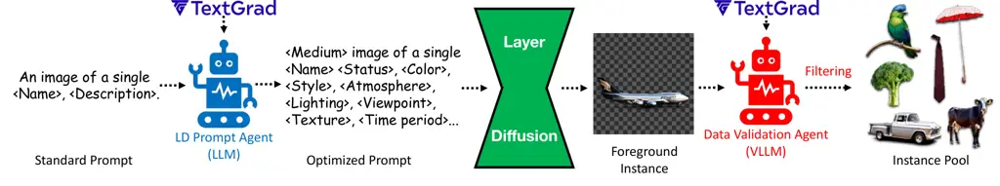

(b) Gen-n-Val (Ours).

Figure 5: Comparison of previous augmentation pipelines \[44, 39\] and
our Gen-n-Val pipeline. (a) Pipeline of previous generative-based
augmentation methods \[44, 39\]. The process involves four steps: First,
applying Stable Diffusion to generate images with a standard prompt.
Next, using augmentation models \[44\] or the relationship between
visual and textual embeddings in cross-attention \[39\] to obtain
segmentation masks. Finally, filtering out flawed masks with
hand-crafted rules. (b) Pipeline of Gen-n-Val. The process begins with
optimizing system prompts of the Layer Diffusion \[42\] prompt agent
(LLM) using TextGrad. The optimized prompts generate Layer
Diffusion \[42\] prompts, and Layer Diffusion \[42\] produces
transparent instances and background images. A VLLM-based validation
agent filters flawed images, and multiple valid instances are pasted
into other images. See Section 3 for more details.

As shown in Figure 5(a), the pipeline of these methods involves four
steps: (1) Generate images using Stable Diffusion with prompts filled by
category name; (2) Obtain segmentation masks using either augmentation
models or cross-attention maps; (3) Refine masks through edge detection
and filter out flawed masks; (4) Composite the instance and background
to create final images. However, these methods have several issues.
First, the generated images are not guaranteed to contain only one
instance. Second, the segmentation masks generated by cross-attention
are of poor quality. Lastly, the generated images are filtered by
hand-crafted rules, such as thresholding, leading to a large number of
unqualified images, such as missing corresponding masks and incorrect
object labels. In contrast, our method can generate data with precise
masks, correct category, and the correct number of object instances,
enhancing the performance of downstream tasks.

### 2.3 Generative Models and Agents

Layer Diffusion \[42\] is an approach for generating transparent images.
This method encodes the transparent alpha channel into the latent
distribution of Stable Diffusion \[29, 26\] to generate transparent
images.

OpenAI released the Large Language Model (LLM), GPT-4 \[1\], and the
Vision Large Language Model (VLLM), GPT-4V \[24\]. Inspired by GPT-4V,
Liu *et al*. \[22\] introduce Large Language-and-Vision
Assistant (LLaVA), an open-source VLLM based on the CLIP image
encoder \[27\] and the open-source LLM Vicuna \[6\]. Besides, Meta
released Llama \[36\] and Llama 3 \[7\], powerful language models that
perform exceptionally well across a wide range of language understanding
tasks, comparable to leading models such as GPT-4. Moreover, Meta
released Llama 3.2 \[23\], integrating vision capability into Llama and
allowing it to process visual inputs. To enhance the feedback provided
by LLM, Yuksekgonul *et al*. \[41\] propose TextGrad, a method to refine
system prompts by backpropagating textual information from outputs,
encouraging precise answers.

With the development of LLMs, using them to decide and solve various
tasks has become a growing trend. A common approach is to use LLMs to
generate textual “actions” or “decisions” for tasks. VISPROG \[15\] uses
GPT3 \[4\] to automatically generate programs that solve complex visual
tasks. ToolFormer \[31\] also uses GPT3 to decide which APIs to call for
solving tasks. HuggingGPT \[32\] uses ChatGPT to choose models on
HuggingFace for solving complicated AI tasks. ReAct \[40\] combines
reasoning and action steps, allowing LLM to make better decisions and
provide more reliable answers. Reflexion \[33\] enhances LLM agents’
decision-making by using reflective linguistic feedback stored in an
episodic memory. Zheng *et al*. \[45\] use GPT-4V as a web agent.
Generative Agents \[25\] introduce a system of generative agents that
simulate realistic human behaviors through memory, planning, and
reflection, enabling interactive digital environments. In summary, these
methods demonstrate the growing power of LLMs to integrate
decision-making and execution, allowing more robust and adaptable AI
solutions across diverse domains.

## 3 Method

To tackle the issues we discuss in Section 2.2, we leverage a Large
Language Model (LLM) as the LD prompt agent, a Vision Large Language
Model (VLLM) as the data validation agent, and Layer Diffusion (LD) to
generate diverse and high-quality data, as shown in Figure 5(b). First,
in the Open Vocabulary Prompt Generation stage, we initiate the process
by employing TextGrad \[41\] optimization techniques to refine the
quality and effectiveness of the LD prompt agent’s system prompt,
allowing the LD prompt agent to generate diverse and high-quality
prompts for LD. The details are shown in Section 3.1. Second, during the
Foreground Image Generation stage, we utilize the LD to generate
transparent instance images. This step creates isolated instance images,
allowing us to generate segmentation masks without manual annotation or
additional segmentation algorithms. The details are shown in
Section 3.2. Third, to ensure the quality of the generated images, we
filter out flawed samples during the Image Filtering stage using the
VLLM as the data validation agent, which is further optimized with
TextGrad. The details are shown in Section 3.3. Finally, we randomly
paste multiple instances into background images. This step creates
diverse scenes with multiple instances, further augmenting the dataset.

### 3.1 Open Vocabulary Prompt Generation

Previous generative-based augmentation methods relied on adding the word
“single” to the prompt during the stage of image generation to instruct
the Stable Diffusion to generate a single-object instance. This approach
not only struggles to keep the diffusion model focused on a single
instance but also accidentally allows other types of objects to appear
in the background due to the ambiguous concept of “single”. The ideal
Stable Diffusion prompts should be detailed and specific with several
components, including the object class, action, environment setting, and
other relevant details \[34\]. For example, Figure 5(b) demonstrates
both the standard and optimized prompts for image generation. For more
examples, please refer to our appendix.

To generate optimized LD prompts, we need a high-quality system prompt
$`p_{\text{sys}}`$ for the LD prompt agent $`A_{p_{\text{LD}}}`$ (a
LLM). Therefore, we leverage two other LLMs, a prompt evaluator
$`E_{\text{prompt}}`$ and a prompt validator $`V_{\text{prompt}}`$, and
TextGrad \[41\] optimization techniques to optimize the system prompt
$`p_{\text{sys}}`$. The system prompt generation process is shown in
Algorithm 1. First, we give the LD prompt agent $`A_{p_{\text{LD}}}`$ an
initial system prompt $`p_{\text{sys}}`$ that instructs it to generate a
prompt $`p_{\text{LD}}`$ for the LD. Second, we evaluate the
$`p_{\text{LD}}`$ using a prompt evaluator $`E_{\text{prompt}}`$ to
determine the quality of the prompt for LD. The prompt evaluator
$`E_{\text{prompt}}`$ is a second LLM which is asked to evaluate the
quality of the prompt generated by the LD prompt agent
$`A_{p_{\text{LD}}}`$ and provide a criticism in the form of a loss
$`L`$. Third, with the loss $`L`$, we optimize the initial system prompt
using Text Gradient Descent (TGD) \[41\] to generate a new optimized
system prompt $`p^{*}_{\text{sys}}`$. Fourth, we use the optimized
system prompt $`p^{*}_{\text{sys}}`$ to generate an optimized prompt
$`p^{*}_{\text{LD}}`$ for the LD model. Finally, we validate the
$`p^{*}_{\text{LD}}`$ to compare the quality with the $`p_{\text{LD}}`$.
The prompt validator $`V_{\text{prompt}}`$ is a third LLM that is asked
to evaluate the quality of the optimized prompt and provide a decision
$`d`$ of whether replacing the initial prompt with the optimized prompt
at the next iteration is beneficial.

1: Input: initial system prompt $`p_{\text{sys}}`$, max iteration $`I`$

2: Initialize: decision $`d\leftarrow\text{False}`$, iteration
$`i\leftarrow 0`$

3: while not $`d`$ and $`i<I`$ do

4:   $`p_{\text{LD}}\leftarrow A_{p_{\text{LD}}}(p_{\text{sys}})`$
$`\triangleright`$ Generate LD prompt

5:   $`L\leftarrow E_{\text{prompt}}(p_{\text{LD}})`$ $`\triangleright`$
Evaluate prompt quality

6:   $`p_{\text{sys}}^{*}\leftarrow\mathrm{TGD}(L)`$ $`\triangleright`$
Update system prompt

7:
  $`p_{\text{LD}}^{*}\leftarrow A_{p_{\text{LD}}}(p_{\text{sys}}^{*})`$
$`\triangleright`$ Generate refined LD prompt

8:   $`d\leftarrow V_{\text{prompt}}(p_{\text{LD}}^{*})`$
$`\triangleright`$ Check if prompt is satisfactory

9:   if $`d`$ then

10:    break $`\triangleright`$ Stop if validator accepts

11:   else

12:    $`p_{\text{sys}}\leftarrow p_{\text{sys}}^{*}`$
$`\triangleright`$ Adopt refined system prompt

13:   end if

14:   $`i\leftarrow i+1`$

15: end while

Algorithm 1 Optimize System Prompt $`p_{\text{sys}}`$ of
$`A_{p_{\text{LD}}}`$

### 3.2 Foreground Image Generation

We propose a method that utilizes the LD to generate transparent images
of foreground instances along with precise alpha masks. By employing the
optimized prompts from the Open Vocabulary Prompt Generation stage, we
empower the LD model to produce high-quality, single-object instances
that strictly adhere to the specified prompts. The optimized prompts are
input into the LD model to generate transparent images where each pixel
contains both RGB values and an alpha transparency channel. This
transparency channel inherently provides an accurate segmentation mask
for the foreground object. Unlike previous methods, our approach
eliminates the need for additional segmentation algorithms, such as
SAM \[19\], or manual annotation, as the alpha channel directly
corresponds to the object’s silhouette, resulting in precise and clean
masks aligned perfectly with the generated images.

The detailed and specific prompts generated by the LD prompt agent
$`A_{p_{\text{LD}}}`$ include various attributes, such as object class,
style, color, texture, lighting, atmosphere, viewpoint, and time period.
By incorporating these attributes, we guide the LD to produce a wide
range of object appearances, increasing the diversity of the generated
instances. Prompt conditioning and negative prompts are also used to
guide the model toward generating images that closely match the desired
characteristics while avoiding undesired elements.

While the LD generates high-quality transparent instances, minor
background noise may still be present in the alpha channel due to
imperfections in the diffusion process. To mitigate this, we apply a
median filter to the alpha channel of the images. The median filter
effectively removes isolated pixels and smooths the mask edges without
significantly altering the overall shape of the object. This
post-processing step ensures that the segmentation masks are clean and
accurately represent the foreground instances.

### 3.3 Image Filtering

Despite the improvements achieved through optimized prompts and the use
of the LD, some generated images may still contain flaws, such as
missing the target object, featuring multiple instances when only one is
desired, incorrect object categories, or poor visual quality, as shown
in Figure 4. To further enhance the quality of our synthetic dataset, we
employ the VLLM as a data validation agent to automatically filter out
these flawed images.

Similar to our approach in optimizing prompts for the LD, we apply the
TextGrad optimization technique to refine the system prompts of the data
validation agent. By optimizing the data validation agent’s system
prompts, we enhance its ability to evaluate and identify flaws in the
generated images. The optimized prompts guide the data validation agent
to focus on specific criteria essential for high-quality instance
segmentation data, such as the presence of a single, correctly
categorized object, and the cleanliness of the transparent background in
the foreground images.

The data validation agent is tasked with analyzing generated images to
assess their suitability for inclusion in the dataset. Here, $`c`$
represents the object category. The key criteria encoded into the data
validation agent through the optimized system prompt include:

- •
  Single $`c`$: The image should contain only one $`c`$.
- •
  Single View: The $`c`$ should be shown from a single angle or
  perspective.
- •
  Intact $`c`$: The $`c`$ should be intact and fully visible.
- •
  Plain Background: The background should be empty or plain, without
  distracting elements.

## 4 Experiments

To demonstrate the enhancement of detection models after applying our
methods, we evaluate on two challenging benchmarks, COCO \[21\] and
LVIS \[14\]. COCO dataset is a large-scale dataset designed for object
detection, segmentation, and captioning, containing 330K images with
1.5M object instances labeled across 80 categories. The LVIS dataset
uses the same images as COCO but provides more detailed and partitioned
annotations across 1,203 categories, offering finer classification. To
quantify this improvement, we compute mean Average Precision (mAP) as
our evaluation metric. We use Meta-LLaMA-3.1-8B-Instruct as the LD
prompt agent and Meta-LLaMA-3.2-11B-Vision-Instruct as the data
validation agent. We apply Copy-Paste \[8\] in all YOLO experiments
except for the baseline. For more details, please refer to our appendix.

| Method                | $`\textbf{mAP}^{\textbf{box}}`$ | $`\textbf{mAP}^{\textbf{box}}_{\textbf{rare}}`$ | $`\textbf{mAP}^{\textbf{mask}}`$ | $`\textbf{mAP}^{\textbf{mask}}_{\textbf{rare}}`$ |
| --------------------- | ------------------------------- | ----------------------------------------------- | -------------------------------- | ------------------------------------------------ |
| Mask R-CNN (baseline) | 22.5                            | 9.1                                             | 21.7                             | 9.6                                              |
| MosaicFusion \[39\]   | 24.0                            | 14.8                                            | 23.1                             | 15.2                                             |
| Gen2Det \[35\]        | 24.4                            | 15.4                                            | 23.6                             | 15.3                                             |
| Gen-n-Val (Ours)      | 26.8                            | 16.1                                            | 25.6                             | 17.2                                             |
| versus baseline       | +4.3                            | +7.0                                            | +3.9                             | +7.6                                             |
| YOLO11m (baseline)    | 12.9                            | 8.3                                             | 10.3                             | 6.5                                              |
| Copy-Paste \[8\]      | 12.9                            | 8.2                                             | 10.4                             | 6.7                                              |
| Gen-n-Val (Ours)      | 17.2                            | 13.0                                            | 14.5                             | 10.1                                             |
| versus baseline       | +4.3                            | +4.7                                            | +4.2                             | +3.6                                             |
| CenterNet2 (baseline) | 47.5                            | 41.4                                            | 42.3                             | 36.8                                             |
| XPaste \[44\]         | 50.1                            | 48.2                                            | 44.4                             | 43.3                                             |
| DiverGen \[11\]       | 51.2                            | 50.1                                            | 45.5                             | 45.8                                             |
| Gen-n-Val (Ours)      | 51.5                            | 55.6                                            | 45.9                             | 48.3                                             |
| versus baseline       | +4.0                            | +14.2                                           | +3.6                             | +11.5                                            |

Table 1: LVIS \[14\] instance segmentation and object detection
benchmark. We borrow numbers of Mask R-CNN \[16\] and
MosaicFusion \[39\] from MosaicFusion \[39\].

| Min. img./cls. | Add. inst. | $`\textbf{mAP}^{\textbf{box}}`$ | $`\textbf{mAP}^{\textbf{box}}_{\textbf{rare}}`$ | $`\textbf{mAP}^{\textbf{mask}}`$ | $`\textbf{mAP}^{\textbf{mask}}_{\textbf{rare}}`$ |
| -------------- | ---------- | ------------------------------- | ----------------------------------------------- | -------------------------------- | ------------------------------------------------ |
| Original       | 0          | 22.5                            | 9.1                                             | 21.7                             | 9.6                                              |
| 10             | 1,874      | 23.1                            | 9.8                                             | 22.5                             | 10.5                                             |
| 100            | 60,306     | 24.2                            | 13.5                                            | 23.4                             | 14.7                                             |
| 1000           | 727,393    | 26.8                            | 16.1                                            | 25.6                             | 17.2                                             |

Table 2: Effect of flattening the LVIS \[14\] class distribution. By
augmenting images with additional instances, we enforce a minimum of
10–1000 images per class, which substantially boosts performance on rare
categories and improves overall accuracy. Min. img./cls.: the minimum
number of images per class. Add. inst.: the number of added instances.

### 4.1 LVIS Benchmark

We train Mask R-CNN \[16\], YOLO11m \[18\], and CenterNet2 \[46\] on the
LVIS training set. As shown in the right part of Figure 1, the LVIS
training set exhibits a highly long-tailed category distribution, where
most categories appear in only a few images. To balance this
distribution, we generate 727,393 instances and paste them onto LVIS
images until all 1,203 categories reach at least 1,000 images. For rare
category analysis, we adopt the category frequency annotations provided
by LVIS. We evaluate on the LVIS validation set. The results are shown
in Table 1. Compared to the baseline, our method improves the mAP by
4.3% for box prediction and 3.9% for mask prediction on Mask R-CNN, by
4.0% for box prediction and 3.6% for mask prediction on CenterNet2, and
by 4.3% for box prediction and 4.2% for mask prediction on YOLO11m.
Rare-category mAP is also significantly improved over the baselines.

### 4.2 Distribution Balancing of LVIS

To investigate Gen-n-Val’s ability to balance the long-tailed
distribution of LVIS, as shown in Figure 1, we progressively “fill” the
tail of the distribution by generating additional synthetic instances
for under-represented classes. Concretely, starting from the original
LVIS distribution, we construct three variants of the training set by
enforcing different lower bounds on the number of images per class: (1)
a mild setting where we up-sample rare categories so that every class
appears in at least 10 images, (2) a stronger setting that further
densifies the common categories until each class has at least 100
images, and (3) an aggressive setting where we continue to generate
instances until all 1,203 categories reach at least 1,000 images. These
three stages correspond to injecting 1.8K, 60.3K, and 727K additional
instances, respectively, and balance the long-tailed distribution as
shown in Figure 1. As demonstrated in Table 2, Gen-n-Val leads to
consistent performance gains for Mask R-CNN: mask mAP improves from 21.7
to 22.5, 23.4, and 25.6, while rare-category mask mAP increases from 9.6
to 10.5, 14.7, and 17.2. Overall, enforcing 10$`\sim`$1,000 images per
class translates into +0.8$`\sim`$+3.9 mAP on all categories and
+0.9$`\sim`$+7.6 mAP on rare categories, demonstrating that Gen-n-Val
effectively balances LVIS and benefits tail classes.

| Method             | $`\textbf{mAP}^{\textbf{box}}`$ | $`\textbf{mAP}^{\textbf{box}}_{\textbf{rare}}`$ | $`\textbf{mAP}^{\textbf{mask}}`$ | $`\textbf{mAP}^{\textbf{mask}}_{\textbf{rare}}`$ |
| ------------------ | ------------------------------- | ----------------------------------------------- | -------------------------------- | ------------------------------------------------ |
| YOLOv9c (baseline) | 50.1                            | 52.8                                            | 41.3                             | 45.1                                             |
| Copy-Paste         | 50.9                            | 53.1                                            | 42.1                             | 46.8                                             |
| MosaicFusion       | 51.4                            | 53.6                                            | 42.7                             | 47.9                                             |
| Gen-n-Val          | 51.9                            | 54.4                                            | 43.4                             | 48.7                                             |
| versus baseline    | +1.8                            | +1.6                                            | +2.1                             | +3.6                                             |
| YOLO11m (baseline) | 49.6                            | 51.9                                            | 39.8                             | 45.4                                             |
| Copy-Paste         | 50.0                            | 52.1                                            | 41.5                             | 47.1                                             |
| MosaicFusion       | 50.6                            | 54.3                                            | 42.0                             | 48.1                                             |
| Gen-n-Val          | 51.7                            | 55.4                                            | 42.9                             | 49.0                                             |
| versus baseline    | +2.1                            | +3.5                                            | +3.1                             | +3.6                                             |

Table 3: COCO \[21\] instance segmentation and object detection
benchmark with YOLO9c \[37\] and YOLO11m \[18\].

### 4.3 COCO Benchmark

We train YOLOv9c \[37\] and YOLO11m \[18\] using the COCO dataset and
our 16K synthetic dataset, and evaluate on the validation set. We choose
the 10 least frequent categories as rare categories and the remaining 70
categories as common categories. We use a synthetic background image and
paste instances with image harmonization \[38\]. We compare our method
with the baseline YOLOv9c, YOLO11m, and Copy-Paste. As shown in Table 3,
Gen-n-Val outperforms the baseline and other methods, achieving the
highest mAP scores for both box and mask predictions. Compared to the
baseline, our method improves the mAP by 1.8% for box prediction and
2.1% for mask prediction on YOLOv9c, and by 2.1% for box prediction and
3.1% for mask prediction on YOLO11m. Furthermore, rare-category mask mAP
improves by 3.6% on YOLOv9c and by 3.6% on YOLO11m, demonstrating the
effectiveness of our method. These results demonstrate the effectiveness
of our synthetic data generation approach.

| Method               | $`\textbf{mAP}^{\textbf{box}}`$ | $`\textbf{mAP}^{\textbf{box}}_{\textbf{novel}}`$ |
| -------------------- | ------------------------------- | ------------------------------------------------ |
| YOLO-Worldv2-M       | 42.7                            | 20.6                                             |
| YOLO11m w/ Gen-n-Val | 49.8                            | 25.5                                             |

Table 4: COCO \[21\] open-vocabulary object detection.

|                                                              |                                                              |                                                              |
| ------------------------------------------------------------ | ------------------------------------------------------------ | ------------------------------------------------------------ |
| 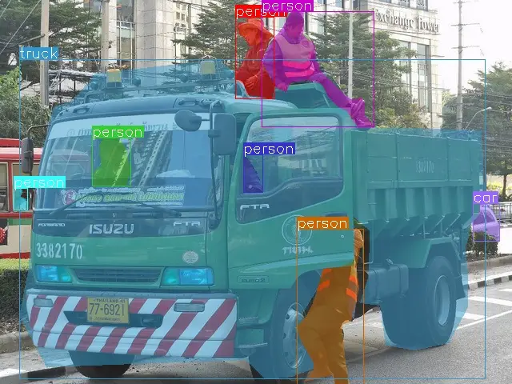 | 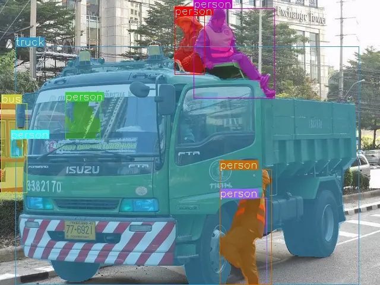 | 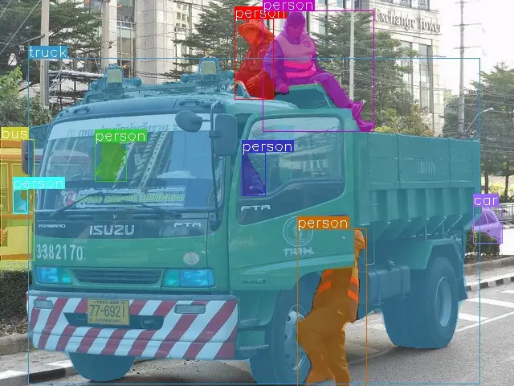 |
| Ground Truth                                                 | Baseline                                                     | Gen-n-Val                                                    |

Figure 6: Qualitative comparison of ground truth, baseline model, and
model trained on Gen-n-Val.

### 4.4 Open-Vocabulary Object Detection

We train YOLO11m using the COCO dataset and our 16K synthetic dataset,
which includes 80 categories from the COCO dataset and 10 additional
categories from the LVIS dataset, and evaluate on the 5K-image COCO/LVIS
validation set for open-vocabulary object detection. Ten LVIS categories
are selected as novel categories in the validation set, and the whole
COCO dataset is used as the training set. We compare our method with the
baseline YOLO-Worldv2-M \[5\], which is an advanced real-time object
detection model that enhances the YOLO framework with open-vocabulary
capabilities. As shown in Table 4, compared to the baseline, Gen-n-Val
improves mAP by 7.1% for box prediction and by 4.9% on novel categories
with YOLO11m, demonstrating the effectiveness of our method on
open-vocabulary object detection.

| $`p^{*}_{\text{LD}}`$ | VLLM | Med. | C-P | $`\textbf{mAP}^{\textbf{box}}`$ | $`\textbf{mAP}^{\textbf{mask}}`$ |
| --------------------- | ---- | ---- | --- | ------------------------------- | -------------------------------- |
|                       | ✓    | ✓    | ✓   | 48.8                            | 39.2                             |
| ✓                     |      | ✓    | ✓   | 51.5                            | 42.0                             |
| ✓                     | ✓    |      | ✓   | 51.5                            | 42.2                             |
| ✓                     | ✓    | ✓    |     | 51.2                            | 42.7                             |
| ✓                     | ✓    | ✓    | ✓   | 51.7                            | 42.9                             |

Table 5: Ablation results on YOLO11m \[18\] trained with synthetic data
on COCO \[21\]. We evaluate the effects of Layer Diffusion \[42\] prompt
optimization ($`p^{*}_{\text{LD}}`$), VLLM filtering (VLLM), median
filtering (Med.), and Copy-Paste \[8\] (C-P).

### 4.5 Ablation Studies

We conduct an ablation study on COCO by comparing YOLO11m with and
without prompt optimization, VLLM filtering, median filtering, and
Copy-Paste. As shown in Table 5, prompt optimization provides the
largest gain, improving mAP by 2.9% for object detection and 3.7% for
instance segmentation. On top of that, VLLM filtering improves mAP by
0.2% and 0.9%, respectively. Median filtering yields an additional 0.2%
and 0.7% mAP improvement, while Copy-Paste brings another 0.5% and 0.2%
mAP gain for object detection and instance segmentation.

Figure 7: The instance segmentation performance of YOLOv9 \[37\] and
YOLO11 \[18\] family models. As the size of the model increases,
performance improves. Gen-n-Val is effective with all family models.

### 4.6 Model Scalability

To comprehensively evaluate our method across different model scales, we
evaluate Gen-n-Val on the COCO dataset using the YOLOv9 and YOLO11
family models, which are state-of-the-art in the YOLO series. In the
instance segmentation task, as shown in Figure 7, Gen-n-Val yields
significant performance improvements over the baseline models, with the
most notable improvement observed being a $`+3.1\%`$ mask mAP gain on
YOLO11m.

| Size | mAP$`{}^{\textbf{box}}`$ | mAP$`{}^{\textbf{box}}_{\textbf{rare}}`$ | mAP$`{}^{\textbf{mask}}`$ | mAP$`{}^{\textbf{mask}}_{\textbf{rare}}`$ |
| ---- | ------------------------ | ---------------------------------------- | ------------------------- | ----------------------------------------- |
| 4K   | 50.8                     | 54.6                                     | 42.2                      | 48.3                                      |
| 8K   | 51.1                     | 55.0                                     | 42.5                      | 48.6                                      |
| 16K  | 51.7                     | 55.4                                     | 42.9                      | 49.0                                      |
| 20K  | 52.0                     | 55.6                                     | 43.0                      | 49.2                                      |

Table 6: The scalability of synthetic data. As the size of the dataset
increases, performance improves.

### 4.7 Data Scalability

To comprehensively evaluate our method across different data scales, we
trained YOLO11m on the COCO dataset and varying sizes of synthetic data,
generating the same 80 classes as in the COCO dataset (4K, 8K, 16K, and
20K), and evaluated it on the COCO. The results in Table 6 show our
model’s scalability with increasing dataset size.

### 4.8 Qualitative Results

We present qualitative comparisons between the ground truth, baseline
model outputs, and Gen-n-Val outputs, evaluated using the YOLO11m. As
shown in Figure 6, the baseline model fails to segment the person in the
driver’s seat of the truck and the car behind the truck. In contrast,
Gen-n-Val accurately segments both the person and the car. This result
highlights the effectiveness of Gen-n-Val. For more results, please
refer to our supplementary material.

## 5 Conclusion

In this work, we introduce a novel agentic framework, Gen-n-Val, for
generating synthetic data, allowing us to create high-quality, diverse,
and precisely annotated synthetic datasets. By leveraging Layer
Diffusion (LD), Large Language Model (LLM), and Vision Large Language
Model (VLLM), Gen-n-Val significantly enhances the quality and usability
of synthetic data. The framework consists of two key agents, the LD
prompt agent (a LLM) and the data validation agent (a VLLM). The LD
prompt agent optimizes the prompt for LD to generate high-quality images
and segmentation masks. The data validation agent filters out failure
cases of image instances. Our experiments demonstrate that Gen-n-Val
outperforms previous data synthesis approaches in instance segmentation
and object detection, and scales with dataset size. On LVIS, Gen-n-Val
further serves as an effective mechanism for addressing long-tailed
category imbalance; it substantially flattens the class distribution.
This work highlights the potential of leveraging LLM- and VLLM-based
agents not only to improve synthetic data quality, but also to mitigate
data imbalance in large-vocabulary computer vision datasets.

## Acknowledgment

This project was supported in part by the National Science and
Technology Council (NSTC), Taiwan, under Grants 114-2221-E-001-016,
114-2221-E-001-004, 113-2634-F-002-008, 114-2634-F-001-001-MBK,
111-2628-E-001-002-MY3, 114-2221-E-001-017-MY2, and 114-2634-F-002-004,
and by Academia Sinica under Grant AS-IAIA-114-M10 and
AS-KPQ-112-NETZ-10-A. We thank the National Center for High-performance
Computing (NCHC) of the National Institutes of Applied Research (NIAR)
in Taiwan for providing computational and storage resources.

## References

- \[1\] J. Achiam, S. Adler, S. Agarwal, L. Ahmad, I. Akkaya, F. L.
  Aleman, D. Almeida, J. Altenschmidt, S. Altman, S. Anadkat, et
  al. (2023) Gpt-4 technical report. arXiv preprint arXiv:2303.08774.
  Cited by: §2.3.
- \[2\] D. Baranchuk, I. Rubachev, A. Voynov, V. Khrulkov, and A.
  Babenko (2022) Label-efficient semantic segmentation with diffusion
  models. In ICCV, Cited by: §1, §2.2.
- \[3\] A. Brock, J. Donahue, and K. Simonyan (2019) Large scale gan
  training for high fidelity natural image synthesis. In ICLR, Cited by:
  §2.2.
- \[4\] T. Brown, B. Mann, N. Ryder, M. Subbiah, J. D. Kaplan, P.
  Dhariwal, A. Neelakantan, P. Shyam, G. Sastry, A. Askell, et
  al. (2020) Language models are few-shot learners. NeurIPS 33,
  pp. 1877–1901. Cited by: §2.3.
- \[5\] T. Cheng, L. Song, Y. Ge, W. Liu, X. Wang, and Y. Shan (2024)
  Yolo-world: real-time open-vocabulary object detection. In CVPR, Cited
  by: §4.4.
- \[6\] W. Chiang, Z. Li, Z. Lin, Y. Sheng, Z. Wu, H. Zhang, L.
  Zheng, S. Zhuang, Y. Zhuang, J. E. Gonzalez, I. Stoica, and E. P.
  Xing (2023) Vicuna: an open-source chatbot impressing gpt-4 with 90%\*
  chatgpt quality. External Links:
  [Link](https://lmsys.org/blog/2023-03-30-vicuna/) Cited by: §2.3.
- \[7\] A. Dubey, A. Jauhri, A. Pandey, A. Kadian, A. Al-Dahle, A.
  Letman, A. Mathur, A. Schelten, A. Yang, A. Fan, et al. (2024) The
  llama 3 herd of models. arXiv preprint arXiv:2407.21783. Cited by:
  §D.1, §1, §2.3.
- \[8\] N. Dvornik, J. Mairal, and C. Schmid (2018) Modeling visual
  context is key to augmenting object detection datasets. In ECCV, Cited
  by: §1, §2.1, Table 1, Table 5, §4.
- \[9\] D. Dwibedi, I. Misra, and M. Hebert (2017) Cut, paste and learn:
  surprisingly easy synthesis for instance detection. In ICCV, Cited by:
  §2.1.
- \[10\] P. Esser, R. Rombach, and B. Ommer (2021) Taming transformers
  for high-resolution image synthesis. In CVPR, Cited by: §2.2.
- \[11\] C. Fan, M. Zhu, H. Chen, Y. Liu, W. Wu, H. Zhang, and C.
  Shen (2024) DiverGen: improving instance segmentation by learning
  wider data distribution with more diverse generative data. In CVPR,
  pp. 3986–3995. Cited by: Table 1.
- \[12\] H. Fang, J. Sun, R. Wang, M. Gou, Y. Li, and C. Lu (2019)
  Instaboost: boosting instance segmentation via probability map guided
  copy-pasting. In ICCV, Cited by: §2.1.
- \[13\] G. Ghiasi, Y. Cui, A. Srinivas, R. Qian, T. Lin, E. D.
  Cubuk, Q. V. Le, and B. Zoph (2021) Simple copy-paste is a strong data
  augmentation method for instance segmentation. In CVPR, Cited by:
  §2.1.
- \[14\] A. Gupta, P. Dollar, and R. Girshick (2019) Lvis: a dataset for
  large vocabulary instance segmentation. In CVPR, Cited by: §A.1, Table
  S.1, Table S.1, §D.6, Appendix H, Figure 1, Figure 1, Table 1, Table
  1, Table 2, Table 2, §4.
- \[15\] T. Gupta and A. Kembhavi (2023) Visual programming:
  compositional visual reasoning without training. In CVPR,
  pp. 14953–14962. Cited by: §2.3.
- \[16\] K. He, G. Gkioxari, P. Dollár, and R. Girshick (2017) Mask
  r-cnn. In ICCV, pp. 2961–2969. Cited by: §A.1, §A.2, Table S.1, Table
  S.1, Table S.2, Table S.2, §D.6, Figure 1, Figure 1, §4.1, Table 1,
  Table 1.
- \[17\] T. Karras, S. Laine, and T. Aila (2019) A style-based generator
  architecture for generative adversarial networks. In CVPR, Cited by:
  §2.2.
- \[18\] R. Khanam and M. Hussain (2024) YOLOv11: an overview of the key
  architectural enhancements. arXiv preprint arXiv:2410.17725. Cited by:
  Appendix E, Figure 7, Figure 7, §4.1, §4.3, Table 3, Table 3, Table 5,
  Table 5.
- \[19\] A. Kirillov, E. Mintun, N. Ravi, H. Mao, C. Rolland, L.
  Gustafson, T. Xiao, S. Whitehead, A. C. Berg, W. Lo, P. Dollár, and R.
  Girshick (2023) Segment anything. arXiv:2304.02643. Cited by: §A.4,
  §3.2.
- \[20\] D. Li, H. Ling, S. W. Kim, K. Kreis, A. Barriuso, S. Fidler,
  and A. Torralba (2022) BigDatasetGAN: synthesizing imagenet with
  pixel-wise annotations. In CVPR, Cited by: §2.2.
- \[21\] T. Lin, M. Maire, S. Belongie, J. Hays, P. Perona, D.
  Ramanan, P. Dollár, and C. L. Zitnick (2014) Microsoft coco: common
  objects in context. In ECCV, Cited by: §D.4, Appendix H, Table 3,
  Table 3, Table 4, Table 4, Table 5, Table 5, §4.
- \[22\] H. Liu, C. Li, Q. Wu, and Y. J. Lee (2023) Visual instruction
  tuning. NeurIPS. Cited by: §2.3.
- \[23\] A. Meta (2024) Llama 3.2: revolutionizing edge ai and vision
  with open, customizable models. Meta AI Blog. Retrieved December 20,
  pp. 2024. Cited by: §D.3, §2.3.
- \[24\] OpenAI (2023) GPT-4V(ision) system card. External Links:
  [Link](https://cdn.openai.com/papers/GPTV_System_Card.pdf) Cited by:
  §2.3.
- \[25\] J. S. Park, J. C. O’Brien, C. J. Cai, M. R. Morris, P. Liang,
  and M. S. Bernstein (2023) Generative agents: interactive simulacra of
  human behavior. In UIST, UIST ’23, New York, NY, USA. Cited by: §2.3.
- \[26\] D. Podell, Z. English, K. Lacey, A. Blattmann, T. Dockhorn, J.
  Müller, J. Penna, and R. Rombach (2024) SDXL: improving latent
  diffusion models for high-resolution image synthesis. In ICLR, Cited
  by: §2.2, §2.3.
- \[27\] A. Radford, J. W. Kim, C. Hallacy, A. Ramesh, G. Goh, S.
  Agarwal, G. Sastry, A. Askell, P. Mishkin, J. Clark, et al. (2021)
  Learning transferable visual models from natural language supervision.
  In ICML, pp. 8748–8763. Cited by: §2.3.
- \[28\] A. Ramesh, P. Dhariwal, A. Nichol, C. Chu, and M. Chen (2022)
  Hierarchical text-conditional image generation with clip latents.
  arXiv preprint arXiv:2204.06125. Cited by: §2.2.
- \[29\] R. Rombach, A. Blattmann, D. Lorenz, P. Esser, and B.
  Ommer (2022) High-resolution image synthesis with latent diffusion
  models. In CVPR, Cited by: §1, §2.2, §2.3.
- \[30\] O. Russakovsky, J. Deng, H. Su, J. Krause, S. Satheesh, S.
  Ma, Z. Huang, A. Karpathy, A. Khosla, B. Michael, A. C. Berg, and L.
  Fei-Fei (2015) ImageNet large scale visual recognition challenge.
  Cited by: §2.2.
- \[31\] T. Schick, J. Dwivedi-Yu, R. Dessì, R. Raileanu, M. Lomeli, E.
  Hambro, L. Zettlemoyer, N. Cancedda, and T. Scialom (2023) Toolformer:
  language models can teach themselves to use tools. NeurIPS 36,
  pp. 68539–68551. Cited by: §2.3.
- \[32\] Y. Shen, K. Song, X. Tan, D. Li, W. Lu, and Y. Zhuang (2023)
  HuggingGPT: solving ai tasks with chatgpt and its friends in hugging
  face. NeurIPS 36, pp. 38154–38180. Cited by: §2.3.
- \[33\] N. Shinn, F. Cassano, A. Gopinath, K. R. Narasimhan, and S.
  Yao (2023) Reflexion: language agents with verbal reinforcement
  learning. In NeurIPS, External Links:
  [Link](https://openreview.net/forum?id=vAElhFcKW6) Cited by: §2.3.
- \[34\] A. Stewart (2024) Prompt guide. External Links:
  [Link](https://learn.rundiffusion.com/prompting-guide-for-juggernaut-x/)
  Cited by: §3.1.
- \[35\] S. Suri, F. Xiao, A. Sinha, S. C. Culatana, R.
  Krishnamoorthi, C. Zhu, and A. Shrivastava (2023) Gen2det: generate to
  detect. arXiv preprint arXiv:2312.04566. Cited by: §2.2, Table 1.
- \[36\] H. Touvron, T. Lavril, G. Izacard, X. Martinet, M. Lachaux, T.
  Lacroix, B. Rozière, N. Goyal, E. Hambro, F. Azhar, et al. (2023)
  Llama: open and efficient foundation language models. arXiv preprint
  arXiv:2302.13971. Cited by: §2.3.
- \[37\] C. Wang, I. Yeh, and H. Mark Liao (2025) Yolov9: learning what
  you want to learn using programmable gradient information. In ECCV,
  Cited by: Figure 7, Figure 7, §4.3, Table 3, Table 3.
- \[38\] K. Wang, M. Gharbi, H. Zhang, Z. Xia, and E. Shechtman (2023)
  Semi-supervised parametric real-world image harmonization. In CVPR,
  Cited by: §4.3.
- \[39\] J. Xie, W. Li, X. Li, Z. Liu, Y. S. Ong, and C. C. Loy (2024)
  Mosaicfusion: diffusion models as data augmenters for large vocabulary
  instance segmentation. IJCV. Cited by: Figure 2, Figure 2, §1, Figure
  5, Figure 5, Figure 5, Figure 5, 5(a), 5(a), §2.2, Table 1, Table 1,
  Table 1.
- \[40\] S. Yao, J. Zhao, D. Yu, N. Du, I. Shafran, K. Narasimhan,
  and Y. Cao (2023) React: synergizing reasoning and acting in language
  models. In International Conference on Learning Representations
  (ICLR), Cited by: §2.3.
- \[41\] M. Yuksekgonul, F. Bianchi, J. Boen, S. Liu, Z. Huang, C.
  Guestrin, and J. Zou (2024) TextGrad: automatic” differentiation” via
  text. arXiv preprint arXiv:2406.07496. Cited by: §D.1, §D.3, §1, §2.3,
  §3.1, §3.
- \[42\] L. Zhang and M. Agrawala (2024) Transparent image layer
  diffusion using latent transparency. ACM TOG. Cited by: §D.1, Figure
  3, Figure 3, Figure 4, Figure 4, §1, Figure 5, Figure 5, §2.3, Table 5.
- \[43\] Y. Zhang, H. Ling, J. Gao, K. Yin, J. Lafleche, A. Barriuso, A.
  Torralba, and S. Fidler (2021) DatasetGAN: efficient labeled data
  factory with minimal human effort. In CVPR, Cited by: §1, §2.2.
- \[44\] H. Zhao, D. Sheng, J. Bao, D. Chen, D. Chen, F. Wen, L.
  Yuan, C. Liu, W. Zhou, Q. Chu, et al. (2023) X-paste: revisiting
  scalable copy-paste for instance segmentation using clip and
  stablediffusion. In ICML, Cited by: §A.5, §1, Figure 5, Figure 5,
  Figure 5, Figure 5, 5(a), 5(a), §2.2, Table 1.
- \[45\] B. Zheng, B. Gou, J. Kil, H. Sun, and Y. Su (2024)
  GPT-4v(ision) is a generalist web agent, if grounded. In ICML,
  External Links: [Link](https://openreview.net/forum?id=piecKJ2DlB)
  Cited by: §2.3.
- \[46\] X. Zhou, V. Koltun, and P. Krähenbühl (2021) Probabilistic
  two-stage detection. In arXiv preprint arXiv:2103.07461, Cited by:
  §4.1.

Supplementary Material

## Overview

This supplementary material extends the main manuscript with
implementation details, expanded analyses, and qualitative examples: (i)
additional results and analyses (Sec. A); (ii) discussions of
limitations (Sec. B) and societal impacts (Sec. C); (iii) full
implementation details of the Gen-n-Val pipeline (prompt generation,
instance generation, filtering, optional background synthesis,
augmentation, and training setup) (Sec. D); (iv) qualitative comparisons
of baseline and Gen-n-Val outputs (Sec. E); (v) prompt optimization
comparisons of initial and optimized prompts (Sec. F); (vi) foreground
image filtering examples (Sec. G); and (vii) synthetic data examples for
COCO and LVIS (Sec. H).

## Appendix A Additional Results and Analyses

| \# of Pasted Instances | $`\textbf{mAP}^{\textbf{box}}`$ | $`\textbf{mAP}_{\textbf{r}}^{\textbf{box}}`$ | $`\textbf{mAP}^{\textbf{mask}}`$ | $`\textbf{mAP}_{\textbf{r}}^{\textbf{mask}}`$ |
| ---------------------- | ------------------------------- | -------------------------------------------- | -------------------------------- | --------------------------------------------- |
| 1                      | 24.7                            | 13.0                                         | 23.9                             | 14.7                                          |
| 3                      | 25.4                            | 13.3                                         | 24.1                             | 13.6                                          |
| 5                      | 25.5                            | 14.9                                         | 26.6                             | 15.5                                          |

Table S.1: Ablation study of Mask R-CNN \[16\] on the LVIS \[14\]
benchmark. Comparison of performance under different numbers of pasted
instances.

### A.1 Number of Pasted Instances

We evaluate the performance of Mask R-CNN \[16\] on the LVIS
benchmark \[14\] using synthetic training data generated with different
numbers of pasted instances per image. As shown in Table S.1, pasting 5
instances per image yields the best performance.

### A.2 Synthetic-Only and Instance-Count-Matched

To further analyze whether the gains come from the quality of synthetic
data rather than simply seeing more training instances, we conduct a
controlled study on LVIS rare categories using Mask R-CNN \[16\].
Specifically, we compare the same number of real and synthetic training
instances, and also evaluate an instance-count-matched setting.

| Training Data                      | $`\textbf{mAP}^{\textbf{box}}`$ | $`\textbf{mAP}^{\textbf{mask}}`$ |
| ---------------------------------- | ------------------------------- | -------------------------------- |
| 4k Real (LVIS)                     | 1.78                            | 1.32                             |
| 4k Synthetic (Gen-n-Val)           | 1.82                            | 1.78                             |
| 8k Real                            | 5.06                            | 5.52                             |
| 4k Real + 4k Synthetic (Gen-n-Val) | 6.28                            | 6.64                             |

Table S.2: Controlled study on LVIS rare categories with Mask
R-CNN \[16\]. Comparison between real and Gen-n-Val synthetic training
instances.

As shown in Table S.2, with 4k training instances, Gen-n-Val synthetic
data already performs comparably to or better than 4k real LVIS
instances. Moreover, under the same total number of instances, 4k real +
4k synthetic outperforms 8k real, suggesting that the gains are not
merely due to seeing more data, but also due to the usefulness of the
generated instances for long-tail categories.

In addition, all LVIS experiments in our paper are iteration-based and
use the same number of training iterations for the baseline (real-only)
and Gen-n-Val (real+synthetic). Therefore, Gen-n-Val does not receive
extra optimization steps in the LVIS setting.

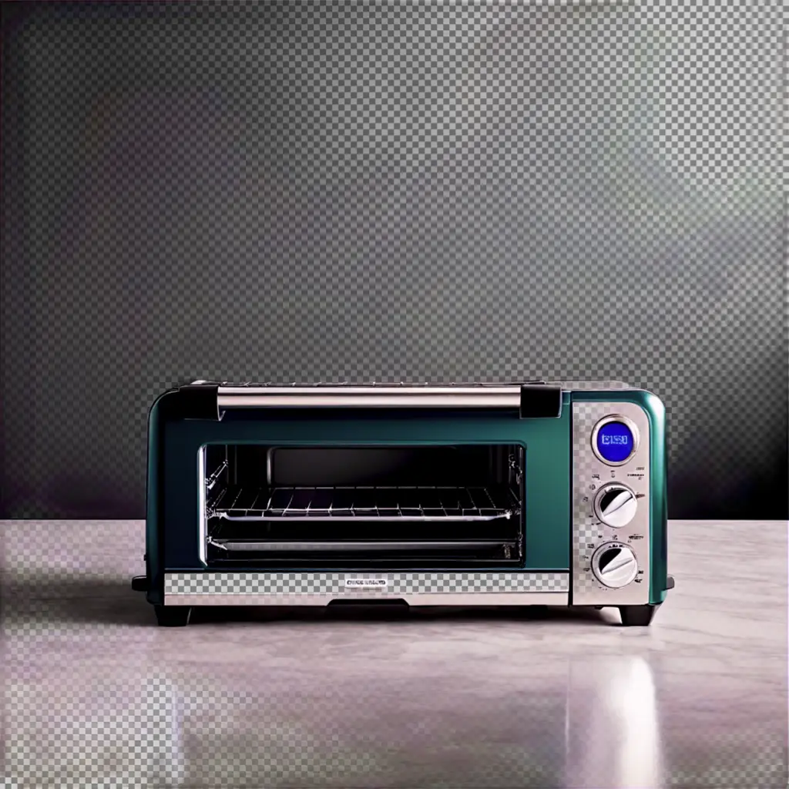

Figure S.1: Semi-transparent background residue. A representative
false-acceptance case caused by imperfect layer separation.

### A.3 Validation Reliability and Failure Analysis

We manually audited 300 accepted and 300 rejected foreground instances
from the validation agent. We observe 5.7% (17/300) false acceptances
and 32.0% (96/300) false rejections. The dominant false-acceptance
failure mode is imperfect layer separation, where a small amount of
semi-transparent background residue remains around the generated
foreground. An example is shown in Fig. S.1.

Figure S.2: Conservative validator rejection example. The VLLM rejects
this egg instance because the cracked shell violates the “intact object”
constraint, illustrating that many false rejections come from
over-strict filtering.

Most false rejections are caused by overly strict validation rather than
unusable samples. For example, in Fig. S.2, the validator rejects an egg
instance because it considers the cracked shell as violating the “intact
object” constraint, even though the instance is still usable for
training. We intentionally keep the validator conservative, since false
acceptance is typically more harmful than false rejection when
constructing a synthetic training set.

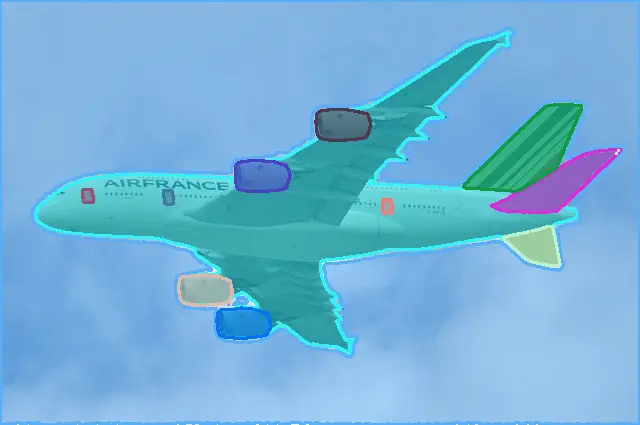

Figure S.3: SAM may split a single object into multiple masks. This
fragmentation makes the extracted foreground less suitable for direct
synthetic instance generation.

### A.4 Alternative Foreground Extraction Pipeline

We also analyze an alternative pipeline based on SAM \[19\]. Although
SAM is a strong segmenter, it often produces fragmented masks, where a
single object is split into multiple disconnected regions, as shown in
Fig. S.3. Such outputs require additional merging and cleanup before
they can be used as instance masks. In contrast, our pipeline directly
generates transparent foregrounds with alpha-aligned masks, which are
more suitable for copy-paste style instance synthesis.

### A.5 Compute Comparison

We compare the practical generation cost of Gen-n-Val and
X-Paste \[44\]. In our reproduction, generating 150k synthetic instances
with X-Paste required about 20 days on 4 NVIDIA RTX A6000 GPUs, whereas
Gen-n-Val required about 5 days under the same hardware setting. This
result suggests that Gen-n-Val is substantially more efficient for
large-scale synthetic instance generation.

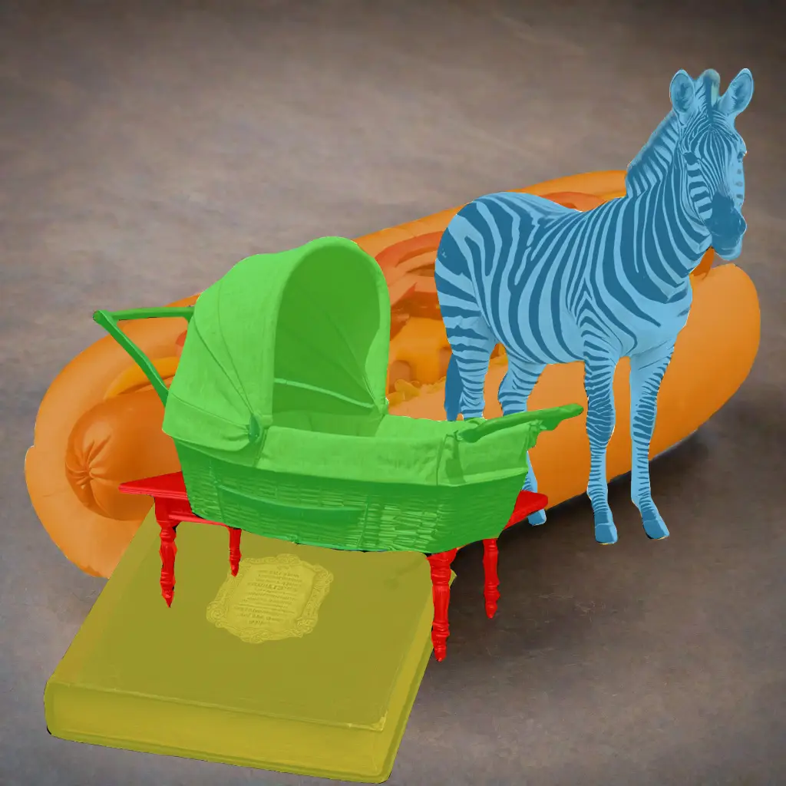

Figure S.4: Example of contextual coherence in instance placement. The
placement of the zebra standing on the huge hot dog is semantically
incoherent, which may lead to unrealistic or nonsensical images.

## Appendix B Limitations

Contextual Coherence in Instance Placement. In this work, the main focus
is to generate high-quality and diverse training instances. As with
other data augmentation methods, although the proposed method utilizes
image harmonization to integrate multiple instances into background
scenes, the instance placement process does not inherently consider the
semantic or contextual relationships between the objects and their
environment. This randomness in placement can result in synthesized
images that lack logical coherence or realism, potentially introducing
noise into the training process. For example, objects may appear in
physically implausible positions or in contexts where their presence is
incongruous, which could hinder model generalization when applied to
real-world scenarios. As shown in Figure S.4, the placement of the zebra
standing on the huge hot dog is semantically incoherent, which may lead
to unrealistic or nonsensical images. Future work could explore
incorporating contextual constraints or relationships between objects to
improve the coherence and realism of the generated data.

## Appendix C Societal Impacts

Our research focuses on developing a novel synthetic data generation
pipeline, which we believe does not pose significant negative societal
impacts. The methodology is designed for general-purpose instance
segmentation tasks and does not directly facilitate applications with
harmful implications, such as surveillance, privacy violations, or
discrimination. The synthetic data generated does not involve any
human-derived data or personal information, thereby eliminating concerns
related to privacy or human rights. Furthermore, our approach emphasizes
efficiency and scalability without incentivizing environmental harm. We
remain committed to responsible research practices and transparency,
ensuring our work contributes positively to the advancement of computer
vision.

## Appendix D Implementation Details

### D.1 Open Vocabulary Prompt Generation

With the initial system prompt, 37% sampled LD prompts were invalid
(e.g., extra system-style replies or additional objects). Using
TextGrad \[41\], we optimize the system prompts of the
Meta-LLaMA-3.1-8B-Instruct \[7\] as the Layer Diffusion (LD) prompt
agent with default parameters (configured with temperature of 0.7,
top-$`p`$ of 0.9, and max-new-tokens set to 256) five times, enabling it
to generate detailed and precise prompts for Layer Diffusion \[42\].
Examples of the initial and optimized system prompts are provided in
Table S.3 of Section F. Examples of the optimized LD prompts produced
from the optimized system prompts are provided in Figures S.8,  S.9,
 S.10, and  S.11 of Section F.

|                                                              |                                                              |                                                              |
| ------------------------------------------------------------ | ------------------------------------------------------------ | ------------------------------------------------------------ |
| Ground Truth                                                 | Baseline                                                     | Gen-n-Val                                                    |
|  |  |  |
|  |  |  |
| 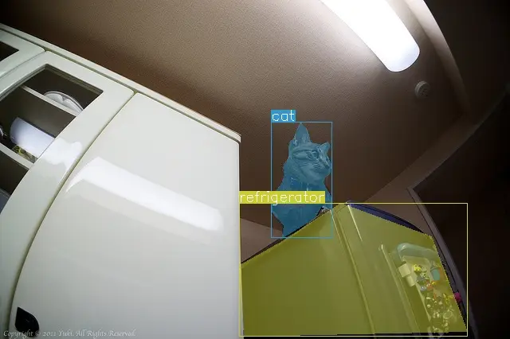 | 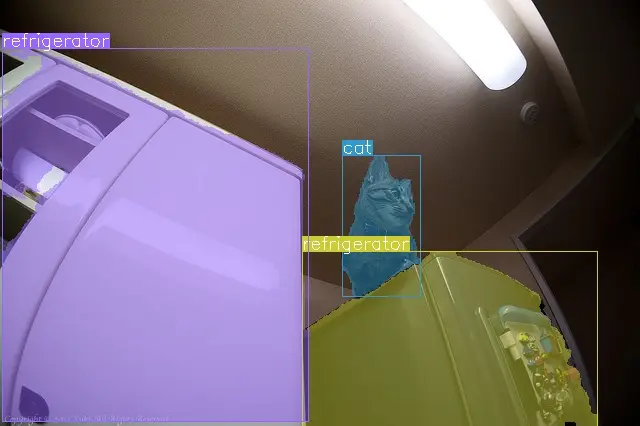 | 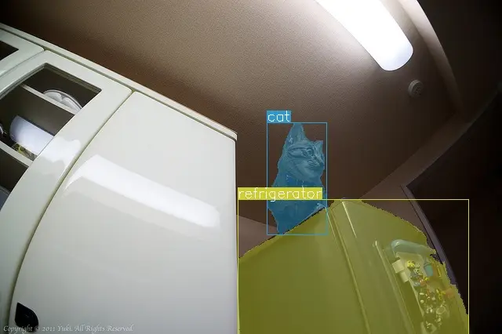 |
| 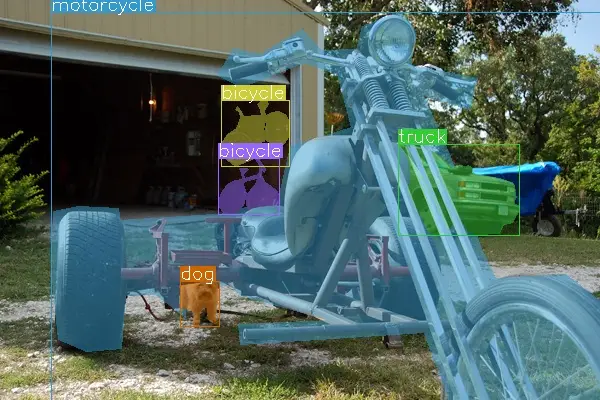 | 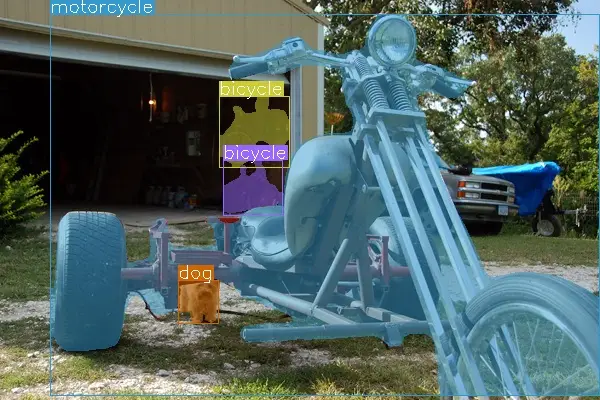 | 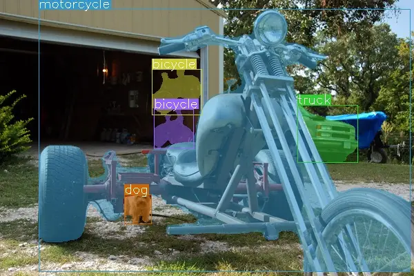 |
| 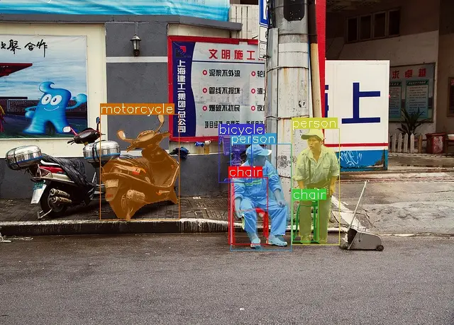 |  | 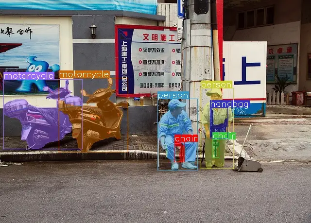 |
| Ground Truth                                                 | Baseline                                                     | Gen-n-Val                                                    |

Figure S.5: Qualitative comparison of ground truth, baseline, and
Gen-n-Val.

### D.2 Foreground Image Generation

These optimized LD prompts are then fed into Layer Diffusion with
default parameters (configured with strength of 1, num-inference-steps
of 25, and a guidance scale of 7) to sample the desired images. Examples
of foreground instances generated using the standard and optimized LD
prompts are provided in Figures S.6 and S.7 of Section F.

### D.3 Foreground Image Filtering

Using TextGrad \[41\], we optimize the system prompts of the
Meta-LLaMA-3.2-11B-Vision-Instruct \[23\] as the data validation agent
with default parameters (configured with temperature of 0.7, top-$`p`$
of 0.9, and max-new-tokens set to 256) five times, enabling it to
effectively evaluate and filter the generated images based on specific
criteria. Examples of the initial and optimized system prompts are
provided in Tables S.4 and S.5 of Section F. After obtaining an intact
foreground instance, we apply a median filter with a kernel size of 15
to denoise the output image and obtain a precise segmentation mask.
Examples of the data validation agent’s filtering process for different
subjects are provided in Figures S.12,  S.13,  S.14, and  S.15 of
Section G.

### D.4 Background Image Generation (Optional)

To synthesize background images, we use simple prompts (_e.g_. “A
\<object\> in an empty \<indoor or outdoor\> background”) along with the
generated foreground instances as input to Layer Diffusion with default
parameters (configured with strength of 1, num-inference-steps of 25,
and a guidance scale of 7). We use this optional setting for our
COCO \[21\] experiments. To reduce the computational cost on LVIS, we
remove the extra synthetic background generation step.

### D.5 Instance Augmentation

We synthesize augmented training images by pasting multiple foreground
instances produced by our Gen-n-Val pipeline onto original images or
synthetic backgrounds (for COCO experiments) generated in the Background
Image Generation phase. The procedure preserves all original LVIS/COCO
annotations and adds annotations only for newly pasted synthetic
instances.

Foreground selection and count. We use two configurations for choosing
synthetic foreground instances to paste. (i) _Standard configuration_:
paste five instances per image; Table S.1 shows this count provides the
strongest empirical performance. (ii) _Long-tail configuration_: perform
targeted augmentation for under-represented categories by adding extra
instances of categories whose image-level frequency is below LVIS
thresholds (rare: fewer than 10 images; common: fewer than 100 images).

Scaling and positioning. Let the original synthetic width/height be
$`(w_{s},h_{s})`$ and the image size $`(W,H)`$. In this work we use
purely random scaling and placement. The scale factor $`s`$ is drawn
from a log-normal distribution
$`s\sim\text{LogNormal}(\mu=\log(m),\sigma=0.4)`$ where $`m`$ is the
mean scale factor (set to 0.5 in our experiments); if the proposed size
would exceed image bounds we clip it to
$`0.9\times\min(W/w_{s},H/h_{s})`$. The (x,y) paste location is sampled
uniformly over all valid upper-left coordinates so the resized instance
lies fully inside the image.

Occlusion trimming and retries. We decode all existing annotation masks
plus masks of previously pasted synthetic instances. Overlapping pixels
are removed from the new synthetic mask. We enforce a minimum retained
area ratio: if the visible area $`A_{\text{vis}}`$ after trimming
satisfies $`A_{\text{vis}}<0.1\,A_{\text{orig}}`$ or is fully occluded,
we shrink the tentative mean size (multiplying by 0.8) and resample
scale/position, retrying up to 10 attempts. This prevents adding
negligible fragments and avoids duplicate coverage. Original annotations
are never modified. This strategy yields: (1) diverse multi-instance
compositions without corrupting existing ground truth, (2)
occlusion-aware clean masks, and (3) selective boosting of
under-represented categories for improved long-tail performance.

### D.6 Model Training

LVIS experiments. We use the Mask R-CNN \[16\] model with a
ResNet-50-FPN backbone to evaluate the effectiveness of Gen-n-Val on the
LVIS benchmark \[14\]. We follow the standard LVIS setup and the common
“1×” training schedule: 90k iterations with a global batch size of 16 (2
images per GPU $`\times`$ 8 GPUs equivalent). Optimization uses SGD with
momentum 0.9 and weight decay 0.0001. The initial learning rate is 0.02
and is reduced by a factor of 10 at 60k and 80k iterations. Repeat
factor sampling is enabled with an oversample threshold of $`10^{-3}`$.
Data augmentation consists of horizontal flipping and multi-scale
resizing where the shorter image side is randomly sampled in the range
\[640, 800\] while ensuring the longer side does not exceed 1333 pixels.

COCO experiments. For COCO we evaluate Gen-n-Val using YOLO11m and
YOLOv9c as additional baselines. YOLO11m is trained for 100 epochs with
a batch size of 200, while YOLOv9c is trained for 100 epochs with a
batch size of 100. All images are resized to 640$`\times`$640 pixels. We
use SGD with momentum 0.9 (learning rate 0.01).

## Appendix E Qualitative Results

In Figure S.5, we present qualitative comparisons between the ground
truth, baseline model outputs, and Gen-n-Val outputs, evaluated using
the YOLO11m \[18\] model. These results demonstrate the robustness of
Gen-n-Val in addressing various challenges in instance segmentation.

- •
  First Row: The baseline model overlooks the car on the highway
  entirely, while Gen-n-Val successfully segments the car, demonstrating
  its ability to detect small and distant objects.
- •
  Second Row: The baseline model mistakenly segments the cabinet as a
  refrigerator, highlighting confusion in object classification.
  Gen-n-Val correctly segments the cabinet, avoiding this
  misclassification.
- •
  Third Row: The baseline model fails to segment the truck on the
  right-hand side of the image. Gen-n-Val, however, segments the truck
  successfully, illustrating its superior handling of challenging
  complex scenes.
- •
  Fourth Row: The baseline model fails to segment the chair under the
  right-hand-side person and mistakenly identifies the chair under the
  left-hand-side person as two separate chairs. Gen-n-Val segments the
  right chair correctly and accurately identifies the left chair as a
  single object. Additionally, Gen-n-Val successfully segments a handbag
  carried by the right-hand-side person, which is present in the image
  but missing in the ground truth annotation.

This highlights Gen-n-Val’s ability to capture fine details and segment
unannotated objects, demonstrating its potential to improve object
detection and segmentation in scenarios with incomplete ground truth
labels.

## Appendix F Prompt Optimization Results

In Table S.3, we provide a comparison between the LD prompt agent’s
initial system prompt and the optimized system prompt for generating
detailed positive prompts for the Layer Diffusion model. This optimized
system prompt is designed to guide the LD prompt agent in generating
high-quality prompts that focus solely on the main subject, ensuring
that the generated images are detailed, realistic, and visually
appealing. The guidelines provided in the optimized system prompt help
the LD prompt agent to create diverse and specific prompts that adhere
to the requirements of the task, resulting in high-quality image
generation.

In Tables S.4 and S.5, we present a comparison between the data
validation agent’s initial system prompt and the optimized system prompt
for analyzing images based on specific criteria. This optimized system
prompt provides clear instructions for describing images, evaluating
them against specific criteria, and deciding whether to keep or filter
out images based on the evaluation results, which ensures that the data
validation agent analyzes images accurately and consistently, leading to
improved performance in evaluating image suitability.

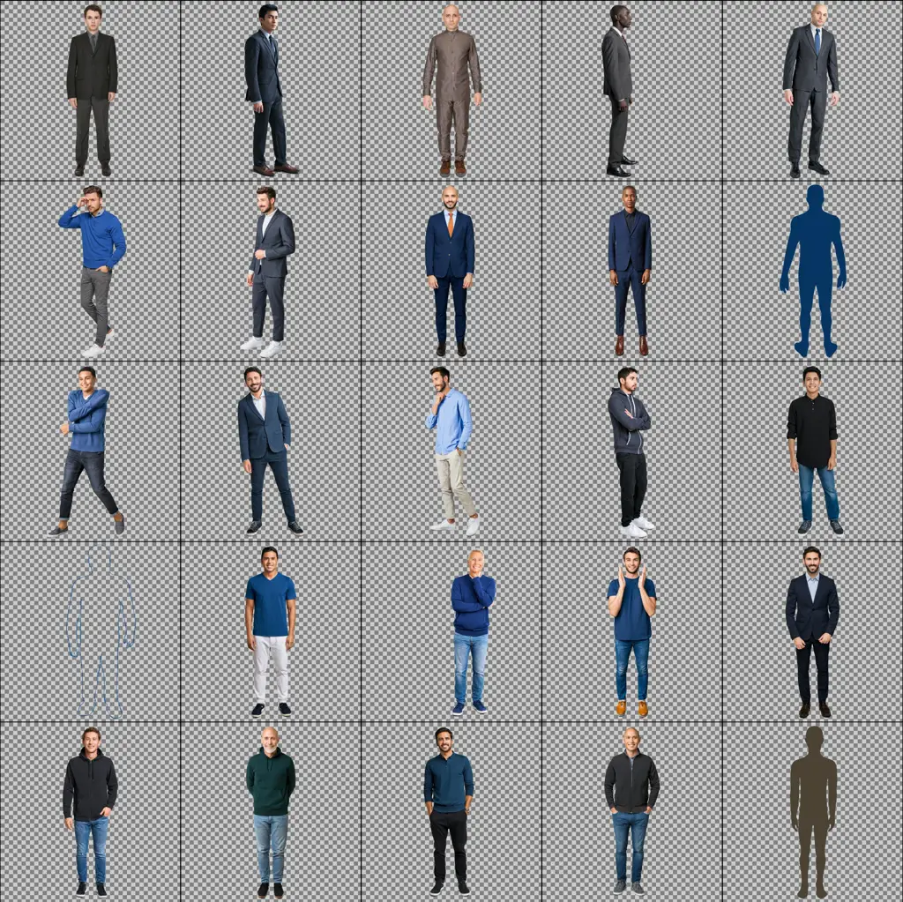

Figure S.6: Example of the person foreground instance generated using
the standard LD prompt.

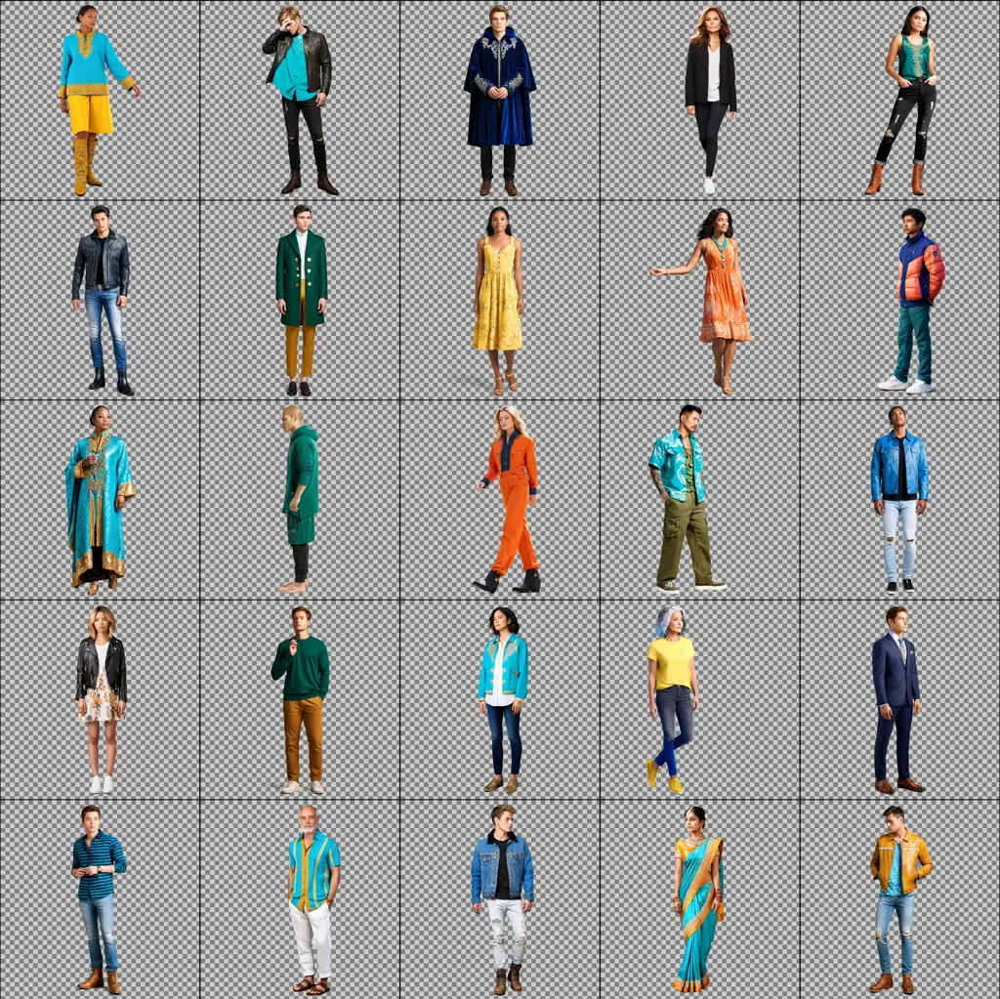

Figure S.7: Example of the person foreground instance generated using
the optimized LD prompt.

In Figures S.6 and S.7, we present examples of person foreground
instances generated using the standard LD prompt and the optimized LD
prompt, respectively. The optimized LD prompt demonstrates its ability
to produce a broader range of images with enhanced diversity. Unlike the
standard prompt, which often results in generic and less varied outputs,
the optimized prompt generates images that vary significantly in terms
of style, color, texture, lighting, and perspective. This diversity
ensures the inclusion of individuals with distinct appearances, clothing
styles, and postures, thereby enriching the dataset and improving the
generalization capability of downstream models trained on these
synthetic examples.

In Figures S.8, S.9, S.10, and S.11, we compare the standard LD prompt
with the optimized LD prompts for the subjects airplane, orange, car,
and person, respectively. The optimized prompts are designed to provide
detailed information about the subject’s status, color, style,
mood/atmosphere, lighting, perspective/viewpoint, textures/material,
time period, and medium, ensuring that the generated images are highly
realistic and visually appealing. The optimized prompts include trigger
words like “high-resolution” and “highly realistic” to emphasize the
quality of the generated images. The examples demonstrate how the
optimized prompts lead to the generation of diverse images that focus
solely on the main subject, enhancing the quality and realism of the
generated images.

## Appendix G Foreground Image Filtering Results

In Figures S.12,  S.13,  S.14, and  S.15, we provide examples of the
data validation agent’s filtering process for different subjects. The
data validation agent evaluates each generated image based on specific
criteria, including the presence of a single subject, a single view, an
intact subject, and a plain background. It analyzes the image and
provides a detailed description of the content, highlighting the
presence or absence of the specified criteria. Based on the evaluation,
the data validation agent determines whether the image meets all the
criteria and should be retained or fails to meet the criteria and should
be filtered out. This filtering process ensures that only high-quality
images that adhere to the task requirements are retained for further
processing, enhancing the overall quality of the generated dataset.

## Appendix H More Gen-n-Val Synthetic Data

In Figure S.16,  S.17,  S.18,  S.19,  S.21, and  S.22, we provide
additional examples of Gen-n-Val synthetic data generated for
COCO \[21\]. Moreover, in Figure S.23,  S.24, and  S.25, we provide
additional examples of Gen-n-Val synthetic data generated for
LVIS \[14\].

## Please check the following pages for more tables and figures.

| The LD Prompt Agent’s Initial System Prompt                                                                                                                                                                                                                                                                                                                                                                                                                                                                                                                                                                                                               |
| --------------------------------------------------------------------------------------------------------------------------------------------------------------------------------------------------------------------------------------------------------------------------------------------------------------------------------------------------------------------------------------------------------------------------------------------------------------------------------------------------------------------------------------------------------------------------------------------------------------------------------------------------------- |
| Generate detailed positive prompts for the Stable Diffusion Juggernaut-XL-v6 model to create images focusing solely on the main subject. Each prompt must be specific and cover aspects such as the subject’s status, color, style, mood/atmosphere, lighting, perspective/viewpoint, textures/material, time period, and medium. Prompts should emphasize the use of trigger words like “high-resolution” and “highly realistic” to ensure quality. Prompts should be concise, limited to under 75 tokens, and must not include disallowed or sensitive content. Background descriptions should be absent, avoiding the inclusion of additional objects. |
| The LD Prompt Agent’s Optimized System Prompt                                                                                                                                                                                                                                                                                                                                                                                                                                                                                                                                                                                                             |
| You are an AI assistant designed to generate detailed and realistic prompts for the \*\*Stable Diffusion XL model\*\*, focusing only on a single subject. The background and environment should be omitted in the prompts. Your prompts should be specific, descriptive, diverse, and follow the provided guidelines to ensure high-quality image generation.                                                                                                                                                                                                                                                                                             |
| \*\*Guidelines for Prompt Creation:\*\*                                                                                                                                                                                                                                                                                                                                                                                                                                                                                                                                                                                                                   |
| 1. \*\*Subject:\*\* The only single object in the image. Ensure a wide variety of subjects, ranging from everyday items to unique or uncommon objects.                                                                                                                                                                                                                                                                                                                                                                                                                                                                                                    |
| 2. \*\*Status:\*\* The current state or condition of the subject.                                                                                                                                                                                                                                                                                                                                                                                                                                                                                                                                                                                         |
| 3. \*\*Color:\*\* Dominant colors of the subject. Include specific shades and variations to enhance visual detail.                                                                                                                                                                                                                                                                                                                                                                                                                                                                                                                                        |
| 4. \*\*Style:\*\* Artistic style or rendering method. Incorporate a range of styles (e.g., photorealistic, hyper-realistic) to promote diversity.                                                                                                                                                                                                                                                                                                                                                                                                                                                                                                         |
| 5. \*\*Mood/Atmosphere:\*\* Emotional quality related to the subject. Convey realistic emotions or states that align with the subject.                                                                                                                                                                                                                                                                                                                                                                                                                                                                                                                    |
| 6. \*\*Lighting:\*\* Specific lighting on the subject. Describe natural or artificial lighting conditions that highlight the subject’s features.                                                                                                                                                                                                                                                                                                                                                                                                                                                                                                          |
| 7. \*\*Perspective/Viewpoint:\*\* Angle or perspective of the subject. Use varied viewpoints (e.g., top-down, eye-level, close-up) to add depth.                                                                                                                                                                                                                                                                                                                                                                                                                                                                                                          |
| 8. \*\*Texture/Material:\*\* Textures or materials of the subject. Detail the tactile qualities to enhance realism.                                                                                                                                                                                                                                                                                                                                                                                                                                                                                                                                       |
| 9. \*\*Time Period:\*\* Specific era. When relevant, specify a realistic time period to provide context.                                                                                                                                                                                                                                                                                                                                                                                                                                                                                                                                                  |
| 10. \*\*Medium:\*\* Artistic medium or level of detail.                                                                                                                                                                                                                                                                                                                                                                                                                                                                                                                                                                                                   |
| - \*\*Key Trigger Words:\*\* Include terms like ‘high-resolution’, ’highly realistic’.                                                                                                                                                                                                                                                                                                                                                                                                                                                                                                                                                                    |
| - \*\*Length:\*\* Keep the prompt under 75 tokens.                                                                                                                                                                                                                                                                                                                                                                                                                                                                                                                                                                                                        |
| - \*\*Avoid:\*\* Do not include any additional subjects in the prompt. Do not include any descriptions about the background.                                                                                                                                                                                                                                                                                                                                                                                                                                                                                                                              |

Table S.3: Comparison of the initial and optimized system prompts of LD
prompt agent.

| The Data Validation Agent’s Initial System Prompt                                                                                                                                                                                                                                                                                                                                                                                                                                                                                                                                                                                                                                                                                                                                                                                                                                                                                                                                          |
| ------------------------------------------------------------------------------------------------------------------------------------------------------------------------------------------------------------------------------------------------------------------------------------------------------------------------------------------------------------------------------------------------------------------------------------------------------------------------------------------------------------------------------------------------------------------------------------------------------------------------------------------------------------------------------------------------------------------------------------------------------------------------------------------------------------------------------------------------------------------------------------------------------------------------------------------------------------------------------------------ |
| As an AI assistant, your role is to analyze images to determine their suitability based on specific criteria. First, provide a detailed description of the image. Second, evaluate the image against four criteria: 1. it should contain only one subject; 2. the subject should be shown from a single angle or perspective, without multiple views or angles within the same image; 3. the subject should be intact and fully visible; and 4. the background should be empty or plain, without distracting elements. Third, based on this evaluation, decide whether to filter out the image if it violates any of the criteria or keep it if it meets all of them. At last, conclude with a result stating ”Keep” if the image meets all criteria or ”Filter Out” if it violates any. Present your analysis in the specified output format, including the image description, detailed evaluations with explanations and results for each criterion, a conclusion, and the final result. |
| Output Format:                                                                                                                                                                                                                                                                                                                                                                                                                                                                                                                                                                                                                                                                                                                                                                                                                                                                                                                                                                             |
| Image Description:                                                                                                                                                                                                                                                                                                                                                                                                                                                                                                                                                                                                                                                                                                                                                                                                                                                                                                                                                                         |
| Evaluation Criteria:                                                                                                                                                                                                                                                                                                                                                                                                                                                                                                                                                                                                                                                                                                                                                                                                                                                                                                                                                                       |
| 1. Single \[Category Name\]:                                                                                                                                                                                                                                                                                                                                                                                                                                                                                                                                                                                                                                                                                                                                                                                                                                                                                                                                                               |
| - Explanation                                                                                                                                                                                                                                                                                                                                                                                                                                                                                                                                                                                                                                                                                                                                                                                                                                                                                                                                                                              |
| - Result: Meet or Fail                                                                                                                                                                                                                                                                                                                                                                                                                                                                                                                                                                                                                                                                                                                                                                                                                                                                                                                                                                     |
| 2. Single View:                                                                                                                                                                                                                                                                                                                                                                                                                                                                                                                                                                                                                                                                                                                                                                                                                                                                                                                                                                            |
| - Explanation                                                                                                                                                                                                                                                                                                                                                                                                                                                                                                                                                                                                                                                                                                                                                                                                                                                                                                                                                                              |
| - Result: Meet or Fail                                                                                                                                                                                                                                                                                                                                                                                                                                                                                                                                                                                                                                                                                                                                                                                                                                                                                                                                                                     |
| 3. Intact \[Category Name\]:                                                                                                                                                                                                                                                                                                                                                                                                                                                                                                                                                                                                                                                                                                                                                                                                                                                                                                                                                               |
| - Explanation                                                                                                                                                                                                                                                                                                                                                                                                                                                                                                                                                                                                                                                                                                                                                                                                                                                                                                                                                                              |
| - Result: Meet or Fail                                                                                                                                                                                                                                                                                                                                                                                                                                                                                                                                                                                                                                                                                                                                                                                                                                                                                                                                                                     |
| 4. Plain Background:                                                                                                                                                                                                                                                                                                                                                                                                                                                                                                                                                                                                                                                                                                                                                                                                                                                                                                                                                                       |
| - Explanation                                                                                                                                                                                                                                                                                                                                                                                                                                                                                                                                                                                                                                                                                                                                                                                                                                                                                                                                                                              |
| - Result: Meet or Fail                                                                                                                                                                                                                                                                                                                                                                                                                                                                                                                                                                                                                                                                                                                                                                                                                                                                                                                                                                     |
| Conclusion:                                                                                                                                                                                                                                                                                                                                                                                                                                                                                                                                                                                                                                                                                                                                                                                                                                                                                                                                                                                |
| Result: Keep or Filter Out                                                                                                                                                                                                                                                                                                                                                                                                                                                                                                                                                                                                                                                                                                                                                                                                                                                                                                                                                                 |

Table S.4: The initial system prompt of the data validation agent. The
category name is a placeholder for the specific object category.

| The Data Validation Agent’s Optimized System Prompt                                                                              |
| -------------------------------------------------------------------------------------------------------------------------------- |
| You are an AI assistant that analyzes images to determine their suitability based on specific criteria.                          |
| \*\*Instructions:\*\*                                                                                                            |
| 1. \*\*Describe the image in detail\*\*.                                                                                         |
| 2. \*\*Evaluate the image\*\* against the following criteria:                                                                    |
| - \*\*Criteria 1 - Single subject\*\*: The image should contain only one subject.                                                |
| - \*\*Criteria 2 - Single View\*\*: The subject should be shown from a single angle or perspective.                              |
| - \*\*Criteria 3 - Intact subject\*\*: The subject should be intact and fully visible.                                           |
| - \*\*Criteria 4 - Plain Background\*\*: The background should be empty or plain, without distracting elements.                  |
| 3. \*\*Decide whether to filter out the image\*\* based on these criteria.                                                       |
| 4. Conclude with \*\*Result:\*\* Keep if the image meets all criteria or \*\*Result:\*\* Filter Out if it violates any criteria. |
| \*\*Output Format:\*\*                                                                                                           |
| \*Image Description:\*\*                                                                                                         |
| \[Your detailed description here\]                                                                                               |
| \*\*Evaluation Criteria:\*\*                                                                                                     |
| 1. \*\*Single \[Category Name\]:\*\*                                                                                             |
| \* \[Explanation\]                                                                                                               |
| \* \*\*Result:\*\* \[Meet/Fail\]                                                                                                 |
| 2. \*\*Single View:\*\*                                                                                                          |
| \* \[Explanation\]                                                                                                               |
| \* \*\*Result:\*\* \[Meet/Fail\]                                                                                                 |
| 3. \*\*Intact \[Category Name\]:\*\*                                                                                             |
| \* \[Explanation\]                                                                                                               |
| \* \*\*Result:\*\* \[Meet/Fail\]                                                                                                 |
| 4. \*\*Plain Background:\*\*                                                                                                     |
| \* \[Explanation\]                                                                                                               |
| \* \*\*Result:\*\* \[Meet/Fail\]                                                                                                 |
| \*\*Conclusion:\*\*                                                                                                              |
| \[Your conclusion here\]                                                                                                         |
| \*\*Result:\*\* \[Keep/Filter Out\]                                                                                              |

Table S.5: The optimized system prompt of the data validation agent. The
category name is a placeholder for the specific object category.

| Standard Layer Diffusion Prompt                                                                                                                                                                                                                                                                                                                                                                                                                                                                 | Foreground Instance Image                                    |
| ----------------------------------------------------------------------------------------------------------------------------------------------------------------------------------------------------------------------------------------------------------------------------------------------------------------------------------------------------------------------------------------------------------------------------------------------------------------------------------------------- | ------------------------------------------------------------ |
| An image of a single airplane, an aircraft that has a fixed wing and is powered by propellers or jets.                                                                                                                                                                                                                                                                                                                                                                                          | 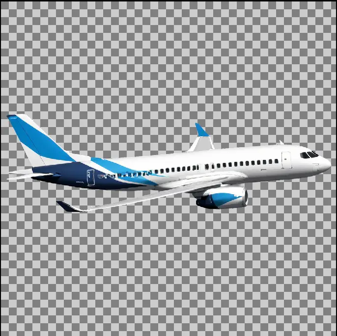 |
| Optimized Layer Diffusion Prompts                                                                                                                                                                                                                                                                                                                                                                                                                                                               | Foreground Instance Image                                    |
| High-resolution digital rendering of a single airplane, alone, with a diverse range of metallic shades from a gleaming silver to a weathered copper, ultra-realistic in style, conveying a sense of nostalgia and longing, under soft morning sunlight with warm shadows, viewed from a low-angle perspective that accentuates the aircraft’s sleek lines, featuring intricate textures of polished aluminum and worn leather seats, set against a timeless backdrop of the early 20th century. | 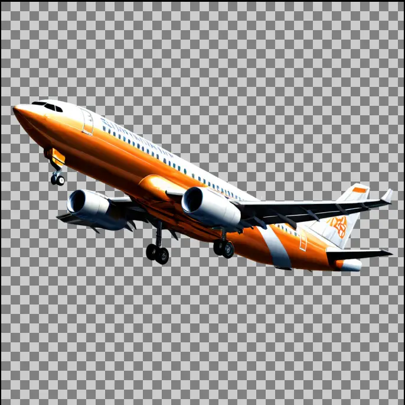 |
| High-resolution digital rendering of a single, sleek, silver, Boeing 747-400F airplane, alone, in a majestic, photorealistic style, evoking feelings of serenity and power, with soft, warm, golden sunlight casting long shadows across its metallic surface, from a low, 45-degree angle, showcasing the intricate details of its textured, riveted aluminum skin, during the golden hour of a late summer evening.                                                                           | 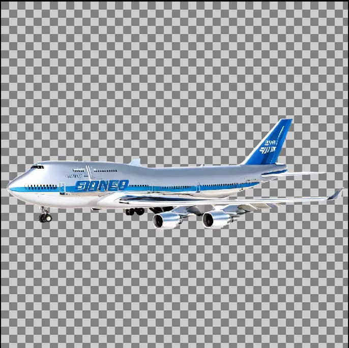 |
| A high-resolution digital rendering of a single, vintage, metallic silver 1940s Boeing B-17 Flying Fortress aeroplane, alone, with a warm golden glow of sunlight illuminating its weathered aluminum skin, ultra-realistic details of its propellers and fuselage visible, a mix of nostalgic and eerie atmosphere, a dramatic low-angle shot from directly below, with intricate textures and rivets on its surface visible, and a subtle sense of motion as if in mid-flight.                | 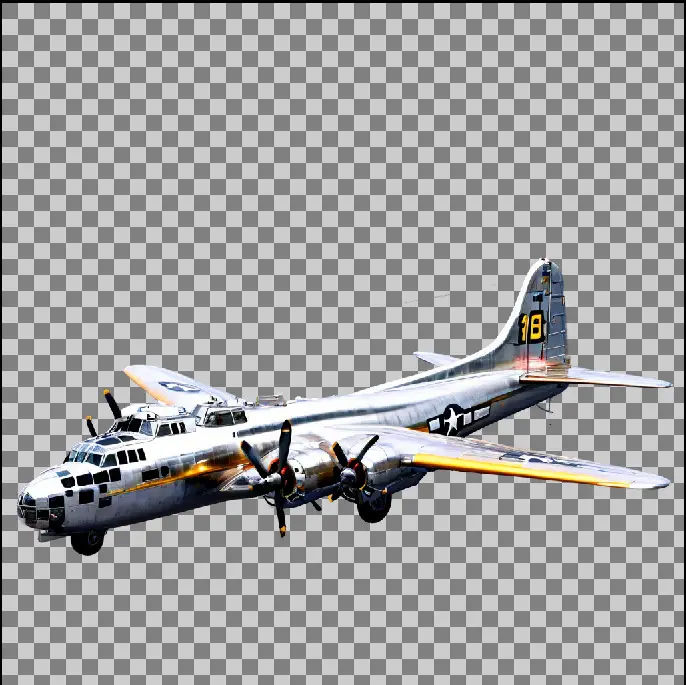 |
| High-resolution digital rendering of a single, sleek, and aerodynamic airplane alone, with a metallic silver fuselage, a deep blue tail fin, and bright red propellers, rendered in an ultra-realistic style with a sense of nostalgia and excitement, under soft golden morning sunlight, from a low-angle, bird’s-eye view, showcasing the intricate textures of the aircraft’s aluminum skin and the worn, leather-like seats, set against a timeless era of classic aviation.               | 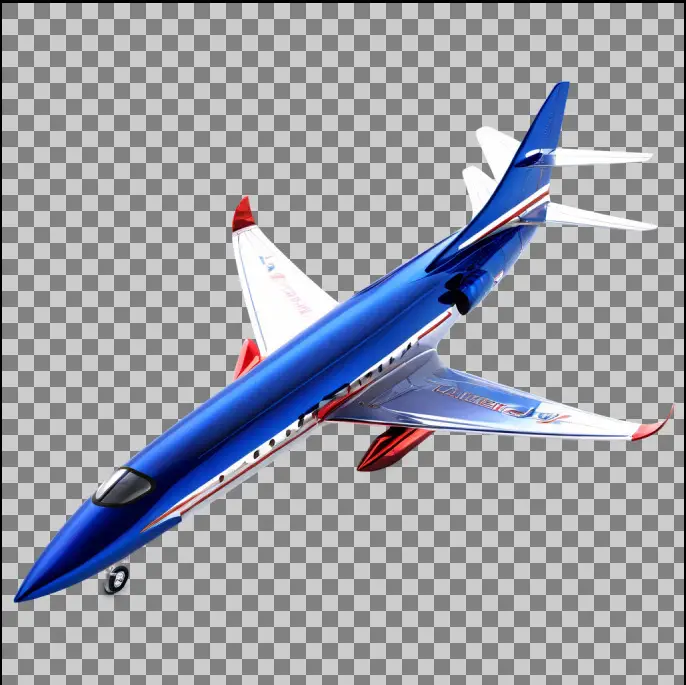 |
| A highly realistic digital rendering of a single vintage airplane, an aeroplane, alone, with a metallic silver body, dark blue accents, and a red stripe, sitting on a runway, exuding a sense of nostalgia, under warm golden sunset lighting, from a low-angle perspective, showcasing its worn aluminum skin and rusty propellers, during the 1940s.                                                                                                                                         | 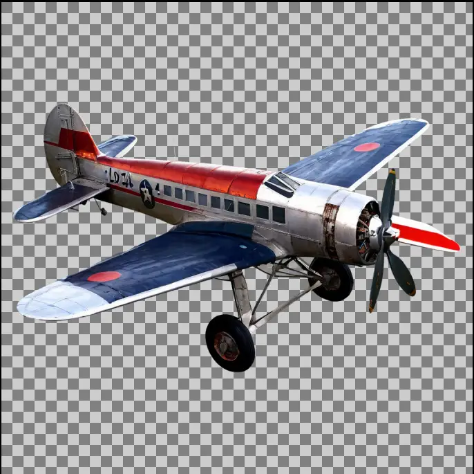 |

Figure S.8: Comparison of the standard and optimized LD prompts and
their corresponding foreground instances for airplane.

| Standard Layer Diffusion Prompt                                                                                                                                                                                                                                                                                                                                                                                                                                                                                                                                       | Foreground Instance Image                                    |
| --------------------------------------------------------------------------------------------------------------------------------------------------------------------------------------------------------------------------------------------------------------------------------------------------------------------------------------------------------------------------------------------------------------------------------------------------------------------------------------------------------------------------------------------------------------------- | ------------------------------------------------------------ |
| An image of a single orange (fruit), orange (FRUIT of an orange tree).                                                                                                                                                                                                                                                                                                                                                                                                                                                                                                | 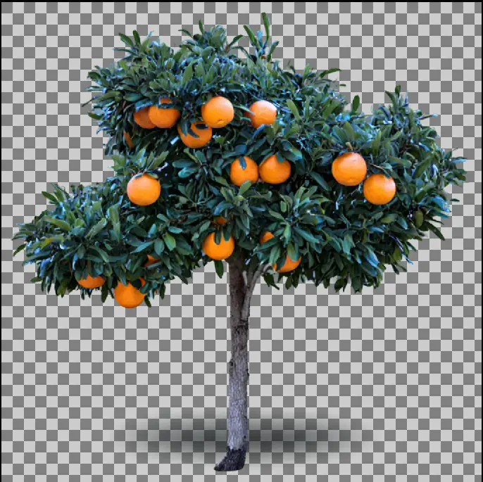 |
| Optimized Layer Diffusion Prompts                                                                                                                                                                                                                                                                                                                                                                                                                                                                                                                                     | Foreground Instance Image                                    |
| High-resolution digital rendering of a single orange fruit alone, with vibrant orange hues ranging from deep burnt orange to bright juicy orange, ultra-realistic, conveying a sense of serenity and satisfaction, under soft warm natural light with subtle shadows, viewed from a 45-degree angle with a slight macro perspective, featuring a glossy skin with subtle ridges and a slightly dimpled texture, set in a timeless, nostalgic atmosphere evoking memories of summertime.                                                                               | 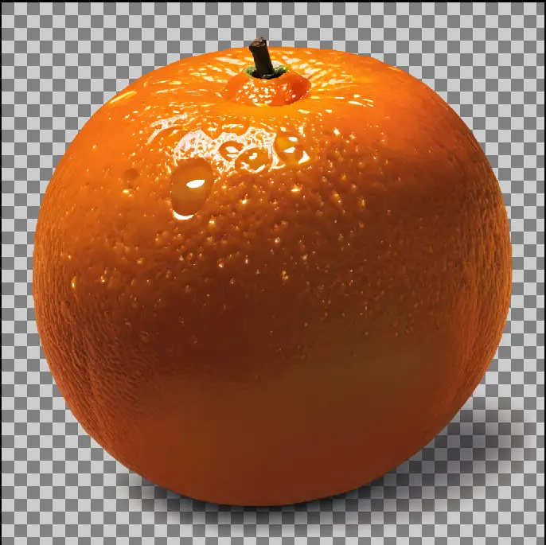 |
| High-resolution digital rendering of a single, perfectly ripe, vibrant orange fruit alone, with a warm, inviting orange color gradating from a deep burnt orange shade at the stem to a bright, juicy orange hue near the peel, ultra-realistic in style, conveying a sense of nostalgia and warmth, under soft, golden natural lighting, from a 45-degree angle, with a subtle sheen and slight oiliness to the peel, as if freshly picked from an orange tree in a lush, Mediterranean orchard during the peak summer season.                                       | 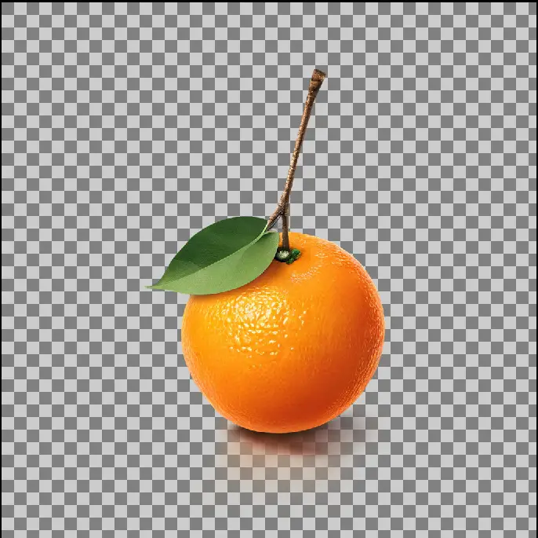 |
| High-resolution digital rendering of a single orange fruit alone, with vibrant shades of orange, coral, and golden hues, ultra-realistic in style, conveying a sense of freshness, serenity, and ripeness, illuminated by soft, warm sunlight, from a 45-degree angle, showcasing the intricate texture of its slightly bumpy skin and the subtle sheen of its juicy pulp, in a timeless, modern setting.                                                                                                                                                             | 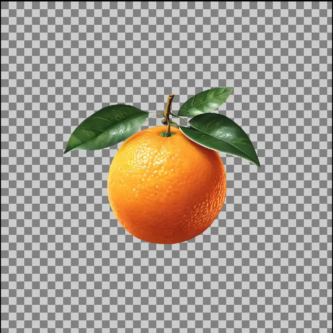 |
| High-resolution digital rendering of a single, juicy orange fruit, alone, with vibrant orange hues, deep orange-red undertones, and subtle yellow-green highlights, in an ultra-realistic style, conveying a sense of ripeness, freshness, and satisfaction, under warm, soft, golden natural lighting, viewed from a 45-degree angle with a shallow depth of field, showcasing the intricate texture of the fruit’s skin, which is slightly wrinkled and slightly sticky to the touch, as if plucked from a tree in the Mediterranean during the peak summer season. | 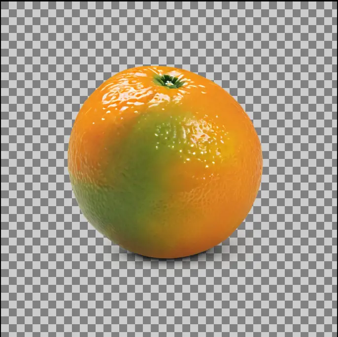 |
| High-resolution digital rendering of a single vibrant orange fruit, alone on a surface, radiating warm golden hues with deep orange undertones, ultra-realistic in style, evoking feelings of nostalgia and abundance, bathed in soft warm sunlight with subtle shadows, captured from a 45-degree angle with the fruit slightly rotated, showcasing its intricate texture of fine oil glands and a slight sheen from a gentle mist, set in a timeless era of rustic simplicity.                                                                                      | 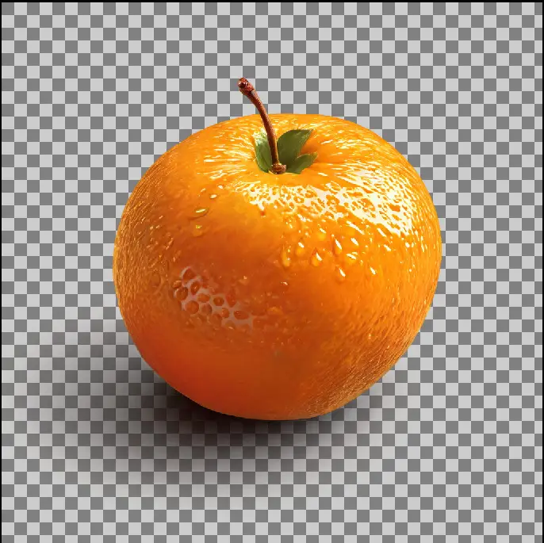 |

Figure S.9: Comparison of the standard and optimized LD prompts and
their corresponding foreground instances for orange.

| Standard Layer Diffusion Prompt                                                                                                                                                                                                                                                                                                                                                                                                                                                                                                                                                                                                              | Foreground Instance Image                                    |
| -------------------------------------------------------------------------------------------------------------------------------------------------------------------------------------------------------------------------------------------------------------------------------------------------------------------------------------------------------------------------------------------------------------------------------------------------------------------------------------------------------------------------------------------------------------------------------------------------------------------------------------------- | ------------------------------------------------------------ |
| An image of a single car, a motor vehicle with four wheels.                                                                                                                                                                                                                                                                                                                                                                                                                                                                                                                                                                                  | 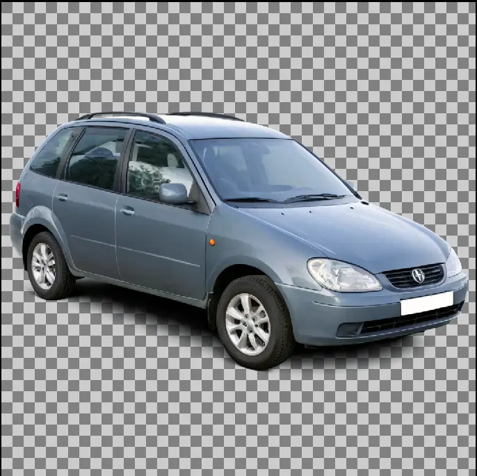 |
| Optimized Layer Diffusion Prompts                                                                                                                                                                                                                                                                                                                                                                                                                                                                                                                                                                                                            | Foreground Instance Image                                    |
| High-resolution digital rendering of a single, ultra-realistic car standing alone on a dimly lit city street at sunset, its sleek metallic body glinting with a gradient of deep blues and rich silvers, its aerodynamic curves accentuated by warm golden light spilling from the setting sun, its tires appearing worn and weathered with a tactile texture, its surface reflecting a mesmerizing array of colors and shades, from the deep, rich tones of its metallic paint to the subtle, nuanced hues of its tinted windows, all captured from a dramatic low-angle perspective that emphasizes the car’s powerful, aggressive stance. | 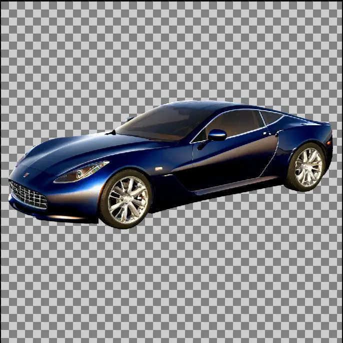 |
| Highly realistic digital rendering of a single, sleek, 1969 Chevrolet Camaro SS alone, featuring a bold, metallic red paint job with a deep, glossy finish, a dark, matte black hood and roof, and a bright, chrome exhaust tip, captured in a moody, atmospheric scene with a warm, golden sunlight illuminating the car from a low, angled perspective, emphasizing the curved lines and aggressive stance of the vehicle, with a soft, velvety texture on the leather interior and a rough, industrial texture on the exposed engine components, set against a timeless, nostalgic backdrop.                                              | 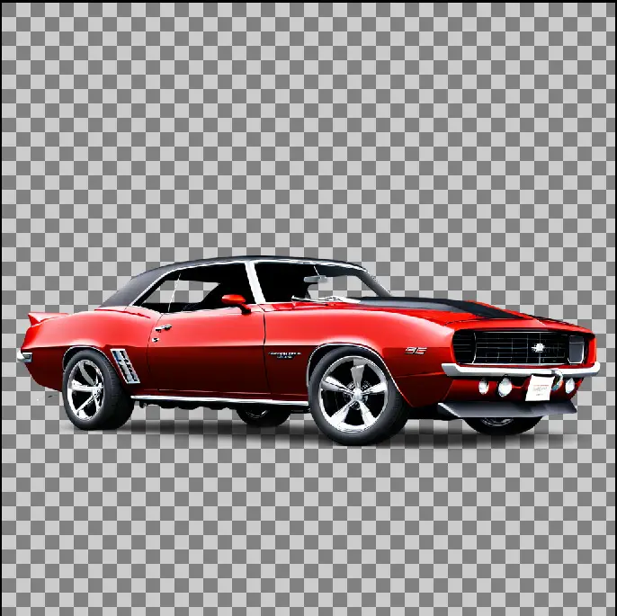 |
| High-resolution digital rendering of a single sleek, high-performance sports car, alone, with a glossy metallic blue finish featuring hints of navy and turquoise, an ultra-realistic style, an eerie and mysterious mood, dramatic side lighting with deep shadows, a low-angle, dramatic perspective, a smooth and aerodynamic texture, and a contemporary, modern time period.                                                                                                                                                                                                                                                            | 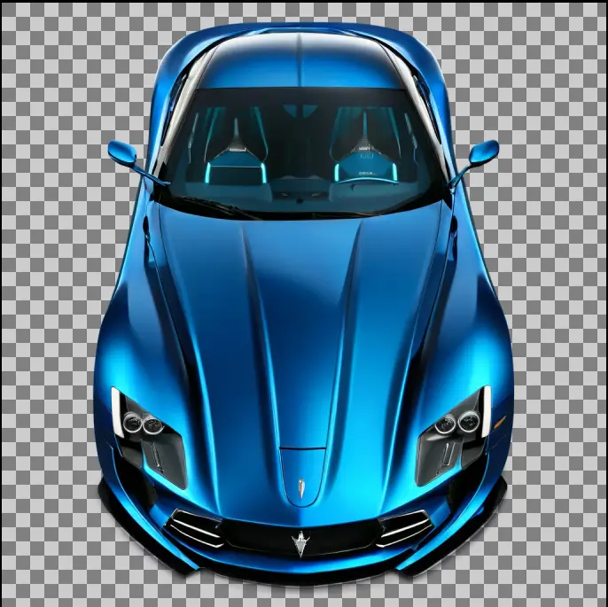 |
| High-resolution digital rendering of a single, sleek, high-performance, 2023, Lamborghini Aventador, alone, with a predominantly glossy, matte black, and metallic silver body, ultra-realistic, conveying a sense of speed and power, with dramatic, golden hour lighting casting a warm glow on its chiseled lines, from a low, eye-level, 45-degree angle, showcasing the intricate, hand-stitched, black and silver leather interior, and the smooth, rubberized, textured steering wheel.                                                                                                                                               | 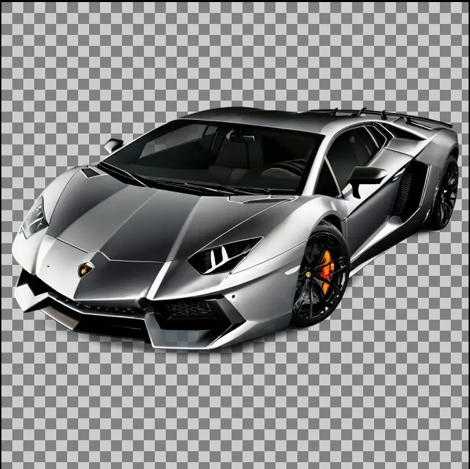 |
| High-resolution digital rendering of a single, ultra-realistic, sleek, 1969 cherry-red Ferrari 250 GTO, alone, with a mix of glossy and matte black leather interior, racing stripes, and gleaming chrome accents, exuding a sense of speed and luxury, under a warm, golden sunlight, from a low, eye-level perspective, showcasing its textured, hand-stitched leather seats and intricate dashboard details, set in a nostalgic, vintage era.                                                                                                                                                                                             | 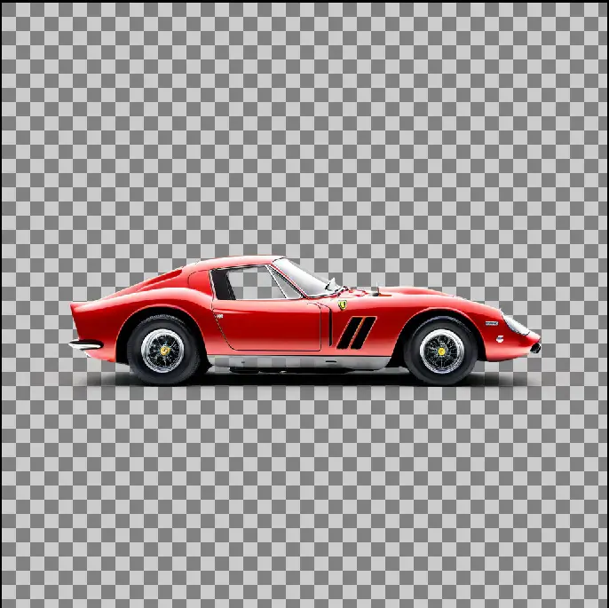 |

Figure S.10: Comparison of the standard and optimized LD prompts and
their corresponding foreground instances for car.

| Standard Layer Diffusion Prompt                                                                                                                                                                                                                                                                                                                                                                                                                                                                                                                                                                                           | Foreground Instance Image                                    |
| ------------------------------------------------------------------------------------------------------------------------------------------------------------------------------------------------------------------------------------------------------------------------------------------------------------------------------------------------------------------------------------------------------------------------------------------------------------------------------------------------------------------------------------------------------------------------------------------------------------------------- | ------------------------------------------------------------ |
| An image of a single person, a human being.                                                                                                                                                                                                                                                                                                                                                                                                                                                                                                                                                                               | 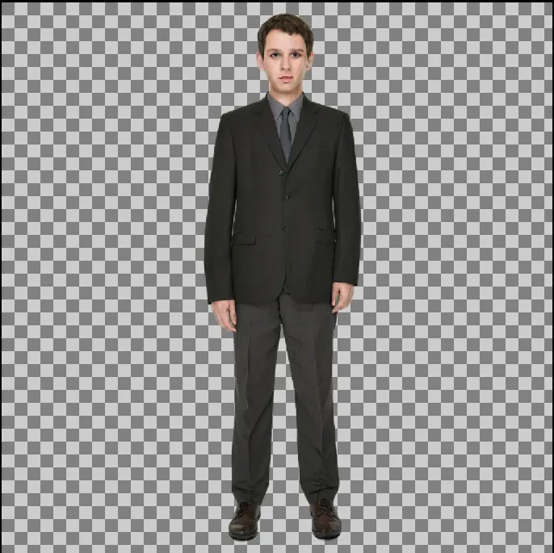 |
| Optimized Layer Diffusion Prompts                                                                                                                                                                                                                                                                                                                                                                                                                                                                                                                                                                                         | Foreground Instance Image                                    |
| High-resolution digital rendering of a single person alone, donning a vibrant turquoise shirt with a slight sheen, a pair of distressed brown jeans, and a worn black leather jacket, captured in an ultra-realistic style that conveys a sense of melancholic introspection under soft, warm golden hour sunlight, viewed from a dynamic low-angle perspective that accentuates the subject’s angular features, showcasing a mix of smooth skin and subtle facial hair texture, set in a timeless era that blends modern and vintage elements.                                                                           |  |
| High-resolution digital rendering of a single person alone, dressed in a vibrant, high-collared, emerald-green coat with intricate, golden-brown buttons, paired with a crisp, snow-white shirt, rendered in ultra-realistic style, conveying a sense of serene contemplation, melancholic introspection, and quiet determination, under soft, warm, golden-hour sunlight that casts a gentle, diffused glow across their features, from a low, eye-level perspective that emphasizes their introspective expression, with a subtle, velvety texture to their skin and a luxurious, smooth sheen to their coat.           |  |
| High-resolution digital rendering of a single person alone, wearing a bright yellow sundress with golden accents and a subtle floral pattern, standing in a quiet alleyway with soft warm sunlight filtering through the trees, cast in an ultra-realistic style with intricate details, conveying a mix of confidence and vulnerability, with the light dancing across their features and casting a warm glow on their skin, viewed from a low-angle perspective that accentuates their tall stature, with a smooth and silky texture to their dress and a subtle sheen to their hair, set in a modern contemporary era. |  |
| High-resolution digital rendering of a single person alone, dressed in a vibrant turquoise and golden outfit with intricate, hand-beaded patterns, ultra-realistic style, conveying a mix of serenity and confidence, illuminated by soft, warm sunlight and dramatic, moody shadows, captured from a low-angle, dynamic perspective, with a focus on the intricate texture of their ornate, beaded necklace and the soft, smooth skin of their face, set in a contemporary, modern time period.                                                                                                                          |  |
| High-resolution digital rendering of a single person alone, dressed in a vibrant turquoise and golden embroidered traditional Indian outfit, ultra-realistic, conveying a mix of serenity and introspection, softly illuminated by warm morning sunlight, captured from a low-angle perspective, showcasing the intricate texture of their silk sari and the delicate pattern on their intricately crafted silver jewelry, set in a timeless and nostalgic era.                                                                                                                                                           |  |

Figure S.11: Comparison of the standard and optimized LD prompts and
their corresponding foreground instances for person.

|                                                                                                                                                                                                                                                                                                                                                                                                                                                                                                          |                                                              |
| -------------------------------------------------------------------------------------------------------------------------------------------------------------------------------------------------------------------------------------------------------------------------------------------------------------------------------------------------------------------------------------------------------------------------------------------------------------------------------------------------------- | ------------------------------------------------------------ |
| Optimized Layer Diffusion Prompt                                                                                                                                                                                                                                                                                                                                                                                                                                                                         | Foreground Instance Image                                    |
| A highly realistic, high-resolution digital rendering of a single, juicy, vibrant orange (fruit) of an orange tree, alone on a smooth, glossy surface, with warm golden undertones and deep reddish-orange hues, ultra-realistic in style, conveying feelings of abundance and gratitude, under soft, diffused morning sunlight, from a 45-degree angle, with intricate, slightly wrinkled skin and a few tiny, raised oil glands, evoking a sense of tactile experience, set in a timeless, modern era. |  |

| The Data Validation Agent’s Response                                                                                                                                                                                                                                                                                                                            |
| --------------------------------------------------------------------------------------------------------------------------------------------------------------------------------------------------------------------------------------------------------------------------------------------------------------------------------------------------------------- |
| \*\*Image Description:\*\*                                                                                                                                                                                                                                                                                                                                      |
| The image depicts a potted tree with green leaves and multiple oranges hanging from its branches. The tree is positioned centrally in the frame, with its trunk visible at the bottom. The oranges are a vibrant orange color, and the leaves are a deep green. The tree appears to be healthy and well-maintained, with no visible signs of damage or disease. |
| \*\*Evaluation Criteria:\*\*                                                                                                                                                                                                                                                                                                                                    |
| 1. \*\*Single orange:\*\*                                                                                                                                                                                                                                                                                                                                       |
| \* The image contains multiple oranges, not just one.                                                                                                                                                                                                                                                                                                           |
| \* \*\*Result:\*\* Fail                                                                                                                                                                                                                                                                                                                                         |
| 2. \*\*Single View:\*\*                                                                                                                                                                                                                                                                                                                                         |
| \* The image shows the tree from a single angle, with no multiple views or perspectives.                                                                                                                                                                                                                                                                        |
| \* \*\*Result:\*\* Meet                                                                                                                                                                                                                                                                                                                                         |
| 3. \*\*Intact orange:\*\*                                                                                                                                                                                                                                                                                                                                       |
| \* All the oranges in the image appear to be intact and fully visible.                                                                                                                                                                                                                                                                                          |
| \* \*\*Result:\*\* Meet                                                                                                                                                                                                                                                                                                                                         |
| 4. \*\*Plain Background:\*\*                                                                                                                                                                                                                                                                                                                                    |
| \* The background of the image is solid black, which is considered plain.                                                                                                                                                                                                                                                                                       |
| \* \*\*Result:\*\* Meet                                                                                                                                                                                                                                                                                                                                         |
| \*\*Conclusion:\*\*                                                                                                                                                                                                                                                                                                                                             |
| Based on the evaluation criteria, the image fails to meet the first criterion, which requires only one orange. However, it meets the remaining three criteria, including showing the tree from a single view, having intact oranges, and having a plain background. Therefore, the image does not meet all the criteria and should be filtered out.             |
| \*\*Result:\*\* Filter Out                                                                                                                                                                                                                                                                                                                                      |

Figure S.12: Example of the data validation agent filtering for orange.

|                                                                                                                                                                                                                                                                                                                                                                                                                                                                                                                                                                                                          |                                                              |
| -------------------------------------------------------------------------------------------------------------------------------------------------------------------------------------------------------------------------------------------------------------------------------------------------------------------------------------------------------------------------------------------------------------------------------------------------------------------------------------------------------------------------------------------------------------------------------------------------------- | ------------------------------------------------------------ |
| Optimized Layer Diffusion Prompt                                                                                                                                                                                                                                                                                                                                                                                                                                                                                                                                                                         | Foreground Instance Image                                    |
| High-resolution digital rendering of a single alarm clock alone, in a mesmerizing gradient of warm golden hues and soft pastel blues, ultra-realistic in style, conveying a sense of serene tranquility and anxious anticipation, illuminated by the soft glow of a bedside lamp and the faint morning light seeping through the curtains, captured from a low-angle perspective that emphasizes the clock’s sleek, metallic texture and intricate mechanisms, with a subtle sheen of polished stainless steel and a delicate scratch on its surface, set against the timeless backdrop of a bygone era. |  |

| The Data Validation Agent’s Response                                                                                                                                                                                                                |
| --------------------------------------------------------------------------------------------------------------------------------------------------------------------------------------------------------------------------------------------------- |
| \*\*Image Description:\*\*                                                                                                                                                                                                                          |
| The image depicts a digital clock with a gold border and blue screen, displaying the time ”16:39” in large black numbers. The clock is positioned on a table or desk, accompanied by a potted plant to its left and a lamp in the top-right corner. |
| \*\*Evaluation Criteria:\*\*                                                                                                                                                                                                                        |
| 1. \*\*Single clock:\*\*                                                                                                                                                                                                                            |
| \* The image contains only one clock.                                                                                                                                                                                                               |
| \* \*\*Result:\*\* Meet                                                                                                                                                                                                                             |
| 2. \*\*Single View:\*\*                                                                                                                                                                                                                             |
| \* The clock is shown from a single angle or perspective.                                                                                                                                                                                           |
| \* \*\*Result:\*\* Meet                                                                                                                                                                                                                             |
| 3. \*\*Intact clock:\*\*                                                                                                                                                                                                                            |
| \* The clock is intact and fully visible.                                                                                                                                                                                                           |
| \* \*\*Result:\*\* Meet                                                                                                                                                                                                                             |
| 4. \*\*Plain Background:\*\*                                                                                                                                                                                                                        |
| \* The background is not entirely plain, as there are other objects present (the plant and lamp).                                                                                                                                                   |
| \* \*\*Result:\*\* Fail                                                                                                                                                                                                                             |
| \*\*Conclusion:\*\*                                                                                                                                                                                                                                 |
| The image meets most of the evaluation criteria, but fails to have a plain background due to the presence of additional objects. Therefore, the final answer is:                                                                                    |
| \*\*Result:\*\* Filter Out                                                                                                                                                                                                                          |

Figure S.13: Example of the data validation agent filtering for clock.

|                                                                                                                                                                                                                                                                                                                                                                                                                                                                                           |                                                              |
| ----------------------------------------------------------------------------------------------------------------------------------------------------------------------------------------------------------------------------------------------------------------------------------------------------------------------------------------------------------------------------------------------------------------------------------------------------------------------------------------- | ------------------------------------------------------------ |
| Optimized Layer Diffusion Prompt                                                                                                                                                                                                                                                                                                                                                                                                                                                          | Foreground Instance Image                                    |
| High-resolution digital rendering of a single birthday card alone, adorned with vibrant shades of cerulean, golden, and crimson hues, ultra-realistically crafted in exquisite detail, evoking a mix of joy, nostalgia, and warmth, illuminated by soft, diffused natural light, and by the soft glow of a single candle, captured from a close-up, eye-level perspective, featuring a textured, embossed, and glossy surface, reminiscent of a vintage card from the early 20th century. |  |

| The Data Validation Agent’s Response                                                                                                                                                                                                                                                                                                                        |
| ----------------------------------------------------------------------------------------------------------------------------------------------------------------------------------------------------------------------------------------------------------------------------------------------------------------------------------------------------------- |
| \*\*Image Description:\*\*                                                                                                                                                                                                                                                                                                                                  |
| The image depicts a large blue candle with two lit wicks, set against a solid black background. The candle is cylindrical in shape and features a wavy top edge. It has a bright blue color that gradually darkens towards the bottom, where it meets the black background. The candle’s surface appears smooth, with no visible imperfections or markings. |
| \*\*Evaluation Criteria:\*\*                                                                                                                                                                                                                                                                                                                                |
| 1. \*\*Single birthday card:\*\*                                                                                                                                                                                                                                                                                                                            |
| \* The image does not contain a birthday card; instead, it features a candle.                                                                                                                                                                                                                                                                               |
| \* \*\*Result:\*\* Fail                                                                                                                                                                                                                                                                                                                                     |
| 2. \*\*Single View:\*\*                                                                                                                                                                                                                                                                                                                                     |
| \* The image shows the candle from a single angle, with no multiple views or perspectives.                                                                                                                                                                                                                                                                  |
| \* \*\*Result:\*\* Meet                                                                                                                                                                                                                                                                                                                                     |
| 3. \*\*Intact birthday card:\*\*                                                                                                                                                                                                                                                                                                                            |
| \* Since there is no birthday card in the image, this criterion is not applicable.                                                                                                                                                                                                                                                                          |
| \* \*\*Result:\*\* N/A                                                                                                                                                                                                                                                                                                                                      |
| 4. \*\*Plain Background:\*\*                                                                                                                                                                                                                                                                                                                                |
| \* The background of the image is solid black, with no distracting elements or patterns.                                                                                                                                                                                                                                                                    |
| \* \*\*Result:\*\* Meet                                                                                                                                                                                                                                                                                                                                     |
| \*\*Conclusion:\*\*                                                                                                                                                                                                                                                                                                                                         |
| Based on the evaluation criteria, the image fails to meet the first criterion, as it does not contain a birthday card. However, it meets the remaining criteria, showcasing the candle from a single view and having a plain black background. Therefore, the image is suitable for use as a birthday card.                                                 |
| \*\*Result:\*\* Filter Out                                                                                                                                                                                                                                                                                                                                  |

Figure S.14: Example of the data validation agent filtering for birthday
card.

|                                                                                                                                                                                                                                                                                                                                                                                                                                                                              |                                                              |
| ---------------------------------------------------------------------------------------------------------------------------------------------------------------------------------------------------------------------------------------------------------------------------------------------------------------------------------------------------------------------------------------------------------------------------------------------------------------------------- | ------------------------------------------------------------ |
| Optimized Layer Diffusion Prompt                                                                                                                                                                                                                                                                                                                                                                                                                                             | Foreground Instance Image                                    |
| High-resolution digital rendering of a single pancake alone, with a warm golden-brown color and a subtle sheen, ultra-realistic in style, evoking feelings of comfort and satisfaction, illuminated by soft morning light with a hint of shadow, viewed from a 45-degree angle to showcase its fluffy interior, featuring a delicate crispy texture on the outside and a soft, airy interior, set in a modern kitchen with a clean, minimalist aesthetic, circa present day. |  |

| The Data Validation Agent’s Response                                                                                                                                       |
| -------------------------------------------------------------------------------------------------------------------------------------------------------------------------- |
| \*\*Image Description:\*\*                                                                                                                                                 |
| The image is a solid black square with no visible objects or features.                                                                                                     |
| \*\*Evaluation Criteria:\*\*                                                                                                                                               |
| 1. \*\*Single pancake:\*\*                                                                                                                                                 |
| \* The image does not contain any pancakes.                                                                                                                                |
| \* \*\*Result:\*\* Fail                                                                                                                                                    |
| 2. \*\*Single View:\*\*                                                                                                                                                    |
| \* There is no visible object to provide a view of.                                                                                                                        |
| \* \*\*Result:\*\* N/A                                                                                                                                                     |
| 3. \*\*Intact pancake:\*\*                                                                                                                                                 |
| \* There is no pancake to evaluate.                                                                                                                                        |
| \* \*\*Result:\*\* N/A                                                                                                                                                     |
| 4. \*\*Plain Background:\*\*                                                                                                                                               |
| \* The background is solid black, which can be considered plain.                                                                                                           |
| \* \*\*Result:\*\* Meet                                                                                                                                                    |
| \*\*Conclusion:\*\*                                                                                                                                                        |
| The image does not meet the criteria for containing a single pancake or providing a single view of one. However, it does meet the criterion for having a plain background. |
| \*\*Result:\*\* Filter Out                                                                                                                                                 |

Figure S.15: Example of the data validation agent filtering for pancake.

|                                                              |                                                              |
| ------------------------------------------------------------ | ------------------------------------------------------------ |
|  |  |
|  |  |
|  |  |

Figure S.16: Additional Examples of Gen-n-Val Synthetic Data for COCO
experiments.

|                                                              |                                                              |
| ------------------------------------------------------------ | ------------------------------------------------------------ |
|  |  |
|  |  |
|  |  |

Figure S.17: Additional Examples of Gen-n-Val Synthetic Data for COCO
experiments.

|                                                              |                                                              |
| ------------------------------------------------------------ | ------------------------------------------------------------ |
|  |  |
|  |  |
|  |  |

Figure S.18: Additional Examples of Gen-n-Val Synthetic Data for COCO
experiments.

|                                                              |                                                              |
| ------------------------------------------------------------ | ------------------------------------------------------------ |
|  |  |
|  |  |
|  |  |

Figure S.19: Additional Examples of Gen-n-Val Synthetic Data for COCO
experiments.

|                                                              |                                                              |
| ------------------------------------------------------------ | ------------------------------------------------------------ |
|  |  |
|  |  |
|  |  |

Figure S.20: Additional Examples of Gen-n-Val Synthetic Data for COCO
experiments.

|                                                               |                                                               |
| ------------------------------------------------------------- | ------------------------------------------------------------- |
|   |   |
|   |   |
|  |  |

Figure S.21: Additional Examples of Gen-n-Val Synthetic Data for COCO
experiments.

|                                                              |                                                              |
| ------------------------------------------------------------ | ------------------------------------------------------------ |
|  |  |
|  |  |
|  |  |

Figure S.22: Additional Examples of Gen-n-Val Synthetic Data for COCO
experiments.

|                                                               |                                                               |
| ------------------------------------------------------------- | ------------------------------------------------------------- |
| Original LVIS                                                 | Augmented by Gen-n-Val                                        |
|  |  |
|  |  |
|  |  |
| Original LVIS                                                 | Augmented by Gen-n-Val                                        |

Figure S.23: Additional Examples of Gen-n-Val Synthetic Data for LVIS
experiments.

|                                                               |                                                               |
| ------------------------------------------------------------- | ------------------------------------------------------------- |
| Original LVIS                                                 | Augmented by Gen-n-Val                                        |
|  |  |
|  |  |
| Original LVIS                                                 | Augmented by Gen-n-Val                                        |

Figure S.24: Additional Examples of Gen-n-Val Synthetic Data for LVIS
experiments.

|                                                               |                                                               |
| ------------------------------------------------------------- | ------------------------------------------------------------- |
| Original LVIS                                                 | Augmented by Gen-n-Val                                        |
|  |  |
|  |  |
|  |  |
| Original LVIS                                                 | Augmented by Gen-n-Val                                        |

Figure S.25: Additional Examples of Gen-n-Val Synthetic Data for LVIS
experiments.
