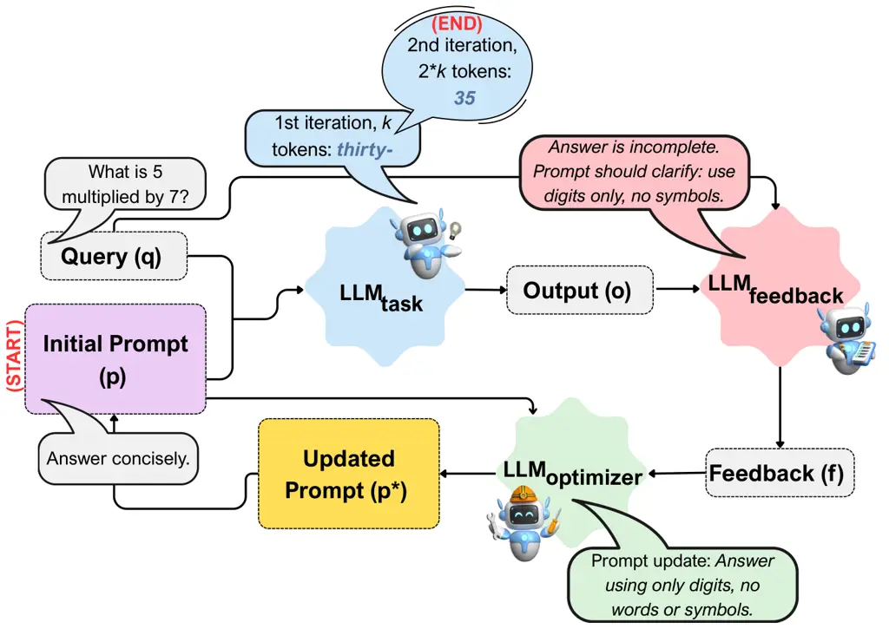

# ProRefine: Inference-Time Prompt Refinement with Textual Feedback

Deepak Pandita Affiliation: Center for Advanced AI, Accenture
Affiliation: Rochester Institute of Technology    Tharindu Cyril
Weerasooriya Affiliation: Center for Advanced AI, Accenture    Ankit
Parag Shah Affiliation: Center for Advanced AI, Accenture    Isabelle
Diana May-Xin Ng Affiliation: Center for Advanced AI, Accenture
Affiliation: UC Berkeley    Christopher M. Homan Affiliation: Rochester
Institute of Technology    Wei Wei Corresponding author: Deepak Pandita
([deepak@mail.rit.edu](mailto:deepak@mail.rit.edu)). Tharindu Cyril
Weerasooriya
([t.weerasooriya@accenture.com](mailto:t.weerasooriya@accenture.com)).
Work done during internship at Accenture. Work to appear at the Workshop
on Efficient Reasoning at NeurIPS 2025. Affiliation: Center for Advanced
AI, Accenture

August 24, 2026

###### Abstract

Agentic workflows, where multiple AI agents collaborate to accomplish
complex tasks like reasoning or planning, play a substantial role in
many cutting-edge commercial applications, and continue to fascinate
researchers across fields for their potential to accomplish expensive,
complex tasks that, until recently, only humans have been trusted to do.
These workflows depend critically on the prompts used to provide the
roles models play in such workflows. Poorly designed prompts that fail
even slightly to guide individual agents can lead to sub-optimal
performance that may snowball within a system of agents, limiting their
reliability and scalability. To address this important problem of
inference-time prompt optimization, we introduce ProRefine, an
innovative inference-time optimization method that uses an agentic loop
of LLMs to generate and apply textual feedback. ProRefine dynamically
refines prompts for multi-step reasoning tasks without additional
training or ground truth labels. Evaluated on five benchmark
mathematical reasoning datasets, ProRefine significantly surpasses
zero-shot Chain-of-Thought baselines by 3 to 37 percentage points. This
approach not only boosts accuracy but also allows smaller models to
approach the performance of their larger counterparts. This highlights
its potential for building more cost-effective and powerful hybrid AI
systems, thereby democratizing access to high-performing AI.

## 1 Introduction

The advancement of Large Language Models (LLMs) is intrinsically linked
to their alignment with human values and preferences (Feng et al.,
2024). While Reinforcement Learning from Human Feedback (RLHF) has been
the cornerstone of this effort (Christiano et al., 2017), recent
research has pivoted towards using LLMs themselves as scalable proxies
for human judgment, serving as evaluators, critics, and sources of
feedback Zheng et al. (2023); Pryzant et al. (2023); Saunders et al.
(2022). This has given rise to sophisticated agentic frameworks that can
detect errors, critique outputs, and iteratively refine them,
particularly for tasks demanding factual correctness Akyurek et al.
(2023); Madaan et al. (2023). Methods like TextGrad have even
demonstrated how textual feedback can “differentiate” through complex
systems to optimize performance Yuksekgonul et al. (2024).

Figure 1: Overview of ProRefine system, illustrating the iterative
process of prompt optimization using feedback from LLMs. In each
iteration, $`LLM_{task}`$ extends its output by an additional $`k`$
tokens, enabling step-by-step feedback to progressively refine the
prompt with $`LLM_{optimizer}`$.

Our work focuses on optimizing the prompt, a key element in
chain-of-thought (CoT) (Wei et al., 2022) based LLM reasoning. Although
prior work has explored prompt optimization Deng et al. (2022); Dong et
al. (2024); Shin et al. (2020); Yang et al. (2024), they all often focus
on either _offline fine-tuning_, which requires extensive training data,
or universal application of _largest, most capable models to every
task_. This presents a practical dilemma in many real-world scenarios.
Continuously fine-tuning is not always feasible, and relying exclusively
on state-of-the-art models is often computationally prohibitive. A
different approach is needed for scenarios that require _dynamic,
on-the-fly repair_ for specific and difficult queries where a standard
prompt fails. This is particularly true in _resource-aware deployments_,
where a smaller model may suffice for most tasks but requires
enhancement for a small subset of critical queries. _The goal,
therefore, shifts from finding a single, universally optimal prompt to
performing targeted, inference-time intervention._

To address this need, we introduce ProRefine (Inference-time Prompt
Refinement with Textual Feedback), which builds upon CoT by adaptively
improving prompts using feedback ($`LLM_{feedback}`$) and an optimizer
($`LLM_{optimizer}`$) to refine prompts for the task-performing LLM
($`LLM_{task}`$). This workflow (Figure 1), motivated by the
teacher-student framework Torrey and Taylor (2013) where a teacher agent
guides a student agent to perform a task by providing feedback at
intermediate steps, but implemented via LLM interactions without
pre-training, represents a novel approach to adaptive agentic reasoning.
We explore policy optimization for aligning compound AI systems, drawing
inspiration from TextGrad and policy gradient algorithms, such as PPO.

This hybrid-model paradigm makes a method like ProRefine a practical
solution. It is designed for resource-constrained environments where
deploying the largest models for every query isn’t feasible, but
temporary access to a capable feedback LLM (perhaps via a separate API
call) is possible for critical tasks. In such cases, the refinement
process is triggered as an on-demand “expert intervention.” ProRefine is
task-agnostic and requires no additional training or ground-truth
labels. It is an inference-time optimization method that relies on the
availability of test-time compute and the ability of LLMs to provide and
act upon feedback for optimization.

The ability to break complex tasks into smaller steps and dynamically
improve prompts offers a crucial advantage in multi-step agentic
workflows where errors can compound. As illustrated in Figure 4 in the
Appendix, This method is also suitable for black-box LLMs where only API
access is available. ProRefine could prove to be crucial in situations
demanding greater interpretability, where feedback steps (outputs of
$`LLM_{feedback}`$) offer insights into the reasoning correction process
and applications requiring dynamic adaptation without
retraining/fine-tuning cycles. To demonstrate its effectiveness, we
evaluate ProRefine across five benchmark mathematical reasoning
datasets, showing it offers a robust alternative to solely scaling up
the base model for all queries.

#### Key Contributions:

- •
  We propose a novel method - ProRefine - for prompt optimization at
  _inference-time_ using textual feedback.
- •
  We evaluated ProRefine on five datasets: object counting, word
  sorting, grade-school math problem solving, math word problems, and
  algebraic word problems, and compared our method against CoT and
  TextGrad.
- •
  We evaluate the importance of using a verifier at inference time.

## 2 ProRefine

#### ProRefine

is an inference-time prompt optimization algorithm that optimizes
prompts by using textual feedback. ProRefine involves interactions
between three LLMs:

$`LLM_{task}`$: Executes the task based on the current prompt,
generating the initial and subsequent outputs.

$`LLM_{feedback}`$: A model that critiques the $`LLM_{task}`$’s output,
providing detailed feedback on improvements. This model should be
capable of providing insightful and accurate critiques Bai et al.
(2022); Saunders et al. (2022).

$`LLM_{optimizer}`$: Interprets the feedback and refines the prompt,
aiming for coherent and task-focused improvements. This LLM is crucial
for ensuring the prompt evolves effectively.

#### ProRefine

(Algorithm 1) works as follows¹¹ 1 The code is available at
[https://github.com/deepakpandita57/ProRefine_public](https://github.com/deepakpandita57/ProRefine_public):

Input: Query: $`q`$, Initial prompt: $`p`$, tokens*per_step: $`k`$,
max_steps: $`n`$, LLMs: $`LLM*{task}`$, $`LLM*{feedback}`$,
$`LLM*{optimizer}`$

Output: Optimized prompt: $`p^{*}`$

1 $`p^{*}=p`$

2 for _$`i=1`$ to $`n`$_ do

    3 $`o_{i}=LLM_{task}(p^{*},q)`$ // Generate $`i*k`$ tokens

    4 $`f_{i}=LLM_{feedback}(q,o_{i})`$ // Get textual feedback

    5 $`p*=LLM_{optimizer}(p^{*},f_{i})`$ // Optimize the prompt

    6 if _$`EOS\_token`$ in $`o_{i}`$_ then

       7 break

8 return $`p^{*}`$ // Return final optimized prompt

Algorithm 1 ProRefine

#### Initialization:

Start with an initial prompt $`p`$ for the task, a query $`q`$, and
parameters defining the generation and optimization process ($`k`$
tokens per step, $`n`$ maximum steps).

#### Generation and Feedback Loop:

- •
  Generation: Use $`LLM_{task}`$ to generate an output based on the
  current prompt $`p^{*}`$ and query $`q`$. This step is limited to
  $`i`$ $`*`$ $`k`$ tokens to control the granularity of the feedback.
  In each iteration, $`LLM_{task}`$ produces $`k`$ more tokens,
  attempting to refine prior output while progressively continuing its
  response to the query.
- •
  Feedback: $`LLM_{feedback}`$ evaluates the generated output $`o_{i}`$
  against the query $`q`$ to provide textual feedback $`f_{i}`$. This
  feedback encapsulates how the output could be improved, focusing on
  aspects such as accuracy, relevance, or coherence.
- •
  Optimization: $`LLM_{optimizer}`$ uses the feedback $`f_{i}`$ to
  refine the prompt $`p^{*}`$. This step involves modifying the prompt
  to better align with the task requirements or to correct identified
  deficiencies in previous generations.

#### Termination:

The process iterates until either the maximum number of steps $`n`$ is
reached or an end-of-sequence (EOS) token is detected in the output,
indicating the completion of the task.

The granularity and duration of the optimization process are governed by
two parameters: $`k`$, the number of tokens per step, and $`n`$, the
maximum number of steps. These parameters can be adjusted according to
the task’s complexity and the desired output quality. For example,
rather than generating feedback every $`k`$ tokens, we might instead
choose to provide feedback after each sentence or paragraph,
particularly in tasks such as machine translation or text summarization,
where larger semantic units may be more meaningful.

#### Unifying Verifier and Feedback:

At inference time, verifiers play a crucial role in judging model
outputs Cobbe et al. (2021); Lightman et al. (2024); Snell et al.
(2024b). For simplicity in this study, we do not train a bespoke
verifier; rather, we employ the Llama3.1-70B-instruct model to function
as both the feedback mechanism ($`LLM_{feedback}`$) and the verifier. We
manage these roles through separate API calls, each with a role-defining
prompt. A smaller model, specifically fine-tuned for these tasks, could
also be used. The verifier’s function is to evaluate the initial output
generated by $`LLM_{task}`$ for each query. If the verifier assesses the
output to be incorrect, the refinement process is triggered; otherwise,
the output is used as is. This also saves computation on answers that
are already correct.

To quantify the verifier’s impact, we analyze three distinct scenarios:
_ProRefine (verifier)_, our standard approach which employs
$`LLM_{feedback}`$ to guide refinement; _ProRefine (no verifier)_,
wherein the refinement process operates without verifier input; and
_ProRefine (optimal verifier)_, guided by a perfect verifier (simulated
using ground-truth labels). This optimal condition reveals the upper
bound of the refinement loop’s potential. Consequently, the performance
difference between _ProRefine (verifier)_ and _ProRefine (optimal
verifier)_ underscores the significance of verifier accuracy. It is
important to note that ProRefine’s methodology does not inherently rely
on labels or optimal verification, despite their use in this specific
evaluation.

## 3 Experiments and Evaluation

|                 |                                  |                            |                            |                            |
| --------------- | -------------------------------- | -------------------------- | -------------------------- | -------------------------- |
| Dataset         | Method                           | Llama-3.2 1B-it            | Llama-3.2 3B-it            | Llama-3.1 8B-it            |
| Object Counting | CoT                              | 0.48 \[0.382, 0.578\]      | 0.65 \[0.556, 0.744\]      | 0.73 \[0.643, 0.817\]      |
|                 | TextGrad                         | 0.62 \[0.524, 0.716\]      | 0.73 \[0.643, 0.817\]      | 0.86 \[0.792, 0.928\]      |
|                 | ProRefine (no verifier)          | 0.51 \[0.412, 0.608\]      | 0.75 \[0.665, 0.835\]      | 0.77 \[0.687, 0.853\]      |
|                 | ProRefine (verifier)             | 0.6 \[0.503, 0.696\]       | 0.72 \[0.632, 0.808\]      | 0.89\* \[0.839, 0.959\]    |
|                 | ^(†)ProRefine (optimal verifier) | 0.67 \[0.577, 0.763\]      | 0.85\* \[0.780, 0.920\]    | 0.94\* \[0.893, 0.987\]    |
| Word Sorting    | CoT                              | 0.11 \[0.048, 0.172\]      | 0.10 \[0.041, 0.159\]      | 0.50 \[0.401, 0.598\]      |
|                 | TextGrad                         | 0.33\* \[0.237, 0.423\]    | 0.61\* \[0.514, 0.706\]    | 0.69\* \[0.599, 0.781\]    |
|                 | ProRefine (no verifier)          | 0.22 \[0.138, 0.302\]      | 0.47\* \[0.372, 0.568\]    | 0.68 \[0.595, 0.779\]      |
|                 | ProRefine (verifier)             | 0.19 \[0.113, 0.267\]      | 0.32\* \[0.228, 0.412\]    | 0.71\* \[0.621, 0.799\]    |
|                 | ^(†)ProRefine (optimal verifier) | 0.29\* \[0.192, 0.368\]    | 0.53\* \[0.432, 0.628\]    | 0.86\*\* \[0.792, 0.928\]  |
| GSM8K           | CoT                              | 0.450 \[0.423, 0.476\]     | 0.809 \[0.787, 0.829\]     | 0.819 \[0.797, 0.839\]     |
|                 | TextGrad                         | 0.463 \[0.436, 0.489\]     | 0.801 \[0.779, 0.822\]     | 0.864\* \[0.845, 0.882\]   |
|                 | ProRefine (no verifier)          | 0.636\*\* \[0.610, 0.662\] | 0.797 \[0.774, 0.818\]     | 0.843 \[0.823, 0.863       |
|                 | ProRefine (verifier)             | 0.654\*\* \[0.627, 0.678\] | 0.866\*\* \[0.847, 0.883\] | 0.885\* \[0.868, 0.902\]   |
|                 | ^(†)ProRefine (optimal verifier) | 0.725\*\* \[0.701, 0.749\] | 0.904\*\* \[0.888, 0.920\] | 0.936\*\* \[0.922, 0.949\] |
| SVAMP           | CoT                              | 0.689 \[0.66, 0.718\]      | 0.869 \[0.848, 0.890\]     | 0.854 \[0.832 , 0.876\]    |
|                 | TextGrad                         | 0.684 \[0.655, 0.713\]     | 0.861 \[0.840, 0.882\]     | 0.84 \[0.817, 0.863\]      |
|                 | ProRefine (no verifier)          | 0.774\*\* \[0.748, 0.800\] | 0.878 \[0.858, 0.898\]     | 0.877 \[0.857, 0.897\]     |
|                 | ProRefine (verifier)             | 0.808\*\* \[0.784, 0.832\] | 0.896 \[0.877, 0.915\]     | 0.893\* \[0.874, 0.912\]   |
|                 | ^(†)ProRefine (optimal verifier) | 0.861\*\* \[0.840, 0.882\] | 0.925\*\* \[0.909, 0.941\] | 0.938\*\* \[0.923, 0.953\] |
| AQUARAT         | CoT                              | 0.259 \[0.202, 0.31\]      | 0.563 \[0.498, 0.620\]     | 0.586 \[0.522, 0.643\]     |
|                 | TextGrad                         | 0.311 \[0.250, 0.364\]     | 0.524 \[0.462 , 0.585\]    | 0.559 \[0.494, 0.616\]     |
|                 | ProRefine (no verifier)          | 0.205 \[0.151, 0.250\]     | 0.343 \[0.284, 0.401\]     | 0.398 \[0.337 , 0.458\]    |
|                 | ProRefine (verifier)             | 0.268 \[0.209, 0.318\]     | 0.551 \[0.486 , 0.608\]    | 0.606 \[0.542, 0.663\]     |
|                 | ^(†)ProRefine (optimal verifier) | 0.354 \[0.292, 0.409\]     | 0.598 \[0.538, 0.659\]     | 0.657 \[0.595, 0.712 \]    |

Table 1: Test Accuracy with 95% confidence intervals across five
benchmark datasets and models. \* and \*\* denote statistically
significant improvements over one or two baseline methods, respectively.
Results in bold indicate the highest accuracy for a dataset-method
combination. ^(†) demonstrates the upper bound potential of the
optimization loop and the impact of verifier quality.
Llama3.1-70B-instruct is employed for feedback generation, prompt
optimization, and evaluation.

### 3.1 Data

We evaluate ProRefine on five reasoning tasks, each of which involves
multi-step reasoning, making them suitable for evaluating prompt
optimization in agentic workflows. We utilize object counting and word
sorting from the BIG-Bench Hard benchmark Srivastava et al. (2023),
grade-school math problem-solving from GSM8K Cobbe et al. (2021), math
word problems from SVAMP Patel et al. (2021), and algebraic word
problems from AQUARAT Ling et al. (2017). See Appendix 5 for details
about data splits.

### 3.2 Experimental Setup

We experiment with three models - Llama3.2-1B-instruct,
Llama3.2-3B-instruct, and Llama3.1-8B-instruct Meta (2024) for
$`LLM_{task}`$. The prompts are optimized using ProRefine, with
Llama3.1-70B-instruct used for feedback generation, prompt optimization,
and evaluation. We select the values of hyperparameters $`k=10`$ and
$`n=25`$ to control the granularity of feedback and duration of
optimization. Hyperparameters $`k`$ and $`n`$ were fixed based on
general preliminary exploration and not tuned per task using benchmark
training/validation data.

We compare ProRefine against the zero-shot Chain-of-Thought (CoT)
baseline and TextGrad Yuksekgonul et al. (2024), and report test
accuracy with 95% confidence interval. It is essential to remember that
TextGrad is a supervised fine-tuning method that utilizes both the
training and validation sets.

### 3.3 Results

Our results (Table 1) demonstrate that ProRefine significantly improves
$`LLM_{task}`$ performance over the zero-shot CoT baseline in all but
one experiment, and it outperforms TextGrad in 11 out of 15 cases
overall. For Llama3.2-1B-instruct model, ProRefine can significantly
outperform CoT and TextGrad on 2 out of 5 datasets. For
Llama3.2-3B-instruct model, ProRefine can outperform CoT and TextGrad on
3 out of 5 datasets with one significant result. For
Llama3.1-8B-instruct model, ProRefine can outperform CoT and TextGrad on
all 5 datasets with 4 significant results.

#### Object Counting:

ProRefine improves performance by $`3-16`$ percentage points over CoT,
with significant gains observed for Llama3.1-8B-instruct. It outperforms
TextGrad on 2 out of 3 models, yielding a $`2-3`$ percentage point
advantage. However, a performance drop of $`2`$ points is observed for
Llama3.2-1B-instruct.

#### Word Sorting:

Performance gains over CoT range from $`8-37`$ percentage points, with
significant improvements for Llama3.2-3B-instruct and
Llama3.1-8B-instruct. ProRefine surpasses TextGrad on 1 of 3 models with
a $`2`$-point gain, but performance drops of $`11-14`$ points are
observed for Llama3.2-1B-instruct and Llama3.2-3B-instruct.

#### GSM8K:

ProRefine achieves $`2.4-20.4`$ percentage points improvement over CoT,
with significant improvement observed for all the models; however, a
slight performance drop ($`1.2`$) is observed for Llama3.2-3B-instruct.
It outperforms TextGrad on all models, achieving a $`2.1-19.1`$
percentage point gain with significant results observed for
Llama3.2-1B-instruct and Llama3.2-3B-instruct models. Minor performance
drop of $`0.4-2.1`$ is observed for Llama3.2-3B-instruct and
Llama3.1-8B-instruct.

#### SVAMP:

Performance improves by $`0.9-11.9`$ percentage points over CoT, with
significant gains for Llama3.2-1B-instruct and Llama3.1-8B-instruct.
ProRefine outperforms TextGrad across all models, with $`1.7-12.4`$
percentage point gains and significant results for Llama3.2-1B-instruct.

#### AQUARAT:

Gains over CoT range from $`0.9-2`$ percentage points, but declines of
$`5.4-22`$ points are also observed. ProRefine exceeds TextGrad on 2 of
3 models, with $`2.7-4.7`$ percentage point gains, although performance
drops of $`10.6-18.1`$ points are also recorded.

Our results demonstrate that using ProRefine with an optimal verifier
significantly improves performance for all tasks, achieving the best
results in 13 out of 15 cases, highlighting the critical role of
verifier quality. Notably, the number of significant improvements
increases with larger model sizes. We also observe that ProRefine
enables smaller models, such as Llama3.2-3B-instruct and
Llama3.1-8B-instruct, to approach the zero-shot performance of larger
models like Llama3.1-8B-instruct and Llama3.1-70B-instruct,
respectively.

## 4 Related Work

ProRefine draws inspiration from and contributes to several
interconnected research areas. The performance of LLMs is heavily
dependent on the quality of the prompts they receive. Early efforts in
this domain centered on crafting prompts manually Wei et al. (2022), a
meticulous process of designing effective prompts to elicit desired
responses. Recognizing the limitations and scalability challenges of
manual methods, research has increasingly focused on automatic prompt
optimization with a growing emphasis on agentic workflows that enable
dynamic and adaptive reasoning.

#### Prompt Generation:

Some pioneering automatic methods, such as AutoPrompt Shin et al. (2020)
and RLPrompt Deng et al. (2022), employ gradient-based search and
reinforcement learning techniques, respectively. AutoPrompt Shin et al.
(2020) uses gradient-based search to generate prompts for masked
language models. It reformulates tasks as fill-in-the-blank problems,
achieving performance comparable to supervised models in tasks like
sentiment analysis. However, it requires training data and gradient
access, limiting its applicability to black-box models. Other approaches
leverage LLMs themselves for prompt generation Mehta et al. (2024);
Pryzant et al. (2023); Yang et al. (2024); Yang et al. (2022); Zhou et
al. (2022). Recent works like Promptomatix Murthy et al. (2025) and
EvoAgentX Wang et al. (2025) extend this direction by enabling automatic
prompt refinement across multiple tasks, workflows, and tools. ProRefine
distinguishes itself by operating simply at inference-time, requiring no
training data, gradient access, or model retraining, while enabling
prompt refinement in dynamically evolving settings.

#### Self-Refinement:

There is a substantial and growing body of work exploring the capacity
of LLMs to act as judges or evaluators Bavaresco et al. (2024); Chiang
and Lee (2023); Li et al. (2024); Liu et al. (2023); Verga et al.
(2024); Wang et al. (2023); Zheng et al. (2023); Zhuge et al. (2024).
This capability has been leveraged to assess response quality or provide
self-feedback. ProRefine adopts this principle, using LLM-generated
textual feedback to improve its own prompting process. Unlike prior uses
of LLM evaluation solely for ranking or filtering, ProRefine uses that
feedback in a closed-loop for optimization during inference.

The idea of LLM iterative refinement is highly relevant. Self-Refine
Madaan et al. (2023) is a prominent example, where an LLM generates both
output and feedback, using the latter for refinement. ARIES Zeng et al.
(2025) further enhances refinement via Elo-style agent debate. Other
works explore self-critiquing Saunders et al. (2022) and reinforcement
learning for critique generation (RL4F) Akyurek et al. (2023), along
with various feedback and refinement mechanisms Dong et al. (2024);
Khattab et al. (2024); Qu et al. (2024); Ranaldi and Freitas (2024);
Schick et al. (2023); Wadhwa et al. (2024), and Monte Carlo-based
refinement in math reasoning (MC-NEST) Rabby et al. (2025). While
ProRefine shares the self-refinement spirit, it focuses on prompt
refinement, suitable for agentic workflows and black-box LLMs, while
avoiding reinforcement learning and direct output modification.

#### Inference-Time Scaling:

ProRefine belongs to the broader category of inference-time methods
Muennighoff et al. (2025); Snell et al. (2024a), that improve LLMs
without without weight modification Du et al. (2024). Inference-time
methods aim to improve the performance of models by utilizing test-time
compute resources. TextGrad Yuksekgonul et al. (2024) performs
gradient-free inference-time optimization using textual feedback.
ProRefine applies a similar idea to intermediate prompt refinement for
dynamic reasoning chains. TextGrad relies on supervised fine-tuning,
whereas ProRefine operates without training data, offering ease of
integration. Other inference-time strategies include RL-of-Thoughts Hao
et al. (2025) and Reward-Is-Enough Song et al. (2025), which apply
RL-based signal propagation during inference. AvR (Alignment via
Refinement) Zhang et al. (2025a) proposes recursive CoT refinement using
long-form reasoning. ProRefine, by contrast, performs step-level
feedback on prompts rather than final outputs, and requires no external
tools or supervision.

#### Agentic Workflows:

ProRefine also fits into a broader trend toward agentic workflows. AFlow
Zhang et al. (2025b) automates agentic workflows through prompt-based
search over prior structures, while EvoAgentX Wang et al. (2025) evolves
agent behaviors and topologies. Meanwhile, Mass Zhou et al. (2025) and
DebFlow Su et al. (2025) optimize multi-agent configurations via
interleaved search and debate. ProRefine focuses instead on optimizing
individual agent prompts within fixed workflows, complementing these
methods. Unlike tool-integrated or debate-based systems, ProRefine
remains model-agnostic and easy to integrate into any prompt-based agent
loop.

## 5 Experiments and Evaluation

### 5.1 Data

We evaluate ProRefine on five reasoning tasks, each of which involves
multi-step reasoning, making them suitable for evaluating prompt
optimization in agentic workflows. We include the original dataset split
sizes in (train/validation/test) format: object counting and word
sorting from the BIG-Bench Hard benchmark Srivastava et al. (2023)
(50/100/100), grade-school math problem-solving from GSM8K Cobbe et al.
(2021) (200/300/1319), math word problems from SVAMP Patel et al. (2021)
(2516/622/1000), and algebraic word problems from AQUARAT Ling et al.
(2017) (97467/254/254). We use the same splits and evaluation as
Yuksekgonul et al. (2024) for object counting, word sorting, and GSM8K.

### 5.2 Experimental Setup

Figure 2: Test Accuracy \[with 95% confidence interval\] across
different models and datasets. Llama3.1-70B-instruct is employed for
feedback generation, prompt optimization, and evaluation.

Figure 3: Average number of prompt refinement iterations.

We experiment with three models - Llama3.2-1B-instruct,
Llama3.2-3B-instruct, and Llama3.1-8B-instruct Meta (2024) for
$`LLM_{task}`$. The prompts are optimized using Algorithm 1, with
Llama3.1-70B-instruct used for feedback generation, prompt optimization,
and evaluation. We select the values of hyperparameters $`k=10`$ and
$`n=25`$ to control the granularity of feedback and duration of
optimization. Hyperparameters $`k`$ and $`n`$ were fixed based on
general preliminary exploration and not tuned per task using benchmark
training/validation data.

We compare the performance of our method against the zero-shot
Chain-of-Thought (CoT) baseline and TextGrad Yuksekgonul et al. (2024),
and report test accuracy with 95% confidence interval. We choose
TextGrad as a baseline because Yuksekgonul et al. (2024) reported
performance at par or better than DSPy Khattab et al. (2024) for prompt
optimization on object counting, word sorting, and GSM8k datasets. It is
essential to remember that TextGrad is a supervised fine-tuning method
that utilizes both the training and validation sets. For TextGrad, we
use a comparative setup consisting of a task model to be fine-tuned and
Llama3.1-70B-instruct model for feedback generation and backpropagation.
The results are shown in Table 1 and Figure 2.

Figure 4: ProRefine example. Given an input query (which in this case
has a correct answer: 13) and an initial prompt, the task model
($`LLM_{task}`$) gives an incorrect answer. ProRefine uses two
additional models, $`LLM_{feedback}`$ and $`LLM_{optimizer}`$, to
iteratively improve the prompt _as the $`LLM_{task}`$ generates its
response_. Refining the prompt during generation allows the feedback
model to target local regions of the response, providing finer-grained
feedback than waiting for the response to complete. We also provide an
additional example illustrating our approach in Figure 5.

## 6 Discussion

This work investigates the following research questions.

#### RQ1

How effectively can textual feedback enhance the performance of LLMs
during inference?

#### RQ2

To what extent does model size impact the ability of LLMs to utilize
textual feedback?

#### RQ3

What is the impact of incorporating a verifier on accuracy at inference
time?

Regarding RQ1, the results demonstrate that ProRefine is a broadly
applicable method that utilizes textual feedback to improve LLM
performance at inference time. The “performance gap bridging” effect is
particularly noteworthy, suggesting that ProRefine may serve as an
effective alternative to simply scaling up model size, potentially
avoiding costly fine-tuning an advantage in resource-constrained
settings.

The largest performance gains are observed on the word sorting task,
indicating that tasks requiring more complex reasoning or manipulation
of intermediate outputs benefit the most from ProRefine’s iterative
refinement. The mixed results when using a smaller model for
$`LLM_{feedback}`$ illustrate the importance of “knowledge asymmetry,”
i.e., that the feedback model should be “sufficiently capable” of
providing useful critiques.

Regarding RQ2, the results indicate that ProRefine outperforms the
baselines on 2 and 3 datasets when using the Llama3.2-1B-instruct and
Llama3.2-3B-instruct models, respectively, and on all 5 datasets when
using the Llama3.1-8B-instruct model. This suggests that performance
improvements scale with model size. These findings imply that larger
models are preferable to smaller ones, particularly in agentic workflows
that may require test-time scaling and the effective use of textual
feedback to solve complex tasks.

Regarding RQ3, the results highlight that employing a high-quality
verifier is crucial for significantly improving task performance at
inference time. We observe some cases where “no verifier” outperforms
the “verifier” setting, which indicates the verifier incorrectly
accepted a flawed initial answer, thereby preventing the refinement
process from correcting the error. This reveals a trade-off: the
verifier reduces computational cost on correct answers but risks
prematurely halting on incorrect ones. The superior results of the
“optimal verifier” highlight the critical role of verifier accuracy.
Beyond enhancing performance, the verifier also reduces computational
cost during inference by guiding the refinement process. Moreover, it
opens up promising avenues for future work, where an optimizer could be
designed to maximize rewards guided by the verifier’s assessments.
ProRefine can offer a degree of interpretability by exposing the outputs
from $`LLM_{feedback}`$, allowing insights into the model’s reasoning
process. Figures 4 and 5 demonstrate cases where model feedback
successfully improves the output and where it fails, respectively.
Although evaluated on reasoning and math tasks, ProRefine is general and
applicable to other tasks.

Figure 5: This figure is an instance when $`LLM_{optimizer}`$ is not
aligned with the feedback from $`LLM_{feedback}`$ and misses important
guiding steps. The framework is similar to Figure 4 when
$`LLM_{optimizer}`$ conveys feedback effectively. We’ve observed a few
failed instances following this pattern.

A crucial consideration for ProRefine is the trade-off between its
accuracy gains and the increased computational cost at inference time.
Each refinement step requires additional calls to the $`LLM_{feedback}`$
and $`LLM_{optimizer}`$, making any single query more expensive to
process than a standard single-pass generation. However, this per-query
cost should be evaluated within ProRefine’s intended hybrid-model
deployment. The strategy is not to run refinement on every query, but to
use it as an on-demand intervention precisely when a more efficient base
model fails. Therefore, the overall system cost is not a simple sum of
expensive refinement processes. Instead, it is a blend of low-cost
successes from the base model and high-value, targeted corrections.
Moreover, the cost is still considerably lower than full model
retraining or fine-tuning. Our results support this approach’s
practicality: Figure 3 shows that the average number of refinement
iterations is typically low, ensuring the per-incident cost of
intervention is contained. This cost-accuracy balance can be further
optimized by tuning hyperparameters like feedback granularity ($`k`$)
and maximum iterations ($`n`$).

## 7 Limitations and Future Work

This work has the following limitations that we acknowledge have
potential for future explorations:

- •
  Computational Cost and Practicality: While ProRefine is designed for
  cost-effective hybrid deployments, its iterative process inherently
  increases inference-time latency and computational cost compared to a
  single-pass query. The cost-benefit of this trade-off must be
  carefully evaluated for each specific application, as its viability
  depends on the base model’s failure rate and the relative costs of the
  LLMs involved.
- •
  Generalizability: Our evaluation is currently focused on mathematical
  and multi-step reasoning tasks. Further research is needed to assess
  performance across a broader range of reasoning tasks and domains. Our
  method is also sensitive to hyperparameters and requires manual
  tuning. Developing more robust, automated, or adaptive methods for
  setting parameters would enhance the method’s usability.
- •
  Dependence on High-Quality Feedback: The system’s performance is
  dependent on the quality of the $`LLM_{feedback}`$. Future work could
  explore using a specialized “critic” model or fine-tuning feedback
  models to improve diagnostic accuracy. Furthermore, using LLMs for
  evaluation introduces potential biases and more comprehensive human
  evaluations and robust methods are need for mitigating evaluator bias.
- •
  Stability of the Refinement Loop: The iterative nature of ProRefine
  lacks a formal convergence guarantee. In some cases, the refinement
  process can suffer from prompt degradation after many iterations or
  plateau before reaching an optimal solution. Investigating methods to
  ensure stable and monotonic improvement is a key area for future
  research.

## 8 Conclusion

We introduced ProRefine, a novel, practical, and _inference-time_ prompt
optimization method for agentic workflows. ProRefine leverages
LLM-generated textual feedback to dynamically refine prompts, leading to
significant performance improvements on multi-step reasoning tasks
without requiring additional training or ground-truth labels. Our
results demonstrate its ability to bridge the performance gap between
smaller and larger LLMs, making it a key enabler for more efficient and
cost-effective hybrid-model deployments. The _inference-time_ nature of
ProRefine makes it readily deployable for on-demand reasoning
correction, contributing to more adaptable and accessible AI systems.
Future work will explore applying this framework to new domains,
developing more sophisticated feedback and optimizer agents, and
exploring adaptive policies for hyperparameter tuning to further
optimize the cost-performance trade-off.

## References

- Akyurek et al. (2023) Afra Feyza Akyurek, Ekin Akyurek, Ashwin Kalyan,
  Peter Clark, Derry Tanti Wijaya, and Niket Tandon. RL4F: Generating
  natural language feedback with reinforcement learning for repairing
  model outputs. In Anna Rogers, Jordan Boyd-Graber, and Naoaki Okazaki,
  editors, _Proceedings of the 61st Annual Meeting of the Association
  for Computational Linguistics (Volume 1: Long Papers)_, pages
  7716–7733, Toronto, Canada, July 2023. Association for Computational
  Linguistics.
  [10.18653/v1/2023.acl-long.427](https://doi.org/10.18653/v1/2023.acl-long.427).
  URL
  [https://aclanthology.org/2023.acl-long.427/](https://aclanthology.org/2023.acl-long.427/).
- Bai et al. (2022) Yuntao Bai, Saurav Kadavath, Sandipan Kundu, Amanda
  Askell, Jackson Kernion, Andy Jones, Anna Chen, Anna Goldie, Azalia
  Mirhoseini, Cameron McKinnon, et al. Constitutional ai: Harmlessness
  from ai feedback. _arXiv preprint arXiv:2212.08073_, 2022.
- Bavaresco et al. (2024) Anna Bavaresco, Raffaella Bernardi, Leonardo
  Bertolazzi, Desmond Elliott, Raquel Fernández, Albert Gatt, Esam
  Ghaleb, Mario Giulianelli, Michael Hanna, Alexander Koller,
  André F. T. Martins, Philipp Mondorf, Vera Neplenbroek, Sandro
  Pezzelle, Barbara Plank, David Schlangen, Alessandro Suglia, Aditya K
  Surikuchi, Ece Takmaz, and Alberto Testoni. Llms instead of human
  judges? a large scale empirical study across 20 nlp evaluation
  tasks, 2024. URL
  [https://arxiv.org/abs/2406.18403](https://arxiv.org/abs/2406.18403).
- Chiang and Lee (2023) Cheng-Han Chiang and Hung-yi Lee. Can large
  language models be an alternative to human evaluations? In Anna
  Rogers, Jordan Boyd-Graber, and Naoaki Okazaki, editors, _Proceedings
  of the 61st Annual Meeting of the Association for Computational
  Linguistics (Volume 1: Long Papers)_, pages 15607–15631, Toronto,
  Canada, July 2023. Association for Computational Linguistics.
  [10.18653/v1/2023.acl-long.870](https://doi.org/10.18653/v1/2023.acl-long.870).
  URL
  [https://aclanthology.org/2023.acl-long.870/](https://aclanthology.org/2023.acl-long.870/).
- Christiano et al. (2017) Paul F Christiano, Jan Leike, Tom Brown,
  Miljan Martic, Shane Legg, and Dario Amodei. Deep reinforcement
  learning from human preferences. In I. Guyon, U. Von Luxburg, S.
  Bengio, H. Wallach, R. Fergus, S. Vishwanathan, and R. Garnett,
  editors, _Advances in Neural Information Processing Systems_,
  volume 30. Curran Associates, Inc., 2017. URL
  [https://proceedings.neurips.cc/paper_files/paper/2017/file/d5e2c0adad503c91f91df240d0cd4e49-Paper.pdf](https://proceedings.neurips.cc/paper_files/paper/2017/file/d5e2c0adad503c91f91df240d0cd4e49-Paper.pdf).
- Cobbe et al. (2021) Karl Cobbe, Vineet Kosaraju, Mohammad Bavarian,
  Mark Chen, Heewoo Jun, Lukasz Kaiser, Matthias Plappert, Jerry Tworek,
  Jacob Hilton, Reiichiro Nakano, et al. Training verifiers to solve
  math word problems. _arXiv preprint arXiv:2110.14168_, 2021.
- Deng et al. (2022) Mingkai Deng, Jianyu Wang, Cheng-Ping Hsieh, Yihan
  Wang, Han Guo, Tianmin Shu, Meng Song, Eric Xing, and Zhiting Hu.
  RLPrompt: Optimizing discrete text prompts with reinforcement
  learning. In Yoav Goldberg, Zornitsa Kozareva, and Yue Zhang, editors,
  _Proceedings of the 2022 Conference on Empirical Methods in Natural
  Language Processing_, pages 3369–3391, Abu Dhabi, United Arab
  Emirates, December 2022. Association for Computational Linguistics.
  [10.18653/v1/2022.emnlp-main.222](https://doi.org/10.18653/v1/2022.emnlp-main.222).
  URL
  [https://aclanthology.org/2022.emnlp-main.222/](https://aclanthology.org/2022.emnlp-main.222/).
- Dong et al. (2024) Yihong Dong, Kangcheng Luo, Xue Jiang, Zhi Jin, and
  Ge Li. PACE: Improving prompt with actor-critic editing for large
  language model. In Lun-Wei Ku, Andre Martins, and Vivek Srikumar,
  editors, _Findings of the Association for Computational Linguistics:
  ACL 2024_, pages 7304–7323, Bangkok, Thailand, August 2024.
  Association for Computational Linguistics.
  [10.18653/v1/2024.findings-acl.436](https://doi.org/10.18653/v1/2024.findings-acl.436).
  URL
  [https://aclanthology.org/2024.findings-acl.436/](https://aclanthology.org/2024.findings-acl.436/).
- Du et al. (2024) Yilun Du, Shuang Li, Antonio Torralba, Joshua B.
  Tenenbaum, and Igor Mordatch. Improving factuality and reasoning in
  language models through multiagent debate. In _Forty-first
  International Conference on Machine Learning_, 2024. URL
  [https://openreview.net/forum?id=zj7YuTE4t8](https://openreview.net/forum?id=zj7YuTE4t8).
- Feng et al. (2024) Yicheng Feng, Yuxuan Wang, Jiazheng Liu, Sipeng
  Zheng, and Zongqing Lu. LLaMA-rider: Spurring large language models to
  explore the open world. In Kevin Duh, Helena Gomez, and Steven
  Bethard, editors, _Findings of the Association for Computational
  Linguistics: NAACL 2024_, pages 4705–4724, Mexico City, Mexico,
  June 2024. Association for Computational Linguistics.
  [10.18653/v1/2024.findings-naacl.292](https://doi.org/10.18653/v1/2024.findings-naacl.292).
  URL
  [https://aclanthology.org/2024.findings-naacl.292/](https://aclanthology.org/2024.findings-naacl.292/).
- Hao et al. (2025) Qianyue Hao, Sibo Li, Jian Yuan, and Yong Li. Rl of
  thoughts: Navigating llm reasoning with inference-time reinforcement
  learning, 2025. URL
  [https://arxiv.org/abs/2505.14140](https://arxiv.org/abs/2505.14140).
- Khattab et al. (2024) Omar Khattab, Arnav Singhvi, Paridhi Maheshwari,
  Zhiyuan Zhang, Keshav Santhanam, Sri Vardhamanan A, Saiful Haq,
  Ashutosh Sharma, Thomas T. Joshi, Hanna Moazam, Heather Miller, Matei
  Zaharia, and Christopher Potts. DSPy: Compiling declarative language
  model calls into state-of-the-art pipelines. In _The Twelfth
  International Conference on Learning Representations_, 2024. URL
  [https://openreview.net/forum?id=sY5N0zY5Od](https://openreview.net/forum?id=sY5N0zY5Od).
- Li et al. (2024) Zhen Li, Xiaohan Xu, Tao Shen, Can Xu, Jia-Chen Gu,
  Yuxuan Lai, Chongyang Tao, and Shuai Ma. Leveraging large language
  models for NLG evaluation: Advances and challenges. In Yaser
  Al-Onaizan, Mohit Bansal, and Yun-Nung Chen, editors, _Proceedings of
  the 2024 Conference on Empirical Methods in Natural Language
  Processing_, pages 16028–16045, Miami, Florida, USA, November 2024.
  Association for Computational Linguistics.
  [10.18653/v1/2024.emnlp-main.896](https://doi.org/10.18653/v1/2024.emnlp-main.896).
  URL
  [https://aclanthology.org/2024.emnlp-main.896/](https://aclanthology.org/2024.emnlp-main.896/).
- Lightman et al. (2024) Hunter Lightman, Vineet Kosaraju, Yuri Burda,
  Harrison Edwards, Bowen Baker, Teddy Lee, Jan Leike, John Schulman,
  Ilya Sutskever, and Karl Cobbe. Let’s Verify Step by Step. In _The
  Twelfth International Conference on Learning Representations_,
  October 2024. URL
  [https://openreview.net/forum?id=v8L0pN6EOi](https://openreview.net/forum?id=v8L0pN6EOi).
- Ling et al. (2017) Wang Ling, Dani Yogatama, Chris Dyer, and Phil
  Blunsom. Program induction by rationale generation: Learning to solve
  and explain algebraic word problems. In Regina Barzilay and Min-Yen
  Kan, editors, _Proceedings of the 55th Annual Meeting of the
  Association for Computational Linguistics (Volume 1: Long Papers)_,
  pages 158–167, Vancouver, Canada, July 2017. Association for
  Computational Linguistics.
  [10.18653/v1/P17-1015](https://doi.org/10.18653/v1/P17-1015). URL
  [https://aclanthology.org/P17-1015/](https://aclanthology.org/P17-1015/).
- Liu et al. (2023) Yang Liu, Dan Iter, Yichong Xu, Shuohang Wang,
  Ruochen Xu, and Chenguang Zhu. G-eval: NLG evaluation using gpt-4 with
  better human alignment. In Houda Bouamor, Juan Pino, and Kalika Bali,
  editors, _Proceedings of the 2023 Conference on Empirical Methods in
  Natural Language Processing_, pages 2511–2522, Singapore,
  December 2023. Association for Computational Linguistics.
  [10.18653/v1/2023.emnlp-main.153](https://doi.org/10.18653/v1/2023.emnlp-main.153).
  URL
  [https://aclanthology.org/2023.emnlp-main.153/](https://aclanthology.org/2023.emnlp-main.153/).
- Madaan et al. (2023) Aman Madaan, Niket Tandon, Prakhar Gupta, Skyler
  Hallinan, Luyu Gao, Sarah Wiegreffe, Uri Alon, Nouha Dziri, Shrimai
  Prabhumoye, Yiming Yang, Shashank Gupta, Bodhisattwa Prasad Majumder,
  Katherine Hermann, Sean Welleck, Amir Yazdanbakhsh, and Peter Clark.
  Self-refine: Iterative refinement with self-feedback. In A. Oh, T.
  Naumann, A. Globerson, K. Saenko, M. Hardt, and S. Levine, editors,
  _Advances in Neural Information Processing Systems_, volume 36, pages
  46534–46594. Curran Associates, Inc., 2023. URL
  [https://proceedings.neurips.cc/paper_files/paper/2023/file/91edff07232fb1b55a505a9e9f6c0ff3-Paper-Conference.pdf](https://proceedings.neurips.cc/paper_files/paper/2023/file/91edff07232fb1b55a505a9e9f6c0ff3-Paper-Conference.pdf).
- Mehta et al. (2024) Maitrey Mehta, Valentina Pyatkin, and Vivek
  Srikumar. Promptly predicting structures: The return of inference. In
  _Proceedings of the 2024 Conference of the North American Chapter of
  the Association for Computational Linguistics: Human Language
  Technologies (Volume 1: Long Papers)_, pages 112–130, 2024.
- Meta (2024) Meta. llama-models/models/llama3_2/MODEL_card.md at main ·
  meta-llama/llama-models, 2024. URL
  [https://github.com/meta-llama/llama-models/blob/main/models/llama3_2/MODEL_CARD.md](https://github.com/meta-llama/llama-models/blob/main/models/llama3_2/MODEL_CARD.md).
- Muennighoff et al. (2025) Niklas Muennighoff, Zitong Yang, Weijia Shi,
  Xiang Lisa Li, Li Fei-Fei, Hannaneh Hajishirzi, Luke Zettlemoyer,
  Percy Liang, Emmanuel Candès, and Tatsunori Hashimoto. s1: Simple
  test-time scaling. _arXiv preprint arXiv:2501.19393_, 2025.
- Murthy et al. (2025) Rithesh Murthy, Ming Zhu, Liangwei Yang, Jielin
  Qiu, Juntao Tan, Shelby Heinecke, Caiming Xiong, Silvio Savarese, and
  Huan Wang. Promptomatix: An automatic prompt optimization framework
  for large language models, 2025. URL
  [https://arxiv.org/abs/2507.14241](https://arxiv.org/abs/2507.14241).
- Patel et al. (2021) Arkil Patel, Satwik Bhattamishra, and Navin Goyal.
  Are NLP models really able to solve simple math word problems? In
  Kristina Toutanova, Anna Rumshisky, Luke Zettlemoyer, Dilek
  Hakkani-Tur, Iz Beltagy, Steven Bethard, Ryan Cotterell, Tanmoy
  Chakraborty, and Yichao Zhou, editors, _Proceedings of the 2021
  Conference of the North American Chapter of the Association for
  Computational Linguistics: Human Language Technologies_, pages
  2080–2094, Online, June 2021. Association for Computational
  Linguistics.
  [10.18653/v1/2021.naacl-main.168](https://doi.org/10.18653/v1/2021.naacl-main.168).
  URL
  [https://aclanthology.org/2021.naacl-main.168/](https://aclanthology.org/2021.naacl-main.168/).
- Pryzant et al. (2023) Reid Pryzant, Dan Iter, Jerry Li, Yin Lee,
  Chenguang Zhu, and Michael Zeng. Automatic prompt optimization with
  “gradient descent” and beam search. In Houda Bouamor, Juan Pino, and
  Kalika Bali, editors, _Proceedings of the 2023 Conference on Empirical
  Methods in Natural Language Processing_, pages 7957–7968, Singapore,
  December 2023. Association for Computational Linguistics.
  [10.18653/v1/2023.emnlp-main.494](https://doi.org/10.18653/v1/2023.emnlp-main.494).
  URL
  [https://aclanthology.org/2023.emnlp-main.494/](https://aclanthology.org/2023.emnlp-main.494/).
- Qu et al. (2024) Yuxiao Qu, Tianjun Zhang, Naman Garg, and Aviral
  Kumar. Recursive introspection: Teaching language model agents how to
  self-improve. In _The Thirty-eighth Annual Conference on Neural
  Information Processing Systems_, 2024. URL
  [https://openreview.net/forum?id=DRC9pZwBwR](https://openreview.net/forum?id=DRC9pZwBwR).
- Rabby et al. (2025) Gollam Rabby, Farhana Keya, and Sören Auer.
  Mc-nest: Enhancing mathematical reasoning in large language models
  leveraging a monte carlo self-refine tree, 2025. URL
  [https://arxiv.org/abs/2411.15645](https://arxiv.org/abs/2411.15645).
- Ranaldi and Freitas (2024) Leonardo Ranaldi and Andrè Freitas.
  Self-refine instruction-tuning for aligning reasoning in language
  models. _arXiv preprint arXiv:2405.00402_, 2024.
- Saunders et al. (2022) William Saunders, Catherine Yeh, Jeff Wu,
  Steven Bills, Long Ouyang, Jonathan Ward, and Jan Leike.
  Self-critiquing models for assisting human evaluators, June 2022. URL
  [http://arxiv.org/abs/2206.05802](http://arxiv.org/abs/2206.05802).
  arXiv:2206.05802 \[cs\].
- Schick et al. (2023) Timo Schick, Jane A. Yu, Zhengbao Jiang, Fabio
  Petroni, Patrick Lewis, Gautier Izacard, Qingfei You, Christoforos
  Nalmpantis, Edouard Grave, and Sebastian Riedel. PEER: A collaborative
  language model. In _The Eleventh International Conference on Learning
  Representations_, 2023. URL
  [https://openreview.net/forum?id=KbYevcLjnc](https://openreview.net/forum?id=KbYevcLjnc).
- Shin et al. (2020) Taylor Shin, Yasaman Razeghi, Robert L. Logan IV,
  Eric Wallace, and Sameer Singh. AutoPrompt: Eliciting Knowledge from
  Language Models with Automatically Generated Prompts. In Bonnie
  Webber, Trevor Cohn, Yulan He, and Yang Liu, editors, _Proceedings of
  the 2020 Conference on Empirical Methods in Natural Language
  Processing (EMNLP)_, pages 4222–4235, Online, November 2020.
  Association for Computational Linguistics.
  [10.18653/v1/2020.emnlp-main.346](https://doi.org/10.18653/v1/2020.emnlp-main.346).
  URL
  [https://aclanthology.org/2020.emnlp-main.346/](https://aclanthology.org/2020.emnlp-main.346/).
- Snell et al. (2024a) Charlie Snell, Jaehoon Lee, Kelvin Xu, and Aviral
  Kumar. Scaling llm test-time compute optimally can be more effective
  than scaling model parameters, 2024a. URL
  [https://arxiv.org/abs/2408.03314](https://arxiv.org/abs/2408.03314).
- Snell et al. (2024b) Charlie Snell, Jaehoon Lee, Kelvin Xu, and Aviral
  Kumar. Scaling LLM Test-Time Compute Optimally can be More Effective
  than Scaling Model Parameters, August 2024b. URL
  [http://arxiv.org/abs/2408.03314](http://arxiv.org/abs/2408.03314).
  arXiv:2408.03314 \[cs\].
- Song et al. (2025) Kefan Song, Amir Moeini, Peng Wang, Lei Gong, Rohan
  Chandra, Yanjun Qi, and Shangtong Zhang. Reward is enough: Llms are
  in-context reinforcement learners, 2025. URL
  [https://arxiv.org/abs/2506.06303](https://arxiv.org/abs/2506.06303).
- Srivastava et al. (2023) Aarohi Srivastava, Abhinav Rastogi, Abhishek
  Rao, Abu Awal Md Shoeb, Abubakar Abid, Adam Fisch, Adam R Brown, Adam
  Santoro, Aditya Gupta, Adrià Garriga-Alonso, et al. Beyond the
  imitation game: Quantifying and extrapolating the capabilities of
  language models. _Transactions on Machine Learning Research_, 2023.
- Su et al. (2025) Jinwei Su, Yinghui Xia, Ronghua Shi, Jianhui Wang,
  Jianuo Huang, Yijin Wang, Tianyu Shi, Yang Jingsong, and Lewei He.
  Debflow: Automating agent creation via agent debate, 2025. URL
  [https://arxiv.org/abs/2503.23781](https://arxiv.org/abs/2503.23781).
- Torrey and Taylor (2013) Lisa Torrey and Matthew Taylor. Teaching on a
  budget: Agents advising agents in reinforcement learning. In
  _Proceedings of the 2013 international conference on Autonomous agents
  and multi-agent systems_, pages 1053–1060, 2013.
- Verga et al. (2024) Pat Verga, Sebastian Hofstatter, Sophia Althammer,
  Yixuan Su, Aleksandra Piktus, Arkady Arkhangorodsky, Minjie Xu, Naomi
  White, and Patrick Lewis. Replacing judges with juries: Evaluating llm
  generations with a panel of diverse models. _arXiv preprint
  arXiv:2404.18796_, 2024.
- Wadhwa et al. (2024) Manya Wadhwa, Xinyu Zhao, Junyi Jessy Li, and
  Greg Durrett. Learning to refine with fine-grained natural language
  feedback. In Yaser Al-Onaizan, Mohit Bansal, and Yun-Nung Chen,
  editors, _Findings of the Association for Computational Linguistics:
  EMNLP 2024_, pages 12281–12308, Miami, Florida, USA, November 2024.
  Association for Computational Linguistics.
  [10.18653/v1/2024.findings-emnlp.716](https://doi.org/10.18653/v1/2024.findings-emnlp.716).
  URL
  [https://aclanthology.org/2024.findings-emnlp.716/](https://aclanthology.org/2024.findings-emnlp.716/).
- Wang et al. (2023) Jiaan Wang, Yunlong Liang, Fandong Meng, Zengkui
  Sun, Haoxiang Shi, Zhixu Li, Jinan Xu, Jianfeng Qu, and Jie Zhou. Is
  ChatGPT a good NLG evaluator? a preliminary study. In Yue Dong, Wen
  Xiao, Lu Wang, Fei Liu, and Giuseppe Carenini, editors, _Proceedings
  of the 4th New Frontiers in Summarization Workshop_, pages 1–11,
  Singapore, December 2023. Association for Computational Linguistics.
  [10.18653/v1/2023.newsum-1.1](https://doi.org/10.18653/v1/2023.newsum-1.1).
  URL
  [https://aclanthology.org/2023.newsum-1.1/](https://aclanthology.org/2023.newsum-1.1/).
- Wang et al. (2025) Yingxu Wang, Siwei Liu, Jinyuan Fang, and Zaiqiao
  Meng. Evoagentx: An automated framework for evolving agentic
  workflows, 2025. URL
  [https://arxiv.org/abs/2507.03616](https://arxiv.org/abs/2507.03616).
- Wei et al. (2022) Jason Wei, Xuezhi Wang, Dale Schuurmans, Maarten
  Bosma, brian ichter, Fei Xia, Ed Chi, Quoc V Le, and Denny Zhou.
  Chain-of-thought prompting elicits reasoning in large language models.
  In S. Koyejo, S. Mohamed, A. Agarwal, D. Belgrave, K. Cho, and A. Oh,
  editors, _Advances in Neural Information Processing Systems_, volume
  35, pages 24824–24837. Curran Associates, Inc., 2022. URL
  [https://proceedings.neurips.cc/paper_files/paper/2022/file/9d5609613524ecf4f15af0f7b31abca4-Paper-Conference.pdf](https://proceedings.neurips.cc/paper_files/paper/2022/file/9d5609613524ecf4f15af0f7b31abca4-Paper-Conference.pdf).
- Yang et al. (2024) Chengrun Yang, Xuezhi Wang, Yifeng Lu, Hanxiao Liu,
  Quoc V. Le, Denny Zhou, and Xinyun Chen. Large language models as
  optimizers, 2024. URL
  [https://arxiv.org/abs/2309.03409](https://arxiv.org/abs/2309.03409).
- Yang et al. (2022) Kevin Yang, Yuandong Tian, Nanyun Peng, and Dan
  Klein. Re3: Generating longer stories with recursive reprompting and
  revision. In Yoav Goldberg, Zornitsa Kozareva, and Yue Zhang, editors,
  _Proceedings of the 2022 Conference on Empirical Methods in Natural
  Language Processing_, pages 4393–4479, Abu Dhabi, United Arab
  Emirates, December 2022. Association for Computational Linguistics.
  [10.18653/v1/2022.emnlp-main.296](https://doi.org/10.18653/v1/2022.emnlp-main.296).
  URL
  [https://aclanthology.org/2022.emnlp-main.296/](https://aclanthology.org/2022.emnlp-main.296/).
- Yuksekgonul et al. (2024) Mert Yuksekgonul, Federico Bianchi, Joseph
  Boen, Sheng Liu, Zhi Huang, Carlos Guestrin, and James Zou. Textgrad:
  Automatic" differentiation" via text. _arXiv preprint
  arXiv:2406.07496_, 2024.
- Zeng et al. (2025) Yongcheng Zeng, Xinyu Cui, Xuanfa Jin, Guoqing Liu,
  Zexu Sun, Dong Li, Ning Yang, Jianye Hao, Haifeng Zhang, and Jun Wang.
  Evolving llms’ self-refinement capability via iterative preference
  optimization, 2025. URL
  [https://arxiv.org/abs/2502.05605](https://arxiv.org/abs/2502.05605).
- Zhang et al. (2025a) Haoke Zhang, Xiaobo Liang, Cunxiang Wang, Juntao
  Li, and Min Zhang. Unlocking recursive thinking of llms: Alignment via
  refinement, 2025a. URL
  [https://arxiv.org/abs/2506.06009](https://arxiv.org/abs/2506.06009).
- Zhang et al. (2025b) Jiayi Zhang, Jinyu Xiang, Zhaoyang Yu, Fengwei
  Teng, Xionghui Chen, Jiaqi Chen, Mingchen Zhuge, Xin Cheng, Sirui
  Hong, Jinlin Wang, Bingnan Zheng, Bang Liu, Yuyu Luo, and Chenglin Wu.
  Aflow: Automating agentic workflow generation, 2025b. URL
  [https://arxiv.org/abs/2410.10762](https://arxiv.org/abs/2410.10762).
- Zheng et al. (2023) Lianmin Zheng, Wei-Lin Chiang, Ying Sheng, Siyuan
  Zhuang, Zhanghao Wu, Yonghao Zhuang, Zi Lin, Zhuohan Li, Dacheng Li,
  Eric Xing, Hao Zhang, Joseph E Gonzalez, and Ion Stoica. Judging
  llm-as-a-judge with mt-bench and chatbot arena. In A. Oh, T.
  Naumann, A. Globerson, K. Saenko, M. Hardt, and S. Levine, editors,
  _Advances in Neural Information Processing Systems_, volume 36, pages
  46595–46623. Curran Associates, Inc., 2023. URL
  [https://proceedings.neurips.cc/paper_files/paper/2023/file/91f18a1287b398d378ef22505bf41832-Paper-Datasets_and_Benchmarks.pdf](https://proceedings.neurips.cc/paper_files/paper/2023/file/91f18a1287b398d378ef22505bf41832-Paper-Datasets_and_Benchmarks.pdf).
- Zhou et al. (2025) Han Zhou, Xingchen Wan, Ruoxi Sun, Hamid Palangi,
  Shariq Iqbal, Ivan Vulic, Anna Korhonen, and Sercan O. Arık.
  Multi-agent design: Optimizing agents with better prompts and
  topologies, 2025. URL
  [https://arxiv.org/abs/2502.02533](https://arxiv.org/abs/2502.02533).
- Zhou et al. (2022) Yongchao Zhou, Andrei Ioan Muresanu, Ziwen Han,
  Keiran Paster, Silviu Pitis, Harris Chan, and Jimmy Ba. Large language
  models are human-level prompt engineers. _arXiv preprint
  arXiv:2211.01910_, 2022.
- Zhuge et al. (2024) Mingchen Zhuge, Changsheng Zhao, Dylan Ashley,
  Wenyi Wang, Dmitrii Khizbullin, Yunyang Xiong, Zechun Liu, Ernie
  Chang, Raghuraman Krishnamoorthi, Yuandong Tian, Yangyang Shi, Vikas
  Chandra, and Jürgen Schmidhuber. Agent-as-a-judge: Evaluate agents
  with agents, 2024. URL
  [https://arxiv.org/abs/2410.10934](https://arxiv.org/abs/2410.10934).
