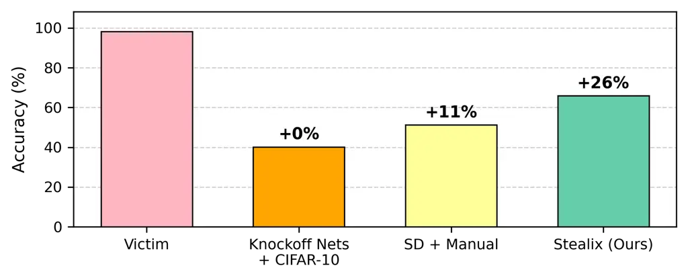
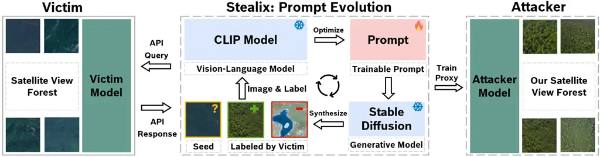
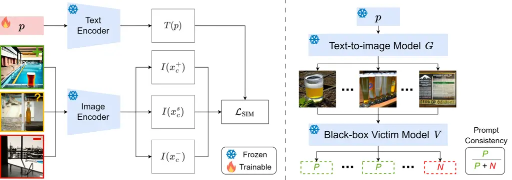
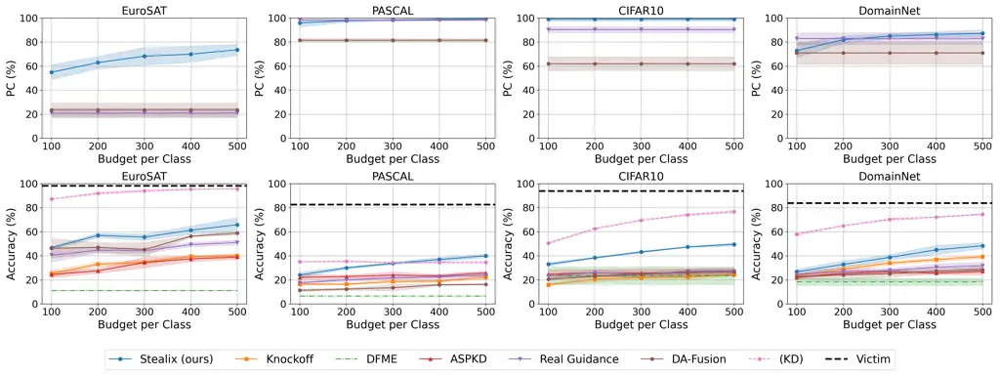
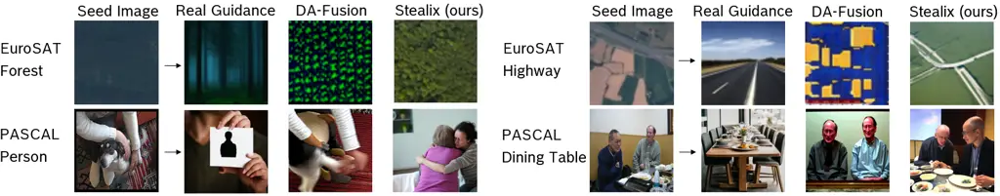
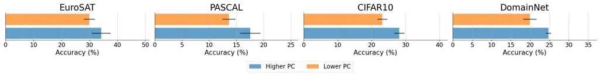
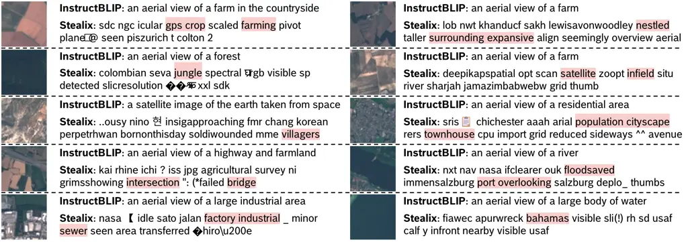
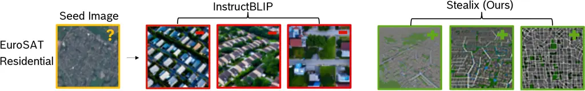
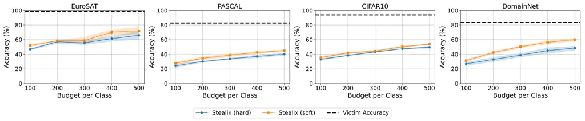
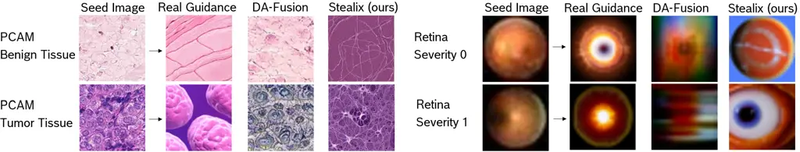

# Stealix: Model Stealing via Prompt Evolution

Zhixiong Zhuang Affiliation: Saarland University, Saarbrücken, Germany
Affiliation: Bosch Center for Artificial Intelligence, Renningen,
Germany Correspondence to: <zhixiong.zhuang@bosch.com>    Hui-Po Wang
Affiliation: CISPA Helmholtz Center for Information Security,
Saarbrücken, Germany    Maria-Irina Nicolae Affiliation: Bosch Center
for Artificial Intelligence, Renningen, Germany    Mario Fritz
Affiliation: CISPA Helmholtz Center for Information Security,
Saarbrücken, Germany

###### Abstract

Model stealing poses a significant security risk in machine learning by
enabling attackers to replicate a black-box model without access to its
training data, thus jeopardizing intellectual property and exposing
sensitive information. Recent methods that use pre-trained diffusion
models for data synthesis improve efficiency and performance but rely
heavily on manually crafted prompts, limiting automation and
scalability, especially for attackers with little expertise. To assess
the risks posed by open-source pre-trained models, we propose a more
realistic threat model that eliminates the need for prompt design skills
or knowledge of class names. In this context, we introduce Stealix, the
first approach to perform model stealing without predefined prompts.
Stealix uses two open-source pre-trained models to infer the victim
model’s data distribution, and iteratively refines prompts through a
genetic algorithm, progressively improving the precision and diversity
of synthetic images. Our experimental results demonstrate that Stealix
significantly outperforms other methods, even those with access to class
names or fine-grained prompts, while operating under the same query
budget. These findings highlight the scalability of our approach and
suggest that the risks posed by pre-trained generative models in model
stealing may be greater than previously recognized.¹¹ 1 The project page
is at
[https://zhixiongzh.github.io/stealix/](https://zhixiongzh.github.io/stealix/).

###### Keywords:

Machine Learning, ICML

SD  
stable diffusion

KD  
knowledge distillation

PC  
prompt consistency

ASPKD  
Active Self-Paced Knowledge Distillation

GAN  
Generative Adversarial Network

## 1 Introduction

Model stealing allows attackers to replicate the functionality of
machine learning models without direct access to training data or model
weights. By querying the victim model with hold-out datasets, the
attacker can construct a proxy model that behaves similarly to the
original by mimicking its predictions. This attack vector compromises
the model owner’s intellectual property and may expose sensitive
information, posing both security and privacy risks (Beetham et al.,
2022; Carlini et al., 2024).



Figure 1: Impact of query datasets on stealing a satellite image
classifier: performance drops occur with dissimilar datasets (Knockoff
Nets + CIFAR-10) and challenging prompt design (SD + manual). Stealix
mitigates these issues by leveraging victim-aware automatic prompt
tuning.



Figure 2: Overview of Stealix. Stealix begins with a real image as a
seed and synthesizes images to aid model stealing by iteratively
refining prompts based on the victim’s responses. The synthesized images
are then used to train a proxy model.

Current model stealing methods for image classification can be
categorized based on the source of the queried images: (1) using
publicly available images like Knockoff Nets (Orekondy et al., 2019),
(2) generating images by training a GAN (GAN) from scratch (Truong et
al., 2021; Sanyal et al., 2022), or (3) synthesizing images by prompting
pre-trained open-source generative models (Shao et al., 2023; Hondru &
Ionescu, 2023). The latter uses models like SD (SD) (Rombach et al., 2022) to achieve superior efficiency by reducing the dependence on
online data sources and by eliminating the high computational cost of
training new generators. However, previous approaches often rely on
human-crafted prompts or class names to generate images. These methods
fall short when the class names lack context or fail to represent the
victim’s data features accurately. Attackers may also struggle to
describe the target data distribution due to limited knowledge or vague
articulation. Furthermore, reliance on human intervention hinders
scalability and automation. These challenges are especially pronounced
in specialized fields, where high-value models are the most common.
Therefore, research under the current assumptions may oversimplify the
problem and underestimate the threat of model stealing facilitated by
pre-trained models, as shown in Figure 1.

To address these limitations and accurately assess the risk, we propose
a more realistic threat model in which the attacker lacks prior
knowledge or expertise in designing prompts for the victim’s data. This
setup reflects practical attack scenarios, such as competitors or
malicious actors with limited data but access to black-box model APIs.
Under these constraints, existing prompt-based approaches struggle to
generate diverse, class-specific queries, limiting their ability to
extract the victim model effectively.

In this context, we introduce Stealix, the first model stealing attack
that removes the need for human-crafted prompts. Our method employs a
text-to-image generative model and a vision-language model to
iteratively generate multiple refined prompts for each class, as
depicted in Figure 2. Unlike prior prompt optimization works (Wen et
al., 2024; Gal et al., 2023; Trabucco et al., 2024), which do not
consider the victim model’s predictions in optimizing prompts, our
approach incorporates these predictions during the optimization to
address inconsistencies in image classification and improve image
diversity. We achieve this with contrastive learning and evolutionary
algorithms. Specifically, the prompt describing the target class is
optimized under a contrastive loss using features extracted by the
vision-language model from the prompt itself and from image triplets. To
further improve the precision and diversity of the prompts, we propose a
proxy metric as the fitness function to evaluate and evolve the prompts.
In practice, our approach requires only a single real image per class.
We show that this is sufficient to achieve new state-of-the-art
performance without requiring manual prompt engineering; this assumption
is realistic, as potential attackers, typically competitors, often have
limited data available, but fail to synthesize more.

Contributions. (i) We present a practical threat model that removes the
need for prompt design expertise, reflecting scalability needs in
real-world settings. (ii) We propose Stealix, the first prompt-agnostic
approach that iteratively refines prompts using a proxy metric.
Statistical analysis demonstrates a high correlation between the proxy
metric and the feature distance to the victim data. (iii) Stealix
surpasses methods using class names or human-crafted prompts, improving
attacker model accuracy by up to 22.2% under a low query budget. (iv)
Our findings reveal critical risks in model stealing with open-source
models, underscoring the need for stronger defenses.

## 2 Related Works

Knowledge distillation. KD (KD) is a model compression technique that
trains smaller student models to replicate the performance of larger
teacher models, thereby reducing resource demands (Ba & Caruana, 2014;
Hinton et al., 2015). Traditional KD relies on the teacher’s training
data to align the student with the same distribution. When this data is
unavailable due to practical constraints, surrogate datasets (Lopes et
al., 2017) or data-free KD with generators (Fang et al., 2019; Micaelli
& Storkey, 2019) are commonly used, which typically require white-box
access for back-propagation. In contrast, model stealing operates in a
black-box setting, where the attacker has limited knowledge of the
victim model.

Model stealing. Model stealing seeks to replicate a victim model’s
attributes, such as parameters, hyperparameters (Wang & Gong, 2018;
Tramèr et al., 2016), and functionality (Oliynyk et al., 2023).
Functionality stealing involves training a proxy model to mimic the
victim’s outputs, raising security concerns in image recognition (Truong
et al., 2021), natural language processing (Krishna et al., 2020),
robotics (Zhuang et al., 2024), and multimodal radiology report
generation (Shen et al., 2025). Our work focuses on functionality
stealing in images, where traditional methods achieve it by querying
victim models using public datasets (Orekondy et al., 2019) or synthetic
images (Truong et al., 2021; Sanyal et al., 2022; Beetham et al., 2022).
As illustrated in Figure 1, these approaches are either constrained by
query dataset similarity or require millions of queries with substantial
computational costs. Recent approaches use pre-trained diffusion models
to reduce the query costs (Shao et al., 2023; Hondru & Ionescu, 2023).
For instance, ASPKD (ASPKD) (Hondru & Ionescu, 2023) generates images
using diffusion models, queries a subset through the victim model, and
pseudo-labels samples via nearest-neighbor matching. However, these
methods still depend on class names or manual prompts, limiting their
practicality in specialized domains. Our approach introduces automatic
prompt refinement to minimize human intervention and thus enhance
effectiveness and scalability.

Personalized image synthesis. Prompt optimization can capture the
essence of specific images, enabling pre-trained text-to-image models to
generate personalized outputs. Textual inversion (Gal et al., 2023)
updates prompt embeddings with text-to-image models, while PEZ (Wen et
al., 2024) optimizes discrete prompts with vision-language model.
Notably, DA-Fusion (Trabucco et al., 2024) leverages textual inversion
to synthesize visually similar images for data augmentation. While
DA-Fusion is not designed for model stealing, we extend it by replacing
the original class label with the victim model’s prediction. Unlike
existing approaches, which lack awareness of the victim model’s outputs
and generate suboptimal queries, our method explicitly incorporates
victim feedback.

## 3 Threat Model

In this section, we formalize the threat model for model stealing. We
start with notations and definitions, describe the victim’s
capabilities, and outline the attacker’s goals and knowledge,
emphasizing the constraints that make model stealing challenging.

#### Notations.

Let $`\mathcal{D}=\{({\bm{x}}_{i},y_{i})\}`$ be the dataset used to
train an image classification model, where
$`{\bm{x}}_{i}\in\mathbb{R}^{H\times W\times C}`$ represents input
images with height $`H`$, width $`W`$, and $`C`$ channels, and
$`y_{i}\in\{1,2,\dots,K\}`$ denotes the corresponding class labels, with
$`K`$ being the total number of classes. Each class is indexed by
$`c\in\{1,2,\dots,K\}`$. The pre-trained generative model $`G`$
generates an image $`{\bm{x}}\sim G({\bm{p}},\epsilon)`$ from a given
prompt $`{\bm{p}}`$ by denoising noise $`\epsilon`$ drawn from a
standard normal distribution $`\epsilon\sim\mathcal{N}(0,1)`$. For
brevity, we denote this process as $`{\bm{x}}\sim G({\bm{p}})`$.

#### Victim model.

The victim trains a classification model $`V`$ with parameters
$`\theta_{v}`$ on a dataset $`\mathcal{D}_{V}`$, where images are drawn
from the victim data distribution $`{\bm{x}}\sim\mathcal{P}_{V}`$. Once
deployed, it operates as a black-box accessible for queries. We assume
the victim model provides only the top-1 predicted class as answer, thus
already reducing the model stealing risks by limiting the attack surface
(Sanyal et al., 2022). For a given input image $`{\bm{x}}`$,
$`y^{*}=V({\bm{x}};\theta_{v})\in\{1,2,\dots,K\}`$ is the predicted
class label.

#### Goal and knowledge of the attacker.

The attacker’s objective is to train a surrogate model
$`A({\bm{x}};\theta_{a})`$, parameterized by $`\theta_{a}`$ that
replicates the behavior of the victim model $`V`$. The attacker has
black-box access to $`V`$, allowing them to query the model with images
and receive the predicted class labels. The attacker is constrained by a
query budget, representing the total number of queries available per
class, denoted as $`B`$. The attacker lacks knowledge of (i) the
architecture and parameters of $`V`$, (ii) the dataset
$`\mathcal{D}_{V}`$ used to train $`V`$, and (iii) prompt design
expertise. We also limit the use of class names, as they may by chance
serve as good prompts; using them would diverge from the assumption that
the attacker lacks prompt design expertise. This constraint
significantly limits the attacker from leveraging a generative model for
efficient model stealing.

## 4 Approach: Stealix



Figure 3: Prompt refinement (left) optimizes the prompt $`{\bm{p}}`$
using encoders $`T`$ and $`I`$ via Equation 3 to capture features from
seed image $`{\bm{x}}^{s}`$ and positive image $`{\bm{x}}^{+}`$ while
filtering out negatives from $`{\bm{x}}^{-}`$. Prompt consistency
(right) evaluates $`{\bm{p}}`$ with Equation 5 by prompting generative
model $`G`$ to synthesize images, which are classified by the victim
model $`V`$ to update positive and negative sets. In the example, the
negative feature “pool” is removed for class “bottle”.

This section details Stealix, formalizing the problem and providing an
overview in Section 4.1, followed by explanations of its components in
Sections 4.2, 4.3 and 4.4.

### 4.1 Method Overview

The attacker’s goal is to optimize the parameters $`\theta_{a}`$ of a
surrogate model $`A`$ to replicate the behavior of the victim model
$`V`$ on the victim data distribution $`\mathcal{P}_{V}`$, achieving
comparable performance. This can be expressed by minimizing the loss
between the outputs of the victim and surrogate models over the victim’s
data distribution under the cross-entropy loss:

```math
\argmin_{\theta_{a}}\underset{{\bm{x}}\sim\mathcal{P}_{V}}{\mathbb{E}}\left[\mathcal{L}_{\text{CE}}\left(V({\bm{x}}),A({\bm{x}})\right)\right]. \tag{1}
```

Without access to the victim data distribution $`\mathcal{P}_{V}`$,
previous methods (Shao et al., 2023; Hondru & Ionescu, 2023) turn to
generate high-quality images using a pre-trained text-to-image model
$`G`$ with a prompt $`\mathbf{p}`$. By designing prompts to synthesize
images similar to the victim data, the attacker can effectively steal
the model by minimizing loss on these generated images:

```math
\argmin_{\theta_{a}}\underset{{\bm{x}}\sim G({\bm{p}})}{\mathbb{E}}\left[\mathcal{L}_{\text{CE}}\left(V({\bm{x}}),A({\bm{x}})\right)\right]. \tag{2}
```

Recall that for specialized tasks and models, the attacker might be
lacking the knowledge to design relevant prompts; to address this
challenge, we propose Stealix. Through the use of genetic algorithms
(Zames, 1981), Stealix iteratively generates multiple prompts that
capture the diversity of class-specific features recognized by the
victim model.

More precisely, each iteration of our attack consists of three steps.
Prompt refinement uses a population of image triplets
$`\mathcal{S}^{t}`$ to optimize corresponding prompts. One randomly
initialized prompt is optimized per image triplet to capture the target
class features. The resulting prompts are evaluated using prompt
consistency, a fitness metric based on how consistently the victim model
classifies synthesized images as the target class. Finally, prompt
reproduction evolves the next population of image triplets using a
genetic algorithm. For each iteration $`t`$, the population
$`{\mathcal{S}}^{t}=\{({\bm{x}}_{c}^{s},{\bm{x}}_{c}^{+},{\bm{x}}_{c}^{-})_{i}^{t}\}_{i=1}^{N}`$,
consisting of $`N`$ image triplets, is built using the image sets
$`\mathcal{X}_{c}^{s}`$, $`\mathcal{X}_{c}^{+}`$, and
$`\mathcal{X}_{c}^{-}`$, such that
$`{\bm{x}}_{c}^{s}\in\mathcal{X}_{c}^{s}`$,
$`{\bm{x}}_{c}^{+}\in\mathcal{X}_{c}^{+}`$, and
$`{\bm{x}}_{c}^{-}\in\mathcal{X}_{c}^{-}`$. These sets are defined for
each class $`c`$: the seed set
$`\mathcal{X}_{c}^{s}=\{{\bm{x}}_{c}^{s}\mid V({\bm{x}}_{c}^{s})=c\}`$
contains real images classified as $`c`$ by the victim model; the
positive set
$`\mathcal{X}_{c}^{+}=\{{\bm{x}}_{c}^{+}\mid V({\bm{x}}_{c}^{+})=c\}`$
has synthetic images classified as $`c`$; and the negative set
$`\mathcal{X}_{c}^{-}=\{{\bm{x}}_{c}^{-}\mid V({\bm{x}}_{c}^{-})\neq c\}`$
includes synthetic images classified into other classes than $`c`$.
$`\mathcal{X}_{c}^{+}`$ and $`\mathcal{X}_{c}^{-}`$ are initially empty,
and generated synthetic images are added to these sets over iterations.

The three steps of the method are repeated until the query budget $`B`$
per class is exhausted (where
$`B=|\mathcal{X}_{c}^{+}|+|\mathcal{X}_{c}^{-}|`$) (see Algorithm 1).
Across $`K`$ classes, this produces $`K\times B`$ synthetic images,
which are used along with the seed images to train the attacker model.
We limit the number of seed images the attacker needs to possess from
each class to one ($`|\mathcal{X}_{c}^{s}|=1`$). The method steps are
detailed below.

### 4.2 Prompt Refinement

Efficient model stealing requires synthesizing images that are similar
to the victim data, which in turn needs prompts that capture the
class-specific features learned by the victim model. To achieve this, we
optimize the prompt to emphasize attributes leading to correct
classifications while minimizing misleading features that cause
incorrect predictions, with a triplet of images
$`\{{\bm{x}}_{c}^{s},{\bm{x}}_{c}^{+},{\bm{x}}_{c}^{-}\}`$. This
triplet, along with a random prompt, is projected into a shared feature
space using an image encoder $`I`$ and a text encoder $`T`$ from a
pre-trained vision-language model (Figure 3 left). The prompt is then
optimized by minimizing the similarity loss between the prompt and image
features, with guidance from the victim model’s predictions:

```math
\min_{\bm{p}}\sum_{{\bm{x}}\in\{{\bm{x}}_{c}^{s},{\bm{x}}_{c}^{+},{\bm{x}}_{c}^{-}\}}\mathcal{L}_{\text{SIM}}(I({\bm{x}}),T({\bm{p}}),V({\bm{x}})), \tag{3}
```

where the similarity loss $`\mathcal{L}_{\text{SIM}}`$ is defined as:

```math
\mathcal{L}_{\text{SIM}}=\begin{cases}1-\cos(I({\bm{x}}),T({\bm{p}})),&\text{if }V({\bm{x}})=c\\
\max(0,\cos(I({\bm{x}}),T({\bm{p}}))),&\text{if }V({\bm{x}})\neq c.\end{cases} \tag{4}
```

If the triplet of images contains only the seed image, the optimization
objective degrades to PEZ (Wen et al., 2024). We compare ours with PEZ
in the ablative study (Appendix D). This refinement process ensures that
the prompt captures salient attributes for accurate classification while
eliminating features that may lead to misclassification. See Algorithm 2
in Appendix A for more details.

### 4.3 Prompt Consistency

To evaluate whether the optimized prompt effectively captures the
features learned by the victim model, we propose a proxy metric, PC
(PC). Since direct access to the victim data distribution is
unavailable, this metric serves as an indicator of distribution
similarity and is used for prompt reproduction. We assume that if a
prompt captures the latent features of the target class learned by the
victim model, the synthetic images will be consistently classified as
the target class by the victim model, implying a closer resemblance with
the victim data. Based on this assumption, PC measures how well a prompt
generates images that match the target class $`c`$ (Figure 3 right).
Given a prompt $`{\bm{p}}`$, a batch of synthetic images
$`\{{\bm{x}}_{i}\}_{i=1}^{M}\sim\mathrm{G}({\bm{p}})`$ is generated,
where $`M`$ is the number of images. PC is computed as:

```math
\mathrm{PC}=\frac{1}{M}\sum_{i=1}^{M}\mathbb{I}(V({\bm{x}}_{i})=c), \tag{5}
```

where $`\mathbb{I}(V({\bm{x}}_{i})=c)`$ is 1 if the victim model
classifies $`{\bm{x}}_{i}`$ as class $`c`$, and 0 otherwise. In Table 3,
we show there is a strong correlation between PC and the $`L_{2}`$
distance between the feature vectors of real and generated images,
validating PC as an effective proxy metric for monitoring data
similarity and for prompt reproduction. The synthetic images are also
used to update the image sets $`\mathcal{X}_{c}^{+}`$ and
$`\mathcal{X}_{c}^{-}`$, while the PC value is added to the fitness set
$`{\mathcal{F}}^{t}`$. Since the prompt is optimized with a triplet of
images, the fitness value can also be assigned to the corresponding
triplet in $`{\mathcal{S}}^{t}`$.

### 4.4 Prompt Reproduction

To generate diverse prompts that capture a broad range of class-specific
features recognized by the victim model, we evolve the image triplet set
$`{\mathcal{S}}^{t}`$ with $`\mathcal{X}_{c}^{s}`$,
$`\mathcal{X}_{c}^{+}`$, and $`\mathcal{X}_{c}^{-}`$ as candidate set.
The triplet with the highest fitness value (PC) in $`{\mathcal{S}}^{t}`$
is selected as the elite, carried forward to the next generation
$`{\mathcal{S}}^{t+1}`$ to guide the production of improved triplets. To
generate new triplets, $`N_{p}`$ triplets are selected from
$`{\mathcal{S}}^{t}`$, where $`N_{p}`$ denotes the number of parents.
This is done by repeatedly sampling $`k`$ triplets and selecting the one
with the highest fitness to form the parent set $`{\mathcal{S}}_{p}`$, a
process known as tournament selection (Zames, 1981), where $`k`$ is the
tournament size. Once the parent set is formed, two parent triplets are
selected, and their images are randomly exchanged to create a new
triplet. Each image in the new triplet is replaced with a random sample
from $`\mathcal{X}_{c}^{s}`$, $`\mathcal{X}_{c}^{+}`$, or
$`\mathcal{X}_{c}^{-}`$ with a probability $`p_{m}`$, encouraging
exploration of the candidate set. The newly generated triplet is added
to $`{\mathcal{S}}^{t+1}`$, and this process is repeated until the
population is fully updated. See Algorithm 3 in Appendix A for details
on the prompt reproduction step.

1:  Input: seed image set $`\{\mathcal{X}_{c}^{s}\}_{c=1}^{K}`$,
synthetic images amount $`M`$ for PC calculation, total query budget
$`B`$ per class, population size $`N`$, victim model $`V`$, generative
model $`G`$, image encoder $`I`$ and text encoder $`T`$

2:  Output: Attacker model $`A`$

3:  Initialize attacker model $`A`$

4:  for each class $`c`$ do

5:   $`\mathcal{X}_{c}^{+}\leftarrow\emptyset`$,
$`\mathcal{X}_{c}^{-}\leftarrow\emptyset`$, population index
$`t\leftarrow 0`$, consumed budget $`b\leftarrow 0`$

6:   // Initial $`{\mathcal{S}}^{0}=\{(x_{c}^{s})_{i}^{0}\}_{i=1}^{N}`$
as $`\mathcal{X}_{c}^{+},\mathcal{X}_{c}^{-}`$ are empty.

7:
  $`{\mathcal{S}}^{t}\leftarrow\{({\bm{x}}_{c}^{s},{\bm{x}}_{c}^{+},{\bm{x}}_{c}^{-})_{i}^{t}\}_{i=1}^{N}`$
from $`\mathcal{X}_{c}^{s},\mathcal{X}_{c}^{+},\mathcal{X}_{c}^{-}`$

8:   while $`b<B`$ do

9:    Initialize the fitness score set
$`{\mathcal{F}}^{t}\leftarrow\emptyset`$

10:    for each triplet
$`({\bm{x}}_{c}^{s},{\bm{x}}_{c}^{+},{\bm{x}}_{c}^{-})_{i}^{t}`$ in
$`{\mathcal{S}}^{t}`$ do

11:      if $`b\geq B`$ then

12:       break

13:      end if

14:      // Optimize the prompt (Section 4.2)

15:
     $`{\bm{p}}_{i}^{t}\leftarrow\text{PromptRefinement}(({\bm{x}}_{c}^{s},{\bm{x}}_{c}^{+},{\bm{x}}_{c}^{-})_{i}^{t},I,T)`$

16:      // Synthesize images and get PC fitness (Section 4.3)

17:      $`\{{\bm{x}}_{i}\}_{i=1}^{M}\sim\mathrm{G}({\bm{p}}_{i}^{t})`$

18:
     $`{\mathcal{F}}^{t}\leftarrow{\mathcal{F}}^{t}\cup\{\frac{1}{M}\sum_{i=1}^{M}\mathbb{I}(V({\bm{x}}_{i})=c)\}`$

19:      $`b\leftarrow b+M`$

20:      // Update the positive and negative sets

21:
     $`\mathcal{X}_{c}^{+}\leftarrow\mathcal{X}_{c}^{+}\cup\{{\bm{x}}_{i}\mid V({\bm{x}}_{i})=c,\;i\in\{1,\ldots,M\}\}`$

22:
     $`\mathcal{X}_{c}^{-}\leftarrow\mathcal{X}_{c}^{-}\cup\{{\bm{x}}_{i}\mid V({\bm{x}}_{i})\neq c,\;i\in\{1,\ldots,M\}\}`$

23:    end for

24:    // Generate the next population (Section 4.4).

25:
   $`{\mathcal{S}}^{t+1}\leftarrow\text{PromptReproduction}({\mathcal{S}}^{t},{\mathcal{F}}^{t},\mathcal{X}_{c}^{s},\mathcal{X}_{c}^{+},\mathcal{X}_{c}^{-})`$

26:    $`t\leftarrow t+1`$

27:   end while

28:  end for

29:  Train model $`A`$ with
$`\{\mathcal{X}_{c}^{+},\mathcal{X}_{c}^{-},\mathcal{X}_{c}^{s}\}_{c=1}^{K}`$
and their labels

30:  return Attacker model $`A`$

Algorithm 1 Stealix

## 5 Experiments

In this section, we introduce our experimental results, starting with
the experimental setup in Section 5.1, followed by the results and
analyses in Table 3. Finally, we exemplify real-world model stealing on
a model trained with proprietary data in Footnote 2.

### 5.1 Experimental Setup

Dataset. We train the victim model on four datasets: EuroSAT (Helber et
al., 2019), PASCAL VOC (Everingham et al., 2010), DomainNet (Peng et
al., 2019), and CIFAR10 (Alex, 2009). Each dataset is chosen for its
specific challenges in evaluating model stealing attacks. EuroSAT
requires specialized prompts for satellite-based land use
classification, as class names alone fail to generate relevant images.
In PASCAL VOC, images are labeled by the largest object, testing the
ability to identify the primary target from the victim model’s
prediction. DomainNet evaluates transfer learning across six diverse
domains: clipart, infograph, paintings, quickdraw, real images, and
sketches. A seed image is randomly chosen from one domain to test
cross-domain generalization, using 10 of 345 classes for manageability.
In CIFAR10, class names can guide image synthesis, leading to strong
baselines when used by other methods, compared to ours, which does not.
See Appendix B for more details. We also introduce results on two
medical datasets in Appendix L, highlighting the challenges when the
diffusion model has limited domain-specific knowledge.

Victim model. All models use ResNet-34 following Truong et al. (2021),
with PASCAL using an ImageNet-pretrained weights. Victim models are
trained with SGD, Nesterov with momentum 0.9, a 0.01 learning rate,
$`5\times 10^{-4}`$ weight decay, and cosine annealing for 50 epochs.

Stealix. We use OpenCLIP-ViT/H as the vision-language model (Cherti et
al., 2023) for prompt refinement, with a learning rate of 0.1 and 500
optimization steps using the AdamW optimizer. We employ Stable
Diffusion-v2 (Rombach et al., 2022) as the generative model, with a
guidance scale of 9 and 25 inference steps. PC evaluation uses $`M=10`$
images. Stable Diffusion-v2 is used across all methods. In prompt
reproduction, we set the population size to $`N=10`$, with $`N_{p}=5`$
parents selected via tournament selection with a tournament size of
$`k=5`$, and retain one elite per generation. The mutation probability
is set to $`p_{m}=0.6`$. Following prior work (Truong et al., 2021), we
use ResNet-18 as the attacker model. To focus on the impact of query
data quality and ensure a fair comparison across methods, we train the
attacker model using the same hyperparameters as the victim model
without tuning: 50 epochs with SGD. More attacker and victim
architectures are shown in Appendix G and Appendix H. The experiments
are run on a NVIDIA V100 GPU and an AMD EPYC 7543 32-Core CPU. The
computation time is provided in Appendix C.

Baselines. We focus on a new, practical threat model that lacks both
prompt expertise and detailed class information. Nevertheless, we
compare our method with existing approaches designed for other threat
models. Specifically, we consider the following baselines. (i) DA-Fusion
(Trabucco et al., 2024) is adapted to train a soft prompt from the seed
image using textual inversion, then synthesize query images with
strength 1 and the same guidance scale as our method; (ii) Real Guidance
(He et al., 2023) uses the prompt “a photo of a {class name}” to
synthesize images given the seed image with strength 1 and same guidance
scale; (iii) ASPKD (Hondru & Ionescu, 2023) follows a three-stage
process, first generating 5000 images per class using Real Guidance,
then querying the victim model with a limited budget $`B`$, and finally
pseudo-labeling the remaining images with a nearest neighbors approach
with the attacker model; (iv) Knockoff Nets (Orekondy et al., 2019)
evaluates performance with randomly collected images by querying the
CIFAR-10 victim model with EuroSAT images and other victim models with
CIFAR-10; (v) DFME (Truong et al., 2021) is a data-free model stealing
method based on GAN that trains a generator from scratch to
adversarially generate samples to query the victim model. We report the
result of DFME using a query budget of 2 million per class. (vi) KD
(Hinton et al., 2015) serves as a reference upper bound, where the
attacker queries the victim model using its training data to evaluate
the best possible performance with data access. While data augmentation
without querying the victim model is not model stealing, we include a
comparison of attacker model accuracy between model stealing and data
augmentation setups in Appendix K.

Evaluation metrics. We rely on two metrics: (i) the accuracy of the
attacker model on the test set of the victim data, which is standard for
stealing classifiers (Orekondy et al., 2019), and (ii) the PC (PC) of
the synthesized images. For Stealix, we report the best PC achieved
across varying query budgets. For Real Guidance and DA-Fusion, where the
prompt remains fixed, PC is measured by querying 500 images per class.
For ASPKD that uses images synthesized by Real Guidance, PC is identical
to Real Guidance. PC is not applicable for KD, Knockoff, and DFME, which
do not involve text-to-image synthesis. All experiments are repeated
three times, with mean values in the table and confidence intervals in
the figure.

### 5.2 Experimental Results

|                |               |            |               |               |               |               |
| -------------- | ------------- | ---------- | ------------- | ------------- | ------------- | ------------- |
| Method         | \#Seed images | Class name | EuroSAT       | PASCAL        | CIFAR10       | DomainNet     |
| Victim         | -             | -          | 98.2% (1.00x) | 82.7% (1.00x) | 93.8% (1.00x) | 83.9% (1.00x) |
| (KD)           | -             | -          | 95.6% (0.97x) | 34.6% (0.42x) | 76.7% (0.82x) | 74.6% (0.89x) |
| Knockoff       | 0             | ✗          | 40.1% (0.41x) | 22.3% (0.27x) | 24.4% (0.26x) | 39.3% (0.47x) |
| DFME           | 0             | ✗          | 11.1% (0.11x) | 6.6% (0.08x)  | 23.7% (0.25x) | 18.5% (0.22x) |
| ASPKD          | 0             | ✓          | 39.2% (0.40x) | 25.7% (0.31x) | 27.1% (0.29x) | 27.3% (0.32x) |
| Real Guidance  | 1             | ✓          | 51.2% (0.52x) | 24.0% (0.29x) | 27.4% (0.29x) | 31.9% (0.38x) |
| DA-Fusion      | 1             | ✗          | 59.0% (0.60x) | 16.4% (0.20x) | 26.7% (0.28x) | 28.4% (0.34x) |
| Stealix (ours) | 1             | ✗          | 65.9% (0.67x) | 40.0% (0.48x) | 49.6% (0.53x) | 48.4% (0.58x) |

Table 1: Attacker model accuracy with a query budget of 500 per class;
DFME uses 2M.

Comparison with baselines. Table 1 compares the accuracy of the attacker
model across methods for a query budget of 500 per class (2M per class
for DFME). Stealix consistently outperforms all other methods. E.g., in
CIFAR-10, Stealix achieves 49.6% accuracy, a 22.2% improvement over the
second-best method, Real Guidance. In contrast, DFME has near-random
accuracy on EuroSAT and PASCAL due to its reliance on training a
generator from scratch with small perturbations, which are quantized
when interacting with real-world victim APIs (discussed in Appendix I).
In PASCAL, Stealix even surpasses KD, where the attacker has access to
the victim data. This is because KD is constrained by the limited victim
data size (around 73 images per class), whereas Stealix generates
additional images and issues more queries. In Figure 4 we illustrate
both the stolen model accuracy and PC across varying query budgets.
Stealix consistently achieves higher PC as the query budget increases,
particularly in EuroSAT, where class names alone are insufficient for
generating relevant images. Although Real Guidance initially attains
higher PC in PASCAL and DomainNet, Stealix ultimately surpasses it with
larger query budgets. In CIFAR-10, Stealix reaches nearly 100% PC. In
Appendix G and Appendix H, our method consistently outperforms others
with different attacker and victim architectures.



Figure 4: PC and attacker model accuracy comparison across datasets with
varying query budgets per class. DFME uses 2M per class. Besides the
baselines, we provide KD and victim accuracy for reference.

Limitations of human-crafted prompts. Even when attackers can craft
prompts for the seed image based on the prior knowledge of class names,
these prompts, though logically accurate from a human perspective, may
still fail to capture the nuanced features learned by the victim model.
To evaluate this, we utilize InstructBLIP (Dai et al., 2023), a
pre-trained vision-language model, as a proxy for a human attacker.
InstructBLIP is instructed with, “It is a photo of a {class name}. Give
me a prompt to synthesize similar images,” alongside the seed image from
the challenging EuroSAT dataset. We synthesize 500 images per class
based on these prompts and train the attacker model. The comparison of
generated prompts between InstructBLIP and Stealix for all classes is
provided in Appendix F, along with examples of generated images. Stealix
outperforms InstructBLIP, achieving an accuracy of 65.9% compared to
55.2%. Despite InstructBLIP incorporating relevant terms like “aerial
view” and “satellite view,” its average PC score is 41.0%, compared to
Stealix’s 73.7%.



Figure 5: Qualitative comparison of images generated by Real Guidance,
DA-Fusion, and Stealix.

Qualitative comparison. Figure 5 presents qualitative comparisons on
EuroSAT and PASCAL datasets. In EuroSAT, class names alone miss
attributes like the satellite view, leading Real Guidance to generate
generic images that differ from the victim data. Additionally, DA-Fusion
struggles to interpret blurred seed images, generating random color
blocks. For PASCAL, when multiple objects are present in the seed image,
Stealix successfully identifies the target object. For instance, the
seed image for the “PASCAL Person” class includes a prominent dog,
leading to the first-generation prompt, “chilean vaw breton cecilia
hands console redux woodpecker northwestern beagle sytracker collie
relaxing celticsped”, which generates dog images and results in PC of 0.
Stealix then uses the misclassified image as a negative example and
refines the prompt to, “syrian helene pasquspock hands thumbcuddling
sheffield stuck smritihouseholds vulnerable kerswednesday humormindy
intestin”, removing dog-related features and achieving PC = 1.
Similarly, Stealix correctly identifies the dining table as the target
in a crowded scene, while DA-Fusion incorrectly focuses on the human.
These examples show how Stealix evolves prompts by filtering out
misleading features using victim feedback.

Correlation between PC and feature distance. Since the attacker lacks
access to the distribution of the victim data, PC is proposed as a proxy
for monitoring and optimizing prompts, based on the hypothesis that more
consistent predictions from the victim model indicate a closer match to
its data. To evaluate this assumption, we collect 150 PC values per
class corresponding to different prompts during prompt evolution. For
each PC, we compute the $`L_{2}`$ distance between the mean feature
vector of the synthetic images and that of the victim data. Feature
vectors are extracted from the victim model before its final fully
connected layer. The Spearman’s rank correlation test shows a strong,
statistically significant negative correlation between PC and $`L_{2}`$
(Table 2), supporting the use of PC as guiding metric. We also evaluate
whether higher PC leads to higher attacker model performance with
different PC values in Appendix E.

| Data      | Correlation $`\rho`$ | p-value                         |
| --------- | -------------------- | ------------------------------- |
| EuroSAT   | $`-0.63`$            | $`7.04\text{\times}{10}^{-05}`$ |
| PASCAL    | $`-0.64`$            | $`2.79\text{\times}{10}^{-04}`$ |
| CIFAR10   | $`-0.73`$            | $`1.20\text{\times}{10}^{-07}`$ |
| DomainNet | $`-0.88`$            | $`1.83\text{\times}{10}^{-26}`$ |

Table 2: Spearman’s rank correlation between PC and $`L_{2}`$ feature
distance.

Diversity comparison. Figure 4 shows that although PC values of Real
Guidance are similar to ours for CIFAR10, PASCAL and DomainNet, our
attacker model performs consistently better. This advantage stems from
the greater diversity in our synthetic data, achieved through prompt
evolution, where distinct images are used to construct different
triplets. To quantify this, we use the diversity score proposed by
Kynkäänniemi et al. (2019), Recall, which measures the likelihood that a
random image from the victim data distribution falls within the support
of the synthetic image set. The higher the score, the more diverse the
images. As shown in Table 3, our method generates more diverse synthetic
data with higher Recall score.

| Method         | EuroSAT | PASCAL | CIFAR10 | DomainNet |
| -------------- | ------- | ------ | ------- | --------- |
| Real Guidance  | 0.29    | 0.07   | 0.40    | 0.41      |
| DA-Fusion      | 0.43    | 0.06   | 0.48    | 0.24      |
| Stealix (ours) | 0.49    | 0.30   | 0.76    | 0.66      |

Table 3: Diversity (recall) across methods that using text-to-image
generative models; higher scores indicate better diversity relative to
the victim data distribution.

### 5.3 Stealing Model Based on Proprietary Data

We now apply Stealix to a large-scale Vision Transformer (ViT)
(Dosovitskiy et al., 2021) trained on proprietary and non-public data,
significantly differing from our previous victims. This model is a ‘Not
Safe For Work’ (NSFW) binary classification model, publicly available
from HuggingFace (Team, 2023), and ranked among the top-4 most
downloaded models for image classification. We use a publicly available
NSFW dataset from HuggingFace (Lewis, 2024)²² 2 Warning: This dataset
contains sexual content. Viewer discretion is advised. to run this
attack. The dataset contains 200 images (100 “safe”, 100 “not safe”).
The victim reaches 92.0% accuracy on this data. The attack is initiated
with one random image per class, the same hyperparameters from
Section 5.1 and a ResNet-18 attacker. With a query budget of 500 queries
per class, Stealix achieves an accuracy of 73.0%, effectively
replicating the victim model. In contrast, the Real Guidance method
fails to synthesize “not safe for work” images, resulting in an attacker
model accuracy of 50.0%, equivalent to random guessing. DA-Fusion
demonstrates moderate performance, with 62.3% accuracy. This result
demonstrates that our approach can leverage general priors in diffusion
models to enhance model stealing, even in the absence of diffusion
models trained on specific datasets.

## 6 Discussion

Defense. Our threat model assumes that the victim employs a defense that
returns only hard label outputs, which is cheap and effective in
limiting information leakage compared to soft labels (Sanyal et al.,
2022). Appendix J shows that the attacker models’ accuracy improves with
soft-label access using images generated by Stealix, underscoring the
need for this defense. Similarly, previous works (Lee et al., 2019;
Mazeika et al., 2022) propose defenses that perturb the posterior
prediction to reduce the utility of stolen models, while keeping the
predicted class (argmax) unchanged to preserve original performance for
benign users. These approaches implicitly push attackers to rely on hard
labels, which are less informative but immune to such perturbations.
However, since our prompt evolution uses only hard label feedback, this
constraint impacts only the training of the attacker model, not the
optimization of prompts, suggesting that stronger defenses may be
required.

Limitations and future work. Unlike GAN-based methods, Stealix does not
require backpropagation through the victim model to train the generator,
which enhances generalization across victim architectures (Appendix H).
Although the attacker architecture can still influence the performance
(Appendix G), our method consistently outperforms the baselines. Since
image synthesis and surrogate training are decoupled, attackers can
reuse synthetic images for, e.g., hyperparameter tuning. This key
advantage could be explored in future work to improve model accuracy.
Finally, as open-source generative models advance, integrating more
powerful models into our framework offers significant potential for
further enhancements.

## 7 Conclusion

We showed that attackers can leverage open-source generative models to
steal proprietary ones, even without prompt expertise or class
information. Using Stealix for prompt evolution and aligning generated
data with victim data significantly boosts model extraction efficiency.
This is the first study to reveal the risks of publicly available
pre-trained generative models in model theft for realistic attack
scenarios. We urge the development of defenses against this emerging
threat.

## Impact Statement

This work aims to raise awareness of the risks associated with model
stealing, particularly through the use of open-source pre-trained
generative models. While our work demonstrates how such models can be
exploited in adversarial settings, it is intended to inform the
development of more robust defenses against model theft. We emphasize
that our approach is not designed to promote malicious behavior but to
highlight vulnerabilities that need addressing within the AI community.
We encourage practitioners, model developers, and stakeholders to
implement stronger defenses, such as hard-label-only responses or
adversarial detection mechanisms, to mitigate potential risks. All
experiments were conducted with publicly available models and data, and
with the intent of advancing the security of AI systems.

## Acknowledgements

We acknowledge the support and funding by Bosch AIShield. This work was
also partially funded by ELSA – European Lighthouse on Secure and Safe
AI funded by the European Union under grant agreement No. 101070617, as
well as the German Federal Ministry of Education and Research (BMBF)
under the grant AIgenCY (16KIS2012).

## References

- Alex (2009) Alex, K. Learning multiple layers of features from tiny
  images. *https://www. cs. toronto. edu/kriz/learning-features-2009-TR.
  pdf*, 2009.
- Ba & Caruana (2014) Ba, J. and Caruana, R. Do deep nets really need to
  be deep? In _Advances in Neural Information Processing Systems
  (NeurIPS)_, 2014.
- Beetham et al. (2022) Beetham, J., Kardan, N., Mian, A. S., and
  Shah, M. Dual student networks for data-free model stealing. In
  _International Conference on Learning Representations (ICLR)_, 2022.
- Carlini et al. (2024) Carlini, N., Paleka, D., Dvijotham, K. D.,
  Steinke, T., Hayase, J., Cooper, A. F., Lee, K., Jagielski, M., Nasr,
  M., Conmy, A., Wallace, E., Rolnick, D., and Tramèr, F. Stealing part
  of a production language model. In _International Conference on
  Machine Learning (ICML)_, 2024.
- Cherti et al. (2023) Cherti, M., Beaumont, R., Wightman, R., Wortsman,
  M., Ilharco, G., Gordon, C., Schuhmann, C., Schmidt, L., and
  Jitsev, J. Reproducible scaling laws for contrastive language-image
  learning. In _Proceedings of the IEEE Conference on Computer Vision
  and Pattern Recognition (CVPR)_, 2023.
- Dai et al. (2023) Dai, W., Li, J., Li, D., Tiong, A. M. H., Zhao, J.,
  Wang, W., Li, B. A., Fung, P., and Hoi, S. C. H. Instructblip: Towards
  general-purpose vision-language models with instruction tuning. In
  _Advances in Neural Information Processing Systems (NeurIPS)_, 2023.
- Dosovitskiy et al. (2021) Dosovitskiy, A., Beyer, L., Kolesnikov, A.,
  Weissenborn, D., Zhai, X., Unterthiner, T., Dehghani, M., Minderer,
  M., Heigold, G., Gelly, S., Uszkoreit, J., and Houlsby, N. An image is
  worth 16x16 words: Transformers for image recognition at scale. In
  _International Conference on Learning Representations (ICLR)_, 2021.
- Everingham et al. (2010) Everingham, M., Van Gool, L., Williams, C. K.
  I., Winn, J., and Zisserman, A. The pascal visual object classes (voc)
  challenge. _International Journal of Computer Vision (IJCV)_, 2010.
- Fang et al. (2019) Fang, G., Song, J., Shen, C., Wang, X., Chen, D.,
  and Song, M. Data-free adversarial distillation. _arXiv preprint
  arXiv:1912.11006_, 2019.
- Gal et al. (2023) Gal, R., Alaluf, Y., Atzmon, Y., Patashnik, O.,
  Bermano, A. H., Chechik, G., and Cohen-Or, D. An image is worth one
  word: Personalizing text-to-image generation using textual inversion.
  In _International Conference on Learning Representations
  (ICLR)_, 2023.
- He et al. (2023) He, R., Sun, S., Yu, X., Xue, C., Zhang, W., Torr,
  P., Bai, S., and Qi, X. Is synthetic data from generative models ready
  for image recognition? In _International Conference on Learning
  Representations (ICLR)_, 2023.
- Helber et al. (2019) Helber, P., Bischke, B., Dengel, A., and
  Borth, D. Eurosat: A novel dataset and deep learning benchmark for
  land use and land cover classification. _IEEE Journal of Selected
  Topics in Applied Earth Observations and Remote Sensing_, 2019.
- Hinton et al. (2015) Hinton, G., Vinyals, O., and Dean, J. Distilling
  the knowledge in a neural network. _arXiv preprint
  arXiv:1503.02531_, 2015.
- Hondru & Ionescu (2023) Hondru, V. and Ionescu, R. T. Towards few-call
  model stealing via active self-paced knowledge distillation and
  diffusion-based image generation. _arXiv preprint
  arXiv:2310.00096_, 2023.
- Krishna et al. (2020) Krishna, K., Tomar, G. S., Parikh, A. P.,
  Papernot, N., and Iyyer, M. Thieves on sesame street! model extraction
  of bert-based apis. In _International Conference on Learning
  Representations (ICLR)_, 2020.
- Kynkäänniemi et al. (2019) Kynkäänniemi, T., Karras, T., Laine, S.,
  Lehtinen, J., and Aila, T. Improved precision and recall metric for
  assessing generative models. In _Advances in Neural Information
  Processing Systems (NeurIPS)_, 2019.
- Lee et al. (2019) Lee, T., Edwards, B., Molloy, I., and Su, D.
  Defending against machine learning model stealing attacks using
  deceptive perturbations. In _IEEE Security and Privacy Workshops
  (SPW)_, 2019.
- Lewis (2024) Lewis, Z. Not-safe-for-work dataset.
  [https://huggingface.co/datasets/zanderlewis/nsfw_detection_large/viewer/default/train?p=1](https://huggingface.co/datasets/zanderlewis/nsfw_detection_large/viewer/default/train?p=1), 2024.
  Accessed: 2024-11-30.
- Lopes et al. (2017) Lopes, R. G., Fenu, S., and Starner, T. Data-free
  knowledge distillation for deep neural networks. In _Advances in
  Neural Information Processing Systems (NeurIPS)_, 2017.
- Mazeika et al. (2022) Mazeika, M., Li, B., and Forsyth, D. How to
  steer your adversary: Targeted and efficient model stealing defenses
  with gradient redirection. In _International Conference on Machine
  Learning (ICML)_, 2022.
- Micaelli & Storkey (2019) Micaelli, P. and Storkey, A. J. Zero-shot
  knowledge transfer via adversarial belief matching. In _Advances in
  Neural Information Processing Systems (NeurIPS)_, 2019.
- Oliynyk et al. (2023) Oliynyk, D., Mayer, R., and Rauber, A. I know
  what you trained last summer: A survey on stealing machine learning
  models and defences. _ACM Computing Surveys_, 2023.
- Orekondy et al. (2019) Orekondy, T., Schiele, B., and Fritz, M.
  Knockoff nets: Stealing functionality of black-box models. In
  _Conference on Computer Vision and Pattern Recognition (CVPR)_, 2019.
- Peng et al. (2019) Peng, X., Bai, Q., Xia, X., Huang, Z., Saenko, K.,
  and Wang, B. Moment matching for multi-source domain adaptation. In
  _International Conference on Computer Vision (ICCV)_, 2019.
- Rombach et al. (2022) Rombach, R., Blattmann, A., Lorenz, D., Esser,
  P., and Ommer, B. High-resolution image synthesis with latent
  diffusion models. In _Conference on Computer Vision and Pattern
  Recognition (CVPR)_, 2022.
- Sanyal et al. (2022) Sanyal, S., ini, Addepalli, S., and Babu, R. V.
  Towards data-free model stealing in a hard label setting. In
  _Conference on Computer Vision and Pattern Recognition (CVPR)_, 2022.
- Shao et al. (2023) Shao, M., Meng, L., Qiao, Y., Zhang, L., and
  Zuo, W. Data-free black-box attack based on diffusion model. _arXiv
  preprint arXiv:2307.12872_, 2023.
- Shen et al. (2025) Shen, Y., Zhuang, Z., Yuan, K., Nicolae, M.-I.,
  Navab, N., Padoy, N., and Fritz, M. Medical multimodal model stealing
  attacks via adversarial domain alignment. In _Proceedings of the AAAI
  Conference on Artificial Intelligence (AAAI)_, 2025.
- Team (2023) Team, F. Not-safe-for-work image detection.
  [https://huggingface.co/Falconsai/nsfw_image_detection](https://huggingface.co/Falconsai/nsfw_image_detection), 2023.
  Accessed: 2024-11-30.
- Trabucco et al. (2024) Trabucco, B., Doherty, K., Gurinas, M., and
  Salakhutdinov, R. Effective data augmentation with diffusion models.
  In _International Conference on Learning Representations
  (ICLR)_, 2024.
- Tramèr et al. (2016) Tramèr, F., Zhang, F., Juels, A., Reiter, M. K.,
  and Ristenpart, T. Stealing machine learning models via prediction
  $`\{`$APIs$`\}`$. In _USENIX Security_, 2016.
- Truong et al. (2021) Truong, J.-B., Maini, P., Walls, R. J., and
  Papernot, N. Data-free model extraction. In _Conference on Computer
  Vision and Pattern Recognition (CVPR)_, 2021.
- Veeling et al. (2018) Veeling, B. S., Linmans, J., Winkens, J., Cohen,
  T., and Welling, M. Rotation equivariant cnns for digital pathology.
  In _Medical Image Computing and Computer Assisted Intervention
  (MICCAI)_, 2018.
- Wang & Gong (2018) Wang, B. and Gong, N. Z. Stealing hyperparameters
  in machine learning. In _IEEE Symposium on Security and Privacy (IEEE
  S&P)_, 2018.
- Wen et al. (2024) Wen, Y., Jain, N., Kirchenbauer, J., Goldblum, M.,
  Geiping, J., and Goldstein, T. Hard prompts made easy: Gradient-based
  discrete optimization for prompt tuning and discovery. In _Advances in
  Neural Information Processing Systems (NeurIPS)_, 2024.
- Wibisono et al. (2012) Wibisono, A., Wainwright, M. J., Jordan, M.,
  and Duchi, J. C. Finite sample convergence rates of zero-order
  stochastic optimization methods. In _Advances in Neural Information
  Processing Systems (NeurIPS)_, 2012.
- Yang et al. (2023) Yang, J., Shi, R., Wei, D., Liu, Z., Zhao, L., Ke,
  B., Pfister, H., and Ni, B. Medmnist v2-a large-scale lightweight
  benchmark for 2d and 3d biomedical image classification. _Scientific
  Data_, 2023.
- Zames (1981) Zames, G. Genetic algorithms in search, optimization and
  machine learning. _Inf Tech J_, 3(1):301, 1981.
- Zhuang et al. (2024) Zhuang, Z., Nicolae, M.-I., and Fritz, M.
  Stealthy imitation: Reward-guided environment-free policy stealing. In
  _International Conference on Machine Learning (ICML)_, 2024.

## Appendix A Algorithms

We detail the algorithms for prompt refinement and prompt reproduction
in Section 4.2 and Section 4.4.

Prompt refinement. We implement the hard prompt optimization method
proposed by PEZ (Wen et al., 2024) to optimize the prompt to capture
target class features learnt by the victim model (Algorithm 2). The soft
prompt, $`\bm{\hat{p}}`$, consists of $`L`$ embedding vectors and is
initialized from the vocabulary embedding set $`\mathbf{E}`$. The soft
prompt is iteratively mapped to its nearest neighbor embeddings using a
projection function, $`\text{Proj}\mathbf{E}(\bm{\hat{p}})`$, and
converted into a hard prompt, $`{\bm{p}}`$, via a function
$`\text{Soft2Hard}(\bm{\hat{p}})`$. During each iteration, the soft
prompt is updated through gradient descent, guided by the similarity
loss $`\mathcal{L}_{\text{SIM}}`$, which aims to retain features in the
positive image while reducing features in the negative image. This
process is repeated for $`s`$ optimization steps, after which the final
hard prompt is obtained. We follow the hyperparameters from Wen et al.
(2024), setting $`L=16`$ and $`\gamma=0.1`$, while reducing $`s`$ from
5000 to 500 to save optimization time, e.g., on EuroSAT, from
approximately 3 minutes to 18 seconds. We further evaluate the impact of
prompt lengths (4, 16, 32) on EuroSAT with a query budget of 500 per
class across three random seeds. The results show that Stealix achieves
62.5%, 65.9%, and 64.3% accuracy for prompt lengths 4, 16, and 32,
respectively. This demonstrates that Stealix consistently outperforms
others (second-best method: 59.0% from DA-Fusion in Table 1), with
prompt length 16 striking the best balance between efficiency and
accuracy.

1:  Input: image triplet
$`({\bm{x}}_{c}^{s},{\bm{x}}_{c}^{+},{\bm{x}}_{c}^{-})`$, text encoder
$`T`$ and image encoder $`I`$, optimization steps $`s`$, learning rate
$`\gamma`$, soft prompt length $`L`$

2:  Output: hard prompt $`{\bm{p}}`$

3:  Initialize soft prompt $`\bm{\hat{p}}`$ from vocabulary
$`\mathbf{E}`$

4:  for step $`=1`$ to $`s`$ do

5:   // Project soft prompt to nearest neighbor embeddings and convert
to hard prompt.

6:
  $`\bm{\hat{p}}^{\prime}\leftarrow\text{Proj}_{\mathbf{E}}(\bm{\hat{p}})`$

7:   $`{\bm{p}}\leftarrow\text{Soft2Hard}(\bm{\hat{p}}^{\prime})`$

8:   // Compute gradient of the similarity loss and update soft prompt
using gradient descent.

9:
  $`g\leftarrow\nabla_{\bm{\hat{p}}^{\prime}}\sum_{\mathbf{x}\in({\bm{x}}_{c}^{s},{\bm{x}}_{c}^{+},{\bm{x}}_{c}^{-})}\mathcal{L}_{\text{SIM}}(I({\bm{x}}),T({\bm{p}}),V({\bm{x}}))`$

10:   $`\bm{\hat{p}}\leftarrow\bm{\hat{p}}-\gamma g`$

11:  end for

12:  // Final projection to ensure the soft prompt is fully converted to
hard tokens.

13:
 $`\bm{\hat{p}}^{\prime}\leftarrow\text{Proj}_{\mathbf{E}}(\bm{\hat{p}})`$

14:  $`{\bm{p}}\leftarrow\text{Soft2Hard}(\bm{\hat{p}}^{\prime})`$

15:  return hard prompt $`{\bm{p}}`$

Algorithm 2 Prompt Refinment

Prompt reproduction. In Algorithm 3, we employ a genetic algorithm to
iteratively refine prompts through tournament selection, crossover and
mutation. In tournament selection, we use prompt consistency as the
fitness function.

1:  Input: Current population $`{\mathcal{S}}^{t}`$, fitness set
$`{\mathcal{F}}^{t}`$, seed image set $`\mathcal{X}_{c}^{s}`$, positive
image set $`\mathcal{X}_{c}^{+}`$, negative image set
$`\mathcal{X}_{c}^{-}`$, tournament size $`k`$, number of parents
$`N_{p}`$, number of populations $`N`$.

2:  Output: Evolved population $`{\mathcal{S}}^{t+1}`$

3:  Select the elite triplet
$`(x_{c}^{s},x_{c}^{+},x_{c}^{-})_{\text{elite}}`$ with the highest
fitness from $`{\mathcal{S}}^{t}`$ given $`{\mathcal{F}}^{t}`$

4:  Initialize next population
$`{\mathcal{S}}^{t+1}\leftarrow\{(x_{c}^{s},x_{c}^{+},x_{c}^{-})_{\text{elite}}\}`$
// Keep the elite triplet in the next population

5:  Initialize the parents set $`{\mathcal{S}}_{p}\leftarrow\emptyset`$

6:  // Perform tournament selection to select $`N_{p}`$ parents.

7:  for $`i=1`$ to $`N_{p}`$ do

8:   Randomly select $`k`$ triplets from $`{\mathcal{S}}^{t}`$

9:   Choose the triplet $`(x_{c}^{s},x_{c}^{+},x_{c}^{-})`$ with maximum
fitness from the $`k`$ triplets given $`{\mathcal{F}}^{t}`$

10:
  $`{\mathcal{S}}_{p}\leftarrow{\mathcal{S}}_{p}\cup\{(x_{c}^{s},x_{c}^{+},x_{c}^{-})\}`$

11:  end for

12:  // Generate the next generation.

13:  for $`i=1`$ to $`N-1`$ do

14:   // Apply crossover using selected parents.

15:   Select two parents from $`{\mathcal{S}}_{p}`$ cyclically, denoted
as $`(x_{c,1}^{s},x_{c,1}^{+},x_{c,1}^{-})`$ and
$`(x_{c,2}^{s},x_{c,2}^{+},x_{c,2}^{-})`$

16:   Split each parent at a random point and form a new triplet, e.g.,
$`(x_{c,1}^{s},x_{c,1}^{+},x_{c,2}^{-})`$, as new triplet
$`(x_{c}^{s},x_{c}^{+},x_{c}^{-})`$

17:   // Apply mutation.

18:   Replace each image in $`(x_{c}^{s},x_{c}^{+},x_{c}^{-})`$ with a
random one from $`{\mathcal{X}}_{c}^{s}`$, $`{\mathcal{X}}_{c}^{+}`$, or
$`{\mathcal{X}}_{c}^{-}`$ with probability $`p_{m}`$

19:
  $`{\mathcal{S}}^{t+1}\leftarrow{\mathcal{S}}^{t+1}\cup\{(x_{c}^{s},x_{c}^{+},x_{c}^{-})\}`$

20:  end for

21:  $`{\mathcal{S}}^{t+1}`$

Algorithm 3 Prompt Reproduction

## Appendix B Datasets

We provide an overview of the datasets introduced in our experiment
setup (Section 5.1), detailing the sizes of the training and validation
sets and their respective image resolutions (see Table 4). For CIFAR-10,
we utilize the standard training and test splits provided by PyTorch,
which consist of 50,000 training images and 10,000 test images at a
resolution of $`32\times 32`$ pixels. In the case of PASCAL, we follow
the preprocess from DA-Fusion (Trabucco et al., 2024) to assign
classification labels based on the largest object present in each image,
resulting in 1,464 training images and 1,449 validation images with an
image size of $`256\times 256`$ pixels. The EuroSAT dataset is split
into training and validation sets using an 80/20 ratio while maintaining
class distribution through stratified sampling, yielding 21,600 training
images and 5,400 validation images at a resolution of $`64\times 64`$
pixels. For DomainNet, we select the first 10 classes in alphabetical
order across six diverse domains: clipart, infograph, paintings,
quickdraw, real images, and sketches. We apply the same 80/20 stratified
split as used for EuroSAT, resulting in 11,449 training images and 2,863
validation images, each resized to $`64\times 64`$ pixels.

| Dataset   | Train/Val  | Image Size        |
| --------- | ---------- | ----------------- |
| EuroSAT   | 21.6K/5.4K | $`64\times 64`$   |
| PASCAL    | 1464/1449  | $`256\times 256`$ |
| CIFAR10   | 50K/10K    | $`32\times 32`$   |
| DomainNet | 11449/2863 | $`64\times 64`$   |

Table 4: Overview of datasets.

## Appendix C Comparison of Computation Time

We present a comparison of the time required for various methods using
the EuroSAT dataset as an example. All experiments were conducted on a
single machine with an NVIDIA V100 32GB GPU and an AMD EPYC 7543 32-Core
Processor. Table 5 summarizes the total time for the process under a
500-query budget per class (with DFME using 2M queries per class).
Stealix demonstrates state-of-the-art accuracy while maintaining
reasonable computational efficiency.

|              | Knockoff | DFME  | ASPKD | Real Guidance | DA-Fusion | Stealix (ours) |
| ------------ | -------- | ----- | ----- | ------------- | --------- | -------------- |
| Time (hours) | 0.5      | 4.5   | 28.6  | 3.3           | 5.4       | 6.3            |
| Accuracy     | 40.1%    | 11.1% | 39.2% | 51.2%         | 59.0%     | 65.9%          |

Table 5: Comparison of computational time and accuracy across methods on
the EuroSAT dataset. The victim model accuracy 98.2%.

## Appendix D Ablative Analysis

We evaluate the contribution of prompt reproduction to Stealix by
conducting an ablation study, where prompts are optimized using only
CLIP from the seed image, without reproduction. This degrades our method
to a version equivalent to PEZ (Wen et al., 2024), which relies solely
on a single image and does not consider the victim model’s predictions.
More specifically, PEZ optimizes prompts using only the seed image
$`x_{c}^{s}`$, while our prompt refinement reformulates prompt
optimization as a contrastive loss over a triplet
$`(x_{c}^{s},x_{c}^{+},x_{c}^{-})`$, guided by the victim model’s
predictions. This enables Stealix to capture class-relevant features
more effectively. Stealix further introduce prompt consistency as a
proxy for evaluation, and prompt reproduction using genetic algorithms,
forming a complete and victim-aware model stealing framework. As shown
in Table 6, the setup labeled “Stealix w/o reproduction (PEZ)” shows a
significant accuracy drop, highlighting the critical role of our
victim-aware prompt optimization to evolve the prompts with prompt
consistency. Note that PEZ is not originally a model stealing method,
but a prompt tuning technique. We include it as part of an ablation
study instead of a baseline comparison to isolate the impact of our
proposed components.

| Method                         | EuroSAT       | PASCAL        | CIFAR10       | DomainNet     |
| ------------------------------ | ------------- | ------------- | ------------- | ------------- |
| Victim                         | 98.2% (1.00x) | 82.7% (1.00x) | 93.8% (1.00x) | 83.9% (1.00x) |
| Stealix w/o reproduction (PEZ) | 60.1% (0.61x) | 26.7% (0.32x) | 33.8% (0.36x) | 39.2% (0.47x) |
| Stealix (ours)                 | 65.9% (0.67x) | 40.0% (0.48x) | 49.6% (0.53x) | 48.4% (0.58x) |

Table 6: Ablation study: comparison of attacker model accuracy without
prompt reproduction.

## Appendix E Linking Prompt Consistency to Model Accuracy

To evaluate whether higher PC leads to more effective model stealing, we
compare attacker model performance using synthetic images generated from
two prompts with different PC values. Specifically, we select prompts at
the 25th percentile (lower PC) and the 100th percentile (higher PC)
during the prompt evolution process. We generate 500 synthetic images
with each of the two prompts, query the victim model, and use only the
positive images to train the attacker model. We exclude the 0th
percentile prompt because it yields no positive samples. Since the
higher PC prompt generates more positive images than the lower PC
prompt, we reduce the number of positive images from the higher PC
prompt to match that of the lower PC prompt. The results, presented in
Figure 6, demonstrate that higher PC values consistently lead to
improved attacker model accuracy across all datasets, confirming that
higher PC enhances the effectiveness of model stealing attacks.



Figure 6: Comparison of attacker model accuracy using synthetic images
generated from prompts with higher and lower PC across four datasets.

## Appendix F Simulating Attacker with InstructBLIP

The prompts generated by InstructBLIP (Dai et al., 2023) for the EuroSAT
dataset are conditioned on seed images and the instruction: “It is a
photo of a {class name}. Give me a prompt to synthesize similar images.”
In Figure 7, we show the prompts produced by InstructBLIP and by Stealix
with high PC. As discussed in Table 3 and shown in Table 7, prompts
generated by InstructBLIP result in lower PC values and reduced attacker
model performance due to misalignment with the latent features learned
by the victim model, despite being human-readable. For example, in the
“Residential” class of EuroSAT (Figure 8), InstructBLIP’s prompt “an
aerial view of a residential area” results in a PC of only 8.8%, while
Stealix reaches 71.0%.

As for Stealix, the optimized prompts are not always interpretable to
humans, echoing our motivation that human-crafted prompts may be
suboptimal for model performance. Moreover, Stealix supplements
class-specific details that may be overlooked by humans. For example, as
shown in Figure 7 (highlighted in red), gps crop emphasizes geospatial
context for AnnualCrop, jungle suggests dense vegetation for Forest, and
floodsaved, port, and bahamas convey water-related cues for River and
SeaLake. These examples illustrate how Stealix uncovers latent features
that the victim learns and highlight the limitations of human-centric
prompt design and the importance of automated prompt evolution in model
stealing.

| Method         | \#Seed images | Class name | PC    | Accuracy |
| -------------- | ------------- | ---------- | ----- | -------- |
| InstructBLIP   | 1             | ✓          | 41.0% | 55.2%    |
| Stealix (ours) | 1             | ✗          | 73.7% | 65.9%    |

Table 7: Comparison with InstructBLIP on EuroSAT at a query budget of
500 per class.



Figure 7: Seed images and corresponding prompts generated by
InstructBLIP and Stealix for the EuroSAT dataset. Each pair shows the
original seed image and the prompt used for image synthesis. Class names
from top to bottom, left to right: AnnualCrop, Forest,
HerbaceousVegetation, Highway, Industrial, Pasture, PermanentCrop,
Residential, River, SeaLake. Feature words related to each class are
highlighted in red for Stealix.



Figure 8: Synthetic images for the Residential class with the prompt
from InstructBLIP and ours.

## Appendix G Different Attacker Model Architectures

We analyze the performance of different attacker model architectures,
including ResNet18, ResNet34, VGG16, and MobileNet, as shown in Table 8.
Our method, Stealix, consistently outperforms all other baselines,
regardless of the attacker model architecture. However, the choice of
architecture does impact performance: smaller models like MobileNet
result in lower accuracy due to their limited capacity, as seen in the
KD baseline where MobileNet achieves only 89.2% accuracy compared to
95.6% with ResNet. This suggests that architectural limitations, rather
than the attack method, drive the performance drop. Moreover, because
Stealix decouples image synthesis from attacker model training,
attackers can optimize hyperparameters and architectures without
re-querying the victim model, offering flexibility and efficiency.

| Method         | \#Seed images | Class name | Attacker architecture |               |               |               |
| -------------- | ------------- | ---------- | --------------------- | ------------- | ------------- | ------------- |
|                |               |            | ResNet18              | ResNet34      | VGG16         | MobileNet     |
| KD             | \-            | \-         | 95.6% (0.97x)         | 95.6% (0.97x) | 95.7% (0.97x) | 89.2% (0.91x) |
| Knockoff       | 0             | ✗          | 40.1% (0.41x)         | 40.3% (0.41x) | 40.1% (0.41x) | 29.3% (0.30x) |
| DFME           | 0             | ✗          | 11.1% (0.11x)         | 11.1% (0.11x) | 11.1% (0.11x) | 11.1% (0.11x) |
| ASPKD          | 0             | ✓          | 39.2% (0.40x)         | 39.0% (0.40x) | 35.4% (0.36x) | 32.0% (0.33x) |
| Real Guidance  | 1             | ✓          | 51.2% (0.52x)         | 52.0% (0.53x) | 43.9% (0.45x) | 40.6% (0.41x) |
| DA-Fusion      | 1             | ✗          | 59.0% (0.60x)         | 53.3% (0.54x) | 58.8% (0.60x) | 48.6% (0.50x) |
| Stealix (ours) | 1             | ✗          | 65.9% (0.67x)         | 67.9% (0.69x) | 66.0% (0.67x) | 51.9% (0.53x) |

Table 8: Performance comparison of different attacker architectures
against a ResNet34 victim model (98.2% accuracy) trained on EuroSAT,
using a query budget of 500 queries per class.

## Appendix H Different Victim Model Architectures

We analyze the performance of Stealix across different victim model
architectures on EuroSAT, including ResNet18, ResNet34, VGG16, and
MobileNet, as shown in Table 9. Using ResNet18 as the attacker
architecture, Stealix consistently performs well across these
architectures, demonstrating its robustness to variations in the victim
model. The ability to generalize across diverse architectures highlights
the adaptability and effectiveness of Stealix in real-world scenarios
where the attacker may not know the exact architecture of the victim
model.

| Method             | Victim architecture |               |               |               |
| ------------------ | ------------------- | ------------- | ------------- | ------------- |
|                    | ResNet18            | ResNet34      | VGG16         | MobileNet     |
| Victim             | 98.4% (1.00x)       | 98.2% (1.00x) | 98.2% (1.00x) | 96.9% (1.00x) |
| Stealix (ResNet18) | 66.2% (0.67x)       | 65.9% (0.67x) | 73.4% (0.75x) | 66.0% (0.68x) |

Table 9: Performance comparison of Stealix against different victim
architectures (ResNet18, ResNet34, VGG16, MobileNet) with the attacker
model architecture set to ResNet18 across all experiments on EuroSAT.

## Appendix I Limitations of DFME

We analyze the performance of DFME (Truong et al., 2021) under realistic
attack scenarios. Following the original DFME setup, we attempted to
extract our ResNet34 victim model trained on CIFAR-10 using 2 million
queries per class with soft-label access, achieving an attacker model
accuracy of 87.4%, which is comparable to the results reported in the
original work. However, DFME generates images with pixel values in the
range $`(-1,1)`$ due to the use of Tanh activation, which is
incompatible with real-world APIs that expect standard image formats
(e.g., pixel values in $`[0,255]`$). After quantizing these images to
the standard format, the attacker model accuracy dropped to 76.4%,
despite using the same query budget. This performance degradation occurs
because DFME relies on adding small perturbations to the generated
images to estimate gradients via forward differences (Wibisono et al.,
2012). Quantization can negate these subtle perturbations. Furthermore,
when the victim model provides only hard-label outputs as a defense
mechanism, the attacker model accuracy further decreased to 23.7%. In
this case, the output labels remain constant under small input
perturbations, rendering forward difference methods ineffective for
gradient estimation and significantly limiting the attacker’s ability to
train the generator.

We present the results across all datasets in Table 10. In the case of
PASCAL, we reduced the batch size from 256 to 64 due to computational
constraints imposed by the large image size ($`256\times 256`$ pixels).
Notably, DFME fails to extract the PASCAL victim model, likely due to
this higher image resolution. Furthermore, for the fine-grained EuroSAT
dataset, even with soft-label access and without quantization, the
attacker model achieves only 19.0% accuracy.

| Method         | EuroSAT       | PASCAL        | CIFAR10       | DomainNet     |
| -------------- | ------------- | ------------- | ------------- | ------------- |
| Victim         | 98.2% (1.00x) | 82.7% (1.00x) | 93.8% (1.00x) | 83.9% (1.00x) |
| DFME           | 19.0% (0.19x) | 6.6% (0.08x)  | 87.4% (0.93x) | 83.0% (0.99x) |
| + Quantization | 10.2% (0.10x) | 6.6% (0.08x)  | 76.4% (0.81x) | 72.0% (0.86x) |
| + Hard label   | 11.1% (0.11x) | 6.6% (0.08x)  | 23.7% (0.25x) | 18.5% (0.22x) |

Table 10: Performance of DFME on various datasets under different
settings with a query budget of 2M per class. Victim model accuracies
are provided for reference.

## Appendix J Stealix with Soft Labels

In this experiment, we evaluate the impact of soft-label access on the
attacker model accuracy compared to the hard-label-only scenario. Since
Stealix’s prompt evolution only relies on hard labels for calculating
prompt consistency, the same synthetic images are used to train the
attacker model under both conditions, with the only difference being
whether the labels are hard or soft (full probability predictions). As
shown in Figure 9, Stealix consistently achieves higher accuracy with
soft-label access across all datasets, as soft labels provide richer
information through confidence scores, resulting in improved model
performance. This underscores the importance of defenses like
hard-label-only outputs to limit the effectiveness of model stealing
attacks. However, hard-label defenses merely slow down the attack,
increasing the required query budget without fully preventing model
theft. Given the high quality and alignment of synthetic images with the
victim’s data, the attack remains viable over time. This highlights the
need for more advanced defense strategies to better address this threat
in future research.



Figure 9: Performance comparison of Stealix with hard label and soft
label access across EuroSAT, PASCAL, CIFAR-10, and DomainNet at varying
query budgets.

## Appendix K DA-Fusion as Data Augmentation

Having one image per class is a realistic setup and differs from having
full access to victim data or its distribution. This reflects real-world
threats posed by competitors in the same field, aiming to provide
similar services. While attackers can use DA-Fusion to augment the seed
images to train the attacker model without querying the victim model, we
demonstrate that model stealing still provides a substantial performance
improvement. We compare the accuracy of attacker models under a model
stealing setup versus a data augmentation setup, with a query budget of
500 per class. Table 11 shows that performance degrades significantly
with DA-Fusion when relying solely on class labels for training instead
of using predictions from the victim model, highlighting that model
stealing is essential, even with one image per class.

| Method         | Query victim | EuroSAT       | PASCAL        | CIFAR10       | DomainNet     |
| -------------- | ------------ | ------------- | ------------- | ------------- | ------------- |
| Victim         | -            | 98.2% (1.00x) | 82.7% (1.00x) | 93.8% (1.00x) | 83.9% (1.00x) |
| Stealix (ours) | ✓            | 65.9% (0.67x) | 40.0% (0.48x) | 49.6% (0.53x) | 48.4% (0.58x) |
| DA-Fusion      | ✓            | 59.0% (0.60x) | 16.4% (0.20x) | 26.7% (0.28x) | 28.4% (0.34x) |
| DA-Fusion      | ✗            | 29.9% (0.30x) | 10.7% (0.13x) | 18.9% (0.20x) | 17.9% (0.21x) |

Table 11: Comparison of attacker model training with and without victim
queries, showing accuracy with a 500-query budget per class; DFME uses
2M.

## Appendix L Limited Medical Knowledge

As generative priors like diffusion models are trained on publicly
available data, the absence or limited presence of domain-specific
knowledge, such as medical expertise, would have impact on the
performance of model stealing relies on these models. However, this
issue applies universally to all model stealing methods that rely on
diffusion models, not specifically to ours. Our experiment results in
Table 1 show that diffusion models can be leveraged more effectively in
model stealing when they describe the data well but are not properly
prompted. In other words, our approach shares the same lower-bound as
existing methods but significantly improves the upper-bound, achieving
an approximate 7–22% improvement compared to the second-best method, as
shown in Table 1.

With that being said, we conducted an experiment analyzing performance
when diffusion models have limited domain-specific knowledge. We
consider two medical datasets: PatchCamelyon (PCAM) (Veeling et al., 2018) and RetinaMNIST (Yang et al., 2023). In PCAM, class names are
“benign tissue” and “tumor tissue”. RetinaMNIST involves a five-level
grading system for diabetic retinopathy severity, with class names as
“diabetic retinopathy $`i`$,” where $`i`$ ranges from 0 to 4 for
severity. We conduct experiments using three random seeds and report the
mean attacker accuracy below, following the setup described in
Section 5.1. The victim model uses the ResNet34 architecture, while the
attacker model is based on ResNet18. The qualitative comparison in
Figure 10 shows that the diffusion model struggles to synthesize
Retina-like images, highlighting its limited knowledge. However, the
results in Table 12 show that methods with generative priors still
outperform Knockoff Nets and DFME, confirming the value of priors,
though the improvements decrease as the data deviates from the diffusion
model’s distribution, resulting in only modest gains of Stealix in such
cases.

In summary, our approach provides (1) significant improvement when
diffusion models can describe the data and (2) comparable or slightly
better performance when they have limited domain knowledge.



Figure 10: Qualitative comparison of images generated by Real Guidance,
DA-Fusion, and Stealix on the PCAM and RetinaMNIST datasets. Other
baselines include: Knockoff uses CIFAR10 as query data, DFME synthesizes
noise images, and ASPKD uses the same images as Real Guidance.

|                |               |            |               |               |
| -------------- | ------------- | ---------- | ------------- | ------------- |
| Method         | \#Seed images | Class name | PCAM          | RetinaMNIST   |
| Victim         | -             | -          | 91.2% (1.00x) | 61.7% (1.00x) |
| (KD)           | -             | -          | 76.3% (0.84x) | 59.4% (0.96x) |
| Knockoff       | 0             | ✗          | 50.0% (0.55x) | 56.1% (0.91x) |
| DFME           | 0             | ✗          | 50.0% (0.55x) | 46.1% (0.75x) |
| ASPKD          | 0             | ✓          | 60.1% (0.66x) | 55.3% (0.90x) |
| Real Guidance  | 1             | ✓          | 61.8% (0.68x) | 56.1% (0.91x) |
| DA-Fusion      | 1             | ✗          | 61.5% (0.68x) | 56.7% (0.92x) |
| Stealix (ours) | 1             | ✗          | 62.2% (0.68x) | 58.0% (0.94x) |

Table 12: Attacker model accuracy for medical dataset with a query
budget of 500 per class; DFME uses 2M.
