# CrimeMind: Simulating Urban Crime with Multi-Modal LLM Agents

Qingbin Zeng ^(†)^(†)thanks: Equal contribution. Affiliation: Department
of Electronic Engineering, Tsinghua University    Ruotong
Zhao¹¹footnotemark: 1 Affiliation: Department of Electronic Engineering,
Tsinghua University    Jinzhu Mao Affiliation: Department of Electronic
Engineering, Tsinghua University    Haoyang Li Affiliation: Department
of Sociology, Hong Kong Baptist University    Fengli Xu ^(†)^(†)thanks:
Corresponding author: fenglixu@tsinghua.edu.cn Affiliation: Department
of Electronic Engineering, Tsinghua University    Yong Li
Affiliation: Department of Electronic Engineering, Tsinghua University

###### Abstract

Modeling urban crime is an important yet challenging task that requires
understanding the subtle visual, social, and cultural cues embedded in
urban environments. Previous work has predominantly focused on
rule-based agent-based modeling (ABM) and deep learning methods. ABMs
offer interpretability of internal mechanisms but exhibit limited
predictive accuracy. In contrast, deep learning methods are often
effective in prediction but are less interpretable and require extensive
training data. Moreover, both lines of work lack the cognitive
flexibility to adapt to changing environments. Leveraging the
capabilities of large language models (LLMs), we propose CrimeMind, a
novel LLM-driven ABM framework for simulating urban crime within a
multi-modal urban context. A key innovation of our design is the
integration of the Routine Activity Theory (RAT) into the agentic
workflow of CrimeMind, enabling it to process rich multi-modal urban
features and reason about criminal behavior. However, RAT requires LLM
agents to infer subtle cues in evaluating environmental safety as part
of assessing guardianship, which can be challenging for LLMs. To address
this, we collect a small-scale human-annotated dataset and align
CrimeMind’s perception with human judgment via a training-free textual
gradient method. More importantly, we leverage the commonsense reasoning
capabilities of LLMs, which enable CrimeMind to conduct counterfactual
simulations. Experiments across four major U.S. cities demonstrate that
CrimeMind outperforms both traditional ABMs and deep learning baselines
in crime hotspot prediction and spatial distribution accuracy, achieving
up to a 24% improvement over the strongest baseline. Furthermore, we
conduct counterfactual simulations of external incidents (e.g., Black
Lives Matter protests) and policy interventions (e.g., the Dallas Police
Redistribution Plan). CrimeMind successfully captures the expected
changes in crime patterns, demonstrating its ability to reflect
counterfactual scenarios. Overall, CrimeMind enables fine-grained
modeling of individual behaviors and facilitates evaluation of
real-world interventions. Our code is open-source at
[https://anonymous.4open.science/r/CrimeMind-EB3E](https://anonymous.4open.science/r/CrimeMind-EB3E).

## 1 Introduction

Understanding and simulating urban crime is a central challenge at the
intersection of computational science, criminology, and urban
planning \[1\]. As cities grow in population, density, and inequality,
crime increasingly reflects not only socioeconomic disparities but also
complex interactions between individuals and their physical
surroundings. Predicting where and why crimes happen requires models
that account for subtle cues in the built environment—such as visual
disorder, perceived safety, and social activity patterns, as well as the
behaviors and intentions of individuals. These demands go far beyond
simple statistical correlations or historical trend extrapolation,
making urban crime modeling a uniquely difficult and socially impactful
task.

Existing approaches generally fall into two categories: data-driven
supervised learning and rule-based agent-based models (ABMs). Supervised
models are often effective at forecasting crime hotspots \[2, 3, 4\],
but they rely heavily on historical data, lack interpretability, and
cannot simulate interventions or unseen scenarios. In contrast, ABMs
offer interpretability and support counterfactual analysis \[5, 6\], but
often rely on hand-crafted heuristics that exhibit limited predictive
accuracy. Importantly, neither paradigm offers the cognitive flexibility
needed to capture the situated, adaptive nature of criminal
decision-making in complex and evolving urban contexts.

Recent advances in large language models (LLMs) provide a potential way
to overcome these limitations. LLMs demonstrate strong capabilities in
commonsense reasoning and role-playing \[7\], and recent work has used
LLM-based agents to simulate macroeconomic trends \[8\], cultural
evolution \[9\], and opinion polarization \[10\]. However, current
LLM-based generative agent frameworks typically focus on general
planning or social routines, and lack integration with domain-specific
social theories. More importantly, they struggle to interpret
multi-modal urban environments, which are critical for modeling
real-world criminal behavior.

To bridge these gaps, we introduce CrimeMind, an LLM-driven agent-based
framework for simulating urban crime in multimodal contexts. A key
innovation of our approach is the integration of Routine Activity Theory
(RAT) \[11\] into the cognitive architecture of LLM-powered agents,
enabling theory-grounded and context-aware decision-making.
Incorporating RAT into agent behavior allows for interpretable,
theory-consistent reasoning about crime events. However, applying RAT in
practice requires agents to infer subtle environmental cues to assess
guardianship and situational risk—an ability that remains challenging
for LLMs due to their limited perceptual grounding. To address this, we
collect a small-scale human-annotated dataset and employ a training-free
textual gradient alignment method based on TextGrad \[12\], aligning the
visual perception of agents with human judgments. This alignment
significantly improves the correlation between predicted and human-rated
safety scores, increasing from 42% to 79%. Criminal agents reason
dynamically over RAT—identifying targets, estimating risks, and adapting
behavior—guided by in-context LLM inference. This design enables
CrimeMind not only to replicate real-world crime distributions but also
to simulate counterfactual scenarios by leveraging the commonsense
reasoning capabilities of LLMs.

Extensive experiments across four major U.S. cities demonstrate that
CrimeMind outperforms traditional agent-based models and deep learning
baselines in both hotspot prediction and distributional accuracy,
achieving over 24% relative enhancement on average. Our ablation studies
further reveal the critical contributions of theory-guided reasoning,
multimodal urban context, and the general reasoning abilities of the
LLM. Moreover, we conduct counterfactual simulations of external shocks
(e.g., Black Lives Matter protests) and policy interventions (e.g., the
Police Redistribution Plan in Dallas). CrimeMind successfully captures
expected changes in crime patterns, demonstrating its ability to reflect
counterfactual scenarios, enabling “what-if” analyses for urban safety
planning.

In summary, the main contributions of this work include:

- •
  We propose the first generative agent-based crime simulation framework
  that explicitly integrates criminological theory into cognitive
  architecture of LLM agents, enabling interpretable and realistic
  modeling of criminal behavior in complex urban environments.
- •
  We calibrate agents’ perception of visual safety with human judgments
  via a training-free textual gradiant approach. This alignment allows
  agents to infer subtle environmental cues necessary for reproducing
  more human-like crime patterns.
- •
  Through extensive experiments, we demonstrate that CrimeMind
  outperforms existing baselines in crime simulation, and more
  importantly, it enables counterfactual simulations under social shocks
  and policy interventions, offering a valuable tool for urban safety
  evaluation and planning.

## 2 Related Work

##### Crime Simulation

Recent studies have shown that understanding and predicting urban crime
is a significant social and scientific challenge \[1, 13\]. Deep
learning approaches, such as the Granger Network \[3\] and
DiffCrime \[4\], have demonstrated strong performance, but the black-box
nature limits the interpretability and counterfactual reasoning. In
contrast, traditional ABMs simulate criminal behavior by encoding
decision-making rules derived from criminological theories such as
Routine Activity Theory \[11\] or Rational Choice Theory \[14\]. These
models provide more interpretable simulations and applications in
burglary prevention \[5\] and police strategy \[15, 6\]. However, these
models often oversimplify agent cognition, ignoring bounded rationality,
perceptual cues, and agent heterogeneity. To address these limitations,
we propose an LLM-driven agent-based framework that is grounded in
criminological theory and enriched with urban context. This approach
enhances both the realism and the interpretability of simulated crimes
by capturing complex, context-aware dynamics.

##### Generative Agents in Social Simulation

With the emergent role-play and reasoning capabilities of LLMs \[16\],
generative agents have emerged as powerful tools for simulating human
behavior and social dynamics \[17, 18, 19, 20\]. Recent studies
demonstrate their potential to model complex social phenomena such as
macroeconomics \[8\], social evolution \[9\], segregation \[21, 22\],
and opinion polarization \[10\]. In large-scale social simulation,
benchmark challenges such as AgentSociety \[23\] further stimulate
research on designing capable, personalised LLM agents, while work on
meta-structure discovery in heterogeneous information networks \[24\]
highlights the versatility of LLM reasoning across complex relational
contexts. These methods further show that generative agents perform well
in social experiments utilizing demographic data \[20\]. Although
generative agents have shown promise across various social science
domains, their direct application to crime simulation remains limited.
Existing models typically lack grounding in criminological theory and
fail to reproduce criminal behavior. In contrast, our work introduces a
theory-driven agent design grounded in Routine Activity Theory, which
ensures that agents’ decisions reflect criminological realism,
supporting more accurate and interpretable simulations of urban crime
patterns.

##### Multi-modal Urban Computing

The strong relationship between multi-modal information and urban crime
patterns makes visual urban computing a critical research direction in
crime prediction. In recent years, visual urban computing has been
widely used in socioeconomic estimation \[25\], urban vitality analysis
\[26\], and safety risk forecasting \[27\] through the analysis of
street-view images, remote sensing imagery, and semantic urban data. For
example, recent work links human mobility traces to experienced
inequalities across cities \[28\], while Naik et al. employed
street-view imagery to estimate income levels and perceived safety \[2,
29\]. However, most of these approaches rely on statistical correlations
between visual features and socio-economic indicators, often lacking
explanatory mechanisms for human behavior \[30\]. In contrast, recent
advances demonstrate that LLM-based agents are capable of perceiving
fine-grained spatial cues from urban imagery and reasoning within
cognitively grounded frameworks \[31\]. Building on this, our proposed
CrimeMind framework embed visual and semantic features into LLM-driven
agents’ decision-making process, enabling fine-grained simulations of
individual criminal behavior in visually grounded environments.

## 3 Problem Formulation

### 3.1 Agent-based crime simulation

To simulate crime dynamics in urban environments, we define an
agent-based crime simulation framework in which heterogeneous agents
interact with structured spatial environments through mobility and
decision-making processes.

Let the urban environment be denoted as $`E`$, spatially discretized
into a set of grid-level regions
$`\mathcal{G}=\{g_{1},g_{2},\ldots,g_{N}\}`$, such as Census Block
Groups (CBGs). Each grid cell $`g\in\mathcal{G}`$ is associated with a
set of static features $`\phi(g)`$, including point-of-interest (POI)
types, demographic indicators, economic statistics, and visual features
(e.g., street view safety scores). The agent population is defined as
$`A=\{R,C,P\}`$, where $`R`$ is the set of ordinary residents, $`C`$ is
the set of potential criminals, and $`P`$ is the set of police agents.
At each discrete time step $`t`$, each agent $`a\in A`$ occupies a grid
cell $`g_{a}^{t}\in\mathcal{G}`$. All agents make mobility decisions
based on spatial features and personal preferences. Specifically,
resident agents $`r\in R`$ and criminal agents $`c\in C`$ move across
the grid to simulate daily routines, governed by empirically validated
mobility models such as the EPR model \[32\]. And police agents
$`p\in P`$ patrol within their jurisdictional areas, contributing to
guardianship intensity.

Criminal decision-making is the focus of our work. At each step $`t`$, a
potential criminal agent $`c\in C`$ assesses whether to commit a crime
based on their own state (e.g., prior behavior, motivation), the
presence and characteristics of nearby agents (potential victims and
police), and the local environment $`\phi(g_{c}^{t})`$, where
$`g_{c}^{t}`$ is the agent’s current grid. Formally, the crime decision
can be modeled as a function:

```math
\mathcal{D}_{c}^{t}=f_{\theta}(\phi(g_{c}^{t}),\mathcal{N}_{c}^{t},h_{c}^{t}), \tag{1}
```

where $`\mathcal{D}_{c}^{t}\in\{0,1\}`$ is the binary crime decision of
agent $`c`$ at time $`t`$; $`\mathcal{N}_{c}^{t}`$ represents the set of
neighboring agents within vicinity; $`h_{c}^{t}`$ denotes the internal
state (e.g., memory or motivation) of the agent; $`f_{\theta}`$ is a
policy function driven by predefined rules or LLM reasoning.

Over a full simulation period of $`T`$ steps, the model outputs a
sequence of crime events:

```math
\mathcal{C}=\bigcup_{t=1}^{T}\{(c,g_{c}^{t},t)\mid\mathcal{D}_{c}^{t}=1\}, \tag{2}
```

which can be aggregated to construct spatiotemporal crime heatmaps for
evaluation or policy testing. A simple illustration of agent-based crime
simulation is shown in Figure 1a.

### 3.2 Datasets and statistics

To construct a realistic urban simulation environment, initialize agent
profiles, and evaluate model outputs, we leverage multiple heterogeneous
datasets, including demographic statistics, street-level imagery, and
historical crime records.

Demographic and Environmental Features. We utilize Census Block Group
(CBG)-level demographic data from SafeGraph, which includes variables
such as median household income, racial composition, gender ratios, and
population density. These features serve dual purposes: (1) they form
part of the static environment representation $`\phi(g)`$ for each CBG
$`g\in\mathcal{G}`$; (2) they are sampled to initialize the profile
distributions of resident and criminal agents, enabling agent-level
heterogeneity. All data used in this work correspond to the year 2019,
ensuring temporal consistency across modalities.

Street View Imagery and Visual Perception. Visual features of the
environment are extracted from Google Street View (GSV) images,
collected via the Google Street View API around 2019. For each CBG, we
retrieve multiple panoramic images at street-level viewpoints. These
images are processed by a vision-language model (VLM) to extract two
types of perceptual cues: perceived safety score, quantifying the
subjective visual safety of a location; and semantic description of the
scene, which serves as input to the LLM-based agent for contextual
awareness. To ensure robust visual representation, we aggregate safety
scores and semantic outputs across all images within a CBG. CBGs with
insufficient street view coverage are excluded from the simulation.

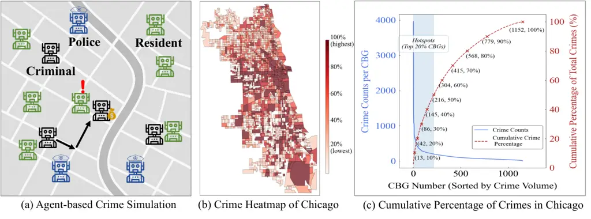

Figure 1: Illustration of problem and hotspot definitions

Crime Records and Hotspot Identification. Ground-truth crime data is
sourced from official open-data portals. For example, the data of
Chicago is from the official data portal¹¹ 1
https://data.cityofchicago.org/, which includes timestamped incident
reports with geographic coordinates and crime categories. To enable
evaluation and visualization, we aggregate crime events over a given
period to construct spatial crime distributions. As illustrated in
Figure 1b (spatial crime distribution) and Figure 1c (cumulative crime
coverage), crime incidents are highly spatially concentrated. In
Chicago, approximately 50% of crimes occur within just 20% of the CBGs,
indicating the existence of distinct crime hotspots. We formally define
the crime hotspots as follows:

###### Definition 1 (Crime Hotspots)

Let $`\mathcal{C}=\{(g_{i},t_{i})\}`$ denote the set of crime events,
where each crime occurs at grid $`g_{i}\in\mathcal{G}`$ and time
$`t_{i}`$. For a fixed time window, we compute the total crime count
$`c(g)`$ for each grid $`g`$. Sorting $`\{c(g)\}`$ in descending order,
we define the top $`\alpha\%`$ of grids that cumulatively account for
$`\beta\%`$ of all crimes as crime hotspots $`\mathcal{H}`$, with
typical values $`\alpha=20\%`$, $`\beta=50\%`$.

This definition provides an empirical and replicable standard for
hotspot detection, serving as the ground truth for evaluating our
simulation’s predictive accuracy. In this work, we define the top
$`\alpha=20\%`$ CBG in ground truth as crime hotspots.

### 3.3 Evaluation Protocol

The central research problem of this paper is to model and analyze the
spatiotemporal dynamics of urban crime using an agent-based simulation
framework powered by LLMs. The goal is to simulate realistic crime
events $`\mathcal{C}_{\mathrm{sim}}`$, and evaluate how well they
replicate real-world crime patterns $`\mathcal{C}_{\mathrm{real}}`$
across both space and time. Given the simulation process produces a
sequence of crime events
$`\mathcal{C}_{\mathrm{sim}}=\{(t_{i},g_{i})\}`$, where each event is
associated with a grid (CBG) $`g_{i}`$ and time $`t_{i}`$. These events
are aggregated at the grid level and normalized to mitigate biases from
absolute crime volume.

We evaluate the model using three quantitative metrics: Jensen-Shannon
Divergence (JSD), Root Mean Squared Error (RMSE), and Crime Hotspot Hit
Rate (HR@K). JSD and RMSE are used to assess the overall similarity
between the real and simulated crime distribution in terms of divergence
and absolute error. The crime hotspot hit rate is a newly defined metric
inspired by top-$`K`$ accuracy in the recommendation system, and we
define it formally as follows:

###### Definition 2 (Crime Hotspot Hit Rate(HR@K))

Let $`\mathcal{G}`$ be the set of all grid cells, and define
$`\mathcal{H}_{\mathrm{real}}\subset\mathcal{G}`$: the set of real crime
hotspots, defined as the top grids that account for 50% of total
observed crimes (typically the top 20% of CBGs);
$`\mathcal{H}_{\mathrm{sim}}^{(K)}\subset\mathcal{G}`$: the top
$`K\times|\mathcal{H}_{\mathrm{real}}|`$ grids ranked by simulated crime
count. Then the Hit Rate can be defined as:

```math
\mathrm{HR@K}=\frac{|\mathcal{H}_{\mathrm{real}}\cap\mathcal{H}_{\mathrm{sim}}^{(K)}|}{|\mathcal{H}_{\mathrm{real}}|} \tag{3}
```

We report results under multiple values of $`K`$ (e.g., 1.0, 1.5,2.0) to
assess the robustness of hotspot prediction under varying recall
thresholds. A higher HR@K indicates stronger alignment between the
simulated and empirical spatial concentration of crimes. These metrics
allow us to systematically evaluate the model’s ability to capture both
broad distributional patterns and localized high-risk areas—crucial for
practical applications such as hotspot policing and urban planning.

## 4 CrimeMind Framework

### 4.1 Routine Activity Theory-Guided Agentic Architecture

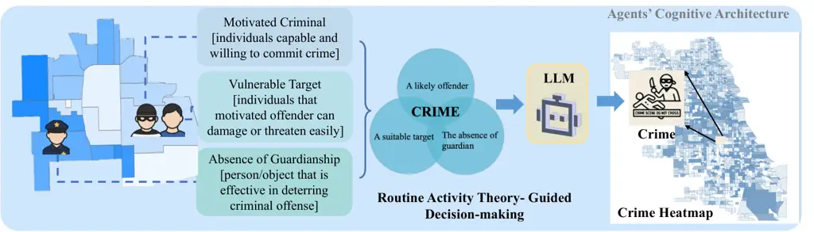

Figure 2: Routine Activity Theory-Guided Agentic Architecture

Our framework, CrimeMind, leverages theory-grounded LLM agents embedded
in an agent-based simulation to model and predict urban crime. Inspired
by the Routine Activity Theory (RAT \[11\], we design LLM-powered agents
whose decision-making is guided by three core components: (1) the
motivation of the offender, (2) the vulnerability of the target, and (3)
the absence of capable guardianship. These elements are encoded into a
structured reasoning pipeline that enables transparent, interpretable,
and context-aware crime simulations. Each agent (citizen, criminal, or
police) operates within a grid-based urban environment, where each cell
corresponds to a Census Block Group. Agent mobility follows an
Exploration and Preferential Return (EPR) process \[32\], approximating
realistic human movement across urban areas. At each simulation step, a
criminal agent evaluates its intent to commit a crime based on the
RAT-aligned cognitive architecture.

Specifically, motivation is derived from an agent’s static profile
(e.g., socio-economic attributes) and dynamic behavioral history (e.g.,
prior successes or failures in committing crimes). Target vulnerability
is assessed when encountering citizen agents, factoring in demographic
attributes and multimodal environmental information—such as census data
and street-level imagery. Visual cues are processed by a Vision-Language
Model (VLM), which generates semantic summaries of environment.
Guardianship is captured by the presence and proximity of nearby police
agents, as well as the perceived safety of the surrounding area,
quantified by a VLM-predicted visual safety score.

These RAT components are fused into a structured prompt that is passed
to the LLM-based criminal agent. The LLM returns both a binary crime
decision and a natural language justification, which enables
interpretability and supports counterfactual interventions (e.g.,
increasing patrol density or altering the visual appearance of a
street). This architecture, as illustrated in Figure 2, is modular and
extensible, and, to our knowledge, represents the first integration of
RAT into the cognitive reasoning pipeline of LLM-based generative agents
for crime simulation.

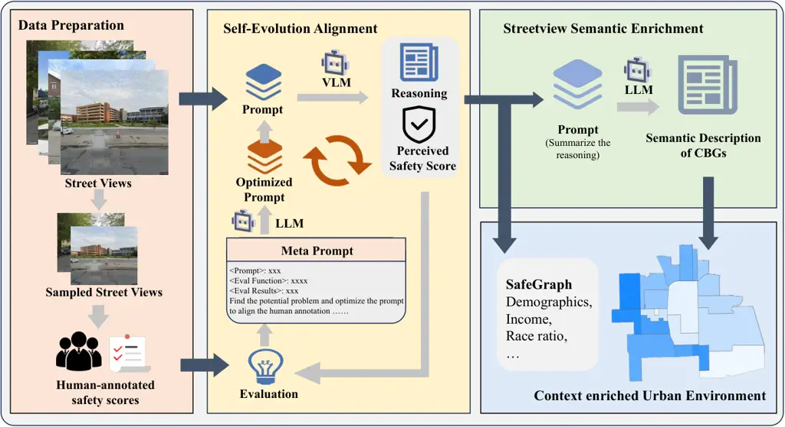

Figure 3: Knowledge Guided Agentic Workflow for Urban Environment
Construction

### 4.2 Mutli-modal Urban Cues Perception

To enable interpretable and theory-informed decision-making within LLM
agents, we construct a urban environment that integrates multi-modal
urban features perception at the CBG level. This design aligns with
Routine Activity Theory (RAT), which emphasizes the importance of
environmental cues and socio-spatial context in shaping crime behavior.

We begin by collecting structured data from SafeGraph and the U.S.
Census, encompassing features such as population demographics, POI
density, and average income. These attributes capture key aspects of
neighborhood vulnerability and social structure, directly informing the
RAT components of suitable targets and offender motivation.

Moreover, RAT highlights the role of perceived guardianship—often
conveyed through the visual character of a place. To model this
perceptual aspect, we collect Google Street View (GSV) images across
each CBG and apply a VLM (Qwen2.5-VL-72B) to estimate perceived safety.
Using carefully designed prompts, the model produces both numerical
safety scores and qualitative descriptors for each image. To move beyond
isolated visual cues toward a more comprehensive environmental
understanding, we aggregate these outputs with a larger language model
(Qwen2.5-72B), which generates high-level textual summaries for each
CBG. These summaries reflect collective impressions—such as
“well-maintained,” “dim lighting,” or “visible neglect”—that capture
ambient perceptions of safety and aesthetic quality, influencing both
criminal and civilian decision-making.

By integrating structured socio-demographic features with these
perceptual and semantic cues, we construct a rich, multimodal
representation of environment. This enables CrimeMind to reason over
both factual and experiential aspects of space, producing more realistic
and interpretable behavior.

### 4.3 Human Judgment Alignment

Perceptions of environmental safety are inherently subjective and
cognitively complex. However, such perceptions play a critical role in
shaping the decision-making processes guided by RAT. To ensure that our
agents’ understanding of visual environments reflects human intuition,
we adopt a training-free alignment method that calibrates the outputs of
a vision-language model (VLM) to human judgments. Figure 3 illustrates
the complete knowledge-guided alignment workflow.

Human annotation. We begin by collecting GSV images sampled from across
each CBG. A subset of these images is then evaluated by human
annotators, who rate the perceived safety using a three-point ordinal
scale. To enhance consistency and reduce individual bias, we employ a
comparative annotation strategy: annotators are shown triplets of images
and asked to rank them from most to least safe. The final scores are
aggregated by averaging across multiple comparisons, resulting in a
high-quality, human-grounded reference dataset.

Self-evolution alignment workflow. We begin with a moderate alignment
between VLM-predicted safety scores and human ratings (Pearson
$`r=0.42`$). To improve this alignment, we implement a self-evolving
prompt refinement process. A stronger LLM (GPT-4o) is provided with the
current prompt, sample outputs, and alignment metrics, and iteratively
proposes revised prompts and scoring criteria to better reflect human
perception. This iterative process continues until convergence is
achieved, at which point the optimized prompt is used to rescore all
images citywide.

This alignment process ensures that agents’ perception of environmental
safety is not only grounded in visual input, but also reflective of
human judgment, making the crime simulation more realism.

## 5 Experiments

### 5.1 Experimental Setup

We conduct extensive experiments to evaluate the effectiveness of our
proposed framework and its capacity to generate actionable insights. The
evaluation metrics are defined in Section 3.3. The simulation
environment consists of thousands of CBGs across four cities (Chicago,
New York, Dallas, and Los Angeles), each enriched with demographic,
socioeconomic, and visual features. Agents include 4,000 citizens, 1,000
criminals (aligned with empirical findings suggesting approximately 20%
criminal propensity in populations\[33\]), and 500 police officers,
proportionally distributed across the CBGs. The simulation runs for 50
time steps, producing spatiotemporal sequences of crime events,
aggregated at the CBG level for subsequent analysis.

|             |                    |                     |                     |                     |                    |                           |
| ----------- | ------------------ | ------------------- | ------------------- | ------------------- | ------------------ | ------------------------- |
| City        | Methods            | HR@1.0 $`\uparrow`$ | HR@1.5 $`\uparrow`$ | HR@2.0 $`\uparrow`$ | JSD $`\downarrow`$ | RMSE(E-04) $`\downarrow`$ |
| Chicago     | ABM-Random         | 0.2851              | 0.4027              | 0.4796              | 0.2066             | 5.60                      |
|             | ABM-Routine \[6\]  | 0.4208              | 0.5068              | 0.6154              | 0.0916             | 3.50                      |
|             | ABM-Hotspot \[15\] | 0.4072              | 0.4932              | 0.6109              | 0.0774             | 2.80                      |
|             | ABM-Burglary \[5\] | 0.4217              | 0.5542              | 0.6607              | 0.1268             | 4.00                      |
|             | DL-UVI \[34\]      | 0.3057              | 0.4672              | 0.5982              | 0.2521             | 7.00                      |
|             | LLM-CrimeMind      | 0.5221              | 0.6239              | 0.7157              | 0.0838             | 1.62                      |
| Dallas      | ABM-Random         | 0.2465              | 0.3522              | 0.4307              | 0.2180             | 19.5                      |
|             | ABM-Routine        | 0.2564              | 0.3077              | 0.3675              | 0.2052             | 19.2                      |
|             | ABM-Hotspot        | 0.3162              | 0.4701              | 0.5556              | 0.2121             | 18.0                      |
|             | ABM-Burglary       | 0.2735              | 0.3761              | 0.4615              | 0.3427             | 101                       |
|             | DL-UVI             | 0.3504              | 0.5128              | 0.5897              | 0.2642             | 19.8                      |
|             | CrimeMind          | 0.4749              | 0.5517              | 0.6375              | 0.0887             | 18.5                      |
| Los Angeles | ABM-Random         | 0.2629              | 0.3741              | 0.4307              | 0.1298             | 5.88                      |
|             | ABM-Routine        | 0.2644              | 0.3830              | 0.4681              | 0.0874             | 2.73                      |
|             | ABM-Hotspot        | 0.2705              | 0.3647              | 0.4590              | 0.0765             | 2.22                      |
|             | ABM-Burglary       | 0.2340              | 0.2340              | 0.2340              | 0.6514             | 72.1                      |
|             | DL-UVI             | 0.2979              | 0.4134              | 0.4894              | 0.2190             | 2.72                      |
|             | CrimeMind          | 0.4053              | 0.4962              | 0.5568              | 0.1022             | 2.43                      |
| New York    | ABM-Random         | 0.2224              | 0.3274              | 0.4258              | 0.4035             | 25.4                      |
|             | ABM-Routine        | 0.3287              | 0.3986              | 0.5035              | 0.3634             | 22.9                      |
|             | ABM-Hotspot        | 0.2238              | 0.3287              | 0.4336              | 0.3897             | 24.0                      |
|             | ABM-Burglary       | 0.2587              | 0.3706              | 0.5035              | 0.2894             | 18.1                      |
|             | DL-UVI             | 0.3007              | 0.3636              | 0.4126              | 0.7188             | 12.8                      |
|             | CrimeMind          | 0.3776              | 0.4425              | 0.5164              | 0.1750             | 15.3                      |

- •
  $`\uparrow`$ indicates higher is better; $`\downarrow`$ indicates
  lower is better.

Table 1: Overall performance in simulating spatial crime patterns.

### 5.2 Overall Performance

We begin by evaluating CrimeMind on the city of Chicago, using
Qwen2.5-7B-Instruct as the decision-making engine. We compare against a
diverse set of baselines. The Random baseline represents the lower bound
with uniformly distributed decisions. The ABM series includes
representative agent-based crime models that follow rule-driven
behaviors\[5, 15, 6\]. UVI is a vision-based method that leverages
segmented street view features to regress CBG-level crime rates \[34\].

As shown in Table 1, CrimeMind outperforms all baselines across all
metrics. In Chicago, it achieves the highest HR@2.0 (0.7157), indicating
stronger top-k hotspot alignment, and yields the lowest JSD (0.0838) and
RMSE (1.62E-04), reflecting accurate crime distribution modeling at the
CBG level. Among traditional ABMs, ABM-Burglary shows relatively better
HR@2.0 (0.6607) but suffers from higher JSD, revealing less stable
spatial modeling. The vision-based UVI model underperforms in both
spatial and numerical metrics, highlighting the limitations of static
perception-based estimation in complex urban crime dynamics. To examine
generalizability, we extend our experiments to three additional U.S.
cities: New York, Dallas, and Los Angeles. CrimeMind consistently
achieves strong performance in all cities, maintaining high hotspot hit
rates and low spatial divergence. For instance, in Dallas, CrimeMind
achieves HR@2.0 of 0.6375 and JSD of 0.0887, outperforming all other
baselines. Even in structurally diverse cities like New York, the
framework achieves competitive results (HR@2.0 = 0.5164, JSD = 0.1750),
validating its robustness.

These results collectively demonstrate that CrimeMind not only excels in
simulating fine-grained spatial crime patterns in a single city but also
generalizes effectively across different urban environments. Its ability
to integrate multimodal context with LLM-based reasoning offers a
significant advancement over traditional rule-based or perception-based
methods in crime modeling. The ablation study in Appendix A.1.1
demonstrates that each module contributes to CrimeMind’s success. The
combination of decision-theoretic modeling (via RAT), multi-modal urban
context, and LLM reasoning provides a comprehensive foundation for
accurate spatial crime simulation.

### 5.3 Evaluation of Perceived Safety Alignment

We evaluate the alignment between model-predicted safety scores and
human perception using a dataset of 100 street view images, each rated
by ten annotators on a three-point safety scale. The averaged scores are
normalized and discretized into 20 safety levels. Human ratings exhibit
high internal consistency (Cronbach’s alpha = 99.26%). The dataset is
split 7:3 for training and evaluation. Initial predictions from the VLM
using a handcrafted prompt yield a Pearson correlation of 0.42 with
human labels. Through iterative prompt optimization, guided by GPT-4o,
using alignment metrics and scoring samples, the correlation improves
substantially to 0.79 after several rounds, as shown in Appendix Figure
7, demonstrating enhanced alignment with human perception.

After convergence, we apply the optimized prompt citywide to estimate
perceived safety for all images. For each CBG, we compute the average
scores and generate corresponding semantic summaries. These outputs
serve as contextual inputs in the simulation. As shown in Table 2 in our
ablation study, removing perceived safety signals leads to a substantial
drop in HR@2.0 and increases in JSD and RMSE, underscoring their
importance for modeling realistic spatial crime patterns.

### 5.4 Counterfactual Analysis

To see whether CrimeMind can reflect realistic shifts in crime
distribution given new socio-political contexts, we conducted
simulations in two representative scenarios: (i) external shocks (e.g.,
BLM protests) and (ii) policy interventions (e.g., Dallas Violent Crime
Reduction Plan, 2020).

External Shocks: Black Lives Matter (BLM) Protests. We simulate crime
dynamics under external shocks that disrupt routine urban patterns,
using the 2020 Black Lives Matter (BLM) protests in Chicago as a case
study. Real-world data show a notable surge in violent crime during the
protest period (Figure 9). To replicate this, we introduce
counterfactual conditions into the LLM agents’ cognitive prompts, which
describe the August 2020 BLM protest scenario, highlighting aspects such
as heightened social tensions and protest activities. These contextual
modifications aim to assess whether LLM-driven agents adapt their
decisions under such socio-environmental disruptions. We evaluate the
simulation against real crime data from August 2020, with a focus on
whether the model captures known shifts, such as the emergence of
temporary crime hotspots.

Figure 4a illustrates how the BLM context influences the core components
of decision-making under RAT. As shown in Figure 4b, incorporating BLM
context improves hotspot prediction accuracy (HR@1.0 increases from
0.4257 to 0.4478) and spatial distribution fidelity (JSD decreases from
0.0776 to 0.0672). Most notably, the model more accurately identifies
new, short-term hotspots observed during the protests (New Hotspot
Concordance increases from 0.4902 to 0.5490).

Policy Intervention: Police Redistribution Plan in Dallas. We further
examine CrimeMind’s use for policy evaluation by simulating the effects
of the “Violent Crime Reduction Plan” introduced by Dallas Mayor Eric
Johnson in 2020. This real-world initiative prioritized reallocating
police presence to high-crime areas and targeting repeat offenders. In
our simulation, we operationalized this by: (1) implementing dynamic
"hot spots policing," where police agents’ patrolling logic was altered
from random routes to assignments based on simulated real-time crime
counts, thereby increasing police presence in higher-crime CBGs; and (2)
incorporating a mechanism for offender removal, where the top 10 most
active criminal agents were arrested at each step in the simulation.

Results in Figure 4c show a substantial reduction in overall crime (from
7926 to 5218 incidents), and a sharper decline in hotspot crime (from
4113 to 2101), leading to a reduced hotspot crime ratio (from 0.5189 to
0.4026). Furthermore, when evaluating the model’s hotspot predictions
against actual crime data from Dallas for the 2021-2024 period
(representing a post-policy implementation timeframe), the HR@1.0
improved from 0.4639 to 0.5015. Other distributional metrics also showed
positive changes, with JSD decreasing from 0.0823 to 0.0658 and RMSE
falling from 0.00192 to 0.00148. These improvements demonstrate that
CrimeMind is capable of simulating the reasonably long-term effects of
policies that involve strategic resource deployment.

These experiments highlight a key contribution of CrimeMind: it
facilitates counterfactual reasoning and scenario-based evaluation of
external shocks and policy interventions. Unlike traditional ABMs with
static rules, our LLM-powered agents dynamically adapt behaviors to
varying conditions, enabling deeper exploration of "what-if" scenarios
in urban criminology and policy analysis.

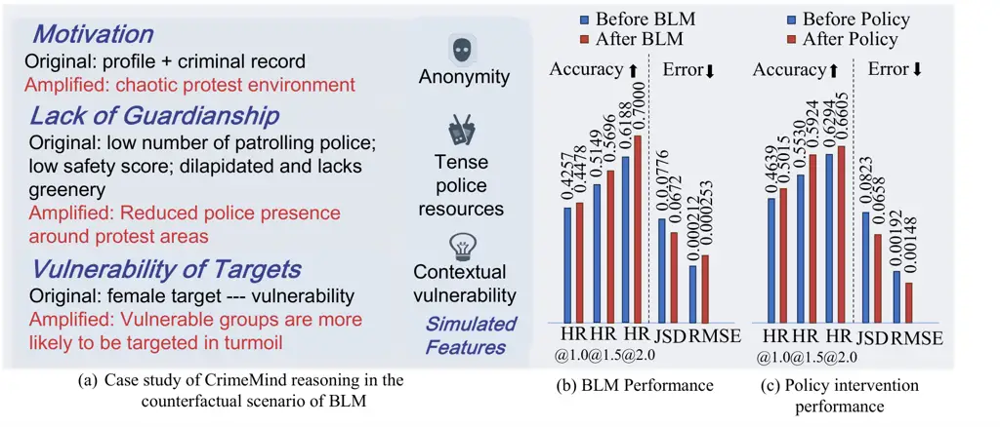

Figure 4: The counterfactual results of BLM and Policy intervention.

## 6 Conclusion

We propose CrimeMind, a novel LLM-based framework for simulating spatial
crime patterns by combining criminological theory, structured urban
data, and unstructured perceptual cues. Our self-alignment pipeline
effectively bridges human-perceived safety and agent reasoning,
improving decision realism. Experiments show that CrimeMind outperforms
traditional agent-based models and deep learning baselines across
multiple U.S. cities in both spatial accuracy and hotspot prediction.
Ablation studies underscore the importance of theory-informed reasoning,
multimodal context, and LLM capabilities. The framework also supports
counterfactual simulation and policy evaluation, providing an evaluation
tool for safety planning and crime prevention. A limitation lies in our
current use of EPR-based (non-LLM) mobility modeling, which we plan to
enhance in future work.

## References

- \[1\] Elizabeth R Groff, Shane D Johnson, and Amy Thornton. State of
  the art in agent-based modeling of urban crime: An overview. Journal
  of Quantitative Criminology, 35:155–193, 2019.
- \[2\] Nikhil Naik, Jade Philipoom, Ramesh Raskar, and César Hidalgo.
  Streetscore-predicting the perceived safety of one million
  streetscapes. In Proceedings of the IEEE conference on computer vision
  and pattern recognition workshops, pages 779–785, 2014.
- \[3\] Victor Rotaru, Yi Huang, Timmy Li, James Evans, and Ishanu
  Chattopadhyay. Event-level prediction of urban crime reveals a
  signature of enforcement bias in us cities. Nature human behaviour,
  6(8):1056–1068, 2022.
- \[4\] Shuliang Wang, Xinyu Pan, Sijie Ruan, Haoyu Han, Ziyu Wang,
  Hanning Yuan, Jiabao Zhu, and Qi Li. Diffcrime: A multimodal
  conditional diffusion model for crime risk map inference. In
  Proceedings of the 30th ACM SIGKDD Conference on Knowledge Discovery
  and Data Mining, pages 3212–3221, 2024.
- \[5\] Nick Malleson, Alison Heppenstall, and Linda See. Crime
  reduction through simulation: An agent-based model of burglary.
  Computers, environment and urban systems, 34(3):236–250, 2010.
- \[6\] Haojie Zhu and Fahui Wang. An agent-based model for simulating
  urban crime with improved daily routines. Computers, Environment and
  Urban Systems, 89:101680, 2021.
- \[7\] Murray Shanahan, Kyle McDonell, and Laria Reynolds. Role play
  with large language models. Nature, 623(7987):493–498, 2023.
- \[8\] Nian Li, Chen Gao, Mingyu Li, Yong Li, and Qingmin Liao.
  Econagent: large language model-empowered agents for simulating
  macroeconomic activities. arXiv preprint arXiv:2310.10436, 2023.
- \[9\] Gordon Dai, Weijia Zhang, Jinhan Li, Siqi Yang, Srihas Rao,
  Arthur Caetano, Misha Sra, et al. Artificial leviathan: Exploring
  social evolution of llm agents through the lens of hobbesian social
  contract theory. arXiv preprint arXiv:2406.14373, 2024.
- \[10\] Jinghua Piao, Zhihong Lu, Chen Gao, Fengli Xu, Fernando P
  Santos, Yong Li, and James Evans. Emergence of human-like polarization
  among large language model agents. arXiv preprint
  arXiv:2501.05171, 2025.
- \[11\] Fernando Miró. Routine activity theory. The encyclopedia of
  theoretical criminology, pages 1–7, 2014.
- \[12\] Mert Yuksekgonul, Federico Bianchi, Joseph Boen, Sheng Liu, Pan
  Lu, Zhi Huang, Carlos Guestrin, and James Zou. Optimizing generative
  ai by backpropagating language model feedback. Nature,
  639(8055):609–616, 2025.
- \[13\] Karabo Jenga, Cagatay Catal, and Gorkem Kar. Machine learning
  in crime prediction. Journal of Ambient Intelligence and Humanized
  Computing, 14(3):2887–2913, 2023.
- \[14\] John Scott et al. Rational choice theory. Understanding
  contemporary society: Theories of the present, 129:126–138, 2000.
- \[15\] David Weisburd, Anthony A Braga, Elizabeth R Groff, and Alese
  Wooditch. Can hot spots policing reduce crime in urban areas? an
  agent-based simulation. Criminology, 55(1):137–173, 2017.
- \[16\] Fengli Xu, Qianyue Hao, Zefang Zong, Jingwei Wang, Yunke Zhang,
  Jingyi Wang, Xiaochong Lan, Jiahui Gong, Tianjian Ouyang, Fanjin Meng,
  et al. Towards large reasoning models: A survey of reinforced
  reasoning with large language models. arXiv preprint
  arXiv:2501.09686, 2025.
- \[17\] Chenyang Shao, Fengli Xu, Bingbing Fan, Jingtao Ding, Yuan
  Yuan, Meng Wang, and Yong Li. Chain-of-planned-behaviour workflow
  elicits few-shot mobility generation in llms. arXiv preprint
  arXiv:2402.09836, 2024.
- \[18\] Joon Sung Park, Carolyn Q. Zou, Aaron Shaw, Benjamin Mako Hill,
  Carrie Cai, Meredith Ringel Morris, Robb Willer, Percy Liang, and
  Michael S. Bernstein. Generative agent simulations of 1,000
  people, 2024.
- \[19\] Onder Gurcan. Llm-augmented agent-based modelling for social
  simulations: Challenges and opportunities, 2024.
- \[20\] Luke Hewitt, Ashwini Ashokkumar, Isaias Ghezae, and Robb
  Willer. Predicting results of social science experiments using large
  language models. Preprint, 2024.
- \[21\] Bingbing Fan, Lin Chen, Songwei Li, Jian Yuan, Fengli Xu, Pan
  Hui, and Yong Li. Invisible walls in cities: Leveraging large language
  models to predict urban segregation experience with social media
  content. arXiv preprint arXiv:2503.04773, 2025.
- \[22\] Yuwei Yan, Qingbin Zeng, Zhiheng Zheng, Jingzhe Yuan, Jie Feng,
  Jun Zhang, Fengli Xu, and Yong Li. Opencity: A scalable platform to
  simulate urban activities with massive llm agents. arXiv preprint
  arXiv:2410.21286, 2024.
- \[23\] Yuwei Yan, Yu Shang, Qingbin Zeng, Yu Li, Keyu Zhao, Zhiheng
  Zheng, Xuefei Ning, Tianji Wu, Shengen Yan, Yu Wang, et al.
  Agentsociety challenge: Designing llm agents for user modeling and
  recommendation on web platforms. In Companion Proceedings of the ACM
  on Web Conference 2025, pages 2963–2967, 2025.
- \[24\] Lin Chen, Fengli Xu, Nian Li, Zhenyu Han, Meng Wang, Yong Li,
  and Pan Hui. Large language model-driven meta-structure discovery in
  heterogeneous information network. In Proceedings of the 30th ACM
  SIGKDD Conference on Knowledge Discovery and Data Mining, pages
  307–318, 2024.
- \[25\] Tong Li, Shiduo Xin, Yanxin Xi, Sasu Tarkoma, Pan Hui, and Yong
  Li. Predicting multi-level socioeconomic indicators from structural
  urban imagery. In Proceedings of the 31st ACM international conference
  on information & knowledge management, pages 3282–3291, 2022.
- \[26\] Jian-gang Shi, Wei Miao, and Hongyun Si. Visualization and
  analysis of mapping knowledge domain of urban vitality research.
  Sustainability, 11(4):988, 2019.
- \[27\] Yang Zhang, Xiangyu Dong, Lanyu Shang, Daniel Zhang, and Dong
  Wang. A multi-modal graph neural network approach to traffic risk
  forecasting in smart urban sensing. In 2020 17th Annual IEEE
  international conference on sensing, communication, and networking
  (SECON), pages 1–9. IEEE, 2020.
- \[28\] Fengli Xu, Qi Wang, Esteban Moro, Lin Chen, Arianna
  Salazar Miranda, Marta C González, Michele Tizzoni, Chaoming Song,
  Carlo Ratti, Luis Bettencourt, et al. Using human mobility data to
  quantify experienced urban inequalities. Nature Human Behaviour, pages
  1–11, 2025.
- \[29\] Nikhil Naik, Scott Duke Kominers, Ramesh Raskar, Edward L
  Glaeser, and César A Hidalgo. Computer vision uncovers predictors of
  physical urban change. Proceedings of the National Academy of
  Sciences, 114(29):7571–7576, 2017.
- \[30\] Varun Mandalapu, Lavanya Elluri, Piyush Vyas, and Nirmalya Roy.
  Crime prediction using machine learning and deep learning: A
  systematic review and future directions. Ieee Access,
  11:60153–60170, 2023.
- \[31\] Qingbin Zeng, Qinglong Yang, Shunan Dong, Heming Du, Liang
  Zheng, Fengli Xu, and Yong Li. Perceive, reflect, and plan: Designing
  llm agent for goal-directed city navigation without instructions.
  arXiv preprint arXiv:2408.04168, 2024.
- \[32\] Chaoming Song, Tal Koren, Pu Wang, and Albert-László Barabási.
  Modelling the scaling properties of human mobility. Nature physics,
  6(10):818–823, 2010.
- \[33\] CW Archer. Criminal justice information services division.
  Federal Bureau of Investigation, US Department of Justice (Testimony
  before the Senate Committee on the Judiciary), 1996.
- \[34\] Zhuangyuan Fan, Fan Zhang, Becky PY Loo, and Carlo Ratti. Urban
  visual intelligence: Uncovering hidden city profiles with street view
  images. Proceedings of the National Academy of Sciences,
  120(27):e2220417120, 2023.
- \[35\] Sophie Curtis-Ham, Wim Bernasco, Oleg N. Medvedev, and Devon
  L. L. Polaschek. Relationships between offenders’ crime locations and
  different prior activity locations as recorded in police data. Journal
  of Police and Criminal Psychology, 8 2022.
- \[36\] Wim Bernasco and Richard Block. WHERE OFFENDERS CHOOSE TO
  ATTACK: A DISCRETE CHOICE MODEL OF ROBBERIES IN CHICAGO\*.
  Criminology, 47(1):93–130, 2 2009.
- \[37\] Douglas S. Massey. Getting Away with Murder: Segregation and
  Violent Crime in Urban America. University of Pennsylvania Law Review,
  143(5):1203, 5 1995.
- \[38\] Brendan O’Flaherty and Rajiv Sethi. Crime and segregation.
  Journal of Economic Behavior & Organization, 64(3):391–405, 2007.
  Networks, Aggregation and Markets Conference, Marseilles 20-21 June
  2005, in honor of Alan Kirman.
- \[39\] Lauren J. Krivo, Ruth D. Peterson, and Danielle C. Kuhl.
  Segregation, racial structure, and neighborhood violent crime.
  American Journal of Sociology, 114(6):1765–1802, 5 2009.

## Appendix A Appendix

### A.1 Additional Experiments

#### A.1.1 Ablation Study

To further understand the internal mechanisms driving CrimeMind’s strong
performance, we conduct a detailed ablation analysis in the Chicago
setting. We conduct an ablation study by progressively removing core
inputs from the CrimeMind framework: (i) Routine Activity Theory-based
reasoning, (ii) static urban features, (iii) street-level perceived
safety scores, and (iv) semantic street descriptions.

Effect of RAT-based Reasoning. Removing the RAT module leads to a
noticeable drop in HR@2.0 (from 0.7157 to 0.6222), despite achieving a
little lower JSD. This shows that by incorporating crime theory into the
cognitive architecture, llm agent can make more realistic crime decision
that produces more accurate crime patterns.

Effect of Urban Context Information. We further ablate three types of
urban context: specifically, removing the safety score causes a large
drop in HR@2.0 and increases both JSD and RMSE, indicating the
importance of fine-grained visual perception for crime risk; excluding
semantic descriptions slightly degrades performance, showing that
textual understanding may offer complementary high-level cues; without
static urban features (e.g., demographics), performance drops in all
metrics, showing the role of socio-economic data in modeling
vulnerability and routine patterns. If we exclude all the urban context,
the model still outperforms traditional baselines in HR@2.0,
demonstrating the inherent strength of LLM-based agent reasoning.
However, the performance gap to the full model shows that urban context
is essential for simulating the real-world crime patterns.

Overall, these results demonstrate that each module contributes to
CrimeMind’s success. The combination of decision-theoretic modeling (via
RAT), multi-modal urban context, and LLM reasoning provides a
comprehensive foundation for accurate spatial crime simulation.

|                             |                     |                     |                     |                    |                           |
| --------------------------- | ------------------- | ------------------- | ------------------- | ------------------ | ------------------------- |
| Methods                     | HR@1.0 $`\uparrow`$ | HR@1.5 $`\uparrow`$ | HR@2.0 $`\uparrow`$ | JSD $`\downarrow`$ | RMSE(E-04) $`\downarrow`$ |
| CrimeMind                   | 0.5221              | 0.6239              | 0.7157              | 0.0838             | 1.62                      |
| - w/o RAT Module            | 0.3644              | 0.5022              | 0.6222              | 0.0754             | 4.26                      |
| - w/o All Urban Context     | 0.3925              | 0.5187              | 0.6495              | 0.1302             | 2.13                      |
| - w/o Safety Score          | 0.4652              | 0.5826              | 0.6957              | 0.1603             | 3.41                      |
| - w/o Semantic Descriptions | 0.4820              | 0.5995              | 0.7081              | 0.1286             | 2.93                      |
| - w/o Static Urban Features | 0.4980              | 0.6123              | 0.7102              | 0.0945             | 2.56                      |

Table 2: Ablation studies. Bold indicates the best performance.

|             |                     |                     |                     |                    |                           |
| ----------- | ------------------- | ------------------- | ------------------- | ------------------ | ------------------------- |
|             | HR@1.0 $`\uparrow`$ | HR@1.5 $`\uparrow`$ | HR@2.0 $`\uparrow`$ | JSD $`\downarrow`$ | RMSE(E-04) $`\downarrow`$ |
| Qwen2.5-7B  | 0.5221              | 0.6239              | 0.7157              | 0.0838             | 1.62                      |
| Qwen2.5-32B | 0.5410              | 0.6380              | 0.7203              | 0.0772             | 1.48                      |
| Qwen2.5-72B | 0.5182              | 0.6255              | 0.7189              | 0.0815             | 0.98                      |
| Qwen3-8B    | 0.5570              | 0.6490              | 0.7285              | 0.0691             | 1.32                      |
| LLaMA3-8B   | 0.5406              | 0.6385              | 0.7021              | 0.0746             | 1.42                      |
| LLaMA3-70B  | 0.5605              | 0.6532              | 0.7223              | 0.0685             | 0.80                      |
| GPT4.1-Nano | 0.4589              | 0.5642              | 0.6588              | 0.0943             | 2.24                      |
| GPT4o-mini  | 0.5436              | 0.6178              | 0.7102              | 0.0782             | 1.57                      |

Table 3: Comparison of Different LLMs

#### A.1.2 Effect of LLM Types

To investigate the impact of different large language models on crime
simulation, we substitute the reasoning module in CrimeMind with several
representative LLMs, including variants from the Qwen, LLaMA, and GPT
families. As shown in Table 3, all LLMs exhibit competitive performance,
demonstrating that CrimeMind maintains robust generalization
capabilities across a diverse range of model architectures and scales.
Within the Qwen2.5 series, the performance generally improves with
larger model size, Qwen2.5-32B achieves better HR@2.0 (0.7203) and lower
JSD (0.0772) than Qwen2.5-7B. However, Qwen2.5-72B, despite being the
largest, slightly underperforms on HR@1.0 and JSD, indicating
diminishing returns or increased decision variance at a large scale.
Among all evaluated models, LLaMA3-70B achieves the best overall
performance (HR@1.0 = 0.5605, JSD = 0.0685, RMSE = 0.000080), indicating
both strong local reasoning and high distributional alignment. In
contrast, GPT-4.1-Nano lags behind other models, with notably higher
RMSE and lower hotspot recall, implying weaker alignment with empirical
crime patterns. These findings suggest that while CrimeMind is generally
effective across different LLMs, model choice still influences the
quality of simulation.

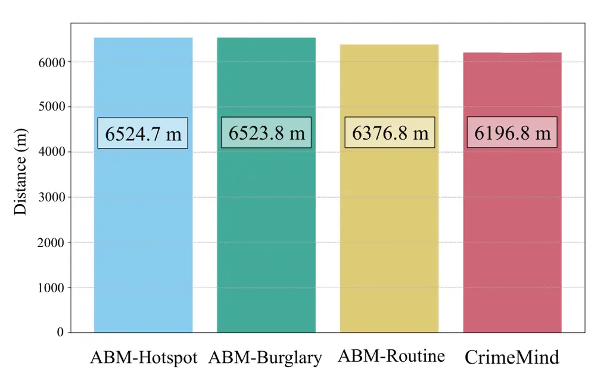

Figure 5: Average distance between crime locations and residences of
criminals in Chicago.

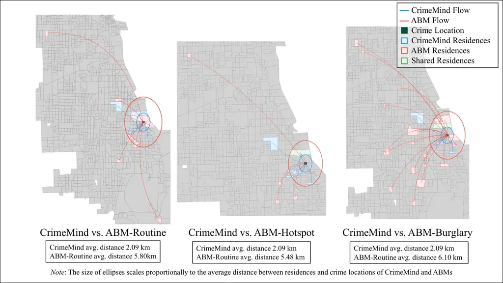

Figure 6: Criminal residences flow in Chicago with different methods for
CBG 170318439005.

#### A.1.3 Case Study on Residential Distribution of Criminals

Research in criminology shows that criminals are usually more likely to
commit crimes near their residences \[35, 36, 37\]. This behavioral
pattern may drive away higher socioeconomic status residents and
ultimately increase the extent of racial segregation or other
socioeconomic segregation \[38, 39\]. As a result, the more severe the
segregation in the residential area is, the higher the violent crime
rate should be.

Heatmap in Figure 10 and experiment results in Table 1 show that
CrimeMind is generally more effective in crime prediction than
traditional ABMs. An obvious trend is observed as demonstrated in Figure
5 that traditional ABMs usually have a longer distance between
residences and crime locations, which indicates that traditional ABMs
fail to support the behavioral patterns in which criminals are more
likely to commit crimes near their residences in comparison with
CrimeMind.

We chose a specific CBG in Chicago for the case study as shown in Figure 6. In this case, the average distance between crime location and the
criminals’ residences of all three ABMs is significantly larger than
that of CrimeMind. The case shows that the criminals of CrimeMind
usually come from the residences closer to the crime location, while the
criminals of traditional ABMs usually have more scattered residences and
spread throughout the entire map of Chicago, and are also farther apart
from the crime location. This reflects that CrimeMind can better display
the segregation phenomenon within the urban environment, while achieving
more accurate predictions on crime and criminals’ trajectories.

### A.2 Supplementary Figures

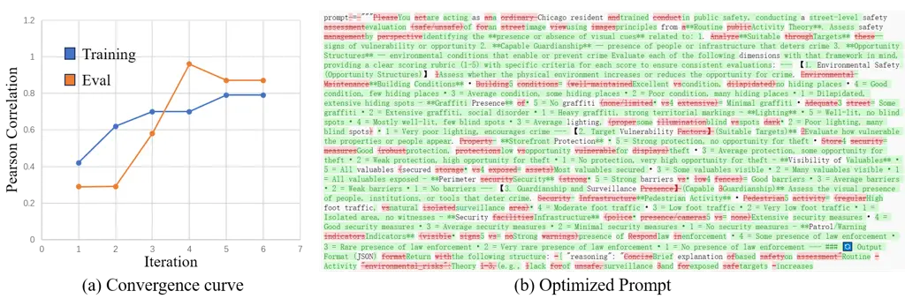

Figure 7: Illustration of the effectiveness of the perceived safety
alignment.

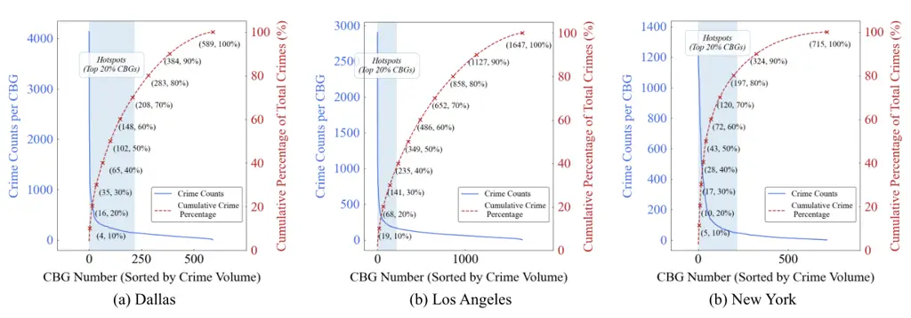

Figure 8: Crime hotspots of each city.

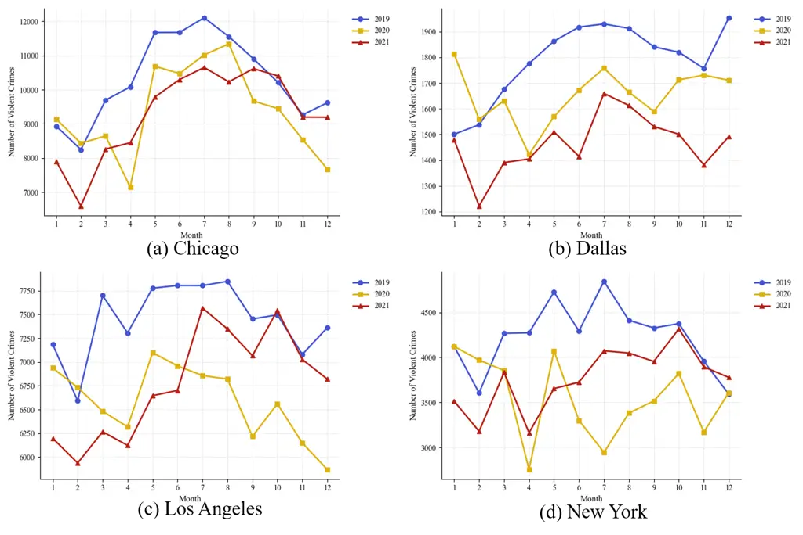

Figure 9: Crime change across time in each city.

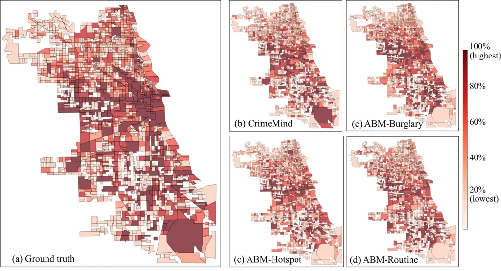

Figure 10: Crime heatmap in Chicago with different methods.

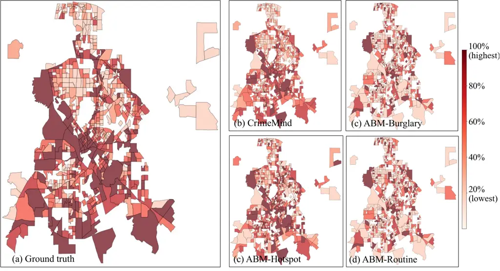

Figure 11: Crime heatmap in Dallas with different methods.

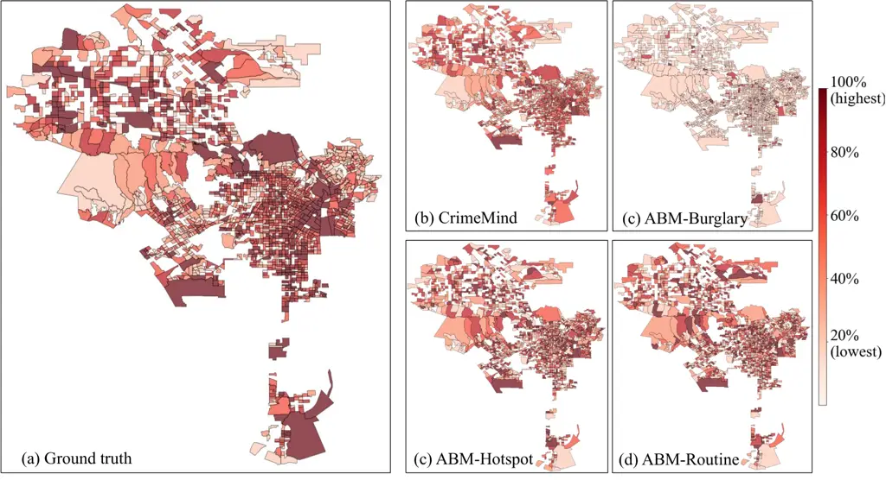

Figure 12: Crime heatmap in Los Angeles with different methods.

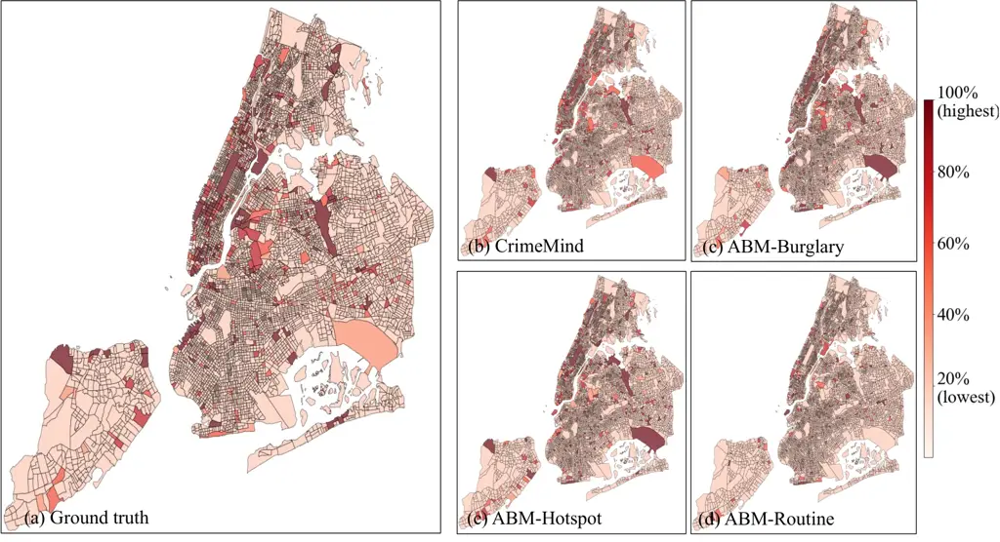

Figure 13: Crime heatmap in New York with different methods.

### A.3 Discussions

#### A.3.1 Limitations

While CrimeMind presents a novel integration of LLM-based agents and
multimodal urban environments for crime simulation, several limitations
remain. First, large language models may introduce potential biases
inherited from pretraining data, which may affect agents’
decision-making in unintended ways, particularly when modeling sensitive
behaviors like crime. To mitigate this, we design prompts that cast the
LLM agent as an expert criminologist reasoning about offenders’
decisions, which helps reduce direct imitation of unethical behavior.
However, this mitigation is imperfect and warrants further exploration,
such as through fine-tuning with domain-specific, ethically aligned
datasets. Also, due to computational constraints, the current simulation
uses a fixed number of agents and discretized time steps. The agent
mobility is modeled using a non-LLM-based exploration model (EPR), which
may limit the agents’ ability to adaptively perceive and respond to
environmental cues in a human-like manner. Enhancing agent mobility with
more dynamic, LLM-informed navigation strategies, especially in complex
urban environments, is an important direction for future work.

#### A.3.2 Code of Ethics

The datasets involved in this work are all open-source, which poses no
problem regarding privacy and copyright. Specifically, street view
images are obtained via the Google Street View API, and crime data is
sourced from official city open data portals. SafeGraph data are
aggregated at the CBG level, ensuring no individual-level or personally
identifiable information is included. We cite the resources in
Section 3.2, and Section 5.1.

#### A.3.3 Broader Impacts

Our method has positive broader impacts. Our method aims to enhance the
realism, interpretability, and adaptability of urban crime simulation
through LLM-driven agents and multimodal environmental context. This can
support city planners, criminologists, and policymakers in evaluating
the impacts of socio-political shocks and public safety interventions.
By grounding agent decision-making in criminological theory and
environmental perception, CrimeMind offers a novel framework for
understanding complex human-environment interactions and crime dynamics
in urban safety.

#### A.3.4 Computational Cost

Our framework relies on querying LLM APIs for agent decision-making,
which constitutes the major computational bottleneck. Specifically, each
criminal agent’s behavior at every time step involves at least one
prompt-response interaction with the LLM, leading to a high volume of
requests in large-scale simulations. Typically, simulating 5,000 agents
over 50 time steps takes about 3 hours to complete (parallelized in
batches of 64 with moderate latency). The cost is primarily time-bound,
as LLM inference via API services is performed off-device and billed by
usage.

### A.4 Prompt Example

#### A.4.1 Prompt for criminal agents

System prompt:

You are an expert criminologist specializing in predicting the
decision-making processes of potential criminal agents. Your task is to
simulate a detailed internal reasoning process for a given criminal
agent(an agent very likely to commit a crime) and context, determining
if the agent will commit a crime. Your response should be ONLY the JSON
object with no additional text preceding or following it. If a crime is
predicted, output: { "status": true, "objective_id": string, (the
agent_id of the target) "reasoning": string } If no crime is predicted,
output: { "status": false, "reasoning": string } "reasoning" should be a
detailed explanation of the decision-making process, including the
factors considered and their implications for the agent’s likelihood to
commit a crime.Remember to output ONLY the JSON with no additional text.

Prompt:

I want you to think step-by-step through the agent’s potential
decision-making process. Consider the following instructions carefully:
\*\*Overall Contextual Information:\*\* The agent is in {city}, the
mayor is {mayor}, and the party is {party}. This political and
administrative context might influence the city’s general approach to
law enforcement and social programs, potentially captured by the
overarching strategy: {strategy}. \*\*Step 1: Analyze Agent’s Motivation
(Likelihood of Intent)\*\* Based on the agent’s attributes, evaluate
their potential motivation to commit a crime."""+f""" - Agent ID:
{criminal\[’agent_id’\]} - Gender: {criminal\[’gender’\]} - Race:
{criminal\[’race’\]} - Residence: {criminal\[’residence’\]} -
Historical Trajectory: {criminal\[’historical_trajectory’\]} (What does
this suggest about their patterns or desensitization to crime?) -
Criminal Records: {criminal\[’criminal_record’\]} (How extensive and
recent is this record? Does it show a pattern of specific crimes? Does
it indicate desperation or opportunism?) - Current Location:
{criminal\[’current_location’\]} (Is this location familiar or
advantageous for criminal activity?) \*Self-Correction/Refinement for
Motivation:\* Are there any conflicting indicators in the agent’s
profile? For example, a long record but a recent positive trajectory, or
vice versa. How does the agent’s profile align with common
criminological theories of motivation (e.g., strain theory, social
learning theory, rational choice theory)? \*\*Step 2: Evaluate Target
Suitability (Opportunity Assessment - Targets)\*\* Consider the provided
potential targets and how they might appear to this specific agent. -
Potential Targets: {target_str} (Describe the nature of these targets.
Are they high-value, low-risk, opportunistic, etc.? Which, if any, would
be most appealing to an agent with the profile from Step 1?)
\*Self-Correction/Refinement for Target Suitability:\* Would all targets
be equally appealing, or does the agent’s historical trajectory or
criminal record suggest a preference for certain types of targets? How
does the agent’s current location relate to these potential targets in
terms of accessibility? \*\*Step 3: Evaluate Absence of Guardianship
(Opportunity Assessment - Environment & Deterrence)\*\* Assess the
perceived risk and ease of committing a crime in the current
environment. - City Description & Environmental Safety Score:
(Implicitly, consider the overall safety and typical guardianship levels
based on the provided CBG attributes). - Police Presence: Number of
Patrolling Police Officers: {police_count} (Is this number high or low
for the area? How visible and active are they likely to be?) - CBG
(Census Block Group) Attributes: - Current CBG Description: {desc} -
Environmental Safety Score(0-1): {score}.Environmental safety score is a
measure of the safety and security of the area, with 0 being very unsafe
& lack of guardianship & suitable for crime, and 1 being very safe &
fully under guardianship & unsuitable for crime. Low environmental
safety score may encourage crime motivation. - Number of POIs:
{len(cbg\[’poi’\])} (Do these POIs increase natural surveillance or
offer more potential targets/cover?) - Total population: {population}
(Does this population density increase anonymity or surveillance?) -
average\\income(\$): {income} (Does this suggest wealth disparity that
might motivate crime, or resources for better security?) -
poverty\\ratio: {poverty_ratio} (Is there economic desperation that
might lower the threshold for criminal behavior?) - housing\\value
(\$):{housing_value} (Does this indicate affluent targets or
well-protected areas?) \*Self-Correction/Refinement for Absence of
Guardianship:\* Are there any CBG attributes that seem contradictory
(e.g., high income but also high crime rate)? How might the agent
interpret these signals? How does the strategy related to the city’s
administration tie into the perceived level of guardianship or
deterrence? \*\*Step 4: Synthesize and Make a Prediction\*\* Now, weigh
the findings from Step 1 (Motivation), Step 2 (Target Suitability), and
Step 3 (Absence of Guardianship). - How strong is the agent’s
motivation? - Are there highly suitable and accessible targets? - Is
the perceived risk of getting caught low enough? - Consider the overall
context: {city}, mayor {mayor}, party {party}, and strategy {strategy}.
Does this overarching context sway the decision? Based on this
synthesis, will the agent likely commit a crime? If yes, which target
(\`objective\\id\`) is the most probable choice given the analysis?
\*\*Step 5: Formulate JSON Output\*\* Based on your detailed
step-by-step reasoning above, construct the JSON output.

#### A.4.2 Prompt for evaluating the perceived score

You are acting as a Chicago resident trained in public safety,
conducting a street-level safety evaluation of an image using principles
from \*\*Routine Activity Theory\*\*. Assess safety by identifying the
\*\*presence or absence of visual cues\*\* related to: 1. \*\*Suitable
Targets\*\* — signs of vulnerability or opportunity 2. \*\*Capable
Guardianship\*\* — presence of people or infrastructure that deters
crime 3. \*\*Opportunity Structures\*\* — environmental conditions that
enable or prevent crime Evaluate each of the following dimensions with
that framework in mind, providing a clear scoring rubric (1-5) with
specific criteria for each score to ensure consistent evaluations: ---
\[1. Environmental Safety (Opportunity Structures)\] Assess whether the
physical environment increases or reduces the opportunity for crime. -
\*\*Building Conditions\*\* • 5 = Excellent condition, no hiding places
• 4 = Good condition, few hiding places • 3 = Average condition, some
hiding places • 2 = Poor condition, many hiding places • 1 =
Dilapidated, extensive hiding spots - \*\*Graffiti Presence\*\* • 5 = No
graffiti • 4 = Minimal graffiti • 3 = Some graffiti • 2 = Extensive
graffiti, social disorder • 1 = Heavy graffiti, strong territorial
markings - \*\*Lighting\*\* • 5 = Well-lit, no blind spots • 4 = Mostly
well-lit, few blind spots • 3 = Average lighting, some blind spots • 2 =
Poor lighting, many blind spots • 1 = Very poor lighting, encourages
crime --- \[2. Target Vulnerability (Suitable Targets)\*\* Evaluate how
vulnerable the properties or people appear. - \*\*Storefront
Protection\*\* • 5 = Strong protection, no opportunity for theft • 4 =
Good protection, low opportunity for theft • 3 = Average protection,
some opportunity for theft • 2 = Weak protection, high opportunity for
theft • 1 = No protection, very high opportunity for theft -
\*\*Visibility of Valuables\*\* • 5 = All valuables secured • 4 = Most
valuables secured • 3 = Some valuables visible • 2 = Many valuables
visible • 1 = All valuables exposed - \*\*Perimeter Security\*\* • 5 =
Strong barriers • 4 = Good barriers • 3 = Average barriers • 2 = Weak
barriers • 1 = No barriers --- \[3. Guardianship and Surveillance
(Capable Guardianship)\*\* Assess the visual presence of people,
institutions, or tools that deter crime. - \*\*Pedestrian Activity\*\* •
5 = High foot traffic, natural surveillance • 4 = Moderate foot traffic
• 3 = Low foot traffic • 2 = Very low foot traffic • 1 = Isolated area,
no witnesses - \*\*Security Infrastructure\*\* • 5 = Extensive security
measures • 4 = Good security measures • 3 = Average security measures •
2 = Minimal security measures • 1 = No security measures -
\*\*Patrol/Warning Indicators\*\* • 5 = Strong presence of law
enforcement • 4 = Some presence of law enforcement • 3 = Rare presence
of law enforcement • 2 = Very rare presence of law enforcement • 1 = No
presence of law enforcement --- \### Output Format (JSON) Return the
following structure: { "reasoning": "Brief explanation based on Routine
Activity Theory (e.g., lack of surveillance and exposed targets
increases risk)", "environmental_safety_score": 1-5,
"vulnerability_safety_score": 1-5, "surveillance_safety_score": 1-5,
"overall_safety_score": 1-5 } Only use what is clearly visible in the
image. If a feature is not visible (e.g., police presence), assume it is
absent.
