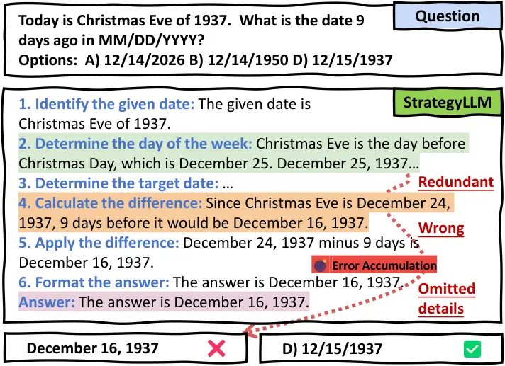
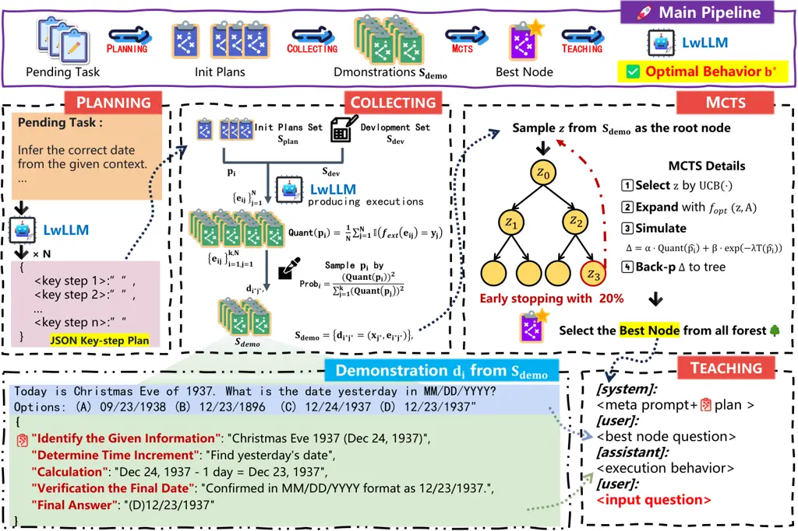

# Direct Behavior Optimization: Unlocking the Potential of Lightweight LLMs

Hongming Yang ^(†)^(†)thanks: Equal contribution Affiliation: Zhejiang
Gongshang University, Hangzhou, China Affiliation: Binjiang Institute of
Zhejiang University, Hangzhou, China Email: <tzoceanyang@gmail.com>   
Shi Lin¹¹footnotemark: 1 Affiliation: Zhejiang Gongshang University,
Hangzhou, China Affiliation: Binjiang Institute of Zhejiang University,
Hangzhou, China Email: <linshizjgsu@gmail.com>    Jun Shao
^(†)^(†)thanks: Corresponding author Affiliation: Zhejiang Gongshang
University, Hangzhou, China Email: <chn.junshao@gmail.com>   
Changting Lin Affiliation: Zhejiang University, Hangzhou, China
Affiliation: GenTel.io, Hangzhou, China Email: <linchangting@gmail.com>
   Donghai Zhu²²footnotemark: 2 Affiliation: Zhejiang Gongshang
University, Hangzhou, China Email: <zhudonghai@zjgsu.edu.cn>    Meng Han
Affiliation: Zhejiang University, Hangzhou, China
Affiliation: GenTel.io, Hangzhou, China Email: <mhan@zju.edu.cn>   
Qinglei Kong Affiliation: Harbin Institute of Technology, Shenzhen,
China Email: <kongqinglei@hit.edu.cn>

###### Abstract

Lightweight Large Language Models (LwLLMs) are reduced-parameter,
optimized models designed to run efficiently on consumer-grade hardware,
offering significant advantages in resource efficiency,
cost-effectiveness, and data privacy. However, these models often
struggle with limited inference and reasoning capabilities, which
restrict their performance on complex tasks and limit their practical
applicability. Moreover, existing prompt optimization methods typically
rely on extensive manual effort or the meta-cognitive abilities of
state-of-the-art LLMs, making them less effective for LwLLMs.

To address these challenges, we introduce DeBoP, a new Direct Behavior
Optimization Paradigm, original from the Chain-of-Thought (CoT)
prompting technique. Unlike CoT Prompting, DeBoP is an automatic
optimization method, which focuses on the optimization directly on the
behavior of LwLLMs. In particular, DeBoP transforms the optimization of
complex prompts into the optimization of discrete, quantifiable
execution sequences using a gradient-free Monte Carlo Tree Search. We
evaluate DeBoP on seven challenging tasks where state-of-the-art LLMs
excel but LwLLMs generally underperform. Experimental results
demonstrate that DeBoP significantly outperforms recent prompt
optimization methods on most tasks. In particular, DeBoP-optimized
LwLLMs surpass GPT-3.5 on most tasks while reducing computational time
by approximately $`60\%`$ compared to other automatic prompt
optimization methods.¹¹ 1 The official implementation of DeBoP is
available at:
[https://github.com/VastOcean-Yang/DeBoP.git](https://github.com/VastOcean-Yang/DeBoP.git).
This work is accepted at ACL 2025.

## 1 Introduction

Large language models (LLMs) have revolutionized the field of natural
language processing, achieving remarkable performance in diverse tasks
such as complex text analysis Wan et al. (2024), advanced mathematical
reasoning Imani et al. (2023), and creative writing Qin et al. (2024).
However, these advancements are accompanied by significant computational
demands, as exemplified by the new LLaMA model, which comprises 405B
parameters Meta (2025). This challenge has driven extensive research
efforts to develop efficient alternatives, leading to the emergence of
lightweight LLMs (LwLLMs) optimized for consumer-grade hardware Wan
et al. (2023). Notably, LwLLMs with 3B-parameter models can operate on
mainstream GPUs like NVIDIA®GeForce RTX 4060 (8GB VRAM). Moreover,
LwLLMs offer enhanced security and compliance over models accessed via
APIs Bommasani et al. (2021), as they operate entirely within the
institution’s internal network. This significantly mitigates the risk of
sensitive data leakage through public networks Wu et al. (2024); Reuters
(2023).

Despite their resource efficiency and enhanced security, LwLLMs often
struggle with advanced inference and multi-step reasoning on complex
tasks Opencompass (2025). One promising solution to this issue is prompt
optimization, which can be broadly classified into manual and automatic
techniques. Manual methods, while effective, require significant human
effort, making them impractical in resource-constrained environments. On
the other hand, automatic methods have broader applicability but often
rely on the meta-cognitive capabilities Flavell (1976) of LLMs, such as
iterative self-reflection Pryzant et al. (2023); Sun et al. (2023),
planning Gao et al. (2023a); Liu et al. (2023b), and detailed reasoning
tracesLiu et al. (2024); Zhou et al. (2024), which LwLLMs struggle to
handle efficiently. More critically, the hierarchical reasoning
structures in these methods can lead to rapid error propagation and
accumulation (as illustrated in Figure 1), which may ultimately degrade
performance to levels even lower than simpler methods, such as Direct
Prompting (see Table 1 for details).



Figure 1: A toy example demonstrating how StrategyLLM Gao et al. (2023a)
fails on LwLLMs. The strategies used by StrategyLLM are highlighted in
blue. Due to the limited reasoning capabilities of LwLLMs, the
accumulation of redundant reasoning, wrong reasoning, and omitted
details leads to an incorrect final answer.

To address these challenges, we in this paper introduce DeBoP, a novel
Direct Behavior Optimization Paradigm, which directly optimizes the
behavior of LwLLMs. Inspired by the experimental results in Table 1,
DeBoP adopts the basic Chain-of-Thought (CoT) prompting Wei et al.
(2022), which involves a series of demonstrations. Furthermore, DeBoP
reformulates the optimization of the behavior of LwLLMs as the
optimization of solutions within the demonstrations. In particular, it
decouples the solution into a structured plan consisting of a series of
key steps and its corresponding execution, then optimizes them by
applying a gradient-free Monte Carlo Tree Search (MCTS). This eliminates
the need for implicit meta-cognitive mechanisms required by existing
optimization methods. Moreover, DeBoP offers the advantage of being
independent of external LLM APIs and eliminates the need for
labor-intensive manual prompt engineering, further highlighting its
applicability.

The contributions of this paper can be summarized as follows. 1) We
propose an automated behavior optimization method tailored for LwLLMs,
significantly expanding the applicability of LLMs in resource- and
security-sensitive settings. 2) We design an external optimizer based on
a gradient-free MCTS framework, which effectively quantifying prompt
design and eliminating the need for advanced meta-cognitive
capabilities. 3) We empirically demonstrate the effectiveness of DeBoP
across several challenging tasks where state-of-the-art LLMs typically
excel Opencompass (2025), and only the combination of LLaMA3-8B and
DeBoP can outperform GPT-3.5 on most tasks while reducing the time
consumption of LwLLMs by approximately $`60\%`$ compared to other
automatic prompt optimization methods.



Figure 2: Overview of the DeBoP framework. As shown in the lower left
corner, the demonstration, which serves as the primary target of our
optimization, consists of a question, a plan, and the corresponding
execution behavior. The "Pending Task" refers to the downstream task
whose performance needs to be optimized for the LwLLM.

## 2 Methodology

As introduced earlier, DeBoP is derived from the CoT Prompting, which
employs a series of demonstrations. In each demonstration, a question is
paired with its corresponding solution that represents the behavior of
the LwLLM. DeBoP focuses on automatically optimizing these solutions and
decomposing each solution into key-step plan and their corresponding
executions. Therefore, DeBoP addresses the generation of key-step plan
and executions, the optimization of the solution, and the instructions
for LwLLMs to execute them. Accordingly, DeBoP consists of four phases:
Planning, Collecting, Mcts  and Teaching. The corresponding high-level
description is given in Fig. 2, and the detailed descriptions of each
phase are provided in Section 2.2.1 through  2.2.4.

### 2.1 Objective and Framework Overview

Our goal is to automatically find an optimal behavior $`b^{*}`$ in the
behavior space $`\mathcal{B}`$ of the LwLLM that maximizes its overall
performance on a development set of $`N`$ input-output pairs, denoted as
$`\mathcal{S}_{\texttt{dev}}=\{(x_{i},y_{i})\}_{i=1}^{N}`$. In our
formulation, the behavior space $`\mathcal{B}`$ is defined as the set of
all possible executable behavior trajectories that the LwLLM can exhibit
when guided by different structured demonstrations.

Each behavior $`b\in\mathcal{B}`$ corresponds to a complete trajectory
of actions or decisions the LwLLM takes in response to a task, which is
instantiated by a structured demonstration $`d_{b}`$. Due to the
combinatorial nature of the action sequences and demonstration
configurations, the space $`\mathcal{B}`$ is intractably large and not
explicitly constructed. Instead, we treat $`\mathcal{B}`$ as an
implicitly searchable space, where promising behaviors can be identified
through guided exploration.

Based on DeBoP, we reformulate the original optimization problem as the
search for a demonstration $`d_{b}`$ that induces a high-performing
behavior $`b`$. The effectiveness of a behavior is evaluated by a
function:

```math
\mathtt{Eval}\bigl(\mathtt{LwLLM}(d_{b}),\mathcal{S}_{\texttt{dev}}\bigr),
```

which measures the LwLLM’s output quality on the development set after
being guided by $`d_{b}`$.

Formally, we aim to identify:

```math
b^{*}=\arg\max_{b\in\mathcal{B}}\mathtt{Eval}\bigl(\mathtt{LwLLM}(d_{b}),\mathcal{S}_{\texttt{dev}}\bigr).
```

To obtain the optimal behavior $`b^{*}`$, as illustrated in Fig. 2, our
framework proceeds in four stages: (1) Planning generates a set of
feasible initial key-step plans $`\mathcal{S}_{\texttt{plan}}`$, where
each plan is encoded in a standardized JSON format to reduce the
complexity of hierarchical reasoning for LwLLMs. (2) Collecting executes
and evaluates these plans on the development set
$`\mathcal{S}_{\texttt{dev}}`$, selecting high-performing demonstrations
to form a seed set $`\mathcal{S}_{\texttt{demo}}`$ for iterative
refinement. (3) Mcts constructs demonstration search forest using
reinforcement learning, specifically, a gradient-free Monte Carlo Tree
Search algorithm, to explore and optimize the solution of the
demonstration. (4) Finally, Teaching applies the best-found
demonstration node to guide the LwLLM via a teaching mechanism, thereby
inducing the optimal behavior $`b^{*}`$.

Further algorithmic and implementation details are provided in the
following sections.

### 2.2 Descriptions of DeBoP

#### 2.2.1 Planning Phase

In this phase, DeBoP aims to generate a set of feasible key-step plans
$`\mathcal{S}_{\texttt{plan}}=\{p_{1},p_{2},\ldots,p_{k}\}`$, where
$`p_{i}`$ has the form

{"\<Key Step 1\>": " ", "\<Key Step2\>": " ", $`\dots`$}

The generation algorithm for these key-step plans consists of two
stages.

In the first stage, we use a universal meta-prompt to guide the LwLLM in
synthesizing task-specific guidelines from a few in-domain examples.
These guidelines are concise, instructive summaries that describe how to
decompose the task into generalizable reasoning steps (e.g., “extract
the reference date” or “subtract a time interval” for DU tasks).
Notably, while the guidelines are tailored to the specific task, the
meta-prompt used to generate them is model-aligned but task-agnostic,
allowing reuse across various domains.

In the second stage, the generated guideline is converted into a
structured, standardized plan in JSON format, with each step represented
as a key mapped to an empty string. This explicit structure simplifies
downstream reasoning for LwLLMs by reducing ambiguity and cognitive
burden. Due to space limitations, the detailed templates are provided in
Appendix A.1.

#### 2.2.2 Collecting Phase

After obtaining the set of key-step plans
$`\mathcal{S}_{\texttt{plan}}`$ from Planning, DeBoP constructs a set
$`\mathcal{S}_{\texttt{demo}}`$ of high performance demonstrations in
the following two stages. In the first stage, we request the LwLLM to
complete the value of each key-step plan $`p_{i}`$ $`(i=1,\cdots,k)`$ on
each $`x_{j}`$ $`(i=1,\cdots,N)`$ in $`\mathcal{S}_{\texttt{dev}}`$,
producing an execution $`e_{ij}`$ with the format

{"\<Key Step 1\>": "\<Execution 1\>",

"\<Key Step 2\>": "\<Execution 2\>",

$`\dots`$      }

The performance of each key-step plan $`p_{i}`$ is then quantified using

```math
\mathtt{Quant}(p_{i})=\frac{1}{N}\sum_{j=1}^{N}\mathbb{I}\Bigl(f_{\texttt{ext}}(e_{ij})=y_{j}\Bigr),
```

where $`f_{\texttt{ext}}`$ is a heuristic function that extracts the
final prediction from $`e_{ij}`$, and $`\mathbb{I}(\star)`$ outputs
$`1`$ if $`\star`$ is True, or 0 otherwise.

In the second stage, we determine the selection probability of each plan
$`p_{i}`$ through a non-linear transformation of the performance
metrics, using

```math
\texttt{Prob}_{i}=\frac{\bigl(\mathtt{Quant}(p_{i}))^{\alpha}}{\sum_{j=1}^{k}(\mathtt{Quant}(p_{j}))^{\alpha}},
```

where $`\alpha=2`$ in our experiments²² 2 we use $`\alpha=2`$ to
slightly amplify the selection pressure in favor of higher-performing
plans. Once a key-step plan $`p_{i^{*}}`$ ($`i^{*}\in\{1,\cdots,k\}`$)
is selected, we randomly chooses a $`j^{*}`$ from $`\{1,\cdots,N\}`$
such that $`f_{\texttt{ext}}(e_{i^{*}j^{*}})=y_{j^{*}}`$ holds. This
results in a selected demonstration
$`d_{i^{*}j^{*}}=(p_{i^{*}},x_{j^{*}},e_{i^{*}j^{*}})`$. Ultimately, the
desired set $`\mathcal{S}_{\texttt{demo}}`$ is constructed as:

```math
\mathcal{S}_{\texttt{demo}}=\{d_{i^{*}j^{*}}=(x_{j^{*}},e_{i^{*}j^{*}})\}.
```

#### 2.2.3 Mcts Phase

In this phase, DeBoP utilizes the demonstrations $`d_{i}`$’s in
$`\mathcal{S}_{\texttt{demo}}`$ from Collecting to identify the possible
optimal demonstration $`d^{\prime}_{b^{*}}`$. Specifically, the possible
optimal demonstration $`d^{\prime}_{b^{*}}`$ is selected from a newly
constructed demonstration forest. In this forest, the root node of each
demonstration tree corresponds to a random demonstration $`d_{i}`$ from
$`\mathcal{S}_{\texttt{demo}}`$, while all other nodes of the tree are
variants of the root node. The process of generating these nodes follows
four stages: Selection, Expansion, Simulation, and Back-propagation, all
of which are adopted from the MCTS framework.

##### Selection.

For a given demonstration tree under construction, we first select a
node $`z^{*}`$ for expansion based on the Upper Confidence Bound
(UCB) Kocsis and Szepesvári (2006). In particular, we select an
unexpanded node $`z^{*}`$ with a breadth-first-search-type method using
the following equation:

```math
z^{*}=\arg\max_{z\in\text{children}(z^{*}_{\texttt{p}})}\left(\frac{Q(z)}{N(z)}+c\sqrt{\frac{2\ln N(z^{*}_{\texttt{p}})}{N(z)}}\right)
```

where $`z^{*}_{\texttt{p}}`$ denotes the parent node of $`z^{*}`$,
children$`(z)`$ represents the set of child nodes of node $`z`$,
$`Q(z)`$ is the accumulated reward of node $`z`$, $`N(z)`$ is the visit
count of node $`z`$, and $`c`$ is an exploration coefficient. Note that
a node is considered unexpanded if it does not have enough child nodes,
and its reward value is initialized to zero, being updated during the
Back-propagation phase.

##### Expansion.

Once an unexpanded node $`z^{*}`$ is selected in stage Selection, we
randomly choose one of the node evolution methods to apply on $`z^{*}`$
in order to obtain a new node $`z`$. This new node $`z`$ is then added
to the tree as the child node of the selected node $`z^{*}`$. The
underlying evolution methods are as follows.

Consolidation: Request the LwLLM to identify key-steps that can be
combined to streamline the reasoning process to improve the coherence.

Decomposition: Request to LwLLM to Identify key-steps that can be
further decomposed to enhance execution ease and accuracy.

Elaboration: Request the LwLLM to expand the reasoning flow to ensure no
missing details of the problem-solving process.

Pruning: Request the LwLLM to dropout the least significant key-step and
its corresponding execution in the demonstration to improve the
efficiency.

Resampling: Request the LwLLM to resample to generate a new
demonstration.

Simplification: Request the LwLLM to simplify and restructure the
reasoning flow to improve the conciseness, coherence, and logical
clarity.

The above procedure can be denoted as $`f_{\texttt{opt}}`$:

```math
z\leftarrow f_{\texttt{opt}}(z^{*},\mathcal{A}),
```

where $`\mathcal{A}`$ represents the set of the six node evolution
methods. Due to the space limitations, detailed prompts for each method
are provided in Appendix A.3.

##### Simulation.

After the new node $`z`$ is added, we request the LwLLM to learn the
corresponding demonstration
$`\hat{d}=(\hat{p}_{i},\hat{x}_{j},\hat{e}_{ij})`$ via a teaching
mechanism (see details of the teaching mechanism in Section 2.2.4).
Following this, we run a process similar to the first stage of
Collecting to obtain $`\mathtt{Quant}(\hat{p}_{i})`$. The only
difference is that the LwLLM now has access to one additional execution
$`\hat{e}_{ij}`$ from the demonstration $`\hat{d}`$, compared to the
process in Collecting.

Finally, we compute the value of $`\Delta`$ for $`\hat{p}_{i}`$ as:

```math
\Delta=\underbrace{\alpha\cdot\mathtt{Quant}(\hat{p}_{i})}_{\text{Execution Accuracy}}+\underbrace{\beta\cdot\exp(-\lambda{T}(\hat{p}_{i}))}_{\text{Time Efficiency}},
```

where $`T(\hat{p}_{i})`$ is the average execution time when using
key-step plan $`\hat{p}_{i}`$ on each $`x_{j}`$ in
$`\mathcal{S}_{\texttt{dev}}`$, and $`\alpha`$, $`\beta`$, and
$`\lambda`$ are hyper-parameters that control the trade-off between
accuracy and temporal efficiency. In our experiment, they are set to 1,
1 and 0.5, respectively.

##### Back-propagation.

In this stage, the value $`\Delta`$ of the node $`z`$ obtained from
stage Simulation will be propagated back up to the root node of the same
tree, and the corresponding visit counts should be also updated
accordingly. These operations can be denoted as:

```math
Q(z^{\prime})\leftarrow Q(z^{\prime})+\Delta,~N(z^{\prime})\leftarrow N(z^{\prime})+1,
```

where $`z^{\prime}`$ is the node along the path from node $`z`$ to the
corresponding root node.

These four stages are typically performed iteratively for a predefined
number of iterations, during which the demonstrations are progressively
updated. However, to enhance computational efficiency, we have
incorporated a probabilistic early termination at each iteration. In our
experiments, the probability of early termination is set to $`20\%`$.
The possible optimal demonstration $`d^{\prime}_{b^{*}}`$ is finally
determined by the node with the highest accumulated reward in the built
forest.

#### 2.2.4 Teaching Phase

After obtaining the possible optimal demonstration
$`d^{\prime}_{b^{*}}=(p^{\prime}_{i},x^{\prime}_{j},e^{\prime}_{i,j})`$,
we integrate it into the conversation history of the LwLLM, as
illustrated in the part of Teaching in Fig. 2. This process effectively
"teaches" the LwLLM by embedding the optimal demonstration, guiding it
to replicate the desired behaviors. By doing so, we ensure that the
LwLLM adheres to high-quality execution patterns that have been proven
effective, while simultaneously accommodating the model’s inherent
reasoning constraints.

## 3 Experiments

|               |         |         |         |         |         |         |         |             |
| ------------- | ------- | ------- | ------- | ------- | ------- | ------- | ------- | ----------- |
|               | PIT     | DU      | SNK     | DQA     | LD      | HB      | MR      | Avg.        |
| DP            | 52 / 44 | 32 / 42 | 49 / 55 | 42 / 30 | 51 / 45 | 76 / 70 | 61 / 52 | 51.9 / 49.4 |
| CoT Prompting | 62 / 69 | 59 / 47 | 68 / 56 | 63 / 49 | 75 / 66 | 95 / 71 | 66 / 51 | 69.7 / 58.1 |
| StrategyLLM   | 32 / 27 | 41 / 28 | 69 / 51 | 63 / 53 | 57 / 38 | 78 / 49 | 60 / 22 | 57.1 / 38.6 |
| Self-Discover | 72 / 43 | 50 / 46 | 53 / 60 | 57 / 43 | 53 / 44 | 63 / 53 | 50 / 42 | 56.9 / 48.7 |
| DeBoP (Ours)  | 83 / 67 | 84 / 74 | 76 / 74 | 70 / 56 | 87 / 74 | 82 / 59 | 74 / 59 | 79.4 / 66.1 |
| GPT-3.5       | 79      | 85      | 67      | 63      | 80      | 86      | 74      | 76.3        |

Table 1: Model accuracy comparison (%) across seven tasks: PIT, DU, SNK,
DQA, LD, HB, and MR. Most of cells in the table display results in the
format "x / y", where "x" represents the performance of LLaMA3-8B and
"y" represents the performance of LLaMA3.2-3B. GPT-3.5 serves as the
reference model. The boldface highlights the best result(s) for each
LwLLM on a given task.

### 3.1 Tasks and Datasets

Language comprehension and complex reasoning are two key aspects used to
evaluate the NLP capabilities of LLMs. Therefore, in our experiments, we
focus on assessing DeBoP’s performance in these two areas. The tasks
selected for evaluation are drawn from BIG-Bench Hard (BBH) Suzgun
et al. (2022), a challenging subset of BIG-Bench tasks Srivastava et al.
(2022). Specifically, the chosen tasks include Snarks (SNK),
Disambiguation QA (DQA), Hyperbaton (HB), Penguins in a Table (PIT),
Data Understanding (DU), Logical Deduction (LD), and Movie
Recommendation (MR). These tasks were selected because they collectively
test both language comprehension (e.g., SNK, DQA, HB) and complex
reasoning abilities (e.g., PIT, DU, LD, MR).

### 3.2 Baseline Methods

To highlight the advantages of DeBoP, we compare it with two categories
of prompt optimization methods: manual and automatic. The manual methods
include Direct Prompting (DP) and CoT Prompting Wei et al. (2022), while
the automatic methods include StrategyLLM Gao et al. (2023a) and
Self-Discover Zhou et al. (2024).

DP is the simplest approach, where the prompt consists of a set of
question-answer pairs without any intermediate reasoning steps. CoT
Prompting Wei et al. (2022) enhances DP by incorporating step-by-step
reasoning within the prompt, enabling multi-step solutions that leverage
the LLM’s reasoning capabilities. StrategyLLM Gao et al. (2023a) takes a
more advanced approach by using four distinct agents—strategy generator,
executor, optimizer, and evaluator—working collaboratively to generate,
evaluate, and select promising strategies for a given task. Similarly,
Self-Discover Zhou et al. (2024) employs a three-phase process,
including Select, Adopt, and Implement, to leverage the capabilities of
LLMs. Further details can be found in Appendix B.

### 3.3 Setting

Our experiments utilize LLaMA3.2-3B Meta (2024b) and LLaMA3-8B Meta
(2024a) as the primary LwLLMs. Furthermore, we used nearly identical
demonstrations for DP and CoT Prompting, with the key difference being
that CoT Prompting includes step-by-step solutions. For DeBoP, we set
five key-step plans for each task and applied temperature sampling
($`\texttt{temp}=0.7`$) for both Planning and Collecting phase. For the
Mcts phase, we employed greedy decoding ($`\texttt{temp}=0`$) and
limited the maximum number of iterations to $`50`$.

All experiments were conducted on a computing system with the following
specifications: an NVIDIA$`\textregistered`$ GeForce
RTX$`\texttrademark`$ 4090 24GB GDDR6X Blower Edition GPU, an
Intel$`\textregistered`$ Xeon$`\textregistered`$ Gold 6148 processor (20
cores, 40 threads, 2.4 GHz base frequency), a Supermicro X11DPG-QT
dual-socket LGA3647 server motherboard, and 32GB of Samsung DDR4-3200
Registered ECC (RDIMM) memory. The result of GPT3.5 was referenced from
Opencompass, 2025

To balance cost and efficiency, we conducted all experiments on a
randomly selected $`50`$-sample subset as $`\mathcal{S}_{\texttt{dev}}`$
and a $`100`$-sample subset as $`\mathcal{S}_{\texttt{test}}`$ from the
original dataset, using a fixed random seed ($`42`$).

|               |      |      |      |      |      |      |      |      |
| ------------- | ---- | ---- | ---- | ---- | ---- | ---- | ---- | ---- |
|               | PIT  | DU   | SNK  | DQA  | LD   | HB   | MR   | Avg. |
| DP            | 6.5  | 5.5  | 2.4  | 2.0  | 3.7  | 4.1  | 3.2  | 3.9  |
| CoT Prompting | 4.3  | 3.4  | 1.4  | 3.4  | 3.9  | 2.4  | 6.9  | 3.7  |
| StrategyLLM   | 5.5  | 11.3 | 13.2 | 11.5 | 14.9 | 11.9 | 23.5 | 13.1 |
| Self-Discover | 14.5 | 12.8 | 10.9 | 8.3  | 13.7 | 18.1 | 18.9 | 13.9 |
| DeBoP (Ours)  | 7.3  | 3.6  | 4.2  | 4.4  | 7.5  | 4.5  | 4.4  | 5.1  |

Table 2: Efficiency comparison (in seconds) for LLaMA3-8B across
different methods.

### 3.4 Results

#### 3.4.1 Model Performance Comparison

The results in Table 1 provide a detailed accuracy comparison of DeBoP
against recent prompt optimization methods across seven tasks (PIT, DU,
SNK, DQA, LD, HB, and MR), as well as GPT-3.5, which serves as a
baseline. DeBoP consistently outperforms the other methods across most
tasks. Notably, the average accuracy of DeBoP with LLaMA3-8B is the
highest among all the methods tested, surpassing GPT-3.5 (76.3%) and
other optimization strategies like CoT Prompting, StrategyLLM, and
Self-Discover. These results demonstrate that DeBoP, through its
key-step planning and optimization via MCTS, achieves superior
performance across multiple tasks compared to other methods. It is also
worth noting that while CoT Prompting achieves the highest accuracy on
the HB task, this success is largely attributed to the use of
meticulously handcrafted prompts.

#### 3.4.2 Efficiency Comparison

Figure 3: Pareto Frontier Analysis.

Table 2 presents an efficiency comparison (in seconds) for LLaMA3-8B
across seven tasks (PIT, DU, SNK, DQA, LD, HB, and MR), as well as the
average inference time for various prompt optimization methods. Manual
prompt optimization methods generally achieve higher efficiency than
automatic ones. However, these efficiency gains come at the cost of
significant manual effort. In contrast, DeBoP demonstrates comparable
efficiency to manual methods while maintaining automation. For instance,
DeBoP completes the DU task in 3.6 seconds, which is close to CoT
Prompting (3.4s) and significantly faster than DP (5.5s). Compared to
other automatic methods, DeBoP reduces the average inference time by
approximately 61% relative to StrategyLLM and 63% relative to
Self-Discover.

Figure 3 further illustrates DeBoP’s performance through a Pareto
Frontier Analysis, balancing accuracy and inference time. The red line
represents the Pareto Frontier, where improving one metric (either
accuracy or inference time) would require sacrificing the other. DeBoP,
marked in the figure, achieves high accuracy ( 80%) while maintaining
relatively low inference time ( 5s), placing it on the Pareto Frontier
as an optimal trade-off between efficiency and accuracy. While CoT
Prompting also lies on the Pareto Frontier, it achieves a lower accuracy
(70%) with a slightly faster inference time (3s). This indicates that
DeBoP is preferable in accuracy-sensitive scenarios.

In summary, DeBoP establishes itself as a highly efficient method,
striking an optimal balance between accuracy and inference time. It not
only surpasses existing automatic methods in efficiency but also
achieves accuracy comparable to or exceeding manual prompt optimization
approaches.

#### 3.4.3 Ablation Study on Individual DeBoP Phase

Figure 4: Ablation study on individual DeBoP phase. P, C, M, and T are
the initials of the Planning, Collecting, Mcts, and Teaching. Due to the
necessity of the C module, we finally design the PC, PCT, and PCMT
settings for these experiments.

Figure 4 illustrates the impact of different combinations of DeBoP
phases (Planning, Collecting, Mcts, and Teaching) on model accuracy for
two LLaMA configurations: LLaMA3-8B (left plot) and LLaMA3.2-3B (right
plot). The plot compares the accuracy across various tasks (PIT, DU,
SNK, and LD) for three settings: PC (Planning+ Collecting), PCT
(Planning+ Collecting+ Mcts+ Teaching), and PCMT (Planning+ Collecting+
Mcts+ Teaching). The results show that PCMT consistently outperforms the
other combinations across all tasks, achieving the highest accuracy for
each task. PCT demonstrates a noticeable improvement over PC for all
tasks, though it still falls short of PCMT. This highlights the crucial
role of Mcts and Teaching  in enhancing the performance of LwLLMs on
complex tasks. The ablation study underscores that incorporating these
phases into the DeBoP framework leads to significant performance
improvements across all tasks.

#### 3.4.4 DeBoP Generalization across LwLLMs

|         | \-      | 8B      | 3B      | GPT-3.5 |
| ------- | ------- | ------- | ------- | ------- |
| 8B      | 52 / 32 | 83 / 84 | 72 / 72 | 53 / 62 |
| 3B      | 44 / 42 | 62 / 55 | 67 / 74 | 40 / 25 |
| GPT-3.5 | 79 / 85 | 81 / 76 | 85 / 75 | 85 / 91 |

Table 3: Model accuracy comparison (%) of DeBoP generalization on tasks:
PIT and DU. "8B" and "3B" refer to LLaMA3-8B and LLaMA3.2-3B,
respectively. Most of cells in the table display results in the format
"x / y", where "x" represents the performance on the PIT task and "y"
represents the performance on the DU task. The LLMs listed in the first
row indicate the LLM used in DeBoP to generate the possible optimal
demonstration, while the LLMs in the first column represent the LLMs
applying DeBoP. The second column denotes that the results are obtained
by the LLMs without DeBoP.

The generalization analysis presented in Table 3 provides key insights
into the effectiveness of DeBoP across different model configurations on
the PIT and DU tasks. Both LLaMA3-8B (denoted as 8B) and LLaMA3.2-3B
(denoted as 3B) show substantial accuracy improvements when applying
DeBoP. Specifically, LLaMA3-8B achieves the highest accuracy of
$`83\%/84\%`$ (PIT/DU) when using demonstrations self-generated.
Similarly, LLaMA3.2-3B reaches $`67\%/74\%`$ when using its own
demonstrations. These results indicate that DeBoP enhances task
performance significantly compared to the baseline performance without
DeBoP, shown in the second column (e.g., $`52\%/32\%`$ for 8B and
$`44\%/42\%`$ for 3B).

GPT-3.5 consistently outperforms the LLaMA models, both with and without
DeBoP, demonstrating its superior generalization capability. Notably,
when applying DeBoP, GPT-3.5 achieves the highest overall accuracy of
$`85\%/91\%`$ using its own demonstrations.

This analysis confirms that DeBoP significantly improves model
performance across tasks while maintaining strong cross-model
generalization. It also underscores the potential of leveraging
demonstrations generated by LwLLMs themselves to boost the accuracy of
smaller models, paving the way for more efficient and scalable prompt
optimization methods.

#### 3.4.5 Single-Demonstration versus Multi-Demonstration Settings

| Task | Method       | Acc. (%) | Time (s) |
| ---- | ------------ | -------- | -------- |
| PIT  | DeBoP        | 83       | 7.3      |
| PIT  | DeBoP-3-shot | 64       | 7.7      |
| DU   | DeBoP        | 84       | 3.6      |
| DU   | DeBoP-3-shot | 66       | 5.4      |

Table 4: Impact of increasing the number of demonstrations.

Table 4 presents the impact of using multiple demonstrations compared to
a single optimized demonstration under the DeBoP framework on two BBH
tasks—PIT and DU. The 3-shot context was constructed by selecting three
correctly executed samples based on the single-demo performance.

Table 4 shows that introducing additional demonstrations leads to a
noticeable degradation in accuracy (–19% on PIT, –18% on DU) while
slightly increasing inference latency. We attribute this to:

Attention dispersion: Longer contexts exacerbate the long-range
dependency limitations of LwLLMs.

Latency overhead: Each additional demonstration increases decoding time,
which is non-trivial for cost-sensitive deployments.

Given the concurrent drop in performance and efficiency, we conclude
that multi-demonstration prompting is _not_ a favourable direction for
DeBoP within the LwLLM setting.

## 4 Related work

### 4.1 Manual Prompt Optimization

The influential chain-of-thought (CoT) prompting method Wei et al.
(2022) has inspired numerous innovative strategies to enhance the
problem-solving capabilities of large language models. One approach
involves using programming languages to explicitly articulate the
reasoning process Chen et al. (2022); Fu et al. (2022); Lyu et al.
(2023), while others represent reasoning through complex structures,
such as forest or graphs Besta et al. (2024); Sel et al. (2023). Some
methods decompose tasks into simpler components, which helps the model
focus on individual subproblems Chen et al. (2023a); Zhou et al. (2022);
Press et al. (2022); Khot et al. (2022). Additionally, techniques have
been developed to incorporate self-correction through automatic feedback
mechanisms Li et al. (2023); Madaan et al. (2024); Miao et al. (2023);
Chen et al. (2023b); Chen et al. (2023c), and some methods combine
multiple prompting strategies to boost performance further Liu et al.
(2023b); Zhou et al. (2025). Despite these advancements, most of these
approaches rely on manually annotated reasoning processes, which limits
their generalizability and flexibility.

### 4.2 Automatic Prompt Optimization

LLMs have demonstrated impressive capabilities, yet challenges remain,
particularly in maintaining long-term coherence Malkin et al. (2021) and
generating multi-step solutions. To address these limitations, two
complementary strategies have emerged: self-reflection and planning.

Self-reflection encourages LLMs to evaluate their own outputs, identify
potential errors, and iteratively refine their responses Pan et al.
(2023); Wang et al. (2023). This introspective approach not only
improves the quality of the generated content but also enables models to
learn from their own mistakes, thereby enhancing performance over time.

On the other hand, planning involves organizing reasoning into a
structured sequence of steps or actions with the goal of achieving a
specific objective Liu et al. (2023a); Gao et al. (2023a). Inspired by
traditional planning algorithms, this approach helps guide models
through complex decision spaces by providing clear, step-by-step
pathways. This can be achieved in several ways, including direct
prompting of the model on planning tasks Kuznia et al. (2022),
translating instructions into executable programs Mishra et al. (2022);
Chen et al. (2022); Gao et al. (2023b), or using search-based techniques
like Monte Carlo Tree Search Pryzant et al. (2023); Wang et al. (2023).

However, most of these methods rely on the meta-cognitive abilities of
state-of-the-art LLMs, which limits their effectiveness when applied to
LwLLMs.

## 5 Conclusion

In this paper, we introduced DeBoP, a new Direct Behavior Optimization
Paradigm that autonomously enhances the performance of LwLLMs for a
given task. We evaluated DeBoP on seven tasks covering both language
comprehension and complex reasoning. The results demonstrate that DeBoP
consistently exhibits strong and efficient performance, revealing novel
optimization methods for LwLLMs. Furthermore, our in-depth analyses
underscore the importance of aligning model capabilities with
optimization strategies when applying DeBoP to LwLLMs. These findings
highlight DeBoP’s potential as an effective framework for improving both
efficiency and accuracy in LwLLMs, paving the way for future
advancements in LwLLMs optimization.

## 6 Limitations

While DeBoP significantly enhances the performance of LwLLMs by
transforming complex prompt optimization into discrete execution
optimization through gradient-free MCTS, several limitations remain. In
particular, the breadth and efficiency of the MCTS expansion process
require further development to fully exploit the potential of this
approach. Moreover, given its ability to improve the performance of
LwLLMs effectively, DeBoP may be vulnerable to misuse by malicious
actors. Future work will focus on refining the MCTS expansion process
and implementing safeguards to mitigate potential abuses.

## Acknowledgements

This research is supported by the National Key R&D Program of China
(Grant No. 2023YFC3304902), the Hangzhou Innovation Team (Grant
No. TD2022011), the National Natural Science Foundation of China (Grant
Nos. 62272413, 62372040, 62202127), and the Tongxiang Institute of
Artificial General Intelligence (Grant No. TAGI2–A–2024–0004).

Jun Shao is also affiliated with the Zhejiang Key Laboratory of Big Data
and Future E-Commerce Technology, Hangzhou, China.

## References

- Besta et al. (2024) Maciej Besta, Nils Blach, Ales Kubicek, Robert
  Gerstenberger, Michal Podstawski, Lukas Gianinazzi, Joanna Gajda,
  Tomasz Lehmann, Hubert Niewiadomski, Piotr Nyczyk, et al. 2024. Graph
  of thoughts: Solving elaborate problems with large language models. In
  _Proceedings of the AAAI Conference on Artificial Intelligence_,
  volume 38, pages 17682–17690.
- Bommasani et al. (2021) Rishi Bommasani, Drew A Hudson, Ehsan Adeli,
  Russ Altman, Simran Arora, Sydney von Arx, Michael S Bernstein,
  Jeannette Bohg, Antoine Bosselut, Emma Brunskill, et al. 2021. On the
  opportunities and risks of foundation models. _arXiv preprint
  arXiv:2108.07258_.
- Chen et al. (2023a) Jiaao Chen, Xiaoman Pan, Dian Yu, Kaiqiang Song,
  Xiaoyang Wang, Dong Yu, and Jianshu Chen. 2023a. Skills-in-context
  prompting: Unlocking compositionality in large language models. _arXiv
  preprint arXiv:2308.00304_.
- Chen et al. (2023b) Pinzhen Chen, Zhicheng Guo, Barry Haddow, and
  Kenneth Heafield. 2023b. Iterative translation refinement with large
  language models. _arXiv preprint arXiv:2306.03856_.
- Chen et al. (2022) Wenhu Chen, Xueguang Ma, Xinyi Wang, and William W
  Cohen. 2022. Program of thoughts prompting: Disentangling computation
  from reasoning for numerical reasoning tasks. _arXiv preprint
  arXiv:2211.12588_.
- Chen et al. (2023c) Xinyun Chen, Maxwell Lin, Nathanael Schärli, and
  Denny Zhou. 2023c. Teaching large language models to self-debug.
  _arXiv preprint arXiv:2304.05128_.
- Flavell (1976) JH Flavell. 1976. Metacognitive aspects of problem
  solving. _The nature of intelligence/Erlbaum_.
- Fu et al. (2022) Yao Fu, Hao Peng, Ashish Sabharwal, Peter Clark, and
  Tushar Khot. 2022. Complexity-based prompting for multi-step
  reasoning. In _The Eleventh International Conference on Learning
  Representations_.
- Gao et al. (2023a) Chang Gao, Haiyun Jiang, Deng Cai, Shuming Shi, and
  Wai Lam. 2023a. Strategyllm: Large language models as strategy
  generators, executors, optimizers, and evaluators for problem solving.
  _arXiv preprint arXiv:2311.08803_.
- Gao et al. (2023b) Luyu Gao, Aman Madaan, Shuyan Zhou, Uri Alon,
  Pengfei Liu, Yiming Yang, Jamie Callan, and Graham Neubig. 2023b. Pal:
  Program-aided language models. In _International Conference on Machine
  Learning_, pages 10764–10799. PMLR.
- Guo et al. (2025) Daya Guo, Dejian Yang, Haowei Zhang, Junxiao Song,
  Ruoyu Zhang, Runxin Xu, Qihao Zhu, Shirong Ma, Peiyi Wang, Xiao Bi,
  et al. 2025. Deepseek-r1: Incentivizing reasoning capability in llms
  via reinforcement learning. _arXiv preprint arXiv:2501.12948_.
- Imani et al. (2023) Shima Imani, Liang Du, and Harsh
  Shrivastava. 2023. Mathprompter: Mathematical reasoning using large
  language models. _arXiv preprint arXiv:2303.05398_.
- Khot et al. (2022) Tushar Khot, Harsh Trivedi, Matthew Finlayson, Yao
  Fu, Kyle Richardson, Peter Clark, and Ashish Sabharwal. 2022.
  Decomposed prompting: A modular approach for solving complex tasks.
  _arXiv preprint arXiv:2210.02406_.
- Kocsis and Szepesvári (2006) Levente Kocsis and Csaba
  Szepesvári. 2006. Bandit based monte-carlo planning. In _European
  conference on machine learning_, pages 282–293. Springer.
- Kuznia et al. (2022) Kirby Kuznia, Swaroop Mishra, Mihir Parmar, and
  Chitta Baral. 2022. Less is more: Summary of long instructions is
  better for program synthesis. _arXiv preprint arXiv:2203.08597_.
- Li et al. (2023) Miaoran Li, Baolin Peng, Michel Galley, Jianfeng Gao,
  and Zhu Zhang. 2023. Self-checker: Plug-and-play modules for
  fact-checking with large language models. _arXiv preprint
  arXiv:2305.14623_.
- Liu et al. (2023a) Bo Liu, Yuqian Jiang, Xiaohan Zhang, Qiang Liu,
  Shiqi Zhang, Joydeep Biswas, and Peter Stone. 2023a. Llm+ p:
  Empowering large language models with optimal planning proficiency.
  _arXiv preprint arXiv:2304.11477_.
- Liu et al. (2024) Shengcai Liu, Caishun Chen, Xinghua Qu, Ke Tang, and
  Yew-Soon Ong. 2024. Large language models as evolutionary optimizers.
  In _2024 IEEE Congress on Evolutionary Computation (CEC)_, pages 1–8.
  IEEE.
- Liu et al. (2023b) Tengxiao Liu, Qipeng Guo, Yuqing Yang, Xiangkun Hu,
  Yue Zhang, Xipeng Qiu, and Zheng Zhang. 2023b. Plan, verify and
  switch: Integrated reasoning with diverse x-of-thoughts. _arXiv
  preprint arXiv:2310.14628_.
- Lyu et al. (2023) Qing Lyu, Shreya Havaldar, Adam Stein, Li Zhang,
  Delip Rao, Eric Wong, Marianna Apidianaki, and Chris
  Callison-Burch. 2023. Faithful chain-of-thought reasoning. _arXiv
  preprint arXiv:2301.13379_.
- Madaan et al. (2024) Aman Madaan, Niket Tandon, Prakhar Gupta, Skyler
  Hallinan, Luyu Gao, Sarah Wiegreffe, Uri Alon, Nouha Dziri, Shrimai
  Prabhumoye, Yiming Yang, et al. 2024. Self-refine: Iterative
  refinement with self-feedback. _Advances in Neural Information
  Processing Systems_, 36.
- Malkin et al. (2021) Nikolay Malkin, Zhen Wang, and Nebojsa
  Jojic. 2021. Coherence boosting: When your pretrained language model
  is not paying enough attention. _arXiv preprint arXiv:2110.08294_.
- Meta (2024a) Meta. 2024a. [Llama 3 8b
  instruct](https://huggingface.co/meta-llama/Meta-Llama-3-8B-Instruct).
  Accessed: 2025-02-16.
- Meta (2024b) Meta. 2024b. [Llama 3.2 3b
  instruct](https://huggingface.co/meta-llama/Llama-3.2-3B-Instruct).
  Accessed: 2025-02-16.
- Meta (2025) Meta. 2025. [Llama
  3.1-405b](https://huggingface.co/meta-llama/Llama-3.1-405B). Hugging
  Face. Accessed: 2025-02-13.
- Miao et al. (2023) Ning Miao, Yee Whye Teh, and Tom Rainforth. 2023.
  Selfcheck: Using llms to zero-shot check their own step-by-step
  reasoning. _arXiv preprint arXiv:2308.00436_.
- Mishra et al. (2022) Swaroop Mishra, Matthew Finlayson, Pan Lu,
  Leonard Tang, Sean Welleck, Chitta Baral, Tanmay Rajpurohit, Oyvind
  Tafjord, Ashish Sabharwal, Peter Clark, et al. 2022. Lila: A unified
  benchmark for mathematical reasoning. _arXiv preprint
  arXiv:2210.17517_.
- Opencompass (2025) Opencompass. 2025. [BBH
  Dataset](https://hub.opencompass.org.cn/dataset-detail/BBH). Accessed:
  2025-02-14.
- Pan et al. (2023) Liangming Pan, Michael Saxon, Wenda Xu, Deepak
  Nathani, Xinyi Wang, and William Yang Wang. 2023. Automatically
  correcting large language models: Surveying the landscape of diverse
  self-correction strategies. _arXiv preprint arXiv:2308.03188_.
- Press et al. (2022) Ofir Press, Muru Zhang, Sewon Min, Ludwig Schmidt,
  Noah A Smith, and Mike Lewis. 2022. Measuring and narrowing the
  compositionality gap in language models. _arXiv preprint
  arXiv:2210.03350_.
- Pryzant et al. (2023) Reid Pryzant, Dan Iter, Jerry Li, Yin Tat Lee,
  Chenguang Zhu, and Michael Zeng. 2023. Automatic prompt optimization
  with "gradient descent" and beam search. _arXiv preprint
  arXiv:2305.03495_.
- Qin et al. (2024) Hua Xuan Qin, Shan Jin, Ze Gao, Mingming Fan, and
  Pan Hui. 2024. Charactermeet: Supporting creative writers’ entire
  story character construction processes through conversation with
  llm-powered chatbot avatars. In _Proceedings of the CHI Conference on
  Human Factors in Computing Systems_, pages 1–19.
- Reuters (2023) Reuters. 2023. ChatGPT fever spreads in US workplace,
  sounding alarm for some.
  https://www.reuters.com/technology/chatgpt-fever-spreads-us-workplace-sounding-alarm-some-2023-08-11.
  Accessed on 2025-02-12.
- Sel et al. (2023) Bilgehan Sel, Ahmad Al-Tawaha, Vanshaj Khattar,
  Lu Wang, Ruoxi Jia, and Ming Jin. 2023. Algorithm of thoughts:
  Enhancing exploration of ideas in large language models. _arXiv
  preprint arXiv:2308.10379_.
- Srivastava et al. (2022) Aarohi Srivastava, Abhinav Rastogi, Abhishek
  Rao, Abu Awal Md Shoeb, Abubakar Abid, Adam Fisch, Adam R Brown, Adam
  Santoro, Aditya Gupta, Adrià Garriga-Alonso, et al. 2022. Beyond the
  imitation game: Quantifying and extrapolating the capabilities of
  language models. _arXiv preprint arXiv:2206.04615_.
- Sun et al. (2023) Hong Sun, Xue Li, Yinchuan Xu, Youkow Homma, Qi Cao,
  Min Wu, Jian Jiao, and Denis Charles. 2023. Autohint: Automatic prompt
  optimization with hint generation. _arXiv preprint arXiv:2307.07415_.
- Suzgun et al. (2022) Mirac Suzgun, Nathan Scales, Nathanael Schärli,
  Sebastian Gehrmann, Yi Tay, Hyung Won Chung, Aakanksha Chowdhery,
  Quoc V Le, Ed H Chi, Denny Zhou, et al. 2022. Challenging big-bench
  tasks and whether chain-of-thought can solve them. _arXiv preprint
  arXiv:2210.09261_.
- Wan et al. (2024) Mengting Wan, Tara Safavi, Sujay Kumar Jauhar, Yujin
  Kim, Scott Counts, Jennifer Neville, Siddharth Suri, Chirag Shah,
  Ryen W White, Longqi Yang, et al. 2024. Tnt-llm: Text mining at scale
  with large language models. In _Proceedings of the 30th ACM SIGKDD
  Conference on Knowledge Discovery and Data Mining_, pages 5836–5847.
- Wan et al. (2023) Zhongwei Wan, Xin Wang, Che Liu, Samiul Alam,
  Yu Zheng, Jiachen Liu, Zhongnan Qu, Shen Yan, Yi Zhu, Quanlu Zhang,
  et al. 2023. Efficient large language models: A survey. _arXiv
  preprint arXiv:2312.03863_.
- Wang et al. (2023) Xinyuan Wang, Chenxi Li, Zhen Wang, Fan Bai,
  Haotian Luo, Jiayou Zhang, Nebojsa Jojic, Eric P Xing, and Zhiting
  Hu. 2023. Promptagent: Strategic planning with language models enables
  expert-level prompt optimization. _arXiv preprint arXiv:2310.16427_.
- Wei et al. (2022) Jason Wei, Xuezhi Wang, Dale Schuurmans, Maarten
  Bosma, Fei Xia, Ed Chi, Quoc V Le, Denny Zhou, et al. 2022.
  Chain-of-thought prompting elicits reasoning in large language models.
  _Advances in neural information processing systems_, 35:24824–24837.
- Wu et al. (2024) Fangzhou Wu, Ning Zhang, Somesh Jha, Patrick
  McDaniel, and Chaowei Xiao. 2024. A new era in llm security: Exploring
  security concerns in real-world llm-based systems. _arXiv preprint
  arXiv:2402.18649_.
- Zhou et al. (2022) Denny Zhou, Nathanael Schärli, Le Hou, Jason Wei,
  Nathan Scales, Xuezhi Wang, Dale Schuurmans, Claire Cui, Olivier
  Bousquet, Quoc Le, et al. 2022. Least-to-most prompting enables
  complex reasoning in large language models. _arXiv preprint
  arXiv:2205.10625_.
- Zhou et al. (2025) Jianpeng Zhou, Wanjun Zhong, Yanlin Wang, and
  Jiahai Wang. 2025. Adaptive-solver framework for dynamic strategy
  selection in large language model reasoning. _Information Processing &
  Management_, 62(3):104052.
- Zhou et al. (2024) Pei Zhou, Jay Pujara, Xiang Ren, Xinyun Chen,
  Heng-Tze Cheng, Quoc V Le, Ed H Chi, Denny Zhou, Swaroop Mishra, and
  Huaixiu Steven Zheng. 2024. Self-discover: Large language models
  self-compose reasoning structures. _arXiv preprint arXiv:2402.03620_.

## Appendix A Prompts in DeBoP

### A.1 Prompts in Planning

The prompts used in the Planning phase are illustrated in Figs. 5, 6,
and 7. Specifically, Fig. 5 illustrates the first stage, while Figs. 6
and 7 correspond to the second stage.

### A.2 Prompts in Collecting

The prompts used in Collecting are illustrated in Fig. 8.

### A.3 Prompts in Mcts

In Mcts, we employ the following six methods to expand the tree node:
Consolidation, Decomposition, Elaboration, Pruning, Resampling,
Simplification. The corresponding prompts for each method are shown in
Figs. 9, 10, 11, 12, 13, and 14.

## Appendix B Details of Baseline Methods

### B.1 Prompts used in DP and CoT Prompting

The prompts of the seven BBH tasks with DP and CoT prompting are
illustrated in the following figures: Fig. 15 for PIT, Fig. 16 for DU,
Fig. 17 for SNK, Fig. 18 for DQA, Fig. 19 for LD, Fig. 20 for HB, and
Fig. 21 MR.

A demonstration is classified as the one for CoT prompting if it
includes a solution (displayed in gray); otherwise, it works for DP.

### B.2 Self-Discover

The reproduction of Self-Discover refers to the code at
[https://github.com/catid/Self-Discover](https://github.com/catid/Self-Discover).

### B.3 StrategyLLM

The reproduction of StrategyLLM refers to the code at
[https://github.com/gao-xiao-bai/StrategyLLM](https://github.com/gao-xiao-bai/StrategyLLM).

## Appendix C How is a behavior derived from a demonstration?

A behavior is the LwLLM’s actual response generated based on both the
input task and the given demonstration. We consider this behavior as
being determined by the interaction between the input and the
demonstration, and assess its effectiveness during the Mcts and
Teaching phases.

To illustrate with a simple example, in the DU task, the demonstration
teaches the model how to solve the problem: "Today is 3/5, and it is
Jane’s second time in the year 1973 to see a meteor shower. What is the
date 24 hours later in MM/DD/YYYY?" The task is broken down into the
following steps:

Identify the known date and the relationship to the target date: In this
case, the known date is 3/5 and the target date is 24 hours later.
Determine the necessary adjustment: The necessary adjustment here is to
add 1 day to the known date. Calculate the accurate date: After adding 1
day to 3/5, the result is 3/6. Final answer: 03/06/1973.

When the LwLLM encounters a new input, such as: "It was Sept. 1st, 2021
a week ago. What is the date tomorrow in MM/DD/YYYY?" it learns from the
demonstration and generates its own response. It identifies that the
known date is 09/01/2021, understands the relationship that the target
date is one day after the date a week ago, makes the necessary
adjustment (adding 8 days), and calculates the accurate date as
09/09/2021. Finally, the LwLLM selects the correct answer, which is
09/02/2021, based on the demonstration and the learned pattern.

### C.1 Why We Focus on Behaviour-Level Optimisation

Instruction-level optimisation shares the same high-level goal—enhancing
LwLLM reasoning—but typically presumes meta-cognitive capabilities
(e.g., abstract prompt rewriting, reflective reasoning) that are
unreliable in lightweight models. Prior methods such as StrategyLLM
achieve limited gains under such constraints. By directly optimising
_demonstration behaviour_ via gradient-free MCTS, DeBoP side-steps this
dependency while still improving reasoning quality.

Our findings suggest that, for LwLLMs, carefully curated single-demo
behaviour optimisation provides a better trade-off between accuracy and
cost than naively increasing the demonstration count or relying on
instruction rewrites.

## Appendix D Supplementary Analysis on Demonstration Impact in Distilled Reasoning LwLLMs

Recent work (Guo et al., 2025) reports that demonstration-based
prompting may hurt the performance of cutting-edge reasoning models such
as DeepSeek R1. To verify whether this claim also holds in the LwLLM
regime, we ran additional experiments on two BBH tasks—PIT and DU—using
DeepSeek-R1-LLaMA3-8B and a vanilla LLaMA3-8B. We compare zero-shot,
3-shot CoT, and DeBoP (where available).

| Task | Model       | Method     | Acc. (%) | Time (s) |
| ---- | ----------- | ---------- | -------- | -------- |
| PIT  | DeepSeek-R1 | 3-shot CoT | 89       | 15.4     |
|      | DeepSeek-R1 | Zero-shot  | 81       | 17.9     |
|      | LLaMA3-8B   | 3-shot CoT | 62       | 4.3      |
|      | LLaMA3-8B   | Zero-shot  | 52       | 6.5      |
|      | LLaMA3-8B   | DeBoP      | 83       | 7.3      |
| DU   | DeepSeek-R1 | 3-shot CoT | 85       | 10.5     |
|      | DeepSeek-R1 | Zero-shot  | 81       | 24.5     |
|      | LLaMA3-8B   | 3-shot CoT | 59       | 3.4      |
|      | LLaMA3-8B   | Zero-shot  | 32       | 5.5      |
|      | LLaMA3-8B   | DeBoP      | 84       | 3.6      |

Table 5: Effect of demonstrations on PIT and DU.

As Table 5 shows, contrary to the negative findings Guo et al. (2025),
DeepSeek R1 benefits noticeably from 3-shot CoT on both tasks ($`+8\%`$
and $`+4\%`$), while LLaMA3-8B shows the largest gain when equipped with
our behaviour-optimised DeBoP demonstrations. These results suggest
that, even for modern distilled models possessing stronger in-context
abilities, well-curated demonstrations can narrow the behaviour space
and guide the model toward more reliable reasoning trajectories—aligning
with the core philosophy of DeBoP.

Although a full DeBoP pipeline tailored to DeepSeek-R1 is left to future
work, the evidence above reinforces the broader applicability of
behaviour-level optimisation beyond vanilla LwLLMs.

## Appendix E License Statement

We release our code, data, and other related artifacts under the MIT
License. This license permits use, modification, and distribution for
both academic and commercial purposes, provided that the original
license notice is retained. By sharing these artifacts openly, we aim to
foster transparency, collaboration, and reproducibility within the
research community.


Figure 5: Planning  Prompt with two stages (stage 1).


Figure 6: Planning  Prompt with two stages (stage 2, part 1)


Figure 7: Planning  Prompt with two stages (Stage 2, Part 2)


Figure 8: Collecting Phase Prompt.


Figure 9: Mcts  Consolidation Prompt.


Figure 10: Mcts  Decomposition Prompt.


Figure 11: Mcts  Elaboration Prompt.


Figure 12: Mcts  Pruning Prompt.


Figure 13: Mcts  Resampling Prompt.


Figure 14: Mcts  simplification Prompt.


Figure 15: DP&CoT Prompt of Penguin in a Table.


Figure 16: DP&CoT Prompt of Date Understanding.


Figure 17: DP&CoT Prompt of Snark.


Figure 18: DP&CoT Prompt of Disambiguation QA.


Figure 19: DP&CoT Prompt of Logical Deduction.


Figure 20: DP&CoT Prompt of Hyperbaton.


Figure 21: DP&CoT Prompt of Movie Recommendation.
